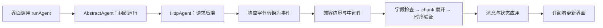

# AG-UI：把 Agent 的执行过程变成界面能理解的事件

按 [`dab9c95f8e70`](https://github.com/ag-ui-protocol/ag-ui/commit/dab9c95f8e70f03ebc2a817e9900a245dfca6ddd) 的 TypeScript 客户端核对。以下是源码推演，没有执行目标项目。

## 1. 为什么仅有“流式文字”不够

Agent 界面还需要知道：正在运行哪个工具？参数收齐了吗？共享表单哪些字段变了？任务已经完成，还是仍等用户操作？

**AG-UI 用有类型的事件表达这些过程，再把事件应用到客户端消息和状态。** 本篇研究的是通信与客户端状态处理；模型推理和后端工具执行属于接入的 Agent 服务。

例如，旅行助手可能一边输出说明，一边更新行程状态。文本增量和行程字段变更应分别表达，界面才能分别更新聊天区与行程卡片。

## 2. 架构：传输、协议检查、状态应用各做一件事



实际管线的次序写在 `runAgent` 中；它不是根据几个模块名称推测出来的。[1][pipeline]

## 3. 一轮调用怎样跑完

1. **准备输入。** `runAgent` 整理运行输入、订阅者与生命周期状态，再调用 `onInitialize`。随后建立中间件调用链。[1][start]
2. **发出请求。** `HttpAgent` 使用 POST 发送 JSON，默认声明接受事件流，并携带 `AbortSignal`。出站输入在真正发送前再检查，避免后续中间件修改绕过边界。[2][http]
3. **解析传输。** HTTP 转换器根据响应 Content-Type 选择 protobuf 或 SSE JSON 解析器。传输层先要求基本事件对象与字符串 `type`，完整协议检查留在后面。[3][transport]
4. **规范并检查事件。** 兼容边界靠近网络入口；之后先检查字段，再展开 chunk，最后验证事件之间的时序关系。[1][pipeline]
5. **应用到消息和状态。** 默认事件应用器按事件类型更新消息或共享状态，并允许订阅者参与修改或阻止默认应用。[4][text] [5][state]
6. **通知界面并结束。** `processApplyEvents` 把新消息与状态放到 agent 上，调用相应订阅者；`finalize` 负责结束运行状态与生命周期清理。[6][notify] [1][finish]

这些步骤不会自动生成一套 React 页面。应用还要把订阅结果接到自己的组件上，也要配置真实后端。

## 4. 核心机制是什么

### 机制一：事件具有身份和生命周期

文字增量用 `messageId` 找到消息，再追加 `delta`；工具参数增量用 `toolCallId` 找到工具调用。验证器用集合记录哪些消息、工具调用仍处于打开状态，并用不同种类的映射记录所属子 Agent。[4][text] [7][verify]

这解决的是“这段增量属于谁、现在能不能接收”，而不只是“收到一串字符”。多个工具或子 Agent 同时出现时，这个区别尤其关键。

### 机制二：快照与增量分别处理

`STATE_SNAPSHOT` 表达整体状态；`STATE_DELTA` 使用 JSON Patch 操作更新已有状态。默认应用器调用依赖库的 `applyPatch`，开启验证，并关闭对原对象的原地修改。[5][state]

```text
已有状态：{ itinerary: { day1: "杭州" } }
增量示意：replace /itinerary/day1 = "苏州"
新状态：  { itinerary: { day1: "苏州" } }
```

这是机制示意。真实应用还要约定状态结构和同步策略；JSON Patch 本身不是多人协作冲突解决算法。当前默认应用器遇到 patch 应用失败会记录警告，不自动宣称已经修复或重新拉取快照。[5][state]

### 机制三：先检查 chunk，再展开，再检查时序

chunk 是更紧凑的流式表达，客户端会把它展开成开始、内容、结束等事件。若先展开再检查，错误字段可能在展开时被默认值掩盖。因此当前管线先执行字段检查；展开之后，才检查消息开闭、工具配对等关系。[1][pipeline]

这里的设计思想是：**输入结构是否合法，与跨事件的过程是否合法，是两种不同的检查。**

### 机制四：用可组合事件流组织生命周期

项目通过 RxJS Observable 与操作符组织传输、变换、检查、状态应用、错误处理和结束清理。AG-UI 实现各阶段的协议语义；订阅、取消传播等基础机制由 RxJS 提供。[1][pipeline]

`HttpAgent.abortRun` 会中止客户端请求。仅凭这段客户端代码，不能保证远端业务任务和已发生的副作用都被撤销。[2][http]

## 5. 为什么这样实现

以下收益与代价是工程分析。

| 选择 | 另一种做法 | 得到什么 | 付出什么 |
| --- | --- | --- | --- |
| 类型化过程事件 | 只返回最终回答或文字 token | UI 能分别处理文本、工具和状态 | 前后端必须遵守身份、顺序与字段约定 |
| 分开传输与协议处理 | 每个 UI 直接解析某种后端流 | 上层处理较少依赖具体传输格式 | 需要维护转换与兼容边界 |
| 快照加增量 | 每次发送完整状态 | 频繁的小更新可以只发送变化 | 增量依赖正确的已有状态，失败需应用处理 |
| 集中应用事件，再通知订阅者 | 各组件自行拼接与校验消息 | 多个组件可观察同一份客户端状态 | 自定义订阅者修改必须遵守管线规则 |

学习价值在于：把后端的执行过程变成明确的界面状态变化，同时控制输入边界和事件生命周期。模型能力、通信协议与 UI 渲染分别属于不同层。

[start]: https://github.com/ag-ui-protocol/ag-ui/blob/dab9c95f8e70f03ebc2a817e9900a245dfca6ddd/sdks/typescript/packages/client/src/agent/agent.ts#L327-L365
[pipeline]: https://github.com/ag-ui-protocol/ag-ui/blob/dab9c95f8e70f03ebc2a817e9900a245dfca6ddd/sdks/typescript/packages/client/src/agent/agent.ts#L368-L404
[finish]: https://github.com/ag-ui-protocol/ag-ui/blob/dab9c95f8e70f03ebc2a817e9900a245dfca6ddd/sdks/typescript/packages/client/src/agent/agent.ts#L405-L439
[http]: https://github.com/ag-ui-protocol/ag-ui/blob/dab9c95f8e70f03ebc2a817e9900a245dfca6ddd/sdks/typescript/packages/client/src/agent/http.ts#L44-L120
[transport]: https://github.com/ag-ui-protocol/ag-ui/blob/dab9c95f8e70f03ebc2a817e9900a245dfca6ddd/sdks/typescript/packages/client/src/transform/http.ts#L14-L115
[text]: https://github.com/ag-ui-protocol/ag-ui/blob/dab9c95f8e70f03ebc2a817e9900a245dfca6ddd/sdks/typescript/packages/client/src/apply/default.ts#L540-L605
[state]: https://github.com/ag-ui-protocol/ag-ui/blob/dab9c95f8e70f03ebc2a817e9900a245dfca6ddd/sdks/typescript/packages/client/src/apply/default.ts#L994-L1060
[notify]: https://github.com/ag-ui-protocol/ag-ui/blob/dab9c95f8e70f03ebc2a817e9900a245dfca6ddd/sdks/typescript/packages/client/src/agent/agent.ts#L565-L620
[verify]: https://github.com/ag-ui-protocol/ag-ui/blob/dab9c95f8e70f03ebc2a817e9900a245dfca6ddd/sdks/typescript/packages/client/src/verify/verify.ts#L10-L91
