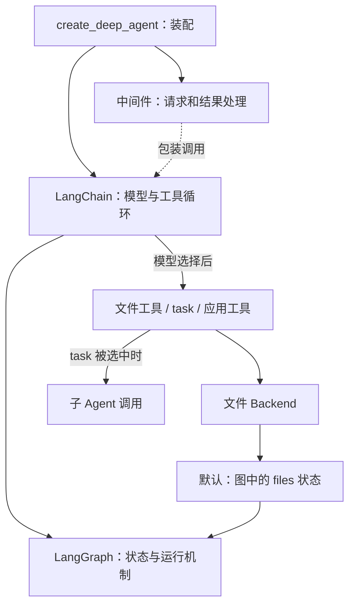

# DeepAgents：给模型配一套处理长任务的工作环境

本篇按 [`7e4e55a70447`](https://github.com/langchain-ai/deepagents/commit/7e4e55a70447edc1219358940181856e39153736) 的 Python SDK 源码核对。以下是源码推演，没有执行目标项目。

## 1. 它解决什么问题

模型能提出“下一步调用哪个工具”，但长任务还需要解决：材料放在哪里？工具结果太长怎么办？子任务看到哪些上下文？任务状态怎样保存？

**DeepAgents 把工作环境和运行规则组合起来，交给现成的 Agent 循环执行。** 用户要求“读报告、委派研究、写总结”时，SDK 提供相关能力；模型是否调用这些工具、以什么顺序调用，取决于运行时的模型输出。

作者的架构文档明确区分三层职责。[1][layers]

| 层 | 具体负责什么 |
| --- | --- |
| DeepAgents | 组装中间件、工具、提示词、文件后端、子 Agent 等能力 |
| LangChain `create_agent` | 建立模型与工具之间的循环 |
| LangGraph | 运行图、传递状态，提供检查点、流式输出和中断等机制 |

因此，理解本项目的重点是这些能力怎样组合，以及在哪个调用边界生效。

## 2. 架构：先装配，再在调用边界介入



装配阶段，`create_deep_agent` 选择模型和后端，组织中间件与子 Agent，最后调用 `create_agent(...)` 返回可运行对象。执行阶段，应用调用该对象，模型回答或请求工具，工具结果进入状态，再继续下一轮。[2][assembly] [3][create-agent]

`create_deep_agent()` 不会在装配时预先执行“读报告→委派→写总结”。

## 3. 沿一次可能的任务看数据变化

下面使用默认文件后端、普通非 fork 子 Agent。调用方需要先提供报告材料，并配置所需的自定义子 Agent。

**装配。** 未指定 `backend` 时，代码选择 `StateBackend()`；然后组装文件、子 Agent、摘要等中间件。memory、skills、人工审批等行为取决于配置。[2][default-backend] [2][assembly]

**读取。** 如果模型选择 `read_file`，文件中间件向已配置后端读取。默认 `StateBackend.read` 从 `files` 通道取文件，检查是否存在，再返回请求行段。因此，虚拟路径 `/report.md` 默认对应图状态中的记录，不自动等于操作系统中的同名文件。[4][read]

**委派。** 如果模型选择 `task(description, subagent_type)`，工具验证目标和调用 ID，再准备子输入并执行。普通子 Agent 的 `messages` 被替换成一条包含任务描述的 `HumanMessage`；未被排除、且非私有的其他状态字段仍可能传入。[5][task] [5][child-input]

这就是精确边界：**对话隔离不等于所有状态隔离，更不等于操作系统沙箱。** 只给子 Agent 说“研究刚才那个问题”可能不够，因为它不一定看到父对话。

**返回。** 返回逻辑筛选允许回传、且确实变化的状态字段。消息部分优先使用 `structured_response`，否则向后找最后一条非空 AI 文本，再封装为一条 `ToolMessage`。[6][child-output]

所以，“只回传最终回答”描述的是对话消息的缩减，不表示完全没有其他状态更新。

**写入。** 如果模型选择 `write_file`，默认后端生成文件数据，通过 `CONFIG_KEY_SEND` 排入 `files` 通道更新；合并机制保留未修改的文件。[7][write] 是否能在程序重启后恢复，还取决于应用配置的 checkpointer 与存储，不能仅凭 `StateBackend` 断言已经实现数据库持久化。

## 4. 核心技术是什么

### 中间件：比普通工具多控制一个时间点

普通工具要等模型选择它才会运行。中间件还能在模型收到请求之前改变提示词、工具集合和消息，并在工具执行前后处理结果。[1][execution]

```text
请求 → 中间件整理模型可见的消息与工具 → 模型
模型若请求工具 → 经中间件执行与处理结果 → 交回循环
```

这样，“某轮不暴露某个工具”“结果过长时移出上下文”等规则有统一的介入位置。

### 上下文管理：工作材料与当前消息分开

文件保存可按需回读的材料，消息承载这一轮送给模型的上下文。工具文本超过配置阈值时，文件中间件尝试把内容移到后端，用缩减消息替代。阈值检查使用字符数与每 token 字符数的近似换算；不能完成移出时，该方法保留原消息。[8][offload]

它与子 Agent 的消息缩减解决同一类约束：完整工作材料可以保留，但不必每轮都完整送入模型。

### 状态适配：文件操作进入图的状态通道

`StateBackend` 通过 LangGraph 配置里的函数读写 `files` 通道。读取设置 `fresh=True`，让同一步骤中已排入的写入能被后续读取看到；写入只提交变化的文件。[7][channel]

本项目实现文件接口与状态通道的适配；状态合并、检查点由 LangGraph 提供。

### 可选前缀路由：统一工具接口，不同保存策略

调用方配置 `CompositeBackend` 后，路由才会按前缀长度降序匹配路径，去掉挂载前缀，再交给对应后端；未命中则走默认后端。[9][routing]

例如，临时文件用线程状态，`/memories/` 用另一种存储。模型继续使用统一文件工具，应用决定路径背后的保存策略。默认路径并不必经 `CompositeBackend`。

## 5. 为什么这样实现

以下是基于实现的工程分析。

| 选择 | 更直接的方案 | 当前方案的收益 | 代价 |
| --- | --- | --- | --- |
| 在循环外组织中间件 | 每个工具单独处理提示、权限、结果长度 | 在调用边界统一放置规则 | 顺序与相互影响需要理解 |
| 分开文件与消息 | 所有材料始终放在消息历史 | 能保存完整材料、缩减当前上下文 | 需要正确回读与维护引用 |
| 缩减父子对话交接 | 父历史全复制，子历史全回灌 | 父 Agent 能集中处理任务结论 | 描述不完整会丢背景，共享状态也需设计 |
| 默认文件进入任务状态 | 默认直接写本地磁盘 | 文件生命周期与任务状态有统一接口 | 跨线程、跨进程保存需额外配置 |
| 可选路径路由 | 每种存储暴露一套工具 | 一套文件接口对应不同保存策略 | 路径边界和跨路由查询更复杂 |

## 6. 能迁移到自己项目的思想

- 把“模型决定做什么”和“系统允许怎样执行”分开，把规则放在可控制的调用边界。
- 把完整工作材料和当前推理上下文分开，按需读取，避免无限复制消息。
- 对子任务明确：给什么输入、共享什么状态、怎样收回结果。
- 区分任务状态、长期保存和操作系统资源；接口相同不代表持久性、隔离性相同。

可用小测试记录子 Agent 实际收到的 `messages` 与自定义状态字段，再对比默认后端和路由后端的文件保存范围。以上实验没有执行，预期不等同实测。

[layers]: https://github.com/langchain-ai/deepagents/blob/7e4e55a70447edc1219358940181856e39153736/libs/ARCHITECTURE.md#L11-L28
[execution]: https://github.com/langchain-ai/deepagents/blob/7e4e55a70447edc1219358940181856e39153736/libs/ARCHITECTURE.md#L46-L61
[default-backend]: https://github.com/langchain-ai/deepagents/blob/7e4e55a70447edc1219358940181856e39153736/libs/deepagents/deepagents/graph.py#L663-L671
[assembly]: https://github.com/langchain-ai/deepagents/blob/7e4e55a70447edc1219358940181856e39153736/libs/deepagents/deepagents/graph.py#L907-L975
[create-agent]: https://github.com/langchain-ai/deepagents/blob/7e4e55a70447edc1219358940181856e39153736/libs/deepagents/deepagents/graph.py#L1008-L1030
[read]: https://github.com/langchain-ai/deepagents/blob/7e4e55a70447edc1219358940181856e39153736/libs/deepagents/deepagents/backends/state.py#L175-L204
[task]: https://github.com/langchain-ai/deepagents/blob/7e4e55a70447edc1219358940181856e39153736/libs/deepagents/deepagents/middleware/subagents.py#L838-L867
[child-input]: https://github.com/langchain-ai/deepagents/blob/7e4e55a70447edc1219358940181856e39153736/libs/deepagents/deepagents/middleware/subagents.py#L804-L836
[child-output]: https://github.com/langchain-ai/deepagents/blob/7e4e55a70447edc1219358940181856e39153736/libs/deepagents/deepagents/middleware/subagents.py#L747-L788
[write]: https://github.com/langchain-ai/deepagents/blob/7e4e55a70447edc1219358940181856e39153736/libs/deepagents/deepagents/backends/state.py#L206-L221
[channel]: https://github.com/langchain-ai/deepagents/blob/7e4e55a70447edc1219358940181856e39153736/libs/deepagents/deepagents/backends/state.py#L57-L120
[offload]: https://github.com/langchain-ai/deepagents/blob/7e4e55a70447edc1219358940181856e39153736/libs/deepagents/deepagents/middleware/filesystem.py#L3527-L3574
[routing]: https://github.com/langchain-ai/deepagents/blob/7e4e55a70447edc1219358940181856e39153736/libs/deepagents/deepagents/backends/composite.py#L195-L225
