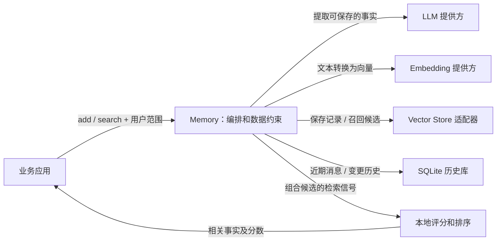

# Mem0：把“聊天记录”变成“需要时能找回的事实”

本篇是按源码重新核对的写法示例，范围是 Python OSS `Memory`，固定提交为 [`26cdefb46600`](https://github.com/mem0ai/mem0/commit/26cdefb46600c0fa5953c4b5ee5003c125539fc4)。下面是源码推演，没有执行目标项目。托管服务的 `MemoryClient` 不在这条主线里。

## 1. 先把项目放对位置

**Mem0 不让一个大模型在内部永久“记住”你，而是在应用外面维护一套可检索的记忆。**

大模型负责从对话里找出值得留下的事实；普通程序负责把事实存起来、按用户隔离、检索和排序。下一次对话时，应用先取出有关事实，再决定怎样把它们放进给模型的上下文。

以一个构造的例子贯穿全文：

- 写入：用户 `u1` 说“我住杭州，喝咖啡不加糖”。
- 事实示意：“住在杭州”“喝咖啡不加糖”。具体措辞由提取模型决定。
- 后来查询：“帮我选一杯适合我的咖啡”。
- 检索目标：返回与这次问题有关的事实，而不是把用户全部聊天历史重新塞回上下文。

这不是安装说明，也不是完整项目清单。要理解的是：**输入怎样变成事实，事实怎样变成候选，候选怎样变成最终结果。**

## 2. 架构：一个编排层，几种不同职责的服务



| 部分 | 负责什么 | 不负责什么 |
| --- | --- | --- |
| `Memory` | 组织写入和检索步骤，传递用户范围与元数据，处理结果 | 没有训练自己的基础模型 |
| LLM | 从新对话、旧记忆和近期消息中提取事实 | 不直接操作数据库，不决定真实写入是否成功 |
| Embedding | 把文本变成可比较的向量 | 不保证事实正确，也不负责保存历史 |
| Vector Store 适配器 | 实现向量存储、搜索和可选关键词搜索 | 不决定整条记忆提取流程 |
| SQLite | 保存近期消息与变更历史 | 不是这里的语义相似度搜索引擎 |
| 评分函数 | 合并语义、关键词、实体等检索信号并排序 | 不生成新的记忆事实 |

初始化方法分别构造这些依赖，说明它们是独立角色，而不是一个叫“Memory”的黑箱。[1][init]

## 3. 一次写入怎样跑完

### 第一步：把输入变成统一的消息和范围

`Memory.add` 接受字符串、单条消息或消息列表，统一为消息结构，并构造 `user_id / agent_id / run_id` 对应的过滤与元数据。默认 `infer=True`；如果指定 `infer=False`，则绕过事实提取，直接把非 system 消息作为原始记忆保存。[2][add]

这里的用户范围会传给后续查询和写入。它不是装饰性的标签，而是这次操作处理哪一组记忆的边界。

### 第二步：先找出“已经知道什么”

默认写入路径进入 `_add_to_vector_store`。它先读取该会话范围内最近 10 条消息，再把新消息编码为向量，检索最多 10 条相关旧记忆。然后把旧记忆、新消息、近期消息和自定义指令组合成提取请求。[3][context]

这样，提取模型看到的不只是孤立的一句话，还能参考相关旧事实及近期语境。**它没有扫描全部历史，拿到的是一个有限的工作上下文。**

### 第三步：一次 LLM 调用提出要保留的事实

代码用 `ADDITIVE_EXTRACTION_PROMPT` 调用 `self.llm.generate_response`，按 JSON 读取 `memory` 数组。如果调用模型失败，会抛出 `LLMError`；如果没有提取出事实，则保存消息并返回空结果。[4][extract]

要区分两件事：

- “模型没有提取出值得保存的事实”。
- “模型服务不可用，根本没完成提取”。

源码专门说明，不能把两种情况都静默变成空数组，否则调用方无法决定是否重试。[4][extract]

### 第四步：程序把事实变成可写入记录

提取到事实后，代码先批量计算 embedding；批量失败时，再尝试逐条计算。随后由程序生成 UUID、计算事实文本的 MD5、补齐时间和用户元数据。[5][records]

哈希用于检查这次召回到的旧记忆和当前批次中有没有完全相同的文本。这里不是语义去重，也不是一个覆盖全库的唯一索引。

**关键思想：LLM 给出事实内容，确定性的程序控制记录身份、格式、重复检查和真实写入。**

### 第五步：先确认保存成功，再报告成功

向量存储优先批量插入，失败时逐条重试。只有进入 `persisted_records` 的记录才被写入历史、建立实体关联并返回为 `ADD` 结果。如果一条也没有保存成功，则抛出存储错误。[6][persist]

这里还暴露了一个重要边界：向量存储和历史库不是同一个原子事务。历史写入也有逐条回退，失败会记录日志。因此，“向量记录已经保存”和“全部辅助历史都完整保存”不是同一个保证。[6][persist]

### 不能把旧版算法套到这里

这个提交的默认 V3 提取路径会构造新记录并返回 `ADD`，没有在该路径中分派模型决定的 `UPDATE / DELETE` 操作。项目仍有独立的 `update`、`delete` 方法，但这不等于默认 `add` 会自动调用它们。

所以，本篇不会把它解释成“LLM 每次决定对所有旧记忆增删改”。方法的旧 docstring 仍提到增删改，而实际方法体已经走追加式批处理；研究当前逻辑，应以这条执行路径为准。[3][context] [5][records] [6][persist]

## 4. 一次检索怎样得到结果

`search` 先检查查询、阈值和用户范围。这里要求把用户范围放在 `filters` 中；随后调用 `_search_vector_store`，可选地再经过配置的 reranker，最后返回结果。[7][search]

真正的检索主线是：

```text
查询文本
  → 词形归一化、实体提取
  → 查询 embedding
  → 语义搜索取候选，数量为 max(top_k × 4, 60)
  → 获取关键词分数及实体关联加分
  → 排除不满足语义阈值的候选
  → 对剩余候选组合评分、排序
  → 截取 top_k，整理成返回对象
```

这一顺序来自方法体，而不是根据 import 推测。[8][retrieve]

### 核心机制一：语义负责选候选，其他信号调整次序

这个实现构造最终候选集时只遍历 `semantic_results`。关键词结果提供按记忆 ID 索引的分数，并没有在这里与语义结果做候选并集。[8][retrieve]

这意味着：**一条记忆如果根本没有进入语义候选池，关键词匹配再强，也不会仅凭关键词结果在这里“补进来”。**

这是理解它的检索能力边界所必需的事实。不能把“混合检索”四个字自动理解成所有召回通道都可以独立找回结果。

### 核心机制二：先过语义门槛，再合并可比较的分数

原始 BM25 分数先经过 sigmoid 归一化；参数会根据查询长度调整。评分函数再执行：

```text
如果 semantic_score < threshold：丢弃
否则：
    raw = semantic_score + normalized_bm25 + entity_boost
    final = min(raw / max_possible, 1)
按 final 降序取 top_k
```

`max_possible` 根据当前是否存在关键词和实体信号取 `1.0 / 2.0 / 1.5 / 2.5`，并非总固定为一个值。[9][scoring]

例如，两个附加信号都存在时，某条候选的三个分量为 `0.7、0.6、0.2`，则最终分数是 `1.5 / 2.5 = 0.6`。这是公式示例，不是实际运行结果。另一条候选若语义分数低于阈值，会先被丢弃，不会被后续关键词加分救回来。

### 核心机制三：实体关联是另一条辅助线索

项目用 spaCy 和规则提取专名、引用文本、主题短语等实体，再用实体与记忆 ID 的关联辅助查询。spaCy 不可用时，相关提取函数会返回空结果。这一能力与 LLM 提取“值得保存的事实”是两件事，不应混为同一个模型调用。[10][entities]

## 5. 为什么这么实现：收益、另一种方案和代价

下表是对已确认实现的**工程推断**，不冒充作者对产品动机的亲述。

| 设计 | 更简单的做法会怎样 | 当前方案得到什么 | 代价和边界 |
| --- | --- | --- | --- |
| 保存提取后的事实，再按需检索 | 每次都带全部聊天记录，上下文会随历史增加，噪声也一起进入 | 把“长期保存什么”和“这一轮取什么”分开处理 | 提取可能遗漏上下文，检索也可能漏掉有用事实 |
| LLM 提取，程序控制 ID、去重和写入确认 | 如果让模型输出直接等同于数据库成功，内容提议和真实状态会混在一起 | 能清楚区分“提取了什么”和“实际保存了什么” | 程序仍需处理供应商错误、部分成功和辅助数据的一致性 |
| 默认追加式批处理 | 自动覆盖旧事实需要额外决定冲突、目标记录和删除语义 | 写入主线可以围绕新事实与确定性处理组织 | 并不自动解决所有事实修正与语义重复问题，应用仍需制定更新策略 |
| 优先批量、失败后逐条回退 | 全部逐条调用会增加往返；批量失败就放弃又会损失可保存的记录 | 正常路径集中调用，异常时保留部分成功的机会 | 部分成功的返回、历史和实体关联更复杂 |
| 语义候选加关键词/实体信号 | 只有语义相似度时，具体词项和名称线索没有独立的加分入口 | 在候选池内综合不同相关性信号 | 候选池外的记录仍然找不回；收益还需用任务数据验证 |

这些结论分别对应前文的写入、持久化和评分代码，不以“解耦、可扩展”这样的抽象词替代实际原因。

## 6. 核心技术由谁提供

| 技术 | Mem0 自己组织/实现的部分 | 交给依赖的部分 |
| --- | --- | --- |
| 事实提取 | 选择旧事实与近期消息，构造提示，解析提取结果 | 基础模型的语义生成能力 |
| 向量检索 | 选择何时编码、作用范围、召回数量和后处理 | embedding 计算、向量索引与底层搜索 |
| 混合排序 | BM25 分数归一化、语义门槛、实体加分与组合排序 | 适配器提供的原始搜索结果；可选 reranker |
| 可控记忆写入 | 哈希去重、元数据构造、批处理与成功记录筛选 | 向量存储和 SQLite 的底层持久化能力 |

因此，学习价值主要在于：**怎样把不确定的语义提取接到可控的数据流程上，以及怎样把几种检索线索组合成可解释的结果。**

## 7. 怎样验证自己真的理解了

以下实验没有执行，仅给出可观察的检验方法：

1. **对比 `infer=True / False`。** 用可记录调用次数的假 LLM 和 embedding。观察关闭推断后是否没有事实提取请求，但仍然发生 embedding 和写入。[2][add] [3][context]
2. **构造“语义弱、关键词强”的候选。** 让语义分数低于阈值，关键词分数很高。观察它是否仍被排除，以验证阈值不是最终组合分数阈值。[9][scoring]
3. **模拟部分写入失败。** 让批量插入失败、逐条插入仅一部分成功。对照返回的 `ADD`、历史和实体关联，检查是否只报告成功持久化的记录。[6][persist]

[init]: https://github.com/mem0ai/mem0/blob/26cdefb46600c0fa5953c4b5ee5003c125539fc4/mem0/memory/main.py#L488-L514
[add]: https://github.com/mem0ai/mem0/blob/26cdefb46600c0fa5953c4b5ee5003c125539fc4/mem0/memory/main.py#L760-L879
[context]: https://github.com/mem0ai/mem0/blob/26cdefb46600c0fa5953c4b5ee5003c125539fc4/mem0/memory/main.py#L881-L955
[extract]: https://github.com/mem0ai/mem0/blob/26cdefb46600c0fa5953c4b5ee5003c125539fc4/mem0/memory/main.py#L957-L991
[records]: https://github.com/mem0ai/mem0/blob/26cdefb46600c0fa5953c4b5ee5003c125539fc4/mem0/memory/main.py#L993-L1045
[persist]: https://github.com/mem0ai/mem0/blob/26cdefb46600c0fa5953c4b5ee5003c125539fc4/mem0/memory/main.py#L1047-L1100
[search]: https://github.com/mem0ai/mem0/blob/26cdefb46600c0fa5953c4b5ee5003c125539fc4/mem0/memory/main.py#L1446-L1536
[retrieve]: https://github.com/mem0ai/mem0/blob/26cdefb46600c0fa5953c4b5ee5003c125539fc4/mem0/memory/main.py#L1642-L1701
[scoring]: https://github.com/mem0ai/mem0/blob/26cdefb46600c0fa5953c4b5ee5003c125539fc4/mem0/utils/scoring.py#L16-L139
[entities]: https://github.com/mem0ai/mem0/blob/26cdefb46600c0fa5953c4b5ee5003c125539fc4/mem0/utils/entity_extraction.py#L731-L772
