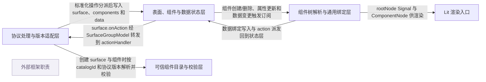

# a2ui：架构、运行逻辑与设计取舍

> main · [b8bee8fbd16f](https://github.com/a2ui-project/a2ui/commit/b8bee8fbd16f37afae8a6ba3f1ad16a76d305130) · deepseek-flash 辅助分析 · 2026-10-30T05:33:11.336Z
> 下文按固定源码推演，没有执行目标项目。引用可跳到具体代码行；“工程推断”解释收益与代价，不代表作者亲述。

## 1. 先建立直觉

**Agent 只发送声明式 JSON，客户端用自己可信的组件目录把它解释成界面，并把数据变化和用户操作当作状态事件处理。**

生成式 Agent 想给出丰富界面，但直接执行模型生成代码有安全风险，且同一份界面描述要跨 Lit、Flutter 等不同客户端复用；同时界面要能随对话增量更新。

贯穿全文的例子：

- **输入：** 示意输入：一组 v0.9 消息，先 createSurface(surfaceId='s1', catalogId='basic')，再 updateComponents 写入 root Column、title Text(text={path:'/user/name'})、go Button(action={event:{name:'book'}})，最后 updateDataModel('/user/name','Ada')；组件属性名只表示形状。
- **预期输出：** 推演结果：SurfaceGroupModel 中出现 s1；SurfaceComponentsModel 持有 root/title/go 等组件模型；DataModel 的 /user/name 为 Ada；Lit 通过 NodeResolver 解析 root 并渲染 Column、Text 和 Button；点击 go 后产生 ActionPayload{name:'book', surfaceId:'s1', sourceComponentId:'go'} 交给 actionHandler。

## 2. 一张图看懂架构



| 模块 | 职责与所在层的原因 | 输入 → 输出 | 拥有的状态 |
| --- | --- | --- | --- |
| 协议处理与版本适配层 [1][source-1] [2][source-2] [3][source-3] | 把不同协议版本的原始消息先解析成统一内部操作，再由 MessageProcessor 校验和分派；它位于网络消息与状态模型之间。 | v0.8/v0.9/v0.9.1/v1.0 的原始 JSON 消息或内部操作。 → InternalCreateSurfaceOp、InternalUpdateComponentsOp、InternalUpdateDataModelOp、InternalDeleteSurfaceOp 等统一操作。 | 不长期保存 UI 状态；持有适配器注册表、catalogs、validationConfig、rpc 与 graphBounds 缓存。 |
| 表面、组件与数据状态层 [4][source-4] [5][source-5] [6][source-6] [7][source-7] | 持有多个 surface、每个 surface 的组件模型和 JSON Pointer 数据模型，并提供创建、删除、更新与事件发射。 | 内部操作中的 surfaceId、components、path/value 等字段。 → SurfaceModel、ComponentModel、DataModel 的可订阅状态。 | SurfaceGroupModel.surfaces、SurfaceComponentsModel.components、DataModel.data 与 DataModel.signals。 |
| 可信组件目录与校验层 [8][source-8] [9][source-9] | 定义哪些组件和函数可被 Agent 请求，并用 schema 校验组件属性、函数参数和目录版本；它是安全边界和类型边界。 | Catalog 实例、组件 payload、catalogId、协议版本。 → 解析后的 ComponentApi/FunctionApi、校验错误或通过校验的组件。 | Catalog.components、functions、protocolVersion 与 validationSchema 缓存。 |
| 组件树解析与通用绑定层 [10][source-10] [11][source-11] | 把 flat 组件字典解析成可渲染的 ComponentNode 树，并按 schema 把属性中的数据路径、action、子组件引用和校验规则解析成运行时值。 | SurfaceModel 的 componentsModel、DataModel、Catalog 中的 Zod schema。 → rootNode Signal、ComponentNode 及其已解析 props、action 闭包。 | NodeResolver.records、nodesByEdge、pendingParents、childEdges；GenericBinder.currentProps 与 dataListeners。 |
| Lit 渲染入口 [12][source-12] [13][source-13] | 监听 SurfaceModel 的 root 组件，把 ComponentNode 渲染成实际 Web Components；它只负责展示与接收交互，不解析协议消息。 | SurfaceModel 与 NodeResolver 产出的 rootNode。 → DOM 元素；用户交互时由解析层产生的 action 闭包回到状态层。 | A2uiSurface._rootNode、unsubscribe。 |
| 外部框架职责（外部依赖） [14][source-14] [15][source-15] [16][source-16] | 提供 Lit 自定义元素与更新周期、Zod schema 解析、Preact Signals 响应式信号；项目自身负责协议、状态和绑定规则。 | 组件 schema、DOM 环境、signal 写入。 → schema 校验结果、响应式通知、Lit 渲染生命周期。 | 由外部框架管理，项目只通过订阅与 signal 读写接入。 |

## 3. 跟着一个请求跑完整条主线

这是对已读方法体的源码推演，不是执行日志。编号是阅读顺序；装配、写入、查询与条件分支是否发生，取决于每步的触发条件。

### 1. 接收消息并准备内部操作

**阶段：** 入口与装配

**触发条件：** 收到 processMessages 调用时必经；数组或单条消息都会被展开。

入口/调用：`MessageProcessor.processMessages / MessageProcessor.prepareOperations / MessageProcessor.prepareSingleItem` [1][source-1] [17][source-17]

**此时输入：** 原始消息 payload 与可选 ExecutionContext。

在 validationConfig 作用域内，把数组展开为单条 item；每条 item 先经过递归/路径校验和 targetVersion 校验，再判断是否已是内部操作。

**状态变化：** 无业务状态变化；只确定本次调用使用的校验配置和待处理操作列表。

**交给下一步：** InternalOperation[] 交给 processOperation。

### 2. 版本适配器把 v0.9 消息转成统一操作

**阶段：** 解析与转换

**触发条件：** 消息不是内部操作时必经。

入口/调用：`MessageProcessor.extractSingleMessageOperations / BaseVersionAdapter.extractOperations / V0Point9Adapter.extractOperationsFromObject` [18][source-18] [3][source-3] [2][source-2]

**此时输入：** 形如 {version:'v0.9', createSurface:{...}} 的原始对象。

工厂按 version 选适配器；BaseVersionAdapter 检查 native action 唯一性并用 Zod schema 校验；V0Point9Adapter 把 createSurface/updateComponents/updateDataModel/deleteSurface 分别映射成带 type 的内部操作。

**状态变化：** 无 UI 状态变化；内部操作补充 version 与 envelopeContext。

**交给下一步：** 如 {type:'createSurface', surfaceId, catalogId, theme, sendDataModel, version} 的统一操作。

### 3. 创建 surface 并解析默认 catalog

**阶段：** 写入表面状态

**触发条件：** 收到 createSurface 操作时必经；若带 components 则内部继续走 updateComponents，若带 dataModel 则写根数据。

入口/调用：`MessageProcessor.processOperation / MessageProcessor.applyStateOperation / MessageProcessor.processCreateSurfaceOp` [19][source-19] [20][source-20] [21][source-21]

**此时输入：** InternalCreateSurfaceOp 中的 surfaceId、catalogId、theme、sendDataModel、components、dataModel、version。

按 catalogId 或默认 catalog 解析 catalog，检查 catalog 与消息协议版本兼容，验证 theme，构造 SurfaceModel，并把兼容版本的可用 catalogs 放入 availableCatalogs。

**状态变化：** SurfaceGroupModel 中新增一个 SurfaceModel；若提供 dataModel，则 surface.dataModel.set('/', dataModel)。

**交给下一步：** 可被后续 updateComponents/updateDataModel 引用的 SurfaceModel。

### 4. 批量校验并写入组件更新

**阶段：** 写入组件状态

**触发条件：** 收到 updateComponents 操作时必经；createSurface 携带 components 也会进入。

入口/调用：`MessageProcessor.processUpdateComponentsOp / MessageProcessor.validateComponentsBatch / MessageProcessor.applyComponentUpdate` [22][source-22] [23][source-23] [24][source-24]

**此时输入：** surfaceId 与 components 数组。

先检查同一批次内重复 id，并逐个校验组件属性、catalog 解析和嵌套函数调用；再做组件图校验；全部通过后才在 batchWrite 中调用 applyComponentUpdate。

**状态变化：** 同类型/同 catalog 的已有组件替换 properties 并触发 onUpdated；类型或 catalog 变化时移除旧 ComponentModel 并新增。

**交给下一步：** SurfaceComponentsModel 中的新组件树状态，供 NodeResolver 订阅。

### 5. 把数据模型更新写到 JSON Pointer 路径

**阶段：** 写入数据状态

**触发条件：** 收到 updateDataModel 操作时必经；path 缺省表示根。

入口/调用：`MessageProcessor.processUpdateDataModelOp / DataModel.set` [25][source-25] [6][source-6] [7][source-7]

**此时输入：** surfaceId、可选 path、value。

校验 path 是 RFC 6901 形状；DataModel.set 解析路径，阻止 __proto__/constructor/prototype，必要时自动创建容器，再写入或删除值。

**状态变化：** DataModel.data 被修改，notifySignals 更新该路径、祖先路径和当前订阅的子孙路径对应 signal。

**交给下一步：** 绑定到该路径的 GenericBinder/组件会收到通知并重新解析。

### 6. Lit 订阅 root 并建立节点解析器

**阶段：** 渲染装配

**触发条件：** surface 属性变化或元素重新连接时。

入口/调用：`A2uiSurface.subscribeToRoot / NodeResolver.buildRoot / NodeResolver.createNode` [12][source-12] [26][source-26] [10][source-10]

**此时输入：** SurfaceModel。

A2uiSurface 创建 NodeResolver，并用 effect 监听 rootNode Signal；NodeResolver 在 root 已存在时 buildRoot，否则等待组件创建事件。

**状态变化：** NodeResolver 的 records、rootRecord 和 rootNode 被建立；A2uiSurface._rootNode 被更新。

**交给下一步：** root 节点一旦可解析，A2uiSurface.render 调用 renderA2uiNode。

### 7. 物化子组件引用并绑定动态数据

**阶段：** 解析与订阅

**触发条件：** 组件节点创建或 binder 输出变化时。

入口/调用：`NodeResolver.materialize / GenericBinder.bindDynamicValue` [27][source-27] [28][source-28] [29][source-29]

**此时输入：** 组件 schema 推导出的 BehaviorNode、binder 当前 props、DataModel。

materialize 把 child ref 字符串替换成 ComponentNode，把不再引用的子节点 dispose；对 DYNAMIC 属性，GenericBinder 订阅 DataModel，并把 {path:...} 包成 WritableBinding/ResolvedBinding。

**状态变化：** node.childEdges、node.props 和 binder 的数据订阅被更新；数据变化触发 updateDeepValue 与 notify。

**交给下一步：** Lit 渲染时看到已解析的 props 和稳定的子节点。

### 8. 用户点击触发 action 闭包

**阶段：** 交互与事件

**触发条件：** 用户触发带 action 的组件时。

入口/调用：`GenericBinder.bindAction / SurfaceModel.dispatchAction / SurfaceGroupModel.addSurface` [30][source-30] [31][source-31] [32][source-32]

**此时输入：** 组件 action payload，如 {event:{name:'book', context:{...}}}。

bindAction 返回闭包；闭包对 functionCall 走 resolveAction，对普通 event 先 resolveAction 再 dispatchAction；SurfaceModel.dispatchAction 组装 ActionPayload 并 emit onAction。

**状态变化：** SurfaceModel.onAction 发射；SurfaceGroupModel.addSurface 注册的订阅把它转发到 group.onAction。

**交给下一步：** ActionPayload 进入全局 action 流。

### 9. 全局 actionHandler 收到 ActionPayload

**阶段：** 回传 Agent 边界

**触发条件：** MessageProcessor 构造时提供了 actionHandler。

入口/调用：`MessageProcessor.constructor` [33][source-33]

**此时输入：** group.onAction 上的 ActionPayload。

构造时把 actionHandler 订阅到 SurfaceGroupModel.onAction。

**状态变化：** 无内部状态变化；调用外部 actionHandler。

**交给下一步：** 宿主应用把 action 编码回 Agent。

## 4. 核心技术到底是什么

### 1. 版本适配与统一内部操作

**解决的问题：** 不同协议版本的 wire 字段不同，如果状态层到处判断版本会重复且容易混用。 [3][source-3] [2][source-2] [34][source-34]

先由 VersionAdapterFactory 按 version 或 payload 选适配器；适配器用 Zod 校验原始消息，再把本版本 action 映射成带 type 的内部操作；MessageProcessor 只 switch type。

算法示意（用于解释机制，不是源码原文）：

```text
adapter = resolveFromPayload(payload)
obj = unwrap messages
check exactly one native action
parsed = adapter.schema.safeParse(with version)
if parsed failed: throw wrapped validation error
ops = []
if 'createSurface' in obj: ops.push(createSurface op)
if 'updateComponents' in obj: ops.push(updateComponents op)
return ops
```

**关键数据结构：** InternalOperation 是带 type 的联合类型，并可携带 envelopeContext；每个 op 保留 version，供后续 catalog 兼容性判断。

- **本项目实现：** BaseVersionAdapter 负责通用展开、action 唯一性检查和 schema 校验；V0Point9Adapter 负责 v0.9/v0.9.1 字段映射。
- **外部依赖提供：** Zod 负责 wire schema 的 structural parse；适配器工厂只负责选择，不执行业务状态变更。
- **收益与代价：** 收益是状态层不必理解多版本差异；代价是每新增协议版本要维护适配器和兼容映射，且错误要经过适配器上下文映射。

### 2. JSON Pointer 数据模型与响应式通知

**解决的问题：** Agent 的 updateDataModel 只给路径和值，渲染绑定需要精确知道哪个路径变化并更新对应组件。 [6][source-6] [7][source-7] [35][source-35]

DataModel.set 解析 JSON Pointer，沿对象/数组走到父节点，写入或删除叶子；然后 notifySignals 批量更新本路径、祖先路径和已订阅的子孙路径 signal。

算法示意（用于解释机制，不是源码原文）：

```text
segments = parse(path)
if segments empty: data = value; notifyAll; return
parent = walk/create containers(segments[0..-2])
if removes: delete/undefined parent[last]
else: parent[last] = value
notifySignals(path)
for ancestor of path: updateSignal(ancestor)
for subscribed descendant: updateSignal(descendant)
```

**关键数据结构：** data 是嵌套 JSON 对象；signals 是 path→Signal；订阅记录用于 dispose；FORBIDDEN_KEYS 防止原型污染。

- **本项目实现：** 路径解析、容器自动创建、数组索引边界、祖先/子孙通知选择都在 DataModel 内实现。
- **外部依赖提供：** Preact Signals 提供 signal、batchWrite、effect；DataModel 只决定何时写哪个 signal。
- **收益与代价：** 收益是组件只需订阅路径就能响应流式数据更新；代价是路径写错会报数据错误，且每次写要扫描已订阅子孙路径。

### 3. Schema 驱动的 GenericBinder

**解决的问题：** 不同 catalog 的组件属性不同，不能为每个组件字段手写数据绑定、action 和子列表逻辑。 [36][source-36] [37][source-37] [38][source-38] [39][source-39]

GenericBinder 先从 Zod schema 递归推导 BehaviorNode：DYNAMIC、ACTION、STRUCTURAL、CHECKABLE、STATIC、OBJECT、ARRAY；再按该树遍历组件原始属性，分别订阅数据、生成 action 闭包、映射模板子列表或计算校验状态。

算法示意（用于解释机制，不是源码原文）：

```text
behavior = scrapeSchemaBehavior(componentSchema)
props = resolveAndBind(rawProps, behavior)
for each node in behavior:
  DYNAMIC -> subscribe data path, produce resolved value/setter
  ACTION -> return async closure
  STRUCTURAL -> expand template to child refs
  CHECKABLE -> subscribe rules, inject isValid/errors
notify listeners with currentProps
```

**关键数据结构：** BehaviorNode 树缓存于 WeakMap；GenericBinder.currentProps 保存解析结果；dataListeners 保存动态订阅；actionClosures 保持 action 引用稳定。

- **本项目实现：** schema 行为树推导、动态值订阅、action 闭包、子列表模板映射和校验状态注入都由本项目实现。
- **外部依赖提供：** Zod 提供 schema 结构和 parse；GenericBinder 依赖 Zod 的 _def 形状做推导，因此与 Zod schema 写法有耦合。
- **收益与代价：** 收益是新增组件只提供 schema 就能接入绑定；代价是 schema 推导复杂，依赖 Zod 内部结构，复杂 union 需要额外规则。

### 4. 组件树物化与占位/循环处理

**解决的问题：** flat 组件字典中的子组件引用可能暂时缺失、被替换或形成环，直接递归渲染会崩溃或显示旧节点。 [10][source-10] [40][source-40] [27][source-27] [41][source-41]

NodeResolver 以 edgeKey 标识父子引用；createNode 对缺失定义建 placeholder，对未知类型建 unknown-type，对循环引用建 cyclic placeholder；materialize 根据 binder 输出新建、复用或 dispose 子节点。

算法示意（用于解释机制，不是源码原文）：

```text
createNode(componentId,dataPath,edgeKey,parent):
  model = components.get(componentId)
  if !model: register placeholder; pendingParents.add
  api = catalog.components.get(model.type)
  if !api: dispatch error; register unknown-type
  binder = new GenericBinder(context, api.schema)
  binder.subscribe(props => materialize(record))
materialize(record):
  resolve child refs to ComponentNode
  dispose edges no longer referenced
  wrap dynamic values and setProps
```

**关键数据结构：** NodeRecord 保存 node、edgeKey、occurrence、parent、refFields、behavior、binder、childEdges；nodesByEdge 用于复用；pendingParents 等待组件到达。

- **本项目实现：** placeholder 升级、循环检测、子节点生命周期和实例 id 都在 NodeResolver 内实现。
- **外部依赖提供：** 使用项目内 signal 作为 rootNode 通知机制；不执行模型生成代码。
- **收益与代价：** 收益是流式到达和增量更新时不会因缺组件或环而崩；代价是节点身份、占位和子边释放逻辑复杂，需要测试覆盖。

## 5. 为什么选择这种实现

### 1. 客户端只渲染预注册 catalog 中的组件，不执行 LLM 生成的可执行代码。

**依据：已确认实现；以下原因是工程分析，不代表作者亲述。** [42][source-42] [43][source-43]

**面临的约束：** Agent 可能来自远程或跨信任边界，生成代码会带来安全风险；同时同一 payload 要跨客户端复用。

**如果改用另一种做法：** 让 Agent 生成任意组件代码或 HTML/脚本，客户端直接插入执行。

**为什么当前方案有用：** 本项目中 Agent 只能写 component:'Text' 这类 catalog 名称；NodeResolver 找不到类型时只发 UNKNOWN_COMPONENT_TYPE 并显示占位，而不是执行未知代码。这样按钮、文本框等能力被限制在宿主预批准的组件和函数集合内。

**付出的代价，以及不适用的情况：** 能力受 catalog 限制，新组件需要宿主先注册；复杂 UI 需要 catalog 设计而不是任意代码。

### 2. 协议版本差异在适配器层被吸收成 InternalOperation，状态层按统一 type 分派。

**依据：已确认实现；以下原因是工程分析，不代表作者亲述。** [3][source-3] [2][source-2] [44][source-44]

**面临的约束：** v0.8、v0.9、v0.9.1、v1.0 的消息字段和 catalog 规则不同，直接在每个状态方法里判断版本会重复且容易漏分支。

**如果改用另一种做法：** 让 MessageProcessor 直接读取原始消息对象，内部到处 if version。

**为什么当前方案有用：** 示例中的 v0.9 createSurface 由 V0Point9Adapter 映射出 catalogId、theme、sendDataModel、dataModel、version；MessageProcessor 后续只处理 processCreateSurfaceOp 的统一字段。v1.0 无默认 catalog 的差异则可在 processCreateSurfaceOp 中按 op.version 判断，而不是在 wire 解析处散开。

**付出的代价，以及不适用的情况：** 新增协议版本需要新增/修改适配器和兼容映射；适配器错误上下文还要经过错误映射。

### 3. 单个 updateComponents 批次先完整校验，再在 batchWrite 中统一写入。

**依据：已确认实现；以下原因是工程分析，不代表作者亲述。** [22][source-22] [23][source-23]

**面临的约束：** 组件更新可能包含多个组件；如果边校验边写入，后面的组件失败会留下前面的部分更新。

**如果改用另一种做法：** 遍历 components 时每验证一个就立即 applyComponentUpdate。

**为什么当前方案有用：** 示例中同一批次若出现重复 id，validateComponentsBatch 会在 seenBatchIds 中先抛 A2uiIntegrityError；因为此时还没进入 mutation pass，旧组件树不会被改掉。校验通过后才 applyComponentUpdate 并记录 graphBound。

**付出的代价，以及不适用的情况：** 需要暂存整批组件并做额外图校验；跨多个内部操作的整个消息列表并不因此变成全局事务。

### 4. 组件属性绑定由 schema 推导，而不是为每种组件类型硬编码字段处理。

**依据：已确认实现；以下原因是工程分析，不代表作者亲述。** [36][source-36] [37][source-37] [39][source-39]

**面临的约束：** catalog 可以扩展组件和函数，组件属性中既有普通值，也有数据路径、action、子列表和校验规则。

**如果改用另一种做法：** 为 Text、Button、Column 等每个组件的每个字段写专门绑定代码。

**为什么当前方案有用：** 在场景里 Text.text 的 {path:'/user/name'} 会被 GenericBinder 按 DYNAMIC 处理并订阅 DataModel；Button.action 会被按 ACTION 处理成闭包；Column.children 会按 STRUCTURAL 展开。若硬编码，每个新 catalog 组件都要改 renderer。

**付出的代价，以及不适用的情况：** GenericBinder 依赖 Zod schema 的结构和内部 _def，复杂 union/嵌套对象需要额外匹配规则；调试 schema 推导比手写字段更抽象。

### 5. SurfaceModel 同时保存 defaultCatalog、availableCatalogs 和 protocolVersion，并按版本过滤可用 catalog。

**依据：已确认实现；以下原因是工程分析，不代表作者亲述。** [45][source-45] [5][source-5] [46][source-46]

**面临的约束：** 同一个 renderer 可能同时处理 v0.9 和 v1.0 消息；不同版本的 catalog 不能混用，v1.0 surface 还可能没有默认 catalog。

**如果改用另一种做法：** 全局只放一个 catalog，surface 创建时不做版本兼容检查。

**为什么当前方案有用：** createSurface 时先解析 catalog 并检查 protocolVersion 兼容，然后把兼容 catalog 放进 availableCatalogs；组件或函数若命名了不兼容 catalog，resolveSurfaceItemCatalog 会报错。这样场景中的 v0.9 surface 不会被错误地按 v1.0 catalog 解释。

**付出的代价，以及不适用的情况：** 创建 surface 和解析组件时多一层版本判断；v1.0 无默认 catalog 的分支增加复杂度。

## 6. 关键代码精读

### 1. v0.9 适配器把四种消息映射成内部操作


`typescript/core/web_core/src/processing/adapters/v0_9.ts:36-81` [2][source-2]

```typescript
  protected extractOperationsFromObject(msgObj: Record<string, unknown>): InternalOperation[] {
    const ops: InternalOperation[] = [];
    if ('createSurface' in msgObj) {
      const cs = msgObj.createSurface as Record<string, unknown>;
      ops.push({
        type: 'createSurface',
        surfaceId: String(cs?.surfaceId || ''),
        catalogId: typeof cs?.catalogId === 'string' ? cs.catalogId : undefined,
        theme: cs?.theme,
        sendDataModel: Boolean(cs?.sendDataModel),
        components: Array.isArray(cs?.components)
          ? (cs.components as InternalComponentPayload[])
          : undefined,
        dataModel:
          cs?.dataModel && typeof cs.dataModel === 'object' && !Array.isArray(cs.dataModel)
            ? (cs.dataModel as Record<string, unknown>)
            : undefined,
        version: typeof msgObj.version === 'string' ? msgObj.version : this.version,
      });
    }
    if ('updateComponents' in msgObj) {
      const uc = msgObj.updateComponents as Record<string, unknown>;
      ops.push({
        type: 'updateComponents',
        surfaceId: String(uc?.surfaceId || ''),
        components: Array.isArray(uc?.components) ? uc.components : [],
      });
    }
    if ('updateDataModel' in msgObj) {
      const ud = msgObj.updateDataModel as Record<string, unknown>;
      ops.push({
        type: 'updateDataModel',
        surfaceId: String(ud?.surfaceId || ''),
        path: typeof ud?.path === 'string' ? ud.path : undefined,
        value: ud?.value,
      });
    }
    if ('deleteSurface' in msgObj) {
      const ds = msgObj.deleteSurface as Record<string, unknown>;
      ops.push({
        type: 'deleteSurface',
        surfaceId: String(ds?.surfaceId || ''),
      });
    }
    return ops;
  }
```


extractOperationsFromObject 分别检查 createSurface、updateComponents、updateDataModel、deleteSurface 是否存在；createSurface 会保留 catalogId、theme、sendDataModel、components、dataModel，并把 version 设为消息 version 或 adapter 默认版本。updateComponents 只提取 surfaceId 和 components 数组，updateDataModel 提取 path 和 value，deleteSurface 只取 surfaceId。这样后续 MessageProcessor 不需要知道 v0.9 的 wire 包装字段。

### 2. updateComponents 的两阶段：先校验整批，后写入状态


`typescript/core/web_core/src/processing/message-processor.ts:1411-1433` [23][source-23]

```typescript
  private validateComponentsBatch(op: InternalUpdateComponentsOp, surface: SurfaceModel<T>): void {
    const seenBatchIds = new Set<string>();
    for (let i = 0; i < op.components.length; i++) {
      const comp = op.components[i];
      if (comp && typeof comp === 'object' && typeof comp.id === 'string') {
        if (seenBatchIds.has(comp.id)) {
          throw new A2uiIntegrityError(
            `Duplicate component ID: '${comp.id}'`,
            [comp.id],
            'INTEGRITY_ERROR',
            {surfaceId: op.surfaceId, path: `/components/${i}/id`},
          );
        }
        seenBatchIds.add(comp.id);
      }
      try {
        this.validateComponentProperties(comp, surface);
      } catch (err: unknown) {
        this.rebaseComponentValidationError(err, i, op.surfaceId);
        throw err;
      }
    }
  }
```


`typescript/core/web_core/src/processing/message-processor.ts:1455-1480` [22][source-22]

```typescript
  private processUpdateComponentsOp(op: InternalUpdateComponentsOp): void {
    if (!op.surfaceId) return;

    const surface = this.model.getSurface(op.surfaceId);
    if (!surface) {
      throw new A2uiIntegrityError(
        `Surface not found for message: ${op.surfaceId}`,
        undefined,
        'INTEGRITY_ERROR',
        {surfaceId: op.surfaceId},
      );
    }

    // 1. Validation pass: validate all components before mutating state
    this.validateComponentsBatch(op, surface);
    const bound = this.validateSurfaceComponentGraph(op, surface);

    // 2. Mutation pass: apply state updates
    batchWrite(() => {
      for (const comp of op.components) {
        this.applyComponentUpdate(comp, surface);
      }
    });
    if (bound) {
      recordComponentGraphBound(surface.componentsModel, bound, this.graphBounds);
    }
```


validateComponentsBatch 用 seenBatchIds 发现同一批次重复 id，并在 validateComponentProperties 失败时把错误路径重定位到 /components/{index}；processUpdateComponentsOp 先调用它和组件图校验，只有都通过才进入 batchWrite 的 mutation pass。applyComponentUpdate 对已有同类型/同 catalog 组件只替换 properties，对类型或 catalog 变化则移除旧模型并创建新模型，因此流式更新不会把旧节点类型错误保留下来。

### 3. action 从组件闭包走到 SurfaceModel 事件


`typescript/core/web_core/src/resolution/generic-binder.ts:575-607` [30][source-30]

```typescript
  private bindAction(value: unknown, path: string[]): () => Promise<void> {
    const cacheKey = path.join('/');
    const cached = this.actionClosures.get(cacheKey);
    if (cached && jsonEquals(cached.raw, value)) {
      return cached.closure;
    }
    const closure = async () => {
      if (!value || typeof value !== 'object') {
        return;
      }
      const valObj = value as Record<string, unknown>;
      const isFunctionCall =
        Boolean(valObj.functionCall && typeof valObj.functionCall === 'object') ||
        'call' in valObj ||
        '@call' in valObj;
      if (isFunctionCall) {
        await this.context.dataContext.resolveAction(value as Action | Record<string, unknown>, {
          userActivation: true,
        });
        return;
      }
      const resolved = this.context.dataContext.resolveAction(
        value as Action | Record<string, unknown>,
        {userActivation: true},
      );
      if (resolved === undefined) {
        return;
      }
      await this.context.dispatchAction(resolved as Action);
    };
    this.actionClosures.set(cacheKey, {raw: value, closure});
    return closure;
  }
```


`typescript/core/web_core/src/state/surface-model.ts:314-355` [31][source-31]

```typescript
  async dispatchAction(payload: any, sourceComponentId: string): Promise<void> {
    if (!payload || typeof payload !== 'object') {
      return;
    }

    const eventPayload = extractActionTarget(payload);
    if (!eventPayload) {
      return;
    }

    const name = eventPayload.name;
    if (!name || typeof name !== 'string') {
      return;
    }

    const rawContext = eventPayload.context;
    const context =
      rawContext && typeof rawContext === 'object' && !Array.isArray(rawContext)
        ? (rawContext as Record<string, unknown>)
        : {};

    const actionToDispatch: ActionPayload = {
      name,
      surfaceId: this.id,
      sourceComponentId,
      timestamp: new Date().toISOString(),
      context,
    };

    // Only set the key when the payload named a catalog, so listeners can
    // distinguish an explicit override from default-catalog resolution.
    const catalogId = eventPayload.catalogId ?? payload.catalogId;
    if (typeof catalogId === 'string' && catalogId) {
      actionToDispatch.catalogId = catalogId;
    }

    if (typeof eventPayload.userMessage === 'string' && eventPayload.userMessage.length > 0) {
      actionToDispatch.userMessage = eventPayload.userMessage;
    }

    await this._onAction.emit(actionToDispatch);
  }
```


GenericBinder.bindAction 先按 path 缓存闭包；点击时如果 payload 是 functionCall 或带 call/@call，就 await dataContext.resolveAction 直接执行；否则先 resolveAction，再把结果交给 context.dispatchAction。SurfaceModel.dispatchAction 从 event 或直接 name 中提取目标，组装 surfaceId、sourceComponentId、timestamp、context，并仅在 payload 明确给出 catalogId 时保留它，最后 emit onAction。

## 7. 动手验证你的理解

以下是建议实验，没有执行过。

### 1. 同一 updateComponents 批次中重复 id 时，是否会部分写入组件树？

**改变什么：** 把一次 updateComponents 的 components 改成两个 id 都为 'root' 的组件，第二个可以是不同类型。 [23][source-23] [22][source-22]

**应该观察到什么：** 应在 validateComponentsBatch 的 seenBatchIds 检查处抛出 A2uiIntegrityError，并因为尚未进入 batchWrite 而不改变旧组件树；这验证单批次先校验后写入。

### 2. Text.text 绑定到 /user/name 后，updateDataModel 是否会让该 Text 属性得到新值？

**改变什么：** 先让组件 text 为 {path:'/user/name'}，再发送 updateDataModel(surfaceId='s1', path='/user/name', value='Ada')。 [6][source-6] [7][source-7] [35][source-35] [29][source-29]

**应该观察到什么：** DataModel.set 写入后 notifySignals 会更新该路径及祖先/子孙 signal；GenericBinder.bindDynamicValue 的订阅回调触发 updateDeepValue 和 notify，因此 Text 的已解析 prop 应变为 Ada。

### 3. 点击带 event 的 Button 时，ActionPayload 的 name 和 sourceComponentId 如何确定？

**改变什么：** 把 Button 的 action event name 从 'book' 改为 'cancel'，组件 id 保持 'go'，然后触发该 action。 [47][source-47] [48][source-48] [32][source-32]

**应该观察到什么：** GenericBinder.bindAction 返回的闭包会 resolveAction，然后 SurfaceModel.dispatchAction 组装 name='cancel'、surfaceId='s1'、sourceComponentId='go' 的 ActionPayload；group 转发后 actionHandler 应收到这个对象。

## 8. 读完应当能复述什么

- 版本适配层把 wire 差异收敛成 InternalOperation，状态层只按操作类型和 version 做业务判断，避免在 surface/data 方法里到处混用 v0.9 与 v1.0 字段。
- 安全边界来自预注册 catalog：Agent 只能请求目录中的组件和函数，未知组件类型会被报错并降级为占位，而不是执行生成代码。
- 单个 updateComponents 批次采用“先整批校验、后批量写入”，避免该批次因后一个组件失败而留下前一个组件已写入的半更新；但跨多个内部操作不是全局事务。
- 数据模型用 JSON Pointer 路径作为订阅键，DataModel 写路径后通知祖先和子孙 signal，GenericBinder 再把变化映射到组件 props，因此流式 updateDataModel 不需要重建整棵 UI。
- 组件树解析用 NodeResolver 维护节点身份、占位和子边生命周期，用 GenericBinder 按 schema 解析动态值/action/子列表；两块共同把 flat 状态转成可渲染的响应式 ComponentNode 树。

## 来源与覆盖边界

本次读取 24 个文件，共 324,049 字符；23 个文件完整读取，其他文件按关键方法取带行号的片段。没有把未读依赖的内部实现当作已确认事实。

- renderA2uiNode 在本仓库已读的 Lit 文件中只是从 @a2ui/web_core/universal 重导出，具体如何把 ComponentNode 映射成 DOM tag、如何传 props 的实现未读到。
- PayloadValidator.validateComponent、validateFunction、validateTheme 的具体方法体未在已读片段中，无法列出完整校验规则和错误详情生成方式。
- RpcHandler.callAgentFunction、handleCallRendererFunction、handleAgentFunctionResponse 的方法体未读到，无法确认 agent 函数调用和 renderer 函数调用的超时、取消与 outbound 消息编码细节。
- DataContext.resolveAction、subscribeDynamicValue、resolveDynamicValue 的方法体未读到，无法确认表达式函数、嵌套动态值和 action context 的完整求值规则。
- createSurface 携带 components 时直接调用 processUpdateComponentsOp，但该内部调用的 envelopeContext 与原 createSurface 错误上下文如何合并，未在已读片段中完整确认。

| 文件 | 实际读取行段 |
| --- | --- |
| [README.md](https://github.com/a2ui-project/a2ui/blob/b8bee8fbd16f37afae8a6ba3f1ad16a76d305130/README.md) | 1–211 / 共 211 行 |
| [package.json](https://github.com/a2ui-project/a2ui/blob/b8bee8fbd16f37afae8a6ba3f1ad16a76d305130/package.json) | 1–93 / 共 93 行 |
| [pyproject.toml](https://github.com/a2ui-project/a2ui/blob/b8bee8fbd16f37afae8a6ba3f1ad16a76d305130/pyproject.toml) | 1–164 / 共 164 行 |
| [typescript/core/web_core/src/processing/message-processor.ts](https://github.com/a2ui-project/a2ui/blob/b8bee8fbd16f37afae8a6ba3f1ad16a76d305130/typescript/core/web_core/src/processing/message-processor.ts) | 1–1555 / 共 1555 行 |
| [typescript/core/web_core/src/processing/adapters/v0_9.ts](https://github.com/a2ui-project/a2ui/blob/b8bee8fbd16f37afae8a6ba3f1ad16a76d305130/typescript/core/web_core/src/processing/adapters/v0_9.ts) | 1–83 / 共 83 行 |
| [typescript/core/web_core/src/processing/operations.ts](https://github.com/a2ui-project/a2ui/blob/b8bee8fbd16f37afae8a6ba3f1ad16a76d305130/typescript/core/web_core/src/processing/operations.ts) | 1–185 / 共 185 行 |
| [typescript/core/web_core/src/state/surface-group-model.ts](https://github.com/a2ui-project/a2ui/blob/b8bee8fbd16f37afae8a6ba3f1ad16a76d305130/typescript/core/web_core/src/state/surface-group-model.ts) | 1–139 / 共 139 行 |
| [typescript/core/web_core/src/state/surface-model.ts](https://github.com/a2ui-project/a2ui/blob/b8bee8fbd16f37afae8a6ba3f1ad16a76d305130/typescript/core/web_core/src/state/surface-model.ts) | 1–410 / 共 410 行 |
| [typescript/core/web_core/src/state/data-model.ts](https://github.com/a2ui-project/a2ui/blob/b8bee8fbd16f37afae8a6ba3f1ad16a76d305130/typescript/core/web_core/src/state/data-model.ts) | 1–471 / 共 471 行 |
| [typescript/renderers/lit/src/surface/a2ui-surface.ts](https://github.com/a2ui-project/a2ui/blob/b8bee8fbd16f37afae8a6ba3f1ad16a76d305130/typescript/renderers/lit/src/surface/a2ui-surface.ts) | 1–148 / 共 148 行 |
| [typescript/renderers/lit/src/surface/render-a2ui-node.ts](https://github.com/a2ui-project/a2ui/blob/b8bee8fbd16f37afae8a6ba3f1ad16a76d305130/typescript/renderers/lit/src/surface/render-a2ui-node.ts) | 1–18 / 共 18 行 |
| [typescript/core/web_core/src/processing/adapters/base.ts](https://github.com/a2ui-project/a2ui/blob/b8bee8fbd16f37afae8a6ba3f1ad16a76d305130/typescript/core/web_core/src/processing/adapters/base.ts) | 1–297 / 共 297 行 |
| [typescript/core/web_core/src/processing/adapters/factory.ts](https://github.com/a2ui-project/a2ui/blob/b8bee8fbd16f37afae8a6ba3f1ad16a76d305130/typescript/core/web_core/src/processing/adapters/factory.ts) | 1–173 / 共 173 行 |
| [typescript/core/web_core/src/state/surface-components-model.ts](https://github.com/a2ui-project/a2ui/blob/b8bee8fbd16f37afae8a6ba3f1ad16a76d305130/typescript/core/web_core/src/state/surface-components-model.ts) | 1–380 / 共 380 行 |
| [typescript/core/web_core/src/resolution/node-resolver.ts](https://github.com/a2ui-project/a2ui/blob/b8bee8fbd16f37afae8a6ba3f1ad16a76d305130/typescript/core/web_core/src/resolution/node-resolver.ts) | 1–891 / 共 891 行 |
| [typescript/core/web_core/src/resolution/generic-binder.ts](https://github.com/a2ui-project/a2ui/blob/b8bee8fbd16f37afae8a6ba3f1ad16a76d305130/typescript/core/web_core/src/resolution/generic-binder.ts) | 1–918 / 共 918 行 |
| [typescript/core/web_core/src/catalog/types.ts](https://github.com/a2ui-project/a2ui/blob/b8bee8fbd16f37afae8a6ba3f1ad16a76d305130/typescript/core/web_core/src/catalog/types.ts) | 1–999 / 共 999 行 |
| [typescript/core/web_core/src/v0_9/schema/server-to-client.ts](https://github.com/a2ui-project/a2ui/blob/b8bee8fbd16f37afae8a6ba3f1ad16a76d305130/typescript/core/web_core/src/v0_9/schema/server-to-client.ts) | 1–131 / 共 131 行 |
| [typescript/core/web_core/src/processing/message-processor.test.ts](https://github.com/a2ui-project/a2ui/blob/b8bee8fbd16f37afae8a6ba3f1ad16a76d305130/typescript/core/web_core/src/processing/message-processor.test.ts) | 1–109、256–263、953–966、1739–1753 / 共 2269 行 |
| [typescript/renderers/lit/src/tests/a2ui-surface.test.ts](https://github.com/a2ui-project/a2ui/blob/b8bee8fbd16f37afae8a6ba3f1ad16a76d305130/typescript/renderers/lit/src/tests/a2ui-surface.test.ts) | 1–245 / 共 245 行 |
| [typescript/core/web_core/src/catalog/exclusive_union.ts](https://github.com/a2ui-project/a2ui/blob/b8bee8fbd16f37afae8a6ba3f1ad16a76d305130/typescript/core/web_core/src/catalog/exclusive_union.ts) | 1–71 / 共 71 行 |
| [typescript/core/web_core/src/catalog/schema_generator.ts](https://github.com/a2ui-project/a2ui/blob/b8bee8fbd16f37afae8a6ba3f1ad16a76d305130/typescript/core/web_core/src/catalog/schema_generator.ts) | 1–1086 / 共 1086 行 |
| [typescript/core/web_core/src/state/component-model.ts](https://github.com/a2ui-project/a2ui/blob/b8bee8fbd16f37afae8a6ba3f1ad16a76d305130/typescript/core/web_core/src/state/component-model.ts) | 1–92 / 共 92 行 |
| [typescript/core/web_core/src/common/events.ts](https://github.com/a2ui-project/a2ui/blob/b8bee8fbd16f37afae8a6ba3f1ad16a76d305130/typescript/core/web_core/src/common/events.ts) | 1–85 / 共 85 行 |

[source-1]: https://github.com/a2ui-project/a2ui/blob/b8bee8fbd16f37afae8a6ba3f1ad16a76d305130/typescript/core/web_core/src/processing/message-processor.ts#L568-L590 "typescript/core/web_core/src/processing/message-processor.ts:568-590"
[source-2]: https://github.com/a2ui-project/a2ui/blob/b8bee8fbd16f37afae8a6ba3f1ad16a76d305130/typescript/core/web_core/src/processing/adapters/v0_9.ts#L36-L81 "typescript/core/web_core/src/processing/adapters/v0_9.ts:36-81"
[source-3]: https://github.com/a2ui-project/a2ui/blob/b8bee8fbd16f37afae8a6ba3f1ad16a76d305130/typescript/core/web_core/src/processing/adapters/base.ts#L212-L272 "typescript/core/web_core/src/processing/adapters/base.ts:212-272"
[source-4]: https://github.com/a2ui-project/a2ui/blob/b8bee8fbd16f37afae8a6ba3f1ad16a76d305130/typescript/core/web_core/src/state/surface-group-model.ts#L61-L107 "typescript/core/web_core/src/state/surface-group-model.ts:61-107"
[source-5]: https://github.com/a2ui-project/a2ui/blob/b8bee8fbd16f37afae8a6ba3f1ad16a76d305130/typescript/core/web_core/src/state/surface-model.ts#L222-L268 "typescript/core/web_core/src/state/surface-model.ts:222-268"
[source-6]: https://github.com/a2ui-project/a2ui/blob/b8bee8fbd16f37afae8a6ba3f1ad16a76d305130/typescript/core/web_core/src/state/data-model.ts#L112-L129 "typescript/core/web_core/src/state/data-model.ts:112-129"
[source-7]: https://github.com/a2ui-project/a2ui/blob/b8bee8fbd16f37afae8a6ba3f1ad16a76d305130/typescript/core/web_core/src/state/data-model.ts#L242-L259 "typescript/core/web_core/src/state/data-model.ts:242-259"
[source-8]: https://github.com/a2ui-project/a2ui/blob/b8bee8fbd16f37afae8a6ba3f1ad16a76d305130/typescript/core/web_core/src/catalog/types.ts#L423-L450 "typescript/core/web_core/src/catalog/types.ts:423-450"
[source-9]: https://github.com/a2ui-project/a2ui/blob/b8bee8fbd16f37afae8a6ba3f1ad16a76d305130/typescript/core/web_core/src/processing/message-processor.ts#L1103-L1134 "typescript/core/web_core/src/processing/message-processor.ts:1103-1134"
[source-10]: https://github.com/a2ui-project/a2ui/blob/b8bee8fbd16f37afae8a6ba3f1ad16a76d305130/typescript/core/web_core/src/resolution/node-resolver.ts#L297-L387 "typescript/core/web_core/src/resolution/node-resolver.ts:297-387"
[source-11]: https://github.com/a2ui-project/a2ui/blob/b8bee8fbd16f37afae8a6ba3f1ad16a76d305130/typescript/core/web_core/src/resolution/generic-binder.ts#L493-L520 "typescript/core/web_core/src/resolution/generic-binder.ts:493-520"
[source-12]: https://github.com/a2ui-project/a2ui/blob/b8bee8fbd16f37afae8a6ba3f1ad16a76d305130/typescript/renderers/lit/src/surface/a2ui-surface.ts#L107-L146 "typescript/renderers/lit/src/surface/a2ui-surface.ts:107-146"
[source-13]: https://github.com/a2ui-project/a2ui/blob/b8bee8fbd16f37afae8a6ba3f1ad16a76d305130/typescript/renderers/lit/src/surface/render-a2ui-node.ts#L17-L18 "typescript/renderers/lit/src/surface/render-a2ui-node.ts:17-18"
[source-14]: https://github.com/a2ui-project/a2ui/blob/b8bee8fbd16f37afae8a6ba3f1ad16a76d305130/typescript/renderers/lit/src/surface/a2ui-surface.ts#L17-L27 "typescript/renderers/lit/src/surface/a2ui-surface.ts:17-27"
[source-15]: https://github.com/a2ui-project/a2ui/blob/b8bee8fbd16f37afae8a6ba3f1ad16a76d305130/typescript/core/web_core/src/state/data-model.ts#L19-L27 "typescript/core/web_core/src/state/data-model.ts:19-27"
[source-16]: https://github.com/a2ui-project/a2ui/blob/b8bee8fbd16f37afae8a6ba3f1ad16a76d305130/typescript/core/web_core/src/resolution/generic-binder.ts#L17-L31 "typescript/core/web_core/src/resolution/generic-binder.ts:17-31"
[source-17]: https://github.com/a2ui-project/a2ui/blob/b8bee8fbd16f37afae8a6ba3f1ad16a76d305130/typescript/core/web_core/src/processing/message-processor.ts#L751-L785 "typescript/core/web_core/src/processing/message-processor.ts:751-785"
[source-18]: https://github.com/a2ui-project/a2ui/blob/b8bee8fbd16f37afae8a6ba3f1ad16a76d305130/typescript/core/web_core/src/processing/message-processor.ts#L704-L730 "typescript/core/web_core/src/processing/message-processor.ts:704-730"
[source-19]: https://github.com/a2ui-project/a2ui/blob/b8bee8fbd16f37afae8a6ba3f1ad16a76d305130/typescript/core/web_core/src/processing/message-processor.ts#L933-L956 "typescript/core/web_core/src/processing/message-processor.ts:933-956"
[source-20]: https://github.com/a2ui-project/a2ui/blob/b8bee8fbd16f37afae8a6ba3f1ad16a76d305130/typescript/core/web_core/src/processing/message-processor.ts#L848-L884 "typescript/core/web_core/src/processing/message-processor.ts:848-884"
[source-21]: https://github.com/a2ui-project/a2ui/blob/b8bee8fbd16f37afae8a6ba3f1ad16a76d305130/typescript/core/web_core/src/processing/message-processor.ts#L1013-L1096 "typescript/core/web_core/src/processing/message-processor.ts:1013-1096"
[source-22]: https://github.com/a2ui-project/a2ui/blob/b8bee8fbd16f37afae8a6ba3f1ad16a76d305130/typescript/core/web_core/src/processing/message-processor.ts#L1455-L1480 "typescript/core/web_core/src/processing/message-processor.ts:1455-1480"
[source-23]: https://github.com/a2ui-project/a2ui/blob/b8bee8fbd16f37afae8a6ba3f1ad16a76d305130/typescript/core/web_core/src/processing/message-processor.ts#L1411-L1433 "typescript/core/web_core/src/processing/message-processor.ts:1411-1433"
[source-24]: https://github.com/a2ui-project/a2ui/blob/b8bee8fbd16f37afae8a6ba3f1ad16a76d305130/typescript/core/web_core/src/processing/message-processor.ts#L1362-L1394 "typescript/core/web_core/src/processing/message-processor.ts:1362-1394"
[source-25]: https://github.com/a2ui-project/a2ui/blob/b8bee8fbd16f37afae8a6ba3f1ad16a76d305130/typescript/core/web_core/src/processing/message-processor.ts#L1483-L1520 "typescript/core/web_core/src/processing/message-processor.ts:1483-1520"
[source-26]: https://github.com/a2ui-project/a2ui/blob/b8bee8fbd16f37afae8a6ba3f1ad16a76d305130/typescript/core/web_core/src/resolution/node-resolver.ts#L205-L214 "typescript/core/web_core/src/resolution/node-resolver.ts:205-214"
[source-27]: https://github.com/a2ui-project/a2ui/blob/b8bee8fbd16f37afae8a6ba3f1ad16a76d305130/typescript/core/web_core/src/resolution/node-resolver.ts#L549-L568 "typescript/core/web_core/src/resolution/node-resolver.ts:549-568"
[source-28]: https://github.com/a2ui-project/a2ui/blob/b8bee8fbd16f37afae8a6ba3f1ad16a76d305130/typescript/core/web_core/src/resolution/node-resolver.ts#L667-L682 "typescript/core/web_core/src/resolution/node-resolver.ts:667-682"
[source-29]: https://github.com/a2ui-project/a2ui/blob/b8bee8fbd16f37afae8a6ba3f1ad16a76d305130/typescript/core/web_core/src/resolution/generic-binder.ts#L536-L548 "typescript/core/web_core/src/resolution/generic-binder.ts:536-548"
[source-30]: https://github.com/a2ui-project/a2ui/blob/b8bee8fbd16f37afae8a6ba3f1ad16a76d305130/typescript/core/web_core/src/resolution/generic-binder.ts#L575-L607 "typescript/core/web_core/src/resolution/generic-binder.ts:575-607"
[source-31]: https://github.com/a2ui-project/a2ui/blob/b8bee8fbd16f37afae8a6ba3f1ad16a76d305130/typescript/core/web_core/src/state/surface-model.ts#L314-L355 "typescript/core/web_core/src/state/surface-model.ts:314-355"
[source-32]: https://github.com/a2ui-project/a2ui/blob/b8bee8fbd16f37afae8a6ba3f1ad16a76d305130/typescript/core/web_core/src/state/surface-group-model.ts#L70-L77 "typescript/core/web_core/src/state/surface-group-model.ts:70-77"
[source-33]: https://github.com/a2ui-project/a2ui/blob/b8bee8fbd16f37afae8a6ba3f1ad16a76d305130/typescript/core/web_core/src/processing/message-processor.ts#L220-L242 "typescript/core/web_core/src/processing/message-processor.ts:220-242"
[source-34]: https://github.com/a2ui-project/a2ui/blob/b8bee8fbd16f37afae8a6ba3f1ad16a76d305130/typescript/core/web_core/src/processing/operations.ts#L140-L149 "typescript/core/web_core/src/processing/operations.ts:140-149"
[source-35]: https://github.com/a2ui-project/a2ui/blob/b8bee8fbd16f37afae8a6ba3f1ad16a76d305130/typescript/core/web_core/src/state/data-model.ts#L420-L454 "typescript/core/web_core/src/state/data-model.ts:420-454"
[source-36]: https://github.com/a2ui-project/a2ui/blob/b8bee8fbd16f37afae8a6ba3f1ad16a76d305130/typescript/core/web_core/src/resolution/generic-binder.ts#L75-L93 "typescript/core/web_core/src/resolution/generic-binder.ts:75-93"
[source-37]: https://github.com/a2ui-project/a2ui/blob/b8bee8fbd16f37afae8a6ba3f1ad16a76d305130/typescript/core/web_core/src/resolution/generic-binder.ts#L254-L299 "typescript/core/web_core/src/resolution/generic-binder.ts:254-299"
[source-38]: https://github.com/a2ui-project/a2ui/blob/b8bee8fbd16f37afae8a6ba3f1ad16a76d305130/typescript/core/web_core/src/resolution/generic-binder.ts#L472-L520 "typescript/core/web_core/src/resolution/generic-binder.ts:472-520"
[source-39]: https://github.com/a2ui-project/a2ui/blob/b8bee8fbd16f37afae8a6ba3f1ad16a76d305130/typescript/core/web_core/src/resolution/generic-binder.ts#L785-L819 "typescript/core/web_core/src/resolution/generic-binder.ts:785-819"
[source-40]: https://github.com/a2ui-project/a2ui/blob/b8bee8fbd16f37afae8a6ba3f1ad16a76d305130/typescript/core/web_core/src/resolution/node-resolver.ts#L439-L517 "typescript/core/web_core/src/resolution/node-resolver.ts:439-517"
[source-41]: https://github.com/a2ui-project/a2ui/blob/b8bee8fbd16f37afae8a6ba3f1ad16a76d305130/typescript/core/web_core/src/resolution/node-resolver.ts#L646-L665 "typescript/core/web_core/src/resolution/node-resolver.ts:646-665"
[source-42]: https://github.com/a2ui-project/a2ui/blob/b8bee8fbd16f37afae8a6ba3f1ad16a76d305130/README.md#L42-L46 "README.md:42-46"
[source-43]: https://github.com/a2ui-project/a2ui/blob/b8bee8fbd16f37afae8a6ba3f1ad16a76d305130/typescript/core/web_core/src/resolution/node-resolver.ts#L325-L346 "typescript/core/web_core/src/resolution/node-resolver.ts:325-346"
[source-44]: https://github.com/a2ui-project/a2ui/blob/b8bee8fbd16f37afae8a6ba3f1ad16a76d305130/typescript/core/web_core/src/processing/message-processor.ts#L1017-L1023 "typescript/core/web_core/src/processing/message-processor.ts:1017-1023"
[source-45]: https://github.com/a2ui-project/a2ui/blob/b8bee8fbd16f37afae8a6ba3f1ad16a76d305130/typescript/core/web_core/src/processing/message-processor.ts#L1017-L1067 "typescript/core/web_core/src/processing/message-processor.ts:1017-1067"
[source-46]: https://github.com/a2ui-project/a2ui/blob/b8bee8fbd16f37afae8a6ba3f1ad16a76d305130/typescript/core/web_core/src/processing/adapters/base.ts#L63-L102 "typescript/core/web_core/src/processing/adapters/base.ts:63-102"
[source-47]: https://github.com/a2ui-project/a2ui/blob/b8bee8fbd16f37afae8a6ba3f1ad16a76d305130/typescript/core/web_core/src/resolution/generic-binder.ts#L596-L603 "typescript/core/web_core/src/resolution/generic-binder.ts:596-603"
[source-48]: https://github.com/a2ui-project/a2ui/blob/b8bee8fbd16f37afae8a6ba3f1ad16a76d305130/typescript/core/web_core/src/state/surface-model.ts#L335-L354 "typescript/core/web_core/src/state/surface-model.ts:335-354"
