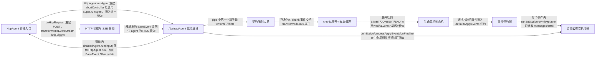

# ag-ui：架构、运行逻辑与设计取舍

> main · [7e7c1109f26e](https://github.com/ag-ui-protocol/ag-ui/commit/7e7c1109f26e77cc32d87d351fb9e0b0bf56ff7f) · deepseek-flash 辅助分析 · 2026-10-30T05:33:11.336Z
> 下文按固定源码推演，没有执行目标项目。引用可跳到具体代码行；“工程推断”解释收益与代价，不代表作者亲述。

## 1. 先建立直觉

**浏览器不等待一整段回复，而是把 Agent 发来的每个小事件立即展开、校验并合成为界面上的消息和状态。**

Agent 的一次运行既包含流式文本，又包含工具调用参数、工具结果和共享状态更新；如果客户端只能接收一条完整消息，就无法边生成边展示，也无法在事件层面统一校验顺序和配对。

贯穿全文的例子：

- **输入：** 用户点击发送「帮我查一下北京天气」。HttpAgent 组装 RunAgentInput，POST 到后端后收到 SSE 帧：RUN_STARTED → TEXT_MESSAGE_CHUNK(delta:"北京") → TOOL_CALL_CHUNK(get_weather, delta:"{\"city\":\"北京\"}") → TOOL_CALL_RESULT → TEXT_MESSAGE_CONTENT(delta:"晴，25℃") → RUN_FINISHED。
- **预期输出：** 订阅者在过程中依次收到 onTextMessageContentEvent、onToolCallArgsEvent、onToolCallResultEvent 和 onNewMessage；agent.messages 最终包含一条带 toolCalls 的 assistant 消息和一条 tool 消息，文本为「北京晴，25℃」；若中间有 STATE_DELTA，则 agent.state 在每次 patch 后被替换。

## 2. 一张图看懂架构



| 模块 | 职责与所在层的原因 | 输入 → 输出 | 拥有的状态 |
| --- | --- | --- | --- |
| HttpAgent 传输入口 [1][source-1] | 负责把一次运行变成一个 HTTP 请求，并在发送前做最后一次出口净化；它决定的是传输形态，不是事件语义。 | RunAgentInput 与 HttpAgentConfig(url/headers/fetch) → Observable<BaseEvent>，由 runHttpRequest 与 transformHttpEventStream 组合而成 | abortController（每次 runAgent 重建）、url、headers、fetch |
| AbstractAgent 运行编排 [2][source-2] [3][source-3] | 负责一轮运行的完整生命周期：准备输入、初始化订阅者、构建中间件链、把事件流串成 enforce→expand→verify→apply 管道、收尾。 | RunAgentParameters 与可选的 AgentSubscriber → RunAgentResult{result,newMessages}，同时把突变写回 this.messages / this.state | isRunning、messages、state、subscribers、pendingInterrupts、activeRunDetach$ |
| HTTP 读取与 SSE 分帧 [4][source-4] [5][source-5] [6][source-6] | 负责把 fetch 的字节流变成事件对象流；它只保证「是一个带字符串 type 的 JSON 对象」，不做协议语义校验。 | fetchResponse thunk 与 HttpEvent 流 → BaseEvent 形状的 JSON 对象流 | TextDecoder、解码 buffer、parserInitialized、bufferSubject |
| 契约强制边界 [7][source-7] | 负责区分三种情况：未知 type 丢弃、已知 type 的未知属性剥离、已知字段的非法值致命；它决定什么数据能进入后续阶段。 | BaseEvent 流（入口）或 RunAgentInput（出口） → 经 stripUnknown 与 schema.parse 处理后的同类型数据 | 无长期状态，只读取 EVENT_SCHEMA_BY_TYPE 与 maxEntries |
| chunk 展开与车道管理 [8][source-8] | 负责把带省略字段的 *_CHUNK 合成为显式的 START/CONTENT/END；它决定 shorthand 如何落到具体消息或工具调用上。 | 可能混有 TEXT/TOOL/REASONING_MESSAGE_CHUNK 的事件流 → 不含 *_CHUNK 的事件流，必要时补出 *_START 与 *_END | lanes: Map<subagentRunId \| undefined, PendingStream>，每个 lane 最多一个未闭合实体 |
| 生命周期状态机 [9][source-9] | 负责检查事件的顺序与配对：首个必须是 RUN_STARTED，消息/工具/推理/步骤/子 agent 必须开闭成对，续接事件不能与 opener 的归属冲突。 | 展开后的事件流 → 通过校验的事件流，或抛 AGUIError 终止本轮 | activeMessages、activeToolCalls、activeReasoningSpans/Messages、activeSteps、activeSubagents、owners（按实体种类分桶） |
| 事件归约器 [10][source-10] | 负责把事件翻译成 messages/state 的不可变替换：文本追加、工具参数拼接、工具结果插位、状态 patch/snapshot。 | 通过校验的事件流与初始 messages/state → Observable<AgentStateMutation>，只在 messages 或 state 真正变化时发出 | 局部 messages、state、currentMutation、runToolCallIds、answeredToolCallIds |
| 订阅者突变执行器 [11][source-11] | 负责在每条事件之前运行所有订阅者的回调，并把它们返回的突变合并成一份；它决定订阅者能否改动本次归约的输入。 | 订阅者数组、当前 messages/state、每个订阅者的 executor → AgentStateMutation（messages/state/stopPropagation） | freezeInputs 标志、messagesMutated/stateMutated、stopPropagation |

## 3. 跟着一个请求跑完整条主线

这是对已读方法体的源码推演，不是执行日志。编号是阅读顺序；装配、写入、查询与条件分支是否发生，取决于每步的触发条件。

### 1. 准备一次运行的输入

**阶段：** 装配

**触发条件：** 必经

入口/调用：`HttpAgent.runAgent / AbstractAgent.prepareRunAgentInput` [12][source-12] [13][source-13] [14][source-14]

**此时输入：** RunAgentParameters（runId、tools、context、forwardedProps、resume）

HttpAgent.runAgent 先用参数里的 abortController 或新建的替换当前实例；AbstractAgent.runAgent 置 isRunning=true、补齐 agentId，然后 prepareRunAgentInput 克隆 messages 与 state、删除 null 的 subagentRunId、过滤 activity 消息、用 keepToolResultsWithCalls 重新配对工具结果，最后按 maxProtocolVersion 决定是否带 protocolVersion。

**状态变化：** this.isRunning=true，this.agentId 可能被赋值，input 是一份与 agent 状态解耦的快照

**交给下一步：** RunAgentInput

### 2. 初始化订阅者并校验中断覆盖

**阶段：** 初始化

**触发条件：** 必经；中断校验只在 runAgent 路径触发，connectAgent 不做

入口/调用：`AbstractAgent.runAgent / AbstractAgent.onInitialize` [15][source-15] [16][source-16]

**此时输入：** RunAgentInput 与组装好的 subscriber 列表

runAgent 在 this.subscribers 前插入一个内部订阅者（负责 warnOnProducerDeclaration 与捕获 RUN_FINISHED 的 result），并把调用方传入的 subscriber 放最后；runInputs.add(input) 标记这是一次 run；onInitialize 对有 pendingInterrupts 的线程检查 resume 是否覆盖所有 id、过期中断是否被 cancelled，然后 runSubscribersWithMutation 执行 onRunInitialized 并把返回的 messages/state 同步回 agent 和 input。

**状态变化：** messages/state 可能被订阅者替换；input.messages 重新做 activity 过滤与 null 标签删除

**交给下一步：** 已初始化的 input 与最终订阅者数组

### 3. 构建中间件链并发起 run

**阶段：** 装配

**触发条件：** 必经

入口/调用：`AbstractAgent.runAgent / HttpAgent.run` [17][source-17] [18][source-18]

**此时输入：** RunAgentInput

runAgent 用 reduceRight 把 this.middlewares 和始终最内层的 CompatibilityBoundary 串成一个只暴露 run/messages/state 的 chainedAgent，然后调用 chainedAgent.run(input)。HttpAgent.run 先调 enforceOutgoingInput 剥离未知字段，再把 requestInit 包在 thunk 里交给 runHttpRequest，最终返回 transformHttpEventStream 的结果。

**状态变化：** 无；此时还没有任何事件被应用

**交给下一步：** Observable<BaseEvent>

### 4. 读取响应字节并发出 HttpEvent

**阶段：** 写入

**触发条件：** 订阅时执行；非 2xx 会立刻抛错

入口/调用：`runHttpRequest` [4][source-4]

**此时输入：** fetchResponse 闭包

defer 保证 fetch 在订阅时才发生。response.ok 为假时读一次 response.text()，按 content-type 决定是否 JSON.parse，把 status 与 payload 挂到 Error 上抛出；否则先发 HEADERS，再拿 body.getReader() 循环 read，把每个 Uint8Array 作为 DATA 事件发出，流结束时 complete，提前取消时 reader.cancel()。

**状态变化：** settled 标志区分正常结束与取消

**交给下一步：** HttpEvent 流（HEADERS + 若干 DATA）

### 5. 按 content-type 选解析器并把字节切成事件

**阶段：** 转换

**触发条件：** 必经；HEADERS 未到就收到 DATA 会失败

入口/调用：`transformHttpEventStream / parseSSEStream` [19][source-19] [20][source-20]

**此时输入：** HttpEvent 流

收到 HEADERS 时读 content-type：等于 AGUI_MEDIA_TYPE 走 parseProtoStream，否则走 parseSSEStream。SSE 解析器用 TextDecoder(stream:true) 处理跨 chunk 的 UTF-8 字符，buffer 按 /\n\n/ 切分并保留最后一段，对每个完整帧抽取 data: 行、拼接、JSON.parse；transformHttpEventStream 在此之上要求结果是非 null、非数组的对象且 type 是非空字符串，否则让 stream 失败。

**状态变化：** buffer 累积与清空、parserInitialized 置位、bufferSubject 只保留 1 条 ReplaySubject 供解析器追赶

**交给下一步：** 带字符串 type 的 BaseEvent 对象流

### 6. 入口 enforce：丢弃未知类型、剥离未知属性、拒绝非法已知值

**阶段：** 校验

**触发条件：** 必经（在中间件链之后、chunk 展开之前）

入口/调用：`enforceEvents / enforceOutgoingInput` [21][source-21] [22][source-22]

**此时输入：** BaseEvent 流或 RunAgentInput

enforceEvents 先用 isRecognizedEvent 判断 type 是否在 EventType 集合里，不在就 warn 并用 EMPTY 丢掉；在则从 EVENT_SCHEMA_BY_TYPE 取出该事件对应的 zod schema，stripUnknown 遍历删除未描述属性并返回被删路径，逐条 warn；最后 schema.parse(value)，已知字段非法会抛错并让整轮 run 失败。enforceOutgoingInput 对出口做同一套处理，区别是先 omitOptionalNulls。

**状态变化：** 无；只决定事件能否继续

**交给下一步：** 净化后的 BaseEvent / RunAgentInput

### 7. 把 CHUNK 展开成 START/CONTENT/END

**阶段：** 转换

**触发条件：** 必经；只有 *_CHUNK 会被展开，其他事件原样通过

入口/调用：`transformChunks` [23][source-23] [24][source-24]

**此时输入：** 可能含 TEXT_MESSAGE_CHUNK / TOOL_CALL_CHUNK / REASONING_MESSAGE_CHUNK 的事件流

每个 chunk 先按 subagentRunId 找到 lane：带 id 优先沿已打开的 lane 继续、带 tag 则开在该 tag 的 lane、无 id 无 tag 则先找父 lane、再退回唯一同类 lane。opener 分支要求首个 chunk 必须带 id，把 role 缺省填为 assistant（TEXT 分支）、把 fields 存进 lanes，并合成 *_START；带 delta 或 rawEvent 时合成 *_CONTENT。遇到显式 START/CONTENT/END 只关闭同一 lane，遇到 RUN_* 或 MESSAGES_SNAPSHOT 关闭所有 lane 并补出 *_END。

**状态变化：** lanes 增加/删除条目；合成出的事件流入下游

**交给下一步：** 不含 *_CHUNK 的事件流

### 8. verify：顺序、配对与归属检查

**阶段：** 查询

**触发条件：** 必经

入口/调用：`verifyEvents` [25][source-25] [26][source-26]

**此时输入：** 展开后的事件流

首个事件必须是 RUN_STARTED（或 RUN_ERROR）；runFinished/runError 之后再来的事件直接抛错，除非是新 RUN_STARTED。TEXT_MESSAGE_START 检查 activeMessages 是否已有同 id，并把 opener 的归属记进 owners.message；CONTENT/END 要求 id 在 activeMessages 中且 subagentRunId 与 opener 一致；STEP 以 (owner, stepName) 为键配对；RUN_FINISHED 前要求 activeSteps、activeMessages、activeReasoning*、activeToolCalls、activeSubagents 全为空。

**状态变化：** active* 集合增删、owners 累积（关闭后不清空）、runStarted/runFinished/runError 标志

**交给下一步：** 通过校验的事件流

### 9. 归约事件并通知订阅者

**阶段：** 写入

**触发条件：** 必经；源错误时先把已到事件 drain 完再抛

入口/调用：`applyBeforeSourceError / defaultApplyEvents / processApplyEvents` [3][source-3] [27][source-27] [28][source-28] [29][source-29]

**此时输入：** 已校验事件流 + 初始 messages/state

applyBeforeSourceError 用 catchError 暂存 sourceError，让 apply 与 processApplyEvents 先把已到达的事件处理完，再用 concatWith 把错误原样抛出。defaultApplyEvents 每个事件先跑 onEvent 订阅者并应用其突变；TEXT_MESSAGE_CONTENT 把 delta 拼到 existingContent 后面并只在变化时 applyMutation；TOOL_CALL_RESULT 按 toolCallId 找 owner 消息并把 tool 消息插在它后面；STATE_DELTA 用 fast-json-patch 生成 newDocument，失败只 warn 不抛。emitUpdates 只在 currentMutation 有内容时发出。processApplyEvents 把 mutation 赋给 this.messages/this.state 并调用 onMessagesChanged/onStateChanged。

**状态变化：** agent.messages、agent.state、RUN_FINISHED interrupt 时的 pendingInterrupts

**交给下一步：** RunAgentResult{result,newMessages}；finalize 时 onFinalize 再跑一轮订阅者

## 4. 核心技术到底是什么

### 1. RxJS 可取消事件管道

**解决的问题：** 一次运行里既有按顺序应用的事件，又有可中断的订阅和统一的收尾动作；用回调难以同时表达顺序、取消和错误。 [30][source-30] [31][source-31]

把源事件流作为 Observable，从源头开始依次接 enforce、transformChunks、verify，再用 takeUntil(activeRunDetach$) 实现 detach，用 applyBeforeSourceError 把源错误暂存成完成信号、先 drain 后重抛，最后 finalize 里清 isRunning 并 resolve 完成 Promise；lastValueFrom 用于等待整条管道结束。

算法示意（用于解释机制，不是源码原文）：

```text
source = chainedAgent.run(input)
out = source.pipe(
  enforceEvents(log, opts),
  transformChunks(log),
  verifyEvents(log),
  takeUntil(detach$),
  applyBeforeSourceError(input, subscribers)
)
await lastValueFrom(out)
finalize(() => { isRunning=false; onFinalize(); resolveCompletion() })
```

**关键数据结构：** Observable<BaseEvent>、Subject<void> activeRunDetach$、Promise<void> activeRunCompletionPromise、AgentStateMutation

- **本项目实现：** agent.ts 中管道组装、applyBeforeSourceError 的错误暂存、finalize 收尾、detachActiveRun 的完成等待
- **外部依赖提供：** rxjs 提供 pipe、mergeMap、concatMap、takeUntil、finalize、lastValueFrom；本项目只定义算子顺序与状态语义
- **收益与代价：** 组合与取消能力好，但错误语义要自己补齐：不先 drain 就会丢掉错误前已经到达的事件，所以 applyBeforeSourceError 专门存在；代价是多一层 defer/concatWith。

### 2. SSE 增量 UTF-8 解码与分帧

**解决的问题：** HTTP 响应体按任意字节边界切分，一个 UTF-8 多字节字符和一个事件帧都可能跨多个 read。 [6][source-6] [32][source-32]

TextDecoder('utf-8',{stream:true}) 保留不完整字节序列；buffer 累加解码后的文本，按 /\n\n/ 切分后 pop 出最后一段留待下次；每个完整帧只取 data: 前缀行，去掉可选的一个空格后以 \n 连接并 JSON.parse；切分后若剩余 buffer 超过 10MB 则让流失败。

算法示意（用于解释机制，不是源码原文）：

```text
decoder = TextDecoder('utf-8', {stream:true})
buffer = ''
onData(bytes):
  buffer += decoder.decode(bytes, {stream:true})
  frames = buffer.split('\n\n')
  buffer = frames.pop()
  for f in frames: emit(parseDataLines(f))
  if buffer.length > MAX: error()
```

**关键数据结构：** string buffer、TextDecoder、Subject<any>、常量 MAX_BUFFER_SIZE=10MB

- **本项目实现：** parseSSEStream 的分帧、data 行抽取、超限保护
- **外部依赖提供：** fetch ReadableStream 的 getReader/read 由 runHttpRequest 提供，浏览器/Node 的 TextDecoder 负责解码
- **收益与代价：** 实现直接、只依赖标准；但要求帧之间是 \n\n、只认 data: 行，非标准帧会被静默忽略；10MB 上限避免无边界响应撑爆内存。

### 3. Zod 生成 schema 的强制边界

**解决的问题：** 事件既可能来自旧版本（带已废弃字段）也可能来自新版本（带未知字段），还可能是进程内直接构造的非法对象；需要区分「不认识」和「认识但值不对」。 [33][source-33] [21][source-21]

启动时把 EventSchema 的每个分支按 type 字面量建成 Map；enforceEvents 对每个事件按 type 取 schema，stripUnknown 递归删除未描述属性并返回路径列表逐条 warn，再 schema.parse(value)。已知 type 但无对应 schema 会抛错（防止 EventType 与 union 漂移）；未知 type 直接丢弃。

算法示意（用于解释机制，不是源码原文）：

```text
for event in source:
  if event.type not in KNOWN: drop + warn
  schema = EVENT_SCHEMA_BY_TYPE.get(event.type)
  {value, stripped} = stripUnknown(event, schema, maxEntries)
  warn each stripped path
  emit schema.parse(value)  # 已知字段非法则抛
```

**关键数据结构：** Set<string> KNOWN_EVENT_TYPES、Map<string,ZodType> EVENT_SCHEMA_BY_TYPE、maxEntries 限制

- **本项目实现：** EVENT_SCHEMA_BY_TYPE 的构建、stripUnknown 的遍历与限制、两类告警
- **外部依赖提供：** @ag-ui/core/schemas 由协议 schema 生成，zod/v4 负责逐字段校验与类型收窄
- **收益与代价：** 兼容性与严格性分层清晰；代价是每个事件都要 parse 一次，且 stripUnknown 要遍历对象，所以有 maxEntries 上限，超限直接失败而不是静默截断。

### 4. chunk 车道（lane）展开

**解决的问题：** chunk 只带部分字段，续块可以省略 id；同一次 run 里又可能有多个 subagent 同时流式输出，单一 pending 槽会让它们互相踩踏。 [34][source-34] [23][source-23] [35][source-35]

以 subagentRunId（undefined 表示父 agent）为键维护 lanes，每个 lane 最多一个 PendingStream。resolveLane 按优先级决定归属：显式 id 若已有 lane 则沿用它、否则按 tag 开新 lane；无 id 有 tag 直接用 tag；无 id 无 tag 先找父 lane，再退回唯一同类 lane，多于一个则抛歧义错误。opener 必须自带 id，否则抛错；续块的 role/name/toolCallName/parentMessageId 与 opener 不一致也抛错。

算法示意（用于解释机制，不是源码原文）：

```text
lanes = Map<owner, PendingStream>
onChunk(c):
  lane = resolveLane(kind, c.id, c.tag)
  open = lanes.get(lane)
  if open matches c.id or c.id absent:
    check opener agreement
    emit CONTENT if delta/rawEvent
  else:
    closeLane(lane)
    require c.id
    lanes.set(lane, fields)
    emit START
    emit CONTENT if delta/rawEvent
```

**关键数据结构：** Map<string|undefined, PendingStream>、PendingStream 区分 text/tool/reasoning 并保存 opener 字段、TEXT/TOOL/REASONING_CHUNK_FIELDS 从 schema.shape 派生

- **本项目实现：** transformChunks 全部逻辑，包括 closeLane/closeAllLanes、unrecognisedChunkProperties 的余量搬运
- **外部依赖提供：** rxjs 的 mergeMap 提供逐事件展开，finalize 在流结束时清空 lanes（但不发事件）
- **收益与代价：** 支持并发 subagent 和省略 id 的 shorthand；代价是归属需要推断，歧义时必须失败而不是猜，所以缺 tag 且多个同类 lane 打开时会抛错。

## 5. 为什么选择这种实现

### 1. 在 chunk 展开之前做 enforcement，在展开之后做 verification

**作者原文：** “Enforcement BEFORE expansion: a chunk is an event of its own, so it is validated as one like any other, and expansion then only ever reshapes values already known good.” [36][source-36]

**面临的约束：** chunk 本身也是协议事件，必须接受与完整事件相同的校验；而 verify 检查的开闭配对只有在展开成 START/CONTENT/END 之后才存在。

**如果改用另一种做法：** 先展开再统一校验，或只在校验后展开

**为什么当前方案有用：** 若先展开，malformed 的 role 会被展开器当成缺省值修复成 assistant，导致同一缺陷在普通事件里致命、在 chunk 里却看不见；把 enforce 放在前面，展开器只处理已确认合法的输入，verify 再基于展开结果检查配对。

**付出的代价，以及不适用的情况：** 展开器不能依赖 enforcement 已经跑过（Middleware.runNext 会在中间件内部提前展开），因此 transformChunks 自己必须携带未识别属性并保留 null 标签，让下游仍能报错。

### 2. 每个 subagent 一条独立 lane 组装 chunk

**依据：已确认实现；以下原因是工程分析，不代表作者亲述。** [37][source-37]

**面临的约束：** 同一次 run 中多个 subagent 可以并发流式输出，且续块可以省略 id，只能靠上下文归属。

**如果改用另一种做法：** 全 run 共用一个 pending stream 槽

**为什么当前方案有用：** 单一全局槽下，第二个 subagent 的 opener 会先关闭第一个 subagent 正在组装的流；由于续块省略 id，第一个 subagent 的下一个 chunk 就找不到归属而直接失败。

**付出的代价，以及不适用的情况：** 归属推断在缺 id 且多个同类 lane 打开时会抛歧义错误，要求生产者为续块补 subagentRunId。

### 3. 已知字段的非法值致命，未知类型/未知属性只丢弃或剥离并告警

**依据：已确认实现；以下原因是工程分析，不代表作者亲述。** [38][source-38] [39][source-39]

**面临的约束：** 协议会演进，旧客户端必须能处理新版本多出来的字段；但真正非法的值（如 null 的 subagentRunId、缺 messageId）如果进入 reducer 会污染消息历史。

**如果改用另一种做法：** 一律 fatal，或一律忽略未知材料

**为什么当前方案有用：** 一律 fatal 会让新版本字段直接杀死旧客户端；一律忽略则会让非法值进入状态并在下一轮被序列化出去，接收端整轮拒绝。分层的做法是：未知 type 丢、未知属性剥并 warn、已知字段非法就让 schema.parse 抛。

**付出的代价，以及不适用的情况：** 每个事件都要做一次 stripUnknown 加 parse；且剥离是逐字段遍历，需要 maxEntries 防止超大对象拖垮进程。

### 4. 文本增量按累积追加写入消息，而不是每次用快照重建

**依据：已确认实现；以下原因是工程分析，不代表作者亲述。** [40][source-40] [41][source-41]

**面临的约束：** UI 需要逐字增长的效果，同时要把每次事件的变化量通知给订阅者。

**如果改用另一种做法：** 每条 CONTENT 都携带完整文本，由 reducer 整体替换

**为什么当前方案有用：** TEXT_MESSAGE_CONTENT 的 delta 直接拼到消息现有 content 后面（existingContent + delta），消息对象保持同一 id，订阅者每收到一次更新就拿到变长的内容；测试里 "Hello " 与 "world!" 两次 delta 得到 "Hello world!"，且状态更新次数与 CONTENT 事件数一致。

**付出的代价，以及不适用的情况：** 同一消息的多次 delta 必须严格串行应用（defaultApplyEvents 用 concatMap），乱序到达会拼错；而且不能在订阅者里原地修改消息，否则会破坏这段累积语义。

### 5. 订阅者通过返回值表达突变，输入在 dev/test 下被 deepFreeze

**作者原文：** “Subscribers receive shared references and must not mutate them in-place. Mutations should only be communicated via the return value.” [42][source-42] [43][source-43]

**面临的约束：** 多个订阅者共享同一份 messages/state 引用，如果允许原地写，就无法知道谁改了、改了哪部分，也无法做零拷贝快路径。

**如果改用另一种做法：** 允许订阅者直接修改传入的 messages/state

**为什么当前方案有用：** runSubscribersWithMutation 只在订阅者返回的 mutation 与当前引用不同时才 structuredClone 合并；没有突变时一次拷贝都不做。dev/test 下对输入 deepFreeze，原地写会立刻以 TypeError 暴露，并在日志里区分「冻结写」与普通订阅者异常。

**付出的代价，以及不适用的情况：** 副作用是订阅者不能缓存并复用同一数组引用做原地修改；在 dev 下如果 messages+state 字符串总量超过 512KB 会跳过冻结，以免 structuredClone 耗尽堆。

## 6. 关键代码精读

### 1. HttpAgent 在字节离开前做出口 enforce，再交给 runHttpRequest


`sdks/typescript/packages/client/src/agent/http.ts:53-64` [44][source-44]

```typescript
  protected requestInit(input: RunAgentInput): RequestInit {
    return {
      method: "POST",
      headers: {
        ...this.headers,
        "Content-Type": "application/json",
        Accept: "text/event-stream",
      },
      body: JSON.stringify(sanitizeOutgoingInput(input)),
      signal: this.abortController.signal,
    };
  }
```


`sdks/typescript/packages/client/src/agent/http.ts:91-106` [18][source-18]

```typescript
  run(input: RunAgentInput): Observable<BaseEvent> {
    // The outgoing half of the enforcement boundary: checked immediately
    // before transmission. Inside the deferred request thunk — not during
    // pipeline construction, where a throw would escape the run's catchError
    // and leave lifecycle callbacks and the completion promise hanging — and
    // before requestInit, so a subclass overriding the request shape still
    // transmits enforced input. Unknown material is stripped with a warning;
    // a malformed known field fails the run before a byte leaves the process.
    const httpEvents = runHttpRequest(() =>
      this.fetch(
        this.url,
        this.requestInit(enforceOutgoingInput(input, { maxEntries: this.maxEnforcedEntries })),
      ),
    );
    return transformHttpEventStream(httpEvents, this.debugLogger);
  }
```


`sdks/typescript/packages/client/src/enforce/enforce.ts:114-132` [22][source-22]

```typescript
export function enforceOutgoingInput(
  input: RunAgentInput,
  options?: EnforcementOptions,
): RunAgentInput {
  const maxEntries = resolveMaxEntries(options?.maxEntries);
  const { value, stripped } = stripUnknown(
    omitOptionalNulls(input, "RunAgentInput"),
    RunAgentInputSchema as unknown as z.ZodType,
    { maxEntries },
  );
  for (const path of stripped) {
    warnDeviation(`Removed unrecognised material at '${path}' from the outgoing input.`);
  }
  // Unasserted on purpose: the generated schema's output and the generated
  // type are two files that must agree, and this is the one place where a
  // divergence between them can be made to fail the build rather than pass
  // silently through a cast.
  return RunAgentInputSchema.parse(value);
}
```


requestInit 把输入 JSON.stringify 成 body，但序列化的是 sanitizeOutgoingInput 的结果——删除 null 的 subagentRunId，避免 schema 拒绝整轮。run 里把 fetch 包进 thunk 交给 runHttpRequest：这样 fetch 在订阅时才发生，且 enforceOutgoingInput 在 requestInit 之前执行，子类重写 requestInit 也绕不过校验。runHttpRequest 返回的 HttpEvent 流再交给 transformHttpEventStream 选 SSE 解析器。enforceOutgoingInput 内部先 omitOptionalNulls，再 stripUnknown（未知字段 warn 后删除），最后 RunAgentInputSchema.parse——已知字段非法时在这里就抛，还没发出任何字节。

### 2. 第一个 TEXT_MESSAGE_CHUNK 如何变成 START 并记住 opener 字段


`sdks/typescript/packages/client/src/chunks/transform.ts:474-521` [45][source-45]

```typescript
            if (
              open?.kind === "text" &&
              // An absent id continues; a present one must be the same message.
              (messageChunkEvent.messageId === undefined ||
                messageChunkEvent.messageId === open.fields.messageId)
            ) {
              requireOpenerAgreement(
                "text message",
                open.fields.messageId,
                "role",
                messageChunkEvent.role,
                open.fields.role,
              );
              requireOpenerAgreement(
                "text message",
                open.fields.messageId,
                "name",
                messageChunkEvent.name,
                open.fields.name,
              );
              textMessageFields = open.fields;
            } else {
              // Whatever else this lane had open ends before the new stream begins.
              textMessageResult.push(...closeLane(lane));

              if (messageChunkEvent.messageId === undefined) {
                throw new Error("First TEXT_MESSAGE_CHUNK must have a messageId");
              }

              textMessageFields = {
                messageId: messageChunkEvent.messageId,
                // Absent means assistant, which the spec states normatively
                // and the generated validator deliberately does not apply, so
                // materialising it here is real work nothing else does.
                //
                // ABSENT, though — not merely falsy, and not null. This stage
                // must not depend on enforcement having run first: it has, on
                // the three pipelines in agent.ts, but Middleware.runNext
                // expands INSIDE the middleware chain, upstream of it. So a
                // present-but-wrong role reaching here has not been judged
                // yet, and substituting for it would repair a producer defect
                // that is fatal when the same value is sent unchunked.
                role: messageChunkEvent.role === undefined ? "assistant" : messageChunkEvent.role,
                name: messageChunkEvent.name,
                subagentRunId: messageChunkEvent.subagentRunId,
              };
              lanes.set(lane, { kind: "text", fields: textMessageFields });

```


`sdks/typescript/packages/client/src/chunks/transform.ts:550-601` [46][source-46]

```typescript
            if (messageChunkEvent.delta !== undefined || messageChunkEvent.rawEvent !== undefined) {
              // `!== undefined`, not `??`, on the incoming tag — here and on
              // every continuation path below: a null tag is a violation the
              // spec names, and `??` read it as absence, so a continuation's
              // null fell back to the opener's owner and never reached the
              // stage that rejects it. Preserved, it rides the synthesized
              // event onward, exactly as an opener's null does.
              //
              // WHICH stage rejects it depends on the path, and both do:
              //
              // - Plain pipeline (`enforce -> expand`): ENFORCEMENT rejects,
              //   and it rejects the raw CHUNK before this stage ever runs.
              //   `SubagentRunIdSchema` is `z.string()`, so `null` is a
              //   malformed value on a described field, which enforcement
              //   keeps fatal. Nothing this stage synthesises is involved.
              // - `Middleware.runNext` (`expand` inside the chain, enforce
              //   after it): expansion is handed the raw chunk, so preserving
              //   the null is what lets enforcement — and then VERIFICATION
              //   (verify.ts's "'subagentRunId: null'. The field is optional"
              //   check) — see it at all.
              //
              // Reading it as absence with `??` is what removed it from the
              // second path entirely, which is the divergence this file
              // exists to prevent.
              const contentOwner =
                messageChunkEvent.subagentRunId !== undefined
                  ? messageChunkEvent.subagentRunId
                  : textMessageFields.subagentRunId;
              const textMessageContentEvent = withChunkOrigin(
                {
                  // Spread FIRST so a described field can never be shadowed by
                  // something the producer also sent under that name.
                  ...textChunkRemainder,
                  type: EventType.TEXT_MESSAGE_CONTENT,
                  messageId: textMessageFields.messageId,
                  // `=== undefined`, not `??` — exactly how the opener's `role` is
                  // handled above. The gate that reached this line is itself
                  // `!== undefined`, so a `delta: null` passes it, and `??` then
                  // repaired the malformed value into "". That made the same
                  // producer defect fatal when sent unchunked and invisible when
                  // sent as a chunk behind a middleware. Preserved, it is fatal on
                  // both paths.
                  delta: messageChunkEvent.delta === undefined ? "" : messageChunkEvent.delta,
                  // Prefer the INCOMING chunk's tag over the opener's, so a producer that
                  // attributes every chunk sees its own attribution on the output rather
                  // than a value this transform remembered.
                  ...(contentOwner !== undefined && { subagentRunId: contentOwner }),
                } as TextMessageContentEvent,
                messageChunkEvent,
              );

              textMessageResult.push(textMessageContentEvent);
```


resolveLane 先决定这个 chunk 属于哪条 lane；若该 lane 没有同类型未闭合流，就走 opener 分支：先把该 lane 里别的未闭合流关掉，然后要求 messageId 必须存在（首个 chunk 不能省略 id），把 messageId、role（缺省 assistant）、name、subagentRunId 存进 lanes，并合成一个不带 rawEvent 的 TEXT_MESSAGE_START。随后若 chunk 带了 delta 或 rawEvent，再合成 TEXT_MESSAGE_CONTENT，把 chunk 的元数据与 rawEvent 搬到 content 事件上（opener 是本地合成的，不宣称拥有 provider 载荷）；delta 只用 === undefined 判空，不用 ??，这样 delta:null 会原样传给 verify 而不是被悄悄修成空串。

### 3. TEXT_MESSAGE_CONTENT 追加进消息，再由 processApplyEvents 通知订阅者


`sdks/typescript/packages/client/src/apply/default.ts:540-586` [27][source-27]

```typescript
        case EventType.TEXT_MESSAGE_CONTENT: {
          const { messageId, delta } = event as TextMessageContentEvent;

          // Find the target message by ID
          const targetMessage = messages.find((m) => m.id === messageId);
          if (!targetMessage) {
            console.warn(`TEXT_MESSAGE_CONTENT: No message found with ID '${messageId}'`);
            return emitUpdates();
          }
          if (targetMessage.role === "activity") {
            // Appending here would replace the activity message's structured content with a
            // string, leaving it no longer a valid ActivityMessage.
            console.warn(
              `TEXT_MESSAGE_CONTENT: Message '${messageId}' is an activity message — ` +
                `message ids must be unique across activity and text messages`,
            );
            return emitUpdates();
          }

          const mutation = await runSubscribersWithMutation(
            subscribers,
            messages,
            state,
            (subscriber, messages, state) =>
              subscriber.onTextMessageContentEvent?.({
                event: event as TextMessageContentEvent,
                messages,
                state,
                agent,
                input,
                textMessageBuffer:
                  typeof targetMessage.content === "string" ? targetMessage.content : "",
              }),
          );
          applyMutation(mutation);

          if (mutation.stopPropagation !== true) {
            // Append content to the correct message by ID
            const existingContent =
              typeof targetMessage.content === "string" ? targetMessage.content : "";
            targetMessage.content = `${existingContent}${delta}`;
            applyEventMetadata(targetMessage, event);
            applyMutation({ messages });
          }

          return emitUpdates();
        }
```


`sdks/typescript/packages/client/src/agent/agent.ts:576-609` [47][source-47]

```typescript
    subscribers: AgentSubscriber[],
  ): Observable<AgentStateMutation> {
    return events$.pipe(
      tap((event) => {
        if (event.messages) {
          this.messages = event.messages;
          subscribers.forEach((subscriber) => {
            subscriber.onMessagesChanged?.({
              messages: this.messages,
              state: this.state,
              agent: this,
              input,
            });
          });
        }
        // `!== undefined`, not truthiness: State is any JSON value, so a
        // snapshot of `null`, `0`, `""` or `false` is a replacement like any
        // other. The mutation channel only carries `state` when a stage
        // actually set it, so presence is the signal — a truthiness check
        // silently discarded every falsy replacement.
        if (event.state !== undefined) {
          this.state = event.state;
          subscribers.forEach((subscriber) => {
            subscriber.onStateChanged?.({
              state: this.state,
              messages: this.messages,
              agent: this,
              input,
            });
          });
        }
      }),
    );
  }
```


defaultApplyEvents 先按 messageId 找到目标消息，若不存在或目标是 activity 消息就只 warn 并返回（不把活动消息的结构化内容覆盖成字符串）。找到后先跑 onTextMessageContentEvent，把当前 content 作为 textMessageBuffer 传给订阅者，并应用订阅者返回的突变；若 stopPropagation 未置位，才把 delta 拼到 existingContent 后面并 applyEventMetadata，最后一次 applyMutation({messages}) 把变化累积到 currentMutation，emitUpdates 只在有变化时真正发出。processApplyEvents 收到这个 mutation 后赋给 this.messages，并对每个订阅者调用 onMessagesChanged；state 用 !== undefined 判断，允许 null/0/"" 这类合法的整体替换。

## 7. 动手验证你的理解

以下是建议实验，没有执行过。

### 1. 只发 chunk、不发显式 TEXT_MESSAGE_END，run 结束时消息会不会被正确闭合？

**改变什么：** 在 SSE 中依次发送 TEXT_MESSAGE_CHUNK(messageId:"m1", delta:"Hello") 与 RUN_FINISHED，中途不发送 TEXT_MESSAGE_START、TEXT_MESSAGE_END。 [48][source-48] [49][source-49] [50][source-50]

**应该观察到什么：** transformChunks 在收到 RUN_FINISHED 时走 closeAllLanes，为 m1 合成 TEXT_MESSAGE_END；verifyEvents 的 activeMessages 已空，RUN_FINISHED 放行；defaultApplyEvents 依次产生 start、content、end 三次更新。如果反过来先发 RUN_FINISHED 再发 chunk，verify 会以「run 已结束」拒绝。

### 2. 未知类型、未知属性、非法已知值在 enforce 边界上分别会怎样？

**改变什么：** 分别构造三个事件：type:"MADE_UP_EVENT"；TEXT_MESSAGE_START 加一个协议没有的 foo 字段；TEXT_MESSAGE_CONTENT 把 delta 设为 null。 [51][source-51] [52][source-52]

**应该观察到什么：** 第一个被 warn 后整条丢弃，后续事件照常；第二个的 foo 被 stripUnknown 删除并 warn 出路径，事件继续；第三个在 schema.parse 抛错，整轮 run 进入 onError。这验证了 enforce 的三种判决不是同一种处理。

### 3. STATE_DELTA 指向不存在的路径时，state 和订阅者会收到什么？

**改变什么：** 初始 state 为 {}，发送 STATE_DELTA，delta 为 [{op:"replace", path:"/nonexistent", value:1}]。 [53][source-53] [54][source-54]

**应该观察到什么：** jsonpatch.applyPatch 抛错被 catch 并 console.warn；由于没有订阅者突变，currentMutation 为空，emitUpdates 返回 EMPTY，订阅者不会收到 onStateChanged；整条流仍正常完成。换成合法路径 /count 时，则能观察到 state 被替换且 onStateChanged 被调用。

## 8. 读完应当能复述什么

- 协议的基本单位是事件而不是消息：一条完整回复被拆成 RUN_STARTED、若干增量、若干工具调用与 RUN_FINISHED，客户端因此可以边到边显示。
- 客户端运行时是一条有序的 RxJS 管道：enforce 先净化和拒绝，transformChunks 再把 shorthand 展开，verify 做开闭与归属检查，apply 才写状态；顺序错了会出现「同一缺陷在 chunk 下不可见」这类不一致。
- chunk 是 shorthand 不是 token：续块可以省 id，因此需要按 subagent 分 lane 并记住 opener 字段；缺 id 的续块若遇到多个同类 lane 必须报歧义而不是猜。
- 状态写入集中在两处：defaultApplyEvents 把事件归约成 mutation，processApplyEvents 把 mutation 落到 agent 上并通知订阅者；订阅者只能通过返回值表达突变，dev 下用 deepFreeze 拦截原地写。
- 增量的语义各不相同：文本按 existingContent + delta 追加，state 用 JSON Patch 的 newDocument 替换，工具结果要插到发出该调用的 assistant 消息之后，而不是简单 append。

## 来源与覆盖边界

本次读取 23 个文件，共 349,997 字符；20 个文件完整读取，其他文件按关键方法取带行号的片段。没有把未读依赖的内部实现当作已确认事实。

- keepToolResultsWithCalls（default.ts 250-395）只出现在 import 和调用处，完整实现未在已读片段中，无法逐条确认工具结果重排规则。
- resolveOrCreateAssistantMessage（default.ts 66-96）只标了位置，未展开函数体；parentMessageId 冲突时回退到 toolCallId 的细节只能从测试 714-800 推断，未在源码中确认。
- Middleware.run 与 CompatibilityBoundary 的转换细节未读，无法确认中间件在 chunk 展开前的具体拦截方式，以及它如何把旧事件翻译成 1.0 形状。
- 服务端如何产生 RUN_FINISHED 的 interrupt outcome、resume 之后 pendingInterrupts 如何被消费，客户端侧只看到 onInitialize 的覆盖校验与 RUN_FINISHED 时的赋值，端到端时序无法从已读代码确认。

| 文件 | 实际读取行段 |
| --- | --- |
| [README.md](https://github.com/ag-ui-protocol/ag-ui/blob/7e7c1109f26e77cc32d87d351fb9e0b0bf56ff7f/README.md) | 1–215 / 共 215 行 |
| [package.json](https://github.com/ag-ui-protocol/ag-ui/blob/7e7c1109f26e77cc32d87d351fb9e0b0bf56ff7f/package.json) | 1–46 / 共 46 行 |
| [sdks/typescript/packages/client/src/agent/agent.ts](https://github.com/ag-ui-protocol/ag-ui/blob/7e7c1109f26e77cc32d87d351fb9e0b0bf56ff7f/sdks/typescript/packages/client/src/agent/agent.ts) | 1–1010 / 共 1010 行 |
| [sdks/typescript/packages/client/src/agent/http.ts](https://github.com/ag-ui-protocol/ag-ui/blob/7e7c1109f26e77cc32d87d351fb9e0b0bf56ff7f/sdks/typescript/packages/client/src/agent/http.ts) | 1–124 / 共 124 行 |
| [sdks/typescript/packages/client/src/apply/default.ts](https://github.com/ag-ui-protocol/ag-ui/blob/7e7c1109f26e77cc32d87d351fb9e0b0bf56ff7f/sdks/typescript/packages/client/src/apply/default.ts) | 1–50、394–1835 / 共 1836 行 |
| [sdks/typescript/packages/client/src/chunks/transform.ts](https://github.com/ag-ui-protocol/ag-ui/blob/7e7c1109f26e77cc32d87d351fb9e0b0bf56ff7f/sdks/typescript/packages/client/src/chunks/transform.ts) | 1–962 / 共 962 行 |
| [sdks/typescript/packages/client/src/verify/verify.ts](https://github.com/ag-ui-protocol/ag-ui/blob/7e7c1109f26e77cc32d87d351fb9e0b0bf56ff7f/sdks/typescript/packages/client/src/verify/verify.ts) | 1–1042 / 共 1042 行 |
| [sdks/typescript/packages/client/src/enforce/enforce.ts](https://github.com/ag-ui-protocol/ag-ui/blob/7e7c1109f26e77cc32d87d351fb9e0b0bf56ff7f/sdks/typescript/packages/client/src/enforce/enforce.ts) | 1–133 / 共 133 行 |
| [sdks/typescript/packages/client/src/agent/subscriber.ts](https://github.com/ag-ui-protocol/ag-ui/blob/7e7c1109f26e77cc32d87d351fb9e0b0bf56ff7f/sdks/typescript/packages/client/src/agent/subscriber.ts) | 1–456 / 共 456 行 |
| [sdks/typescript/packages/client/src/run/http-request.ts](https://github.com/ag-ui-protocol/ag-ui/blob/7e7c1109f26e77cc32d87d351fb9e0b0bf56ff7f/sdks/typescript/packages/client/src/run/http-request.ts) | 1–103 / 共 103 行 |
| [sdks/typescript/packages/client/src/transform/http.ts](https://github.com/ag-ui-protocol/ag-ui/blob/7e7c1109f26e77cc32d87d351fb9e0b0bf56ff7f/sdks/typescript/packages/client/src/transform/http.ts) | 1–150 / 共 150 行 |
| [sdks/typescript/packages/client/src/transform/sse.ts](https://github.com/ag-ui-protocol/ag-ui/blob/7e7c1109f26e77cc32d87d351fb9e0b0bf56ff7f/sdks/typescript/packages/client/src/transform/sse.ts) | 1–131 / 共 131 行 |
| [sdks/typescript/packages/client/src/agent/types.ts](https://github.com/ag-ui-protocol/ag-ui/blob/7e7c1109f26e77cc32d87d351fb9e0b0bf56ff7f/sdks/typescript/packages/client/src/agent/types.ts) | 1–62 / 共 62 行 |
| [sdks/typescript/packages/client/src/agent/__tests__/http.test.ts](https://github.com/ag-ui-protocol/ag-ui/blob/7e7c1109f26e77cc32d87d351fb9e0b0bf56ff7f/sdks/typescript/packages/client/src/agent/__tests__/http.test.ts) | 1–269 / 共 269 行 |
| [sdks/typescript/packages/client/src/apply/__tests__/default.text-message.test.ts](https://github.com/ag-ui-protocol/ag-ui/blob/7e7c1109f26e77cc32d87d351fb9e0b0bf56ff7f/sdks/typescript/packages/client/src/apply/__tests__/default.text-message.test.ts) | 1–410 / 共 410 行 |
| [sdks/typescript/packages/client/src/apply/__tests__/default.tool-calls.test.ts](https://github.com/ag-ui-protocol/ag-ui/blob/7e7c1109f26e77cc32d87d351fb9e0b0bf56ff7f/sdks/typescript/packages/client/src/apply/__tests__/default.tool-calls.test.ts) | 1–1083 / 共 1083 行 |
| [sdks/typescript/packages/client/src/apply/__tests__/default.state.test.ts](https://github.com/ag-ui-protocol/ag-ui/blob/7e7c1109f26e77cc32d87d351fb9e0b0bf56ff7f/sdks/typescript/packages/client/src/apply/__tests__/default.state.test.ts) | 1–216 / 共 216 行 |
| [sdks/typescript/packages/client/src/chunks/__tests__/transform.test.ts](https://github.com/ag-ui-protocol/ag-ui/blob/7e7c1109f26e77cc32d87d351fb9e0b0bf56ff7f/sdks/typescript/packages/client/src/chunks/__tests__/transform.test.ts) | 1–834 / 共 834 行 |
| [sdks/typescript/packages/client/src/verify/__tests__/verify.lifecycle.test.ts](https://github.com/ag-ui-protocol/ag-ui/blob/7e7c1109f26e77cc32d87d351fb9e0b0bf56ff7f/sdks/typescript/packages/client/src/verify/__tests__/verify.lifecycle.test.ts) | 1–50 / 共 329 行 |
| [sdks/typescript/packages/client/src/debug-logger.ts](https://github.com/ag-ui-protocol/ag-ui/blob/7e7c1109f26e77cc32d87d351fb9e0b0bf56ff7f/sdks/typescript/packages/client/src/debug-logger.ts) | 1–75 / 共 75 行 |
| [sdks/typescript/packages/client/src/utils.ts](https://github.com/ag-ui-protocol/ag-ui/blob/7e7c1109f26e77cc32d87d351fb9e0b0bf56ff7f/sdks/typescript/packages/client/src/utils.ts) | 1–37 / 共 37 行 |
| [sdks/typescript/packages/client/src/verify/index.ts](https://github.com/ag-ui-protocol/ag-ui/blob/7e7c1109f26e77cc32d87d351fb9e0b0bf56ff7f/sdks/typescript/packages/client/src/verify/index.ts) | 1–2 / 共 2 行 |
| [sdks/typescript/packages/client/src/legacy/convert.ts](https://github.com/ag-ui-protocol/ag-ui/blob/7e7c1109f26e77cc32d87d351fb9e0b0bf56ff7f/sdks/typescript/packages/client/src/legacy/convert.ts) | 44–66、78–85 / 共 582 行 |

[source-1]: https://github.com/ag-ui-protocol/ag-ui/blob/7e7c1109f26e77cc32d87d351fb9e0b0bf56ff7f/sdks/typescript/packages/client/src/agent/http.ts#L41-L106 "sdks/typescript/packages/client/src/agent/http.ts:41-106"
[source-2]: https://github.com/ag-ui-protocol/ag-ui/blob/7e7c1109f26e77cc32d87d351fb9e0b0bf56ff7f/sdks/typescript/packages/client/src/agent/agent.ts#L327-L435 "sdks/typescript/packages/client/src/agent/agent.ts:327-435"
[source-3]: https://github.com/ag-ui-protocol/ag-ui/blob/7e7c1109f26e77cc32d87d351fb9e0b0bf56ff7f/sdks/typescript/packages/client/src/agent/agent.ts#L536-L609 "sdks/typescript/packages/client/src/agent/agent.ts:536-609"
[source-4]: https://github.com/ag-ui-protocol/ag-ui/blob/7e7c1109f26e77cc32d87d351fb9e0b0bf56ff7f/sdks/typescript/packages/client/src/run/http-request.ts#L22-L102 "sdks/typescript/packages/client/src/run/http-request.ts:22-102"
[source-5]: https://github.com/ag-ui-protocol/ag-ui/blob/7e7c1109f26e77cc32d87d351fb9e0b0bf56ff7f/sdks/typescript/packages/client/src/transform/http.ts#L13-L149 "sdks/typescript/packages/client/src/transform/http.ts:13-149"
[source-6]: https://github.com/ag-ui-protocol/ag-ui/blob/7e7c1109f26e77cc32d87d351fb9e0b0bf56ff7f/sdks/typescript/packages/client/src/transform/sse.ts#L27-L130 "sdks/typescript/packages/client/src/transform/sse.ts:27-130"
[source-7]: https://github.com/ag-ui-protocol/ag-ui/blob/7e7c1109f26e77cc32d87d351fb9e0b0bf56ff7f/sdks/typescript/packages/client/src/enforce/enforce.ts#L74-L132 "sdks/typescript/packages/client/src/enforce/enforce.ts:74-132"
[source-8]: https://github.com/ag-ui-protocol/ag-ui/blob/7e7c1109f26e77cc32d87d351fb9e0b0bf56ff7f/sdks/typescript/packages/client/src/chunks/transform.ts#L253-L396 "sdks/typescript/packages/client/src/chunks/transform.ts:253-396"
[source-9]: https://github.com/ag-ui-protocol/ag-ui/blob/7e7c1109f26e77cc32d87d351fb9e0b0bf56ff7f/sdks/typescript/packages/client/src/verify/verify.ts#L7-L126 "sdks/typescript/packages/client/src/verify/verify.ts:7-126"
[source-10]: https://github.com/ag-ui-protocol/ag-ui/blob/7e7c1109f26e77cc32d87d351fb9e0b0bf56ff7f/sdks/typescript/packages/client/src/apply/default.ts#L397-L586 "sdks/typescript/packages/client/src/apply/default.ts:397-586"
[source-11]: https://github.com/ag-ui-protocol/ag-ui/blob/7e7c1109f26e77cc32d87d351fb9e0b0bf56ff7f/sdks/typescript/packages/client/src/agent/subscriber.ts#L330-L455 "sdks/typescript/packages/client/src/agent/subscriber.ts:330-455"
[source-12]: https://github.com/ag-ui-protocol/ag-ui/blob/7e7c1109f26e77cc32d87d351fb9e0b0bf56ff7f/sdks/typescript/packages/client/src/agent/http.ts#L66-L72 "sdks/typescript/packages/client/src/agent/http.ts:66-72"
[source-13]: https://github.com/ag-ui-protocol/ag-ui/blob/7e7c1109f26e77cc32d87d351fb9e0b0bf56ff7f/sdks/typescript/packages/client/src/agent/agent.ts#L327-L334 "sdks/typescript/packages/client/src/agent/agent.ts:327-334"
[source-14]: https://github.com/ag-ui-protocol/ag-ui/blob/7e7c1109f26e77cc32d87d351fb9e0b0bf56ff7f/sdks/typescript/packages/client/src/agent/agent.ts#L611-L648 "sdks/typescript/packages/client/src/agent/agent.ts:611-648"
[source-15]: https://github.com/ag-ui-protocol/ag-ui/blob/7e7c1109f26e77cc32d87d351fb9e0b0bf56ff7f/sdks/typescript/packages/client/src/agent/agent.ts#L344-L358 "sdks/typescript/packages/client/src/agent/agent.ts:344-358"
[source-16]: https://github.com/ag-ui-protocol/ag-ui/blob/7e7c1109f26e77cc32d87d351fb9e0b0bf56ff7f/sdks/typescript/packages/client/src/agent/agent.ts#L650-L730 "sdks/typescript/packages/client/src/agent/agent.ts:650-730"
[source-17]: https://github.com/ag-ui-protocol/ag-ui/blob/7e7c1109f26e77cc32d87d351fb9e0b0bf56ff7f/sdks/typescript/packages/client/src/agent/agent.ts#L367-L390 "sdks/typescript/packages/client/src/agent/agent.ts:367-390"
[source-18]: https://github.com/ag-ui-protocol/ag-ui/blob/7e7c1109f26e77cc32d87d351fb9e0b0bf56ff7f/sdks/typescript/packages/client/src/agent/http.ts#L91-L106 "sdks/typescript/packages/client/src/agent/http.ts:91-106"
[source-19]: https://github.com/ag-ui-protocol/ag-ui/blob/7e7c1109f26e77cc32d87d351fb9e0b0bf56ff7f/sdks/typescript/packages/client/src/transform/http.ts#L58-L131 "sdks/typescript/packages/client/src/transform/http.ts:58-131"
[source-20]: https://github.com/ag-ui-protocol/ag-ui/blob/7e7c1109f26e77cc32d87d351fb9e0b0bf56ff7f/sdks/typescript/packages/client/src/transform/sse.ts#L42-L127 "sdks/typescript/packages/client/src/transform/sse.ts:42-127"
[source-21]: https://github.com/ag-ui-protocol/ag-ui/blob/7e7c1109f26e77cc32d87d351fb9e0b0bf56ff7f/sdks/typescript/packages/client/src/enforce/enforce.ts#L74-L106 "sdks/typescript/packages/client/src/enforce/enforce.ts:74-106"
[source-22]: https://github.com/ag-ui-protocol/ag-ui/blob/7e7c1109f26e77cc32d87d351fb9e0b0bf56ff7f/sdks/typescript/packages/client/src/enforce/enforce.ts#L114-L132 "sdks/typescript/packages/client/src/enforce/enforce.ts:114-132"
[source-23]: https://github.com/ag-ui-protocol/ag-ui/blob/7e7c1109f26e77cc32d87d351fb9e0b0bf56ff7f/sdks/typescript/packages/client/src/chunks/transform.ts#L258-L330 "sdks/typescript/packages/client/src/chunks/transform.ts:258-330"
[source-24]: https://github.com/ag-ui-protocol/ag-ui/blob/7e7c1109f26e77cc32d87d351fb9e0b0bf56ff7f/sdks/typescript/packages/client/src/chunks/transform.ts#L457-L543 "sdks/typescript/packages/client/src/chunks/transform.ts:457-543"
[source-25]: https://github.com/ag-ui-protocol/ag-ui/blob/7e7c1109f26e77cc32d87d351fb9e0b0bf56ff7f/sdks/typescript/packages/client/src/verify/verify.ts#L220-L260 "sdks/typescript/packages/client/src/verify/verify.ts:220-260"
[source-26]: https://github.com/ag-ui-protocol/ag-ui/blob/7e7c1109f26e77cc32d87d351fb9e0b0bf56ff7f/sdks/typescript/packages/client/src/verify/verify.ts#L946-L1023 "sdks/typescript/packages/client/src/verify/verify.ts:946-1023"
[source-27]: https://github.com/ag-ui-protocol/ag-ui/blob/7e7c1109f26e77cc32d87d351fb9e0b0bf56ff7f/sdks/typescript/packages/client/src/apply/default.ts#L540-L586 "sdks/typescript/packages/client/src/apply/default.ts:540-586"
[source-28]: https://github.com/ag-ui-protocol/ag-ui/blob/7e7c1109f26e77cc32d87d351fb9e0b0bf56ff7f/sdks/typescript/packages/client/src/apply/default.ts#L1022-L1057 "sdks/typescript/packages/client/src/apply/default.ts:1022-1057"
[source-29]: https://github.com/ag-ui-protocol/ag-ui/blob/7e7c1109f26e77cc32d87d351fb9e0b0bf56ff7f/sdks/typescript/packages/client/src/apply/default.ts#L1400-L1456 "sdks/typescript/packages/client/src/apply/default.ts:1400-1456"
[source-30]: https://github.com/ag-ui-protocol/ag-ui/blob/7e7c1109f26e77cc32d87d351fb9e0b0bf56ff7f/sdks/typescript/packages/client/src/agent/agent.ts#L367-L427 "sdks/typescript/packages/client/src/agent/agent.ts:367-427"
[source-31]: https://github.com/ag-ui-protocol/ag-ui/blob/7e7c1109f26e77cc32d87d351fb9e0b0bf56ff7f/sdks/typescript/packages/client/src/agent/agent.ts#L536-L563 "sdks/typescript/packages/client/src/agent/agent.ts:536-563"
[source-32]: https://github.com/ag-ui-protocol/ag-ui/blob/7e7c1109f26e77cc32d87d351fb9e0b0bf56ff7f/sdks/typescript/packages/client/src/run/http-request.ts#L53-L99 "sdks/typescript/packages/client/src/run/http-request.ts:53-99"
[source-33]: https://github.com/ag-ui-protocol/ag-ui/blob/7e7c1109f26e77cc32d87d351fb9e0b0bf56ff7f/sdks/typescript/packages/client/src/enforce/enforce.ts#L26-L49 "sdks/typescript/packages/client/src/enforce/enforce.ts:26-49"
[source-34]: https://github.com/ag-ui-protocol/ag-ui/blob/7e7c1109f26e77cc32d87d351fb9e0b0bf56ff7f/sdks/typescript/packages/client/src/chunks/transform.ts#L47-L61 "sdks/typescript/packages/client/src/chunks/transform.ts:47-61"
[source-35]: https://github.com/ag-ui-protocol/ag-ui/blob/7e7c1109f26e77cc32d87d351fb9e0b0bf56ff7f/sdks/typescript/packages/client/src/chunks/transform.ts#L345-L396 "sdks/typescript/packages/client/src/chunks/transform.ts:345-396"
[source-36]: https://github.com/ag-ui-protocol/ag-ui/blob/7e7c1109f26e77cc32d87d351fb9e0b0bf56ff7f/sdks/typescript/packages/client/src/agent/agent.ts#L391-L401 "sdks/typescript/packages/client/src/agent/agent.ts:391-401"
[source-37]: https://github.com/ag-ui-protocol/ag-ui/blob/7e7c1109f26e77cc32d87d351fb9e0b0bf56ff7f/sdks/typescript/packages/client/src/chunks/transform.ts#L258-L265 "sdks/typescript/packages/client/src/chunks/transform.ts:258-265"
[source-38]: https://github.com/ag-ui-protocol/ag-ui/blob/7e7c1109f26e77cc32d87d351fb9e0b0bf56ff7f/sdks/typescript/packages/client/src/enforce/enforce.ts#L65-L72 "sdks/typescript/packages/client/src/enforce/enforce.ts:65-72"
[source-39]: https://github.com/ag-ui-protocol/ag-ui/blob/7e7c1109f26e77cc32d87d351fb9e0b0bf56ff7f/sdks/typescript/packages/client/src/enforce/enforce.ts#L95-L103 "sdks/typescript/packages/client/src/enforce/enforce.ts:95-103"
[source-40]: https://github.com/ag-ui-protocol/ag-ui/blob/7e7c1109f26e77cc32d87d351fb9e0b0bf56ff7f/sdks/typescript/packages/client/src/apply/default.ts#L576-L585 "sdks/typescript/packages/client/src/apply/default.ts:576-585"
[source-41]: https://github.com/ag-ui-protocol/ag-ui/blob/7e7c1109f26e77cc32d87d351fb9e0b0bf56ff7f/sdks/typescript/packages/client/src/apply/__tests__/default.text-message.test.ts#L59-L101 "sdks/typescript/packages/client/src/apply/__tests__/default.text-message.test.ts:59-101"
[source-42]: https://github.com/ag-ui-protocol/ag-ui/blob/7e7c1109f26e77cc32d87d351fb9e0b0bf56ff7f/sdks/typescript/packages/client/src/agent/subscriber.ts#L354-L396 "sdks/typescript/packages/client/src/agent/subscriber.ts:354-396"
[source-43]: https://github.com/ag-ui-protocol/ag-ui/blob/7e7c1109f26e77cc32d87d351fb9e0b0bf56ff7f/sdks/typescript/packages/client/src/agent/subscriber.ts#L446-L455 "sdks/typescript/packages/client/src/agent/subscriber.ts:446-455"
[source-44]: https://github.com/ag-ui-protocol/ag-ui/blob/7e7c1109f26e77cc32d87d351fb9e0b0bf56ff7f/sdks/typescript/packages/client/src/agent/http.ts#L53-L64 "sdks/typescript/packages/client/src/agent/http.ts:53-64"
[source-45]: https://github.com/ag-ui-protocol/ag-ui/blob/7e7c1109f26e77cc32d87d351fb9e0b0bf56ff7f/sdks/typescript/packages/client/src/chunks/transform.ts#L474-L521 "sdks/typescript/packages/client/src/chunks/transform.ts:474-521"
[source-46]: https://github.com/ag-ui-protocol/ag-ui/blob/7e7c1109f26e77cc32d87d351fb9e0b0bf56ff7f/sdks/typescript/packages/client/src/chunks/transform.ts#L550-L601 "sdks/typescript/packages/client/src/chunks/transform.ts:550-601"
[source-47]: https://github.com/ag-ui-protocol/ag-ui/blob/7e7c1109f26e77cc32d87d351fb9e0b0bf56ff7f/sdks/typescript/packages/client/src/agent/agent.ts#L576-L609 "sdks/typescript/packages/client/src/agent/agent.ts:576-609"
[source-48]: https://github.com/ag-ui-protocol/ag-ui/blob/7e7c1109f26e77cc32d87d351fb9e0b0bf56ff7f/sdks/typescript/packages/client/src/chunks/transform.ts#L429-L433 "sdks/typescript/packages/client/src/chunks/transform.ts:429-433"
[source-49]: https://github.com/ag-ui-protocol/ag-ui/blob/7e7c1109f26e77cc32d87d351fb9e0b0bf56ff7f/sdks/typescript/packages/client/src/verify/verify.ts#L968-L976 "sdks/typescript/packages/client/src/verify/verify.ts:968-976"
[source-50]: https://github.com/ag-ui-protocol/ag-ui/blob/7e7c1109f26e77cc32d87d351fb9e0b0bf56ff7f/sdks/typescript/packages/client/src/chunks/__tests__/transform.test.ts#L23-L61 "sdks/typescript/packages/client/src/chunks/__tests__/transform.test.ts:23-61"
[source-51]: https://github.com/ag-ui-protocol/ag-ui/blob/7e7c1109f26e77cc32d87d351fb9e0b0bf56ff7f/sdks/typescript/packages/client/src/enforce/enforce.ts#L81-L103 "sdks/typescript/packages/client/src/enforce/enforce.ts:81-103"
[source-52]: https://github.com/ag-ui-protocol/ag-ui/blob/7e7c1109f26e77cc32d87d351fb9e0b0bf56ff7f/sdks/typescript/packages/client/src/chunks/transform.ts#L585-L592 "sdks/typescript/packages/client/src/chunks/transform.ts:585-592"
[source-53]: https://github.com/ag-ui-protocol/ag-ui/blob/7e7c1109f26e77cc32d87d351fb9e0b0bf56ff7f/sdks/typescript/packages/client/src/apply/default.ts#L1038-L1056 "sdks/typescript/packages/client/src/apply/default.ts:1038-1056"
[source-54]: https://github.com/ag-ui-protocol/ag-ui/blob/7e7c1109f26e77cc32d87d351fb9e0b0bf56ff7f/sdks/typescript/packages/client/src/apply/__tests__/default.state.test.ts#L171-L214 "sdks/typescript/packages/client/src/apply/__tests__/default.state.test.ts:171-214"
