# ag-ui：架构、运行逻辑与设计取舍

> release/2026-10-21 · [05fea43abfe1](https://github.com/ag-ui-protocol/ag-ui/commit/05fea43abfe16bb8fd077ba258c8471943cafed2) · deepseek-flash 辅助分析 · 2026-10-30T05:33:11.336Z
> 下文按固定源码推演，没有执行目标项目。引用可跳到具体代码行；“工程推断”解释收益与代价，不代表作者亲述。

## 1. 先建立直觉

**浏览器把一次 Agent 调用发成 HTTP 请求，后端用事件流一段段回传，前端按到达顺序把文本、工具调用和状态拼成最终会话。**

一次性完整响应只能等全部结束，无法边流边显示；文本增量、工具调用参数和状态补丁又必须按顺序合并，否则 UI 与后端历史会不一致。

贯穿全文的例子：

- **输入：** 假设 HttpAgent 的 initialMessages 有一条用户消息“北京天气怎么样？”，initialState 为 {count:0}，调用 runAgent({runId:'r1'})。
- **预期输出：** 假设后端回传事件流：RUN_STARTED、TEXT_MESSAGE_START(m1)、TEXT_MESSAGE_CONTENT(m1,'北京')、TEXT_MESSAGE_CONTENT(m1,'晴')、TEXT_MESSAGE_END、TOOL_CALL_START(t1,'getWeather')、TOOL_CALL_ARGS(t1,'{"city":"北京"}')、TOOL_CALL_END、TOOL_CALL_RESULT、STATE_DELTA(/count=1)、RUN_FINISHED(success,result)。前端会先出现空 assistant 消息，再逐步变成“北京晴”；toolCalls[0].function.arguments 逐步累积；state.count 变为 1；runAgent 返回 result 和只含本轮新增消息的 newMessages。以上是推演形状，不代表模型一定调用某工具。

## 2. 一张图看懂架构

```mermaid
flowchart LR
  M0["运行编排与 HTTP 入口"]
  M1["HTTP 与 SSE 分帧"]
  M2["入站与出站 schema 强制"]
  M3["chunk 事件展开与 lane 装配"]
  M4["事件序列与归属校验"]
  M5["事件归约为 messages 与 state mutation"]
  M6["订阅者回调与受控 mutation"]
  M0 -->|"构建管道并订阅 HttpAgent.run 返回的 transformHttpEventStream"| M1
  M1 -->|"原始 BaseEvent 进入 enforceEvents"| M2
  M2 -->|"已剥离未知字段的事件进入 transformChunks"| M3
  M3 -->|"展开后的 START/CONTENT/END 进入 verifyEvents"| M4
  M4 -->|"验证通过的事件进入 defaultApplyEvents"| M5
  M5 -->|"每个事件调用 runSubscribersWithMutation"| M6
  M6 -->|"返回 AgentStateMutation 给 reducer"| M5
  M5 -->|"processApplyEvents 写回 agent.messages/state 并通知订阅者"| M0
  classDef external fill:#f2f1f8,stroke:#a9a0bf,color:#625774
```



| 模块 | 职责与所在层的原因 | 输入 → 输出 | 拥有的状态 |
| --- | --- | --- | --- |
| 运行编排与 HTTP 入口 [1][source-1] [2][source-2] [3][source-3] | AbstractAgent 负责组装输入、合并订阅者、构建 RxJS 管道并返回结果；HttpAgent 负责在一次运行中替换 AbortController 并实现 run。 | RunAgentParameters、AgentSubscriber、agent.messages 与 agent.state。 → RunAgentInput、BaseEvent 流、RunAgentResult。 | isRunning、agentId、messages、state、subscribers、activeRunDetach$、activeRunCompletionPromise。 |
| HTTP 与 SSE 分帧 [4][source-4] [5][source-5] [6][source-6] | 把 fetch 返回的字节流变成 BaseEvent；runHttpRequest 负责响应状态与读取循环，transformHttpEventStream 按 Content-Type 选择 SSE 或 protobuf 解析器。 | fetch thunk、Response.body 的 Uint8Array 块。 → BaseEvent 事件流。 | SSE 的字符串 buffer、TextDecoder、parser 选择标志、Subject 缓冲。 |
| 入站与出站 schema 强制 [7][source-7] [8][source-8] [3][source-3] | 发送前用 RunAgentInputSchema 剥离未知字段并校验；接收后对已知事件类型按 schema 剥离未知属性、对非法已知字段直接报错，未知事件类型则丢弃并警告。 | RunAgentInput 或 BaseEvent。 → 已剥离并解析的 RunAgentInput 或 BaseEvent。 | EVENT_SCHEMA_BY_TYPE 映射与 KNOWN_EVENT_TYPES 集合。 |
| chunk 事件展开与 lane 装配 [9][source-9] [10][source-10] | 把 TEXT_MESSAGE_CHUNK、TOOL_CALL_CHUNK、REASONING_MESSAGE_CHUNK 展开成 START/CONTENT/END；按 subagentRunId 分 lane，同一 lane 最多保持一个待装配流。 | 可能包含 chunk 的 BaseEvent 流。 → 展开后的 BaseEvent 流。 | lanes Map，键是 subagentRunId 或 undefined，值是 PendingStream。 |
| 事件序列与归属校验 [11][source-11] [12][source-12] [13][source-13] | 维护 RUN_STARTED/RUN_FINISHED、文本消息、工具调用、推理、步骤、子代理和 owner 的状态机；要求第一个事件是 RUN_STARTED 或 RUN_ERROR，运行结束前实体必须关闭，归属不能矛盾。 | 展开后的 BaseEvent 流。 → 通过校验的 BaseEvent 流，或 AGUIError。 | activeMessages、activeToolCalls、owners、activeSteps、activeSubagents、closedSubagents、runFinished/runError 等。 |
| 事件归约为 messages 与 state mutation [14][source-14] [15][source-15] [16][source-16] | defaultApplyEvents 对每个事件先跑订阅者，再按事件类型修改本地 messages/state；processApplyEvents 把 mutation 写回 agent 并通知 onMessagesChanged/onStateChanged。 | 已验证的 BaseEvent 流、RunAgentInput、AgentSubscriber[]。 → AgentStateMutation 事件流。 | 本地 messages、state、currentMutation、runToolCallIds、answeredToolCallIds。 |
| 订阅者回调与受控 mutation [17][source-17] [18][source-18] | runSubscribersWithMutation 顺序执行订阅者；订阅者通过返回值提交 messages/state mutation，而不是原地修改；dev/test 小载荷下 deepFreeze 输入以暴露误写。 | AgentSubscriber[]、当前 messages/state、执行回调。 → 合并后的 AgentStateMutation，可能带 stopPropagation。 | freezeInputs、局部 messages/state、messagesMutated/stateMutated、stopPropagation。 |

## 3. 跟着一个请求跑完整条主线

这是对已读方法体的源码推演，不是执行日志。编号是阅读顺序；装配、写入、查询与条件分支是否发生，取决于每步的触发条件。

### 1. HttpAgent.runAgent 组装输入并合并订阅者

**阶段：** 初始化与装配

**触发条件：** 必经；如果传入 abortController 则替换默认控制器

入口/调用：`HttpAgent.runAgent / AbstractAgent.runAgent / AbstractAgent.prepareRunAgentInput` [19][source-19] [1][source-1] [20][source-20]

**此时输入：** parameters、subscriber、agent.messages、agent.state

HttpAgent 先设置 abortController 再调用 super.runAgent；AbstractAgent 置 isRunning=true、补 agentId，调用 prepareRunAgentInput 克隆 messages/state、过滤 activity 消息、移除值为 null 的 subagentRunId，并构造内部订阅者加 this.subscribers 加传入 subscriber 的数组。

**状态变化：** isRunning 变为 true；activeRunDetach$ 与 activeRunCompletionPromise 稍后创建；输入被克隆和清洗。

**交给下一步：** RunAgentInput、subscribers、currentMessageIds

### 2. onInitialize 校验 resume 并应用初始化 mutation

**阶段：** 初始化写入；可选分支

**触发条件：** pendingInterrupts 非空且 input 是本次 runAgent 的输入时检查 resume 覆盖与过期；订阅者 onRunInitialized 始终执行

入口/调用：`AbstractAgent.onInitialize / runSubscribersWithMutation` [21][source-21] [17][source-17]

**此时输入：** input、subscribers、this.pendingInterrupts

如果存在未覆盖的 pending interrupt 则抛 AGUIError；过期 interrupt 只有 cancelled 条目能继续。随后按顺序跑 onRunInitialized，若有 messages/state mutation，则写回 this.messages/this.state 并重新清洗 input.messages，再通知 onMessagesChanged/onStateChanged。

**状态变化：** this.messages、this.state、input.messages、input.state 可能被订阅者修改；subscriber 通知被触发。

**交给下一步：** 初始化后的 input 与 subscribers

### 3. 构建运行管道并触发 HttpAgent.run

**阶段：** 装配与调用

**触发条件：** 必经

入口/调用：`AbstractAgent.runAgent / HttpAgent.run` [22][source-22] [3][source-3]

**此时输入：** input、middlewares、activeRunDetach$

用 reduceRight 把 middlewares 和 CompatibilityBoundary 串成 chainedAgent，最内层调用 chainedAgent.run(input)。管道顺序是 enforceEvents、transformChunks、verifyEvents、takeUntil(activeRunDetach$)、applyBeforeSourceError、catchError(onError)、finalize。

**状态变化：** activeRunDetach$ 和 activeRunCompletionPromise 建立；源事件流开始被订阅。

**交给下一步：** Observable<BaseEvent> 以及最终的 AgentStateMutation

### 4. 发送前执行 enforceOutgoingInput 与 requestInit

**阶段：** 写入与发送；订阅时执行

**触发条件：** fetch thunk 被 runHttpRequest 订阅时执行；发送失败或 schema 非法会进入 catchError

入口/调用：`HttpAgent.run / enforceOutgoingInput / HttpAgent.requestInit / sanitizeOutgoingInput` [23][source-23] [3][source-3] [8][source-8]

**此时输入：** RunAgentInput

HttpAgent.run 把 fetch 包进 runHttpRequest thunk；thunk 内先 enforceOutgoingInput 对 RunAgentInputSchema 做 omitOptionalNulls、stripUnknown、parse，再 requestInit 生成 POST、Content-Type application/json、Accept text/event-stream、JSON.stringify(sanitizeOutgoingInput(input)) 和 abort signal。

**状态变化：** 不修改 agent 状态；可能剥离未知字段并警告，非法已知字段在发送前抛错。

**交给下一步：** fetch 的 RequestInit 与 Response

### 5. runHttpRequest 读取响应并由 transformHttpEventStream 解析

**阶段：** 网络读取与解析

**触发条件：** response.ok 为 true 时进入读取循环；Content-Type 等于 protobuf media type 走 proto，否则走 SSE；AbortError 转成 RUN_ERROR

入口/调用：`runHttpRequest / transformHttpEventStream / parseSSEStream` [4][source-4] [5][source-5] [24][source-24]

**此时输入：** fetch 返回的 Response

runHttpRequest 对非 ok 响应读取文本并抛带 status/payload 的错误；对 ok 响应先发 HEADERS，再循环 reader.read() 发 DATA。transformHttpEventStream 用 ReplaySubject(1) 缓冲到 HEADERS 后选择解析器；SSE 用 TextDecoder stream:true 累积 buffer，按 \n\n 分帧，只取 data: 行拼接后 JSON.parse，并检查结果是对象且 type 是非空字符串。

**状态变化：** SSE buffer、TextDecoder、parserInitialized、eventSubject 状态变化；传输结束后释放 reader。

**交给下一步：** 原始 BaseEvent 流

### 6. enforceEvents、transformChunks、verifyEvents 依次处理事件

**阶段：** 校验、展开与验证

**触发条件：** 每个事件必经；chunk 事件会被展开；未知事件类型被 enforceEvents 丢弃；非法序列或归属矛盾由 verifyEvents 抛错

入口/调用：`enforceEvents / transformChunks / verifyEvents` [7][source-7] [10][source-10] [13][source-13]

**此时输入：** 原始 BaseEvent 流

enforceEvents 先确认事件类型已知，再按类型 schema stripUnknown 并 parse；transformChunks 用 lanes 把 TEXT/TOOL/REASONING chunk 展开成 START/CONTENT/END，显式事件只关闭自己 lane，RUN_* 和 MESSAGES_SNAPSHOT 关闭所有 lane；verifyEvents 要求第一个事件是 RUN_STARTED 或 RUN_ERROR，维护打开中的消息/工具/推理/步骤/子代理和 owner，RUN_FINISHED 前要求它们关闭。

**状态变化：** lanes、activeMessages、activeToolCalls、owners、activeSteps、activeSubagents 等内部状态变化。

**交给下一步：** 展开并验证后的 BaseEvent 流

### 7. defaultApplyEvents 归约事件并写回 agent 状态

**阶段：** 写入与通知

**触发条件：** 每个验证后事件必经；订阅者设置 stopPropagation 时跳过该事件的内置归约；源错误在已收事件应用完后重新抛出

入口/调用：`defaultApplyEvents / AbstractAgent.processApplyEvents / AbstractAgent.applyBeforeSourceError` [14][source-14] [15][source-15] [16][source-16] [25][source-25]

**此时输入：** 验证后的 BaseEvent 流、input、subscribers、agent

defaultApplyEvents 克隆 agent.messages 和 input.state，逐事件先跑 onEvent 与对应订阅者，再按事件类型修改本地 messages/state：TEXT_MESSAGE_CONTENT 追加 delta，TOOL_CALL_ARGS 追加 arguments，STATE_DELTA 用 fast-json-patch 生成 newDocument；每步 emitUpdates 发出 AgentStateMutation。processApplyEvents 收到 mutation 后写 this.messages/this.state 并通知 onMessagesChanged/onStateChanged。applyBeforeSourceError 把源错误暂存，等归约排空后再 rethrow。

**状态变化：** agent.messages、agent.state 被 mutation 替换；订阅者收到 onMessagesChanged/onStateChanged。

**交给下一步：** AgentStateMutation 流

### 8. finalize 收尾并返回 result 与 newMessages

**阶段：** 收尾与查询

**触发条件：** 流完成或出错时 finalize 必执行；onFinalize 的异步结果不被 runAgent await

入口/调用：`AbstractAgent.onFinalize / AbstractAgent.runAgent` [26][source-26] [27][source-27]

**此时输入：** input、subscribers、this.messages

finalize 把 isRunning 置 false，调用 void this.onFinalize 跑 onRunFinalized 并可能写回 messages/state，然后 resolve activeRunCompletionPromise 并清空 detach 状态。lastValueFrom 返回后，runAgent 用 currentMessageIds 对比 this.messages 计算 newMessages，并返回内部订阅者捕获的 result。

**状态变化：** isRunning 变为 false；finalize 订阅者可能再次修改 messages/state；activeRunDetach$/completionPromise 清空。

**交给下一步：** RunAgentResult {result, newMessages}

## 4. 核心技术到底是什么

### 1. RxJS 事件管道与取消

**解决的问题：** 把传输、校验、归约、错误与收尾组合成可取消的顺序流，而不是手写回调链。 [1][source-1] [2][source-2]

HttpAgent.run 返回 Observable；AbstractAgent.runAgent 用 pipe 依次挂 enforceEvents、transformChunks、verifyEvents、takeUntil(activeRunDetach$)、applyBeforeSourceError、catchError、finalize，再用 lastValueFrom 等待结束。

算法示意（用于解释机制，不是源码原文）：

```text
input = prepareRunAgentInput(params)
subs = [internalResultCapture, ...agent.subscribers, subscriber]
await onInitialize(input, subs)
detach = new Subject()
source = chainedAgent.run(input)
out = source.pipe(enforce, expandChunks, verify, takeUntil(detach), apply(input, subs))
try:
  await lastValueFrom(out.pipe(catchError(onError), finalize(cleanup)))
return {result, newMessages: diff(agent.messages, beforeIds)}
```

**关键数据结构：** Observable、Subject、Subscription、AgentStateMutation；activeRunDetach$ 是取消信号。

- **本项目实现：** 本项目实现管道顺序、middleware 链、applyBeforeSourceError、onError/onFinalize 和 newMessages 差分。
- **外部依赖提供：** rxjs 提供 pipe、defer、mergeMap、concatMap、takeUntil、catchError、finalize、lastValueFrom 等操作符；本项目决定它们如何组合。
- **收益与代价：** 组合式管道便于插入校验和取消，但顺序非常关键；takeUntil 与 finalize 的时序需要谨慎测试。

### 2. SSE 分帧与内容类型协商

**解决的问题：** HTTP body 的字节块边界不等于事件边界，UTF-8 字符和 SSE 帧都可能被拆开。 [4][source-4] [5][source-5] [24][source-24]

runHttpRequest 发 HEADERS 和 DATA；transformHttpEventStream 看到 HEADERS 后按 Content-Type 选解析器；SSE 解析器用 TextDecoder stream:true 解码，buffer 累积后按 \n\n 切帧，保留最后一段未完成数据，把 data: 行拼接后 JSON.parse。

算法示意（用于解释机制，不是源码原文）：

```text
on HEADERS:
  parser = contentType == proto ? proto : sse
on DATA:
  text = decoder.decode(bytes, {stream: true})
  buffer += text
  frames = buffer.split('\n\n')
  buffer = frames.pop()
  for frame in frames:
    data = lines starting 'data:' joined by '\n'
    obj = JSON.parse(data)
    if obj is object and typeof obj.type == 'string': emit obj
```

**关键数据结构：** buffer 字符串、TextDecoder、ReplaySubject(1)、eventSubject、reader。

- **本项目实现：** 本项目实现 SSE 分帧、data: 行提取、JSON 形状检查和 AbortError 到 RUN_ERROR 的转换。
- **外部依赖提供：** 浏览器 fetch 提供 Response.body.getReader()，TextDecoder 处理 UTF-8，JSON.parse 解析帧；传输协议本身不依赖 RxJS。
- **收益与代价：** SSE 简单且跨语言，但需要处理拆包、粘包、最大 buffer 和取消读取；protobuf 分支需另一套解析器。

### 3. Zod schema 剥离与严格校验

**解决的问题：** 生产者可能发送旧版本、未知字段或 schema 不允许的 null；未知字段应告警剥离，但已知字段的非法值必须让运行失败。 [7][source-7] [8][source-8] [3][source-3]

enforceOutgoingInput 先 omitOptionalNulls 再对 RunAgentInputSchema stripUnknown 和 parse；enforceEvents 用 EventType 判断已知类型，按 EVENT_SCHEMA_BY_TYPE 取 schema，stripUnknown 后 parse；未知事件类型直接丢弃。

算法示意（用于解释机制，不是源码原文）：

```text
function enforceOutgoing(input):
  input = omitOptionalNulls(input, 'RunAgentInput')
  {value, stripped} = stripUnknown(input, RunAgentInputSchema)
  warn(stripped)
  return RunAgentInputSchema.parse(value)

function enforceEvent(e):
  if e.type not in EventType: warn; drop
  schema = EVENT_SCHEMA_BY_TYPE.get(e.type)
  {value, stripped} = stripUnknown(e, schema)
  warn(stripped)
  return schema.parse(value)
```

**关键数据结构：** KNOWN_EVENT_TYPES Set、EVENT_SCHEMA_BY_TYPE Map、stripped 路径列表。

- **本项目实现：** 本项目决定在发送前和入站管道中执行剥离与校验，并决定未知事件类型丢弃、非法已知字段致命。
- **外部依赖提供：** zod/v4 和 @ag-ui/core/schemas 生成具体 schema；本项目只编排调用点和告警。
- **收益与代价：** 严格校验能阻止坏数据进入状态和下一轮请求，但要求协议 schema 与生成类型保持一致；剥离未知字段可能掩盖生产者错误，所以每个路径都告警。

### 4. JSON Patch 状态增量

**解决的问题：** 状态更新可能只改一个字段，不应每轮发送完整快照。 [16][source-16] [28][source-28]

STATE_DELTA 事件带 JSON Patch 操作数组；reducer 对当前 state 调用 jsonpatch.applyPatch(state, delta, true, false)，拿 newDocument 作为新 state，并发出 state mutation；补丁失败只告警不更新。

算法示意（用于解释机制，不是源码原文）：

```text
on STATE_DELTA(e):
  mutation = runSubscribers(e)
  applyMutation(mutation)
  if mutation.stopPropagation != true:
    try:
      result = jsonpatch.applyPatch(state, e.delta, true, false)
      state = result.newDocument
      currentMutation.state = state
    catch error:
      warn(error)
```

**关键数据结构：** State 是任意 JSON；delta 是 JSON Patch 操作数组；currentMutation 暂存待发 state。

- **本项目实现：** 本项目在 defaultApplyEvents 的 STATE_DELTA 分支决定何时调用 patch、如何发 mutation、失败时如何降级。
- **外部依赖提供：** fast-json-patch 负责按 RFC 6902 应用操作并返回 newDocument；本项目不实现 patch 算法。
- **收益与代价：** 增量小、传输省，但补丁路径错误或顺序错会失败；失败只告警意味着 UI 可能保留旧状态。

## 5. 为什么选择这种实现

### 1. 一次运行拆成可流式消费的事件序列，而不是只返回一条完整消息

**依据：已确认实现；以下原因是工程分析，不代表作者亲述。** [29][source-29] [2][source-2] [15][source-15]

**面临的约束：** 用户需要实时看到文本增长、工具调用参数和状态更新；后端也可能在完成前发多个中间事件。

**如果改用另一种做法：** 等后端全部完成后返回一个完整 JSON，再由前端一次性渲染。

**为什么当前方案有用：** 全文示例中 TEXT_MESSAGE_CONTENT 每来一个 delta 就触发一次 messages mutation，STATE_DELTA 也能独立应用；如果等完整响应，首字延迟和工具调用中间态都无法显示，订阅者也无法在事件级拦截或停止传播。

**付出的代价，以及不适用的情况：** 必须维护事件顺序、实体开闭和归属校验；客户端复杂度明显高于一次性响应。

### 2. enforceEvents 放在 transformChunks 之前，verifyEvents 放在展开之后

**作者原文：** “Enforcement BEFORE expansion: a chunk is an event of its own, so it is validated as one like any other, and expansion then only ever reshapes values already known good.” [30][source-30]

**面临的约束：** chunk 本身也是事件，必须先按自己的 schema 校验；verifyEvents 检查的消息开闭和配对只有在 chunk 展开成 START/CONTENT/END 后才存在。

**如果改用另一种做法：** 先展开 chunk 再统一校验，或把校验放到最外层。

**为什么当前方案有用：** 如果先展开，malformed role 可能在展开时被修成 assistant，导致同一个缺陷在普通事件中致命、在 chunk 中却不可见；先 enforce 保证展开只重塑已知合法值，verify 再检查展开后的序列。

**付出的代价，以及不适用的情况：** 管道顺序成为隐含契约；middleware 内部若提前调用 runNext 展开，需要额外把未知材料带到下游告警。

### 3. 发送前在 fetch thunk 内做最终出站清洗和 schema 校验

**依据：已确认实现；以下原因是工程分析，不代表作者亲述。** [31][source-31] [3][source-3] [8][source-8]

**面临的约束：** prepareRunAgentInput 之后，middleware 和 onRunInitialized 仍可能写 input；值为 null 的 subagentRunId 对接收端是 schema 非法，会杀死整轮运行。

**如果改用另一种做法：** 只在 prepareRunAgentInput 清洗一次，之后直接 JSON.stringify。

**为什么当前方案有用：** HttpAgent.run 把 enforceOutgoingInput 放在 deferred thunk 中，请求真正发出前再剥离未知字段并 parse；requestInit 再调用 sanitizeOutgoingInput 去掉 null 标签。这样即使中间件或订阅者改了 input，也不会把非法 null 发到线上。

**付出的代价，以及不适用的情况：** 每次请求多一次 schema 剥离和 parse；错误在 fetch thunk 内抛出，必须由管道 catchError 接住。

### 4. TOOL_CALL_START 归约必须幂等，先查已有 toolCall 再创建消息

**依据：已确认实现；以下原因是工程分析，不代表作者亲述。** [32][source-32]

**面临的约束：** 同一个 start 可能因为 HITL 重同步、重放或双传输到达 reducer 两次；工具调用还可能已经存在于 agent.messages 中。

**如果改用另一种做法：** 每次 TOOL_CALL_START 都无条件 push 一个新 ToolCall。

**为什么当前方案有用：** 无条件 push 会让 assistant 消息持有两个相同 id 的调用，第二个副本因为 TOOL_CALL_ARGS 查找第一个匹配而永远为空；这个畸形消息还会被带回下一轮 provider。先查已有调用并只更新名称/元数据，重放就不会制造重复。

**付出的代价，以及不适用的情况：** 每次 start 都要扫描 messages 中已有 toolCalls；如果同名 id 被不同名称重用，需要告警并原地改 name。

### 5. 订阅者通过返回值提交 mutation，并用 dev/test deepFreeze 暴露原地写

**作者原文：** “Subscribers receive shared references and must not mutate them in-place. Mutations should only be communicated via the return value.” [33][source-33]

**面临的约束：** 订阅者拿到的是共享 messages/state 引用；如果允许原地改，reducer 无法判断变化边界，也难以发出正确的 onMessagesChanged/onStateChanged。

**如果改用另一种做法：** 让订阅者直接修改传入的 messages/state，reducer 每步后深比较。

**为什么当前方案有用：** runSubscribersWithMutation 顺序执行订阅者，只有返回的 mutation 才被 defensive clone 合并；dev/test 小载荷下 deepFreeze 输入，让误写立即变成 TypeError，而不是悄悄污染状态。stopPropagation 可以提前终止后续订阅者和内置归约。

**付出的代价，以及不适用的情况：** 生产环境和小载荷阈值以上会跳过 freeze 以省性能；订阅者必须遵守返回 mutation 的约定，不能依赖原地写。

## 6. 关键代码精读

### 1. runAgent 如何把输入、订阅者和管道串起来


`sdks/typescript/packages/client/src/agent/agent.ts:296-324` [1][source-1]

```typescript
  public async runAgent(
    parameters?: RunAgentParameters,
    subscriber?: AgentSubscriber,
  ): Promise<RunAgentResult> {
    try {
      this.isRunning = true;
      this.agentId = this.agentId ?? uuidv4();
      const input = this.prepareRunAgentInput(parameters);

      this.debugLogger?.lifecycle("LIFECYCLE", "Run started:", {
        agentId: this.agentId,
        threadId: this.threadId,
      });

      let result: unknown = undefined;
      const currentMessageIds = new Set(this.messages.map((message) => message.id));

      const subscribers: AgentSubscriber[] = [
        {
          onRunStartedEvent: ({ event }) => warnOnProducerDeclaration(event),
          onRunFinishedEvent: (params) => {
            if (params.outcome === "success") {
              result = params.result;
            }
          },
        },
        ...this.subscribers,
        subscriber ?? {},
      ];
```


`sdks/typescript/packages/client/src/agent/agent.ts:336-400` [34][source-34]

```typescript
      const pipeline = pipe(
        () => {
          // Build middleware chain using reduceRight so middlewares can intercept runs.
          // The always-on inbound compatibility boundary runs innermost —
          // closest to the wire — so every other middleware and the
          // enforcement stage see 1.0-shaped events. Appended per run and
          // never stored, so it is installed exactly once regardless of
          // use() or clone().
          const chainedAgent = [...this.middlewares, new CompatibilityBoundary()].reduceRight(
            (nextAgent: AbstractAgent, middleware) =>
              ({
                run: (i: RunAgentInput) => middleware.run(i, nextAgent),
                get messages() {
                  return nextAgent.messages;
                },
                get state() {
                  return nextAgent.state;
                },
              }) as AbstractAgent,
            this, // Original agent is the final 'next'
          );

          return chainedAgent.run(input);
        },
        // Enforcement BEFORE expansion: a chunk is an event of its own, so it
        // is validated as one like any other, and expansion then only ever
        // reshapes values already known good. Expanding first handed this stage
        // repaired input — a malformed role arrived as "assistant" — so the
        // same defect was fatal when a producer sent it plainly and invisible
        // when it sent it as a chunk. Verification stays after expansion,
        // because what it checks (messages opening and closing, pairing) only
        // exists once the chunk has become a start and a content event.
        enforceEvents(this.debugLogger),
        transformChunks(this.debugLogger),
        verifyEvents(this.debugLogger),
        // Stop processing immediately when this run is detached
        (source$) => source$.pipe(takeUntil(this.activeRunDetach$!)),
        (source$) => this.applyBeforeSourceError(input, source$, subscribers),
        catchError((error) => {
          this.debugLogger?.lifecycle("LIFECYCLE", "Run errored:", {
            agentId: this.agentId,
            error: error instanceof Error ? error.message : String(error),
          });
          this.isRunning = false;
          return this.onError(input, error, subscribers);
        }),
        finalize(() => {
          this.debugLogger?.lifecycle("LIFECYCLE", "Run finished:", {
            agentId: this.agentId,
            threadId: this.threadId,
          });
          this.isRunning = false;
          void this.onFinalize(input, subscribers);
          resolveActiveRunCompletion?.();
          resolveActiveRunCompletion = undefined;
          this.activeRunCompletionPromise = undefined;
          this.activeRunDetach$ = undefined;
        }),
      );

      await lastValueFrom(pipeline(of(null)));
      const newMessages = structuredClone_(this.messages).filter(
        (message: Message) => !currentMessageIds.has(message.id),
      );
      return { result, newMessages };
```


runAgent 先 prepareRunAgentInput 克隆并清洗消息/状态，构造内部订阅者捕获 RUN_FINISHED 的 result，并把 this.subscribers 与调用方 subscriber 合并。随后创建 activeRunDetach$，在 pipe 的第一个函数里用 reduceRight 把 middlewares 和 CompatibilityBoundary 串成 chainedAgent，再调用 chainedAgent.run(input)。管道中 enforceEvents 先校验原始事件，transformChunks 展开 chunk，verifyEvents 检查序列，takeUntil 让 detachActiveRun 能停止处理，applyBeforeSourceError 保证已收事件先应用再把源错误抛出，finalize 负责 isRunning=false、onFinalize 和完成 Promise。最后 lastValueFrom 等待流结束，用 currentMessageIds 差分出 newMessages。

### 2. HttpAgent.run 在发送前做两次防护


`sdks/typescript/packages/client/src/agent/http.ts:91-103` [3][source-3]

```typescript
  run(input: RunAgentInput): Observable<BaseEvent> {
    // The outgoing half of the enforcement boundary: checked immediately
    // before transmission. Inside the deferred request thunk — not during
    // pipeline construction, where a throw would escape the run's catchError
    // and leave lifecycle callbacks and the completion promise hanging — and
    // before requestInit, so a subclass overriding the request shape still
    // transmits enforced input. Unknown material is stripped with a warning;
    // a malformed known field fails the run before a byte leaves the process.
    const httpEvents = runHttpRequest(() =>
      this.fetch(this.url, this.requestInit(enforceOutgoingInput(input))),
    );
    return transformHttpEventStream(httpEvents, this.debugLogger);
  }
```


`sdks/typescript/packages/client/src/agent/http.ts:53-64` [23][source-23]

```typescript
  protected requestInit(input: RunAgentInput): RequestInit {
    return {
      method: "POST",
      headers: {
        ...this.headers,
        "Content-Type": "application/json",
        Accept: "text/event-stream",
      },
      body: JSON.stringify(sanitizeOutgoingInput(input)),
      signal: this.abortController.signal,
    };
  }
```


`sdks/typescript/packages/client/src/enforce/enforce.ts:108-121` [8][source-8]

```typescript
export function enforceOutgoingInput(input: RunAgentInput): RunAgentInput {
  const { value, stripped } = stripUnknown(
    omitOptionalNulls(input, "RunAgentInput"),
    RunAgentInputSchema as unknown as z.ZodType,
  );
  for (const path of stripped) {
    warnDeviation(`Removed unrecognised material at '${path}' from the outgoing input.`);
  }
  // Unasserted on purpose: the generated schema's output and the generated
  // type are two files that must agree, and this is the one place where a
  // divergence between them can be made to fail the build rather than pass
  // silently through a cast.
  return RunAgentInputSchema.parse(value);
}
```


HttpAgent.run 没有立即 fetch，而是把 fetch 包进 runHttpRequest 的回调，等订阅时才执行。回调里先 enforceOutgoingInput：omitOptionalNulls、stripUnknown、parse，未知字段告警剥离，已知字段非法直接抛错。然后 requestInit 生成 POST 头、Accept text/event-stream、abort signal，并在 JSON.stringify 前调用 sanitizeOutgoingInput 去掉消息上的 subagentRunId:null。这样 middlewares 或 onRunInitialized 在 prepareRunAgentInput 之后写入的非法 null 也不会离开进程。

### 3. 文本增量与工具调用如何写入消息


`sdks/typescript/packages/client/src/apply/default.ts:489-535` [15][source-15]

```typescript
        case EventType.TEXT_MESSAGE_CONTENT: {
          const { messageId, delta } = event as TextMessageContentEvent;

          // Find the target message by ID
          const targetMessage = messages.find((m) => m.id === messageId);
          if (!targetMessage) {
            console.warn(`TEXT_MESSAGE_CONTENT: No message found with ID '${messageId}'`);
            return emitUpdates();
          }
          if (targetMessage.role === "activity") {
            // Appending here would replace the activity message's structured content with a
            // string, leaving it no longer a valid ActivityMessage.
            console.warn(
              `TEXT_MESSAGE_CONTENT: Message '${messageId}' is an activity message — ` +
                `message ids must be unique across activity and text messages`,
            );
            return emitUpdates();
          }

          const mutation = await runSubscribersWithMutation(
            subscribers,
            messages,
            state,
            (subscriber, messages, state) =>
              subscriber.onTextMessageContentEvent?.({
                event: event as TextMessageContentEvent,
                messages,
                state,
                agent,
                input,
                textMessageBuffer:
                  typeof targetMessage.content === "string" ? targetMessage.content : "",
              }),
          );
          applyMutation(mutation);

          if (mutation.stopPropagation !== true) {
            // Append content to the correct message by ID
            const existingContent =
              typeof targetMessage.content === "string" ? targetMessage.content : "";
            targetMessage.content = `${existingContent}${delta}`;
            applyEventMetadata(targetMessage, event);
            applyMutation({ messages });
          }

          return emitUpdates();
        }
```


`sdks/typescript/packages/client/src/apply/default.ts:595-651` [35][source-35]

```typescript
        case EventType.TOOL_CALL_START: {
          const mutation = await runSubscribersWithMutation(
            subscribers,
            messages,
            state,
            (subscriber, messages, state) =>
              subscriber.onToolCallStartEvent?.({
                event: event as ToolCallStartEvent,
                messages,
                state,
                agent,
                input,
              }),
          );
          applyMutation(mutation);

          if (mutation.stopPropagation !== true) {
            const { toolCallId, toolCallName, parentMessageId, subagentRunId } =
              event as ToolCallStartEvent;
            if (!runToolCallIds.includes(toolCallId)) runToolCallIds.push(toolCallId);

            // Applying a start event must be idempotent. The same start can
            // reach this reducer twice — a tool call already carried in
            // `agent.messages` from an earlier run and then replayed by the
            // backend (the HITL path does this when the run re-syncs after
            // `respond()`), or one stream re-delivered over two transports.
            // Appending unconditionally would leave the assistant message
            // holding the id twice, and the second copy stays empty because
            // TOOL_CALL_ARGS resolves to the first match. That malformed
            // message is then what travels back to the provider on the next
            // turn. Resolve the existing entry the same way TOOL_CALL_ARGS
            // does, and do it before resolveOrCreateAssistantMessage so a
            // replay can't append a stray empty assistant message either.
            const ownerMessage = messages.find((m) =>
              (m as AssistantMessage).toolCalls?.some((tc) => tc.id === toolCallId),
            ) as AssistantMessage | undefined;
            const existingToolCall = ownerMessage?.toolCalls?.find((tc) => tc.id === toolCallId);

            if (existingToolCall) {
              // Update the existing entry instead of pushing a second one, and
              // leave `arguments` untouched — a start event carries none, so
              // the copy already in state holds the only streamed args.
              const renamed = existingToolCall.function.name !== toolCallName;
              if (renamed) {
                console.warn(
                  `TOOL_CALL_START: tool call '${toolCallId}' already exists with name ` +
                    `'${existingToolCall.function.name}' — updating it to '${toolCallName}'`,
                );
                existingToolCall.function.name = toolCallName;
              }

              if (applyEventMetadata(existingToolCall, event) || renamed) {
                applyMutation({ messages });
              }

              return emitUpdates();
            }
```


TEXT_MESSAGE_CONTENT 先按 messageId 找到目标消息，拒绝写入 activity 消息；调用订阅者时把当前 content 作为 textMessageBuffer 传入。若订阅者没有 stopPropagation，就把 existingContent 与 delta 拼成新 content，再 applyEventMetadata 并发出 messages mutation。TOOL_CALL_START 则先在整个 messages 中查找是否已有 toolCallId：已有就只更新名称/元数据并直接返回，避免重放产生第二个空副本；没有才 resolveOrCreateAssistantMessage，初始化 toolCalls 数组并 push 一个 arguments 为空的 ToolCall。

## 7. 动手验证你的理解

以下是建议实验，没有执行过。

### 1. 文本增量是否真的按 delta 追加，而不是每次用累计快照覆盖？

**改变什么：** 向 defaultApplyEvents 依次发送 TEXT_MESSAGE_START(m1)、TEXT_MESSAGE_CONTENT(m1,'Hello ')、TEXT_MESSAGE_CONTENT(m1,'world!')、TEXT_MESSAGE_END(m1)。 [15][source-15] [36][source-36]

**应该观察到什么：** 应观察到两次 content mutation：第一次 messages[0].content 为 'Hello '，第二次为 'Hello world!'；TEXT_MESSAGE_END 不产生新的 content mutation。因为 reducer 用 existingContent + delta 赋值，而不是用事件里的完整文本覆盖。

### 2. 重复的 TOOL_CALL_START 是否会制造第二个 toolCall？

**改变什么：** 发送 RUN_STARTED、同一个 TOOL_CALL_START(tc-1, search, parentMessageId=msg-1) 两次、再发 TOOL_CALL_ARGS(tc-1,'{"query":"x"}') 和 TOOL_CALL_END。 [32][source-32] [37][source-37]

**应该观察到什么：** 最终 messages 中只有一个 assistant 消息，toolCalls 长度为 1，且 arguments 为 '{"query":"x"}'；重复的 start 不应再 push 一个空副本。因为 reducer 在 resolveOrCreateAssistantMessage 之前先查已有 toolCall。

### 3. STATE_DELTA 是否把 Patch 应用到当前 state 并发出 state mutation？

**改变什么：** 初始 state 为 {count:0,text:'hello'}，发送 STATE_DELTA，delta 为 [{op:'replace',path:'/count',value:1},{op:'replace',path:'/text',value:'world'}]。 [16][source-16] [28][source-28]

**应该观察到什么：** 应观察到 update.state 为 {count:1,text:'world'}；如果 patch 路径不存在，则应告警且不发出该次 state mutation。因为 reducer 调用 fast-json-patch 的 applyPatch 并用 newDocument 替换 state。

## 8. 读完应当能复述什么

- 一次 Agent 运行在前端被拆成输入装配、HTTP/SSE 传输、入站 schema 强制、chunk 展开、序列验证、事件归约、订阅者通知和收尾八段；每段只处理一种变化。
- 文本增量不是完整文本快照：TEXT_MESSAGE_CONTENT 的 delta 被追加到 existingContent 后面，工具调用参数也是字符串累积；状态则可由 STATE_SNAPSHOT 整体替换或 STATE_DELTA 用 JSON Patch 增量修改。
- 管道顺序是正确性的一部分：enforceEvents 必须先于 chunk 展开，verifyEvents 必须晚于展开；发送前还要在 fetch thunk 内做最终出站清洗，防止 middleware 或订阅者写入非法 null。
- 订阅者不能原地改共享 messages/state；返回值 mutation 加 stopPropagation 是唯一受控通道，dev/test 的 deepFreeze 只是暴露误写的辅助手段。

## 来源与覆盖边界

本次读取 20 个文件，共 349,165 字符；19 个文件完整读取，其他文件按关键方法取带行号的片段。没有把未读依赖的内部实现当作已确认事实。

- resolveOrCreateAssistantMessage 的函数体未包含在已读片段中（symbol bodyIncluded=false），无法逐行说明 parentMessageId 与已有非 assistant 消息冲突时如何回退到 toolCallId；只能从调用点和测试观察行为。
- parseProtoStream 的实现未读，无法解释 protobuf 分支如何解码二进制帧以及与 SSE 分支共享哪些校验。
- stripUnknown 的内部遍历算法未读，无法说明它如何递归处理嵌套 union、数组和未知对象键。
- CompatibilityBoundary 和具体 middlewares 的实现未读，无法说明旧版本事件翻译和 THINKING_* 等兼容逻辑的细节。

| 文件 | 实际读取行段 |
| --- | --- |
| [README.md](https://github.com/ag-ui-protocol/ag-ui/blob/05fea43abfe16bb8fd077ba258c8471943cafed2/README.md) | 1–215 / 共 215 行 |
| [package.json](https://github.com/ag-ui-protocol/ag-ui/blob/05fea43abfe16bb8fd077ba258c8471943cafed2/package.json) | 1–46 / 共 46 行 |
| [sdks/typescript/packages/client/src/agent/agent.ts](https://github.com/ag-ui-protocol/ag-ui/blob/05fea43abfe16bb8fd077ba258c8471943cafed2/sdks/typescript/packages/client/src/agent/agent.ts) | 1–969 / 共 969 行 |
| [sdks/typescript/packages/client/src/agent/http.ts](https://github.com/ag-ui-protocol/ag-ui/blob/05fea43abfe16bb8fd077ba258c8471943cafed2/sdks/typescript/packages/client/src/agent/http.ts) | 1–121 / 共 121 行 |
| [sdks/typescript/packages/client/src/apply/default.ts](https://github.com/ag-ui-protocol/ag-ui/blob/05fea43abfe16bb8fd077ba258c8471943cafed2/sdks/typescript/packages/client/src/apply/default.ts) | 1–50、343–1784 / 共 1785 行 |
| [sdks/typescript/packages/client/src/chunks/transform.ts](https://github.com/ag-ui-protocol/ag-ui/blob/05fea43abfe16bb8fd077ba258c8471943cafed2/sdks/typescript/packages/client/src/chunks/transform.ts) | 1–962 / 共 962 行 |
| [sdks/typescript/packages/client/src/verify/verify.ts](https://github.com/ag-ui-protocol/ag-ui/blob/05fea43abfe16bb8fd077ba258c8471943cafed2/sdks/typescript/packages/client/src/verify/verify.ts) | 1–1042 / 共 1042 行 |
| [sdks/typescript/packages/client/src/enforce/enforce.ts](https://github.com/ag-ui-protocol/ag-ui/blob/05fea43abfe16bb8fd077ba258c8471943cafed2/sdks/typescript/packages/client/src/enforce/enforce.ts) | 1–122 / 共 122 行 |
| [sdks/typescript/packages/client/src/agent/subscriber.ts](https://github.com/ag-ui-protocol/ag-ui/blob/05fea43abfe16bb8fd077ba258c8471943cafed2/sdks/typescript/packages/client/src/agent/subscriber.ts) | 1–456 / 共 456 行 |
| [sdks/typescript/packages/client/src/run/http-request.ts](https://github.com/ag-ui-protocol/ag-ui/blob/05fea43abfe16bb8fd077ba258c8471943cafed2/sdks/typescript/packages/client/src/run/http-request.ts) | 1–103 / 共 103 行 |
| [sdks/typescript/packages/client/src/transform/http.ts](https://github.com/ag-ui-protocol/ag-ui/blob/05fea43abfe16bb8fd077ba258c8471943cafed2/sdks/typescript/packages/client/src/transform/http.ts) | 1–150 / 共 150 行 |
| [sdks/typescript/packages/client/src/transform/sse.ts](https://github.com/ag-ui-protocol/ag-ui/blob/05fea43abfe16bb8fd077ba258c8471943cafed2/sdks/typescript/packages/client/src/transform/sse.ts) | 1–131 / 共 131 行 |
| [sdks/typescript/packages/client/src/agent/__tests__/http.test.ts](https://github.com/ag-ui-protocol/ag-ui/blob/05fea43abfe16bb8fd077ba258c8471943cafed2/sdks/typescript/packages/client/src/agent/__tests__/http.test.ts) | 1–269 / 共 269 行 |
| [sdks/typescript/packages/client/src/apply/__tests__/default.text-message.test.ts](https://github.com/ag-ui-protocol/ag-ui/blob/05fea43abfe16bb8fd077ba258c8471943cafed2/sdks/typescript/packages/client/src/apply/__tests__/default.text-message.test.ts) | 1–410 / 共 410 行 |
| [sdks/typescript/packages/client/src/apply/__tests__/default.tool-calls.test.ts](https://github.com/ag-ui-protocol/ag-ui/blob/05fea43abfe16bb8fd077ba258c8471943cafed2/sdks/typescript/packages/client/src/apply/__tests__/default.tool-calls.test.ts) | 1–1083 / 共 1083 行 |
| [sdks/typescript/packages/client/src/apply/__tests__/default.state.test.ts](https://github.com/ag-ui-protocol/ag-ui/blob/05fea43abfe16bb8fd077ba258c8471943cafed2/sdks/typescript/packages/client/src/apply/__tests__/default.state.test.ts) | 1–216 / 共 216 行 |
| [sdks/typescript/packages/client/src/verify/__tests__/verify.lifecycle.test.ts](https://github.com/ag-ui-protocol/ag-ui/blob/05fea43abfe16bb8fd077ba258c8471943cafed2/sdks/typescript/packages/client/src/verify/__tests__/verify.lifecycle.test.ts) | 1–329 / 共 329 行 |
| [sdks/typescript/packages/client/src/transform/__tests__/sse.test.ts](https://github.com/ag-ui-protocol/ag-ui/blob/05fea43abfe16bb8fd077ba258c8471943cafed2/sdks/typescript/packages/client/src/transform/__tests__/sse.test.ts) | 1–707 / 共 707 行 |
| [sdks/typescript/packages/client/src/agent/types.ts](https://github.com/ag-ui-protocol/ag-ui/blob/05fea43abfe16bb8fd077ba258c8471943cafed2/sdks/typescript/packages/client/src/agent/types.ts) | 1–55 / 共 55 行 |
| [sdks/typescript/packages/client/src/debug-logger.ts](https://github.com/ag-ui-protocol/ag-ui/blob/05fea43abfe16bb8fd077ba258c8471943cafed2/sdks/typescript/packages/client/src/debug-logger.ts) | 1–75 / 共 75 行 |

[source-1]: https://github.com/ag-ui-protocol/ag-ui/blob/05fea43abfe16bb8fd077ba258c8471943cafed2/sdks/typescript/packages/client/src/agent/agent.ts#L296-L324 "sdks/typescript/packages/client/src/agent/agent.ts:296-324"
[source-2]: https://github.com/ag-ui-protocol/ag-ui/blob/05fea43abfe16bb8fd077ba258c8471943cafed2/sdks/typescript/packages/client/src/agent/agent.ts#L336-L404 "sdks/typescript/packages/client/src/agent/agent.ts:336-404"
[source-3]: https://github.com/ag-ui-protocol/ag-ui/blob/05fea43abfe16bb8fd077ba258c8471943cafed2/sdks/typescript/packages/client/src/agent/http.ts#L91-L103 "sdks/typescript/packages/client/src/agent/http.ts:91-103"
[source-4]: https://github.com/ag-ui-protocol/ag-ui/blob/05fea43abfe16bb8fd077ba258c8471943cafed2/sdks/typescript/packages/client/src/run/http-request.ts#L22-L102 "sdks/typescript/packages/client/src/run/http-request.ts:22-102"
[source-5]: https://github.com/ag-ui-protocol/ag-ui/blob/05fea43abfe16bb8fd077ba258c8471943cafed2/sdks/typescript/packages/client/src/transform/http.ts#L13-L90 "sdks/typescript/packages/client/src/transform/http.ts:13-90"
[source-6]: https://github.com/ag-ui-protocol/ag-ui/blob/05fea43abfe16bb8fd077ba258c8471943cafed2/sdks/typescript/packages/client/src/transform/sse.ts#L27-L90 "sdks/typescript/packages/client/src/transform/sse.ts:27-90"
[source-7]: https://github.com/ag-ui-protocol/ag-ui/blob/05fea43abfe16bb8fd077ba258c8471943cafed2/sdks/typescript/packages/client/src/enforce/enforce.ts#L70-L101 "sdks/typescript/packages/client/src/enforce/enforce.ts:70-101"
[source-8]: https://github.com/ag-ui-protocol/ag-ui/blob/05fea43abfe16bb8fd077ba258c8471943cafed2/sdks/typescript/packages/client/src/enforce/enforce.ts#L108-L121 "sdks/typescript/packages/client/src/enforce/enforce.ts:108-121"
[source-9]: https://github.com/ag-ui-protocol/ag-ui/blob/05fea43abfe16bb8fd077ba258c8471943cafed2/sdks/typescript/packages/client/src/chunks/transform.ts#L253-L330 "sdks/typescript/packages/client/src/chunks/transform.ts:253-330"
[source-10]: https://github.com/ag-ui-protocol/ag-ui/blob/05fea43abfe16bb8fd077ba258c8471943cafed2/sdks/typescript/packages/client/src/chunks/transform.ts#L398-L456 "sdks/typescript/packages/client/src/chunks/transform.ts:398-456"
[source-11]: https://github.com/ag-ui-protocol/ag-ui/blob/05fea43abfe16bb8fd077ba258c8471943cafed2/sdks/typescript/packages/client/src/verify/verify.ts#L7-L90 "sdks/typescript/packages/client/src/verify/verify.ts:7-90"
[source-12]: https://github.com/ag-ui-protocol/ag-ui/blob/05fea43abfe16bb8fd077ba258c8471943cafed2/sdks/typescript/packages/client/src/verify/verify.ts#L220-L294 "sdks/typescript/packages/client/src/verify/verify.ts:220-294"
[source-13]: https://github.com/ag-ui-protocol/ag-ui/blob/05fea43abfe16bb8fd077ba258c8471943cafed2/sdks/typescript/packages/client/src/verify/verify.ts#L382-L460 "sdks/typescript/packages/client/src/verify/verify.ts:382-460"
[source-14]: https://github.com/ag-ui-protocol/ag-ui/blob/05fea43abfe16bb8fd077ba258c8471943cafed2/sdks/typescript/packages/client/src/apply/default.ts#L346-L390 "sdks/typescript/packages/client/src/apply/default.ts:346-390"
[source-15]: https://github.com/ag-ui-protocol/ag-ui/blob/05fea43abfe16bb8fd077ba258c8471943cafed2/sdks/typescript/packages/client/src/apply/default.ts#L489-L535 "sdks/typescript/packages/client/src/apply/default.ts:489-535"
[source-16]: https://github.com/ag-ui-protocol/ag-ui/blob/05fea43abfe16bb8fd077ba258c8471943cafed2/sdks/typescript/packages/client/src/apply/default.ts#L971-L1005 "sdks/typescript/packages/client/src/apply/default.ts:971-1005"
[source-17]: https://github.com/ag-ui-protocol/ag-ui/blob/05fea43abfe16bb8fd077ba258c8471943cafed2/sdks/typescript/packages/client/src/agent/subscriber.ts#L330-L410 "sdks/typescript/packages/client/src/agent/subscriber.ts:330-410"
[source-18]: https://github.com/ag-ui-protocol/ag-ui/blob/05fea43abfe16bb8fd077ba258c8471943cafed2/sdks/typescript/packages/client/src/agent/subscriber.ts#L413-L455 "sdks/typescript/packages/client/src/agent/subscriber.ts:413-455"
[source-19]: https://github.com/ag-ui-protocol/ag-ui/blob/05fea43abfe16bb8fd077ba258c8471943cafed2/sdks/typescript/packages/client/src/agent/http.ts#L66-L72 "sdks/typescript/packages/client/src/agent/http.ts:66-72"
[source-20]: https://github.com/ag-ui-protocol/ag-ui/blob/05fea43abfe16bb8fd077ba258c8471943cafed2/sdks/typescript/packages/client/src/agent/agent.ts#L578-L609 "sdks/typescript/packages/client/src/agent/agent.ts:578-609"
[source-21]: https://github.com/ag-ui-protocol/ag-ui/blob/05fea43abfe16bb8fd077ba258c8471943cafed2/sdks/typescript/packages/client/src/agent/agent.ts#L611-L690 "sdks/typescript/packages/client/src/agent/agent.ts:611-690"
[source-22]: https://github.com/ag-ui-protocol/ag-ui/blob/05fea43abfe16bb8fd077ba258c8471943cafed2/sdks/typescript/packages/client/src/agent/agent.ts#L326-L404 "sdks/typescript/packages/client/src/agent/agent.ts:326-404"
[source-23]: https://github.com/ag-ui-protocol/ag-ui/blob/05fea43abfe16bb8fd077ba258c8471943cafed2/sdks/typescript/packages/client/src/agent/http.ts#L53-L64 "sdks/typescript/packages/client/src/agent/http.ts:53-64"
[source-24]: https://github.com/ag-ui-protocol/ag-ui/blob/05fea43abfe16bb8fd077ba258c8471943cafed2/sdks/typescript/packages/client/src/transform/sse.ts#L27-L130 "sdks/typescript/packages/client/src/transform/sse.ts:27-130"
[source-25]: https://github.com/ag-ui-protocol/ag-ui/blob/05fea43abfe16bb8fd077ba258c8471943cafed2/sdks/typescript/packages/client/src/agent/agent.ts#L503-L576 "sdks/typescript/packages/client/src/agent/agent.ts:503-576"
[source-26]: https://github.com/ag-ui-protocol/ag-ui/blob/05fea43abfe16bb8fd077ba258c8471943cafed2/sdks/typescript/packages/client/src/agent/agent.ts#L382-L404 "sdks/typescript/packages/client/src/agent/agent.ts:382-404"
[source-27]: https://github.com/ag-ui-protocol/ag-ui/blob/05fea43abfe16bb8fd077ba258c8471943cafed2/sdks/typescript/packages/client/src/agent/agent.ts#L753-L789 "sdks/typescript/packages/client/src/agent/agent.ts:753-789"
[source-28]: https://github.com/ag-ui-protocol/ag-ui/blob/05fea43abfe16bb8fd077ba258c8471943cafed2/sdks/typescript/packages/client/src/apply/__tests__/default.state.test.ts#L29-L49 "sdks/typescript/packages/client/src/apply/__tests__/default.state.test.ts:29-49"
[source-29]: https://github.com/ag-ui-protocol/ag-ui/blob/05fea43abfe16bb8fd077ba258c8471943cafed2/README.md#L43-L53 "README.md:43-53"
[source-30]: https://github.com/ag-ui-protocol/ag-ui/blob/05fea43abfe16bb8fd077ba258c8471943cafed2/sdks/typescript/packages/client/src/agent/agent.ts#L360-L370 "sdks/typescript/packages/client/src/agent/agent.ts:360-370"
[source-31]: https://github.com/ag-ui-protocol/ag-ui/blob/05fea43abfe16bb8fd077ba258c8471943cafed2/sdks/typescript/packages/client/src/agent/http.ts#L15-L39 "sdks/typescript/packages/client/src/agent/http.ts:15-39"
[source-32]: https://github.com/ag-ui-protocol/ag-ui/blob/05fea43abfe16bb8fd077ba258c8471943cafed2/sdks/typescript/packages/client/src/apply/default.ts#L616-L651 "sdks/typescript/packages/client/src/apply/default.ts:616-651"
[source-33]: https://github.com/ag-ui-protocol/ag-ui/blob/05fea43abfe16bb8fd077ba258c8471943cafed2/sdks/typescript/packages/client/src/agent/subscriber.ts#L330-L455 "sdks/typescript/packages/client/src/agent/subscriber.ts:330-455"
[source-34]: https://github.com/ag-ui-protocol/ag-ui/blob/05fea43abfe16bb8fd077ba258c8471943cafed2/sdks/typescript/packages/client/src/agent/agent.ts#L336-L400 "sdks/typescript/packages/client/src/agent/agent.ts:336-400"
[source-35]: https://github.com/ag-ui-protocol/ag-ui/blob/05fea43abfe16bb8fd077ba258c8471943cafed2/sdks/typescript/packages/client/src/apply/default.ts#L595-L651 "sdks/typescript/packages/client/src/apply/default.ts:595-651"
[source-36]: https://github.com/ag-ui-protocol/ag-ui/blob/05fea43abfe16bb8fd077ba258c8471943cafed2/sdks/typescript/packages/client/src/apply/__tests__/default.text-message.test.ts#L49-L101 "sdks/typescript/packages/client/src/apply/__tests__/default.text-message.test.ts:49-101"
[source-37]: https://github.com/ag-ui-protocol/ag-ui/blob/05fea43abfe16bb8fd077ba258c8471943cafed2/sdks/typescript/packages/client/src/apply/__tests__/default.tool-calls.test.ts#L883-L924 "sdks/typescript/packages/client/src/apply/__tests__/default.tool-calls.test.ts:883-924"
