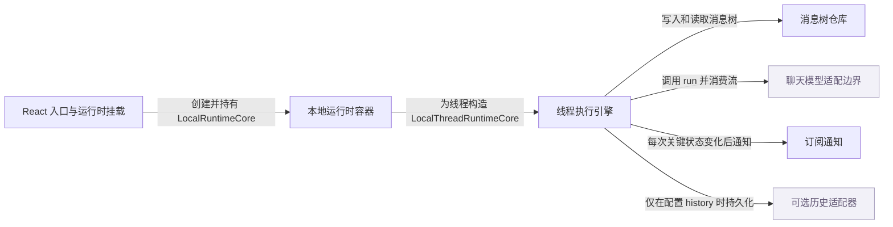

# assistant-ui：架构、运行逻辑与设计取舍

> main · [0188f0597a0f](https://github.com/assistant-ui/assistant-ui/commit/0188f0597a0ff7e0d65a63472efc98197dd46736) · deepseek-flash 辅助分析 · 2026-10-30T05:33:11.336Z
> 下文按固定源码推演，没有执行目标项目。引用可跳到具体代码行；“工程推断”解释收益与代价，不代表作者亲述。

## 1. 先建立直觉

**用一个不依赖 React 的运行时保存消息树并执行模型流，React 层只负责把运行时状态订阅到界面。**

聊天界面要同时处理流式片段、工具调用暂停与继续、分支和可选历史，而不同模型后端返回的数据形状差异很大；如果没有统一执行层，UI 组件会被各家 SDK 的流式与持久化细节绑死。

贯穿全文的例子：

- **输入：** 用户在 Composer 输入 hello 并提交；测试中的 ChatModelAdapter 对本次 run 先 yield content 文本 a，再 yield content 文本 ab。
- **预期输出：** 线程先出现 hello 用户消息，再出现 assistant 消息；assistant 最终文本为 ab，而不是 aab，并在没有显式状态时由运行时补成 complete/unknown（测试片段未展示最终断言，这是按代码推演）。

## 2. 一张图看懂架构



| 模块 | 职责与所在层的原因 | 输入 → 输出 | 拥有的状态 |
| --- | --- | --- | --- |
| React 入口与运行时挂载 [1][source-1] [2][source-2] | useLocalRuntime 在 useState 中创建 LocalRuntimeCore，AssistantRuntimeProvider 只把 runtime 放进上下文；这一层不执行模型调用。 | ChatModelAdapter、LocalRuntimeOptions、initialMessages → AssistantRuntime 和 React 上下文 | runtime 实例身份、options、modelContext 注册 |
| 本地运行时容器 [3][source-3] | LocalRuntimeCore 持有 options 与 model context，并为线程列表构造 LocalThreadRuntimeCore。 | LocalRuntimeOptionsBase、initialMessages → 可被 AssistantRuntime 包装的 threads/main thread core | _options、threads |
| 线程执行引擎 [4][source-4] [5][source-5] [6][source-6] [7][source-7] | LocalThreadRuntimeCore 负责 append、startRun、_runLoop、performRoundtrip，协调消息仓库、模型适配器、通知和可选历史。 | AppendMessage、StartRunConfig、模型 adapter 的流式结果 → 对 MessageRepository 的写入、订阅通知、历史写入 | activeRun、abortController、roundtripsInFlight、unwrittenMessages、lastRunConfig |
| 消息树仓库 [8][source-8] [9][source-9] | MessageRepository 用 Map 加 prev/next/children 链表保存分支和 head，按 head 回溯生成当前路径；它自身不通知订阅者。 | parentId 与 ThreadMessage → 当前消息数组、headId、按 parentId 查询的路径 | messages Map、head、root、每个节点的 level/children/prev/next |
| 聊天模型适配边界（外部依赖） [10][source-10] | 把统一 ChatModelRunOptions 交给具体后端实现，后端返回 Promise<ChatModelRunResult> 或 AsyncGenerator<ChatModelRunResult>。 | modelMessages、runConfig、abortSignal、context、消息 id 等 → content/status/metadata 片段 | 由外部后端持有，core 只保留本轮 initialContent 与 message 快照 |
| 订阅通知 [11][source-11] | BaseSubscribable 用 Set 保存回调，_notifySubscribers 逐个调用；LocalThreadRuntimeCore 在仓库改动后触发通知。 | 订阅回调 → 状态变更通知 | _subscribers Set |
| 可选历史适配器（外部依赖） [12][source-12] | ThreadHistoryAdapter 提供 load/append/update/delete；未配置 history 时运行不落历史，本场景默认不经过持久化。 | ExportedMessageRepositoryItem → 外部持久化写入 | 由外部历史后端持有 |

## 3. 跟着一个请求跑完整条主线

这是对已读方法体的源码推演，不是执行日志。编号是阅读顺序；装配、写入、查询与条件分支是否发生，取决于每步的触发条件。

### 1. Composer 提交 hello 进入线程 append

**阶段：** 入口与分流

**触发条件：** 没有 voice session；未启用消息队列时直接走 _runAppend

入口/调用：`LocalThreadRuntimeCore.append` [5][source-5]

**此时输入：** AppendMessage，角色为 user，parentId 由当前尾部解析

append 先解析 parentId，判断是否 voice、是否为尾部、是否要 startRun；默认路径调用 _runAppend(message)。

**状态变化：** 不直接写仓库，只把消息交给 _runAppend；队列/语音分支未进入。

**交给下一步：** rawMessage 进入 _runAppendInner

### 2. 写入 hello 用户消息并决定启动 run

**阶段：** 写入与调度

**触发条件：** 初始化屏障已通过且未被回滚；user 消息默认 startRun 为 true

入口/调用：`LocalThreadRuntimeCore._runAppendInner / MessageRepository.addOrUpdateMessage` [13][source-13] [14][source-14] [15][source-15]

**此时输入：** rawMessage=hello

fromThreadMessageLike 生成 ThreadMessage，repository.addOrUpdateMessage(parentId,newMessage)，通知订阅者；随后安排可选历史写入，并在 startRun 为 true 时调用 this.startRun({parentId:newMessage.id,...})。

**状态变化：** 用户消息进入 MessageRepository，head 跟随新消息；_pendingAppends 在 finally 减少。

**交给下一步：** startRun 的 parentId 指向 hello 用户消息

### 3. 创建 assistant 占位消息并进入 runLoop

**阶段：** 执行准备

**触发条件：** voice 未连接，sourceId 不是语音消息

入口/调用：`LocalThreadRuntimeCore.startRun` [16][source-16]

**此时输入：** parentId=hello 消息 id，runConfig

取消父消息的 pause，generateId 创建 role=assistant、status=running、content=[] 的消息，加入 _unwrittenMessages，然后调用 _runLoop(parentId,message,runConfig,runCallback)。

**状态变化：** 生成 assistant 内存消息；此时尚未由 performRoundtrip 的 updateMessage 写入仓库。

**交给下一步：** _runLoop 拿到 assistant 占位消息

### 4. runLoop 设置 activeRun 并调用 performRoundtrip

**阶段：** 执行循环

**触发条件：** 初始化与历史 load barrier 已通过，且 voice 为空

入口/调用：`LocalThreadRuntimeCore._runLoop` [17][source-17] [18][source-18]

**此时输入：** parentId、assistant message、runConfig、runCallback

设置 _activeRun={resumedFromPause:false,isRunning:true}，清空 suggestions，通知订阅者，然后 do/while 中调用 performRoundtrip；若 shouldContinue 为 false 则退出。

**状态变化：** isRunning 变为 true；_activeRun 指向本轮 run。

**交给下一步：** performRoundtrip 开始组装模型消息

### 5. performRoundtrip 读取父路径并保存本轮基线

**阶段：** 查询与装配

**触发条件：** parentId 非空时读取该父消息到根的路径

入口/调用：`LocalThreadRuntimeCore.performRoundtrip / MessageRepository.getMessages` [19][source-19] [20][source-20] [21][source-21]

**此时输入：** parentId=hello 用户消息 id，assistant 占位 message

repository.getMessages(parentId) 从 hello 回溯到根，得到 modelMessages；随后 abort 旧 run、创建新 AbortController，记录 initialContent=message.content、initialAnnotations/Data/Steps/Custom，并把本轮登记到 _roundtripsInFlight。

**状态变化：** initialContent 固定为 assistant 占位消息的空 content；roundtrip 归属到当前 abortController。

**交给下一步：** modelMessages、initialContent=[]、新的 abortSignal

### 6. 调用 ChatModelAdapter.run 并判断是否异步迭代

**阶段：** 外部调用与流式入口

**触发条件：** runCallback 由本轮传入或默认 adapters.chatModel.run.bind

入口/调用：`LocalThreadRuntimeCore.performRoundtrip` [22][source-22] [23][source-23]

**此时输入：** modelMessages、runConfig、abortSignal、context、assistantMessageId

先把 assistant 状态更新为 running（若是新消息则 switchToBranch），再调用 runCallback({messages,runConfig,abortSignal,context,...})；若返回值带 Symbol.asyncIterator，则 for await 消费，否则 await 单个结果。

**状态变化：** assistant 消息以 running 状态写入仓库并通知；流开始被逐块消费。

**交给下一步：** 每个 r 都是 ChatModelRunResult 片段

### 7. 每个流片段用 initialContent 基线重建 content

**阶段：** 流式更新

**触发条件：** 进入 for await 且未 abort，或单次 Promise 已 resolve

入口/调用：`LocalThreadRuntimeCore.performRoundtrip / MessageRepository.addOrUpdateMessage` [24][source-24] [25][source-25] [26][source-26] [27][source-27]

**此时输入：** 第一块 content=[text a]，第二块 content=[text ab]

updateMessage 中 content = withExternalResults([...initialContent, ...m.content])；因为 initialContent=[]，第一块得到 [a]，第二块得到 [ab]，而不是把 ab 追加到上一块 [a] 后变成 [a,ab]。随后 message 替换为新对象，repository.addOrUpdateMessage(parentId,message)，再 _notifySubscribers。

**状态变化：** assistant 消息的 content 被当前完整片段替换；metadata 的 annotations/data/steps 则按 initial + new 累积；仓库 head 对应的消息对象更新并通知订阅者。

**交给下一步：** 订阅者看到 assistant 文本先 a 后 ab

### 8. 流结束后补状态并收尾

**阶段：** 收尾与可选持久化

**触发条件：** 流正常结束且消息仍为 running；history 只有配置时才写

入口/调用：`LocalThreadRuntimeCore.performRoundtrip / LocalThreadRuntimeCore._runLoop` [28][source-28] [29][source-29] [30][source-30]

**此时输入：** 最终 assistant message，content=[ab]

若 message.status 仍为 running，updateMessage 设置 complete/unknown；finally 中清理 abortController 与 roundtripsInFlight，按 terminal/pausing 条件调用 _persistSettled（仅 history 存在时），最后通知；_runLoop 在 finally 中把 activeRun 置空并通知 isRunning 变化。

**状态变化：** assistant 最终状态为 complete，activeRun 结束；若未配置 history，则没有任何持久化写入。

**交给下一步：** 线程稳定显示 hello 与 assistant ab

## 4. 核心技术到底是什么

### 1. 异步迭代的“完整片段”流协议

**解决的问题：** 不同模型后端有不同流式协议，但 UI 需要统一的中间消息状态。 [31][source-31] [24][source-24] [32][source-32] [27][source-27]

adapter.run 返回单个结果或 AsyncGenerator；运行时对每个 r 调用 updateMessage，以本轮 initialContent 为基线，把 r.content 作为当前完整 content 重建消息，再写入仓库并通知；不是把每个 text part 追加到上一块。

算法示意（用于解释机制，不是源码原文）：

```text
initialContent = message.content
result = chatModel.run({ messages, runConfig, abortSignal, context })
if isAsyncIterable(result):
  for chunk in result:
    if aborted: break
    updateMessage(chunk)
else:
  updateMessage(await result)

updateMessage(chunk):
  content = chunk.content ? [...initialContent, ...chunk.content] : undefined
  message = {...message, content, status: chunk.status ?? message.status}
  repository.addOrUpdateMessage(parentId, message)
  notifySubscribers()
```

**关键数据结构：** initialContent: ThreadAssistantMessagePart[]；每个 chunk.content: ThreadAssistantMessagePart[]；message.metadata.steps/annotations/data 单独累加。

- **本项目实现：** LocalThreadRuntimeCore.performRoundtrip 的 updateMessage 与 for await 循环。
- **外部依赖提供：** 具体 ChatModelAdapter.run 的实现，负责把后端流转换成 ChatModelRunResult；本仓库只定义接口并消费结果。
- **收益与代价：** 收益是运行时和 UI 始终拿到自包含的当前 content，避免依赖后端是否发 delta；代价是 adapter 每次 yield 都要提供相对 initialContent 的完整 content，内容变长时每块复制/传输成本上升，不能把 chunk 当成原始 token delta。

### 2. 分支消息链表仓库

**解决的问题：** 聊天需要编辑、重载、切换分支、工具继续，单一线性数组难以表达 parent/child 和当前 head。 [8][source-8] [9][source-9]

每个消息一个节点，保存 prev/next/children/level；新增或更新时 link/relink 到 parent，若 parent 是当前 head 则移动 head；getMessages 从 head 沿 prev 回溯，并按 level 填数组；_messages 是缓存，结构改动后 dirty。

算法示意（用于解释机制，不是源码原文）：

```text
upsert(parentId, message):
  prev = parentId ? map.get(parentId) : null
  existing = map.get(message.id)
  if existing:
    relink(prev, existing)
    existing.current = message
  else:
    node = {prev, current: message, children: [], level: prev ? prev.level + 1 : 0}
    map.set(message.id, node)
    link(prev, node)
    if head == prev: head = node; selectPathTo(node)
  cache.dirty()

getMessages(headId):
  walk from head/headId through prev, fill array by level
```

**关键数据结构：** Map<string, RepositoryMessage>；RepositoryMessage={prev,next,current,children,level}；root 伪节点；head 指针；CachedValue<ThreadMessage[]>。

- **本项目实现：** MessageRepository 的 addOrUpdateMessage、getMessages、switchToBranch、export。
- **外部依赖提供：** 无；通知由外层 runtime 负责，仓库不直接调用订阅者。
- **收益与代价：** 收益是分支、编辑和 head 切换有明确数据结构，路径查询只沿祖先链走；代价是 link/relink/cut 的不变量复杂，错误会以内部异常暴露出来。

### 3. 订阅式状态推送

**解决的问题：** 异步 run 在不同时刻改动消息，React 组件需要按变更重渲染，而不是轮询。 [11][source-11] [33][source-33] [25][source-25]

BaseSubscribable 用 Set 保存回调；runtime 在 repository 写入后调用 _notifySubscribers，逐个回调；React/store 层负责把回调桥接到组件订阅。

算法示意（用于解释机制，不是源码原文）：

```text
subscribe(cb):
  subscribers.add(cb)
  return () => subscribers.delete(cb)

notify():
  errors = []
  for cb in subscribers:
    try cb() catch e: errors.push(e)
  if errors: throw/AggregateError
```

**关键数据结构：** Set<() => void> 订阅者集合。

- **本项目实现：** BaseSubscribable 与 LocalThreadRuntimeCore 的 _notifySubscribers 调用点。
- **外部依赖提供：** @assistant-ui/store/React 的 useAui/useAuiState 订阅桥接；本次已读代码只确认到 runtime 通知层。
- **收益与代价：** 收益是状态变更即时推送；代价是每个流片段都可能触发一次通知，订阅端需要自行合并或做选择器比较，否则高频流会造成较多渲染。

### 4. 可选且串行的历史持久化

**解决的问题：** 同一消息的异步历史写入可能乱序，暂停快照可能在终态写入之后到达并把状态“复活”。 [34][source-34] [35][source-35] [36][source-36] [37][source-37]

只有配置 adapters.history 才写；每个 message id 用 _historyWrites 串成 Promise 链，保证同一个 id 的写入按发起顺序落地；用户消息 append 较早，assistant 在 roundtrip 进入 terminal 或满足 pausing+update 时才 _persistSettled。

算法示意（用于解释机制，不是源码原文）：

```text
chainHistoryWrite(id, write):
  if deleted tombstone: suppress
  pending = historyWrites.get(id)
  next = pending ? pending.then(writeCurrent, writeCurrent) : writeCurrent()
  historyWrites.set(id, next.catch(()=>{}))
  return next

persistSettled(parentId, message):
  operation = unwritten ? append : update
  history[operation]({parentId,message,runConfig})
  chainHistoryWrite(message.id, ...)
```

**关键数据结构：** _historyWrites Map<string,Promise<void>>；_unwrittenMessages Set；_deletedMessages tombstone。

- **本项目实现：** LocalThreadRuntimeCore._chainHistoryWrite、_persistSettled、_runAppendInner 的历史写入。
- **外部依赖提供：** ThreadHistoryAdapter 的 append/update/delete 实现。
- **收益与代价：** 收益是同一消息的写入顺序可预测，暂停/终态不会互相覆盖；代价是 runtime 需要维护写入链、未写集合和删除墓碑，且 append-only adapter 无法完整支持暂停后再更新的场景。

## 5. 为什么选择这种实现

### 1. 把消息执行与状态放在与 React 无关的 LocalThreadRuntimeCore，而不是放在 Provider 或组件 effect 中。

**依据：已确认实现；以下原因是工程分析，不代表作者亲述。** [1][source-1] [2][source-2] [17][source-17]

**面临的约束：** 流式 run 跨多次 await/for await，期间组件可能 rerender、StrictMode replay 或切换线程。

**如果改用另一种做法：** 在 React 组件里用 useEffect 直接调用模型并 setState。

**为什么当前方案有用：** 本次场景中 hello 提交后，异步流可能在组件 rerender 期间继续；由 runtime core 持 abortController、activeRun、roundtripsInFlight 和 repository，Provider 只暴露 runtime，执行状态不会因 UI 渲染周期丢失。

**付出的代价，以及不适用的情况：** 需要 runtime/core、store、React 适配层多层抽象，调试调用链更长。

### 2. 每个流片段的 content 按 initialContent + 当前 chunk 重建并替换，而不是追加到上一块结果。

**依据：已确认实现；以下原因是工程分析，不代表作者亲述。** [38][source-38] [27][source-27]

**面临的约束：** adapter 后端可能返回累计快照，也可能返回别的形状；运行时需要一个不会重复拼接的规则。

**如果改用另一种做法：** candidate = previousContent + chunk.content，把每块当增量文本追加。

**为什么当前方案有用：** 测试先返回 a 再返回 ab；若把第二块追加到第一块，文本会变成 aab。当前实现第二块得到 [...initialContent, ...ab] = [ab]，所以最终是 ab。

**付出的代价，以及不适用的情况：** adapter 必须为每次 yield 提供相对本轮起点的完整 content 数组；长回答会重复复制/传输前缀，不能把 chunk 当作原始 token delta。

### 3. content 采用替换快照，而 metadata 的 annotations/data/steps 采用 initial + new 累积。

**依据：已确认实现；以下原因是工程分析，不代表作者亲述。** [39][source-39]

**面临的约束：** 同一个 ChatModelRunResult 中，content 与 metadata 在流式协议里的语义可能不同。

**如果改用另一种做法：** content 和 metadata 都追加，或都用最新值替换。

**为什么当前方案有用：** 代码对 content 使用 withExternalResults([...initialContent, ...m.content])，对 annotations/data/steps 使用 [...(initialX ?? []), ...newX]；这样测试的两块 a/ab 不会被拼成 aab，同时注解/步骤可以逐块累积。

**付出的代价，以及不适用的情况：** adapter 作者必须理解 content 是当前快照、metadata 是增量片段，契约不完全对称。

### 4. 同一个消息 id 的历史写入被串行化，而不是每个异步写独立 fire-and-forget。

**作者原文：** “Writes for one message id must land in issue order; an earlier paused snapshot arriving after the terminal write would resurrect the pause.” [35][source-35]

**面临的约束：** 历史适配器写入是异步的，暂停快照和终态写入可能并发。

**如果改用另一种做法：** 每次持久化直接调用 history.append/update，不维护 Promise 链。

**为什么当前方案有用：** 源码注释指出，一个较早的暂停快照如果在终态写入之后到达，会把暂停状态重新复活；串行化保证同一个 id 按发起顺序落地。

**付出的代价，以及不适用的情况：** 需要 _historyWrites、tombstone 和链式 Promise，增加状态机复杂度。

### 5. 用 MessageRepository 的分支链表作为消息真源，而不是用一个扁平消息数组直接增删。

**依据：已确认实现；以下原因是工程分析，不代表作者亲述。** [8][source-8] [15][source-15] [40][source-40]

**面临的约束：** 编辑、重载、工具继续和分支切换都要求表达 parent/child 与当前 head。

**如果改用另一种做法：** 维护 messages: ThreadMessage[]，编辑时截断/替换数组元素。

**为什么当前方案有用：** 本次 hello 的 run 需要从 parentId 读取到根路径作为 modelMessages；后续若编辑 hello 或产生分支，链表仓库能通过 parentId/prev/children 保留路径关系并切换 head，而扁平数组难以表达同一父消息的多条子分支。

**付出的代价，以及不适用的情况：** 需要维护 link/relink/cut、level 和缓存 dirty 等不变量，仓库内部错误可能直接抛出。

## 6. 关键代码精读

### 1. append 到 run 的分界


`packages/core/src/runtimes/local/local-thread-runtime-core.ts:773-796` [5][source-5]

```typescript
  public async append(message: AppendMessage): Promise<void> {
    message = {
      ...message,
      parentId: this._resolveAppendParent(message.parentId),
    };
    if (this.voice) return this._appendToVoiceSession(message);
    if (this._isVoiceMessage(message.sourceId))
      throw new Error("Voice transcript messages cannot be edited");
    const isTail = message.parentId === (this.messages.at(-1)?.id ?? null);
    const willRun = message.startRun ?? message.role === "user";
    if (this._queue && willRun && isTail) {
      if (message.steer ?? this._queueRunInFlight !== null)
        this._queue.adapter.steer(message);
      else this._queue.adapter.enqueue(message);
      return;
    }
    if (
      this._queue &&
      !isTail &&
      (this._options.unstable_queueClearOnRewind ?? true)
    )
      this._queue.clear();
    return this._runAppend(message);
  }
```


`packages/core/src/runtimes/local/local-thread-runtime-core.ts:946-954` [13][source-13]

```typescript
    const message = this.enrichAppendMetadata(rawMessage);
    this.ensureInitialized();

    const newMessage = fromThreadMessageLike(message, generateId(), {
      type: "complete",
      reason: "unknown",
    });
    this.repository.addOrUpdateMessage(message.parentId, newMessage);
    this._notifySubscribers();
```


`packages/core/src/runtimes/local/local-thread-runtime-core.ts:997-1009` [14][source-14]

```typescript
    const startRun = message.startRun ?? message.role === "user";
    if (startRun) {
      // startRun reaches _runLoop synchronously, which marks the run active
      // before the queue can see this append leave
      reachRun();
      const [runResult, historyResult] = await Promise.allSettled([
        this.startRun({
          parentId: newMessage.id,
          sourceId: message.sourceId,
          runConfig: message.runConfig ?? {},
        }),
        historyWrite,
      ]);
```


append 先处理 parentId、voice 和队列。默认没有 queue/voice 时调用 _runAppend；_runAppendInner 先把 hello 转成 ThreadMessage 并乐观写入仓库、通知界面，再在 user 消息默认 startRun 的条件下调用 this.startRun，把新建 assistant 消息的 run 接到 hello 的 id 后面。

### 2. 每个流片段用 initialContent 基线重建 content


`packages/core/src/runtimes/local/local-thread-runtime-core.ts:1424-1444` [38][source-38]

```typescript
          }),
        };
      });
    };
    const updateMessage = (m: Partial<ChatModelRunResult>) => {
      if (!syncOwnedMessage()) return;
      const newSteps = m.metadata?.steps;
      const steps = newSteps
        ? [...(initialSteps ?? []), ...newSteps]
        : undefined;

      const newAnnotations = m.metadata?.unstable_annotations;
      const newData = m.metadata?.unstable_data;
      const annotations = newAnnotations
        ? [...(initialAnnotations ?? []), ...newAnnotations]
        : undefined;
      const data = newData ? [...(initialData ?? []), ...newData] : undefined;

      const content = m.content
        ? withExternalResults([...initialContent, ...m.content])
        : undefined;
```


`packages/core/src/runtimes/local/local-thread-runtime-core.ts:1477-1479` [25][source-25]

```typescript
      this.repository.addOrUpdateMessage(parentId, message);
      hasStoredMessage = true;
      this._notifySubscribers();
```


`packages/core/src/runtimes/local/local-thread-runtime-core.test.ts:471-478` [27][source-27]

```typescript
    );
    const thread = createThread(
      {
        async *run() {
          yield { content: [{ type: "text", text: "a" }] };
          await gate;
          yield { content: [{ type: "text", text: "ab" }] };
        },
```


performRoundtrip 在流开始前把 assistant 占位消息的 content 存为 initialContent。updateMessage 每次都用 [...initialContent, ...m.content] 重建 content，而不是读取上一次 message.content 再追加。因此测试先 yield text a、再 yield text ab 时，第二次的 content 变成 [ab]，不会保留第一块的 [a] 再拼成 [a,ab]；随后仓库 addOrUpdateMessage 替换同一消息并通知订阅者。

### 3. adapter.run 与异步迭代


`packages/core/src/runtimes/local/local-thread-runtime-core.ts:1519-1543` [41][source-41]

```typescript
      runCallback =
        runCallback ??
        this.adapters.chatModel.run.bind(this.adapters.chatModel);

      const abortSignal = abortController.signal;
      const shouldCancelMessage = () =>
        abortSignal.aborted &&
        (message.status.type === "running" ||
          (message.status.type === "requires-action" &&
            (this._activeRun !== run ||
              shouldContinue(message, this._options.unstable_humanToolNames))));
      const threadId = this._getThreadId?.();
      const promiseOrGenerator = runCallback({
        messages: modelMessages,
        runConfig: this._lastRunConfig,
        abortSignal,
        context,
        unstable_assistantMessageId: message.id,
        unstable_threadId: threadId,
        unstable_parentId: parentId,
        unstable_getMessage() {
          syncOwnedMessage();
          return withoutToolInteractions(message);
        },
      });
```


`packages/core/src/runtimes/local/local-thread-runtime-core.ts:1546-1561` [42][source-42]

```typescript
      if (Symbol.asyncIterator in promiseOrGenerator) {
        for await (const r of promiseOrGenerator) {
          if (abortSignal.aborted) {
            if (shouldCancelMessage()) {
              updateMessage({
                status: { type: "incomplete", reason: "cancelled" },
              });
            }
            break;
          }

          updateMessage(r);
        }
      } else {
        updateMessage(await promiseOrGenerator);
      }
```


`packages/core/src/runtimes/local/local-thread-runtime-core.ts:1567-1571` [28][source-28]

```typescript
      } else if (message.status.type === "running") {
        updateMessage({
          status: { type: "complete", reason: "unknown" },
        });
      }
```


performRoundtrip 把 modelMessages、runConfig、abortSignal、context 和消息 id 交给 runCallback；如果返回值带 Symbol.asyncIterator，就用 for await 逐块消费，并在每次 abort 检查后调用 updateMessage。最后如果消息仍是 running，则补 complete/unknown。这里清楚区分了“运行时负责消费与落库”和“adapter 负责产生后端结果”的边界。

## 7. 动手验证你的理解

以下是建议实验，没有执行过。

### 1. 验证 chunk 是相对 initialContent 的累计快照，而不是增量 delta。

**改变什么：** 把测试 adapter 的第二块从 text=ab 改成 text=b，其余仍先 yield a。 [24][source-24] [27][source-27]

**应该观察到什么：** 按当前 updateMessage，第一块得到 content=[a]，第二块以 initialContent=[] 重建得到 content=[b]；最终 assistant 显示 b，而不是 ab。若期望 ab，adapter 必须第二块返回 ab 这种完整快照。

### 2. 验证 a 然后 ab 不会形成两个 text part 或字符串 aab。

**改变什么：** 保持 adapter 先 yield a、再 yield ab，检查 assistant 消息 content 的 part 数量与文本。 [43][source-43] [25][source-25] [27][source-27]

**应该观察到什么：** 每个时刻 content 都由当前块替换；最终 content 是包含 ab 的当前快照，而不是 [a,ab]。这正是第二个 yield 使用 initialContent 基线而非上一块结果的结果。

### 3. 验证 history 不是每个流片段都写。

**改变什么：** 配置一个只实现 load/append 的 history adapter，发送 hello，并让 adapter 先返回 a 再返回 ab。 [44][source-44] [37][source-37] [36][source-36]

**应该观察到什么：** 用户消息在 _runAppendInner 中较早 append；assistant 的 append 要等 roundtrip 进入 terminal 后由 _persistSettled 写入，不应随 a/ab 两个片段各写一次。若 history 只有 append 没有 update，pausing 分支也不会强行写入。

## 8. 读完应当能复述什么

- 执行引擎在 LocalThreadRuntimeCore，不在 React Provider；Provider 只负责把 runtime 暴露给组件树。
- 流式 chunk 的 content 按本轮 initialContent 重建，是完整快照语义；测试的 a 再 ab 因此最终为 ab，而不是 aab。
- MessageRepository 是带 head 和分支的消息树真源，仓库改动本身不通知，通知由 runtime 在写入后触发。
- ChatModelAdapter 把不同后端统一成 Promise 或 AsyncGenerator 的 ChatModelRunResult，代价是 adapter 必须遵守完整 content 片段契约。
- history 是可选适配器；一旦配置，同一消息的写入会按 id 串行化，避免暂停快照覆盖终态。

## 来源与覆盖边界

本次读取 24 个文件，共 264,180 字符；22 个文件完整读取，其他文件按关键方法取带行号的片段。没有把未读依赖的内部实现当作已确认事实。

- AssistantProviderBase/AssistantProvider 的订阅桥接未读，无法确认 runtime 的 _notifySubscribers 到 useSyncExternalStore/React 组件的精确调用路径。
- useRemoteThreadListRuntime 与 RemoteThreadList 的许多主体方法未读，无法完整解释 Cloud/远程线程初始化和它的消息加载。
- 未读任何具体 ChatModelAdapter 后端实现，只能从接口、performRoundtrip 和测试片段推断 chunk 是完整快照；不能断言所有第三方 adapter 都这样实现。
- 测试只读到 471-478 的 adapter yield 代码，未读到该测试的最终断言；最终 ab 是依据 updateMessage 与测试输入推演的结果。
- 工具调用、审批、shouldContinue 的多轮循环只读到部分逻辑，本场景没有展开这些分支。

| 文件 | 实际读取行段 |
| --- | --- |
| [README.md](https://github.com/assistant-ui/assistant-ui/blob/0188f0597a0ff7e0d65a63472efc98197dd46736/README.md) | 1–164 / 共 164 行 |
| [package.json](https://github.com/assistant-ui/assistant-ui/blob/0188f0597a0ff7e0d65a63472efc98197dd46736/package.json) | 1–101 / 共 101 行 |
| [packages/core/src/runtimes/local/local-thread-runtime-core.ts](https://github.com/assistant-ui/assistant-ui/blob/0188f0597a0ff7e0d65a63472efc98197dd46736/packages/core/src/runtimes/local/local-thread-runtime-core.ts) | 1–1937 / 共 1937 行 |
| [packages/core/src/runtimes/local/local-runtime-core.ts](https://github.com/assistant-ui/assistant-ui/blob/0188f0597a0ff7e0d65a63472efc98197dd46736/packages/core/src/runtimes/local/local-runtime-core.ts) | 1–31 / 共 31 行 |
| [packages/core/src/runtime/utils/message-repository.ts](https://github.com/assistant-ui/assistant-ui/blob/0188f0597a0ff7e0d65a63472efc98197dd46736/packages/core/src/runtime/utils/message-repository.ts) | 1–647 / 共 647 行 |
| [packages/core/src/runtime/utils/chat-model-adapter.ts](https://github.com/assistant-ui/assistant-ui/blob/0188f0597a0ff7e0d65a63472efc98197dd46736/packages/core/src/runtime/utils/chat-model-adapter.ts) | 1–71 / 共 71 行 |
| [packages/core/src/runtimes/local/local-thread-runtime-core.test.ts](https://github.com/assistant-ui/assistant-ui/blob/0188f0597a0ff7e0d65a63472efc98197dd46736/packages/core/src/runtimes/local/local-thread-runtime-core.test.ts) | 1–50、83–88、102–107、129–134、177–182、257–264、310–315、337–347、375–380、410–415、437–442、471–478、516–525、563–575、622–640、679–693、716–724、737–763、793–814、844–849、890–902、939–944、995–1010、1038–1051、1076–1087、1122–1127、1163–1171、1204–1209、1250–1260、1314–1333、1368–1374、1407–1420、1533–1545、1872–1879、1996–2007、2051–2065、2081–2101、2116–2127、2221–2226、2410–2418、2524–2535、2580–2586、2626–2632、2666–2679、2723–2742、2782–2794、2815–2827、2852–2861、2879–2889、2909–2918、2942–2949、2972–2978、3006–3014、3034–3040、3055–3060、3069–3074、3093–3098、3120–3125、3150–3155、3179–3184、3216–3221、3251–3256、3295–3302、3336–3341、3361–3366、3387–3392、3444–3449、3770–3778、3811–3817、3837–3842、3890–3895、3934–3939、3969–3978、4018–4024、4070–4075、4104–4115、4165–4170、4205–4210、4230–4235、4264–4269、4293–4298、4319–4324、4370–4378、4474–4485、4518–4529、4575–4590、4624–4637、4677–4684、4735–4746、4789–4803、4842–4857、4898–4912、4945–4961、4998–5020、5051–5060、5096–5106、5146–5153、5231–5236、5295–5300、5491–5496、5521–5532、5575–5580、5611–5623、5664–5676、5717–5729、5813–5819、5861–5866、5911–5917、5974–5980、6342–6352、6394–6408、6440–6457、6506–6513、6561–6568、6612–6617、6643–6656、6673–6691、6720–6730、6777–6784、6814–6827、6877–6886、6902–6915、6983–6988、7011–7016、7059–7069、7100–7118、7138–7145、7189–7194、8131–8144、8195–8201、8475–8487、8588–8601 / 共 9332 行 |
| [packages/core/src/react/runtimes/useLocalRuntime.ts](https://github.com/assistant-ui/assistant-ui/blob/0188f0597a0ff7e0d65a63472efc98197dd46736/packages/core/src/react/runtimes/useLocalRuntime.ts) | 1–184 / 共 184 行 |
| [packages/core/src/react/AssistantRuntimeProvider.tsx](https://github.com/assistant-ui/assistant-ui/blob/0188f0597a0ff7e0d65a63472efc98197dd46736/packages/core/src/react/AssistantRuntimeProvider.tsx) | 1–66 / 共 66 行 |
| [packages/core/src/react/RuntimeAdapter.ts](https://github.com/assistant-ui/assistant-ui/blob/0188f0597a0ff7e0d65a63472efc98197dd46736/packages/core/src/react/RuntimeAdapter.ts) | 1–57 / 共 57 行 |
| [packages/core/src/react/client/RemoteThreadList.ts](https://github.com/assistant-ui/assistant-ui/blob/0188f0597a0ff7e0d65a63472efc98197dd46736/packages/core/src/react/client/RemoteThreadList.ts) | 1–50、123–233 / 共 2166 行 |
| [packages/core/src/adapters/thread-history.ts](https://github.com/assistant-ui/assistant-ui/blob/0188f0597a0ff7e0d65a63472efc98197dd46736/packages/core/src/adapters/thread-history.ts) | 1–115 / 共 115 行 |
| [packages/core/src/runtime/utils/thread-message-like.ts](https://github.com/assistant-ui/assistant-ui/blob/0188f0597a0ff7e0d65a63472efc98197dd46736/packages/core/src/runtime/utils/thread-message-like.ts) | 1–354 / 共 354 行 |
| [packages/core/src/runtime/utils/auto-status.ts](https://github.com/assistant-ui/assistant-ui/blob/0188f0597a0ff7e0d65a63472efc98197dd46736/packages/core/src/runtime/utils/auto-status.ts) | 1–132 / 共 132 行 |
| [packages/core/src/runtime/utils/tool-interactions.ts](https://github.com/assistant-ui/assistant-ui/blob/0188f0597a0ff7e0d65a63472efc98197dd46736/packages/core/src/runtime/utils/tool-interactions.ts) | 1–148 / 共 148 行 |
| [packages/core/src/runtime/utils/message-repository-session.ts](https://github.com/assistant-ui/assistant-ui/blob/0188f0597a0ff7e0d65a63472efc98197dd46736/packages/core/src/runtime/utils/message-repository-session.ts) | 1–174 / 共 174 行 |
| [packages/core/src/subscribable/subscribable.ts](https://github.com/assistant-ui/assistant-ui/blob/0188f0597a0ff7e0d65a63472efc98197dd46736/packages/core/src/subscribable/subscribable.ts) | 1–396 / 共 396 行 |
| [packages/core/src/react/runtimes/useLocalRuntime.test.tsx](https://github.com/assistant-ui/assistant-ui/blob/0188f0597a0ff7e0d65a63472efc98197dd46736/packages/core/src/react/runtimes/useLocalRuntime.test.tsx) | 1–830 / 共 830 行 |
| [packages/core/src/utils/id.ts](https://github.com/assistant-ui/assistant-ui/blob/0188f0597a0ff7e0d65a63472efc98197dd46736/packages/core/src/utils/id.ts) | 1–14 / 共 14 行 |
| [packages/core/src/runtimes/local/should-continue.ts](https://github.com/assistant-ui/assistant-ui/blob/0188f0597a0ff7e0d65a63472efc98197dd46736/packages/core/src/runtimes/local/should-continue.ts) | 1–41 / 共 41 行 |
| [packages/core/src/runtimes/local/local-runtime-options.ts](https://github.com/assistant-ui/assistant-ui/blob/0188f0597a0ff7e0d65a63472efc98197dd46736/packages/core/src/runtimes/local/local-runtime-options.ts) | 1–55 / 共 55 行 |
| [packages/core/src/adapters/suggestion.ts](https://github.com/assistant-ui/assistant-ui/blob/0188f0597a0ff7e0d65a63472efc98197dd46736/packages/core/src/adapters/suggestion.ts) | 1–94 / 共 94 行 |
| [packages/core/src/runtime/interfaces/thread-runtime-core.ts](https://github.com/assistant-ui/assistant-ui/blob/0188f0597a0ff7e0d65a63472efc98197dd46736/packages/core/src/runtime/interfaces/thread-runtime-core.ts) | 1–334 / 共 334 行 |
| [packages/core/src/runtime/base/base-thread-runtime-core.ts](https://github.com/assistant-ui/assistant-ui/blob/0188f0597a0ff7e0d65a63472efc98197dd46736/packages/core/src/runtime/base/base-thread-runtime-core.ts) | 1–587 / 共 587 行 |

[source-1]: https://github.com/assistant-ui/assistant-ui/blob/0188f0597a0ff7e0d65a63472efc98197dd46736/packages/core/src/react/runtimes/useLocalRuntime.ts#L56-L76 "packages/core/src/react/runtimes/useLocalRuntime.ts:56-76"
[source-2]: https://github.com/assistant-ui/assistant-ui/blob/0188f0597a0ff7e0d65a63472efc98197dd46736/packages/core/src/react/AssistantRuntimeProvider.tsx#L55-L63 "packages/core/src/react/AssistantRuntimeProvider.tsx:55-63"
[source-3]: https://github.com/assistant-ui/assistant-ui/blob/0188f0597a0ff7e0d65a63472efc98197dd46736/packages/core/src/runtimes/local/local-runtime-core.ts#L8-L29 "packages/core/src/runtimes/local/local-runtime-core.ts:8-29"
[source-4]: https://github.com/assistant-ui/assistant-ui/blob/0188f0597a0ff7e0d65a63472efc98197dd46736/packages/core/src/runtimes/local/local-thread-runtime-core.ts#L160-L200 "packages/core/src/runtimes/local/local-thread-runtime-core.ts:160-200"
[source-5]: https://github.com/assistant-ui/assistant-ui/blob/0188f0597a0ff7e0d65a63472efc98197dd46736/packages/core/src/runtimes/local/local-thread-runtime-core.ts#L773-L796 "packages/core/src/runtimes/local/local-thread-runtime-core.ts:773-796"
[source-6]: https://github.com/assistant-ui/assistant-ui/blob/0188f0597a0ff7e0d65a63472efc98197dd46736/packages/core/src/runtimes/local/local-thread-runtime-core.ts#L1114-L1151 "packages/core/src/runtimes/local/local-thread-runtime-core.ts:1114-1151"
[source-7]: https://github.com/assistant-ui/assistant-ui/blob/0188f0597a0ff7e0d65a63472efc98197dd46736/packages/core/src/runtimes/local/local-thread-runtime-core.ts#L1299-L1328 "packages/core/src/runtimes/local/local-thread-runtime-core.ts:1299-1328"
[source-8]: https://github.com/assistant-ui/assistant-ui/blob/0188f0597a0ff7e0d65a63472efc98197dd46736/packages/core/src/runtime/utils/message-repository.ts#L203-L235 "packages/core/src/runtime/utils/message-repository.ts:203-235"
[source-9]: https://github.com/assistant-ui/assistant-ui/blob/0188f0597a0ff7e0d65a63472efc98197dd46736/packages/core/src/runtime/utils/message-repository.ts#L323-L378 "packages/core/src/runtime/utils/message-repository.ts:323-378"
[source-10]: https://github.com/assistant-ui/assistant-ui/blob/0188f0597a0ff7e0d65a63472efc98197dd46736/packages/core/src/runtime/utils/chat-model-adapter.ts#L50-L70 "packages/core/src/runtime/utils/chat-model-adapter.ts:50-70"
[source-11]: https://github.com/assistant-ui/assistant-ui/blob/0188f0597a0ff7e0d65a63472efc98197dd46736/packages/core/src/subscribable/subscribable.ts#L93-L112 "packages/core/src/subscribable/subscribable.ts:93-112"
[source-12]: https://github.com/assistant-ui/assistant-ui/blob/0188f0597a0ff7e0d65a63472efc98197dd46736/packages/core/src/adapters/thread-history.ts#L66-L109 "packages/core/src/adapters/thread-history.ts:66-109"
[source-13]: https://github.com/assistant-ui/assistant-ui/blob/0188f0597a0ff7e0d65a63472efc98197dd46736/packages/core/src/runtimes/local/local-thread-runtime-core.ts#L946-L954 "packages/core/src/runtimes/local/local-thread-runtime-core.ts:946-954"
[source-14]: https://github.com/assistant-ui/assistant-ui/blob/0188f0597a0ff7e0d65a63472efc98197dd46736/packages/core/src/runtimes/local/local-thread-runtime-core.ts#L997-L1009 "packages/core/src/runtimes/local/local-thread-runtime-core.ts:997-1009"
[source-15]: https://github.com/assistant-ui/assistant-ui/blob/0188f0597a0ff7e0d65a63472efc98197dd46736/packages/core/src/runtime/utils/message-repository.ts#L346-L378 "packages/core/src/runtime/utils/message-repository.ts:346-378"
[source-16]: https://github.com/assistant-ui/assistant-ui/blob/0188f0597a0ff7e0d65a63472efc98197dd46736/packages/core/src/runtimes/local/local-thread-runtime-core.ts#L1114-L1143 "packages/core/src/runtimes/local/local-thread-runtime-core.ts:1114-1143"
[source-17]: https://github.com/assistant-ui/assistant-ui/blob/0188f0597a0ff7e0d65a63472efc98197dd46736/packages/core/src/runtimes/local/local-thread-runtime-core.ts#L1203-L1232 "packages/core/src/runtimes/local/local-thread-runtime-core.ts:1203-1232"
[source-18]: https://github.com/assistant-ui/assistant-ui/blob/0188f0597a0ff7e0d65a63472efc98197dd46736/packages/core/src/runtimes/local/local-thread-runtime-core.ts#L1241-L1244 "packages/core/src/runtimes/local/local-thread-runtime-core.ts:1241-1244"
[source-19]: https://github.com/assistant-ui/assistant-ui/blob/0188f0597a0ff7e0d65a63472efc98197dd46736/packages/core/src/runtimes/local/local-thread-runtime-core.ts#L1307-L1328 "packages/core/src/runtimes/local/local-thread-runtime-core.ts:1307-1328"
[source-20]: https://github.com/assistant-ui/assistant-ui/blob/0188f0597a0ff7e0d65a63472efc98197dd46736/packages/core/src/runtimes/local/local-thread-runtime-core.ts#L1484-L1487 "packages/core/src/runtimes/local/local-thread-runtime-core.ts:1484-1487"
[source-21]: https://github.com/assistant-ui/assistant-ui/blob/0188f0597a0ff7e0d65a63472efc98197dd46736/packages/core/src/runtime/utils/message-repository.ts#L323-L344 "packages/core/src/runtime/utils/message-repository.ts:323-344"
[source-22]: https://github.com/assistant-ui/assistant-ui/blob/0188f0597a0ff7e0d65a63472efc98197dd46736/packages/core/src/runtimes/local/local-thread-runtime-core.ts#L1500-L1521 "packages/core/src/runtimes/local/local-thread-runtime-core.ts:1500-1521"
[source-23]: https://github.com/assistant-ui/assistant-ui/blob/0188f0597a0ff7e0d65a63472efc98197dd46736/packages/core/src/runtimes/local/local-thread-runtime-core.ts#L1531-L1561 "packages/core/src/runtimes/local/local-thread-runtime-core.ts:1531-1561"
[source-24]: https://github.com/assistant-ui/assistant-ui/blob/0188f0597a0ff7e0d65a63472efc98197dd46736/packages/core/src/runtimes/local/local-thread-runtime-core.ts#L1428-L1444 "packages/core/src/runtimes/local/local-thread-runtime-core.ts:1428-1444"
[source-25]: https://github.com/assistant-ui/assistant-ui/blob/0188f0597a0ff7e0d65a63472efc98197dd46736/packages/core/src/runtimes/local/local-thread-runtime-core.ts#L1477-L1479 "packages/core/src/runtimes/local/local-thread-runtime-core.ts:1477-1479"
[source-26]: https://github.com/assistant-ui/assistant-ui/blob/0188f0597a0ff7e0d65a63472efc98197dd46736/packages/core/src/runtimes/local/local-thread-runtime-core.ts#L1546-L1558 "packages/core/src/runtimes/local/local-thread-runtime-core.ts:1546-1558"
[source-27]: https://github.com/assistant-ui/assistant-ui/blob/0188f0597a0ff7e0d65a63472efc98197dd46736/packages/core/src/runtimes/local/local-thread-runtime-core.test.ts#L471-L478 "packages/core/src/runtimes/local/local-thread-runtime-core.test.ts:471-478"
[source-28]: https://github.com/assistant-ui/assistant-ui/blob/0188f0597a0ff7e0d65a63472efc98197dd46736/packages/core/src/runtimes/local/local-thread-runtime-core.ts#L1567-L1571 "packages/core/src/runtimes/local/local-thread-runtime-core.ts:1567-1571"
[source-29]: https://github.com/assistant-ui/assistant-ui/blob/0188f0597a0ff7e0d65a63472efc98197dd46736/packages/core/src/runtimes/local/local-thread-runtime-core.ts#L1633-L1671 "packages/core/src/runtimes/local/local-thread-runtime-core.ts:1633-1671"
[source-30]: https://github.com/assistant-ui/assistant-ui/blob/0188f0597a0ff7e0d65a63472efc98197dd46736/packages/core/src/runtimes/local/local-thread-runtime-core.ts#L1245-L1255 "packages/core/src/runtimes/local/local-thread-runtime-core.ts:1245-1255"
[source-31]: https://github.com/assistant-ui/assistant-ui/blob/0188f0597a0ff7e0d65a63472efc98197dd46736/packages/core/src/runtime/utils/chat-model-adapter.ts#L66-L70 "packages/core/src/runtime/utils/chat-model-adapter.ts:66-70"
[source-32]: https://github.com/assistant-ui/assistant-ui/blob/0188f0597a0ff7e0d65a63472efc98197dd46736/packages/core/src/runtimes/local/local-thread-runtime-core.ts#L1519-L1561 "packages/core/src/runtimes/local/local-thread-runtime-core.ts:1519-1561"
[source-33]: https://github.com/assistant-ui/assistant-ui/blob/0188f0597a0ff7e0d65a63472efc98197dd46736/packages/core/src/runtime/base/base-thread-runtime-core.ts#L59-L65 "packages/core/src/runtime/base/base-thread-runtime-core.ts:59-65"
[source-34]: https://github.com/assistant-ui/assistant-ui/blob/0188f0597a0ff7e0d65a63472efc98197dd46736/packages/core/src/adapters/thread-history.ts#L91-L109 "packages/core/src/adapters/thread-history.ts:91-109"
[source-35]: https://github.com/assistant-ui/assistant-ui/blob/0188f0597a0ff7e0d65a63472efc98197dd46736/packages/core/src/runtimes/local/local-thread-runtime-core.ts#L237-L299 "packages/core/src/runtimes/local/local-thread-runtime-core.ts:237-299"
[source-36]: https://github.com/assistant-ui/assistant-ui/blob/0188f0597a0ff7e0d65a63472efc98197dd46736/packages/core/src/runtimes/local/local-thread-runtime-core.ts#L335-L354 "packages/core/src/runtimes/local/local-thread-runtime-core.ts:335-354"
[source-37]: https://github.com/assistant-ui/assistant-ui/blob/0188f0597a0ff7e0d65a63472efc98197dd46736/packages/core/src/runtimes/local/local-thread-runtime-core.ts#L1633-L1661 "packages/core/src/runtimes/local/local-thread-runtime-core.ts:1633-1661"
[source-38]: https://github.com/assistant-ui/assistant-ui/blob/0188f0597a0ff7e0d65a63472efc98197dd46736/packages/core/src/runtimes/local/local-thread-runtime-core.ts#L1424-L1444 "packages/core/src/runtimes/local/local-thread-runtime-core.ts:1424-1444"
[source-39]: https://github.com/assistant-ui/assistant-ui/blob/0188f0597a0ff7e0d65a63472efc98197dd46736/packages/core/src/runtimes/local/local-thread-runtime-core.ts#L1430-L1444 "packages/core/src/runtimes/local/local-thread-runtime-core.ts:1430-1444"
[source-40]: https://github.com/assistant-ui/assistant-ui/blob/0188f0597a0ff7e0d65a63472efc98197dd46736/packages/core/src/runtimes/local/local-thread-runtime-core.ts#L1307-L1317 "packages/core/src/runtimes/local/local-thread-runtime-core.ts:1307-1317"
[source-41]: https://github.com/assistant-ui/assistant-ui/blob/0188f0597a0ff7e0d65a63472efc98197dd46736/packages/core/src/runtimes/local/local-thread-runtime-core.ts#L1519-L1543 "packages/core/src/runtimes/local/local-thread-runtime-core.ts:1519-1543"
[source-42]: https://github.com/assistant-ui/assistant-ui/blob/0188f0597a0ff7e0d65a63472efc98197dd46736/packages/core/src/runtimes/local/local-thread-runtime-core.ts#L1546-L1561 "packages/core/src/runtimes/local/local-thread-runtime-core.ts:1546-1561"
[source-43]: https://github.com/assistant-ui/assistant-ui/blob/0188f0597a0ff7e0d65a63472efc98197dd46736/packages/core/src/runtimes/local/local-thread-runtime-core.ts#L1442-L1444 "packages/core/src/runtimes/local/local-thread-runtime-core.ts:1442-1444"
[source-44]: https://github.com/assistant-ui/assistant-ui/blob/0188f0597a0ff7e0d65a63472efc98197dd46736/packages/core/src/runtimes/local/local-thread-runtime-core.ts#L978-L995 "packages/core/src/runtimes/local/local-thread-runtime-core.ts:978-995"
