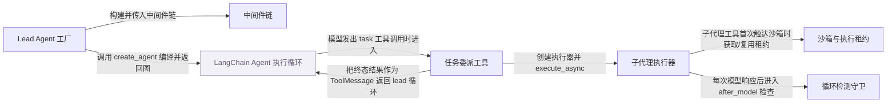

# deer-flow：架构、运行逻辑与设计取舍

> main · [c50cdc516177](https://github.com/bytedance/deer-flow/commit/c50cdc5161779c8b32cda6a0cb575303195f5e65) · deepseek-flash 辅助分析 · 2026-10-30T05:33:11.336Z
> 下文按固定源码推演，没有执行目标项目。引用可跳到具体代码行；“工程推断”解释收益与代价，不代表作者亲述。

## 1. 先建立直觉

**把一次用户请求交给一个会自己决定调用工具或分派子任务的主代理，子代理在受限环境里做完并把结果交回，主代理汇总后输出。**

当前 DeerFlow 2.0 harness 不是早期固定 research DAG，而是通用 agent 循环；难点是按每次请求组装模型、工具、中间件、沙箱和子代理能力，并让长任务在超时、取消、并发使用沙箱时安全收尾。

贯穿全文的例子：

- **输入：** 用户请求：调研 2026 年 AI Agent 框架，把结论写入 /mnt/user-data/outputs/report.md，并附 3 个来源。主代理可能直接搜索，也可能用 task 工具把某一段调研委派给 general-purpose 子代理。
- **预期输出：** 推演输出可能为：lead 汇总子代理返回的 ToolMessage，并在沙箱输出目录生成或更新 report.md；若子代理触发循环上限，结果可能带 stop_reason=loop_capped，而不是伪装成完全正常完成。

## 2. 一张图看懂架构



| 模块 | 职责与所在层的原因 | 输入 → 输出 | 拥有的状态 |
| --- | --- | --- | --- |
| Lead Agent 工厂 [1][source-1] [2][source-2] | 按 RunnableConfig 解析模型、子代理开关、技能白名单、工具与中间件，调用 create_agent 编译当前运行栈；它只负责装配，不实现模型循环。 | RunnableConfig，含模型名、agent 名、thread/user 上下文和运行策略。 → LeadAgentAssembly，内含编译后的 graph 和装配描述。 | config 的 metadata/callbacks、checkpoint mode、解析后的模型与子代理策略。 |
| 中间件链 [3][source-3] [4][source-4] | 把沙箱、上下文压缩、子代理限流、循环检测、澄清等横切逻辑按固定顺序插入图；顺序本身就是行为契约。 | config、模型名、skill 集合、deferred 工具等。 → 有序 AgentMiddleware 列表，交给 create_agent。 | 各中间件自己的运行态，例如 pending warning、sandbox lease 上下文。 |
| LangChain Agent 执行循环（外部依赖） [5][source-5] [6][source-6] | 提供模型调用、工具调用、中间件钩子调度和 graph 状态推进；项目代码只装配图和中间件。 | 模型、工具、middleware、系统提示和 state schema。 → AIMessage、tool calls 或最终回答，并驱动图状态。 | LangGraph/AgentState 中的 messages 等通道。 |
| 任务委派工具 [7][source-7] [8][source-8] | 校验子代理类型和委派策略，构建子代理工具与 SubagentExecutor，后台执行并轮询，最终把结果包成 ToolMessage/Command 回给 lead。 | prompt、subagent_type、acceptance_criteria、runtime state/context。 → Command 中的 ToolMessage，或失败/超时结果。 | 后台任务注册表、轮询状态、token usage 上报。 |
| 子代理执行器 [9][source-9] [10][source-10] [11][source-11] | 在隔离事件循环中创建子图、构建初始状态、astream 执行、收集 token/receipts/ai messages，并以一次性终态写回收结果。 | 任务文本、父状态快照、工具、沙箱状态、运行上下文。 → SubagentResult，含 status/result/error/stop_reason/token usage。 | SubagentResult.status、ai_messages、tool_receipts、bash_executions。 |
| 沙箱与执行租约 [12][source-12] [13][source-13] [14][source-14] | 延迟或按策略获取沙箱，把执行 owner 绑定到 sandbox_id，并在最后一个使用者退出时释放；文件工具通过虚拟路径映射访问线程目录。 | thread_id、user_id、runtime context、虚拟路径。 → sandbox_id、路径解析结果或工具输出。 | owner 到 lease binding、sandbox 到 owners 集合、release pending 标记。 |
| 循环检测守卫 [15][source-15] [16][source-16] | 在模型响应后检查重复工具调用或同工具高频调用，先注入警告，达到硬上限时剥离 tool_calls 并记录 stop_reason=loop_capped。 | 最后一条 AIMessage 的 tool_calls 和 runtime 上下文。 → 警告消息、被剥离工具调用的 AIMessage 或 stop_reason。 | 按 thread/run 维护的 hash 窗口、工具频率窗口、pending warnings、stop_reason。 |

## 3. 跟着一个请求跑完整条主线

这是对已读方法体的源码推演，不是执行日志。编号是阅读顺序；装配、写入、查询与条件分支是否发生，取决于每步的触发条件。

### 1. 按请求组装 lead graph

**阶段：** 装配

**触发条件：** 必经，run worker 进入 lead 工厂时

入口/调用：`make_lead_agent / assemble_lead_agent / _assemble_lead_agent` [17][source-17] [2][source-2] [18][source-18] [5][source-5]

**此时输入：** RunnableConfig，包含用户请求所属 thread、模型选择和运行开关

解析 app_config、用户身份、subagent_enabled、模型和技能白名单；调用 get_available_tools 获取工具；构建 middlewares；最后 create_agent 编译

**状态变化：** 写入 config.metadata、checkpoint mode、subagent_enabled；生成 graph 和 LeadAgentAssembly

**交给下一步：** 可被 stream/invoke 的 lead graph

### 2. 模型选择 task 工具并进入委派

**阶段：** 调用

**触发条件：** 仅当 lead 模型返回名为 task 的工具调用，且 subagent 能力开启

入口/调用：`task_tool` [19][source-19] [20][source-20] [21][source-21]

**此时输入：** prompt、subagent_type、tool_call_id、可选 acceptance_criteria/context_mode/model_name

校验 subagent_type 和 bash 策略；读取父 sandbox_state/thread_data/uploaded_files；按父 tool_groups 获取子代理工具，并强制 subagent_enabled=False 防止嵌套；创建 SubagentExecutor

**状态变化：** 构造 executor_kwargs，携带父用户、租户、trace、extension 和授权属性

**交给下一步：** SubagentExecutor 实例，准备异步执行

### 3. 后台登记并提交到隔离事件循环

**阶段：** 并发/后台

**触发条件：** task_tool 成功创建 executor 后

入口/调用：`SubagentExecutor.execute_async / SubagentExecutor.run_with_timeout` [22][source-22] [23][source-23]

**此时输入：** 任务 prompt 和外部 tool_call_id

创建 PENDING 的 SubagentResult，生成 execution_id 并加入后台注册表；复制父 context；把 run_with_timeout 提交到持久隔离循环；run_with_timeout 创建 _aexecute 任务并等待超时

**状态变化：** _background_tasks 新增 execution_id；结果对象初始 status=PENDING；超时分支 try_set_terminal(TIMED_OUT) 并取消子任务

**交给下一步：** execution_id，供 task_tool 轮询

### 4. 子代理构建初始状态并创建子图

**阶段：** 构建

**触发条件：** 子任务被准入并开始执行

入口/调用：`SubagentExecutor._aexecute_admitted / SubagentExecutor._build_initial_state / SubagentExecutor._create_agent` [24][source-24] [25][source-25] [26][source-26] [27][source-27]

**此时输入：** 任务文本、父 sandbox_state/thread_data、子代理配置

加载技能并组装 deferred 工具；把系统提示与任务拼成 SystemMessage/HumanMessage；把父 sandbox/thread_data/uploaded_files 作为新容器写入子状态；create_agent 创建子图，checkpointer=False

**状态变化：** 子图 state 获得 messages、sandbox、thread_data、uploaded_files；executor 记录 _available_skill_names、_recursion_limit、_stop_reason_middlewares

**交给下一步：** 可 astream 的子 agent 和有界 run_config

### 5. 沙箱在 before_agent 的 eager 分支获取或复用租约

**阶段：** 获取/并发

**触发条件：** before_agent/abefore_agent 触发；默认 lazy_init=True 且技能投影为 None 时此钩子直接跳过，实际首次工具获取在 ensure_sandbox_initialized（方法体未读），不在此步断言

入口/调用：`SandboxMiddleware.before_agent / SandboxMiddleware.abefore_agent / SandboxLeaseManager.acquire / SandboxLeaseManager.reuse_or_acquire_async` [12][source-12] [28][source-28] [13][source-13] [29][source-29]

**此时输入：** thread_id、user_id、runtime.context 中的 owner_id、checkpoint 中的 sandbox_id

若 lazy 且无投影则调 super 返回；否则在 existing_sandbox_id 为 None 或投影非空时先 authorize_sandbox_execution，再 _acquire_sandbox；已有 sandbox_id 且无投影时走 _retain_existing_sandbox，最终调用 lease manager 的 acquire 或 reuse_or_acquire_async

**状态变化：** runtime.context 写入 sandbox_id；lease manager 建立 owner->binding 和 sandbox->owners；图状态返回 sandbox 或 Overwrite

**交给下一步：** 工具可用的 sandbox_id，或此钩子跳过

### 6. 文件类工具解析虚拟路径并校验允许范围

**阶段：** 查询/写入

**触发条件：** 仅当工具请求包含路径，例如 /mnt/user-data/outputs/report.md

入口/调用：`replace_virtual_path / validate_local_tool_path` [14][source-14] [30][source-30]

**此时输入：** 虚拟路径和 thread_data 中的 workspace/uploads/outputs 实际路径

validate_local_tool_path 拒绝路径穿越，限定 /mnt/user-data、只读 skills、只读 ACP 和配置挂载；replace_virtual_path 按最长前缀把虚拟前缀映射为线程实际路径

**状态变化：** 路径映射为线程输出目录下的实际路径；文件写入造成的数据变化由具体工具执行

**交给下一步：** 经校验的实际路径或工具错误

### 7. 模型响应后执行循环检测

**阶段：** 检查/可选分支

**触发条件：** 每个 AIMessage 带 tool_calls 时由 after_model 触发；未触发阈值则不改变状态

入口/调用：`LoopDetectionMiddleware._track_and_check / LoopDetectionMiddleware._apply` [15][source-15] [31][source-31] [16][source-16]

**此时输入：** 最后一条 AIMessage 的 tool_calls 和当前 thread/run 上下文

把工具名和稳定参数键排序后哈希，维护滑动窗口计数；同时按工具名维护窗口频率；达到 warn 阈值则排队警告，下一次 wrap_model_call 以 HumanMessage 注入；达到 hard 阈值则剥离 tool_calls 并写 stop_reason

**状态变化：** _history/_warned/_tool_name_history/_tool_name_counter/_pending_warnings 更新；硬停时 _stop_reason[run_id]=loop_capped

**交给下一步：** 继续循环、注入警告，或强制最终回答

### 8. 子代理收尾并释放执行租约

**阶段：** 回收/终态

**触发条件：** 子代理 astream 结束、异常、取消或超时清理时

入口/调用：`SubagentExecutor._aexecute_admitted / SubagentResult.try_set_terminal / release_sandbox_execution_lease_async` [32][source-32] [11][source-11] [33][source-33] [34][source-34]

**此时输入：** final_state、collector 的 token 记录、可能已触发的 guard stop_reason

提取最终结果或 LLM 错误；消费 guard 的 stop_reason；用 try_set_terminal 一次性写 COMPLETED/FAILED/CANCELLED/TIMED_OUT；finally 中关闭 stream、上报 usage、释放 sandbox lease

**状态变化：** SubagentResult 进入终态；token_usage_records、tool_receipts、stop_reason 写回；sandbox owners 移除，最后一个 owner 才触发 provider.release

**交给下一步：** 供 task_tool 轮询的终态 SubagentResult

### 9. task_tool 轮询终态并返回 ToolMessage

**阶段：** 查询/写入

**触发条件：** task_tool 的轮询循环看到 COMPLETED/FAILED/CANCELLED/TIMED_OUT 或轮询超时

入口/调用：`task_tool / _task_result_command` [8][source-8] [35][source-35] [36][source-36]

**此时输入：** execution_id 和后台任务结果

COMPLETED 时上报 usage，校验 citation receipts 和 acceptance checklist，清理后台注册表，用 _task_result_command 把文本、artifacts、token usage、stop_reason 包成 ToolMessage；lead 收到后继续自己的循环并最终汇总

**状态变化：** 后台注册表移除 execution_id；graph messages 追加 task ToolMessage

**交给下一步：** lead 可见的 ToolMessage/Command，驱动最终回答或文件交付

## 4. 核心技术到底是什么

### 1. 中间件驱动的 Agent 图装配

**解决的问题：** 同一套 lead 代码要按请求启用不同模型、工具、沙箱、子代理、压缩和权限策略。 [37][source-37] [38][source-38] [39][source-39]

先解析配置和身份，再获取可用工具并做授权过滤，然后按固定顺序构建 middleware，最后交给 create_agent 编译；图运行时由 LangChain 调各钩子。

算法示意（用于解释机制，不是源码原文）：

```text
cfg = resolve(config)
tools = get_available_tools(model, groups, subagent_enabled)
tools = authorize(tools, context)
middlewares = build_middlewares(config, model, skills, tools)
middlewares = compose_extensions(middlewares)
graph = create_agent(model, tools, middlewares, prompt, state_schema)
return graph
```

**关键数据结构：** tools: list[BaseTool]；middleware chain: list[AgentMiddleware]；deferred_names: frozenset；effective_policies: dict。

- **本项目实现：** _assemble_lead_agent 负责解析、取工具、授权、构建 middlewares 和调用 create_agent；build_middlewares 负责顺序。
- **外部依赖提供：** LangChain create_agent 负责编译图、调度模型/工具循环和中间件钩子；本项目不实现通用循环。
- **收益与代价：** 顺序成为行为契约，插错位置会改变 provider 看到的请求；换来策略集中和可观测。

### 2. 子代理隔离事件循环与后台登记

**解决的问题：** 子代理可能运行很久，不能阻塞 lead 的请求循环；同时超时、取消和执行完成会竞争同一结果对象。 [22][source-22] [23][source-23] [33][source-33]

execute_async 先创建结果并登记 execution_id，再把 run_with_timeout 提交到持久隔离循环；run_with_timeout 创建 _aexecute 任务并等待 timeout；终态写入由 try_set_terminal 加锁，只允许第一次成功。

算法示意（用于解释机制，不是源码原文）：

```text
result = SubagentResult(status=PENDING)
register(execution_id, result)
ctx = copy_parent_context()
submit_isolated(run_with_timeout)
run_with_timeout:
  task = create_task(_aexecute(task, result))
  wait(task, timeout)
  if timeout: result.try_set_terminal(TIMED_OUT); task.cancel()
  return result
```

**关键数据结构：** _background_tasks: dict[execution_id, SubagentResult]；SubagentResult._state_lock；status/result/error/stop_reason。

- **本项目实现：** SubagentExecutor.execute_async 和 run_with_timeout 负责登记、超时、取消、监督清理；try_set_terminal 负责终态唯一性。
- **外部依赖提供：** asyncio 提供隔离事件循环和 Future；LangGraph astream 提供子图流式执行。
- **收益与代价：** 需要跨循环传递只读上下文、代理 recorder、清理 deferred 任务；换来 lead 不被长任务阻塞和超时后仍可回收。

### 3. 沙箱执行租约的引用式释放

**解决的问题：** lead 和多个子代理可能同时使用同一 thread 的 sandbox；任何一个先结束都不能把仍在使用的远端 sandbox 释放掉。 [40][source-40] [41][source-41] [42][source-42] [12][source-12]

每个执行用 owner_id 绑定 sandbox_id；manager 维护 sandbox 到 owners 的集合；获取时幂等复用当前 owner 的 binding；释放时只移除自己的 owner，仅当 owners 为空且有 release pending 时才调用 provider.release。

算法示意（用于解释机制，不是源码原文）：

```text
acquire(owner, thread, user):
  if active_binding(owner) exists: return its sandbox_id
  sandbox_id = provider.acquire(thread)
  bind owner -> sandbox_id; owners[sandbox_id].add(owner)
  return sandbox_id
release(owner):
  remove owner from owners[binding.sandbox_id]
  if owners empty and release_pending: provider.release(sandbox_id)
```

**关键数据结构：** _bindings_by_owner: dict[owner_id, _LeaseBinding]；_owners_by_sandbox: dict[sandbox_id, set[owner_id]]；_release_pending_by_sandbox: set[sandbox_id]。

- **本项目实现：** SandboxLeaseManager 负责绑定、复用、释放和 teardown 预留；SandboxMiddleware 负责在 before_agent/工具调用边界获取和释放。
- **外部依赖提供：** SandboxProvider 负责真正创建、保存和释放远端/本地沙箱。
- **收益与代价：** 租约和清理状态复杂，但避免并发执行互相踩踏或提前释放 warm sandbox。

### 4. 双层循环检测

**解决的问题：** 模型可能重复同一工具调用，也可能用不同参数高频调用同一工具，最终耗尽轮次或预算。 [43][source-43] [15][source-15] [31][source-31] [16][source-16]

Layer 1 把工具名和稳定参数键排序后做 md5 短哈希，在滑动窗口里计数相同调用集；Layer 2 维护按工具名的窗口计数和 Counter。达到 warn 阈值排队警告，达到 hard 阈值剥离 tool_calls 并记录 loop_capped。

算法示意（用于解释机制，不是源码原文）：

```text
key = hash(sorted(name + stable_args(tool_calls)))
history[scope].append(key)
if count(history, key) >= hard_limit: hard_stop()
for name in tool_names:
  freq_window.append(name); counter[name] += 1
  trim freq_window and counter
  if counter[name] >= hard_limit: hard_stop()
  elif counter[name] >= warn: queue_warning()
```

**关键数据结构：** _history: OrderedDict[run_scope, list[hash]]；_tool_name_history: deque；_tool_name_counter: Counter；_pending_warnings。

- **本项目实现：** LoopDetectionMiddleware 负责 normalize、hash、窗口计数、警告注入和硬停；executor 读取 stop_reason。
- **外部依赖提供：** LangChain 的 after_model 触发检测，wrap_model_call 负责在真正模型请求前注入警告。
- **收益与代价：** 硬停能阻止无限循环，但可能截断仍有进展的长任务；项目用 warn 先提示并允许有限保存/读取动作。

## 5. 为什么选择这种实现

### 1. 沙箱默认 lazy_init，首次工具调用才获取

**作者原文：** “Default is True for optimal performance.” [44][source-44] [45][source-45] [46][source-46]

**面临的约束：** 很多运行只需回答或调用非沙箱工具，提前启动容器会浪费资源。

**如果改用另一种做法：** before_agent 一律提前获取沙箱

**为什么当前方案有用：** 在本次调研场景里，lead 可能只做汇总，子代理也可能只读上下文；懒初始化避免为没有 sandbox 工具的运行创建租约。只有技能 projection 非空或显式 lazy_init=False 才走 eager。

**付出的代价，以及不适用的情况：** 第一次 sandbox 工具调用会多一次启动延迟；需要 prewarm 和工具内初始化兜底。

### 2. 子代理通过后台注册表和隔离事件循环执行，task_tool 轮询后转成 ToolMessage

**依据：已确认实现；以下原因是工程分析，不代表作者亲述。** [7][source-7] [47][source-47] [22][source-22]

**面临的约束：** 子代理可能长时间运行，lead 需要继续流式事件、处理超时和取消。

**如果改用另一种做法：** 在 task_tool 内直接 await 子代理完成

**为什么当前方案有用：** 直接 await 会把 lead 的工具节点占住，超时/取消也更难与子代理清理解耦。当前做法先登记 execution_id，再提交隔离循环，task_tool 可每 5 秒轮询并把 task_started/task_running/task_completed 事件写给前端。

**付出的代价，以及不适用的情况：** 跨循环上下文复制、后台注册表清理、usage 迟到上报都更复杂。

### 3. 循环硬停剥离 tool_calls，而不是抛异常结束

**作者原文：** “the loop hard stop does NOT raise — it strips ``tool_calls`` so the agent loop terminates naturally with a final answer.” [48][source-48] [49][source-49] [50][source-50]

**面临的约束：** provider 要求 assistant tool_calls 后紧跟 ToolMessage；直接插入中间消息或抛错会破坏消息配对。

**如果改用另一种做法：** 达到上限直接抛递归错误或终止图

**为什么当前方案有用：** 剥离 tool_calls 后模型还能基于已有结果产出最终回答，executor 也能把它标成 completed + loop_capped，让 lead 区分“被限流”与“子代理崩溃”。

**付出的代价，以及不适用的情况：** 硬停后不会再调用工具，可能阻断尚未完成的文件保存；代码用提示词和有限保存步骤缓解。

### 4. SubagentResult 终态只允许第一次写入成功

**作者原文：** “The first terminal transition wins; late terminal writes must not change status or payload fields.” [51][source-51]

**面临的约束：** 后台超时/取消和实际执行 worker 可能竞争同一个结果对象。

**如果改用另一种做法：** 每个路径各自覆盖 status/result

**为什么当前方案有用：** 如果超时先写 TIMED_OUT，执行线程随后又写 COMPLETED，lead 会看到互相矛盾的 status/result。try_set_terminal 用 _state_lock 检查已有终态，第一次成功后后续写入返回 False。

**付出的代价，以及不适用的情况：** 后到的错误信息或结果片段会被丢弃，需要调用方接受“终态即事实”。

### 5. 授权过滤先于 deferred 工具目录组装

**作者原文：** “Apply authorization Layer 1: filter tools before deferred assembly so denied tools can never enter the DeferredToolCatalog.” [52][source-52] [53][source-53]

**面临的约束：** 被拒绝的工具不能出现在模型可见的 deferred tool catalog 里，否则 tool_search 可能把禁用工具暴露给模型。

**如果改用另一种做法：** 先组装全部 deferred 工具，再在调用时做授权

**为什么当前方案有用：** 当前子代理路径先对 _base_tools 和 describe_skill_tool 做 apply_tool_authorization，形成 configured_tools，再调用 assemble_deferred_tools；这样 catalog 从已授权列表构建，运行时授权只作为第二层。

**付出的代价，以及不适用的情况：** 组装顺序被固定，后续新增工具类别必须接入同一授权漏斗。

## 6. 关键代码精读

### 1. lead 工厂如何把配置变成可执行图


`backend/packages/harness/deerflow/agents/lead_agent/agent.py:977-1005` [54][source-54]

```python
    requested_model_name: str | None = cfg.get("model_name") or cfg.get("model")
    is_plan_mode = cfg.get("is_plan_mode", False)
    requested_subagent_enabled = cfg.get("subagent_enabled", False)
    subagent_execution_capacity = configured_subagent_max_running()
    max_concurrent_subagents = effective_subagent_concurrency(
        cfg.get("max_concurrent_subagents"),
        resolved_app_config,
        execution_capacity=subagent_execution_capacity,
    )
    max_total_subagents = effective_total_subagents_per_run(cfg.get("max_total_subagents"), resolved_app_config)
    is_bootstrap = cfg.get("is_bootstrap", False)
    interaction_policy = resolve_run_interaction_policy(config)
    non_interactive = not interaction_policy.allows_clarification
    # The live host capability never comes from checkpoint-configurable data.
    runtime_context = config.get("context")
    scheduler_capability = runtime_context.get(SCHEDULER_CAPABILITY_CONTEXT_KEY) if isinstance(runtime_context, Mapping) else None
    if is_bootstrap or cfg.get("is_subagent") or not is_scheduler_capability(scheduler_capability) or scheduler_capability.mode != interaction_policy.mode.value:
        scheduler_capability = None
    agent_name = validate_agent_name(cfg.get("agent_name"))

    agent_config = load_agent_config(agent_name, user_id=resolved_user_id) if not is_bootstrap else None
    memory_enabled = getattr(agent_config, "memory_enabled", True) is not False
    # Keep compatibility with lightweight AgentConfig-shaped objects used by
    # integrations that predate caller-level subagent restrictions.
    allowed_subagents = getattr(agent_config, "allowed_subagents", None) if agent_config is not None else None
    # The request switch may disable delegation, but it can never widen the
    # server-side custom-agent policy. An explicit empty list is a hard deny.
    subagent_enabled = bool(requested_subagent_enabled and allowed_subagents != [])
    config.setdefault("configurable", {})["subagent_enabled"] = subagent_enabled
```


`backend/packages/harness/deerflow/agents/lead_agent/agent.py:1321-1330` [18][source-18]

```python
    raw_tools = get_available_tools(
        model_name=model_name,
        groups=agent_config.tool_groups if agent_config else None,
        mcp_plugins=getattr(agent_config, "mcp_plugins", None),
        subagent_enabled=subagent_enabled,
        include_conversation_reader=callable(cfg.get(CONVERSATION_READER_CONTEXT_KEY)) and not bool(cfg.get("is_subagent")),
        **({"scheduler_capability": scheduler_capability} if scheduler_capability is not None else {}),
        app_config=resolved_app_config,
        chat_model=chat_model,
    )
```


`backend/packages/harness/deerflow/agents/lead_agent/agent.py:1405-1412` [5][source-5]

```python
    graph = create_agent(
        model=chat_model,
        tools=final_tools,
        middleware=bound_middlewares,
        system_prompt=system_prompt,
        state_schema=get_thread_state_schema(mode),
        context_schema=dict,
    )
```


这一段先解析 subagent_enabled，防止请求开关绕过服务端 allowed_subagents=[] 的硬拒绝；随后按模型和工具组获取工具；再构建 middlewares；最后 create_agent 把模型、工具、中间件和状态 schema 编译成图。关键点是工厂不执行调研，它只决定本次运行拥有哪些能力。

### 2. task_tool 如何把委派变成后台任务并回收


`backend/packages/harness/deerflow/tools/builtins/task_tool.py:1045-1071` [55][source-55]

```python
    executor_kwargs = {
        "config": config,
        "tools": tools,
        "parent_model": parent_model,
        "sandbox_state": sandbox_state,
        "thread_data": thread_data,
        "uploaded_files": uploaded_files,
        "thread_id": thread_id,
        "trace_id": trace_id,
        "user_id": user_id,
        "user_role": user_role,
        "oauth_provider": oauth_provider,
        "oauth_id": oauth_id,
        "run_id": run_id,
        "channel_user_id": channel_user_id,
        "is_internal": is_internal,
        "authz_attributes": authz_attributes,
        "deerflow_trace_id": deerflow_trace_id,
        "knowledge_scope": knowledge_scope,
        # RFC #4651 PR3: lead-supplied acceptance criteria are handed to the
        # executor, which appends them to the subagent's task HumanMessage as
        # untrusted data (sanitized and boundary-framed by
        # InputSanitizationMiddleware). The subagent's SystemMessage carries
        # only a framework-owned pointer note, so criterion text can never gain
        # system-channel authority over framework instructions.
        "acceptance_criteria": acceptance_criteria,
    }
```


`backend/packages/harness/deerflow/tools/builtins/task_tool.py:1098-1104` [56][source-56]

```python
    executor = SubagentExecutor(**executor_kwargs)

    # Keep the provider tool-call ID for stream/message correlation, but use a
    # server-generated execution ID for process-wide background task control.
    execution_id = executor.execute_async(prompt, task_id=tool_call_id)

    # Poll for task completion in backend (removes need for LLM to poll)
```


`backend/packages/harness/deerflow/tools/builtins/task_tool.py:1179-1234` [57][source-57]

```python
            if result.status == SubagentStatus.COMPLETED:
                _report_subagent_usage(runtime, result)
                await aemit_custom_event(
                    {
                        "type": "task_completed",
                        "task_id": tool_call_id,
                        "result": result.result,
                        "usage": usage,
                        "model_name": effective_model,
                    },
                    writer=writer,
                )
                logger.info(f"[trace={trace_id}] Task {tool_call_id} completed after {poll_count} polls")
                cleanup_background_task(execution_id)
                # stop_reason carries a guardrail cap (token_capped / turn_capped)
                # when the run was ended early but still produced a final answer
                # — the work survives on result_brief like a clean success.
                # RFC #4651 PR2: cross-check the report's [rN] citations
                # against the harvested receipts once, here — the only point
                # holding the full (untruncated) report text. receipts=None
                # means no harvest happened (receipts_enabled=false, or the
                # run ended before streaming): skip, keeping disabled
                # deployments exactly pre-PR2. An empty list is a real
                # harvest (zero stamped calls) and still gets a verdict.
                receipts = getattr(result, "tool_receipts", None)
                receipt_verdict = verify_receipt_citations(result.result or "", receipts) if receipts is not None else None
                # RFC #4651 PR4: deterministic acceptance checklist. Runs only
                # when the delegation carried criteria; offloaded because the
                # file leaves perform sandbox IO. Failure-isolated like the
                # citation check — a checker error never changes the outcome,
                # the result just flows back without a checklist verdict.
                acceptance_verdict = None
                if acceptance_criteria:
                    try:
                        acceptance_verdict = await asyncio.to_thread(
                            check_acceptance_criteria,
                            acceptance_criteria,
                            runtime=runtime,
                            thread_data=thread_data,
                            bash_executions=getattr(result, "bash_executions", None),
                        )
                    except Exception:
                        logger.warning(f"[trace={trace_id}] Acceptance checklist failed for task {tool_call_id}; result flows back unchecked", exc_info=True)
                return _task_result_command(
                    tool_call_id=tool_call_id,
                    status="completed",
                    result=result.result,
                    stop_reason=result.stop_reason,
                    model_name=effective_model,
                    usage=usage,
                    tool_receipts=receipts,
                    source_messages=getattr(result, "ai_messages", None),
                    receipt_verdict=receipt_verdict,
                    acceptance_verdict=acceptance_verdict,
                    knowledge_sources=getattr(result, "knowledge_sources", None),
                )
```


task_tool 先构造 executor_kwargs，把父状态、用户身份和授权属性交给 SubagentExecutor；然后调用 execute_async 拿到 execution_id；轮询循环看到 COMPLETED 后上报 usage、校验 citation receipts 与 acceptance checklist，最后 _task_result_command 把结果包成 ToolMessage。这样 lead 看到的不是子代理内部流，而是一条可继续消费的工具结果。

### 3. 沙箱租约如何按 owner 引用释放，以及路径校验如何拒绝越界


`backend/packages/harness/deerflow/sandbox/lease.py:515-539` [13][source-13]

```python
    def acquire(
        self,
        owner_id: str,
        thread_id: str,
        *,
        user_id: str,
        release_on_last: bool = True,
    ) -> str:
        """Acquire and bind a sandbox, idempotently for one execution owner."""
        key = self._thread_key(thread_id, user_id)
        with self._serializer.hold(key):
            existing_sandbox_id = self._active_owner_binding(
                owner_id,
                key,
                release_on_last=release_on_last,
            )
            if existing_sandbox_id is not None:
                return existing_sandbox_id
            return self._acquire_and_bind(
                owner_id,
                thread_id,
                user_id,
                key,
                release_on_last=release_on_last,
            )
```


`backend/packages/harness/deerflow/sandbox/lease.py:651-675` [42][source-42]

```python
    def release(self, owner_id: str) -> None:
        """Release one execution and park the sandbox only after the last user."""
        with self._metadata_lock:
            binding = self._bindings_by_owner.get(owner_id)
        if binding is None:
            return

        with self._serializer.hold(binding.thread_key):
            with self._metadata_lock:
                current = self._bindings_by_owner.get(owner_id)
                if current is None:
                    return
                binding = current
            try:
                sandbox = self._provider.get(binding.sandbox_id)
                if sandbox is not None:
                    sandbox.release_command_scope(owner_id)
            finally:
                # Scope cleanup still uses the client: keep the holder until
                # it drains, then atomically decide whether parking is pending.
                with self._metadata_lock:
                    binding, release_provider = self._remove_binding_locked(owner_id)
                if release_provider:
                    assert binding is not None
                    self._release_if_idle(binding.sandbox_id)
```


`backend/packages/harness/deerflow/sandbox/tools.py:1019-1077` [30][source-30]

```python
def validate_local_tool_path(path: str, thread_data: ThreadDataState | None, *, read_only: bool = False) -> None:
    """Validate that a virtual path is allowed for local-sandbox access.

    This function is a security gate — it checks whether *path* may be
    accessed and raises on violation.  It does **not** resolve the virtual
    path to a host path. Sandbox-backed readers should keep mounted paths
    virtual and let the provider's mount table resolve them.

    Allowed virtual-path families:
      - ``/mnt/user-data/*``  — always allowed (read + write)
      - ``/mnt/user-data``    — the bare root, allowed only when *read_only* is True
      - ``/mnt/skills/*``     — allowed only when *read_only* is True
      - ``/mnt/acp-workspace/*`` — allowed only when *read_only* is True
      - Custom mount paths (from config.yaml) — respects per-mount ``read_only`` flag

    Args:
        path: The virtual path to validate.
        thread_data: Thread data (must be present for local sandbox).
        read_only: When True, skills and ACP workspace paths are permitted.

    Raises:
        SandboxRuntimeError: If thread data is missing.
        PermissionError: If the path is not allowed or contains traversal.
    """
    if thread_data is None:
        raise SandboxRuntimeError("Thread data not available for local sandbox")

    _reject_path_traversal(path)
    # Creating a non-portable name is rejected. Reading, and editing a file
    # that is already stored under that name, is not.
    if not read_only:
        _reject_unstored_windows_incompatible_path(path, thread_data)

    # Skills paths — read-only access only
    if _is_skills_path(path):
        if not read_only:
            raise PermissionError(f"Write access to skills path is not allowed: {path}")
        return

    # ACP workspace paths — read-only access only
    if _is_acp_workspace_path(path):
        if not read_only:
            raise PermissionError(f"Write access to ACP workspace is not allowed: {path}")
        return

    # User-data paths. The bare root passes for reads because the local
    # provider maps it for parity with AIO; the resolver still rejects it,
    # and only ls lists it, one allowed directory at a time.
    if path.startswith(f"{VIRTUAL_PATH_PREFIX}/") or (read_only and path == VIRTUAL_PATH_PREFIX):
        return

    # Custom mount paths — respect read_only config
    if _is_custom_mount_path(path):
        mount = _get_custom_mount_for_path(path)
        if mount and mount.read_only and not read_only:
            raise PermissionError(f"Write access to read-only mount is not allowed: {path}")
        return

    raise PermissionError(f"Only paths under {VIRTUAL_PATH_PREFIX}/, {_get_skills_container_path()}/, {_ACP_WORKSPACE_VIRTUAL_PATH}/, or configured mount paths are allowed")
```


acquire 先检查当前 owner 是否已有活的 binding，有则直接返回，避免同一执行重复获取；release 在锁内移除 owner，只有 owners 集合为空且 release_pending 时才真正 provider.release。文件路径侧，validate_local_tool_path 先拒绝路径穿越，并限定允许的虚拟路径族和只读挂载。

## 7. 动手验证你的理解

以下是建议实验，没有执行过。

### 1. 关闭 subagent 后，lead 是否还会被提供 task 工具？

**改变什么：** 在请求 configurable 中设置 subagent_enabled=False，保持同一个 agent 配置和模型。 [58][source-58] [18][source-18]

**应该观察到什么：** _assemble_lead_agent 解析出的 subagent_enabled 为 False，并把它写入 configurable/context；get_available_tools 收到 subagent_enabled=False。预期 lead 的工具列表不再暴露 task，模型只能直接使用沙箱/搜索等工具。

### 2. 连续相同 read_file 调用是否会触发循环硬停并带 loop_capped？

**改变什么：** 开启 loop_detection，设置 warn_threshold=3、hard_limit=5，让模型连续 5 次调用 read_file 同一路径同一行范围。 [59][source-59] [49][source-49] [50][source-50]

**应该观察到什么：** 第三次后 after_model 排队警告，下一次 wrap_model_call 注入 HumanMessage；第五次命中 Layer 1 hard_limit，_apply 记录 stop_reason=loop_capped 并剥离 tool_calls。子代理 executor 读取 guard stop_reason 后把 COMPLETED 结果标为 loop_capped。

### 3. lazy_init=False 或技能 projection 非空时，沙箱是否在 before_agent 提前获取？

**改变什么：** 把 SandboxMiddleware 的 lazy_init 设为 False，或给 lead 配置一个受限技能集合使 _prepare_agent_skill_projection 返回非 None。 [60][source-60] [61][source-61]

**应该观察到什么：** before_agent/abefore_agent 不再走 lazy 跳过分支；它先做 sandbox:execute 授权，再 acquire 或 reuse_or_acquire，并把 sandbox_id 写入 runtime.context 和图状态。这样后续第一个工具调用不会等到 lazy 初始化才创建沙箱。

## 8. 读完应当能复述什么

- 当前 harness 的核心是“装配 + LangChain 通用循环”：lead 工厂只决定模型、工具、中间件和状态 schema，真正的模型-工具循环由 create_agent 提供。
- 委派不是直接调用子代理函数，而是 task_tool -> SubagentExecutor.execute_async -> 隔离事件循环 -> 后台注册表轮询 -> ToolMessage 回 lead；超时/取消/完成通过一次性终态收敛。
- 沙箱是执行租约而不是全局单例：owner 绑定、引用计数和最后一个 owner 释放，保证 lead 与并发子代理不会提前踩掉 warm sandbox。
- 文件路径先校验再映射：虚拟 /mnt/user-data 前缀映射到线程实际目录，路径穿越和只读 skills/ACP 访问在工具入口被拒绝。
- 循环检测是中间件级安全阀：相同调用哈希和同工具频率双层计数，警告延迟到 wrap_model_call 注入，硬停剥离 tool_calls 并让上层看到 loop_capped。

## 来源与覆盖边界

本次读取 11 个文件，共 349,824 字符；6 个文件完整读取，其他文件按关键方法取带行号的片段。没有把未读依赖的内部实现当作已确认事实。

- Gateway/run worker 如何调用 make_lead_agent 的入口代码不在已读范围内，无法确认请求进入 run worker 的精确调用链。
- ensure_sandbox_initialized、write_file_tool 的完整函数体未包含，无法确认首次 lazy 初始化的重试细节和 write_file 的完整写入/回滚行为。
- SubagentExecutor._aexecute（1643-1678）方法体未包含，无法确认 execute_async 创建的 PENDING 结果在何处被改为 RUNNING；本报告不声称该状态转换。
- SubagentExecutor._consume_guard_stop_reason、_extract_final_result 的完整函数体未包含，终态异常分支和最终文本抽取只能按调用点推断。
- memory backend 的可选分支和 CompositeBackend/StateBackend 默认路由未在已读代码中展开，不能断言本次运行默认经过哪种 memory 后端。
- get_available_tools 的内部实现未读，subagent_enabled=False 时 task 工具是否一定从最终工具列表消失只能按参数和装配路径推断。

| 文件 | 实际读取行段 |
| --- | --- |
| [README.md](https://github.com/bytedance/deer-flow/blob/c50cdc5161779c8b32cda6a0cb575303195f5e65/README.md) | 1–50 / 共 4102 行 |
| [backend/packages/harness/deerflow/agents/lead_agent/agent.py](https://github.com/bytedance/deer-flow/blob/c50cdc5161779c8b32cda6a0cb575303195f5e65/backend/packages/harness/deerflow/agents/lead_agent/agent.py) | 1–50、482–811、831–879、887–1447 / 共 1447 行 |
| [backend/packages/harness/deerflow/subagents/executor.py](https://github.com/bytedance/deer-flow/blob/c50cdc5161779c8b32cda6a0cb575303195f5e65/backend/packages/harness/deerflow/subagents/executor.py) | 1–50、261–307、892–1081、1085–1253、1472–1642、1676–2155、2223–2357 / 共 2501 行 |
| [backend/packages/harness/deerflow/subagents/runtime.py](https://github.com/bytedance/deer-flow/blob/c50cdc5161779c8b32cda6a0cb575303195f5e65/backend/packages/harness/deerflow/subagents/runtime.py) | 1–175 / 共 175 行 |
| [backend/packages/harness/deerflow/sandbox/middleware.py](https://github.com/bytedance/deer-flow/blob/c50cdc5161779c8b32cda6a0cb575303195f5e65/backend/packages/harness/deerflow/sandbox/middleware.py) | 1–692 / 共 692 行 |
| [backend/packages/harness/deerflow/sandbox/tools.py](https://github.com/bytedance/deer-flow/blob/c50cdc5161779c8b32cda6a0cb575303195f5e65/backend/packages/harness/deerflow/sandbox/tools.py) | 1–50、751–789、859–937、1016–1079、1319–1427 / 共 3579 行 |
| [backend/packages/harness/deerflow/sandbox/lease.py](https://github.com/bytedance/deer-flow/blob/c50cdc5161779c8b32cda6a0cb575303195f5e65/backend/packages/harness/deerflow/sandbox/lease.py) | 1–826 / 共 826 行 |
| [backend/packages/harness/deerflow/agents/middlewares/loop_detection_middleware.py](https://github.com/bytedance/deer-flow/blob/c50cdc5161779c8b32cda6a0cb575303195f5e65/backend/packages/harness/deerflow/agents/middlewares/loop_detection_middleware.py) | 1–1001 / 共 1001 行 |
| [backend/packages/harness/deerflow/agents/factory.py](https://github.com/bytedance/deer-flow/blob/c50cdc5161779c8b32cda6a0cb575303195f5e65/backend/packages/harness/deerflow/agents/factory.py) | 1–548 / 共 548 行 |
| [backend/packages/harness/deerflow/tools/builtins/task_tool.py](https://github.com/bytedance/deer-flow/blob/c50cdc5161779c8b32cda6a0cb575303195f5e65/backend/packages/harness/deerflow/tools/builtins/task_tool.py) | 1–1397 / 共 1397 行 |
| [backend/packages/harness/deerflow/subagents/context_snapshot.py](https://github.com/bytedance/deer-flow/blob/c50cdc5161779c8b32cda6a0cb575303195f5e65/backend/packages/harness/deerflow/subagents/context_snapshot.py) | 1–7、89–131 / 共 181 行 |

[source-1]: https://github.com/bytedance/deer-flow/blob/c50cdc5161779c8b32cda6a0cb575303195f5e65/backend/packages/harness/deerflow/agents/lead_agent/agent.py#L834-L877 "backend/packages/harness/deerflow/agents/lead_agent/agent.py:834-877"
[source-2]: https://github.com/bytedance/deer-flow/blob/c50cdc5161779c8b32cda6a0cb575303195f5e65/backend/packages/harness/deerflow/agents/lead_agent/agent.py#L963-L1005 "backend/packages/harness/deerflow/agents/lead_agent/agent.py:963-1005"
[source-3]: https://github.com/bytedance/deer-flow/blob/c50cdc5161779c8b32cda6a0cb575303195f5e65/backend/packages/harness/deerflow/agents/lead_agent/agent.py#L485-L541 "backend/packages/harness/deerflow/agents/lead_agent/agent.py:485-541"
[source-4]: https://github.com/bytedance/deer-flow/blob/c50cdc5161779c8b32cda6a0cb575303195f5e65/backend/packages/harness/deerflow/agents/lead_agent/agent.py#L707-L778 "backend/packages/harness/deerflow/agents/lead_agent/agent.py:707-778"
[source-5]: https://github.com/bytedance/deer-flow/blob/c50cdc5161779c8b32cda6a0cb575303195f5e65/backend/packages/harness/deerflow/agents/lead_agent/agent.py#L1405-L1412 "backend/packages/harness/deerflow/agents/lead_agent/agent.py:1405-1412"
[source-6]: https://github.com/bytedance/deer-flow/blob/c50cdc5161779c8b32cda6a0cb575303195f5e65/backend/packages/harness/deerflow/agents/factory.py#L189-L197 "backend/packages/harness/deerflow/agents/factory.py:189-197"
[source-7]: https://github.com/bytedance/deer-flow/blob/c50cdc5161779c8b32cda6a0cb575303195f5e65/backend/packages/harness/deerflow/tools/builtins/task_tool.py#L1045-L1102 "backend/packages/harness/deerflow/tools/builtins/task_tool.py:1045-1102"
[source-8]: https://github.com/bytedance/deer-flow/blob/c50cdc5161779c8b32cda6a0cb575303195f5e65/backend/packages/harness/deerflow/tools/builtins/task_tool.py#L1129-L1204 "backend/packages/harness/deerflow/tools/builtins/task_tool.py:1129-1204"
[source-9]: https://github.com/bytedance/deer-flow/blob/c50cdc5161779c8b32cda6a0cb575303195f5e65/backend/packages/harness/deerflow/subagents/executor.py#L1679-L1747 "backend/packages/harness/deerflow/subagents/executor.py:1679-1747"
[source-10]: https://github.com/bytedance/deer-flow/blob/c50cdc5161779c8b32cda6a0cb575303195f5e65/backend/packages/harness/deerflow/subagents/executor.py#L1838-L1932 "backend/packages/harness/deerflow/subagents/executor.py:1838-1932"
[source-11]: https://github.com/bytedance/deer-flow/blob/c50cdc5161779c8b32cda6a0cb575303195f5e65/backend/packages/harness/deerflow/subagents/executor.py#L2111-L2152 "backend/packages/harness/deerflow/subagents/executor.py:2111-2152"
[source-12]: https://github.com/bytedance/deer-flow/blob/c50cdc5161779c8b32cda6a0cb575303195f5e65/backend/packages/harness/deerflow/sandbox/middleware.py#L231-L317 "backend/packages/harness/deerflow/sandbox/middleware.py:231-317"
[source-13]: https://github.com/bytedance/deer-flow/blob/c50cdc5161779c8b32cda6a0cb575303195f5e65/backend/packages/harness/deerflow/sandbox/lease.py#L515-L539 "backend/packages/harness/deerflow/sandbox/lease.py:515-539"
[source-14]: https://github.com/bytedance/deer-flow/blob/c50cdc5161779c8b32cda6a0cb575303195f5e65/backend/packages/harness/deerflow/sandbox/tools.py#L754-L785 "backend/packages/harness/deerflow/sandbox/tools.py:754-785"
[source-15]: https://github.com/bytedance/deer-flow/blob/c50cdc5161779c8b32cda6a0cb575303195f5e65/backend/packages/harness/deerflow/agents/middlewares/loop_detection_middleware.py#L563-L662 "backend/packages/harness/deerflow/agents/middlewares/loop_detection_middleware.py:563-662"
[source-16]: https://github.com/bytedance/deer-flow/blob/c50cdc5161779c8b32cda6a0cb575303195f5e65/backend/packages/harness/deerflow/agents/middlewares/loop_detection_middleware.py#L802-L852 "backend/packages/harness/deerflow/agents/middlewares/loop_detection_middleware.py:802-852"
[source-17]: https://github.com/bytedance/deer-flow/blob/c50cdc5161779c8b32cda6a0cb575303195f5e65/backend/packages/harness/deerflow/agents/lead_agent/agent.py#L831-L879 "backend/packages/harness/deerflow/agents/lead_agent/agent.py:831-879"
[source-18]: https://github.com/bytedance/deer-flow/blob/c50cdc5161779c8b32cda6a0cb575303195f5e65/backend/packages/harness/deerflow/agents/lead_agent/agent.py#L1321-L1330 "backend/packages/harness/deerflow/agents/lead_agent/agent.py:1321-1330"
[source-19]: https://github.com/bytedance/deer-flow/blob/c50cdc5161779c8b32cda6a0cb575303195f5e65/backend/packages/harness/deerflow/tools/builtins/task_tool.py#L873-L895 "backend/packages/harness/deerflow/tools/builtins/task_tool.py:873-895"
[source-20]: https://github.com/bytedance/deer-flow/blob/c50cdc5161779c8b32cda6a0cb575303195f5e65/backend/packages/harness/deerflow/tools/builtins/task_tool.py#L921-L942 "backend/packages/harness/deerflow/tools/builtins/task_tool.py:921-942"
[source-21]: https://github.com/bytedance/deer-flow/blob/c50cdc5161779c8b32cda6a0cb575303195f5e65/backend/packages/harness/deerflow/tools/builtins/task_tool.py#L1028-L1102 "backend/packages/harness/deerflow/tools/builtins/task_tool.py:1028-1102"
[source-22]: https://github.com/bytedance/deer-flow/blob/c50cdc5161779c8b32cda6a0cb575303195f5e65/backend/packages/harness/deerflow/subagents/executor.py#L2226-L2297 "backend/packages/harness/deerflow/subagents/executor.py:2226-2297"
[source-23]: https://github.com/bytedance/deer-flow/blob/c50cdc5161779c8b32cda6a0cb575303195f5e65/backend/packages/harness/deerflow/subagents/executor.py#L2330-L2343 "backend/packages/harness/deerflow/subagents/executor.py:2330-2343"
[source-24]: https://github.com/bytedance/deer-flow/blob/c50cdc5161779c8b32cda6a0cb575303195f5e65/backend/packages/harness/deerflow/subagents/executor.py#L1475-L1540 "backend/packages/harness/deerflow/subagents/executor.py:1475-1540"
[source-25]: https://github.com/bytedance/deer-flow/blob/c50cdc5161779c8b32cda6a0cb575303195f5e65/backend/packages/harness/deerflow/subagents/executor.py#L1605-L1642 "backend/packages/harness/deerflow/subagents/executor.py:1605-1642"
[source-26]: https://github.com/bytedance/deer-flow/blob/c50cdc5161779c8b32cda6a0cb575303195f5e65/backend/packages/harness/deerflow/subagents/executor.py#L1784-L1807 "backend/packages/harness/deerflow/subagents/executor.py:1784-1807"
[source-27]: https://github.com/bytedance/deer-flow/blob/c50cdc5161779c8b32cda6a0cb575303195f5e65/backend/packages/harness/deerflow/subagents/executor.py#L1900-L1932 "backend/packages/harness/deerflow/subagents/executor.py:1900-1932"
[source-28]: https://github.com/bytedance/deer-flow/blob/c50cdc5161779c8b32cda6a0cb575303195f5e65/backend/packages/harness/deerflow/sandbox/middleware.py#L354-L430 "backend/packages/harness/deerflow/sandbox/middleware.py:354-430"
[source-29]: https://github.com/bytedance/deer-flow/blob/c50cdc5161779c8b32cda6a0cb575303195f5e65/backend/packages/harness/deerflow/sandbox/lease.py#L611-L649 "backend/packages/harness/deerflow/sandbox/lease.py:611-649"
[source-30]: https://github.com/bytedance/deer-flow/blob/c50cdc5161779c8b32cda6a0cb575303195f5e65/backend/packages/harness/deerflow/sandbox/tools.py#L1019-L1077 "backend/packages/harness/deerflow/sandbox/tools.py:1019-1077"
[source-31]: https://github.com/bytedance/deer-flow/blob/c50cdc5161779c8b32cda6a0cb575303195f5e65/backend/packages/harness/deerflow/agents/middlewares/loop_detection_middleware.py#L663-L748 "backend/packages/harness/deerflow/agents/middlewares/loop_detection_middleware.py:663-748"
[source-32]: https://github.com/bytedance/deer-flow/blob/c50cdc5161779c8b32cda6a0cb575303195f5e65/backend/packages/harness/deerflow/subagents/executor.py#L1973-L2024 "backend/packages/harness/deerflow/subagents/executor.py:1973-2024"
[source-33]: https://github.com/bytedance/deer-flow/blob/c50cdc5161779c8b32cda6a0cb575303195f5e65/backend/packages/harness/deerflow/subagents/executor.py#L264-L305 "backend/packages/harness/deerflow/subagents/executor.py:264-305"
[source-34]: https://github.com/bytedance/deer-flow/blob/c50cdc5161779c8b32cda6a0cb575303195f5e65/backend/packages/harness/deerflow/sandbox/lease.py#L806-L826 "backend/packages/harness/deerflow/sandbox/lease.py:806-826"
[source-35]: https://github.com/bytedance/deer-flow/blob/c50cdc5161779c8b32cda6a0cb575303195f5e65/backend/packages/harness/deerflow/tools/builtins/task_tool.py#L1222-L1234 "backend/packages/harness/deerflow/tools/builtins/task_tool.py:1222-1234"
[source-36]: https://github.com/bytedance/deer-flow/blob/c50cdc5161779c8b32cda6a0cb575303195f5e65/backend/packages/harness/deerflow/tools/builtins/task_tool.py#L697-L749 "backend/packages/harness/deerflow/tools/builtins/task_tool.py:697-749"
[source-37]: https://github.com/bytedance/deer-flow/blob/c50cdc5161779c8b32cda6a0cb575303195f5e65/backend/packages/harness/deerflow/agents/lead_agent/agent.py#L956-L1005 "backend/packages/harness/deerflow/agents/lead_agent/agent.py:956-1005"
[source-38]: https://github.com/bytedance/deer-flow/blob/c50cdc5161779c8b32cda6a0cb575303195f5e65/backend/packages/harness/deerflow/agents/lead_agent/agent.py#L1321-L1412 "backend/packages/harness/deerflow/agents/lead_agent/agent.py:1321-1412"
[source-39]: https://github.com/bytedance/deer-flow/blob/c50cdc5161779c8b32cda6a0cb575303195f5e65/backend/packages/harness/deerflow/agents/factory.py#L248-L259 "backend/packages/harness/deerflow/agents/factory.py:248-259"
[source-40]: https://github.com/bytedance/deer-flow/blob/c50cdc5161779c8b32cda6a0cb575303195f5e65/backend/packages/harness/deerflow/sandbox/lease.py#L175-L194 "backend/packages/harness/deerflow/sandbox/lease.py:175-194"
[source-41]: https://github.com/bytedance/deer-flow/blob/c50cdc5161779c8b32cda6a0cb575303195f5e65/backend/packages/harness/deerflow/sandbox/lease.py#L225-L263 "backend/packages/harness/deerflow/sandbox/lease.py:225-263"
[source-42]: https://github.com/bytedance/deer-flow/blob/c50cdc5161779c8b32cda6a0cb575303195f5e65/backend/packages/harness/deerflow/sandbox/lease.py#L651-L675 "backend/packages/harness/deerflow/sandbox/lease.py:651-675"
[source-43]: https://github.com/bytedance/deer-flow/blob/c50cdc5161779c8b32cda6a0cb575303195f5e65/backend/packages/harness/deerflow/agents/middlewares/loop_detection_middleware.py#L180-L227 "backend/packages/harness/deerflow/agents/middlewares/loop_detection_middleware.py:180-227"
[source-44]: https://github.com/bytedance/deer-flow/blob/c50cdc5161779c8b32cda6a0cb575303195f5e65/backend/packages/harness/deerflow/sandbox/middleware.py#L58-L90 "backend/packages/harness/deerflow/sandbox/middleware.py:58-90"
[source-45]: https://github.com/bytedance/deer-flow/blob/c50cdc5161779c8b32cda6a0cb575303195f5e65/backend/packages/harness/deerflow/sandbox/middleware.py#L240-L248 "backend/packages/harness/deerflow/sandbox/middleware.py:240-248"
[source-46]: https://github.com/bytedance/deer-flow/blob/c50cdc5161779c8b32cda6a0cb575303195f5e65/backend/packages/harness/deerflow/sandbox/middleware.py#L440-L446 "backend/packages/harness/deerflow/sandbox/middleware.py:440-446"
[source-47]: https://github.com/bytedance/deer-flow/blob/c50cdc5161779c8b32cda6a0cb575303195f5e65/backend/packages/harness/deerflow/tools/builtins/task_tool.py#L1129-L1179 "backend/packages/harness/deerflow/tools/builtins/task_tool.py:1129-1179"
[source-48]: https://github.com/bytedance/deer-flow/blob/c50cdc5161779c8b32cda6a0cb575303195f5e65/backend/packages/harness/deerflow/agents/middlewares/loop_detection_middleware.py#L50-L59 "backend/packages/harness/deerflow/agents/middlewares/loop_detection_middleware.py:50-59"
[source-49]: https://github.com/bytedance/deer-flow/blob/c50cdc5161779c8b32cda6a0cb575303195f5e65/backend/packages/harness/deerflow/agents/middlewares/loop_detection_middleware.py#L812-L839 "backend/packages/harness/deerflow/agents/middlewares/loop_detection_middleware.py:812-839"
[source-50]: https://github.com/bytedance/deer-flow/blob/c50cdc5161779c8b32cda6a0cb575303195f5e65/backend/packages/harness/deerflow/subagents/executor.py#L2017-L2024 "backend/packages/harness/deerflow/subagents/executor.py:2017-2024"
[source-51]: https://github.com/bytedance/deer-flow/blob/c50cdc5161779c8b32cda6a0cb575303195f5e65/backend/packages/harness/deerflow/subagents/executor.py#L276-L305 "backend/packages/harness/deerflow/subagents/executor.py:276-305"
[source-52]: https://github.com/bytedance/deer-flow/blob/c50cdc5161779c8b32cda6a0cb575303195f5e65/backend/packages/harness/deerflow/subagents/executor.py#L1512-L1555 "backend/packages/harness/deerflow/subagents/executor.py:1512-1555"
[source-53]: https://github.com/bytedance/deer-flow/blob/c50cdc5161779c8b32cda6a0cb575303195f5e65/backend/packages/harness/deerflow/agents/lead_agent/agent.py#L1341-L1358 "backend/packages/harness/deerflow/agents/lead_agent/agent.py:1341-1358"
[source-54]: https://github.com/bytedance/deer-flow/blob/c50cdc5161779c8b32cda6a0cb575303195f5e65/backend/packages/harness/deerflow/agents/lead_agent/agent.py#L977-L1005 "backend/packages/harness/deerflow/agents/lead_agent/agent.py:977-1005"
[source-55]: https://github.com/bytedance/deer-flow/blob/c50cdc5161779c8b32cda6a0cb575303195f5e65/backend/packages/harness/deerflow/tools/builtins/task_tool.py#L1045-L1071 "backend/packages/harness/deerflow/tools/builtins/task_tool.py:1045-1071"
[source-56]: https://github.com/bytedance/deer-flow/blob/c50cdc5161779c8b32cda6a0cb575303195f5e65/backend/packages/harness/deerflow/tools/builtins/task_tool.py#L1098-L1104 "backend/packages/harness/deerflow/tools/builtins/task_tool.py:1098-1104"
[source-57]: https://github.com/bytedance/deer-flow/blob/c50cdc5161779c8b32cda6a0cb575303195f5e65/backend/packages/harness/deerflow/tools/builtins/task_tool.py#L1179-L1234 "backend/packages/harness/deerflow/tools/builtins/task_tool.py:1179-1234"
[source-58]: https://github.com/bytedance/deer-flow/blob/c50cdc5161779c8b32cda6a0cb575303195f5e65/backend/packages/harness/deerflow/agents/lead_agent/agent.py#L1004-L1005 "backend/packages/harness/deerflow/agents/lead_agent/agent.py:1004-1005"
[source-59]: https://github.com/bytedance/deer-flow/blob/c50cdc5161779c8b32cda6a0cb575303195f5e65/backend/packages/harness/deerflow/agents/middlewares/loop_detection_middleware.py#L618-L636 "backend/packages/harness/deerflow/agents/middlewares/loop_detection_middleware.py:618-636"
[source-60]: https://github.com/bytedance/deer-flow/blob/c50cdc5161779c8b32cda6a0cb575303195f5e65/backend/packages/harness/deerflow/sandbox/middleware.py#L243-L305 "backend/packages/harness/deerflow/sandbox/middleware.py:243-305"
[source-61]: https://github.com/bytedance/deer-flow/blob/c50cdc5161779c8b32cda6a0cb575303195f5e65/backend/packages/harness/deerflow/sandbox/middleware.py#L367-L418 "backend/packages/harness/deerflow/sandbox/middleware.py:367-418"
