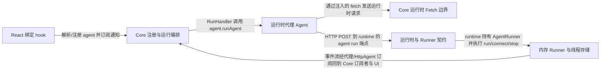

# CopilotKit：架构、运行逻辑与设计取舍

> main · [be9a2caa72ac](https://github.com/CopilotKit/CopilotKit/commit/be9a2caa72ac2b999cdcb3708303f5ad9211e5fc) · deepseek-flash 辅助分析 · 2026-10-30T05:33:11.336Z
> 下文按固定源码推演，没有执行目标项目。引用可跳到具体代码行；“工程推断”解释收益与代价，不代表作者亲述。

## 1. 先建立直觉

**一个共享核心把用户界面和可替换的智能体连接起来：界面只读写 agent 的消息与状态，真正的模型/工具执行由运行时一侧的 agent 和 runner 负责，事件通过协议流回并驱动界面更新。**

如果每个 React 组件自己发 LLM 请求，就会重复处理连接、认证头、流式事件、线程并发、前端工具注册和状态合并；多个组件共享同一个 agent 时还容易互相覆盖 threadId 或重复渲染。

贯穿全文的例子：

- **输入：** 组件调用 useAgent({ agentId: "chat-1", runtimeAgentId: "default", threadId: "t1" })，拿到一个注册在本地 chat-1、出站路由到 runtime 的 default agent 的代理；随后对该 agent 发起一次运行，输入一条用户消息（例如“查订单 A 状态”）。
- **预期输出：** 推演结果可能是：代理向运行时发出 /agent/default/run 或单端点 envelope，运行时 runner 执行 agent 并产出 AG-UI 事件流；客户端的 agent.messages 追加助手消息，agent.state 或按 run 保存的状态随 STATE_SNAPSHOT/STATE_DELTA 更新，useAgent 的订阅触发重渲染，界面显示新消息和状态。若模型选择前端工具，工具调用和结果会进入消息/状态链路；具体执行细节见 gaps。

## 2. 一张图看懂架构



| 模块 | 职责与所在层的原因 | 输入 → 输出 | 拥有的状态 |
| --- | --- | --- | --- |
| React 绑定 hook [1][source-1] [2][source-2] [3][source-3] | 把组件参数解析成具体 agent，并在运行时尚未同步时提供稳定的临时代理；同时把 agent 通知转换成组件重渲染。 | useAgent 的 agentId/threadId/runtimeAgentId/updates/throttleMs，以及 provider 里的 core。 → 返回 agent 与 isReady，并建立/清理订阅。 | registeredProxyAgent、provisionalAgentCache、订阅句柄；不拥有消息本身，消息在 agent 上。 |
| Core 注册与运行编排 [4][source-4] [5][source-5] [6][source-6] [7][source-7] | 维护 agent 注册表、运行入口、订阅通知和状态管理；RunHandler 负责一次运行的准备与调用，StateManager 订阅 agent 事件记录消息/状态。 | 来自 hook 的 getAgent/registerProxiedAgent/subscribeToAgentWithOptions，以及运行参数。 → 向代理 agent 调用 runAgent，并向 UI 订阅者发出 agents/run/message 相关通知。 | subscribers、agentRegistry、runHandler、stateManager 以及运行中的请求 ID/abort controller。 |
| 运行时代理 Agent [8][source-8] [9][source-9] [10][source-10] | 继承 HttpAgent，统一处理 run/connect/stop 的运行时路由、transport 选择、消息过滤和工具调用配对修复。 | RunHandler 构造的 RunAgentInput，以及 runtimeUrl、transport、headers、messageFilter。 → Observable<BaseEvent>，由 HTTP/SSE 或 Intelligence delegate 产生。 | runtimeMode、transport、delegate、activeRun、messages/state（继承自 agent）。 |
| Core 运行时 Fetch 边界 [11][source-11] [12][source-12] | 为代理 agent 提供统一 fetch：发送前解析并覆盖最新 headers，处理 single-route 包装，并用 watchdog 把请求结果反馈到运行时连接状态。 | 代理 agent 的 fetch 调用和 RequestInit。 → 标准 Response，交给 @ag-ui/client 的 HTTP 事件流解析。 | runtimeFetch 缓存、单端点资源开关、运行时健康探测状态。 |
| 运行时与 Runner 契约 [13][source-13] [14][source-14] | 服务端创建 runtime 并选择 runner；AgentRunner 定义 run/connect/isRunning/stop 的抽象，SSE runtime 默认使用 InMemoryAgentRunner。 | runtime 配置里的 agents 与 runner 选项。 → 统一 runner 实例和 runtime 模式（SSE/Intelligence）。 | runtime.agents、runtime.runner、runtime.mode。 |
| 内存 Runner 与线程存储 [15][source-15] [16][source-16] [17][source-17] | 执行具体 agent，缓冲并回报 AG-UI 事件，同时维护线程级并发锁、事件历史和消息快照。 | AgentRunnerRunRequest（threadId、agent、input、ownerId）。 → run() 返回只含 agent 事件的 Observable；connect() 可重放历史并桥接活跃 run。 | 进程全局 BoundedThreadStore：isRunning、currentRunId、subject、historicRuns、messagesSnapshot、owner。 |

## 3. 跟着一个请求跑完整条主线

这是对已读方法体的源码推演，不是执行日志。编号是阅读顺序；装配、写入、查询与条件分支是否发生，取决于每步的触发条件。

### 1. Hook 解析并注册本次私有代理

**阶段：** 装配/初始化

**触发条件：** 当 runtimeAgentId 与 threadId 同时提供且 threadId 合法时走私有代理分支；只给 agentId 时走共享 agent 查询分支。

入口/调用：`useAgent / CopilotKitCore.registerProxiedAgent / AgentRegistry.registerProxiedAgent` [18][source-18] [2][source-2] [19][source-19]

**此时输入：** agentId='chat-1'、runtimeAgentId='default'、threadId='t1'。

useAgent 先做三者配套校验；effect 调 copilotkit.registerProxiedAgent，AgentRegistry 检查 id 冲突，构造 ProxiedCopilotRuntimeAgent，应用 headers/fetch 后写入 localAgents/_agents，并通知 agents 变化。

**状态变化：** localAgents 与 _agents 出现 chat-1 代理；hook 的 registeredProxyAgent 被设置，后续渲染返回真实代理。

**交给下一步：** useAgent 返回注册好的 ProxiedCopilotRuntimeAgent。

### 2. Hook 建立 agent 通知订阅

**阶段：** 装配/订阅

**触发条件：** updateFlags 非空且 agent 引用变化时重建订阅。

入口/调用：`useAgent / CopilotKitCore.subscribeToAgentWithOptions` [20][source-20] [21][source-21]

**此时输入：** UseAgentUpdate 选择的消息/状态/运行生命周期回调，以及 throttleMs。

useAgent 把 onMessagesChanged/onStateChanged 映射到 batchedForceUpdate，把 onRunInitialized/onRunStartedEvent/onRunFinalized/onRunFailed/onRunErrorEvent 也映射到 batchedForceUpdate；core 用 safeCall 包裹回调，有效 throttleMs>0 时只把消息/状态回调放进共享 Throttler，生命周期回调立即执行。

**状态变化：** agent 上增加订阅；core 记录订阅句柄；尚未产生消息。

**交给下一步：** 后续 agent 事件会进入 batchedForceUpdate 或立即生命周期回调。

### 3. 任务进入 Core 运行入口

**阶段：** 写入/执行入口

**触发条件：** 调用方调用 core.runAgent 时；headers 解析失败会取消 continuation 并返回空结果。

入口/调用：`CopilotKitCore.runAgent / RunHandler.runAgent` [5][source-5] [22][source-22] [23][source-23]

**此时输入：** agent、forwardedProps、resume、runId。

Core 直接委托 RunHandler；RunHandler 清中断状态和 suggestions，重新准备 headers，await detach 旧运行，计算 continuation/runId/requestId，创建或复用 AbortController，并临时拦截 agent.abortRun 以便停止时同时中止工具链。

**状态变化：** 设置运行代次、活跃 requestId、abort controller 集合，并挂接 agent.abortRun 包装。

**交给下一步：** 准备好运行上下文后继续构造 RunAgentInput。

### 4. 构造输入并调用代理 agent

**阶段：** 写入/调用

**触发条件：** headers 准备成功且旧运行 detach 成功；否则中止 continuation 并返回空结果。

入口/调用：`RunHandler.runAgent / RunHandler.buildFrontendTools / ProxiedCopilotRuntimeAgent.run` [24][source-24] [25][source-25] [9][source-9]

**此时输入：** agent 当前 threadId、forwardedProps、properties、context、前端工具注册表。

runAgent 把 properties 与 forwardedProps 合并，加入 __copilotkitRequestId，按需带 resume/runId，调用 buildFrontendTools 过滤 wildcard/disabled/其他 agent 的工具并生成 schema，取 agent 作用域 context，然后调用 agent.runAgent(input, subscriber)。

**状态变化：** RunAgentInput 形成；requestId 与逻辑 runId 绑定；agent 进入运行态。

**交给下一步：** ProxiedCopilotRuntimeAgent.run(input) 被调用。

### 5. 代理 agent 选择 HTTP 路由并准备出站消息

**阶段：** 可选分支/写入

**触发条件：** runtimeMode 为 pending，或 transport 为 auto 且不是 Intelligence 时，先 ensureRuntimeConfiguration；随后不是 Intelligence 则走 HTTP。默认 transport 是 auto，默认 runtimeMode 在未收到 /info 时可能是 pending。

入口/调用：`ProxiedCopilotRuntimeAgent.run / ProxiedCopilotRuntimeAgent.ensureRuntimeConfiguration / ProxiedCopilotRuntimeAgent.#runViaHttp / ProxiedCopilotRuntimeAgent.#prepareOutboundMessages` [26][source-26] [10][source-10] [27][source-27]

**此时输入：** RunAgentInput 与当前 runtimeUrl/transport/runtimeMode。

run 在 defer 中先确保 /info 配置，再递归进入 run；#runViaHttp 先对消息应用可选 messageFilter 并修复 tool call 与 result 的配对，再按 transport 选择 single-route envelope 或 super.run 生成的 REST /agent/default/run 请求。

**状态变化：** transport/runtimeMode 可能被解析；activeRun 记录 {threadId, runId}，流 finalize 时释放；出站 messages 可能被过滤/修复。

**交给下一步：** HTTP fetch 到 runtime 的 /agent/default/run，返回 SSE/HTTP 事件流。

### 6. 运行时 Runner 执行 agent 并缓冲事件

**阶段：** 执行/并发控制/写入

**触发条件：** 当 runtime 的 handle-run 选择 InMemoryAgentRunner 并调用 run 时；若同线程已有活跃或 finalizing run，按 onConcurrentRun 默认 throw，配置 supersede 时中止旧 run。handle-run 如何解析 /run 并选出 runner 不在已读证据中，作为边界。

入口/调用：`InMemoryAgentRunner.run` [16][source-16] [28][source-28] [29][source-29]

**此时输入：** AgentRunnerRunRequest：threadId='t1'、agent、input.runId、ownerId。

run 先 canClaim 检查 owner，再 getOrCreate 线程 store；若已有运行则按 onConcurrentRun 抛错或 supersede；随后设置 isRunning/currentRunId/agent，创建 runSubject 和 nextSubject，异步调用 request.agent.runAgent，在 onEvent 中把每个事件 push 到两个 subject 与 currentRunEvents。完成后内部 finalizeRun 用 finalizeRunEvents 补终止事件，按 currentRunId 是否仍属于本 run 决定 appendRun 历史。

**状态变化：** store.isRunning=true、currentRunId 与 agent 被占用；完成后若仍拥有线程则写 historicRuns/messagesSnapshot 并清空运行字段；被 supersede 的旧 run 不覆盖新 run 状态。

**交给下一步：** runSubject.asObservable() 产出 agent 事件；SSE 编码由未读的 runtime handler 负责。

### 7. 事件回到客户端并驱动 UI 重渲染

**阶段：** 查询/通知

**触发条件：** agent 的 onMessagesChanged/onStateChanged/onRunFinalized 等通知到达；StateManager 也订阅同一 agent，并在已读回调片段中把事件交给 handle*，其合并算法未完整读取，见 gaps。

入口/调用：`useAgent / batchedForceUpdate` [30][source-30] [20][source-20] [31][source-31]

**此时输入：** agent 通知（onMessagesChanged、onStateChanged、运行生命周期事件）。

useAgent 在订阅 effect 中把消息/状态回调设为 batchedForceUpdate，把运行生命周期回调也设为 batchedForceUpdate；batchedForceUpdate 用 queueMicrotask 合并同一 tick 的多次通知，active 标志防止卸载后更新。React 组件随后重新读取 agent.messages/agent.state。

**状态变化：** 组件重新渲染；agent.messages/agent.state 由 agent 的订阅链更新，StateManager 的 handle* 具体写入逻辑见 gaps。

**交给下一步：** 界面显示助手消息和状态变化；下一次 run 可从更新后的消息/状态继续。

## 4. 核心技术到底是什么

### 1. AG-UI 事件流水线与 RxJS 缓冲

**解决的问题：** 一次 agent 运行会持续产出文本、状态、工具调用和终止事件，客户端需要在运行中增量消费，连接重放时还要能拿到历史。 [32][source-32] [33][source-33] [34][source-34]

输入 RunAgentInput → HTTP 请求返回事件流 → transformHttpEventStream 转成 BaseEvent 序列 → runner 对每个事件调用 runSubject.next/nextSubject.next 并同时累积 currentRunEvents → finalizeRunEvents 补齐终止边界 → 完成后 compactEvents 写入 historicRuns，connect 时再重放/桥接。

算法示意（用于解释机制，不是源码原文）：

```text
events = transformHttpEventStream(httpResponse)
for e in events:
  runSubject.next(e)
  nextSubject.next(e)
  currentRunEvents.push(e)
terminal = finalizeRunEvents(currentRunEvents)
for e in terminal: subjects.next(e)
appendRun(compactEvents(currentRunEvents))

```

**关键数据结构：** ReplaySubject<BaseEvent>(Infinity)、currentRunEvents、HistoricRun.events、messagesSnapshot；不变量是每个 run 自己的终止事件只 finalize 一次，supersede 的旧 run 不能清空新 run 的 subject。

- **本项目实现：** ProxiedCopilotRuntimeAgent 负责 HTTP/代理路径；InMemoryAgentRunner 负责 subject、事件累积、finalize 和历史写入。
- **外部依赖提供：** @ag-ui/client 的 runHttpRequest、transformHttpEventStream、compactEvents 和 HttpAgent 订阅机制；rxjs 的 ReplaySubject 与 Observable。
- **收益与代价：** 流式体验和可重放性好，但活跃 run 的 ReplaySubject 缓冲在完成前不计入 maxBytes，极端单 run 可能暂时超限。

### 2. 前端工具声明与工具结果配对修复

**解决的问题：** 模型需要看到前端可调用的工具 schema，同时后端从消息历史重建状态时不能遇到孤立的 tool result。 [25][source-25] [27][source-27] [35][source-35]

RunHandler 从工具注册表过滤 wildcard、available=false、其他 agent 的工具和 disabled 工具，映射为 name/description/parameters；代理 agent 在 HTTP 出站前对消息应用可选 filter，再用 ɵkeepToolResultsWithCalls 或 ɵrepairToolCallPairs 修复 call/result 配对，失败则逐级回退到未修复但保留过滤结果的消息。

算法示意（用于解释机制，不是源码原文）：

```text
tools = registry.filter(enabled && scope).map(toSchema)
kept = messageFilter ? filter(clone(messages)) : undefined
if kept: messages = repairToolCallPairs(kept, full)
else: messages = keepToolResultsWithCalls(full)
return {...input, messages}

```

**关键数据结构：** Tool[]、Message[]、toolCallId 与 tool result 的对应关系；过滤后的消息是 second clone，避免 filter 改写原对象影响修复基线。

- **本项目实现：** RunHandler.buildFrontendTools 生成工具声明；ProxiedCopilotRuntimeAgent.#prepareOutboundMessages/#applyMessageFilter 在 HTTP 路径执行过滤和修复。
- **外部依赖提供：** @ag-ui/client 的 Tool/Message/RunAgentInput 类型；工具实际执行由模型/运行时与前端工具处理链路完成，本段未完整读取。
- **收益与代价：** 修复能避免 provider 拒绝孤立 tool result，但修复会改动顺序/去重/替换编辑副本；失败时回退到完整历史可能增加 payload。

### 3. 运行时连接、代理路由与请求头覆盖

**解决的问题：** 客户端不知道 runtime 是 REST 还是单端点，且认证头可能随登录态变化，不能在构造 agent 时固化。 [11][source-11] [26][source-26] [36][source-36]

proxied agent 在 pending/auto 时 ensureRuntimeConfiguration 先请求 /info 决定 mode/transport；AgentRegistry.createRuntimeFetch 在每次实际 fetch 前 resolveHeaders，把 core headers 覆盖到请求上，必要时把 REST 调用包装成 {method, params, body} 单端点 envelope，并用 watchdog 记录运行时可达性。

算法示意（用于解释机制，不是源码原文）：

```text
if mode pending or transport auto:
  info = fetchRuntimeInfo()
  mode = info.mode; transport = resolved
fetch = (input, init) => {
  headers = overlay(resolveHeaders(), init.headers)
  if singleRoute: input, init = envelope(input, init)
  response = fetch(input, init)
  reportOutcome(response)
  return response
}

```

**关键数据结构：** HeaderSourceResolver、runtimeFetch 闭包、runtimeMode/transport、singleEndpointUrl。

- **本项目实现：** AgentRegistry.createRuntimeFetch 与 ProxiedCopilotRuntimeAgent.ensureRuntimeConfiguration/run/connect。
- **外部依赖提供：** 浏览器/Node fetch、@ag-ui/client HttpAgent 的 requestInit 与事件流解析。
- **收益与代价：** 每次发送都解析 headers 能避免过期 token，但增加异步解析和单端点分支复杂度；auto 检测会先试 REST 再回退 single。

### 4. 有界内存线程存储

**解决的问题：** 开发/SSE 模式下线程历史不能无限增长，同时要防止正在运行的线程被驱逐后丢失完成事件。 [37][source-37] [38][source-38] [39][source-39] [40][source-40]

进程全局 BoundedThreadStore 用 Map 维持 LRU 顺序；getOrCreate 创建线程并按 maxThreads 驱逐；appendRun 在运行完成时更新线程级消息快照、累积事件字节、按 maxRunsPerThread FIFO 裁剪、按 maxBytes 驱逐其他非运行线程；被移除线程的 owner 记录保留一段时间，防止 id 被其他身份重新占用。

算法示意（用于解释机制，不是源码原文）：

```text
getOrCreate(threadId, owner):
  if exists: touch; return
  store = new(threadId, owner)
  map.set; evictThreadsIfNeeded(protect=threadId)
appendRun(run):
  if writer not current: return
  messagesSnapshot = nonempty run.messages
  historicRuns.push(run)
  enforceRunCap(); evictByBytesIfNeeded(protect=threadId)

```

**关键数据结构：** Map<string, InMemoryEventStore>、ReplaySubject、historicRuns、messagesSnapshot、removedOwners；不变量是 running/stopRequested 线程不被 LRU 驱逐，消息快照在 run-cap 驱逐后仍保留。

- **本项目实现：** InMemoryAgentRunner 与 ɵBoundedThreadStore 全部在项目内实现。
- **外部依赖提供：** 无外部存储；AgentRunner 抽象允许替换为 Intelligence/SQLite runner。
- **收益与代价：** 进程内实现简单且可重放，但进程全局、非持久，最后一个 runner 的 limits 会影响所有内存线程，且单活跃 run 的流式缓冲不受 maxBytes 约束。

## 5. 为什么选择这种实现

### 1. 把组件与 agent 之间通过 core 的注册/订阅隔离，而不是让组件直接请求 LLM。

**依据：已确认实现；以下原因是工程分析，不代表作者亲述。** [41][source-41] [21][source-21]

**面临的约束：** React 并发渲染可能重复构造/丢弃实例，runtime 的 /info 异步同步，多个 hook 可能共享同一 agent，且流式更新频繁。

**如果改用另一种做法：** 每个组件内直接 fetch /run，把返回文本 setState 到局部状态。

**为什么当前方案有用：** 本项目中 useAgent 在 runtime 未同步时返回缓存的 provisional 代理，真实 agent 到达后替换引用；订阅统一经 core 的 safeCall 和可选 Throttler，组件只消费 agent.messages/state。若组件直接请求，就无法自然处理共享 threadId、连接中占位、多个组件重复请求和错误上报。

**付出的代价，以及不适用的情况：** 多出代理 agent、订阅和状态同步层，调试调用链更长；错误路径和 provisional 与真实 agent 的切换需要理解 isReady。

### 2. 用 ProxiedCopilotRuntimeAgent 适配运行时 HTTP，而不是把 fetch 逻辑散落在 RunHandler。

**依据：已确认实现；以下原因是工程分析，不代表作者亲述。** [8][source-8] [9][source-9] [11][source-11]

**面临的约束：** 同一 agent 要支持 REST、单端点、Intelligence delegate，run/connect/stop 路由不同，headers 需要在发送时取最新值。

**如果改用另一种做法：** RunHandler 直接拼 URL 并 fetch，把流解析写回 agent。

**为什么当前方案有用：** 代理类在 run() 中先 ensureRuntimeConfiguration，再按 runtimeMode 选择 #runViaHttp 或 delegate；#runViaHttp 统一做消息过滤、activeRun 跟踪和 abort；headers 由注入的 fetch 在每次请求发送时解析覆盖。这样 RunHandler 只负责构造输入，不需要知道传输差异。

**付出的代价，以及不适用的情况：** 代理类继承 HttpAgent 并维护 runtimeMode/transport/delegate 多态，状态组合多；代理和 delegate 之间需要同步 messages/state。

### 3. 运行时用 AgentRunner 抽象执行，并让 InMemoryAgentRunner 管理线程并发、历史与重放。

**依据：已确认实现；以下原因是工程分析，不代表作者亲述。** [14][source-14] [16][source-16] [17][source-17]

**面临的约束：** 同一 thread 不能无约束并发运行；connect 需要重放历史并桥接活跃 run；SSE 与 Intelligence 需要可替换执行后端。

**如果改用另一种做法：** HTTP handler 里直接调用 agent.runAgent，收到事件就写 SSE，不保存历史。

**为什么当前方案有用：** Runner 在 run() 中先检查 owner 和 isRunning/stopRequested，再建立 ReplaySubject；connect() 可从 historicRuns 重放并桥接活跃 subject。这样 SSE handler 只做传输，停止/重连/并发语义集中在 runner，避免每个入口重复实现。

**付出的代价，以及不适用的情况：** 内存 runner 是进程级、非持久，不能跨重启；需要 Intelligence/SQLite runner 才适合生产长期线程。

### 4. 消息/状态通知可节流，但运行生命周期回调立即触发。

**依据：已确认实现；以下原因是工程分析，不代表作者亲述。** [42][source-42] [20][source-20] [21][source-21]

**面临的约束：** 流式消息和状态可能在短时间内高频变化；同时停止按钮/busy 状态需要及时反映。

**如果改用另一种做法：** 所有回调统一节流，或全部不节流。

**为什么当前方案有用：** 本项目让 onMessagesChanged/onStateChanged 共享一个 leading+trailing Throttler，而 onRunInitialized/onRunFinalized/onRunFailed/onRunErrorEvent 不加节流；React 侧再用 queueMicrotask 合并同一 tick 的 forceUpdate。这样既减少流式重渲染，又不会延迟运行状态切换。

**付出的代价，以及不适用的情况：** throttleMs 配置错误会回退为不节流；消息/状态 UI 可能有最多一个窗口的延迟。

### 5. InMemory 线程存储采用有界 LRU/运行上限/字节上限，并为被移除线程保留 owner 记录。

**依据：已确认实现；以下原因是工程分析，不代表作者亲述。** [37][source-37] [39][source-39] [40][source-40]

**面临的约束：** 进程全局共享存储，匿名身份也可能反复创建线程；运行中的线程被驱逐会导致完成事件写入失败。

**如果改用另一种做法：** 普通 Map 无上限保存所有线程，删除后立即忘记 owner。

**为什么当前方案有用：** 实现用 maxThreads LRU、maxRunsPerThread FIFO 和 maxBytes 跨线程驱逐控制内存；evictOneLru 跳过 isRunning 或 stopRequested 的线程，避免正在 finalize 的 run 丢失；removedOwners 保留一段时间，防止旧 thread id 被另一个身份立刻 claim。

**付出的代价，以及不适用的情况：** 存储是进程全局的，后构造 runner 的 limits 会影响所有内存线程；owner 记录本身也有限额，极端多身份 churn 仍可能挤出他人记录。

## 6. 关键代码精读

### 1. useAgent 如何得到真实代理并订阅重渲染


`packages/react-core/src/v2/hooks/use-agent.tsx:256-293` [43][source-43]

```typescript
  const { agent, isReady } = useMemo<{
    agent: AbstractAgent;
    isReady: boolean;
  }>(() => {
    // Proxied-agent path: this hook registers its own agent (routing to
    // runtimeAgentId), so bypass the shared-singleton lookup entirely. Use the
    // registered instance once the effect has run; until then return a
    // provisional proxy so `agent` is never null and its reference stays stable
    // across the pre-registration renders.
    if (runtimeAgentId != null) {
      if (registeredProxyAgent) {
        provisionalAgentCache.current.delete(resolvedAgentId);
        return { agent: registeredProxyAgent, isReady: true };
      }
      const cached = provisionalAgentCache.current.get(resolvedAgentId);
      if (cached) {
        copilotkit.applyHeadersToAgent(cached);
        return { agent: cached, isReady: false };
      }
      const provisional = new ProxiedCopilotRuntimeAgent({
        runtimeUrl: copilotkit.runtimeUrl,
        agentId: resolvedAgentId,
        runtimeAgentId,
        transport: copilotkit.runtimeTransport,
        runtimeMode: "pending",
      });
      copilotkit.applyHeadersToAgent(provisional);
      provisionalAgentCache.current.set(resolvedAgentId, provisional);
      return { agent: provisional, isReady: false };
    }

    const existing = copilotkit.getAgent(resolvedAgentId);
    if (existing) {
      // Real agent found — clear any cached provisional for this ID
      provisionalAgentCache.current.delete(resolvedAgentId);
      return { agent: existing, isReady: true };
    }

```


`packages/react-core/src/v2/hooks/use-agent.tsx:372-421` [44][source-44]

```typescript
  useEffect(() => {
    if (updateFlags.length === 0) return;

    let active = true;
    const handlers: SubscribeToAgentSubscriber = {};

    // Microtask-batched forceUpdate: coalesces multiple synchronous
    // notifications (e.g. OnStateChanged + OnRunStatusChanged firing in the
    // same tick) into a single React re-render. This prevents the scroll
    // jumping described in #3499 where rapid unbatched forceUpdate calls
    // cause brief content height fluctuations during streaming.
    let batchScheduled = false;
    const batchedForceUpdate = () => {
      if (!active) return;
      if (!batchScheduled) {
        batchScheduled = true;
        queueMicrotask(() => {
          batchScheduled = false;
          if (active) {
            forceUpdate();
          }
        });
      }
    };

    if (updateFlags.includes(UseAgentUpdate.OnMessagesChanged)) {
      handlers.onMessagesChanged = batchedForceUpdate;
    }

    if (updateFlags.includes(UseAgentUpdate.OnStateChanged)) {
      handlers.onStateChanged = batchedForceUpdate;
    }

    if (updateFlags.includes(UseAgentUpdate.OnRunStatusChanged)) {
      handlers.onRunInitialized = batchedForceUpdate;
      handlers.onRunStartedEvent = batchedForceUpdate;
      handlers.onRunFinalized = batchedForceUpdate;
      handlers.onRunFailed = batchedForceUpdate;
      // Protocol-level RUN_ERROR event (distinct from onRunFailed which
      // handles local exceptions like network errors).
      handlers.onRunErrorEvent = batchedForceUpdate;
    }

    const subscription = copilotkit.subscribeToAgentWithOptions(
      agent,
      handlers,
      {
        throttleMs,
      },
    );
```


这段先处理 runtimeAgentId 分支：effect 调 registerProxiedAgent 拿到私有代理并存入 registeredProxyAgent；在 effect 尚未运行或 runtime 连接中时，useMemo 用 provisionalAgentCache 返回稳定的临时 ProxiedCopilotRuntimeAgent，避免每次渲染新建引用。之后订阅 effect 只把消息、状态和运行生命周期事件映射成 batchedForceUpdate，交给 core 的 subscribeToAgentWithOptions 统一 safeCall/节流；因此 UI 不直接解析 SSE，而是等 agent 字段变化后重渲染。

### 2. RunHandler 如何把一次任务变成 RunAgentInput


`packages/core/src/core/run-handler.ts:760-770` [22][source-22]

```typescript
    // Re-apply current headers (merged on top of the agent's own headers) so
    // the token in effect right now is what this run carries — not a value
    // resolved earlier (#1937).
    try {
      const headersApplied = this._internal.prepareAgentHeadersForRun(agent);
      if (headersApplied) await headersApplied;
    } catch {
      // Already reported as HEADER_RESOLUTION_FAILED by the resolver.
      continuationHandoff?.cancel();
      return { result: undefined, newMessages: [] };
    }
```


`packages/core/src/core/run-handler.ts:786-793` [23][source-23]

```typescript
    if (agent.detachActiveRun) {
      try {
        await agent.detachActiveRun();
      } catch (error) {
        continuationHandoff?.cancel();
        throw error;
      }
    }
```


`packages/core/src/core/run-handler.ts:913-928` [24][source-24]

```typescript
      const pinRunIdOnWire = runId !== undefined && !continuationHandoff;
      const agentRunInput = {
        forwardedProps: {
          ...this._internal.getPropertiesForAgent(agent.agentId),
          ...forwardedProps,
          __copilotkitRequestId: requestId,
        },
        ...(resume !== undefined ? { resume } : {}),
        ...(pinRunIdOnWire ? { runId } : {}),
        tools: this.buildFrontendTools(agent.agentId),
        context: this._internal.getContextForAgent(agent.agentId),
      };
      const runAgentResult = await agent.runAgent(
        agentRunInput,
        agentSubscriber,
      );
```


runAgent 先重新应用当前 headers，await detach 旧运行，避免新运行覆盖旧管道；然后计算 resumedRunId/continuation/requestId，并创建 AbortController。构造输入时把 agent 作用域 properties 与调用方 forwardedProps 合并，加入请求 ID，带上 resume/runId 条件字段、buildFrontendTools 过滤后的工具 schema 和 getContextForAgent 的上下文，最后调用 agent.runAgent。这里的输入就是代理 agent 判断 transport 和出站消息的基础。

### 3. InMemoryAgentRunner 如何执行并 finalize 一次运行


`packages/runtime/src/v2/runtime/runner/in-memory.ts:825-864` [45][source-45]

```typescript
    if (store.isRunning || store.stopRequested) {
      if (this.onConcurrentRun !== "supersede") {
        throw new ThreadAlreadyRunningError();
      }
      // Supersede: abort the prior (possibly wedged) run so this one can start.
      // Mirrors stop(). Record the prior run's OWN finalize intent on its
      // captured control BEFORE resetting the shared store flags for the new
      // run: a supersede is a clean stop of the prior run, so its async teardown
      // must finalize as RUN_FINISHED, never a synthetic RUN_ERROR. The prior
      // run's async finalization is prevented from clobbering this run's state
      // by the run-id guard below.
      const priorAgent = store.agent;
      const priorFinalize = store.activeFinalize;
      if (priorFinalize) {
        priorFinalize.stopRequested = true;
      }
      store.isRunning = false;
      if (priorAgent) {
        try {
          priorAgent.abortRun();
        } catch (error) {
          console.error("Failed to abort superseded run", error);
        }
      }
    }
    store.isRunning = true;
    store.currentRunId = request.input.runId;
    store.agent = request.agent;
    store.stopRequested = false;

    // Per-run finalize control. This run's teardown reads THIS captured holder
    // (never the shared `store.stopRequested`, which a later run resets), so an
    // aborted run is always finalized against its own stop-intent.
    const finalizeControl: RunFinalizeControl = { stopRequested: false };
    store.activeFinalize = finalizeControl;

    // Track seen message IDs and current run events for this run
    const seenMessageIds = new Set<string>();
    const currentRunEvents: BaseEvent[] = [];
    store.currentEvents = currentRunEvents;
```


`packages/runtime/src/v2/runtime/runner/in-memory.ts:1021-1046` [28][source-28]

```typescript
      try {
        await request.agent.runAgent(request.input, {
          onEvent: ({ event }) => {
            let processedEvent: BaseEvent = event;
            if (event.type === EventType.RUN_STARTED) {
              const runStartedEvent = event as RunStartedEvent;
              if (!runStartedEvent.input) {
                const sanitizedMessages = request.input.messages
                  ? request.input.messages.filter(
                      (message) => !historicMessageIds.has(message.id),
                    )
                  : undefined;
                const updatedInput = {
                  ...request.input,
                  ...(sanitizedMessages !== undefined
                    ? { messages: sanitizedMessages }
                    : {}),
                };
                runStartedEvent.input = updatedInput;
                processedEvent = runStartedEvent;
              }
            }

            runSubject.next(processedEvent); // For run() return - only agent events
            nextSubject.next(processedEvent); // For connect() / store - all events
            currentRunEvents.push(processedEvent); // Accumulate for storage
```


`packages/runtime/src/v2/runtime/runner/in-memory.ts:1085-1111` [29][source-29]

```typescript
    // Start the agent execution immediately (not lazily). When finishing the
    // run throws on both paths, release the thread anyway: otherwise it stays
    // "running", refuses every later run and is never evicted.
    runAgent().catch((error) => {
      console.error(
        "Failed to finish agent run",
        { threadId: request.threadId, runId: request.input.runId },
        error,
      );
      if (store.currentRunId === request.input.runId) {
        store.currentEvents = null;
        store.currentRunId = null;
        store.agent = null;
        store.runSubject = null;
        store.stopRequested = false;
        store.isRunning = false;
        store.activeFinalize = null;
      }
      runSubject.complete();
      nextSubject.complete();
      if (store.subject === nextSubject) {
        store.subject = null;
      }
    });

    // Return the run subject (only agent events, no injected messages)
    return runSubject.asObservable();
```


run 先用 canClaim 做 owner 检查，再 getOrCreate 线程 store；若已有运行则按 throw/supersede 处理，然后设置 isRunning、currentRunId、agent，创建两个 ReplaySubject。异步 runAgent 调用真实 agent，onEvent 把每个事件同时推给 runSubject（run 返回值）和 nextSubject（connect/存储桥接），并累积 currentRunEvents。完成后内部 finalizeRun 先补 RUN_STARTED（若 stop 早于首事件），再用 finalizeRunEvents 补终止事件；只有当 currentRunId 仍属于本 run 时才 appendRun 并把运行字段清空，防止被 supersede 的旧 run 覆盖新 run。

## 7. 动手验证你的理解

以下是建议实验，没有执行过。

### 1. 节流是否只合并消息/状态通知，而不延迟运行生命周期？

**改变什么：** 在流式输出期间把 useAgent 的 throttleMs 从 0 改为 50（或反过来），观察 onMessagesChanged/onStateChanged 的 forceUpdate 次数与 onRunInitialized/onRunFinalized 的触发时机。 [20][source-20] [21][source-21]

**应该观察到什么：** throttleMs=50 时消息/状态更新按 leading+trailing 窗口合并，同一 tick 的多个通知只触发一次 microtask forceUpdate；运行开始/结束回调仍立即进入 batchedForceUpdate，因此 busy/停止按钮不会被窗口拖慢。

### 2. threadId 与 runtimeAgentId 的配套校验是否真的阻止共享 agent 被覆盖？

**改变什么：** 把调用从 useAgent({ agentId: "default" }) 改为 useAgent({ agentId: "chat-1", runtimeAgentId: "default", threadId: "t1" })，或故意只传 threadId 不传 runtimeAgentId。 [18][source-18] [19][source-19] [46][source-46]

**应该观察到什么：** 前者会注册一个本地 id 为 chat-1、出站路由到 default 的私有代理，并把 agent.threadId 写成 t1；后者应在渲染时抛出错误，因为共享单例上的 threadId 会被多个 hook 互相覆盖。

### 3. messageFilter 返回不可用结果时是否回退到完整历史而不是让 run 失败？

**改变什么：** 配置一个 messageFilter，使其第一次返回非数组（或抛错），再发起一次 run；观察控制台警告和出站请求体。 [35][source-35] [47][source-47]

**应该观察到什么：** 代理 agent 会打印“sending the full message history instead”并发送未过滤的完整消息；若 filter 返回合法数组但配对修复失败，则先尝试保留过滤结果并只移动漂移的 tool result，最后才发送未修复的过滤结果。

## 8. 读完应当能复述什么

- UI 层只应绑定 agent 并订阅其消息/状态；连接时序、临时占位、节流和错误保护由 core 统一处理，避免每个组件重复实现。
- ProxiedCopilotRuntimeAgent 是传输边界：它决定 run/connect/stop 的路由、runtimeMode/transport、出站消息修复和 abort，RunHandler 只构造运行输入。
- 运行时 runner 负责执行、并发控制和事件重放；InMemoryAgentRunner 用 ReplaySubject + historicRuns + 线程级消息快照把一次运行变成可回放的事件历史。
- 前端工具不是直接执行就会生效：工具 schema 要随 RunAgentInput 发给模型，消息中的 tool call/result 配对必须在出站前修复，否则后端重建状态会出问题。
- 有界内存存储是开发/SSE 的便利设施而非持久存储：它用 LRU、run cap、byte cap 和 owner retention 控制内存，但仍是进程全局且单活跃 run 的流式缓冲不受 maxBytes 限制。

## 来源与覆盖边界

本次读取 12 个文件，共 349,977 字符；10 个文件完整读取，其他文件按关键方法取带行号的片段。没有把未读依赖的内部实现当作已确认事实。

- runtime 的 handle-run 与 agent-utils 未在已读证据中：无法确认 /run 请求如何解析、如何按 agentId 选出 agent、如何把 runner Observable 编码成 SSE。
- StateManager.subscribeToAgent 的方法体只读到 425 行附近，且 handleRunStarted、handleRunFinished、handleStateSnapshot、handleStateDelta、handleMessagesSnapshot 等方法体未包含在已读片段中：只能确认订阅回调会调用它们，无法精确说明状态 delta 合并、runId/messageId 映射和 raw event 裁剪算法。
- RunHandler.processAgentResult 的方法体未包含在已读片段中：无法确认前端工具调用被模型返回后，RunHandler 如何执行工具、如何插入 tool result、如何递归 follow-up，以及 HITL 中断恢复的完整路径。
- useAgent 本身只返回 agent，不直接调用 runAgent；实际发起任务通常由 CopilotChat 或其他调用方完成，本回答只按“调用方随后对 agent 发起运行”这一场景推演。
- @ag-ui/client 的 HttpAgent/transformHttpEventStream 内部如何逐块解析 SSE、如何判定 MESSAGES_SNAPSHOT 与文本增量，属于外部依赖行为，未在仓库已读代码中展开。

| 文件 | 实际读取行段 |
| --- | --- |
| [README.md](https://github.com/CopilotKit/CopilotKit/blob/be9a2caa72ac2b999cdcb3708303f5ad9211e5fc/README.md) | 1–268 / 共 268 行 |
| [package.json](https://github.com/CopilotKit/CopilotKit/blob/be9a2caa72ac2b999cdcb3708303f5ad9211e5fc/package.json) | 1–191 / 共 191 行 |
| [packages/core/src/core/core.ts](https://github.com/CopilotKit/CopilotKit/blob/be9a2caa72ac2b999cdcb3708303f5ad9211e5fc/packages/core/src/core/core.ts) | 1–1792 / 共 1792 行 |
| [packages/core/src/core/agent-registry.ts](https://github.com/CopilotKit/CopilotKit/blob/be9a2caa72ac2b999cdcb3708303f5ad9211e5fc/packages/core/src/core/agent-registry.ts) | 1–1895 / 共 1895 行 |
| [packages/core/src/agent.ts](https://github.com/CopilotKit/CopilotKit/blob/be9a2caa72ac2b999cdcb3708303f5ad9211e5fc/packages/core/src/agent.ts) | 1–1107 / 共 1107 行 |
| [packages/core/src/utils/http-agent.ts](https://github.com/CopilotKit/CopilotKit/blob/be9a2caa72ac2b999cdcb3708303f5ad9211e5fc/packages/core/src/utils/http-agent.ts) | 1–23 / 共 23 行 |
| [packages/react-core/src/v2/hooks/use-agent.tsx](https://github.com/CopilotKit/CopilotKit/blob/be9a2caa72ac2b999cdcb3708303f5ad9211e5fc/packages/react-core/src/v2/hooks/use-agent.tsx) | 1–487 / 共 487 行 |
| [packages/runtime/src/v2/runtime/core/runtime.ts](https://github.com/CopilotKit/CopilotKit/blob/be9a2caa72ac2b999cdcb3708303f5ad9211e5fc/packages/runtime/src/v2/runtime/core/runtime.ts) | 1–1052 / 共 1052 行 |
| [packages/runtime/src/v2/runtime/runner/agent-runner.ts](https://github.com/CopilotKit/CopilotKit/blob/be9a2caa72ac2b999cdcb3708303f5ad9211e5fc/packages/runtime/src/v2/runtime/runner/agent-runner.ts) | 1–213 / 共 213 行 |
| [packages/runtime/src/v2/runtime/runner/in-memory.ts](https://github.com/CopilotKit/CopilotKit/blob/be9a2caa72ac2b999cdcb3708303f5ad9211e5fc/packages/runtime/src/v2/runtime/runner/in-memory.ts) | 1–1369 / 共 1369 行 |
| [packages/core/src/core/run-handler.ts](https://github.com/CopilotKit/CopilotKit/blob/be9a2caa72ac2b999cdcb3708303f5ad9211e5fc/packages/core/src/core/run-handler.ts) | 1–50、740–980、1874–1895 / 共 2075 行 |
| [packages/core/src/core/state-manager.ts](https://github.com/CopilotKit/CopilotKit/blob/be9a2caa72ac2b999cdcb3708303f5ad9211e5fc/packages/core/src/core/state-manager.ts) | 138–425 / 共 762 行 |

[source-1]: https://github.com/CopilotKit/CopilotKit/blob/be9a2caa72ac2b999cdcb3708303f5ad9211e5fc/packages/react-core/src/v2/hooks/use-agent.tsx#L207-L214 "packages/react-core/src/v2/hooks/use-agent.tsx:207-214"
[source-2]: https://github.com/CopilotKit/CopilotKit/blob/be9a2caa72ac2b999cdcb3708303f5ad9211e5fc/packages/react-core/src/v2/hooks/use-agent.tsx#L237-L254 "packages/react-core/src/v2/hooks/use-agent.tsx:237-254"
[source-3]: https://github.com/CopilotKit/CopilotKit/blob/be9a2caa72ac2b999cdcb3708303f5ad9211e5fc/packages/react-core/src/v2/hooks/use-agent.tsx#L372-L427 "packages/react-core/src/v2/hooks/use-agent.tsx:372-427"
[source-4]: https://github.com/CopilotKit/CopilotKit/blob/be9a2caa72ac2b999cdcb3708303f5ad9211e5fc/packages/core/src/core/core.ts#L513-L561 "packages/core/src/core/core.ts:513-561"
[source-5]: https://github.com/CopilotKit/CopilotKit/blob/be9a2caa72ac2b999cdcb3708303f5ad9211e5fc/packages/core/src/core/core.ts#L1714-L1718 "packages/core/src/core/core.ts:1714-1718"
[source-6]: https://github.com/CopilotKit/CopilotKit/blob/be9a2caa72ac2b999cdcb3708303f5ad9211e5fc/packages/core/src/core/run-handler.ts#L743-L770 "packages/core/src/core/run-handler.ts:743-770"
[source-7]: https://github.com/CopilotKit/CopilotKit/blob/be9a2caa72ac2b999cdcb3708303f5ad9211e5fc/packages/core/src/core/state-manager.ts#L284-L349 "packages/core/src/core/state-manager.ts:284-349"
[source-8]: https://github.com/CopilotKit/CopilotKit/blob/be9a2caa72ac2b999cdcb3708303f5ad9211e5fc/packages/core/src/agent.ts#L126-L201 "packages/core/src/agent.ts:126-201"
[source-9]: https://github.com/CopilotKit/CopilotKit/blob/be9a2caa72ac2b999cdcb3708303f5ad9211e5fc/packages/core/src/agent.ts#L685-L699 "packages/core/src/agent.ts:685-699"
[source-10]: https://github.com/CopilotKit/CopilotKit/blob/be9a2caa72ac2b999cdcb3708303f5ad9211e5fc/packages/core/src/agent.ts#L767-L801 "packages/core/src/agent.ts:767-801"
[source-11]: https://github.com/CopilotKit/CopilotKit/blob/be9a2caa72ac2b999cdcb3708303f5ad9211e5fc/packages/core/src/core/agent-registry.ts#L748-L802 "packages/core/src/core/agent-registry.ts:748-802"
[source-12]: https://github.com/CopilotKit/CopilotKit/blob/be9a2caa72ac2b999cdcb3708303f5ad9211e5fc/packages/core/src/core/agent-registry.ts#L825-L835 "packages/core/src/core/agent-registry.ts:825-835"
[source-13]: https://github.com/CopilotKit/CopilotKit/blob/be9a2caa72ac2b999cdcb3708303f5ad9211e5fc/packages/runtime/src/v2/runtime/core/runtime.ts#L587-L625 "packages/runtime/src/v2/runtime/core/runtime.ts:587-625"
[source-14]: https://github.com/CopilotKit/CopilotKit/blob/be9a2caa72ac2b999cdcb3708303f5ad9211e5fc/packages/runtime/src/v2/runtime/runner/agent-runner.ts#L199-L212 "packages/runtime/src/v2/runtime/runner/agent-runner.ts:199-212"
[source-15]: https://github.com/CopilotKit/CopilotKit/blob/be9a2caa72ac2b999cdcb3708303f5ad9211e5fc/packages/runtime/src/v2/runtime/runner/in-memory.ts#L753-L807 "packages/runtime/src/v2/runtime/runner/in-memory.ts:753-807"
[source-16]: https://github.com/CopilotKit/CopilotKit/blob/be9a2caa72ac2b999cdcb3708303f5ad9211e5fc/packages/runtime/src/v2/runtime/runner/in-memory.ts#L809-L864 "packages/runtime/src/v2/runtime/runner/in-memory.ts:809-864"
[source-17]: https://github.com/CopilotKit/CopilotKit/blob/be9a2caa72ac2b999cdcb3708303f5ad9211e5fc/packages/runtime/src/v2/runtime/runner/in-memory.ts#L1114-L1170 "packages/runtime/src/v2/runtime/runner/in-memory.ts:1114-1170"
[source-18]: https://github.com/CopilotKit/CopilotKit/blob/be9a2caa72ac2b999cdcb3708303f5ad9211e5fc/packages/react-core/src/v2/hooks/use-agent.tsx#L160-L198 "packages/react-core/src/v2/hooks/use-agent.tsx:160-198"
[source-19]: https://github.com/CopilotKit/CopilotKit/blob/be9a2caa72ac2b999cdcb3708303f5ad9211e5fc/packages/core/src/core/agent-registry.ts#L497-L552 "packages/core/src/core/agent-registry.ts:497-552"
[source-20]: https://github.com/CopilotKit/CopilotKit/blob/be9a2caa72ac2b999cdcb3708303f5ad9211e5fc/packages/react-core/src/v2/hooks/use-agent.tsx#L397-L427 "packages/react-core/src/v2/hooks/use-agent.tsx:397-427"
[source-21]: https://github.com/CopilotKit/CopilotKit/blob/be9a2caa72ac2b999cdcb3708303f5ad9211e5fc/packages/core/src/core/core.ts#L1627-L1697 "packages/core/src/core/core.ts:1627-1697"
[source-22]: https://github.com/CopilotKit/CopilotKit/blob/be9a2caa72ac2b999cdcb3708303f5ad9211e5fc/packages/core/src/core/run-handler.ts#L760-L770 "packages/core/src/core/run-handler.ts:760-770"
[source-23]: https://github.com/CopilotKit/CopilotKit/blob/be9a2caa72ac2b999cdcb3708303f5ad9211e5fc/packages/core/src/core/run-handler.ts#L786-L793 "packages/core/src/core/run-handler.ts:786-793"
[source-24]: https://github.com/CopilotKit/CopilotKit/blob/be9a2caa72ac2b999cdcb3708303f5ad9211e5fc/packages/core/src/core/run-handler.ts#L913-L928 "packages/core/src/core/run-handler.ts:913-928"
[source-25]: https://github.com/CopilotKit/CopilotKit/blob/be9a2caa72ac2b999cdcb3708303f5ad9211e5fc/packages/core/src/core/run-handler.ts#L1877-L1895 "packages/core/src/core/run-handler.ts:1877-1895"
[source-26]: https://github.com/CopilotKit/CopilotKit/blob/be9a2caa72ac2b999cdcb3708303f5ad9211e5fc/packages/core/src/agent.ts#L906-L935 "packages/core/src/agent.ts:906-935"
[source-27]: https://github.com/CopilotKit/CopilotKit/blob/be9a2caa72ac2b999cdcb3708303f5ad9211e5fc/packages/core/src/agent.ts#L335-L380 "packages/core/src/agent.ts:335-380"
[source-28]: https://github.com/CopilotKit/CopilotKit/blob/be9a2caa72ac2b999cdcb3708303f5ad9211e5fc/packages/runtime/src/v2/runtime/runner/in-memory.ts#L1021-L1046 "packages/runtime/src/v2/runtime/runner/in-memory.ts:1021-1046"
[source-29]: https://github.com/CopilotKit/CopilotKit/blob/be9a2caa72ac2b999cdcb3708303f5ad9211e5fc/packages/runtime/src/v2/runtime/runner/in-memory.ts#L1085-L1111 "packages/runtime/src/v2/runtime/runner/in-memory.ts:1085-1111"
[source-30]: https://github.com/CopilotKit/CopilotKit/blob/be9a2caa72ac2b999cdcb3708303f5ad9211e5fc/packages/react-core/src/v2/hooks/use-agent.tsx#L384-L395 "packages/react-core/src/v2/hooks/use-agent.tsx:384-395"
[source-31]: https://github.com/CopilotKit/CopilotKit/blob/be9a2caa72ac2b999cdcb3708303f5ad9211e5fc/packages/core/src/core/state-manager.ts#L381-L421 "packages/core/src/core/state-manager.ts:381-421"
[source-32]: https://github.com/CopilotKit/CopilotKit/blob/be9a2caa72ac2b999cdcb3708303f5ad9211e5fc/packages/core/src/agent.ts#L712-L758 "packages/core/src/agent.ts:712-758"
[source-33]: https://github.com/CopilotKit/CopilotKit/blob/be9a2caa72ac2b999cdcb3708303f5ad9211e5fc/packages/runtime/src/v2/runtime/runner/in-memory.ts#L883-L891 "packages/runtime/src/v2/runtime/runner/in-memory.ts:883-891"
[source-34]: https://github.com/CopilotKit/CopilotKit/blob/be9a2caa72ac2b999cdcb3708303f5ad9211e5fc/packages/runtime/src/v2/runtime/runner/in-memory.ts#L1044-L1046 "packages/runtime/src/v2/runtime/runner/in-memory.ts:1044-1046"
[source-35]: https://github.com/CopilotKit/CopilotKit/blob/be9a2caa72ac2b999cdcb3708303f5ad9211e5fc/packages/core/src/agent.ts#L393-L437 "packages/core/src/agent.ts:393-437"
[source-36]: https://github.com/CopilotKit/CopilotKit/blob/be9a2caa72ac2b999cdcb3708303f5ad9211e5fc/packages/core/src/agent.ts#L1014-L1058 "packages/core/src/agent.ts:1014-1058"
[source-37]: https://github.com/CopilotKit/CopilotKit/blob/be9a2caa72ac2b999cdcb3708303f5ad9211e5fc/packages/runtime/src/v2/runtime/runner/in-memory.ts#L69-L73 "packages/runtime/src/v2/runtime/runner/in-memory.ts:69-73"
[source-38]: https://github.com/CopilotKit/CopilotKit/blob/be9a2caa72ac2b999cdcb3708303f5ad9211e5fc/packages/runtime/src/v2/runtime/runner/in-memory.ts#L333-L361 "packages/runtime/src/v2/runtime/runner/in-memory.ts:333-361"
[source-39]: https://github.com/CopilotKit/CopilotKit/blob/be9a2caa72ac2b999cdcb3708303f5ad9211e5fc/packages/runtime/src/v2/runtime/runner/in-memory.ts#L472-L546 "packages/runtime/src/v2/runtime/runner/in-memory.ts:472-546"
[source-40]: https://github.com/CopilotKit/CopilotKit/blob/be9a2caa72ac2b999cdcb3708303f5ad9211e5fc/packages/runtime/src/v2/runtime/runner/in-memory.ts#L593-L653 "packages/runtime/src/v2/runtime/runner/in-memory.ts:593-653"
[source-41]: https://github.com/CopilotKit/CopilotKit/blob/be9a2caa72ac2b999cdcb3708303f5ad9211e5fc/packages/react-core/src/v2/hooks/use-agent.tsx#L223-L320 "packages/react-core/src/v2/hooks/use-agent.tsx:223-320"
[source-42]: https://github.com/CopilotKit/CopilotKit/blob/be9a2caa72ac2b999cdcb3708303f5ad9211e5fc/packages/react-core/src/v2/hooks/use-agent.tsx#L42-L43 "packages/react-core/src/v2/hooks/use-agent.tsx:42-43"
[source-43]: https://github.com/CopilotKit/CopilotKit/blob/be9a2caa72ac2b999cdcb3708303f5ad9211e5fc/packages/react-core/src/v2/hooks/use-agent.tsx#L256-L293 "packages/react-core/src/v2/hooks/use-agent.tsx:256-293"
[source-44]: https://github.com/CopilotKit/CopilotKit/blob/be9a2caa72ac2b999cdcb3708303f5ad9211e5fc/packages/react-core/src/v2/hooks/use-agent.tsx#L372-L421 "packages/react-core/src/v2/hooks/use-agent.tsx:372-421"
[source-45]: https://github.com/CopilotKit/CopilotKit/blob/be9a2caa72ac2b999cdcb3708303f5ad9211e5fc/packages/runtime/src/v2/runtime/runner/in-memory.ts#L825-L864 "packages/runtime/src/v2/runtime/runner/in-memory.ts:825-864"
[source-46]: https://github.com/CopilotKit/CopilotKit/blob/be9a2caa72ac2b999cdcb3708303f5ad9211e5fc/packages/react-core/src/v2/hooks/use-agent.tsx#L463-L466 "packages/react-core/src/v2/hooks/use-agent.tsx:463-466"
[source-47]: https://github.com/CopilotKit/CopilotKit/blob/be9a2caa72ac2b999cdcb3708303f5ad9211e5fc/packages/core/src/agent.ts#L350-L378 "packages/core/src/agent.ts:350-378"
