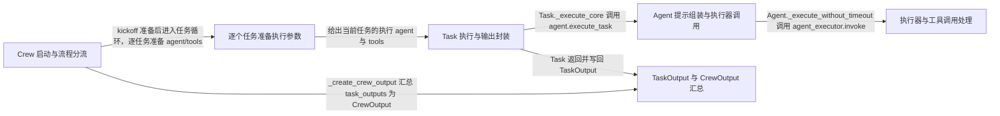

# crewAI：架构、运行逻辑与设计取舍

> main · [97bbfb648117](https://github.com/crewAIInc/crewAI/commit/97bbfb64811775a965304bda45c8ec0e8e4ef3a2) · deepseek-flash 辅助分析 · 2026-10-30T05:33:11.336Z
> 下文按固定源码推演，没有执行目标项目。引用可跳到具体代码行；“工程推断”解释收益与代价，不代表作者亲述。

## 1. 先建立直觉

**把多步工作拆成有序任务，每个任务交给对应角色代理执行，再把已有结果按上下文规则传给下一个任务，最后汇总成一次输出。**

多代理协作时，如果直接让代理互相调用，容易出现谁负责哪一步、上一步结果如何进入下一步、最终输出以哪个任务为准这些边界不清的问题。

贯穿全文的例子：

- **输入：** 一个 Crew 配置两个任务：research_task 由 researcher 执行，writing_task 由 writer 执行；process=Process.sequential，kickoff 输入 {"topic":"AI Agents"}，writing_task 显式 context=[research_task]。
- **预期输出：** 推演得到 CrewOutput：raw 是最后一个有效任务返回的文本；tasks_output 含 research_task 与 writing_task 两个 TaskOutput；后续任务构造上下文时可读取前序任务输出；token_usage 记录本次 Crew 汇总用量。

## 2. 一张图看懂架构



| 模块 | 职责与所在层的原因 | 输入 → 输出 | 拥有的状态 |
| --- | --- | --- | --- |
| Crew 启动与流程分流 [1][source-1] [2][source-2] | 接收 kickoff 输入，建立运行作用域，按 Process 选择顺序或层级流程，并最终返回 CrewOutput。 | inputs、input_files、可选 checkpoint；以及 Crew 上配置的 tasks、agents、process。 → 顺序流程交给 _run_sequential_process，最终输出 CrewOutput 或流式输出。 | Crew 的 id、process、tasks、usage_metrics；运行中进入事件与追踪作用域。 |
| 逐个任务准备执行参数 [3][source-3] | 在任务循环里解析当前任务该用哪个 agent、哪些 tools，并处理 replay 跳过与任务开始日志。 | 当前 Task、任务下标、start_index、已有 task_outputs。 → TaskExecutionData（agent、tools、是否跳过）以及更新后的 task_outputs/last_sync_output。 | 读取并可能更新 task_outputs 与 last_sync_output；不直接执行模型。 |
| Task 执行与输出封装 [4][source-4] [5][source-5] [6][source-6] | 承载任务描述、期望输出、上下文与最终 TaskOutput；调用 Agent 执行，并把返回值封装为 TaskOutput 写回自身。 | agent、context 字符串、tools；context 由 Crew._get_context 聚合。 → TaskOutput，包含 raw、pydantic/json_dict、agent 角色、messages 与 tool_failures。 | prompt_context、output、start_time/end_time、processed_by_agents、retry_count 等。 |
| Agent 提示组装与执行器调用 [7][source-7] [8][source-8] [9][source-9] | 把 Task 的描述、期望输出、上下文和记忆检索组合成 prompt，然后交给 agent_executor.invoke 执行。 | Task、context、tools。 → 执行器返回的 output 字符串或结构化结果，交由 Task 再封装。 | reset tool failures、保存 last messages、发出 Agent 执行事件。 |
| 执行器与工具调用处理 [10][source-10] [11][source-11] [12][source-12] | 执行器接收 input/tool_names/tools 等调用参数；其原生工具调用路径负责解析参数、查缓存、执行工具函数、处理 hook 与失败。 | Agent._execute_without_timeout 传入的 invoke 字典；原生工具调用为 tool_call 对象。 → AgentExecutor.invoke 返回结果字典，Agent 读取其中的 output；单个工具调用返回包含 result、from_cache、tool_failure 的字典。 | 工具缓存命中状态、累计工具失败、工具使用计数、hook 阻断状态。 |
| TaskOutput 与 CrewOutput 汇总 [13][source-13] [14][source-14] [2][source-2] | 把每个任务的输出保留为 TaskOutput，最终从有效任务输出中取最后一个作为 CrewOutput 的 raw/pydantic/json_dict。 | 按执行顺序累积的 list[TaskOutput]。 → CrewOutput，包含 raw、pydantic、json_dict、tasks_output、token_usage。 | Crew.token_usage；final_task_output.raw 可能被输出 hook 修改。 |

## 3. 跟着一个请求跑完整条主线

这是对已读方法体的源码推演，不是执行日志。编号是阅读顺序；装配、写入、查询与条件分支是否发生，取决于每步的触发条件。

### 1. 接收输入并建立一次 Crew 运行

**阶段：** 初始化

**触发条件：** 必经；从 Crew.kickoff 进入

入口/调用：`Crew.kickoff` [15][source-15]

**此时输入：** inputs、input_files、可选 checkpoint。

建立执行与追踪作用域，调用 prepare_kickoff 准备输入，再按 self.process 分支。

**状态变化：** 进入运行作用域；后续成功时写 usage_metrics。

**交给下一步：** 进入 process 分支。

### 2. 选择顺序流程

**阶段：** 分支选择

**触发条件：** self.process == Process.sequential

入口/调用：`Crew.kickoff / Crew._run_sequential_process` [16][source-16] [17][source-17]

**此时输入：** 已准备的 Crew 与 inputs。

kickoff 命中顺序分支后调用 _run_sequential_process，后者把 self.tasks 交给 _execute_tasks。

**状态变化：** 无额外任务状态，仅进入任务循环。

**交给下一步：** tasks 列表进入 _execute_tasks。

### 3. 为当前任务解析 agent 与 tools

**阶段：** 准备

**触发条件：** 每轮任务循环；replay 且 task_index < start_index 时可能跳过

入口/调用：`Crew._execute_tasks / prepare_task_execution` [18][source-18] [3][source-3]

**此时输入：** 当前 Task、task_index、start_index、已有 task_outputs。

若命中 replay 起点之前则跳过并可回收已有 task.output；否则调用 crew._get_agent_to_use，选择 task.tools 或 agent.tools，再经 _prepare_tools 处理。

**状态变化：** task_outputs/last_sync_output 可能因 replay 被更新。

**交给下一步：** TaskExecutionData(agent, tools, should_skip)。

### 4. 计算当前任务上下文

**阶段：** 查询

**触发条件：** 同步任务执行前；条件任务与异步任务有各自分支

入口/调用：`Crew._get_context` [19][source-19]

**此时输入：** 当前 Task 与已累积 task_outputs。

若 task.context 为空则返回空字符串；否则 task.context 为 NOT_SPECIFIED 时聚合当前 task_outputs，为显式列表时聚合指定任务。

**状态变化：** 无；只读 task_outputs 与 task.context。

**交给下一步：** 传给 Task.execute_sync 的 context 字符串。

### 5. Task 进入本地执行核心

**阶段：** 写入准备

**触发条件：** 非异步任务且未被条件跳过

入口/调用：`Task.execute_sync / Task._execute_core` [4][source-4] [20][source-20]

**此时输入：** agent、context、tools。

记录 start_time；_execute_core 设置当前 task id，写 prompt_context，准备 tools，发出 TaskStartedEvent，并调用 agent.execute_task。

**状态变化：** Task.prompt_context 写入；processed_by_agents 加入 agent.role；开始时间写入。

**交给下一步：** agent.execute_task 的返回结果。

### 6. Agent 组装 prompt 并调用执行器

**阶段：** 调用

**触发条件：** 必经；Agent 有 agent_executor

入口/调用：`Agent.execute_task / Agent._execute_without_timeout` [7][source-7] [21][source-21] [22][source-22]

**此时输入：** Task、context、tools。

_prepare_task_execution 先 task.prompt，再补 schema、把 context 格式化进 prompt、检索记忆；execute_task 再做知识检索和 finalize prompt，然后调用 agent_executor.invoke({"input": task_prompt, ...})。

**状态变化：** Agent 重置工具失败、发出 AgentExecutionStartedEvent，后续保存 last messages。

**交给下一步：** invoke 返回字典，Agent 读取 invoke_result["output"]。

### 7. 把 agent 结果封装为 TaskOutput

**阶段：** 写入

**触发条件：** agent.execute_task 正常返回后

入口/调用：`Task._execute_core` [6][source-6] [23][source-23]

**此时输入：** agent 返回的 str、BaseModel 或结构化结果。

根据输出类型生成 raw/pydantic/json_dict，构造 TaskOutput；执行 guardrails、POST_STEP hook、task callback 与 output_file 保存，最后写 self.output 并发出 TaskCompletedEvent。

**状态变化：** Task.output 写入；end_time 写入；callback 与 output_file 副作用发生。

**交给下一步：** 返回 TaskOutput 给 Crew 任务循环。

### 8. 追加输出并作为下一任务上下文来源

**阶段：** 写入/查询循环

**触发条件：** 同步任务返回后；下一轮任务计算 context 时读取已追加输出

入口/调用：`Crew._execute_tasks / Crew._get_context` [24][source-24] [19][source-19]

**此时输入：** 当前 task_output。

同步分支把 task_output append 到 task_outputs，处理结果并记录执行日志；下一轮 _get_context 读取 task_outputs 或显式 task.context。

**状态变化：** task_outputs 增长，前一任务输出成为后续任务可选上下文。

**交给下一步：** 下一任务的 context 字符串。

### 9. 汇总最终 CrewOutput

**阶段：** 汇总

**触发条件：** 任务循环结束且至少有一个 raw 非空的 TaskOutput

入口/调用：`Crew._create_crew_output` [25][source-25]

**此时输入：** task_outputs 列表。

过滤 raw 非空输出，取最后一个作为 final_task_output；构造 CrewOutput，执行 OUTPUT/EXECUTION_END hook，排空后台 memory 写入并发出完成事件。

**状态变化：** Crew.token_usage 写入；final_task_output.raw 可能被输出 hook 改回 CrewOutput.raw。

**交给下一步：** 返回 CrewOutput。

## 4. 核心技术到底是什么

### 1. 顺序任务循环与上下文聚合

**解决的问题：** 让多个任务按配置顺序执行，并让后续任务按规则拿到前序输出。 [26][source-26] [19][source-19]

Crew._execute_tasks 遍历 tasks；每个任务先经 prepare_task_execution 解析 agent/tools，再调用 _get_context 读取 task.context 或已有 task_outputs，同步执行后 append TaskOutput，最后交给 _create_crew_output。

算法示意（用于解释机制，不是源码原文）：

```text
task_outputs = []
for task in tasks:
    exec_data = prepare(task, task_outputs)
    if exec_data.should_skip: continue
    context = get_context(task, task_outputs)
    output = task.execute_sync(exec_data.agent, context, exec_data.tools)
    task_outputs.append(output)
return create_crew_output(task_outputs)
```

**关键数据结构：** list[TaskOutput] 按执行顺序累积；Task.context 为 NOT_SPECIFIED 或显式 Task 列表，决定聚合范围。

- **本项目实现：** Crew._execute_tasks、Crew._get_context、prepare_task_execution。
- **外部依赖提供：** 无；这是本项目对任务与输出的编排。
- **收益与代价：** 顺序执行简单可预测，但吞吐受单任务串行限制；上下文聚合便于传递结果，但默认聚合全部已有输出可能让 prompt 变长。

### 2. Agent 提示组装与执行器边界

**解决的问题：** 把任务描述、期望输出、上下文和记忆检索合成一次模型请求，同时把模型与工具循环隔离在 executor 内。 [7][source-7] [21][source-21] [27][source-27]

Task.prompt 生成基础任务文本；Agent._prepare_task_execution 追加 schema、格式化为带 context 的 prompt；Agent.execute_task 再做知识检索并调用 agent_executor.invoke；invoke 返回 output 后 Agent 再 finalize。

算法示意（用于解释机制，不是源码原文）：

```text
base = task.prompt()
prompt = build_task_prompt_with_schema(task, base)
prompt = format_task_with_context(prompt, context)
prompt = retrieve_memory_context(task, prompt)
result = agent_executor.invoke({
  input: prompt, tool_names, tools, ask_for_human_input
})
return result["output"]
```

**关键数据结构：** prompt 字符串；invoke 字典含 input、tool_names、tools_description、ask_for_human_input；返回字典读 output。

- **本项目实现：** Agent._prepare_task_execution、Agent.execute_task、Agent._execute_without_timeout。
- **外部依赖提供：** 具体模型提供方由 BaseLLM 子类负责；例如 OpenAICompletion.call 负责发 OpenAI 请求并做 provider 调用事件。
- **收益与代价：** Agent 层只负责 prompt 与边界，executor 可独立处理工具循环；代价是 invoke 内部方法体不在当前已读范围，追踪到 invoke 后出现证据缺口。

### 3. TaskOutput/CrewOutput 规范化

**解决的问题：** 把不同类型任务结果统一成可继续传递、可最终汇总的结构。 [6][source-6] [13][source-13] [14][source-14]

Task._execute_core 根据 BaseModel 或字符串生成 raw、pydantic_output、json_output，构造 TaskOutput；Crew._create_crew_output 过滤 raw 非空输出，取最后一个有效 TaskOutput 构造 CrewOutput，并保存 tasks_output 与 token_usage。

算法示意（用于解释机制，不是源码原文）：

```text
if result is BaseModel: raw = result.model_dump_json()
else: raw = result
if guardrails: skip export
else: pydantic, json_dict = export_output(result)
task_output = TaskOutput(raw, pydantic, json_dict, agent)
valid = [t for t in task_outputs if t.raw]
return CrewOutput(raw=valid[-1].raw, tasks_output=task_outputs)
```

**关键数据结构：** TaskOutput 含 raw/pydantic/json_dict/agent/output_format/messages/tool_failures；CrewOutput 含 raw/pydantic/json_dict/tasks_output/token_usage。

- **本项目实现：** Task._execute_core 的输出构造、Crew._create_crew_output、TaskOutput/CrewOutput Pydantic 模型。
- **外部依赖提供：** Pydantic 提供模型字段校验与序列化。
- **收益与代价：** 统一结构让上下文聚合和最终读取简单；代价是最终输出只取最后一个有效任务，若最后一个任务 raw 为空会被前一个有效输出替代。

### 4. 原生工具调用执行路径

**解决的问题：** 模型返回工具调用时，需要解析参数、选择原始工具、查缓存、执行函数并把失败信息带回。 [10][source-10] [11][source-11] [12][source-12]

_execute_single_native_tool_call 解析 tool_call 得到 call_id/func_name/func_args；解析参数失败即进入失败处理；否则查找 original_tool 与 structured_tool，检查 usage limit 和缓存，执行工具函数，按需缓存，生成 ToolUsage 事件，最后把 result、from_cache、tool_failure 返回。

算法示意（用于解释机制，不是源码原文）：

```text
info = extract_tool_call_info(tool_call)
args = parse_tool_call_args(...)
tool = find_original_or_structured(...)
emit ToolUsageStarted
if cache hit: result = cached
else: result = tool_func(**args)
if success: cache.add(...)
emit ToolUsageFinished
if failure: handle_tool_failure(...)
return {result, from_cache, tool_failure}
```

**关键数据结构：** args_dict、original_tool、structured_tool、from_cache、ToolFailure；结果字典供上层组装 observation。

- **本项目实现：** AgentExecutor._execute_single_native_tool_call、CacheHandler、ToolUsage 事件。
- **外部依赖提供：** 实际工具函数由用户工具或 crewai-tools 提供；模型是否产生工具调用由 LLM provider 决定。
- **收益与代价：** 集中处理缓存、hook、失败策略可复用；代价是原生与文本解析工具路径并存，路径选择依赖 executor 内部逻辑，当前 invoke 方法体未读导致不能完整确认。

## 5. 为什么选择这种实现

### 1. 用 Task 对象承载执行单元、上下文依赖和输出，而不是只让 Agent 直接互相调用。

**依据：已确认实现；以下原因是工程分析，不代表作者亲述。** [28][source-28] [29][source-29] [24][source-24]

**面临的约束：** 顺序流程需要知道当前任务用哪个 agent、上下文从哪些任务来、输出如何保留给后续任务。

**如果改用另一种做法：** 让 Agent 直接执行字符串任务并返回文本，由调用方自行保存结果。

**为什么当前方案有用：** 本场景中 writing_task 需要引用 research_task 的输出；Task.context 与 TaskOutput 使 Crew 能在循环中按任务粒度聚合上下文并保留每个任务输出，最终还能生成 tasks_output 列表。

**付出的代价，以及不适用的情况：** Task 与 Agent、Crew、guardrail、callback 耦合更多，Task 对象状态也更多。

### 2. 上下文默认与显式 context 分开：NOT_SPECIFIED 时聚合已有任务输出，显式列表时只聚合指定任务。

**依据：已确认实现；以下原因是工程分析，不代表作者亲述。** [19][source-19] [28][source-28]

**面临的约束：** 任务之间既可能自动串行传递全部前序结果，也可能只依赖某几个指定任务。

**如果改用另一种做法：** 始终只传上一个任务输出，或始终传全部历史输出。

**为什么当前方案有用：** 若 writing_task 显式 context=[research_task]，聚合范围可限定在研究任务，避免把无关中间结果塞进写作 prompt；未显式指定时则可由已有 task_outputs 提供顺序上下文。

**付出的代价，以及不适用的情况：** 默认聚合全部已有输出可能使 prompt 随任务数增长；显式 context 也要求任务引用正确。

### 3. 用 Process 枚举限制流程类型，并在 kickoff 中显式分支。

**作者原文：** “The `Process` class is implemented as an enumeration (`Enum`), ensuring type safety and restricting process values to the defined types (`sequential`, `hierarchical`).” [30][source-30] [31][source-31] [32][source-32]

**面临的约束：** 流程类型需要可配置且取值有限，顺序与层级流程的执行策略不同。

**如果改用另一种做法：** 用任意字符串配置流程，或只实现一种硬编码顺序流程。

**为什么当前方案有用：** 文档说明枚举用于类型安全并限制为 sequential/hierarchical；代码中 kickoff 对 sequential 调用 _run_sequential_process，对 hierarchical 调用 _run_hierarchical_process，否则抛 NotImplementedError。

**付出的代价，以及不适用的情况：** 新增流程类型必须改枚举与 kickoff 分支；层级流程还需 manager_llm 或 manager_agent。

### 4. Task 层负责 TaskOutput、guardrail、callback 与文件输出；Agent 层负责 prompt 和 executor 调用。

**依据：已确认实现；以下原因是工程分析，不代表作者亲述。** [33][source-33] [34][source-34]

**面临的约束：** 一次任务执行既要产生统一输出结构，又要让 agent 专注模型与工具交互。

**如果改用另一种做法：** 让 Agent.execute_task 直接返回最终 TaskOutput，把 guardrail 和文件保存也放进 Agent。

**为什么当前方案有用：** Task._execute_core 在拿到 agent 结果后构造 TaskOutput、执行 guardrail 与 POST_STEP hook、写 self.output 并保存 output_file；Agent 只把 task_prompt 交给 executor 并返回 output。这样顺序循环追加的是任务级输出，而不是松散字符串。

**付出的代价，以及不适用的情况：** 同步与异步路径在 Task 与 Agent 中各有对应实现，代码重复度更高。

## 6. 关键代码精读

### 1. kickoff 如何选择顺序流程


`lib/crewai/src/crewai/crew.py:1052-1064` [35][source-35]

```python
        runtime_scope = crewai_event_bus._enter_runtime_scope()
        try:
            execution_token = begin_execution(tracing=self.tracing)
            inputs = prepare_kickoff(self, inputs, input_files)

            if self.process == Process.sequential:
                result = self._run_sequential_process()
            elif self.process == Process.hierarchical:
                result = self._run_hierarchical_process()
            else:
                raise NotImplementedError(
                    f"The process '{self.process}' is not implemented yet."
                )
```


`lib/crewai/src/crewai/crew.py:1524-1527` [17][source-17]

```python
    def _run_sequential_process(self) -> CrewOutput:
        """Executes tasks sequentially and returns the final output."""
        return self._execute_tasks(self.tasks)

```


kickoff 先建立执行 token 与 runtime scope，prepare_kickoff 处理输入；随后只按 self.process 分支：sequential 调 _run_sequential_process，hierarchical 调另一个方法，其他值直接报未实现。_run_sequential_process 只做一件事：把 self.tasks 交给 _execute_tasks。

### 2. 任务循环如何准备、取上下文、执行并追加输出


`lib/crewai/src/crewai/crew.py:1601-1606` [18][source-18]

```python
        for task_index, task in enumerate(tasks):
            exec_data, task_outputs, last_sync_output = prepare_task_execution(
                self, task, task_index, start_index, task_outputs, last_sync_output
            )
            if exec_data.should_skip:
                continue
```


`lib/crewai/src/crewai/crew.py:1633-1641` [24][source-24]

```python
                context = self._get_context(task, task_outputs)
                task_output = task.execute_sync(
                    agent=exec_data.agent,
                    context=context,
                    tools=exec_data.tools,
                )
                task_outputs.append(task_output)
                self._process_task_result(task, task_output)
                self._store_execution_log(task, task_output, task_index, was_replayed)
```


`lib/crewai/src/crewai/crew.py:1887-1895` [19][source-19]

```python
    def _get_context(task: Task, task_outputs: list[TaskOutput]) -> str:
        if not task.context:
            return ""

        return (
            aggregate_raw_outputs_from_task_outputs(task_outputs)
            if task.context is NOT_SPECIFIED
            else aggregate_raw_outputs_from_tasks(task.context)
        )
```


每轮先 prepare_task_execution 得到 agent/tools 或跳过标记；同步任务在 1633 行用 _get_context 读取上下文，再 execute_sync 执行，返回的 TaskOutput 追加到 task_outputs，并处理结果和日志。_get_context 的关键是 task.context：显式列表走 aggregate_raw_outputs_from_tasks，NOT_SPECIFIED 走 aggregate_raw_outputs_from_task_outputs。

### 3. Task 如何调用 Agent 并把结果变成 TaskOutput


`lib/crewai/src/crewai/task.py:861-892` [20][source-20]

```python
            self.prompt_context = context
            tools = tools or self.tools or []

            self.processed_by_agents.add(agent.role)
            executor = agent.agent_executor
            if not (
                executor and executor._resuming and resume_task_scope(str(self.id))
            ):
                crewai_event_bus.emit(
                    self, TaskStartedEvent(context=context, task=self)
                )

            from crewai.hooks.contexts import StepContext
            from crewai.hooks.dispatch import InterceptionPoint, dispatch

            pre_step_ctx = StepContext(
                kind="task",
                step_name=self.name or self.description,
                agent=agent,
                agent_role=getattr(agent, "role", None),
                task=self,
                payload=context,
            )
            dispatch(InterceptionPoint.PRE_STEP, pre_step_ctx)
            context = pre_step_ctx.payload

            with tool_failure_collector() as execution_failures:
                result = agent.execute_task(
                    task=self,
                    context=context,
                    tools=tools,
                )
```


`lib/crewai/src/crewai/task.py:914-925` [6][source-6]

```python
            task_output = TaskOutput(
                name=self.name or self.description,
                description=self.description,
                expected_output=self.expected_output,
                raw=raw,
                pydantic=pydantic_output,
                json_dict=json_output,
                agent=agent.role,
                output_format=self._get_output_format(),
                messages=agent.last_messages,  # type: ignore[attr-defined]
                tool_failures=list(execution_failures),
            )
```


`lib/crewai/src/crewai/task.py:957-962` [36][source-36]

```python
            self.output = task_output
            self.end_time = datetime.datetime.now()

            if self.callback:
                cb_result = self.callback(self.output)
                if inspect.iscoroutine(cb_result):
```


_execute_core 先把 context 写入 Task.prompt_context，然后调用 agent.execute_task；拿到结果后按 BaseModel/普通字符串生成 raw、pydantic、json_dict，构造 TaskOutput；随后写 self.output 与 end_time，执行 callback 和 output_file，最后返回 TaskOutput。

## 7. 动手验证你的理解

以下是建议实验，没有执行过。

### 1. 显式给 writing_task 设置 context=[research_task] 与保持 NOT_SPECIFIED，会怎样改变上下文聚合范围？

**改变什么：** 把 writing_task.context 从 NOT_SPECIFIED 改为 [research_task]。 [19][source-19] [28][source-28]

**应该观察到什么：** _get_context 走 aggregate_raw_outputs_from_tasks(task.context)，只聚合 research_task 的输出；若不改，则走 aggregate_raw_outputs_from_task_outputs(task_outputs)，聚合当前已累积的任务输出。

### 2. 顺序流程中第二个任务没有 agent 会怎样？

**改变什么：** 构造 writing_task 时不设置 task.agent，且 Crew 没有可替代 agent。 [37][source-37]

**应该观察到什么：** prepare_task_execution 调 _get_agent_to_use 得到 None 后抛出 ValueError，提示该任务没有可用 agent；不会进入 Agent.execute_task。

### 3. 最终 CrewOutput 是否一定来自最后一个任务？

**改变什么：** 让最后一个任务返回空 raw，而前一个任务 raw 非空。 [38][source-38]

**应该观察到什么：** _create_crew_output 先过滤 t.raw 非空，再取 valid_outputs[-1]，因此最终 raw 来自最后一个 raw 非空的任务，而不是简单取 task_outputs[-1]。

## 8. 读完应当能复述什么

- 顺序流程的主线是 Crew.kickoff 选分支、_execute_tasks 逐任务准备与执行、Task 封装 TaskOutput、最后 _create_crew_output 汇总。
- 前一任务结果进入后一任务依赖 Task.context 与 Crew._get_context；显式 context 与 NOT_SPECIFIED 的聚合范围不同。
- Task 层承担输出、guardrail、callback 与文件保存，Agent 层承担 prompt 与 executor 调用，边界使任务输出可回写到 Task.output。
- Process 只是有限枚举，kickoff 通过显式分支进入不同流程；新增流程必须改枚举与分支。
- 工具调用路径有缓存、hook、usage limit 与失败处理，但 invoke 内部如何选择该路径不在当前已读范围内。

## 来源与覆盖边界

本次读取 22 个文件，共 349,874 字符；15 个文件完整读取，其他文件按关键方法取带行号的片段。没有把未读依赖的内部实现当作已确认事实。

- AgentExecutor.invoke 方法体未包含在当前已读证据中，无法确认它如何迭代模型调用、如何解析最终答案以及如何选择原生工具调用路径。
- prepare_kickoff 完整方法体未读，无法确认输入插值、agent setup、planning 与事件重置的全部细节。
- aggregate_raw_outputs_from_task_outputs 与 aggregate_raw_outputs_from_tasks 的实现未读，无法确认上下文字符串的拼接、截断或格式。
- Crew._run_hierarchical_process 方法体未读，无法比较层级流程中 manager 如何实际分派任务。
- Task.context 使用 NOT_SPECIFIED 时，`if not task.context` 的真值语义依赖 constants 中的 _NotSpecified 实现，当前未读，无法从代码完全确认默认分支一定进入聚合。

| 文件 | 实际读取行段 |
| --- | --- |
| [README.md](https://github.com/crewAIInc/crewAI/blob/97bbfb64811775a965304bda45c8ec0e8e4ef3a2/README.md) | 1–742 / 共 742 行 |
| [pyproject.toml](https://github.com/crewAIInc/crewAI/blob/97bbfb64811775a965304bda45c8ec0e8e4ef3a2/pyproject.toml) | 1–378 / 共 378 行 |
| [lib/crewai/src/crewai/crew.py](https://github.com/crewAIInc/crewAI/blob/97bbfb64811775a965304bda45c8ec0e8e4ef3a2/lib/crewai/src/crewai/crew.py) | 1–50、994–1097、1521–1527、1574–1647、1884–1896、1937–1999 / 共 2608 行 |
| [lib/crewai/src/crewai/task.py](https://github.com/crewAIInc/crewAI/blob/97bbfb64811775a965304bda45c8ec0e8e4ef3a2/lib/crewai/src/crewai/task.py) | 1–1635 / 共 1635 行 |
| [lib/crewai/src/crewai/agent/core.py](https://github.com/crewAIInc/crewAI/blob/97bbfb64811775a965304bda45c8ec0e8e4ef3a2/lib/crewai/src/crewai/agent/core.py) | 1–50、682–712、829–868、961–1035、1073–1105 / 共 2299 行 |
| [lib/crewai/src/crewai/agents/agent_executor.py](https://github.com/crewAIInc/crewAI/blob/97bbfb64811775a965304bda45c8ec0e8e4ef3a2/lib/crewai/src/crewai/agents/agent_executor.py) | 1–50、2228–2470、3613–3628 / 共 3655 行 |
| [lib/crewai/src/crewai/agents/step_executor.py](https://github.com/crewAIInc/crewAI/blob/97bbfb64811775a965304bda45c8ec0e8e4ef3a2/lib/crewai/src/crewai/agents/step_executor.py) | 1–722 / 共 722 行 |
| [lib/crewai/src/crewai/tools/tool_usage.py](https://github.com/crewAIInc/crewAI/blob/97bbfb64811775a965304bda45c8ec0e8e4ef3a2/lib/crewai/src/crewai/tools/tool_usage.py) | 1–1121 / 共 1121 行 |
| [lib/crewai/src/crewai/process.py](https://github.com/crewAIInc/crewAI/blob/97bbfb64811775a965304bda45c8ec0e8e4ef3a2/lib/crewai/src/crewai/process.py) | 1–12 / 共 12 行 |
| [lib/crewai/src/crewai/crews/crew_output.py](https://github.com/crewAIInc/crewAI/blob/97bbfb64811775a965304bda45c8ec0e8e4ef3a2/lib/crewai/src/crewai/crews/crew_output.py) | 1–96 / 共 96 行 |
| [lib/crewai/src/crewai/tasks/task_output.py](https://github.com/crewAIInc/crewAI/blob/97bbfb64811775a965304bda45c8ec0e8e4ef3a2/lib/crewai/src/crewai/tasks/task_output.py) | 1–121 / 共 121 行 |
| [lib/crewai/src/crewai/agents/agent_builder/base_agent.py](https://github.com/crewAIInc/crewAI/blob/97bbfb64811775a965304bda45c8ec0e8e4ef3a2/lib/crewai/src/crewai/agents/agent_builder/base_agent.py) | 1–825 / 共 825 行 |
| [lib/crewai/src/crewai/llms/base_llm.py](https://github.com/crewAIInc/crewAI/blob/97bbfb64811775a965304bda45c8ec0e8e4ef3a2/lib/crewai/src/crewai/llms/base_llm.py) | 1–1370 / 共 1370 行 |
| [lib/crewai/src/crewai/llms/providers/openai/completion.py](https://github.com/crewAIInc/crewAI/blob/97bbfb64811775a965304bda45c8ec0e8e4ef3a2/lib/crewai/src/crewai/llms/providers/openai/completion.py) | 1–50、623–694 / 共 3132 行 |
| [lib/crewai/src/crewai/utilities/agent_utils.py](https://github.com/crewAIInc/crewAI/blob/97bbfb64811775a965304bda45c8ec0e8e4ef3a2/lib/crewai/src/crewai/utilities/agent_utils.py) | 1–50、83–208 / 共 2096 行 |
| [lib/crewai/src/crewai/events/event_bus.py](https://github.com/crewAIInc/crewAI/blob/97bbfb64811775a965304bda45c8ec0e8e4ef3a2/lib/crewai/src/crewai/events/event_bus.py) | 1–50、569–648 / 共 955 行 |
| [lib/crewai/src/crewai/execution.py](https://github.com/crewAIInc/crewAI/blob/97bbfb64811775a965304bda45c8ec0e8e4ef3a2/lib/crewai/src/crewai/execution.py) | 1–286 / 共 286 行 |
| [docs/edge/en/concepts/processes.mdx](https://github.com/crewAIInc/crewAI/blob/97bbfb64811775a965304bda45c8ec0e8e4ef3a2/docs/edge/en/concepts/processes.mdx) | 1–66 / 共 66 行 |
| [lib/crewai/src/crewai/context.py](https://github.com/crewAIInc/crewAI/blob/97bbfb64811775a965304bda45c8ec0e8e4ef3a2/lib/crewai/src/crewai/context.py) | 1–135 / 共 135 行 |
| [lib/crewai/src/crewai/agent/__init__.py](https://github.com/crewAIInc/crewAI/blob/97bbfb64811775a965304bda45c8ec0e8e4ef3a2/lib/crewai/src/crewai/agent/__init__.py) | 1–6 / 共 6 行 |
| [lib/crewai/src/crewai/agents/cache/cache_handler.py](https://github.com/crewAIInc/crewAI/blob/97bbfb64811775a965304bda45c8ec0e8e4ef3a2/lib/crewai/src/crewai/agents/cache/cache_handler.py) | 1–61 / 共 61 行 |
| [lib/crewai/src/crewai/crews/utils.py](https://github.com/crewAIInc/crewAI/blob/97bbfb64811775a965304bda45c8ec0e8e4ef3a2/lib/crewai/src/crewai/crews/utils.py) | 43–56、62–96、115–213、240–274 / 共 515 行 |

[source-1]: https://github.com/crewAIInc/crewAI/blob/97bbfb64811775a965304bda45c8ec0e8e4ef3a2/lib/crewai/src/crewai/crew.py#L1045-L1073 "lib/crewai/src/crewai/crew.py:1045-1073"
[source-2]: https://github.com/crewAIInc/crewAI/blob/97bbfb64811775a965304bda45c8ec0e8e4ef3a2/lib/crewai/src/crewai/crew.py#L1940-L1961 "lib/crewai/src/crewai/crew.py:1940-1961"
[source-3]: https://github.com/crewAIInc/crewAI/blob/97bbfb64811775a965304bda45c8ec0e8e4ef3a2/lib/crewai/src/crewai/crews/utils.py#L143-L177 "lib/crewai/src/crewai/crews/utils.py:143-177"
[source-4]: https://github.com/crewAIInc/crewAI/blob/97bbfb64811775a965304bda45c8ec0e8e4ef3a2/lib/crewai/src/crewai/task.py#L620-L628 "lib/crewai/src/crewai/task.py:620-628"
[source-5]: https://github.com/crewAIInc/crewAI/blob/97bbfb64811775a965304bda45c8ec0e8e4ef3a2/lib/crewai/src/crewai/task.py#L844-L892 "lib/crewai/src/crewai/task.py:844-892"
[source-6]: https://github.com/crewAIInc/crewAI/blob/97bbfb64811775a965304bda45c8ec0e8e4ef3a2/lib/crewai/src/crewai/task.py#L914-L925 "lib/crewai/src/crewai/task.py:914-925"
[source-7]: https://github.com/crewAIInc/crewAI/blob/97bbfb64811775a965304bda45c8ec0e8e4ef3a2/lib/crewai/src/crewai/agent/core.py#L685-L711 "lib/crewai/src/crewai/agent/core.py:685-711"
[source-8]: https://github.com/crewAIInc/crewAI/blob/97bbfb64811775a965304bda45c8ec0e8e4ef3a2/lib/crewai/src/crewai/agent/core.py#L964-L1035 "lib/crewai/src/crewai/agent/core.py:964-1035"
[source-9]: https://github.com/crewAIInc/crewAI/blob/97bbfb64811775a965304bda45c8ec0e8e4ef3a2/lib/crewai/src/crewai/agent/core.py#L1076-L1104 "lib/crewai/src/crewai/agent/core.py:1076-1104"
[source-10]: https://github.com/crewAIInc/crewAI/blob/97bbfb64811775a965304bda45c8ec0e8e4ef3a2/lib/crewai/src/crewai/agents/agent_executor.py#L2231-L2262 "lib/crewai/src/crewai/agents/agent_executor.py:2231-2262"
[source-11]: https://github.com/crewAIInc/crewAI/blob/97bbfb64811775a965304bda45c8ec0e8e4ef3a2/lib/crewai/src/crewai/agents/agent_executor.py#L2302-L2375 "lib/crewai/src/crewai/agents/agent_executor.py:2302-2375"
[source-12]: https://github.com/crewAIInc/crewAI/blob/97bbfb64811775a965304bda45c8ec0e8e4ef3a2/lib/crewai/src/crewai/agents/agent_executor.py#L2447-L2468 "lib/crewai/src/crewai/agents/agent_executor.py:2447-2468"
[source-13]: https://github.com/crewAIInc/crewAI/blob/97bbfb64811775a965304bda45c8ec0e8e4ef3a2/lib/crewai/src/crewai/tasks/task_output.py#L30-L56 "lib/crewai/src/crewai/tasks/task_output.py:30-56"
[source-14]: https://github.com/crewAIInc/crewAI/blob/97bbfb64811775a965304bda45c8ec0e8e4ef3a2/lib/crewai/src/crewai/crews/crew_output.py#L14-L33 "lib/crewai/src/crewai/crews/crew_output.py:14-33"
[source-15]: https://github.com/crewAIInc/crewAI/blob/97bbfb64811775a965304bda45c8ec0e8e4ef3a2/lib/crewai/src/crewai/crew.py#L1045-L1064 "lib/crewai/src/crewai/crew.py:1045-1064"
[source-16]: https://github.com/crewAIInc/crewAI/blob/97bbfb64811775a965304bda45c8ec0e8e4ef3a2/lib/crewai/src/crewai/crew.py#L1057-L1058 "lib/crewai/src/crewai/crew.py:1057-1058"
[source-17]: https://github.com/crewAIInc/crewAI/blob/97bbfb64811775a965304bda45c8ec0e8e4ef3a2/lib/crewai/src/crewai/crew.py#L1524-L1527 "lib/crewai/src/crewai/crew.py:1524-1527"
[source-18]: https://github.com/crewAIInc/crewAI/blob/97bbfb64811775a965304bda45c8ec0e8e4ef3a2/lib/crewai/src/crewai/crew.py#L1601-L1606 "lib/crewai/src/crewai/crew.py:1601-1606"
[source-19]: https://github.com/crewAIInc/crewAI/blob/97bbfb64811775a965304bda45c8ec0e8e4ef3a2/lib/crewai/src/crewai/crew.py#L1887-L1895 "lib/crewai/src/crewai/crew.py:1887-1895"
[source-20]: https://github.com/crewAIInc/crewAI/blob/97bbfb64811775a965304bda45c8ec0e8e4ef3a2/lib/crewai/src/crewai/task.py#L861-L892 "lib/crewai/src/crewai/task.py:861-892"
[source-21]: https://github.com/crewAIInc/crewAI/blob/97bbfb64811775a965304bda45c8ec0e8e4ef3a2/lib/crewai/src/crewai/agent/core.py#L985-L1018 "lib/crewai/src/crewai/agent/core.py:985-1018"
[source-22]: https://github.com/crewAIInc/crewAI/blob/97bbfb64811775a965304bda45c8ec0e8e4ef3a2/lib/crewai/src/crewai/agent/core.py#L1086-L1104 "lib/crewai/src/crewai/agent/core.py:1086-1104"
[source-23]: https://github.com/crewAIInc/crewAI/blob/97bbfb64811775a965304bda45c8ec0e8e4ef3a2/lib/crewai/src/crewai/task.py#L945-L991 "lib/crewai/src/crewai/task.py:945-991"
[source-24]: https://github.com/crewAIInc/crewAI/blob/97bbfb64811775a965304bda45c8ec0e8e4ef3a2/lib/crewai/src/crewai/crew.py#L1633-L1641 "lib/crewai/src/crewai/crew.py:1633-1641"
[source-25]: https://github.com/crewAIInc/crewAI/blob/97bbfb64811775a965304bda45c8ec0e8e4ef3a2/lib/crewai/src/crewai/crew.py#L1940-L1993 "lib/crewai/src/crewai/crew.py:1940-1993"
[source-26]: https://github.com/crewAIInc/crewAI/blob/97bbfb64811775a965304bda45c8ec0e8e4ef3a2/lib/crewai/src/crewai/crew.py#L1601-L1646 "lib/crewai/src/crewai/crew.py:1601-1646"
[source-27]: https://github.com/crewAIInc/crewAI/blob/97bbfb64811775a965304bda45c8ec0e8e4ef3a2/lib/crewai/src/crewai/llms/providers/openai/completion.py#L626-L693 "lib/crewai/src/crewai/llms/providers/openai/completion.py:626-693"
[source-28]: https://github.com/crewAIInc/crewAI/blob/97bbfb64811775a965304bda45c8ec0e8e4ef3a2/lib/crewai/src/crewai/task.py#L177-L180 "lib/crewai/src/crewai/task.py:177-180"
[source-29]: https://github.com/crewAIInc/crewAI/blob/97bbfb64811775a965304bda45c8ec0e8e4ef3a2/lib/crewai/src/crewai/task.py#L223-L225 "lib/crewai/src/crewai/task.py:223-225"
[source-30]: https://github.com/crewAIInc/crewAI/blob/97bbfb64811775a965304bda45c8ec0e8e4ef3a2/lib/crewai/src/crewai/process.py#L4-L11 "lib/crewai/src/crewai/process.py:4-11"
[source-31]: https://github.com/crewAIInc/crewAI/blob/97bbfb64811775a965304bda45c8ec0e8e4ef3a2/lib/crewai/src/crewai/crew.py#L1057-L1064 "lib/crewai/src/crewai/crew.py:1057-1064"
[source-32]: https://github.com/crewAIInc/crewAI/blob/97bbfb64811775a965304bda45c8ec0e8e4ef3a2/docs/edge/en/concepts/processes.mdx#L59-L61 "docs/edge/en/concepts/processes.mdx:59-61"
[source-33]: https://github.com/crewAIInc/crewAI/blob/97bbfb64811775a965304bda45c8ec0e8e4ef3a2/lib/crewai/src/crewai/task.py#L927-L991 "lib/crewai/src/crewai/task.py:927-991"
[source-34]: https://github.com/crewAIInc/crewAI/blob/97bbfb64811775a965304bda45c8ec0e8e4ef3a2/lib/crewai/src/crewai/agent/core.py#L985-L1035 "lib/crewai/src/crewai/agent/core.py:985-1035"
[source-35]: https://github.com/crewAIInc/crewAI/blob/97bbfb64811775a965304bda45c8ec0e8e4ef3a2/lib/crewai/src/crewai/crew.py#L1052-L1064 "lib/crewai/src/crewai/crew.py:1052-1064"
[source-36]: https://github.com/crewAIInc/crewAI/blob/97bbfb64811775a965304bda45c8ec0e8e4ef3a2/lib/crewai/src/crewai/task.py#L957-L962 "lib/crewai/src/crewai/task.py:957-962"
[source-37]: https://github.com/crewAIInc/crewAI/blob/97bbfb64811775a965304bda45c8ec0e8e4ef3a2/lib/crewai/src/crewai/crews/utils.py#L154-L160 "lib/crewai/src/crewai/crews/utils.py:154-160"
[source-38]: https://github.com/crewAIInc/crewAI/blob/97bbfb64811775a965304bda45c8ec0e8e4ef3a2/lib/crewai/src/crewai/crew.py#L1944-L1947 "lib/crewai/src/crewai/crew.py:1944-1947"
