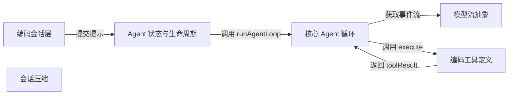

# pi：架构、运行逻辑与设计取舍

> main · [f09d01b85e03](https://github.com/earendil-works/pi/commit/f09d01b85e0384647fcab6779d35ab9dabe04be3) · deepseek-flash 辅助分析 · 2026-10-30T05:33:11.336Z
> 下文按固定源码推演，没有执行目标项目。引用可跳到具体代码行；“工程推断”解释收益与代价，不代表作者亲述。

## 1. 先建立直觉

**一个反复请模型决定下一步、执行工具、把结果写回对话的运行器；外层保存会话和界面，内层只把模型响应与工具结果接成可继续的对话。**

编码 Agent 同时要处理模型流式输出、工具调用、用户中途插话、取消、后续消息和长会话压缩。如果核心循环还负责 provider 格式、会话持久化和 TUI，调度状态会被外围细节淹没。

贯穿全文的例子：

- **输入：** 用户输入“读取 packages/agent/src/agent-loop.ts，然后把其中一段注释改清楚”。会话层先处理命令/模板和认证，把用户消息交给 Agent；模型第一轮返回 read 工具调用，第二轮根据读到的内容返回 edit 工具调用，第三轮返回完成文本。
- **预期输出：** 推演 transcript：user → assistant(toolCall read) → toolResult(read) → assistant(toolCall edit) → toolResult(edit) → assistant(最终文本)。流式过程中上下文里只有一条可替换的 assistant 消息；工具结果按 assistant 源顺序写入；无新工具调用且无 steering/follow-up 后发出 agent_end。

## 2. 一张图看懂架构



| 模块 | 职责与所在层的原因 | 输入 → 输出 | 拥有的状态 |
| --- | --- | --- | --- |
| 编码会话层 [1][source-1] | 接收用户输入，处理扩展命令、压缩中拒绝、输入拦截、技能/模板展开；流式时按 steer/followUp 排队，非流式时校验模型和认证后进入运行阶段。持久化、模型目录、认证和压缩等复杂度留在这一层。 | 用户文本、图片、PromptOptions；流式状态下还包含 streamingBehavior。 → 进入会话运行阶段；在核心侧最终表现为 Agent 的 prompt 消息或队列消息。_startRun 内部装配在已读范围外。 | 会话消息、steering/follow-up 队列、压缩状态、模型与认证状态、会话文件。 |
| Agent 状态与生命周期 [2][source-2] [3][source-3] [4][source-4] [5][source-5] | 有状态包装层，拥有 transcript、监听器、steering/follow-up 队列和当前 activeRun；把上下文快照与 loop 配置交给核心循环，并把循环事件归约为 AgentState。 | AgentMessage 或 continuation 请求；内部还接收核心循环发出的 AgentEvent。 → runAgentLoop/runAgentLoopContinue 所需的 AgentContext、AgentLoopConfig 和事件回调。 | AgentState.messages、tools、model、thinkingLevel、isStreaming、streamingMessage、pendingToolCalls、errorMessage；两个 PendingMessageQueue；activeRun 的 AbortController。 |
| 核心 Agent 循环 [6][source-6] [7][source-7] | 调度一轮轮 turn：声明工具变化、注入 steering/prepared 消息、调用模型流、执行工具、写回结果，再根据 finishTurn、steering、follow-up 决定继续或结束。它只处理 AgentMessage 和 AgentEvent。 | prompts、AgentContext、AgentLoopConfig、AbortSignal、StreamFn。 → AgentEvent 流和本次运行新增的 AgentMessage[]。 | currentContext、newMessages、lastCompletedTurn、pendingMessages、explicitContinuation，以及工具批次内的 finalizedCalls。 |
| 模型流抽象 [8][source-8] [9][source-9] | 把 provider 无关的 StreamFn 作为核心循环与模型实现之间的边界；宿主可注入默认 stream 函数，核心不依赖 provider catalog。 | Model、归一化后的 TranscriptContext、SimpleStreamOptions/AbortSignal。 → AssistantMessageEventStream，包含 start、text/thinking/toolcall 增量、done/error 事件。 | 模块级 defaultStreamFn 可选；未配置时 getDefaultStreamFn 抛错。 |
| 编码工具定义 [10][source-10] [11][source-11] [12][source-12] [13][source-13] | read/edit 等工具在 coding-agent 中定义参数 schema、执行逻辑和渲染；核心循环只通过 AgentTool.execute 调用，并通过 beforeToolCall/afterToolCall 插入策略。 | 工具参数、toolCallId、AbortSignal、onUpdate、ExtensionContext。 → AgentToolResult，包含 content、details、可选 structuredContent/usage/isError/terminate。 | 文件系统副作用；edit 通过 withFileMutationQueue 限制同一路径的并发写。 |
| 会话压缩 [14][source-14] [15][source-15] [16][source-16] [17][source-17] | 长会话的上层复杂度：估计上下文 token、找保留最近消息的切点、生成或更新摘要、记录读写文件。compaction.ts 是纯函数，session manager 负责 I/O 和重载；核心 runLoop 不直接实现压缩。 | SessionEntry[]、AgentMessage[]、Model、摘要选项和 CompactionSettings。 → CompactionPreparation 或 CompactionResult（summary、firstKeptEntryId、tokensBefore、usage、details）。 | 摘要文本、保留起点、文件操作集合；不直接改变核心循环的 currentContext。 |

## 3. 跟着一个请求跑完整条主线

这是对已读方法体的源码推演，不是执行日志。编号是阅读顺序；装配、写入、查询与条件分支是否发生，取决于每步的触发条件。

### 1. 会话层先拦截、排队或校验用户输入

**阶段：** 预处理与校验

**触发条件：** 每次 AgentSession.prompt 调用；若正在流式且有 streamingBehavior，则走排队分支；若压缩中则直接拒绝。

入口/调用：`AgentSession.prompt` [1][source-1]

**此时输入：** 用户文本 text、PromptOptions（images、streamingBehavior、expandPromptTemplates 等）。

先尝试执行以 / 开头的扩展命令；若 compactionAbortController 存在则抛错；运行输入处理器，必要时展开 skill 和 prompt template；流式时按 followUp/steer 入队并返回；否则校验 model 和认证，然后调用 _startRun。

**状态变化：** 可能向 steering/follow-up 队列追加消息；可能设置 preflightResult；不在这里修改核心 transcript。

**交给下一步：** 非流式且校验通过后进入会话运行阶段；_startRun 内部装配在本仓库已读范围外。

### 2. Agent 规范化提示并建立一次 run 的生命周期

**阶段：** 装配与写入

**触发条件：** 运行阶段调用 Agent.prompt 或继续逻辑时。

入口/调用：`Agent.prompt / Agent.runPromptMessages / Agent.runWithLifecycle` [18][source-18] [3][source-3] [19][source-19]

**此时输入：** 字符串、单条 AgentMessage 或 AgentMessage[]，可选图片。

Agent.prompt 先用 normalizePromptInput 变成 AgentMessage[]；runWithLifecycle 创建 AbortController 和 activeRun，设置 isStreaming=true；runPromptMessages 在生命周期内调用 runAgentLoop，传入 createContextSnapshot、createLoopConfig、processEvents 回调和 streamFunction。

**状态变化：** activeRun 被设置；isStreaming=true；streamingMessage 和 errorMessage 清空。

**交给下一步：** runAgentLoop 收到 prompts、上下文快照、配置、emit 回调和 signal。

### 3. runAgentLoop 初始化工具声明并发出运行开始事件

**阶段：** 初始化

**触发条件：** 每次新 prompt 运行必经。

入口/调用：`runAgentLoop / declareToolChanges` [6][source-6] [20][source-20]

**此时输入：** prompts、AgentContext、AgentLoopConfig、emit、signal、streamFn。

declareToolChanges 比较 transcript 中的系统消息工具声明与 context.tools 的可执行集合，生成 toolsAdded/toolsRemoved 系统消息；把初始消息复制进 newMessages 和 currentContext.messages；发出 agent_start、turn_start，以及每条初始消息的 message_start/message_end；调用 runLoop。

**状态变化：** currentContext.messages 增加初始提示及可能的工具变更系统消息；newMessages 同步记录；事件被 emit。

**交给下一步：** runLoop 收到 currentContext、newMessages、config、signal、emit、streamFunction。

### 4. runLoop 注入 steering/prepared 消息并准备请求

**阶段：** 写入与查询

**触发条件：** 进入内层 while；若已有 lastCompletedTurn，则先调用 prepareNextTurn；每次请求前调用 prepareRequest。

入口/调用：`runLoop` [21][source-21]

**此时输入：** currentContext、config、pendingMessages、lastCompletedTurn。

初始 pendingMessages 来自 getSteeringMessages；lastCompletedTurn 存在时 prepareNextTurn 可替换 context/model/thinkingLevel 并返回要追加的消息；随后对 prepared+pending 消息走 declareToolChanges、发 message_start/message_end、push 到 currentContext 和 newMessages；prepareRequest 可在请求前再次替换 context/model/thinkingLevel。

**状态变化：** currentContext.messages 追加 prepared 和 steering 消息；config 的 model/reasoning 可能被替换；pendingMessages 清空。

**交给下一步：** 准备好进入 streamAssistantResponse 的上下文和请求配置。

### 5. streamAssistantResponse 转换上下文并消费流事件

**阶段：** 查询与流式写入

**触发条件：** 每次请求模型时必经。

入口/调用：`streamAssistantResponse` [22][source-22] [23][source-23]

**此时输入：** currentContext.messages、config.model、config.transformContext、config.convertToLlm、streamFunction、signal。

先可选 transformContext，再调用 config.convertToLlm 把 AgentMessage[] 转成 Message[]（该转换函数由调用方提供）；normalizeContext 只保留 messages 作为 TranscriptContext；解析 API key 后调用 streamFunction。遍历 start/delta/done/error 事件，把流式 partial 写入 context，并把事件 emit 给上层。

**状态变化：** context.messages 中一条 assistant 消息被流式 partial 反复替换；done 时用 result() 的最终消息替换并 emit message_end。

**交给下一步：** 最终 AssistantMessage 返回给 runLoop，并被 push 到 newMessages。

### 6. runLoop 判断硬退出或提取工具调用

**阶段：** 分支判断

**触发条件：** assistant 消息完成后；若 stopReason 为 error/aborted 则硬退出；若为 length 则不执行工具；否则提取 content 中的 toolCall。

入口/调用：`runLoop / failToolCallsFromTruncatedMessage` [24][source-24] [25][source-25]

**此时输入：** finalMessage、currentContext、config。

error/aborted 时记录 lastCompletedTurn，调用 finishTurn，发 turn_end 和 agent_end 后返回；正常消息过滤出 toolCalls；stopReason 为 length 时 failToolCallsFromTruncatedMessage 为每个调用生成错误结果并不执行；否则调用 executeToolCalls。

**状态变化：** 可能追加一组 toolResult 消息；截断路径生成 error toolResult 并继续下一轮让模型重发。

**交给下一步：** executedToolBatch 的 messages 和 terminate 标志，或硬退出。

### 7. executeToolCalls 选择串行或并行

**阶段：** 调度决策

**触发条件：** assistant 消息包含工具调用且不是 length 截断时。

入口/调用：`executeToolCalls` [26][source-26]

**此时输入：** currentContext、assistantMessage、config、signal、emit。

过滤出 toolCalls，并检查是否有工具声明 executionMode=sequential。如果 config.toolExecution 为 sequential 或任一工具要求 sequential，则调用 executeToolCallsSequential；否则调用 executeToolCallsParallel。

**状态变化：** 无；只产生分支决定。

**交给下一步：** 调用串行或并行执行函数。

### 8. 串行或并行执行工具并形成结果消息

**阶段：** 执行与并发

**触发条件：** 由 executeToolCalls 选择；并行路径先准备再并发执行。

入口/调用：`executeToolCallsSequential / executeToolCallsParallel` [27][source-27] [28][source-28] [29][source-29]

**此时输入：** currentContext、assistantMessage、toolCalls、config、signal、emit。

两条路径都逐个 emit tool_execution_start 并调用 prepareToolCall：查工具、prepareArguments、schema 校验、beforeToolCall；immediate 结果直接形成错误/阻止结果。串行路径逐个执行并 finalize；并行路径把已准备调用包装成闭包，Promise.all 并发执行，最后按源顺序 createToolResultMessage。

**状态变化：** 串行路径按源顺序累积 finalizedCalls；并行路径 tool_execution_end 可能按完成顺序发出，但 toolResult 消息按 assistant 源顺序形成。

**交给下一步：** 返回 messages 和 shouldTerminateToolBatch(finalizedCalls) 的 terminate 标志。

### 9. runLoop 写回工具结果并决定继续或结束

**阶段：** 写入与轮询

**触发条件：** 每批工具执行后；若 finishTurn 返回 end 则立即退出。

入口/调用：`runLoop` [30][source-30]

**此时输入：** toolResults、lastCompletedTurn、config.finishTurn、steering/follow-up 队列。

把 toolResults push 到 currentContext.messages 和 newMessages；记录 lastCompletedTurn；调用 finishTurn 得到 decision，emit turn_end；decision 为 end 则 emit agent_end 返回；否则轮询 getSteeringMessages，若有工具结果或 steering 则继续内层；内层结束再取 follow-up，若存在则设为 pending 继续；显式 continue 在没有自然请求时做一次 context-only turn；否则 emit agent_end 并 break。

**状态变化：** currentContext/newMessages 增加 toolResult；队列被 drain；AgentState 随事件更新。

**交给下一步：** 继续下一轮请求，或发出 agent_end 结束本次运行。

## 4. 核心技术到底是什么

### 1. AgentMessage 到 LLM 消息的请求边界

**解决的问题：** 会话中要保留自定义消息、工具变更系统消息和 UI 通知，但 provider 只接受有限消息类型。 [22][source-22] [9][source-9]

每次请求前先可选 transformContext 处理 AgentMessage；再调用调用方提供的 convertToLlm 映射/过滤成 Message[]；normalizeContext 只保留 messages 形成 provider transcript；系统消息在 transcript 中承载 prompt 和工具声明。

算法示意（用于解释机制，不是源码原文）：

```text
messages = context.messages
if config.transformContext:
  messages = await config.transformContext(messages)
llmMessages = await config.convertToLlm(messages)
transcript = normalizeContext({ messages: llmMessages })
response = streamFn(model, transcript, options)
return response
```

**关键数据结构：** AgentMessage 是 Message 与自定义消息的联合；AgentContext 只持有 messages 和可执行 tools；StreamFn 接收 TranscriptContext，其中 messages 是唯一顶层字段。

- **本项目实现：** streamAssistantResponse 按顺序调用 transformContext、convertToLlm、normalizeContext，并把 config 传给 streamFunction。
- **外部依赖提供：** pi-ai 的 normalizeContext、TranscriptContext 和具体 provider 消息格式；本项目只保证传入归一化 transcript。
- **收益与代价：** 核心循环与 provider 解耦，UI 自定义消息不必进入 provider；代价是每次请求都要转换，且 convertToLlm 契约要求不抛异常。

### 2. 流式 assistant 消息按累计快照替换

**解决的问题：** 模型流先给 start，再给多个 text/thinking/toolcall 事件；如果每个事件都追加一条消息，transcript 会膨胀，toolResult 关联也会错乱。 [23][source-23]

start 时把 event.partial 作为一条消息 push；后续增量事件把 context 最后一条替换为 event.partial——partial 是当前累计快照，不是要追加的 delta；done/error 时调用 response.result() 得到最终完整消息并替换最后一条。

算法示意（用于解释机制，不是源码原文）：

```text
addedPartial = false
for event in response:
  if event.type == start:
    context.messages.push(event.partial)
    addedPartial = true
  elif event.type in deltaEvents:
    context.messages[last] = event.partial
  elif event.type in doneOrError:
    final = await response.result()
    if addedPartial: context.messages[last] = final
    else: context.messages.push(final)
    emit message_end
    return final
```

**关键数据结构：** partialMessage 是 AssistantMessage 的当前快照；context.messages 中始终只有一条正在演进的 assistant 消息；最终消息包含 usage、stopReason 等完整字段。

- **本项目实现：** streamAssistantResponse 的事件 switch、partialMessage 替换逻辑、result() 取最终消息。
- **外部依赖提供：** pi-ai 的 AssistantMessageEventStream 负责把 provider SSE 聚合成带 partial 的事件；本项目消费这些事件并写回上下文。
- **收益与代价：** UI 能实时看到增量，transcript 又不会膨胀；代价是核心假设 event.partial 是累计快照，streamFn 实现必须遵守该事件契约。

### 3. 工具批次准备/执行分离与顺序策略

**解决的问题：** 同一 assistant 消息可能包含多个工具调用；读文件可以并行降低延迟，但编辑同一文件或需要前置策略的工具必须有序，且错误参数不能进入执行阶段。 [26][source-26] [28][source-28] [29][source-29]

先按 toolCalls 顺序逐个 prepareToolCall：查工具、prepareArguments、schema 校验、beforeToolCall；immediate 结果直接形成错误/阻止结果。串行模式逐个执行并 finalize；并行模式把已准备调用包装成闭包，Promise.all 并发执行，最后按源顺序 createToolResultMessage。shouldTerminateToolBatch 要求本批所有结果都 terminate=true 才终止。

算法示意（用于解释机制，不是源码原文）：

```text
toolCalls = assistantMessage.content.filter(toolCall)
if globalSequential or anyToolSequential:
  for call in toolCalls:
    prep = prepare(call)
    if prep.immediate: finalize(prep.result)
    else: execute(prep); afterHook(prep)
else:
  for call in toolCalls:
    prep = prepare(call)
    if prep.immediate: push(immediate)
    else: push(closure(() => execute(prep)))
  ordered = await Promise.all(entries)
  for finalized in ordered: emit toolResultMessage
```

**关键数据结构：** finalizedCalls 在串行路径按源顺序累积；并行路径先存 immediate 结果或闭包，再 Promise.all 得到 orderedFinalizedCalls；AgentToolResult.terminate 是批次终止提示。

- **本项目实现：** executeToolCalls、executeToolCallsSequential、executeToolCallsParallel、prepareToolCall、shouldTerminateToolBatch。
- **外部依赖提供：** 工具自身的 execute 实现由 coding-agent 或扩展提供；核心只负责调用和结果消息化。
- **收益与代价：** 并行减少等待，串行保证副作用顺序；代价是并行工具会同时产生外部副作用，因此工具需要用 executionMode 声明顺序要求，且 before/after hook 仍在准备阶段顺序执行。

### 4. steering/follow-up 双队列与 turn 调度

**解决的问题：** 用户可能在 Agent 工作时补充修正，也可能想等 Agent 完成当前任务后再追加任务；两者如果都按“下一次请求前注入”处理，会打断本应完成的当前任务。 [31][source-31] [32][source-32] [33][source-33]

PendingMessageQueue 保存消息，mode 为 all 或 one-at-a-time；Agent.steer 入 steeringQueue，Agent.followUp 入 followUpQueue。runLoop 在每轮工具结果后轮询 steering；只有在没有工具调用且没有 steering、agent 本来要停止时才轮询 follow-up。finishTurn 可以返回 end 立即结束，或 continue 在没有自然请求时让循环做一次 context-only turn。

算法示意（用于解释机制，不是源码原文）：

```text
pending = await getSteeringMessages()
while hasMoreToolCalls or pending.length:
  ... run assistant and tools ...
  decision = await finishTurn(turn)
  if decision.action == end: break
  pending = await getSteeringMessages()
followUps = await getFollowUpMessages()
if followUps.length: pending = followUps; continue
if explicitContinuation: explicitContinuation = false; continue
break
```

**关键数据结构：** PendingMessageQueue.messages、mode；runLoop 的 pendingMessages、lastCompletedTurn、explicitContinuation。

- **本项目实现：** Agent 的 steer/followUp/队列方法、createLoopConfig 中的 getSteeringMessages/getFollowUpMessages、runLoop 的双层循环。
- **外部依赖提供：** 无；队列和调度完全在本项目内实现。
- **收益与代价：** 调度更贴近用户意图，但状态机更复杂；one-at-a-time 默认避免一次注入过多消息，代价是后续消息要等下一个 drain 点。

## 5. 为什么选择这种实现

### 1. 核心循环全程使用 AgentMessage，只在调用 LLM 的边界转换成 Message[]。

**作者原文：** “Agent loop that works with AgentMessage throughout.  * Transforms to Message[] only at the LLM call boundary.” [34][source-34] [35][source-35]

**面临的约束：** 会话层需要保留自定义消息、工具变更系统消息和 UI 事件，而 provider 只接受有限的 LLM 消息类型。

**如果改用另一种做法：** 在 runLoop 内直接维护 provider Message[]，并让上层也使用 provider 格式。

**为什么当前方案有用：** 本次“读取再修改”场景中，工具变更系统消息、read/edit 的 toolResult 和可能的 UI 通知需要同时存在于 transcript；如果在循环里直接使用 provider 格式，自定义消息和工具声明差异很难表达。把转换限制在 streamAssistantResponse，核心调度就只关心 AgentMessage 和工具结果。

**付出的代价，以及不适用的情况：** 每次请求都要执行 transformContext/convertToLlm；convertToLlm 契约要求不抛异常，否则会破坏正常事件序列。

### 2. 工具默认可以并行执行，但准备、校验和前后 hook 按顺序进行；任一工具声明 executionMode=sequential 或全局配置 sequential 时整批退化为串行。

**依据：已确认实现；以下原因是工程分析，不代表作者亲述。** [36][source-36] [37][source-37] [38][source-38]

**面临的约束：** 同一批工具调用可能同时包含独立读操作和同一文件的写操作；参数错误和策略阻止不应该在并发执行后才暴露。

**如果改用另一种做法：** 所有工具一律串行执行，或者所有工具无条件并行执行。

**为什么当前方案有用：** “读取再修改”中 read 可以与其他读并行，edit 需要顺序和文件 mutation queue；把 prepareToolCall 放在并发执行之前，能先校验所有参数并运行 beforeToolCall，避免坏参数进入执行阶段。逐工具 executionMode 比全局串行更细，允许只对需要顺序的工具降级。

**付出的代价，以及不适用的情况：** 并行执行仍可能产生外部副作用竞争，工具作者必须正确声明 executionMode；并行时 tool_execution_end 按完成顺序发出，而 toolResult 消息按源顺序生成，事件消费者需要理解两者不同。

### 3. steering 与 follow-up 使用两个独立队列，并设置不同的轮询时机。

**作者原文：** “Called when the agent has no more tool calls and no steering messages.” [33][source-33] [31][source-31] [32][source-32]

**面临的约束：** 用户可能在 Agent 执行工具时追加修正，也可能想等当前任务结束后再追加新任务；两类消息的语义不同。

**如果改用另一种做法：** 所有用户追加消息都进入同一个队列，在下一次模型请求前统一注入。

**为什么当前方案有用：** 如果 follow-up 也按 steering 注入，Agent 可能在本应完成当前工具批次前就转向新任务；分开后，steering 在工具结果写回后、下一次请求前注入，follow-up 只在 Agent 没有工具调用且没有 steering、本来要停止时才注入。

**付出的代价，以及不适用的情况：** 调度状态更多；默认 one-at-a-time 会让后续消息多等几个 drain 点。

### 4. 核心循环通过 StreamFn 接收模型能力，不直接依赖 provider catalog 或默认模型运行时。

**作者原文：** “Hosts that provide a default model runtime can install its stream function here  * without making pi-agent-core depend on a provider catalog or compatibility layer.” [39][source-39] [9][source-9]

**面临的约束：** coding-agent 需要模型目录、认证、重试和多种 provider，但 pi-agent-core 也要能被其他宿主复用和独立测试。

**如果改用另一种做法：** 在 runLoop 内直接创建 provider 客户端并解析模型/认证。

**为什么当前方案有用：** 把 streamFunction 作为参数传入，并在 Agent 构造时允许注入，核心就只看到 Model、TranscriptContext 和事件流；coding-agent 可以在自己的模型运行时里安装默认 streamFn，而核心不需要知道 Anthropic/OpenAI 的差异。

**付出的代价，以及不适用的情况：** 调用者必须提供 streamFn，或在宿主中调用 setDefaultStreamFn；否则 getDefaultStreamFn 抛错。核心也无法单独完成 provider 特定的重试和认证。

### 5. 上下文压缩不放进 runLoop，而由 coding-agent 的会话/压缩层承担，核心只提供 prepareRequest/prepareNextTurn 等替换上下文和模型的钩子。

**依据：已确认实现；以下原因是工程分析，不代表作者亲述。** [14][source-14] [17][source-17] [40][source-40]

**面临的约束：** 压缩需要 session entries、摘要模型调用、API key、文件操作追踪和会话重载，这些都不属于纯循环调度。

**如果改用另一种做法：** 在 runLoop 每次请求前自动检测 token 并压缩上下文。

**为什么当前方案有用：** compaction.ts 被设计成纯函数，session manager 负责 I/O 和重载；runLoop 已经允许 prepareNextTurn 返回 replacement context，prepareRequest 返回 replacement model/context。把压缩放在上层，核心循环就不必知道摘要提示、切点和文件信息。

**付出的代价，以及不适用的情况：** 如果上层没有安装压缩钩子，核心不会自动压缩；压缩触发和重载的精确调用顺序需要看未读的 AgentSession 方法体。

## 6. 关键代码精读

### 1. runAgentLoop 如何把工具声明差异变成系统消息并进入 runLoop


`packages/agent/src/agent-loop.ts:111-135` [6][source-6]

```typescript
export async function runAgentLoop(
	prompts: AgentMessage[],
	context: AgentContext,
	config: AgentLoopConfig,
	emit: AgentEventSink,
	signal: AbortSignal | undefined,
	streamFn: StreamFn,
): Promise<AgentMessage[]> {
	const initialMessages = declareToolChanges(context, prompts);
	const newMessages: AgentMessage[] = [...initialMessages];
	const currentContext: AgentContext = {
		...context,
		messages: [...context.messages, ...initialMessages],
	};

	await emit({ type: "agent_start" });
	await emit({ type: "turn_start" });
	for (const message of initialMessages) {
		await emit({ type: "message_start", message });
		await emit({ type: "message_end", message });
	}

	await runLoop(currentContext, newMessages, config, signal, emit, streamFn ?? getDefaultStreamFn());
	return newMessages;
}
```


`packages/agent/src/agent-loop.ts:342-372` [20][source-20]

```typescript
function declareToolChanges(context: AgentContext, pendingMessages: AgentMessage[]): AgentMessage[] {
	let systemIndex = -1;
	for (let i = pendingMessages.length - 1; i >= 0; i--) {
		if (pendingMessages[i].role === "system") {
			systemIndex = i;
			break;
		}
	}
	const pending = pendingMessages[systemIndex] as SystemMessage | undefined;
	const baseline = pending
		? pendingMessages.map((message, index) =>
				index === systemIndex ? withToolChanges(pending, NO_CHANGES) : message,
			)
		: pendingMessages;
	const changes = getToolStateChanges(
		getCurrentTools([...context.messages, ...baseline]),
		(context.tools ?? []).map(toToolDeclaration),
	);
	const unchanged = changes.toolsAdded.length === 0 && changes.toolsRemoved.length === 0;

	if (pending) {
		// Keep the caller's message object when it already declares no tool changes.
		if (unchanged && !pending.toolsAdded?.length && !pending.toolsRemoved?.length) return pendingMessages;
		return baseline.map((message, index) => (index === systemIndex ? withToolChanges(pending, changes) : message));
	}
	if (unchanged) return pendingMessages;
	const update = withToolChanges({ role: "system", content: "", timestamp: Date.now() }, changes);
	const insertIndex = pendingMessages.findIndex((message) => message.role !== "system");
	const index = insertIndex === -1 ? pendingMessages.length : insertIndex;
	return [...pendingMessages.slice(0, index), update, ...pendingMessages.slice(index)];
}
```


runAgentLoop 先调用 declareToolChanges(context, prompts)。declareToolChanges 从 pendingMessages 中找最后一条 system 消息，用 getCurrentTools 计算已提交 transcript 与 context.tools 可执行集合的差异；若没有变化则原样返回，若有变化则在第一条非 system 消息前插入或替换一条只带 toolsAdded/toolsRemoved 的系统消息。随后 runAgentLoop 复制初始消息到 newMessages 和 currentContext.messages，发出 agent_start/turn_start，并对每条初始消息发 message_start/message_end，最后把 currentContext 交给 runLoop。关键不变量是：模型看到的工具清单由 transcript 系统消息重放，而不是旁路 context.tools。

### 2. streamAssistantResponse 如何用累计 partial 替换而不是追加 assistant 消息


`packages/agent/src/agent-loop.ts:390-417` [22][source-22]

```typescript
async function streamAssistantResponse(
	context: AgentContext,
	config: AgentLoopConfig,
	signal: AbortSignal | undefined,
	emit: AgentEventSink,
	streamFunction: StreamFn,
): Promise<AssistantMessage> {
	// Apply context transform if configured (AgentMessage[] → AgentMessage[])
	let messages = context.messages;
	if (config.transformContext) {
		messages = await config.transformContext(messages, signal);
	}

	// Convert to LLM-compatible messages (AgentMessage[] → Message[])
	const llmMessages = await config.convertToLlm(messages);

	const llmContext = normalizeContext({ messages: llmMessages });

	// Resolve API key (important for expiring tokens)
	const resolvedApiKey =
		(config.getApiKey ? await config.getApiKey(config.model.provider) : undefined) || config.apiKey;

	const response = await streamFunction(config.model, llmContext, {
		...config,
		apiKey: resolvedApiKey,
		identity: mergeClientIdentity(DEFAULT_AGENT_IDENTITY, config.identity),
		signal,
	});
```


`packages/agent/src/agent-loop.ts:419-465` [23][source-23]

```typescript
	const result = async () => Object.assign(await response.result(), { thinkingLevel: config.reasoning ?? "off" });

	let partialMessage: AssistantMessage | null = null;
	let addedPartial = false;

	for await (const event of response) {
		switch (event.type) {
			case "start":
				partialMessage = event.partial;
				context.messages.push(partialMessage);
				addedPartial = true;
				await emit({ type: "message_start", message: { ...partialMessage } });
				break;

			case "text_start":
			case "text_delta":
			case "text_end":
			case "thinking_start":
			case "thinking_delta":
			case "thinking_end":
			case "toolcall_start":
			case "toolcall_delta":
			case "toolcall_end":
				if (partialMessage) {
					partialMessage = event.partial;
					context.messages[context.messages.length - 1] = partialMessage;
					await emit({
						type: "message_update",
						assistantMessageEvent: event,
						message: { ...partialMessage },
					});
				}
				break;

			case "done":
			case "error": {
				const finalMessage = await result();
				if (addedPartial) {
					context.messages[context.messages.length - 1] = finalMessage;
				} else {
					context.messages.push(finalMessage);
				}
				if (!addedPartial) {
					await emit({ type: "message_start", message: { ...finalMessage } });
				}
				await emit({ type: "message_end", message: finalMessage });
				return finalMessage;
```


先对 context.messages 做可选 transformContext，再调用 config.convertToLlm 成 LLM 消息，normalizeContext 只保留 messages，解析 API key 后调用 streamFunction。遍历响应事件时，start 分支把 event.partial push 到 context 并标记 addedPartial；text/thinking/toolcall 分支把 context 最后一条直接赋值为 event.partial，并发 message_update；done/error 分支调用 result() 得到最终 AssistantMessage，若已有 partial 就替换最后一条，否则追加并补发 message_start，最后发 message_end 并返回最终消息。因此 context 中不会为每个 delta 新增消息，最终消息包含完整 usage 和 stopReason。

### 3. 工具批次如何先选择模式、再准备/执行、最后按源顺序生成 toolResult


`packages/agent/src/agent-loop.ts:518-533` [26][source-26]

```typescript
async function executeToolCalls(
	currentContext: AgentContext,
	assistantMessage: AssistantMessage,
	config: AgentLoopConfig,
	signal: AbortSignal | undefined,
	emit: AgentEventSink,
): Promise<ExecutedToolCallBatch> {
	const toolCalls = assistantMessage.content.filter((c) => c.type === "toolCall");
	const hasSequentialToolCall = toolCalls.some(
		(tc) => currentContext.tools?.find((t) => t.name === tc.name)?.executionMode === "sequential",
	);
	if (config.toolExecution === "sequential" || hasSequentialToolCall) {
		return executeToolCallsSequential(currentContext, assistantMessage, toolCalls, config, signal, emit);
	}
	return executeToolCallsParallel(currentContext, assistantMessage, toolCalls, config, signal, emit);
}
```


`packages/agent/src/agent-loop.ts:596-670` [28][source-28]

```typescript
async function executeToolCallsParallel(
	currentContext: AgentContext,
	assistantMessage: AssistantMessage,
	toolCalls: AgentToolCall[],
	config: AgentLoopConfig,
	signal: AbortSignal | undefined,
	emit: AgentEventSink,
): Promise<ExecutedToolCallBatch> {
	const finalizedCalls: FinalizedToolCallEntry[] = [];

	for (const toolCall of toolCalls) {
		await emit({
			type: "tool_execution_start",
			toolCallId: toolCall.id,
			toolName: toolCall.name,
			args: toolCall.arguments,
		});

		const preparation = await prepareToolCall(currentContext, assistantMessage, toolCall, config, signal);
		if (preparation.kind === "immediate") {
			const finalized = {
				toolCall,
				result: preparation.result,
				isError: preparation.isError,
			} satisfies FinalizedToolCallOutcome;
			await emitToolExecutionEnd(finalized, emit);
			finalizedCalls.push(finalized);
			if (signal?.aborted) {
				break;
			}
			continue;
		}

		finalizedCalls.push(async () => {
			if (signal?.aborted) {
				const finalized = {
					toolCall,
					result: createErrorToolResult("Operation aborted"),
					isError: true,
				} satisfies FinalizedToolCallOutcome;
				await emitToolExecutionEnd(finalized, emit);
				return finalized;
			}
			const executed = await executePreparedToolCall(preparation, signal, emitToolExecutionUpdate(toolCall, emit));
			const finalized = await finalizeExecutedToolCall(
				currentContext,
				assistantMessage,
				preparation,
				executed,
				config,
				signal,
			);
			await emitToolExecutionEnd(finalized, emit);
			return finalized;
		});
		if (signal?.aborted) {
			break;
		}
	}

	const orderedFinalizedCalls = await Promise.all(
		finalizedCalls.map((entry) => (typeof entry === "function" ? entry() : Promise.resolve(entry))),
	);
	const messages: ToolResultMessage[] = [];
	for (const finalized of orderedFinalizedCalls) {
		const toolResultMessage = createToolResultMessage(finalized);
		await emitToolResultMessage(toolResultMessage, emit);
		messages.push(toolResultMessage);
	}

	return {
		messages,
		terminate: shouldTerminateToolBatch(orderedFinalizedCalls),
	};
}
```


`packages/agent/src/agent-loop.ts:700-702` [29][source-29]

```typescript
function shouldTerminateToolBatch(finalizedCalls: FinalizedToolCallOutcome[]): boolean {
	return finalizedCalls.length > 0 && finalizedCalls.every((finalized) => finalized.result.terminate === true);
}
```


executeToolCalls 先过滤出 toolCalls，并检查是否有工具声明 executionMode=sequential；如果全局 sequential 或任一工具要求 sequential，就走串行路径，否则并行。并行路径 executeToolCallsParallel 仍按 toolCalls 顺序 emit tool_execution_start 并 prepareToolCall：未知工具、参数校验失败或 beforeToolCall 阻止会形成 immediate 结果；准备好的调用被包装成闭包放进 finalizedCalls。随后 Promise.all 执行所有闭包，得到 orderedFinalizedCalls；最后按这个源顺序 createToolResultMessage 并 emit message_start/message_end。shouldTerminateToolBatch 只有在本批 finalizedCalls 非空且每个 result.terminate=true 时才返回 true，因此一个工具想终止批次不足以让整批提前结束。

## 7. 动手验证你的理解

以下是建议实验，没有执行过。

### 1. 把全局 toolExecution 改成 sequential，或让一个工具声明 executionMode=sequential，是否会让本批工具不再并发执行，同时 toolResult 仍按 assistant 源顺序写入？

**改变什么：** 在 AgentLoopConfig 中设置 toolExecution: "sequential"，或把其中一个工具的 executionMode 设为 "sequential"；其余配置保持并行默认。 [26][source-26] [27][source-27]

**应该观察到什么：** executeToolCalls 会走 executeToolCallsSequential；第二个工具不会在第一个工具 execute 完成前开始；messages 中的 toolResult 顺序仍与 assistant 消息里的 toolCall 顺序一致。若只让一个工具 sequential，则整批都走串行路径，因为 executeToolCalls 检查 hasSequentialToolCall。

### 2. 流式过程中 context 里的 assistant 消息是每个 delta 追加一条，还是始终只有一条被累计快照替换？

**改变什么：** 用 mock streamFn 先 push start(partial=A)，再 push 一个 text_delta 事件并让 event.partial 表示累计后的 A+B，最后 push done 且 response.result() 返回最终消息；运行后检查 messages 中 assistant 消息数量。 [41][source-41]

**应该观察到什么：** 按 streamAssistantResponse，start 时 push 一条 partial，后续 delta 把 context 最后一条替换为 event.partial，done 时用 result() 的最终消息替换同一条；因此 assistant 消息数量为 1，最终内容等于 done 返回的完整消息，而不是 A、A+B 两条。

### 3. finishTurn 返回 end 时，是否会跳过 steering/follow-up 轮询并立即结束？

**改变什么：** 让 finishTurn 返回 { action: "end" }，同时让 getSteeringMessages 和 getFollowUpMessages 返回非空消息；观察是否还会发起下一次模型请求。 [42][source-42]

**应该观察到什么：** runLoop 在 decision?.action === "end" 时直接 emit agent_end 并 return，不再执行 pendingMessages = getSteeringMessages 和 follow-up 分支；因此队列消息保留但不会被本次运行消费。

## 8. 读完应当能复述什么

- 核心循环只维护 AgentMessage transcript；provider Message 转换集中在 streamAssistantResponse，工具声明通过 transcript 系统消息重放。
- 流式增量事件里的 partial 是累计快照，必须替换 context 中同一条 assistant 消息；done 时再用 result() 的最终消息收口。
- 工具执行把准备/校验/前后 hook 与真正 execute 分离：并行只并发执行阶段，最终 toolResult 仍按 assistant 源顺序写入，批次终止要求所有结果都 terminate=true。
- steering 与 follow-up 是不同调度时机：steering 在工具结果后注入，follow-up 在 Agent 本来要停止时才注入；finishTurn 是上层干预是否继续的钩子。
- 编码会话层承担模型选择、认证、压缩、持久化和 TUI 交互；核心通过 StreamFn、AgentTool 和 prepareRequest/prepareNextTurn 钩子接收能力，保持调度逻辑可复用。

## 来源与覆盖边界

本次读取 24 个文件，共 347,608 字符；22 个文件完整读取，其他文件按关键方法取带行号的片段。没有把未读依赖的内部实现当作已确认事实。

- AgentSession._startRun、_prepareRun、_installAgentRequestProjection 等方法体在已读范围内没有包含，因此无法确认会话层具体如何把 prompt 装配到 Agent、如何安装 prepareRequest/prepareNextTurn 钩子，以及压缩在请求前触发的精确顺序。
- AgentSession.constructor 的方法体未读，无法确认 Agent 的 streamFn、convertToLlm、工具集合和事件监听器在构造时如何注入。
- AgentSession._handleAgentEvent 和 subscribe 的方法体未读，无法确认会话持久化、扩展事件和 TUI 刷新如何消费 AgentEvent。
- compaction.ts 的 prepareCompaction/compact 是纯函数，但 AgentSession 中自动压缩的触发条件和重载路径（_runAutoCompaction、_checkCompaction 等）方法体未读，不能断言每轮请求前一定会压缩。
- TUI 渲染层和 interactive 模式的调用路径未读，无法确认 message_update、tool_execution_update 等事件在界面上的具体呈现方式。

| 文件 | 实际读取行段 |
| --- | --- |
| [README.md](https://github.com/earendil-works/pi/blob/f09d01b85e0384647fcab6779d35ab9dabe04be3/README.md) | 1–207 / 共 207 行 |
| [package.json](https://github.com/earendil-works/pi/blob/f09d01b85e0384647fcab6779d35ab9dabe04be3/package.json) | 1–79 / 共 79 行 |
| [packages/agent/src/agent-loop.ts](https://github.com/earendil-works/pi/blob/f09d01b85e0384647fcab6779d35ab9dabe04be3/packages/agent/src/agent-loop.ts) | 1–960 / 共 960 行 |
| [packages/agent/src/agent.ts](https://github.com/earendil-works/pi/blob/f09d01b85e0384647fcab6779d35ab9dabe04be3/packages/agent/src/agent.ts) | 1–624 / 共 624 行 |
| [packages/agent/src/types.ts](https://github.com/earendil-works/pi/blob/f09d01b85e0384647fcab6779d35ab9dabe04be3/packages/agent/src/types.ts) | 1–540 / 共 540 行 |
| [packages/agent/src/stream-fn.ts](https://github.com/earendil-works/pi/blob/f09d01b85e0384647fcab6779d35ab9dabe04be3/packages/agent/src/stream-fn.ts) | 1–21 / 共 21 行 |
| [packages/coding-agent/src/core/agent-session.ts](https://github.com/earendil-works/pi/blob/f09d01b85e0384647fcab6779d35ab9dabe04be3/packages/coding-agent/src/core/agent-session.ts) | 1–50、2110–2196 / 共 4480 行 |
| [packages/coding-agent/src/core/agent-session-runtime.ts](https://github.com/earendil-works/pi/blob/f09d01b85e0384647fcab6779d35ab9dabe04be3/packages/coding-agent/src/core/agent-session-runtime.ts) | 1–448 / 共 448 行 |
| [packages/coding-agent/src/core/compaction/compaction.ts](https://github.com/earendil-works/pi/blob/f09d01b85e0384647fcab6779d35ab9dabe04be3/packages/coding-agent/src/core/compaction/compaction.ts) | 1–1105 / 共 1105 行 |
| [packages/agent/src/index.ts](https://github.com/earendil-works/pi/blob/f09d01b85e0384647fcab6779d35ab9dabe04be3/packages/agent/src/index.ts) | 1–6 / 共 6 行 |
| [packages/coding-agent/src/core/tools/read.ts](https://github.com/earendil-works/pi/blob/f09d01b85e0384647fcab6779d35ab9dabe04be3/packages/coding-agent/src/core/tools/read.ts) | 1–225 / 共 225 行 |
| [packages/coding-agent/src/core/tools/edit.ts](https://github.com/earendil-works/pi/blob/f09d01b85e0384647fcab6779d35ab9dabe04be3/packages/coding-agent/src/core/tools/edit.ts) | 1–221 / 共 221 行 |
| [packages/coding-agent/src/core/tools/index.ts](https://github.com/earendil-works/pi/blob/f09d01b85e0384647fcab6779d35ab9dabe04be3/packages/coding-agent/src/core/tools/index.ts) | 1–225 / 共 225 行 |
| [packages/agent/test/agent-loop.test.ts](https://github.com/earendil-works/pi/blob/f09d01b85e0384647fcab6779d35ab9dabe04be3/packages/agent/test/agent-loop.test.ts) | 1–2235 / 共 2235 行 |
| [packages/coding-agent/examples/sdk/01-minimal.ts](https://github.com/earendil-works/pi/blob/f09d01b85e0384647fcab6779d35ab9dabe04be3/packages/coding-agent/examples/sdk/01-minimal.ts) | 1–27 / 共 27 行 |
| [packages/ai/src/api/anthropic-messages.ts](https://github.com/earendil-works/pi/blob/f09d01b85e0384647fcab6779d35ab9dabe04be3/packages/ai/src/api/anthropic-messages.ts) | 1–1687 / 共 1687 行 |
| [packages/coding-agent/src/modes/interactive/theme/theme.ts](https://github.com/earendil-works/pi/blob/f09d01b85e0384647fcab6779d35ab9dabe04be3/packages/coding-agent/src/modes/interactive/theme/theme.ts) | 1–1087 / 共 1087 行 |
| [packages/coding-agent/src/utils/frontmatter.ts](https://github.com/earendil-works/pi/blob/f09d01b85e0384647fcab6779d35ab9dabe04be3/packages/coding-agent/src/utils/frontmatter.ts) | 1–41 / 共 41 行 |
| [packages/coding-agent/src/utils/image-process.ts](https://github.com/earendil-works/pi/blob/f09d01b85e0384647fcab6779d35ab9dabe04be3/packages/coding-agent/src/utils/image-process.ts) | 1–120 / 共 120 行 |
| [packages/coding-agent/src/utils/sleep.ts](https://github.com/earendil-works/pi/blob/f09d01b85e0384647fcab6779d35ab9dabe04be3/packages/coding-agent/src/utils/sleep.ts) | 1–19 / 共 19 行 |
| [packages/coding-agent/src/utils/tool-result-images.ts](https://github.com/earendil-works/pi/blob/f09d01b85e0384647fcab6779d35ab9dabe04be3/packages/coding-agent/src/utils/tool-result-images.ts) | 1–68 / 共 68 行 |
| [packages/coding-agent/src/core/auth-guidance.ts](https://github.com/earendil-works/pi/blob/f09d01b85e0384647fcab6779d35ab9dabe04be3/packages/coding-agent/src/core/auth-guidance.ts) | 1–26 / 共 26 行 |
| [packages/coding-agent/src/core/bash-executor.ts](https://github.com/earendil-works/pi/blob/f09d01b85e0384647fcab6779d35ab9dabe04be3/packages/coding-agent/src/core/bash-executor.ts) | 1–147 / 共 147 行 |
| [packages/coding-agent/src/core/bug-report.ts](https://github.com/earendil-works/pi/blob/f09d01b85e0384647fcab6779d35ab9dabe04be3/packages/coding-agent/src/core/bug-report.ts) | 1–91 / 共 376 行 |

[source-1]: https://github.com/earendil-works/pi/blob/f09d01b85e0384647fcab6779d35ab9dabe04be3/packages/coding-agent/src/core/agent-session.ts#L2113-L2196 "packages/coding-agent/src/core/agent-session.ts:2113-2196"
[source-2]: https://github.com/earendil-works/pi/blob/f09d01b85e0384647fcab6779d35ab9dabe04be3/packages/agent/src/agent.ts#L194-L263 "packages/agent/src/agent.ts:194-263"
[source-3]: https://github.com/earendil-works/pi/blob/f09d01b85e0384647fcab6779d35ab9dabe04be3/packages/agent/src/agent.ts#L441-L455 "packages/agent/src/agent.ts:441-455"
[source-4]: https://github.com/earendil-works/pi/blob/f09d01b85e0384647fcab6779d35ab9dabe04be3/packages/agent/src/agent.ts#L476-L515 "packages/agent/src/agent.ts:476-515"
[source-5]: https://github.com/earendil-works/pi/blob/f09d01b85e0384647fcab6779d35ab9dabe04be3/packages/agent/src/agent.ts#L575-L622 "packages/agent/src/agent.ts:575-622"
[source-6]: https://github.com/earendil-works/pi/blob/f09d01b85e0384647fcab6779d35ab9dabe04be3/packages/agent/src/agent-loop.ts#L111-L135 "packages/agent/src/agent-loop.ts:111-135"
[source-7]: https://github.com/earendil-works/pi/blob/f09d01b85e0384647fcab6779d35ab9dabe04be3/packages/agent/src/agent-loop.ts#L172-L330 "packages/agent/src/agent-loop.ts:172-330"
[source-8]: https://github.com/earendil-works/pi/blob/f09d01b85e0384647fcab6779d35ab9dabe04be3/packages/agent/src/stream-fn.ts#L1-L20 "packages/agent/src/stream-fn.ts:1-20"
[source-9]: https://github.com/earendil-works/pi/blob/f09d01b85e0384647fcab6779d35ab9dabe04be3/packages/agent/src/types.ts#L19-L37 "packages/agent/src/types.ts:19-37"
[source-10]: https://github.com/earendil-works/pi/blob/f09d01b85e0384647fcab6779d35ab9dabe04be3/packages/coding-agent/src/core/tools/read.ts#L86-L102 "packages/coding-agent/src/core/tools/read.ts:86-102"
[source-11]: https://github.com/earendil-works/pi/blob/f09d01b85e0384647fcab6779d35ab9dabe04be3/packages/coding-agent/src/core/tools/edit.ts#L143-L159 "packages/coding-agent/src/core/tools/edit.ts:143-159"
[source-12]: https://github.com/earendil-works/pi/blob/f09d01b85e0384647fcab6779d35ab9dabe04be3/packages/coding-agent/src/core/tools/edit.ts#L163-L198 "packages/coding-agent/src/core/tools/edit.ts:163-198"
[source-13]: https://github.com/earendil-works/pi/blob/f09d01b85e0384647fcab6779d35ab9dabe04be3/packages/coding-agent/src/core/tools/index.ts#L164-L171 "packages/coding-agent/src/core/tools/index.ts:164-171"
[source-14]: https://github.com/earendil-works/pi/blob/f09d01b85e0384647fcab6779d35ab9dabe04be3/packages/coding-agent/src/core/compaction/compaction.ts#L1-L6 "packages/coding-agent/src/core/compaction/compaction.ts:1-6"
[source-15]: https://github.com/earendil-works/pi/blob/f09d01b85e0384647fcab6779d35ab9dabe04be3/packages/coding-agent/src/core/compaction/compaction.ts#L196-L224 "packages/coding-agent/src/core/compaction/compaction.ts:196-224"
[source-16]: https://github.com/earendil-works/pi/blob/f09d01b85e0384647fcab6779d35ab9dabe04be3/packages/coding-agent/src/core/compaction/compaction.ts#L446-L501 "packages/coding-agent/src/core/compaction/compaction.ts:446-501"
[source-17]: https://github.com/earendil-works/pi/blob/f09d01b85e0384647fcab6779d35ab9dabe04be3/packages/coding-agent/src/core/compaction/compaction.ts#L859-L923 "packages/coding-agent/src/core/compaction/compaction.ts:859-923"
[source-18]: https://github.com/earendil-works/pi/blob/f09d01b85e0384647fcab6779d35ab9dabe04be3/packages/agent/src/agent.ts#L382-L390 "packages/agent/src/agent.ts:382-390"
[source-19]: https://github.com/earendil-works/pi/blob/f09d01b85e0384647fcab6779d35ab9dabe04be3/packages/agent/src/agent.ts#L517-L540 "packages/agent/src/agent.ts:517-540"
[source-20]: https://github.com/earendil-works/pi/blob/f09d01b85e0384647fcab6779d35ab9dabe04be3/packages/agent/src/agent-loop.ts#L342-L372 "packages/agent/src/agent-loop.ts:342-372"
[source-21]: https://github.com/earendil-works/pi/blob/f09d01b85e0384647fcab6779d35ab9dabe04be3/packages/agent/src/agent-loop.ts#L184-L248 "packages/agent/src/agent-loop.ts:184-248"
[source-22]: https://github.com/earendil-works/pi/blob/f09d01b85e0384647fcab6779d35ab9dabe04be3/packages/agent/src/agent-loop.ts#L390-L417 "packages/agent/src/agent-loop.ts:390-417"
[source-23]: https://github.com/earendil-works/pi/blob/f09d01b85e0384647fcab6779d35ab9dabe04be3/packages/agent/src/agent-loop.ts#L419-L465 "packages/agent/src/agent-loop.ts:419-465"
[source-24]: https://github.com/earendil-works/pi/blob/f09d01b85e0384647fcab6779d35ab9dabe04be3/packages/agent/src/agent-loop.ts#L250-L287 "packages/agent/src/agent-loop.ts:250-287"
[source-25]: https://github.com/earendil-works/pi/blob/f09d01b85e0384647fcab6779d35ab9dabe04be3/packages/agent/src/agent-loop.ts#L488-L513 "packages/agent/src/agent-loop.ts:488-513"
[source-26]: https://github.com/earendil-works/pi/blob/f09d01b85e0384647fcab6779d35ab9dabe04be3/packages/agent/src/agent-loop.ts#L518-L533 "packages/agent/src/agent-loop.ts:518-533"
[source-27]: https://github.com/earendil-works/pi/blob/f09d01b85e0384647fcab6779d35ab9dabe04be3/packages/agent/src/agent-loop.ts#L540-L594 "packages/agent/src/agent-loop.ts:540-594"
[source-28]: https://github.com/earendil-works/pi/blob/f09d01b85e0384647fcab6779d35ab9dabe04be3/packages/agent/src/agent-loop.ts#L596-L670 "packages/agent/src/agent-loop.ts:596-670"
[source-29]: https://github.com/earendil-works/pi/blob/f09d01b85e0384647fcab6779d35ab9dabe04be3/packages/agent/src/agent-loop.ts#L700-L702 "packages/agent/src/agent-loop.ts:700-702"
[source-30]: https://github.com/earendil-works/pi/blob/f09d01b85e0384647fcab6779d35ab9dabe04be3/packages/agent/src/agent-loop.ts#L283-L330 "packages/agent/src/agent-loop.ts:283-330"
[source-31]: https://github.com/earendil-works/pi/blob/f09d01b85e0384647fcab6779d35ab9dabe04be3/packages/agent/src/agent.ts#L149-L180 "packages/agent/src/agent.ts:149-180"
[source-32]: https://github.com/earendil-works/pi/blob/f09d01b85e0384647fcab6779d35ab9dabe04be3/packages/agent/src/agent-loop.ts#L298-L326 "packages/agent/src/agent-loop.ts:298-326"
[source-33]: https://github.com/earendil-works/pi/blob/f09d01b85e0384647fcab6779d35ab9dabe04be3/packages/agent/src/types.ts#L282-L306 "packages/agent/src/types.ts:282-306"
[source-34]: https://github.com/earendil-works/pi/blob/f09d01b85e0384647fcab6779d35ab9dabe04be3/packages/agent/src/agent-loop.ts#L1-L4 "packages/agent/src/agent-loop.ts:1-4"
[source-35]: https://github.com/earendil-works/pi/blob/f09d01b85e0384647fcab6779d35ab9dabe04be3/packages/agent/src/agent-loop.ts#L390-L404 "packages/agent/src/agent-loop.ts:390-404"
[source-36]: https://github.com/earendil-works/pi/blob/f09d01b85e0384647fcab6779d35ab9dabe04be3/packages/agent/src/types.ts#L39-L47 "packages/agent/src/types.ts:39-47"
[source-37]: https://github.com/earendil-works/pi/blob/f09d01b85e0384647fcab6779d35ab9dabe04be3/packages/agent/src/agent-loop.ts#L526-L532 "packages/agent/src/agent-loop.ts:526-532"
[source-38]: https://github.com/earendil-works/pi/blob/f09d01b85e0384647fcab6779d35ab9dabe04be3/packages/agent/src/agent-loop.ts#L656-L664 "packages/agent/src/agent-loop.ts:656-664"
[source-39]: https://github.com/earendil-works/pi/blob/f09d01b85e0384647fcab6779d35ab9dabe04be3/packages/agent/src/stream-fn.ts#L5-L20 "packages/agent/src/stream-fn.ts:5-20"
[source-40]: https://github.com/earendil-works/pi/blob/f09d01b85e0384647fcab6779d35ab9dabe04be3/packages/agent/src/types.ts#L266-L280 "packages/agent/src/types.ts:266-280"
[source-41]: https://github.com/earendil-works/pi/blob/f09d01b85e0384647fcab6779d35ab9dabe04be3/packages/agent/src/agent-loop.ts#L424-L465 "packages/agent/src/agent-loop.ts:424-465"
[source-42]: https://github.com/earendil-works/pi/blob/f09d01b85e0384647fcab6779d35ab9dabe04be3/packages/agent/src/agent-loop.ts#L295-L326 "packages/agent/src/agent-loop.ts:295-326"
