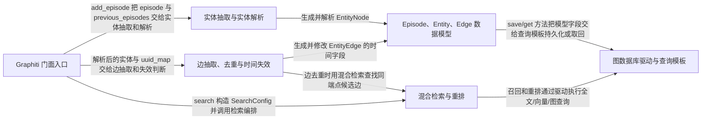

# graphiti：架构、运行逻辑与设计取舍

> main · [72b5c59c0660](https://github.com/getzep/graphiti/commit/72b5c59c06607e09ea855be61b6ff5a3446fc951) · deepseek-flash 辅助分析 · 2026-10-30T05:33:11.336Z
> 下文按固定源码推演，没有执行目标项目。引用可跳到具体代码行；“工程推断”解释收益与代价，不代表作者亲述。

## 1. 先建立直觉

**它把每次对话先存成可追溯的 episode，再抽取人物和关系，并用有效时间区间让旧事实被标记为过期而不是直接删除，查询时同时看向量、关键词和图关系。**

传统 RAG 把文档切块后做静态相似度检索，难以表达‘谁和谁有什么关系’、‘这条事实何时为真’以及‘新信息何时推翻旧信息’。冲突事实如果只追加或直接覆盖，都会丢失历史或混淆当前状态。

贯穿全文的例子：

- **输入：** 推演输入：Episode A（reference_time=2024-01-10）内容为‘Alice: I work at Acme.’；Episode B（reference_time=2025-03-02）内容为‘Alice: I left Acme and now work at Globex.’。随后查询‘Where does Alice work now?’。
- **预期输出：** 推演输出：图中保留 Episode A 和 Episode B，Alice、Acme、Globex 为实体；若抽取模型给出对应时间，Acme 关系带 valid_at≈2024-01-10、invalid_at≈2025-03-02、expired_at=写入时刻，Globex 关系带 valid_at≈2025-03-02；检索返回相关 EntityEdge 列表，具体排序仍取决于模型抽取、嵌入和检索配置。

## 2. 一张图看懂架构



| 模块 | 职责与所在层的原因 | 输入 → 输出 | 拥有的状态 |
| --- | --- | --- | --- |
| Graphiti 门面入口 [1][source-1] [2][source-2] [3][source-3] | 对外暴露初始化、写入 episode 和查询边的主 API，负责把驱动、LLM、embedder、cross-encoder 组装成请求上下文，再调用内部维护与检索流程。 | 构造参数或已有 GraphDriver；add_episode 的文本、reference_time、group_id；search 的 query 与配置。 → AddEpisodeResults 或 EntityEdge 列表，以及内部传给抽取/检索模块的 GraphitiClients。 | 持有 driver、llm_client、embedder、cross_encoder、clients；add_episode 内产生请求级 driver 和 episode 状态。 |
| Episode、Entity、Edge 数据模型 [4][source-4] [5][source-5] | 用 Pydantic 模型定义图中节点和边的字段边界，尤其是 EntityEdge 的 fact、episodes 溯源以及 valid_at/invalid_at/expired_at 时间字段。 | 抽取与解析得到的字段值、数据库记录。 → 可保存或可返回的 EpisodicNode、EntityNode、EntityEdge。 | EntityEdge 拥有时间有效性和来源 episode 列表；EntityNode 拥有名称、摘要、属性与嵌入。 |
| 实体抽取与实体解析 [6][source-6] [7][source-7] | 调用 LLM 从 episode 中抽取实体，再用精确名称、语义候选和 LLM 解决重复实体，输出统一 uuid 映射，避免同一个人被反复建成新节点。 | EpisodicNode、上一批 episode、实体类型定义。 → resolved EntityNode 列表、uuid_map、duplicate_pairs。 | 候选节点列表、决议状态 DedupResolutionState 和 uuid_map 都在内存中变化。 |
| 边抽取、去重与时间失效 [8][source-8] [9][source-9] | 从已解析实体之间抽取事实边，对同端点关系做重复检测，并用 valid_at/invalid_at 比较决定旧边是否被新事实取代。 | EntityEdge 候选、已存在边、episode reference_time。 → resolved_edges、invalidated_edges、new_edges。 | 新边获得 valid_at/invalid_at/reference_time；旧边被写入 invalid_at/expired_at。 |
| 混合检索与重排 [10][source-10] [11][source-11] | 按 SearchConfig 并行执行关键词、向量、图遍历等候选召回，再按 RRF、MMR、cross-encoder 或 node_distance 重排。 | query、group_ids、SearchConfig、SearchFilters、可选 center_node_uuid。 → SearchResults，其中 Graphiti.search 只取 edges。 | 查询向量、候选边/节点/社区列表和重排分数在调用内产生。 |
| 图数据库驱动与查询模板 [12][source-12] [13][source-13] | 把模型层操作翻译为各后端可执行的 Cypher/查询模板，负责 MERGE 保存、全文索引和向量余弦查询；本项目保留统一 GraphDriver 抽象，具体数据库负责执行。 | 节点/边保存参数、全文 query、向量、过滤条件。 → 数据库记录，再由 record parser 转回模型对象。 | 数据库中的节点、关系、全文索引和向量属性。 |

## 3. 跟着一个请求跑完整条主线

这是对已读方法体的源码推演，不是执行日志。编号是阅读顺序；装配、写入、查询与条件分支是否发生，取决于每步的触发条件。

### 1. 装配实例与默认客户端

**阶段：** 装配

**触发条件：** 首次创建 Graphiti 实例；未传 graph_driver/llm_client/embedder 时走默认实现

入口/调用：`Graphiti.__init__` [14][source-14]

**此时输入：** uri、user、password 或自定义 graph_driver、LLM、embedder、cross_encoder

选择 Neo4jDriver 或外部注入驱动，选择默认 OpenAIClient/OpenAIEmbedder/OpenAIRerankerClient，并组装 GraphitiClients 与 nodes/edges 命名空间

**状态变化：** 创建实例级 driver、llm_client、embedder、cross_encoder、clients

**交给下一步：** 可供 add_episode/search 使用的 Graphiti 实例

### 2. 解析请求范围并准备 episode 上下文

**阶段：** 写入

**触发条件：** 必经；previous_episode_uuids 为空时按 reference_time 检索近期 episode，非空时按 UUID 取回

入口/调用：`Graphiti.add_episode` [15][source-15] [16][source-16]

**此时输入：** name、episode_body、reference_time、group_id、source、uuid

先解析请求级 group_id/driver/clients，再检索 previous_episodes；若未给 uuid 则用当前时间和 reference_time 新建 EpisodicNode

**状态变化：** 内存中建立 episode；previous_episodes 来自数据库查询；尚未写入新 episode

**交给下一步：** 带 valid_at 的 EpisodicNode 与 previous_episodes

### 3. 从 episode 抽取实体候选

**阶段：** 写入

**触发条件：** 必经；过滤后没有可用实体类型时提前返回空列表

入口/调用：`extract_nodes` [17][source-17] [18][source-18]

**此时输入：** episode、previous_episodes、entity_types、custom_extraction_instructions

拼装 episode 内容、时间戳、上一批消息和实体类型上下文，调用抽取 LLM，过滤空名称，再转换为 EntityNode 并合并同一消息内的精确重名候选

**状态变化：** 产生内存中的 extracted_nodes 与 node_episode_index_map

**交给下一步：** 未解析的 EntityNode 列表和 episode 归属映射

### 4. 实体解析与 uuid 统一

**阶段：** 写入

**触发条件：** 必经；每个候选先查 identity、精确名称和语义候选，仍无法决定才进入 LLM 去重

入口/调用：`resolve_extracted_nodes` [19][source-19]

**此时输入：** extracted_nodes、episode、previous_episodes、entity_types

按候选节点建立索引，先尝试身份属性和相似度决议，未解决项合并后交给 LLM 返回 candidate_id 决议；最终把未决议节点保留为新节点并填充 uuid_map

**状态变化：** resolved_nodes 与 uuid_map 在 DedupResolutionState 中形成；重复实体指向已有 uuid

**交给下一步：** resolved 节点列表、uuid_map、duplicate_pairs

### 5. 抽取边并解析端点与时间

**阶段：** 写入

**触发条件：** 必经；端点名称不在已解析实体表中时会 materialize 悬空端点节点，并在最终未引用时剪除

入口/调用：`Graphiti._extract_and_resolve_edges / extract_edges` [20][source-20] [21][source-21] [22][source-22]

**此时输入：** episode、extracted_nodes、previous_episodes、edge_type_map、已解析 nodes 与 uuid_map

extract_edges 用 LLM 生成事实三元组，校验源/目标实体名称，解析 valid_at/invalid_at，调用 normalize_future_temporal_bounds 修正未来时态，再创建 EntityEdge；_extract_and_resolve_edges 随后用 uuid_map 重映射端点

**状态变化：** 产生带 fact、episodes、reference_time、valid_at、invalid_at 的内存边

**交给下一步：** 待去重和失效判断的 EntityEdge 列表

### 6. 边去重、矛盾候选和旧边失效

**阶段：** 写入

**触发条件：** 必经；没有 related/existing 候选时跳过 LLM 去重但仍抽取时间戳；完全相同 fact 可走快速复用路径

入口/调用：`resolve_extracted_edges / _dedupe_extracted_edge / _apply_temporal_invalidation` [23][source-23] [24][source-24] [25][source-25] [26][source-26]

**此时输入：** 抽取边、episode、实体表、edge_types、edge_type_map

先为 fact 生成嵌入，用同端点过滤检索重复候选，用更宽检索收集可能矛盾的候选；LLM 返回 duplicate_facts 与 contradicted_facts 后复用重复边或保留新边，再比较日期决定是否把候选旧边的 invalid_at 设为新边 valid_at

**状态变化：** resolved_edges 保留；invalidated_edges 被写入 invalid_at/expired_at；new_edges 仅包含 uuid 未复用的新边

**交给下一步：** resolved_edges、invalidated_edges、new_edges

### 7. 持久化 episode、实体、MENTIONS 和关系边

**阶段：** 写入

**触发条件：** 必经；store_raw_episode_content=False 时清空 episode.content；update_communities=True 时另有社区更新分支

入口/调用：`Graphiti._process_episode_data` [27][source-27] [28][source-28] [29][source-29]

**此时输入：** episode、hydrated_nodes、entity_edges、now、group_id

为实体和 episode 构建 MENTIONS 边，把 entity_edges 的 uuid 写回 episode.entity_edges，再调用 add_nodes_and_edges_bulk 保存；节点和边保存查询使用 MERGE 按 uuid 写入属性

**状态变化：** 数据库新增/更新 Episodic、Entity、RELATES_TO、MENTIONS 记录，并写入时间字段

**交给下一步：** AddEpisodeResults 所需的 episodic_edges、episode、nodes、edges

### 8. 查询时的混合召回与融合

**阶段：** 查询

**触发条件：** 查询必经；center_node_uuid 为空时选 EDGE_HYBRID_SEARCH_RRF，非空时选 EDGE_HYBRID_SEARCH_NODE_DISTANCE

入口/调用：`Graphiti.search / search / edge_search` [30][source-30] [31][source-31] [32][source-32]

**此时输入：** query、group_ids、num_results、search_filter、center_node_uuid

根据 SearchConfig 判断是否需要嵌入 query；并行跑 edge/node/episode/community 各 scope；edge_search 按配置构造 BM25、余弦相似度和 BFS 任务，合并候选后按 reranker 选择 RRF、MMR、cross-encoder 或 node_distance，并截取前 limit 条

**状态变化：** 产生查询向量、候选边映射和重排分数；不改图数据

**交给下一步：** EntityEdge 列表

## 4. 核心技术到底是什么

### 1. 时间有效窗口与矛盾失效

**解决的问题：** 同一人物/关系在新对话中发生冲突时，既要保留旧事实历史，又要表达旧事实何时被取代。 [5][source-5] [26][source-26] [33][source-33]

抽取边时写入 valid_at/invalid_at/reference_time；去重后把可能矛盾候选按日期排序；若候选有效时间早于新边，则把候选.invalid_at 设为新边.valid_at，并写 expired_at=当前写入时间；若新边自身已有 invalid_at，则新边也被标记 expired_at。

算法示意（用于解释机制，不是源码原文）：

```text
new_edge = extract_edge(episode)
if new_edge.invalid_at and not new_edge.expired_at:
    new_edge.expired_at = now
for candidate in sorted(candidates, by=valid_at):
    if candidate.valid_at > new_edge.valid_at:
        new_edge.invalid_at = candidate.valid_at
        new_edge.expired_at = now
        break
for candidate in candidates:
    if candidate.valid_at < new_edge.valid_at:
        candidate.invalid_at = new_edge.valid_at
        candidate.expired_at = now
```

**关键数据结构：** EntityEdge.valid_at / invalid_at / expired_at / reference_time；候选边列表；episodes 来源列表。关键不变量是 invalid_at 只表示事实停止为真的时间，软截止日期不直接当作 invalid_at。

- **本项目实现：** Graphiti 自己实现字段模型、未来时态归一化和日期比较失效逻辑；抽取提示词要求模型保留事实细节并给出时间。
- **外部依赖提供：** LLM 负责从文本提出事实和时间候选；图数据库只存储和返回这些字段，不替项目做语义矛盾判断。
- **收益与代价：** 收益是可追溯历史且不必删除旧边；代价是日期抽取质量直接影响失效方向，过期边仍留在库中，查询方必须区分有效与历史事实。

### 2. 实体候选级联去重

**解决的问题：** 同一实体在多次 episode 中可能名称相同、大小写不同或语义相近，直接按名称新增会分裂图。 [34][source-34] [35][source-35] [36][source-36]

为每个抽取实体收集身份属性候选、精确名称候选和向量相似候选；先尝试确定性身份/相似度决议，仍未解决的实体合并候选后交给 LLM 选择 duplicate_candidate_id，最后生成 uuid_map 把抽取端点映射到已解析实体。

算法示意（用于解释机制，不是源码原文）：

```text
for node in extracted_nodes:
    candidates = identity_lookup(node)
    candidates += exact_name_lookup(node)
    candidates += semantic_search(node, limit=15, min_score=0.6)
    if deterministic_identity(candidates): resolve(node)
    elif deterministic_similarity(candidates): resolve(node)
    else: unresolved.append(node)
if unresolved:
    llm_resolutions = llm_dedupe(unresolved, candidates)
    apply candidate_id -> uuid_map
```

**关键数据结构：** candidate_nodes_by_extracted、DedupCandidateIndexes、DedupResolutionState、uuid_map。不变量是最终每个抽取实体都有一个 resolved uuid，重复项共享已有节点 uuid。

- **本项目实现：** 候选收集、确定性决议、LLM 响应校验和 uuid_map 更新都由本项目实现。
- **外部依赖提供：** 精确名称查询和向量相似搜索由图数据库执行；LLM 只在未解决时做选择题。
- **收益与代价：** 收益是减少 LLM 调用并保留精确匹配；代价是候选召回和阈值决定上限，候选召不回时 LLM 也无法选中正确旧实体。

### 3. 可配置的混合检索与重排

**解决的问题：** 单一向量检索容易漏掉精确人名/关系词，单一关键词检索又无法处理语义改写；只用 LLM 汇总延迟高。 [37][source-37] [32][source-32] [38][source-38]

EdgeSearchConfig 决定候选方法集合；edge_search 为 BM25、余弦相似度和 BFS 各生成一个候选任务并并行执行，每个任务取 2*limit 候选；合并后用 reranker 选择 RRF、MMR、cross-encoder 或 node_distance，再截断到 limit。

算法示意（用于解释机制，不是源码原文）：

```text
tasks = []
if bm25 in methods: tasks.append(fulltext(query, 2*limit))
if cosine in methods: tasks.append(similarity(query_vector, 2*limit))
if bfs in methods: tasks.append(bfs(origin_uuids, depth, 2*limit))
results = gather(tasks)
if reranker == rrf: uuids, scores = rrf([uuid_lists])
if reranker == mmr: uuids, scores = mmr(query_vector, embeddings)
if reranker == cross_encoder: uuids = cross_encoder.rank(query, facts)
return edges[:limit]
```

**关键数据结构：** SearchConfig、EdgeSearchConfig.search_methods、EdgeReranker、候选 uuid 映射和重排分数列表。

- **本项目实现：** 本项目决定何时嵌入 query、如何组任务、如何合并 uuid 和选择重排器；RRF 函数本身的实现未在已读代码片段中。
- **外部依赖提供：** 图数据库提供全文索引、向量余弦表达式和 BFS 路径查询；embedding 服务提供 query/fact 向量；cross-encoder 服务提供可选语义重排。
- **收益与代价：** 收益是不同召回方式互补且可按后端配置；代价是每个方法都可能产生数据库查询和候选，参数与索引配置不当会增加延迟或噪声。

### 4. Episode 溯源与 MERGE 持久化

**解决的问题：** 需要回答某个实体或事实来自哪次原始输入，并且重复保存同一 uuid 时不能无限追加重复节点/边。 [39][source-39] [27][source-27] [40][source-40]

保存 episode 时创建 EpisodicNode；再为每个被提及实体建立 EpisodicEdge（MENTIONS），并把关系边 uuid 写回 episode.entity_edges。节点/边保存查询以 uuid 为 MERGE 键，存在则 SET 属性，不存在才创建。

算法示意（用于解释机制，不是源码原文）：

```text
for node in entity_nodes:
    make MENTIONS(episode, node)
episode.entity_edges = [edge.uuid for edge in entity_edges]
bulk_save(episodes, episodic_edges, nodes, entity_edges)
MERGE (n:Entity {uuid: node.uuid})
SET n = node_data
MERGE (source)-[e:RELATES_TO {uuid: edge.uuid}]->(target)
SET e = edge_data
```

**关键数据结构：** EpisodicNode.entity_edges、EpisodicEdge(source=episode,target=entity)、EntityEdge.episodes；数据库中的 Entity/Episodic/RELATES_TO/MENTIONS。

- **本项目实现：** 本项目构建溯源边、写回 episode 的实体边列表，并生成跨后端 MERGE 查询。
- **外部依赖提供：** 图数据库执行 MERGE/SET 和事务；本项目只定义查询与参数。
- **收益与代价：** 收益是同一 uuid 保存可重复执行且溯源可查；代价是 MERGE 不按 fact 语义自动去重，事实去重仍依赖上层检索和 LLM 决议。

## 5. 为什么选择这种实现

### 1. add_episode 不再在并发过程中重写共享 self.driver，而是为不同 group_id 返回请求级 driver/clients 副本

**依据：已确认实现；以下原因是工程分析，不代表作者亲述。** [41][source-41]

**面临的约束：** add_episode 内部有大量 await（LLM、embedding、DB 写入），并发处理不同 group_id 时共享实例状态可能被另一个请求改写。

**如果改用另一种做法：** 继续在入口处把 self.driver 改成当前 group_id 对应的数据库连接。

**为什么当前方案有用：** 在本文两段对话并发写入不同 group 时，如果共享 driver 被中途改写，第一个请求后半段的节点/边可能落到第二个 group 的数据库。请求级 driver 让每个调用从始至终使用同一个数据库目标。

**付出的代价，以及不适用的情况：** 多 group 场景会复制 clients 和驱动包装，调用链需要显式传递 driver/clients；默认数据库路径为保持兼容仍复用共享实例。

### 2. 冲突事实采用失效标记而不是删除或直接覆盖

**作者原文：** “When information changes, old facts are invalidated — not deleted.” [42][source-42] [26][source-26]

**面临的约束：** 需要保留旧事实以支持历史查询和来源追溯，同时表达新事实何时取代旧事实。

**如果改用另一种做法：** 发现矛盾后删除旧边，或把旧边 fact 直接改成新事实。

**为什么当前方案有用：** 删除会让历史查询丢失‘Alice 曾经在 Acme’；直接覆盖会让旧 episode 的溯源指向被改写的内容。写入 invalid_at/expired_at 后，旧边仍能说明它曾经为真，新边负责当前事实。

**付出的代价，以及不适用的情况：** 数据库会累积历史边，查询方或上层服务必须理解时间字段；如果时间抽取错误，失效方向也可能错误。

### 3. 检索采用可配置的多路召回并由重排器融合，而不是只做单路向量检索

**作者原文：** “Combines semantic embeddings, keyword (BM25), and graph traversal for low-latency, high-precision queries without reliance on LLM summarization.” [43][source-43] [38][source-38] [32][source-32]

**面临的约束：** Agent 记忆查询既可能依赖语义相似，也可能依赖精确人名、关系词或图上的邻近关系。

**如果改用另一种做法：** 只计算 query 与 fact 的余弦相似度，取 top-k。

**为什么当前方案有用：** 在‘Alice 现在在哪工作’这类查询中，精确实体名和关系事实很重要，图遍历还能把相邻事实带回候选集。混合召回让不同信号先各自产生候选，再融合排序；代价是需要配置和更多数据库查询。

**付出的代价，以及不适用的情况：** 延迟和候选噪声增加，效果依赖各后端索引、limit、min_score 和 reranker 选择；基础 Graphiti.search 并未暴露时间过滤参数。

### 4. 实体去重先做候选召回和确定性决议，只把未解决项交给 LLM

**依据：已确认实现；以下原因是工程分析，不代表作者亲述。** [44][source-44]

**面临的约束：** 每个抽取实体都调用 LLM 去重会增加成本和延迟，而精确名称/身份属性/向量相似已经能排除大量重复。

**如果改用另一种做法：** 把所有抽取实体和全图实体一起发给 LLM，让模型一次性判断重复。

**为什么当前方案有用：** 两段对话里 Alice 可能以相同名称再次出现，精确名称候选可以先定位旧节点；语义候选补充别名；只有候选无法决定时才让 LLM 做选择题。这样既保留确定性路径，也限制 LLM 输入规模。

**付出的代价，以及不适用的情况：** 候选召回失败或阈值不合适时，正确旧实体不会进入 LLM 选项；确定性相似度规则也需要维护。

## 6. 关键代码精读

### 1. add_episode 如何把抽取、解析、边处理和持久化串起来


`graphiti_core/graphiti.py:1470-1505` [45][source-45]

```python
                # Extract and resolve nodes
                extracted_nodes, node_episode_index_map = await extract_nodes(
                    clients,
                    episode,
                    previous_episodes,
                    entity_types,
                    excluded_entity_types,
                    custom_extraction_instructions,
                )

                nodes, uuid_map, _ = await resolve_extracted_nodes(
                    clients,
                    extracted_nodes,
                    episode,
                    previous_episodes,
                    entity_types,
                )

                # Extract and resolve edges in parallel with attribute extraction
                (
                    resolved_edges,
                    invalidated_edges,
                    new_edges,
                ) = await self._extract_and_resolve_edges(
                    episode,
                    extracted_nodes,
                    previous_episodes,
                    edge_type_map or edge_type_map_default,
                    group_id,
                    edge_types,
                    nodes,
                    uuid_map,
                    custom_extraction_instructions=custom_extraction_instructions,
                    entity_types=entity_types,
                    clients=clients,
                )
```


`graphiti_core/graphiti.py:1507-1531` [46][source-46]

```python
                entity_edges = resolved_edges + invalidated_edges

                # Extract node attributes - only pass new edges for summary generation
                # to avoid duplicating facts that already exist in the graph
                hydrated_nodes = await extract_attributes_from_nodes(
                    clients,
                    nodes,
                    episode,
                    previous_episodes,
                    entity_types,
                    edges=new_edges,
                )

                # Process and save episode data (including saga association if provided)
                episodic_edges, episode = await self._process_episode_data(
                    episode,
                    hydrated_nodes,
                    entity_edges,
                    now,
                    group_id,
                    saga,
                    saga_previous_episode_uuid,
                    node_episode_index_map,
                    clients=clients,
                )
```


这段代码先抽取实体并解析出 uuid_map，再把同一批实体交给 _extract_and_resolve_edges 生成带时间字段的边。随后把 resolved_edges 与 invalidated_edges 合并为 entity_edges，只把 new_edges 传给实体摘要/属性抽取，避免把已存在的旧事实重复写进摘要。最后 _process_episode_data 负责写 episode、实体、关系边和 MENTIONS 溯源；update_communities 是可选分支，不是每次写入必经。

### 2. 日期比较如何使旧关系失效


`graphiti_core/utils/maintenance/edge_operations.py:724-745` [47][source-47]

```python
    now = utc_now()

    # The edge arrived with an end date, so it is already historical.
    if resolved_edge.invalid_at and not resolved_edge.expired_at:
        resolved_edge.expired_at = now

    # A candidate that starts later supersedes this edge, so expire this one instead.
    if resolved_edge.expired_at is None:
        invalidation_candidates.sort(key=lambda c: (c.valid_at is None, ensure_utc(c.valid_at)))
        for candidate in invalidation_candidates:
            candidate_valid_at_utc = ensure_utc(candidate.valid_at)
            resolved_edge_valid_at_utc = ensure_utc(resolved_edge.valid_at)
            if (
                candidate_valid_at_utc is not None
                and resolved_edge_valid_at_utc is not None
                and candidate_valid_at_utc > resolved_edge_valid_at_utc
            ):
                resolved_edge.invalid_at = candidate.valid_at
                resolved_edge.expired_at = now
                break

    return resolve_edge_contradictions(resolved_edge, invalidation_candidates)
```


`graphiti_core/utils/maintenance/edge_operations.py:756-781` [48][source-48]

```python
    for edge in invalidation_candidates:
        # (Edge invalid before new edge becomes valid) or (new edge invalid before edge becomes valid)
        edge_invalid_at_utc = ensure_utc(edge.invalid_at)
        resolved_edge_valid_at_utc = ensure_utc(resolved_edge.valid_at)
        edge_valid_at_utc = ensure_utc(edge.valid_at)
        resolved_edge_invalid_at_utc = ensure_utc(resolved_edge.invalid_at)

        if (
            edge_invalid_at_utc is not None
            and resolved_edge_valid_at_utc is not None
            and edge_invalid_at_utc <= resolved_edge_valid_at_utc
        ) or (
            edge_valid_at_utc is not None
            and resolved_edge_invalid_at_utc is not None
            and resolved_edge_invalid_at_utc <= edge_valid_at_utc
        ):
            continue
        # New edge invalidates edge
        elif (
            edge_valid_at_utc is not None
            and resolved_edge_valid_at_utc is not None
            and edge_valid_at_utc < resolved_edge_valid_at_utc
        ):
            edge.invalid_at = resolved_edge.valid_at
            edge.expired_at = edge.expired_at if edge.expired_at is not None else utc_now()
            invalidated_edges.append(edge)
```


第一段先处理新边自身已经带 invalid_at 的情况：如果它已经是历史事实，就把 expired_at 记为当前写入时间。第二段把候选按 valid_at 排序；如果某个候选比新边更晚开始为真，则新边自己应被该候选取代，写入新边.invalid_at 并过期。resolve_edge_contradictions 再遍历候选，若候选有效时间早于新边有效时间，则把候选.invalid_at 设为新边.valid_at。这里全是日期比较，不做语义判断，语义矛盾候选来自前面的 LLM 去重/矛盾识别。

### 3. edge_search 如何按配置组合召回与重排


`graphiti_core/search/search.py:291-333` [49][source-49]

```python
        if EdgeSearchMethod.bm25 in config.search_methods:
            search_tasks.append(
                edge_fulltext_search(driver, query, search_filter, group_ids, 2 * limit)
            )
        if EdgeSearchMethod.cosine_similarity in config.search_methods:
            search_tasks.append(
                edge_similarity_search(
                    driver,
                    query_vector,
                    None,
                    None,
                    search_filter,
                    group_ids,
                    2 * limit,
                    config.sim_min_score,
                )
            )
        if EdgeSearchMethod.bfs in config.search_methods:
            search_tasks.append(
                edge_bfs_search(
                    driver,
                    bfs_origin_node_uuids,
                    config.bfs_max_depth,
                    search_filter,
                    group_ids,
                    2 * limit,
                )
            )

        # Execute only the configured search methods
        search_results: list[list[EntityEdge]] = []
        if search_tasks:
            with _trace_phase(
                search_tracer,
                'search.edge_search.execute_methods',
                {
                    'method_count': len(search_tasks),
                    'candidate_limit': 2 * limit,
                },
            ) as method_span:
                search_results = list(
                    await semaphore_gather(*search_tasks, max_coroutines=max_coroutines)
                )
```


`graphiti_core/search/search.py:377-383` [50][source-50]

```python
            if (
                config.reranker == EdgeReranker.rrf
                or config.reranker == EdgeReranker.episode_mentions
            ):
                search_result_uuids = [[edge.uuid for edge in result] for result in search_results]

                reranked_uuids, edge_scores = rrf(search_result_uuids, min_score=reranker_min_score)
```


edge_search 只把配置中出现的 BM25、余弦相似度和 BFS 加入 search_tasks，每个任务取 2*limit 个候选并并行执行。随后把多组结果压成 edge_uuid_map，再根据 EdgeReranker 分支：RRF 或 episode_mentions 把各组 uuid 列表交给 rrf；MMR 加载 fact 向量后计算多样性；cross_encoder 先 RRF 截断再让交叉编码器打分；node_distance 以中心节点距离重排。最后按重排后的 uuid 取回边并截断 limit。RRF 的具体公式不在已读函数体内，因此这里只确认调用边界。

## 7. 动手验证你的理解

以下是建议实验，没有执行过。

### 1. 如果把第二段冲突对话的 reference_time 改成早于第一段，失效方向会怎样变化？

**改变什么：** 保持事实文本与实体相同，把 Episode B 的 reference_time 从 2025-03-02 改为 2023-01-01，使抽取边若按 reference_time 得到更早的 valid_at。 [51][source-51] [33][source-33]

**应该观察到什么：** 在抽取模型确实给出对应 valid_at 的前提下，新边会被视为更早开始为真：_apply_temporal_invalidation 会先发现已有候选比新边更晚，从而把新边自己标记 invalid_at=候选.valid_at 并设置 expired_at；旧候选不会因为这次写入而被过期。若模型没有按 reference_time 填 valid_at，结果不会按此预期变化。

### 2. 给 search 传入 center_node_uuid 是否会改变检索路径和排序依据？

**改变什么：** 同一 query 分别调用 Graphiti.search(center_node_uuid=None) 与 Graphiti.search(center_node_uuid=Alice 节点 uuid)。 [52][source-52] [53][source-53]

**应该观察到什么：** 前者选择 EDGE_HYBRID_SEARCH_RRF，edge_search 使用 RRF 融合候选；后者选择 EDGE_HYBRID_SEARCH_NODE_DISTANCE，edge_search 要求 center_node_uuid 非空，并用 node_distance_reranker 按到中心节点的关系距离重排。具体返回顺序仍取决于候选召回和数据库中的图距离，不能从代码直接预测某条边一定第一。

## 8. 读完应当能复述什么

- 写入路径不是简单追加：episode 先抽取实体，实体解析产生 uuid_map，边再基于统一实体 uuid 去重和判断时间冲突。
- 冲突处理的关键是 EntityEdge 的 valid_at/invalid_at/expired_at 与日期比较；旧事实保留，但可被标记为已被取代。
- 检索不是单一向量 top-k：SearchConfig 决定召回方法，edge_search 并行收集候选后再选 RRF、MMR、cross-encoder 或 node_distance。
- 实体去重采用候选级联：精确名称/身份/语义召回负责缩小范围，确定性决议优先，LLM 只处理未解决项。
- 持久化依赖 uuid 的 MERGE 与 MENTIONS 溯源边；事实语义去重和矛盾判断仍由上层检索与 LLM 决议，不由数据库自动完成。

## 来源与覆盖边界

本次读取 16 个文件，共 349,756 字符；13 个文件完整读取，其他文件按关键方法取带行号的片段。没有把未读依赖的内部实现当作已确认事实。

- RRF 函数体（search_utils.py 中 rrf）未在已读代码片段内，无法确认其精确分数公式、去重细节和并列名次处理。
- add_nodes_and_edges_bulk 的实现与事务边界未读，无法确认批量写入失败时 episode、节点、边如何回滚。
- LLM 抽取与去重是模型行为，本仓库代码不能保证从给定两段对话一定抽出 Acme/Globex 或一定给出某个 valid_at，因此示例排序只是推演。
- 基础 Graphiti.search 入口没有 reference_time 参数，已读代码也未展示过期边过滤；当前/历史查询应由谁按时间字段过滤不能从这些片段完全确认。

| 文件 | 实际读取行段 |
| --- | --- |
| [README.md](https://github.com/getzep/graphiti/blob/72b5c59c06607e09ea855be61b6ff5a3446fc951/README.md) | 1–882 / 共 882 行 |
| [pyproject.toml](https://github.com/getzep/graphiti/blob/72b5c59c06607e09ea855be61b6ff5a3446fc951/pyproject.toml) | 1–112 / 共 112 行 |
| [graphiti_core/graphiti.py](https://github.com/getzep/graphiti/blob/72b5c59c06607e09ea855be61b6ff5a3446fc951/graphiti_core/graphiti.py) | 1–50、207–390、913–1095、1301–1587、1910–1973 / 共 2252 行 |
| [graphiti_core/nodes.py](https://github.com/getzep/graphiti/blob/72b5c59c06607e09ea855be61b6ff5a3446fc951/graphiti_core/nodes.py) | 1–1167 / 共 1167 行 |
| [graphiti_core/edges.py](https://github.com/getzep/graphiti/blob/72b5c59c06607e09ea855be61b6ff5a3446fc951/graphiti_core/edges.py) | 1–1052 / 共 1052 行 |
| [graphiti_core/search/search.py](https://github.com/getzep/graphiti/blob/72b5c59c06607e09ea855be61b6ff5a3446fc951/graphiti_core/search/search.py) | 1–892 / 共 892 行 |
| [graphiti_core/search/search_utils.py](https://github.com/getzep/graphiti/blob/72b5c59c06607e09ea855be61b6ff5a3446fc951/graphiti_core/search/search_utils.py) | 1–50、128–157、182–299 / 共 2076 行 |
| [graphiti_core/utils/maintenance/node_operations.py](https://github.com/getzep/graphiti/blob/72b5c59c06607e09ea855be61b6ff5a3446fc951/graphiti_core/utils/maintenance/node_operations.py) | 1–1296 / 共 1296 行 |
| [graphiti_core/utils/maintenance/edge_operations.py](https://github.com/getzep/graphiti/blob/72b5c59c06607e09ea855be61b6ff5a3446fc951/graphiti_core/utils/maintenance/edge_operations.py) | 1–1154 / 共 1154 行 |
| [graphiti_core/utils/maintenance/temporal_edge_utils.py](https://github.com/getzep/graphiti/blob/72b5c59c06607e09ea855be61b6ff5a3446fc951/graphiti_core/utils/maintenance/temporal_edge_utils.py) | 1–97 / 共 97 行 |
| [graphiti_core/search/search_config.py](https://github.com/getzep/graphiti/blob/72b5c59c06607e09ea855be61b6ff5a3446fc951/graphiti_core/search/search_config.py) | 1–161 / 共 161 行 |
| [graphiti_core/driver/driver.py](https://github.com/getzep/graphiti/blob/72b5c59c06607e09ea855be61b6ff5a3446fc951/graphiti_core/driver/driver.py) | 1–221 / 共 221 行 |
| [graphiti_core/driver/neo4j/operations/search_ops.py](https://github.com/getzep/graphiti/blob/72b5c59c06607e09ea855be61b6ff5a3446fc951/graphiti_core/driver/neo4j/operations/search_ops.py) | 1–655 / 共 655 行 |
| [graphiti_core/models/edges/edge_db_queries.py](https://github.com/getzep/graphiti/blob/72b5c59c06607e09ea855be61b6ff5a3446fc951/graphiti_core/models/edges/edge_db_queries.py) | 1–344 / 共 344 行 |
| [graphiti_core/models/nodes/node_db_queries.py](https://github.com/getzep/graphiti/blob/72b5c59c06607e09ea855be61b6ff5a3446fc951/graphiti_core/models/nodes/node_db_queries.py) | 1–399 / 共 399 行 |
| [graphiti_core/prompts/extract_edges.py](https://github.com/getzep/graphiti/blob/72b5c59c06607e09ea855be61b6ff5a3446fc951/graphiti_core/prompts/extract_edges.py) | 1–31、92–198 / 共 369 行 |

[source-1]: https://github.com/getzep/graphiti/blob/72b5c59c06607e09ea855be61b6ff5a3446fc951/graphiti_core/graphiti.py#L209-L225 "graphiti_core/graphiti.py:209-225"
[source-2]: https://github.com/getzep/graphiti/blob/72b5c59c06607e09ea855be61b6ff5a3446fc951/graphiti_core/graphiti.py#L1334-L1352 "graphiti_core/graphiti.py:1334-1352"
[source-3]: https://github.com/getzep/graphiti/blob/72b5c59c06607e09ea855be61b6ff5a3446fc951/graphiti_core/graphiti.py#L1912-L1921 "graphiti_core/graphiti.py:1912-1921"
[source-4]: https://github.com/getzep/graphiti/blob/72b5c59c06607e09ea855be61b6ff5a3446fc951/graphiti_core/nodes.py#L93-L100 "graphiti_core/nodes.py:93-100"
[source-5]: https://github.com/getzep/graphiti/blob/72b5c59c06607e09ea855be61b6ff5a3446fc951/graphiti_core/edges.py#L263-L287 "graphiti_core/edges.py:263-287"
[source-6]: https://github.com/getzep/graphiti/blob/72b5c59c06607e09ea855be61b6ff5a3446fc951/graphiti_core/utils/maintenance/node_operations.py#L73-L96 "graphiti_core/utils/maintenance/node_operations.py:73-96"
[source-7]: https://github.com/getzep/graphiti/blob/72b5c59c06607e09ea855be61b6ff5a3446fc951/graphiti_core/utils/maintenance/node_operations.py#L816-L825 "graphiti_core/utils/maintenance/node_operations.py:816-825"
[source-8]: https://github.com/getzep/graphiti/blob/72b5c59c06607e09ea855be61b6ff5a3446fc951/graphiti_core/utils/maintenance/edge_operations.py#L424-L451 "graphiti_core/utils/maintenance/edge_operations.py:424-451"
[source-9]: https://github.com/getzep/graphiti/blob/72b5c59c06607e09ea855be61b6ff5a3446fc951/graphiti_core/utils/maintenance/edge_operations.py#L715-L745 "graphiti_core/utils/maintenance/edge_operations.py:715-745"
[source-10]: https://github.com/getzep/graphiti/blob/72b5c59c06607e09ea855be61b6ff5a3446fc951/graphiti_core/search/search.py#L98-L108 "graphiti_core/search/search.py:98-108"
[source-11]: https://github.com/getzep/graphiti/blob/72b5c59c06607e09ea855be61b6ff5a3446fc951/graphiti_core/search/search.py#L259-L273 "graphiti_core/search/search.py:259-273"
[source-12]: https://github.com/getzep/graphiti/blob/72b5c59c06607e09ea855be61b6ff5a3446fc951/graphiti_core/driver/driver.py#L90-L103 "graphiti_core/driver/driver.py:90-103"
[source-13]: https://github.com/getzep/graphiti/blob/72b5c59c06607e09ea855be61b6ff5a3446fc951/graphiti_core/driver/neo4j/operations/search_ops.py#L232-L240 "graphiti_core/driver/neo4j/operations/search_ops.py:232-240"
[source-14]: https://github.com/getzep/graphiti/blob/72b5c59c06607e09ea855be61b6ff5a3446fc951/graphiti_core/graphiti.py#L321-L386 "graphiti_core/graphiti.py:321-386"
[source-15]: https://github.com/getzep/graphiti/blob/72b5c59c06607e09ea855be61b6ff5a3446fc951/graphiti_core/graphiti.py#L1421-L1445 "graphiti_core/graphiti.py:1421-1445"
[source-16]: https://github.com/getzep/graphiti/blob/72b5c59c06607e09ea855be61b6ff5a3446fc951/graphiti_core/graphiti.py#L1448-L1460 "graphiti_core/graphiti.py:1448-1460"
[source-17]: https://github.com/getzep/graphiti/blob/72b5c59c06607e09ea855be61b6ff5a3446fc951/graphiti_core/utils/maintenance/node_operations.py#L123-L145 "graphiti_core/utils/maintenance/node_operations.py:123-145"
[source-18]: https://github.com/getzep/graphiti/blob/72b5c59c06607e09ea855be61b6ff5a3446fc951/graphiti_core/utils/maintenance/node_operations.py#L154-L162 "graphiti_core/utils/maintenance/node_operations.py:154-162"
[source-19]: https://github.com/getzep/graphiti/blob/72b5c59c06607e09ea855be61b6ff5a3446fc951/graphiti_core/utils/maintenance/node_operations.py#L827-L891 "graphiti_core/utils/maintenance/node_operations.py:827-891"
[source-20]: https://github.com/getzep/graphiti/blob/72b5c59c06607e09ea855be61b6ff5a3446fc951/graphiti_core/graphiti.py#L945-L982 "graphiti_core/graphiti.py:945-982"
[source-21]: https://github.com/getzep/graphiti/blob/72b5c59c06607e09ea855be61b6ff5a3446fc951/graphiti_core/utils/maintenance/edge_operations.py#L235-L245 "graphiti_core/utils/maintenance/edge_operations.py:235-245"
[source-22]: https://github.com/getzep/graphiti/blob/72b5c59c06607e09ea855be61b6ff5a3446fc951/graphiti_core/utils/maintenance/edge_operations.py#L355-L374 "graphiti_core/utils/maintenance/edge_operations.py:355-374"
[source-23]: https://github.com/getzep/graphiti/blob/72b5c59c06607e09ea855be61b6ff5a3446fc951/graphiti_core/utils/maintenance/edge_operations.py#L520-L539 "graphiti_core/utils/maintenance/edge_operations.py:520-539"
[source-24]: https://github.com/getzep/graphiti/blob/72b5c59c06607e09ea855be61b6ff5a3446fc951/graphiti_core/utils/maintenance/edge_operations.py#L558-L585 "graphiti_core/utils/maintenance/edge_operations.py:558-585"
[source-25]: https://github.com/getzep/graphiti/blob/72b5c59c06607e09ea855be61b6ff5a3446fc951/graphiti_core/utils/maintenance/edge_operations.py#L946-L955 "graphiti_core/utils/maintenance/edge_operations.py:946-955"
[source-26]: https://github.com/getzep/graphiti/blob/72b5c59c06607e09ea855be61b6ff5a3446fc951/graphiti_core/utils/maintenance/edge_operations.py#L715-L783 "graphiti_core/utils/maintenance/edge_operations.py:715-783"
[source-27]: https://github.com/getzep/graphiti/blob/72b5c59c06607e09ea855be61b6ff5a3446fc951/graphiti_core/graphiti.py#L1031-L1044 "graphiti_core/graphiti.py:1031-1044"
[source-28]: https://github.com/getzep/graphiti/blob/72b5c59c06607e09ea855be61b6ff5a3446fc951/graphiti_core/edges.py#L340-L380 "graphiti_core/edges.py:340-380"
[source-29]: https://github.com/getzep/graphiti/blob/72b5c59c06607e09ea855be61b6ff5a3446fc951/graphiti_core/nodes.py#L546-L582 "graphiti_core/nodes.py:546-582"
[source-30]: https://github.com/getzep/graphiti/blob/72b5c59c06607e09ea855be61b6ff5a3446fc951/graphiti_core/graphiti.py#L1955-L1970 "graphiti_core/graphiti.py:1955-1970"
[source-31]: https://github.com/getzep/graphiti/blob/72b5c59c06607e09ea855be61b6ff5a3446fc951/graphiti_core/search/search.py#L118-L153 "graphiti_core/search/search.py:118-153"
[source-32]: https://github.com/getzep/graphiti/blob/72b5c59c06607e09ea855be61b6ff5a3446fc951/graphiti_core/search/search.py#L291-L383 "graphiti_core/search/search.py:291-383"
[source-33]: https://github.com/getzep/graphiti/blob/72b5c59c06607e09ea855be61b6ff5a3446fc951/graphiti_core/utils/maintenance/temporal_edge_utils.py#L39-L71 "graphiti_core/utils/maintenance/temporal_edge_utils.py:39-71"
[source-34]: https://github.com/getzep/graphiti/blob/72b5c59c06607e09ea855be61b6ff5a3446fc951/graphiti_core/utils/maintenance/node_operations.py#L456-L484 "graphiti_core/utils/maintenance/node_operations.py:456-484"
[source-35]: https://github.com/getzep/graphiti/blob/72b5c59c06607e09ea855be61b6ff5a3446fc951/graphiti_core/utils/maintenance/node_operations.py#L585-L632 "graphiti_core/utils/maintenance/node_operations.py:585-632"
[source-36]: https://github.com/getzep/graphiti/blob/72b5c59c06607e09ea855be61b6ff5a3446fc951/graphiti_core/utils/maintenance/node_operations.py#L816-L891 "graphiti_core/utils/maintenance/node_operations.py:816-891"
[source-37]: https://github.com/getzep/graphiti/blob/72b5c59c06607e09ea855be61b6ff5a3446fc951/graphiti_core/search/search.py#L98-L153 "graphiti_core/search/search.py:98-153"
[source-38]: https://github.com/getzep/graphiti/blob/72b5c59c06607e09ea855be61b6ff5a3446fc951/graphiti_core/search/search_config.py#L80-L87 "graphiti_core/search/search_config.py:80-87"
[source-39]: https://github.com/getzep/graphiti/blob/72b5c59c06607e09ea855be61b6ff5a3446fc951/graphiti_core/utils/maintenance/edge_operations.py#L69-L113 "graphiti_core/utils/maintenance/edge_operations.py:69-113"
[source-40]: https://github.com/getzep/graphiti/blob/72b5c59c06607e09ea855be61b6ff5a3446fc951/graphiti_core/models/edges/edge_db_queries.py#L63-L73 "graphiti_core/models/edges/edge_db_queries.py:63-73"
[source-41]: https://github.com/getzep/graphiti/blob/72b5c59c06607e09ea855be61b6ff5a3446fc951/graphiti_core/graphiti.py#L1304-L1332 "graphiti_core/graphiti.py:1304-1332"
[source-42]: https://github.com/getzep/graphiti/blob/72b5c59c06607e09ea855be61b6ff5a3446fc951/README.md#L125-L126 "README.md:125-126"
[source-43]: https://github.com/getzep/graphiti/blob/72b5c59c06607e09ea855be61b6ff5a3446fc951/README.md#L133-L134 "README.md:133-134"
[source-44]: https://github.com/getzep/graphiti/blob/72b5c59c06607e09ea855be61b6ff5a3446fc951/graphiti_core/utils/maintenance/node_operations.py#L840-L891 "graphiti_core/utils/maintenance/node_operations.py:840-891"
[source-45]: https://github.com/getzep/graphiti/blob/72b5c59c06607e09ea855be61b6ff5a3446fc951/graphiti_core/graphiti.py#L1470-L1505 "graphiti_core/graphiti.py:1470-1505"
[source-46]: https://github.com/getzep/graphiti/blob/72b5c59c06607e09ea855be61b6ff5a3446fc951/graphiti_core/graphiti.py#L1507-L1531 "graphiti_core/graphiti.py:1507-1531"
[source-47]: https://github.com/getzep/graphiti/blob/72b5c59c06607e09ea855be61b6ff5a3446fc951/graphiti_core/utils/maintenance/edge_operations.py#L724-L745 "graphiti_core/utils/maintenance/edge_operations.py:724-745"
[source-48]: https://github.com/getzep/graphiti/blob/72b5c59c06607e09ea855be61b6ff5a3446fc951/graphiti_core/utils/maintenance/edge_operations.py#L756-L781 "graphiti_core/utils/maintenance/edge_operations.py:756-781"
[source-49]: https://github.com/getzep/graphiti/blob/72b5c59c06607e09ea855be61b6ff5a3446fc951/graphiti_core/search/search.py#L291-L333 "graphiti_core/search/search.py:291-333"
[source-50]: https://github.com/getzep/graphiti/blob/72b5c59c06607e09ea855be61b6ff5a3446fc951/graphiti_core/search/search.py#L377-L383 "graphiti_core/search/search.py:377-383"
[source-51]: https://github.com/getzep/graphiti/blob/72b5c59c06607e09ea855be61b6ff5a3446fc951/graphiti_core/utils/maintenance/edge_operations.py#L730-L743 "graphiti_core/utils/maintenance/edge_operations.py:730-743"
[source-52]: https://github.com/getzep/graphiti/blob/72b5c59c06607e09ea855be61b6ff5a3446fc951/graphiti_core/graphiti.py#L1955-L1957 "graphiti_core/graphiti.py:1955-1957"
[source-53]: https://github.com/getzep/graphiti/blob/72b5c59c06607e09ea855be61b6ff5a3446fc951/graphiti_core/search/search.py#L421-L455 "graphiti_core/search/search.py:421-455"
