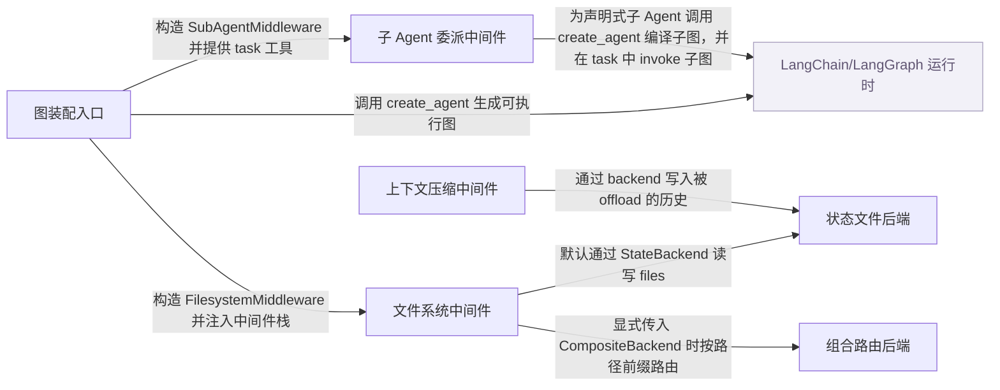

# deepagents：架构、运行逻辑与设计取舍

> deepagents==0.7.32 · [e85c6b980878](https://github.com/langchain-ai/deepagents/commit/e85c6b98087861512d2c5240305e16cfac68a746) · deepseek-flash 辅助分析 · 2026-10-30T05:33:11.336Z
> 下文按固定源码推演，没有执行目标项目。引用可跳到具体代码行；“工程推断”解释收益与代价，不代表作者亲述。

## 1. 先建立直觉

**它把模型、文件工具、子任务委派和长上下文处理预先装配成一个可运行的图；运行时负责循环调用模型和执行工具，项目自己负责把文件存到哪里、如何隔离子任务、如何压缩历史。**

长任务中，模型需要反复读材料、写中间结果、把独立子任务交给另一个上下文，同时避免工具输出和对话历史撑爆上下文窗口。若每个应用都自己拼工具、状态和压缩逻辑，容易在权限、持久化和结果回传上出错。

贯穿全文的例子：

- **输入：** 用户提交一条消息：读取 /materials/a.md，提取要点，交给 researcher 子 Agent 总结，并把总结写到 /notes/summary.md。应用使用 create_deep_agent(model=..., subagents=[researcher])，不显式传 backend。
- **预期输出：** 推演结果：主 Agent 产生 read_file 工具调用，ToolMessage 返回材料内容；随后产生 task 工具调用，researcher 在独立上下文中只收到委派说明，返回一条总结；task 返回的 ToolMessage 含该总结；主 Agent 再产生 write_file，最终状态中的 files 字典出现 /notes/summary.md，内容为总结。

## 2. 一张图看懂架构



| 模块 | 职责与所在层的原因 | 输入 → 输出 | 拥有的状态 |
| --- | --- | --- | --- |
| 图装配入口 [1][source-1] [2][source-2] [3][source-3] [4][source-4] | 解析模型和默认 backend，构造文件系统、子 Agent、压缩等中间件栈，最后调用 LangChain 的 create_agent 生成图；它不执行模型循环本身。 | model、tools、subagents、backend、permissions、system_prompt 等构造参数。 → 一个带 Deep Agents 元数据和递归上限的 CompiledStateGraph。 | 只持有构造期配置；运行态 state 由生成的图管理。 |
| LangChain/LangGraph 运行时（外部依赖） [5][source-5] [6][source-6] | 负责真实的模型调用、工具节点执行、状态通道、checkpoint、流式中断等；Deep Agents 把中间件和工具交给它。 | create_deep_agent 产出的图、消息输入和运行配置。 → 每一步更新后的图状态与最终结果。 | messages、files 等图状态由 LangGraph 通道和 checkpointer 管理。 |
| 文件系统中间件 [7][source-7] [8][source-8] [9][source-9] | 向模型提供 ls、read_file、write_file、edit_file 等工具，在工具层做路径校验、权限检查，并在工具返回后处理超大结果。 | 模型生成的工具调用参数，例如 file_path、content。 → ToolMessage 或 Command，交回图的消息通道。 | 通过 backend 读写文件；默认写进 StateBackend 的 files 通道。 |
| 子 Agent 委派中间件 [10][source-10] [11][source-11] [12][source-12] | 提供 task 工具：按名字选择子 Agent，准备隔离或继承的初始状态，调用子图，再把结果包装成父 Agent 能看到的 ToolMessage。 | task 工具调用中的 description 与 subagent_type。 → 一个 Command，其中 messages 含子 Agent 的最终 ToolMessage，并可能合并子图返回的非消息状态。 | 子 Agent 有独立运行状态；父状态只接收排除了 messages、todos 等键后的更新。 |
| 状态文件后端 [13][source-13] [14][source-14] [15][source-15] | 把文件内容存进 LangGraph 的 files 状态通道，通过 CONFIG_KEY_READ 和 CONFIG_KEY_SEND 读写，使后端实例可在任意图节点或工具中按需读取当前状态。 | 绝对文件路径和内容。 → ReadResult、WriteResult 等结构化结果。 | files 字典，键是路径，值是含 content、encoding、时间戳的 FileData。 |
| 组合路由后端 [16][source-16] [17][source-17] [18][source-18] | 按路径前缀把操作路由到不同后端，例如把 /memories/ 路由到持久 store；只有调用方显式传入 CompositeBackend 时才走这条路径。 | 文件路径和具体后端方法调用。 → 路由后的后端结果，并把路径恢复为调用方看到的完整路径。 | default 后端加 routes 前缀映射；sorted_routes 按前缀长度降序保证最长匹配。 |
| 上下文压缩中间件 [19][source-19] [20][source-20] | 在模型调用前检查 token 预算，必要时把旧消息 offload 到 backend 并生成摘要事件，从而缩短后续请求；具体摘要生成函数体在已读范围内不完整。 | ModelRequest 中的消息、系统提示和工具定义。 → 可能被改写的 ModelRequest，或带状态更新的 ExtendedModelResponse。 | 写入 summarization event 和 session id，历史文件路径记录在事件里。 |

## 3. 跟着一个请求跑完整条主线

这是对已读方法体的源码推演，不是执行日志。编号是阅读顺序；装配、写入、查询与条件分支是否发生，取决于每步的触发条件。

### 1. 装配 Deep Agent 图

**阶段：** 装配

**触发条件：** 必经：应用代码调用 create_deep_agent

入口/调用：`create_deep_agent` [21][source-21] [22][source-22] [3][source-3] [4][source-4]

**此时输入：** model、tools、subagents、可选 backend 和 middleware。

解析模型，未传 backend 时创建 StateBackend；把 FilesystemMiddleware 放入主栈，若有声明式或编译子 Agent 则再放入 SubAgentMiddleware；最后调用 create_agent 并附加递归上限和元数据。

**状态变化：** 无运行态；生成图对象及其默认中间件栈。

**交给下一步：** CompiledStateGraph，供用户 invoke 或 stream。

### 2. 模型请求 read_file，工具包装器接管

**阶段：** 工具调用

**触发条件：** 条件：模型选择 read_file；这是示例假设，不保证模型一定这样调用

入口/调用：`FilesystemMiddleware.wrap_tool_call` [23][source-23]

**此时输入：** ToolCallRequest，含工具名和 file_path 参数。

先检查是否与并行的文件变更冲突；在 blob store 上下文中调用 handler；若发生 read_file 且开启二进制 offload，则做 offload；否则按阈值决定是否进入大结果拦截。

**状态变化：** 本步本身不写文件；可能改变后续结果的表示。

**交给下一步：** ToolMessage 或 Command，进入大结果后处理。

### 3. read_file 工具体查询后端

**阶段：** 查询

**触发条件：** 条件：read_file 已通过 wrap_tool_call

入口/调用：`FilesystemMiddleware.sync_read_file` [24][source-24]

**此时输入：** file_path、offset、limit 和 ToolRuntime。

validate_path 校验路径；用 _permission_error 检查读权限；然后调用 backend.read；最后把 ReadResult 交给 _handle_read_result 转成 ToolMessage。

**状态变化：** 无，读操作不改变 files。

**交给下一步：** 含材料内容或错误信息的 ToolMessage。

### 4. StateBackend 从 files 通道读取

**阶段：** 查询

**触发条件：** 条件：backend 是默认 StateBackend

入口/调用：`StateBackend.read / StateBackend._read_files` [25][source-25] [26][source-26]

**此时输入：** 绝对路径、offset、limit。

_get_config 取得 LangGraph 配置；CONFIG_KEY_READ 以 fresh=True 读取 files，使同一 superstep 内先写后读可见；read 从 files 取该路径的 FileData，文本路径走 slice_read_response。

**状态变化：** 无。

**交给下一步：** ReadResult，含原始窗口内容或 file_not_found 错误。

### 5. 可选：超大工具结果被拦截

**阶段：** 可选分支：驱逐

**触发条件：** 条件：tool_token_limit_before_evict 非 None、工具不在排除列表，并且结果超过阈值；具体阈值比较在未读的 _process_large_message 中，不能断言本次一定触发

入口/调用：`FilesystemMiddleware._intercept_large_tool_result` [27][source-27] [28][source-28]

**此时输入：** ToolMessage 或含 messages 更新的 Command。

对单个 ToolMessage 调用 _process_large_message；对 Command 则拆出消息，逐个处理 ToolMessage，再重新包装成 Command。

**状态变化：** 可能把大内容写到后端并在消息中留下缩短后的表示；具体写路径和替换格式无法从已读代码确认。

**交给下一步：** 原结果或处理后结果。

### 6. 模型请求 task，准备子 Agent 状态

**阶段：** 委派

**触发条件：** 条件：模型选择 task，且当前不在 fork 子 Agent 的递归上下文

入口/调用：`_build_task_tool.task / _build_task_tool._validate_and_prepare_state` [29][source-29] [30][source-30]

**此时输入：** description、subagent_type、ToolRuntime。

检查 subagent_type 是否存在并需要 tool_call_id；非 fork 子 Agent 只构造 HumanMessage(description)，并从父状态中排除 _EXCLUDED_STATE_KEYS 和 private_state_keys；然后调用子图的 invoke。

**状态变化：** 子图拥有独立消息历史；父状态在本步尚未合并子结果。

**交给下一步：** 子图返回的 result 字典，交给 _return_command_with_state_update。

### 7. 把子 Agent 结果包装成父 ToolMessage

**阶段：** 返回

**触发条件：** 条件：子 Agent invoke 返回 result

入口/调用：`_build_task_tool._return_command_with_state_update` [31][source-31] [32][source-32]

**此时输入：** result 字典、父 tool_call_id、子 Agent 初始 state。

若 result 有 structured_response，则序列化为 JSON；否则倒序找最后一条文本非空的 AIMessage；同时构造 state_update，排除 messages、todos、structured_response、私有键和未变化的键；最后用 Command 更新父状态。

**状态变化：** 父 messages 增加一条 ToolMessage，内容为子 Agent 最终答案；子图返回的其他允许状态字段可能被合并。

**交给下一步：** Command(update={...messages:[ToolMessage]})。

### 8. 模型请求 write_file，工具体写入后端

**阶段：** 写入

**触发条件：** 条件：模型选择 write_file

入口/调用：`FilesystemMiddleware.sync_write_file` [33][source-33]

**此时输入：** file_path、content、ToolRuntime。

validate_path 校验路径；_permission_error 检查写权限；调用 backend.write；成功返回 Updated file 的 ToolMessage，失败返回错误 ToolMessage。

**状态变化：** 由 backend.write 改变存储；工具层不直接改 state。

**交给下一步：** ToolMessage，供模型确认写入结果。

### 9. StateBackend 把单文件更新发进 files 通道

**阶段：** 写入

**触发条件：** 条件：backend 是默认 StateBackend

入口/调用：`StateBackend.write / StateBackend._send_files_update` [15][source-15] [34][source-34]

**此时输入：** 已验证的绝对路径和字符串内容。

先 _read_files 取现有文件；若存在则 update_file_data，否则 create_file_data；设置 utf-8；_send_files_update 只发送 {path: new_file_data} 给 files 通道，由 dict-merge reducer 合并，未提及的键保留。

**状态变化：** files 字典增加或替换该路径的内容；同一 superstep 内通过 fresh=True 可读回。

**交给下一步：** WriteResult(path=file_path)。

## 4. 核心技术到底是什么

### 1. 中间件包装工具调用

**解决的问题：** 在不改动模型和工具实现的前提下，统一做路径校验、权限、并行变更保护和大结果后处理。 [3][source-3] [4][source-4] [9][source-9]

create_deep_agent 把 FilesystemMiddleware 注入中间件栈；工具节点调用工具时先经过 wrap_tool_call。包装器先检查并行文件变更，再执行 handler；返回后按工具名和阈值决定是否交给 _intercept_large_tool_result。

算法示意（用于解释机制，不是源码原文）：

```text
function create_deep_agent(...):
  backend = backend or StateBackend()
  mw = [FilesystemMiddleware(backend)]
  if subagents: mw.append(SubAgentMiddleware(...))
  graph = create_agent(model, tools, middleware=mw)
  return graph.with_config(recursion_limit=9999)

function wrap_tool_call(request, handler):
  reject_parallel_file_mutation(request)
  result = handler(request)
  if result_oversized_and_not_excluded: result = intercept(result)
  return result
```

**关键数据结构：** ToolCallRequest 携带工具名与参数；返回值是 ToolMessage 或 Command；中间件栈按顺序包装请求。

- **本项目实现：** create_deep_agent 负责装配；FilesystemMiddleware.wrap_tool_call 负责工具执行前后的项目自有逻辑。
- **外部依赖提供：** LangChain create_agent 负责模型调用和工具节点调度；LangGraph 负责图执行和消息通道。
- **收益与代价：** 统一包装让权限和大结果处理不散落在每个工具里，但包装器必须知道哪些工具排除在驱逐之外，并承担同步与异步两套实现。

### 2. 通过状态通道持久化文件

**解决的问题：** 默认不引入外部存储时，文件仍要能随对话线程保存，并支持同一工具步骤内先写后读。 [14][source-14] [15][source-15]

StateBackend 用 CONFIG_KEY_READ 读 files，fresh=True 让 pending writes 先经过 reducer；写入时只发送单个路径的 FileData 更新，files 通道的 dict-merge reducer 把新键合并进旧字典。

算法示意（用于解释机制，不是源码原文）：

```text
function read_all():
  cfg = get_config()
  return cfg[CONFIG_KEY_READ]('files', True) or {}

function write(path, content):
  files = read_all()
  data = update_file_data(files[path], content) if path in files else create_file_data(content)
  data.encoding = 'utf-8'
  cfg[CONFIG_KEY_SEND]([('files', {path: data})])
  return WriteResult(path)
```

**关键数据结构：** files: dict[str, FileData]；FileData 含 content、encoding，可能含 created_at、modified_at。不变量是路径为键，写只提交变化键。

- **本项目实现：** StateBackend 的 _read_files、_send_files_update、write、edit、delete 实现通道读写和单文件合并。
- **外部依赖提供：** LangGraph 提供 CONFIG_KEY_READ、CONFIG_KEY_SEND、files 通道 reducer 和 checkpoint。
- **收益与代价：** 默认实现零外部依赖、线程内强一致，但文件随线程状态存在，不自动跨线程持久化，也不能执行 shell。

### 3. 子 Agent 上下文隔离与结果回传

**解决的问题：** 主 Agent 读了很多材料后，把独立子任务交给另一个 Agent，但不应把完整父历史复制给子 Agent，也不能把子 Agent 的全部中间消息塞回父上下文。 [10][source-10] [11][source-11]

task 工具按 subagent_type 选择已编译子图；非 fork 时初始 state 只放一条 HumanMessage(description)，并排除父状态中的消息、todos、structured_response、skills 元数据和私有键；子图 invoke 后，只取 structured_response 或最后一条非空 AIMessage 文本，包装成父的 ToolMessage。

算法示意（用于解释机制，不是源码原文）：

```text
function task(description, subagent_type, runtime):
  if runtime.state[forked_context]: return refusal
  if subagent_type not in graphs: return error
  runnable, state = prepare(subagent_type, description, runtime)
  result = runnable.invoke(state)
  content = structured_response_json(result) or last_nonempty_ai_text(result)
  update = changed_keys(result) minus excluded_keys
  return Command(update={**update, 'messages':[ToolMessage(content)]})
```

**关键数据结构：** 子 state 是消息列表加允许继承的字段；_EXCLUDED_STATE_KEYS 明确排除 messages、todos、structured_response 等；父只收到一个 ToolMessage。

- **本项目实现：** _build_task_tool 的 task、_validate_and_prepare_state、_return_command_with_state_update 实现选择、隔离和回传。
- **外部依赖提供：** 子图本身由 LangChain create_agent 或调用方提供的 Runnable 执行；Runtime 和 Command 由 LangGraph/LangChain 提供。
- **收益与代价：** 隔离降低父上下文污染和 token 成本，但子 Agent 看不到未写进 description 的细节；只回最终答案会丢失中间证据。

### 4. 消息通道的增量 reducer

**解决的问题：** 长对话中每次 checkpoint 都复制完整消息列表会让增长接近 O(N²)，需要按消息 ID 做增量写入、替换和删除。 [35][source-35] [36][source-36]

DeepAgentState 给 messages 使用 DeltaChannel 和 _messages_delta_reducer；reducer 先展平 writes，遇到 REMOVE_ALL_MESSAGES 清空，然后按消息 ID 建立索引：新 ID 追加，已有 ID 替换，RemoveMessage 以 None 墓碑删除。

算法示意（用于解释机制，不是源码原文）：

```text
function reduce(state, writes):
  msgs = flatten(writes)
  if REMOVE_ALL in msgs:
    state = []; msgs = after_last_remove_all
  index = {m.id: i for i,m in enumerate(state) if m.id}
  result = list(state)
  for m in msgs:
    if m.id is None: result.append(m)
    elif RemoveMessage(m.id): result[index[m.id]] = None; delete index
    elif m.id in index: result[index[m.id]] = m
    else: index[m.id] = len(result); result.append(m)
  return [m for m in result if m is not None]
```

**关键数据结构：** result 列表加 id 到位置的索引；None 作为删除墓碑；消息 ID 由 LangGraph 在写入 checkpoint 前预分配。

- **本项目实现：** _messages_delta_reducer 在本地实现批量 reducer，并跳过 chunk 到完整消息的强制转换。
- **外部依赖提供：** LangGraph 的 DeltaChannel、checkpoint 和 ensure_message_ids 负责通道语义与稳定 ID。
- **收益与代价：** 增量写入把 checkpoint 增长从平方级降到线性级，但要求消息 ID 稳定，且 reducer 需要正确处理重置和删除。

## 5. 为什么选择这种实现

### 1. 默认 backend 使用 StateBackend，而不是默认 FilesystemBackend 或 CompositeBackend

**作者原文：** “The default state backend is thread-scoped; store-backed or filesystem-backed routes can make files durable across threads or map them to disk or sandbox storage.” [37][source-37] [22][source-22] [13][source-13]

**面临的约束：** 零配置场景下文件要能随对话线程保存，且不要求调用方先配置 store 或磁盘目录。

**如果改用另一种做法：** 默认使用 FilesystemBackend，或默认用 CompositeBackend 把某些前缀路由到持久存储。

**为什么当前方案有用：** 本场景没有显式传 backend；StateBackend 把文件写进 LangGraph 的 files 通道，随 checkpoint 保存，因此 read_file/write_file 立即可用。若默认走 Composite，调用方必须理解路由前缀；若默认走文件系统，则引入外部路径和持久化配置。

**付出的代价，以及不适用的情况：** 默认文件只在线程内持久，不跨线程；也不能执行 shell。需要跨线程时调用方要显式换 backend 或路由。

### 2. 子 Agent 默认采用 isolated 上下文，只接收委派说明

**作者原文：** “By default the subagent is isolated: it receives only the delegated task description.” [38][source-38] [39][source-39] [40][source-40]

**面临的约束：** 父 Agent 可能已经积累大量材料；若子 Agent 复制完整父历史，会浪费 token 并让子任务被无关上下文干扰。

**如果改用另一种做法：** 默认让子 Agent 继承父 Agent 的全部消息历史。

**为什么当前方案有用：** 本场景中主 Agent 先 read_file 再 task；默认 isolated 时子 Agent 的初始 messages 只有一条 HumanMessage(description)，父材料必须由主 Agent 在 description 中写清。这样结果回传也只取最终答案，父上下文不会被子 Agent 的中间工具输出填满。

**付出的代价，以及不适用的情况：** 主 Agent 必须把必要背景完整写进 description；子 Agent 看不到父对话中未写出的细节，中间证据也不会自动回传。

### 3. 文件权限检查放在 FilesystemMiddleware 的工具层，而不是 backend 层

**依据：已确认实现；以下原因是工程分析，不代表作者亲述。** [41][source-41] [42][source-42]

**面临的约束：** 模型只能通过工具触达文件；直接调用 backend 是应用代码行为，需要明确边界。

**如果改用另一种做法：** 在每个 backend 的 read/write/edit 内部统一做权限检查。

**为什么当前方案有用：** 本场景 write_file 先 validate_path，再 _permission_error，再 backend.write；deny 规则会返回 ToolMessage 错误，模型能看到并调整。若把权限只放 backend，直接 backend 调用和工具调用会共享同一策略，但当前设计明确说直接 backend 使用不包含 permissions。

**付出的代价，以及不适用的情况：** 绕过 FilesystemMiddleware 直接调用 backend 不会受权限保护；权限不是工具可见性，模型仍可能看到工具但调用被拒。

### 4. 超大工具结果在 wrap_tool_call 返回后拦截，而不是无条件截断所有工具输出

**依据：已确认实现；以下原因是工程分析，不代表作者亲述。** [43][source-43] [27][source-27] [44][source-44]

**面临的约束：** 工具结果可能包含模型后续需要检索的完整内容，直接丢弃会破坏可恢复性；全部保留又会撑爆上下文窗口。

**如果改用另一种做法：** 所有工具结果超过固定字符数就直接截断，或完全不处理。

**为什么当前方案有用：** 本场景 read_file 可能返回长材料。包装器在 handler 返回后检查阈值，超过时交给 _intercept_large_tool_result，后者对 ToolMessage 和 Command 分别处理；这样普通小结果不受影响，大结果有机会被移出上下文并留下可回查的表示。

**付出的代价，以及不适用的情况：** 需要额外 backend 写入和后处理；阈值配置不当会误驱逐；具体写文件和替换格式依赖未读的 _process_large_message。

## 6. 关键代码精读

### 1. create_deep_agent 如何排出默认中间件栈


`libs/deepagents/deepagents/graph.py:907-934` [3][source-3]

```python
    deepagent_middleware: list[AgentMiddleware[Any, Any, Any]] = [
        FilesystemMiddleware(
            backend=backend,
            custom_tool_descriptions=_profile.tool_description_overrides,
            permissions=permissions,
        ),
    ]
    sub_agent_middleware: SubAgentMiddleware | None = None
    if inline_subagents:
        sub_agent_middleware = SubAgentMiddleware(
            backend=backend,
            subagents=inline_subagents,
            # Overrides the task tool description. Value should include
            # {available_agents} — a format placeholder replaced with the
            # subagent name/description list. Without it the model can't
            # see which subagents exist. None (default) uses the built-in
            # template. Stale keys silently no-op if the tool is renamed.
            task_description=_profile.tool_description_overrides.get("task"),
            state_schema=state_schema,
        )
        deepagent_middleware.append(sub_agent_middleware)
    deepagent_middleware.extend(
        [
            _ParentNotifierMiddleware(),
            create_summarization_middleware(model, backend),
            PatchToolCallsMiddleware(),
        ]
    )
```


`libs/deepagents/deepagents/graph.py:1008-1019` [45][source-45]

```python
    return create_agent(
        model,
        system_prompt=final_system_prompt,
        tools=_tools,
        middleware=deepagent_middleware,
        response_format=response_format,
        context_schema=context_schema,
        checkpointer=checkpointer,
        store=store,
        debug=debug,
        name=name,
        cache=cache,
```


这里先构造 FilesystemMiddleware，并总是把它放在主栈第一个；只有在 inline_subagents 非空时才构造 SubAgentMiddleware 并追加。紧接着追加父通知、摘要和工具调用修补中间件。最后把整个 deepagent_middleware 交给 create_agent，并指定 DeepAgentState，使 messages 使用 DeltaChannel。

### 2. task 工具如何隔离子上下文并返回一个 ToolMessage


`libs/deepagents/deepagents/middleware/subagents.py:833-866` [46][source-46]

```python
        else:
            subagent_state = {key: value for key, value in runtime.state.items() if key not in _EXCLUDED_STATE_KEYS | private_state_keys}
            subagent_state["messages"] = [HumanMessage(content=description)]
        return subagent_runnable, subagent_state

    def task(
        description: str,
        subagent_type: str,
        runtime: ToolRuntime,
    ) -> str | Command:
        if runtime.state.get(_FORKED_CONTEXT_KEY):
            return _FORK_RECURSION_REFUSAL
        if subagent_type not in subagent_graphs:
            allowed_types = ", ".join([f"`{k}`" for k in subagent_graphs])
            return f"We cannot invoke subagent {subagent_type} because it does not exist, the only allowed types are {allowed_types}"
        if not runtime.tool_call_id:
            value_error_msg = "Tool call ID is required for subagent invocation"
            raise ValueError(value_error_msg)
        subagent, subagent_state = _validate_and_prepare_state(
            subagent_type,
            description,
            runtime,
        )
        # The parent's callbacks, tags and configurable reach the subagent
        # automatically: langgraph's `ensure_config` seeds each run from the
        # ambient parent config and (as of langgraph#7926) merges it per-key, so
        # the subagent's bound config still wins collisions (e.g. `lc_agent_name`,
        # `recursion_limit`) and parent metadata propagates (deepagents#3634).
        # Forwarding those keys explicitly would double-count under the merge
        # (e.g. duplicate `tags`), so we only stamp the subagent tracing tag.
        subagent_config: RunnableConfig = {"configurable": {"ls_agent_type": "subagent"}}
        with _subagent_tracing_context():
            result = subagent.invoke(subagent_state, subagent_config)
        return _return_command_with_state_update(result, runtime.tool_call_id, subagent_state)
```


`libs/deepagents/deepagents/middleware/subagents.py:761-786` [31][source-31]

```python
        structured = result.get("structured_response")
        if structured is not None:
            if hasattr(structured, "model_dump_json"):
                content: str = structured.model_dump_json()
            elif dataclasses.is_dataclass(structured) and not isinstance(structured, type):
                content = json.dumps(dataclasses.asdict(structured))
            else:
                content = json.dumps(structured)
        else:
            # Walk back to the last AIMessage with non-empty text. Anthropic
            # occasionally emits a trailing empty `end_turn` AIMessage after a
            # successful final tool call, which would otherwise be forwarded
            # as an empty ToolMessage.
            content = ""
            for msg in reversed(result["messages"]):
                if isinstance(msg, AIMessage):
                    text = msg.text.rstrip() if msg.text else ""
                    if text:
                        content = text
                        break

        return Command(
            update={
                **state_update,
                "messages": [ToolMessage(content, tool_call_id=tool_call_id)],
            }
```


task 先拒绝 fork 子 Agent 的递归委派，检查 subagent_type 和 tool_call_id；_validate_and_prepare_state 对非 fork 子 Agent 只构造 HumanMessage(description)，并过滤父状态中的排除键；然后子图 invoke。返回后，_return_command_with_state_update 优先使用 structured_response，否则倒序找最后一条非空 AIMessage；再把允许且发生变化的子状态字段和一条 ToolMessage 一起放进 Command。

### 3. StateBackend.write 如何只提交一个文件更新


`libs/deepagents/deepagents/backends/state.py:206-221` [15][source-15]

```python
    def write(
        self,
        file_path: str,
        content: str,
    ) -> WriteResult:
        """Write content to a file, creating it or overwriting it if it already exists.

        The update is queued directly via `CONFIG_KEY_SEND`.
        """
        files = self._read_files()

        existing = files.get(file_path)
        new_file_data = update_file_data(existing, content) if existing is not None else create_file_data(content)
        new_file_data["encoding"] = "utf-8"
        self._send_files_update({file_path: self._prepare_for_storage(new_file_data)})
        return WriteResult(path=file_path)
```


write 先从当前 files 读到 existing；存在则 update_file_data，否则 create_file_data；设置 utf-8 后，_send_files_update 只发送包含该路径的字典。files 通道使用 dict-merge reducer，因此其他未提及的路径不会被这次写入清掉；同一 superstep 内 fresh=True 的读取能看到这次发送。

## 7. 动手验证你的理解

以下是建议实验，没有执行过。

### 1. 显式配置 CompositeBackend 后，/memories/ 路径是否真的被路由，而默认路径仍留在 default backend？

**改变什么：** 在 create_deep_agent 中传入 CompositeBackend(default=StateBackend(), routes={'/memories/': StoreBackend(...)})，分别写 /a.txt 和 /memories/b.md。 [17][source-17] [18][source-18]

**应该观察到什么：** 写 /a.txt 走 default；写 /memories/b.md 时 _route_for_path 匹配前缀，去掉 /memories/ 后交给目标 backend，再把返回 path 恢复为 /memories/b.md。根目录 ls 应同时显示 default 文件和 /memories/ 虚拟目录。

### 2. 改变 tool_token_limit_before_evict 是否会改变大工具结果进入拦截路径的行为？

**改变什么：** 构造 FilesystemMiddleware 时把 tool_token_limit_before_evict 设为 None，或设成很小的正整数，然后让模型产生一次会返回大内容的 read_file 调用。 [43][source-43] [27][source-27] [44][source-44]

**应该观察到什么：** 设为 None 时 wrap_tool_call 在阈值判断处直接返回原 tool_result；设为小正整数且工具不在 TOOLS_EXCLUDED_FROM_EVICTION 时，应进入 _intercept_large_tool_result 分支。由于 _process_large_message 未读，不能断言具体截断文本，只能观察是否经过拦截路径和返回的 ToolMessage 形状。

### 3. 传入一个自定义同步子 Agent 时，task 工具是否仍保留默认 general-purpose，并列出两个名字？

**改变什么：** 调用 create_deep_agent(subagents=[{'name':'writer','description':'Writes summaries.'}])，检查生成的 tools 节点中 task 是否存在，并检查 task 描述里的 available agents。 [47][source-47] [48][source-48]

**应该观察到什么：** 因为 inline_subagents 非空，会创建 SubAgentMiddleware；若没有同名 general-purpose，create_deep_agent 还会自动插入默认 general-purpose。task 工具描述应由 _describe_subagent_for_tool 拼出 general-purpose 和 writer 两行。若传入同名 general-purpose，则用户 spec 覆盖默认，不再重复插入。

## 8. 读完应当能复述什么

- Deep Agents 本身不实现模型-工具循环；它把文件、子 Agent、压缩等行为装配成中间件，交给 LangChain create_agent 和 LangGraph 运行。
- 默认文件存储在 StateBackend 的 files 状态通道里，写入只提交变化路径，由 dict-merge reducer 合并；跨线程持久化和路径路由需要显式换 backend。
- 子 Agent 默认 isolated：task 只把委派说明放进子上下文，子图执行完只把最终答案包装成父的 ToolMessage，中间消息和大部分状态键不回传。
- 文件权限在 FilesystemMiddleware 的工具层执行，因此模型通过工具调用会被拦截，但直接调用 backend 不受这层权限保护。
- 大工具结果先在 wrap_tool_call 后经过阈值判断，可能被移出上下文；具体驱逐格式依赖未读的 _process_large_message，不能从当前已读代码臆测。
- messages 使用 DeltaChannel 和基于消息 ID 的 reducer，把长对话 checkpoint 的增长从平方级压到线性级，但要求消息 ID 稳定并正确处理删除墓碑。

## 来源与覆盖边界

本次读取 24 个文件，共 346,628 字符；19 个文件完整读取，其他文件按关键方法取带行号的片段。没有把未读依赖的内部实现当作已确认事实。

- FilesystemMiddleware._process_large_message 在已读清单中 bodyIncluded=false（filesystem.py 3527-3572 未给出方法体），因此无法确认 token 阈值比较后的具体截断文本、offload 文件路径和 ToolMessage 内容替换格式。
- LangChain create_agent 的模型循环和工具节点调度实现不在已读源码中；只能确认 create_deep_agent 调用它并传入 middleware、tools、checkpointer 等参数，不能从本仓库已读代码展开其内部调用顺序。
- FilesystemMiddleware._handle_read_result 的方法体在已读清单中 bodyIncluded=false，因此 read_file 结果如何加行号、分页和格式化无法从已读代码确认。
- summarization.py 的 _create_summary、_offload_to_backend 等方法体未完整包含在已读范围；只能确认 wrap_model_call 会取有效消息、计数、决定是否摘要、记录事件，不能确认具体摘要算法和历史文件写入细节。
- CompositeBackend 只有显式传入时才生效；默认 create_deep_agent 走 StateBackend。未读代码不能证明默认路径会经过任何路由。

| 文件 | 实际读取行段 |
| --- | --- |
| [README.md](https://github.com/langchain-ai/deepagents/blob/e85c6b98087861512d2c5240305e16cfac68a746/README.md) | 1–113 / 共 113 行 |
| [libs/deepagents/deepagents/graph.py](https://github.com/langchain-ai/deepagents/blob/e85c6b98087861512d2c5240305e16cfac68a746/libs/deepagents/deepagents/graph.py) | 1–1031 / 共 1031 行 |
| [libs/deepagents/deepagents/middleware/filesystem.py](https://github.com/langchain-ai/deepagents/blob/e85c6b98087861512d2c5240305e16cfac68a746/libs/deepagents/deepagents/middleware/filesystem.py) | 1–50、1889–2045、2268–2297、2335–2376、3756–3910 / 共 3910 行 |
| [libs/deepagents/deepagents/middleware/subagents.py](https://github.com/langchain-ai/deepagents/blob/e85c6b98087861512d2c5240305e16cfac68a746/libs/deepagents/deepagents/middleware/subagents.py) | 1–1061 / 共 1061 行 |
| [libs/deepagents/deepagents/backends/state.py](https://github.com/langchain-ai/deepagents/blob/e85c6b98087861512d2c5240305e16cfac68a746/libs/deepagents/deepagents/backends/state.py) | 1–380 / 共 380 行 |
| [libs/deepagents/deepagents/backends/composite.py](https://github.com/langchain-ai/deepagents/blob/e85c6b98087861512d2c5240305e16cfac68a746/libs/deepagents/deepagents/backends/composite.py) | 1–1020 / 共 1020 行 |
| [libs/deepagents/deepagents/middleware/summarization.py](https://github.com/langchain-ai/deepagents/blob/e85c6b98087861512d2c5240305e16cfac68a746/libs/deepagents/deepagents/middleware/summarization.py) | 1–50、1583–1724、2373–2398 / 共 2421 行 |
| [libs/deepagents/deepagents/backends/protocol.py](https://github.com/langchain-ai/deepagents/blob/e85c6b98087861512d2c5240305e16cfac68a746/libs/deepagents/deepagents/backends/protocol.py) | 1–1007 / 共 1007 行 |
| [libs/deepagents/deepagents/middleware/_state.py](https://github.com/langchain-ai/deepagents/blob/e85c6b98087861512d2c5240305e16cfac68a746/libs/deepagents/deepagents/middleware/_state.py) | 1–50 / 共 50 行 |
| [libs/deepagents/tests/unit_tests/test_graph.py](https://github.com/langchain-ai/deepagents/blob/e85c6b98087861512d2c5240305e16cfac68a746/libs/deepagents/tests/unit_tests/test_graph.py) | 1–50、73–92、100–106 / 共 3288 行 |
| [libs/deepagents/tests/unit_tests/test_file_system_tools.py](https://github.com/langchain-ai/deepagents/blob/e85c6b98087861512d2c5240305e16cfac68a746/libs/deepagents/tests/unit_tests/test_file_system_tools.py) | 1–586 / 共 586 行 |
| [libs/deepagents/tests/unit_tests/test_subagents.py](https://github.com/langchain-ai/deepagents/blob/e85c6b98087861512d2c5240305e16cfac68a746/libs/deepagents/tests/unit_tests/test_subagents.py) | 1–50、81–334 / 共 3510 行 |
| [libs/deepagents/tests/unit_tests/backends/test_state_backend.py](https://github.com/langchain-ai/deepagents/blob/e85c6b98087861512d2c5240305e16cfac68a746/libs/deepagents/tests/unit_tests/backends/test_state_backend.py) | 1–193 / 共 193 行 |
| [libs/deepagents/tests/unit_tests/backends/test_composite_backend.py](https://github.com/langchain-ai/deepagents/blob/e85c6b98087861512d2c5240305e16cfac68a746/libs/deepagents/tests/unit_tests/backends/test_composite_backend.py) | 1–252 / 共 1832 行 |
| [libs/ARCHITECTURE.md](https://github.com/langchain-ai/deepagents/blob/e85c6b98087861512d2c5240305e16cfac68a746/libs/ARCHITECTURE.md) | 1–116 / 共 116 行 |
| [libs/deepagents/deepagents/_api/deprecation.py](https://github.com/langchain-ai/deepagents/blob/e85c6b98087861512d2c5240305e16cfac68a746/libs/deepagents/deepagents/_api/deprecation.py) | 1–132 / 共 132 行 |
| [libs/deepagents/deepagents/_excluded_middleware.py](https://github.com/langchain-ai/deepagents/blob/e85c6b98087861512d2c5240305e16cfac68a746/libs/deepagents/deepagents/_excluded_middleware.py) | 1–237 / 共 237 行 |
| [libs/deepagents/deepagents/_messages_reducer.py](https://github.com/langchain-ai/deepagents/blob/e85c6b98087861512d2c5240305e16cfac68a746/libs/deepagents/deepagents/_messages_reducer.py) | 1–91 / 共 91 行 |
| [libs/deepagents/deepagents/_models.py](https://github.com/langchain-ai/deepagents/blob/e85c6b98087861512d2c5240305e16cfac68a746/libs/deepagents/deepagents/_models.py) | 1–213 / 共 213 行 |
| [libs/deepagents/deepagents/_tools.py](https://github.com/langchain-ai/deepagents/blob/e85c6b98087861512d2c5240305e16cfac68a746/libs/deepagents/deepagents/_tools.py) | 1–66 / 共 66 行 |
| [libs/deepagents/deepagents/_version.py](https://github.com/langchain-ai/deepagents/blob/e85c6b98087861512d2c5240305e16cfac68a746/libs/deepagents/deepagents/_version.py) | 1–218 / 共 218 行 |
| [libs/deepagents/deepagents/backends/__init__.py](https://github.com/langchain-ai/deepagents/blob/e85c6b98087861512d2c5240305e16cfac68a746/libs/deepagents/deepagents/backends/__init__.py) | 1–24 / 共 24 行 |
| [libs/deepagents/deepagents/middleware/_fs_interrupt.py](https://github.com/langchain-ai/deepagents/blob/e85c6b98087861512d2c5240305e16cfac68a746/libs/deepagents/deepagents/middleware/_fs_interrupt.py) | 1–204 / 共 204 行 |
| [libs/deepagents/deepagents/middleware/_parent_notifier.py](https://github.com/langchain-ai/deepagents/blob/e85c6b98087861512d2c5240305e16cfac68a746/libs/deepagents/deepagents/middleware/_parent_notifier.py) | 1–96 / 共 96 行 |

[source-1]: https://github.com/langchain-ai/deepagents/blob/e85c6b98087861512d2c5240305e16cfac68a746/libs/deepagents/deepagents/graph.py#L289-L309 "libs/deepagents/deepagents/graph.py:289-309"
[source-2]: https://github.com/langchain-ai/deepagents/blob/e85c6b98087861512d2c5240305e16cfac68a746/libs/deepagents/deepagents/graph.py#L628-L682 "libs/deepagents/deepagents/graph.py:628-682"
[source-3]: https://github.com/langchain-ai/deepagents/blob/e85c6b98087861512d2c5240305e16cfac68a746/libs/deepagents/deepagents/graph.py#L907-L934 "libs/deepagents/deepagents/graph.py:907-934"
[source-4]: https://github.com/langchain-ai/deepagents/blob/e85c6b98087861512d2c5240305e16cfac68a746/libs/deepagents/deepagents/graph.py#L1008-L1020 "libs/deepagents/deepagents/graph.py:1008-1020"
[source-5]: https://github.com/langchain-ai/deepagents/blob/e85c6b98087861512d2c5240305e16cfac68a746/libs/ARCHITECTURE.md#L22-L26 "libs/ARCHITECTURE.md:22-26"
[source-6]: https://github.com/langchain-ai/deepagents/blob/e85c6b98087861512d2c5240305e16cfac68a746/libs/ARCHITECTURE.md#L49-L59 "libs/ARCHITECTURE.md:49-59"
[source-7]: https://github.com/langchain-ai/deepagents/blob/e85c6b98087861512d2c5240305e16cfac68a746/libs/deepagents/deepagents/middleware/filesystem.py#L1892-L1908 "libs/deepagents/deepagents/middleware/filesystem.py:1892-1908"
[source-8]: https://github.com/langchain-ai/deepagents/blob/e85c6b98087861512d2c5240305e16cfac68a746/libs/deepagents/deepagents/middleware/filesystem.py#L2029-L2044 "libs/deepagents/deepagents/middleware/filesystem.py:2029-2044"
[source-9]: https://github.com/langchain-ai/deepagents/blob/e85c6b98087861512d2c5240305e16cfac68a746/libs/deepagents/deepagents/middleware/filesystem.py#L3850-L3879 "libs/deepagents/deepagents/middleware/filesystem.py:3850-3879"
[source-10]: https://github.com/langchain-ai/deepagents/blob/e85c6b98087861512d2c5240305e16cfac68a746/libs/deepagents/deepagents/middleware/subagents.py#L804-L866 "libs/deepagents/deepagents/middleware/subagents.py:804-866"
[source-11]: https://github.com/langchain-ai/deepagents/blob/e85c6b98087861512d2c5240305e16cfac68a746/libs/deepagents/deepagents/middleware/subagents.py#L747-L787 "libs/deepagents/deepagents/middleware/subagents.py:747-787"
[source-12]: https://github.com/langchain-ai/deepagents/blob/e85c6b98087861512d2c5240305e16cfac68a746/libs/deepagents/deepagents/middleware/subagents.py#L974-L1006 "libs/deepagents/deepagents/middleware/subagents.py:974-1006"
[source-13]: https://github.com/langchain-ai/deepagents/blob/e85c6b98087861512d2c5240305e16cfac68a746/libs/deepagents/deepagents/backends/state.py#L38-L47 "libs/deepagents/deepagents/backends/state.py:38-47"
[source-14]: https://github.com/langchain-ai/deepagents/blob/e85c6b98087861512d2c5240305e16cfac68a746/libs/deepagents/deepagents/backends/state.py#L57-L119 "libs/deepagents/deepagents/backends/state.py:57-119"
[source-15]: https://github.com/langchain-ai/deepagents/blob/e85c6b98087861512d2c5240305e16cfac68a746/libs/deepagents/deepagents/backends/state.py#L206-L221 "libs/deepagents/deepagents/backends/state.py:206-221"
[source-16]: https://github.com/langchain-ai/deepagents/blob/e85c6b98087861512d2c5240305e16cfac68a746/libs/deepagents/deepagents/backends/composite.py#L228-L283 "libs/deepagents/deepagents/backends/composite.py:228-283"
[source-17]: https://github.com/langchain-ai/deepagents/blob/e85c6b98087861512d2c5240305e16cfac68a746/libs/deepagents/deepagents/backends/composite.py#L300-L352 "libs/deepagents/deepagents/backends/composite.py:300-352"
[source-18]: https://github.com/langchain-ai/deepagents/blob/e85c6b98087861512d2c5240305e16cfac68a746/libs/deepagents/deepagents/backends/composite.py#L708-L726 "libs/deepagents/deepagents/backends/composite.py:708-726"
[source-19]: https://github.com/langchain-ai/deepagents/blob/e85c6b98087861512d2c5240305e16cfac68a746/libs/deepagents/deepagents/middleware/summarization.py#L1622-L1638 "libs/deepagents/deepagents/middleware/summarization.py:1622-1638"
[source-20]: https://github.com/langchain-ai/deepagents/blob/e85c6b98087861512d2c5240305e16cfac68a746/libs/deepagents/deepagents/middleware/summarization.py#L1667-L1704 "libs/deepagents/deepagents/middleware/summarization.py:1667-1704"
[source-21]: https://github.com/langchain-ai/deepagents/blob/e85c6b98087861512d2c5240305e16cfac68a746/libs/deepagents/deepagents/graph.py#L628-L648 "libs/deepagents/deepagents/graph.py:628-648"
[source-22]: https://github.com/langchain-ai/deepagents/blob/e85c6b98087861512d2c5240305e16cfac68a746/libs/deepagents/deepagents/graph.py#L671-L671 "libs/deepagents/deepagents/graph.py:671-671"
[source-23]: https://github.com/langchain-ai/deepagents/blob/e85c6b98087861512d2c5240305e16cfac68a746/libs/deepagents/deepagents/middleware/filesystem.py#L3869-L3879 "libs/deepagents/deepagents/middleware/filesystem.py:3869-3879"
[source-24]: https://github.com/langchain-ai/deepagents/blob/e85c6b98087861512d2c5240305e16cfac68a746/libs/deepagents/deepagents/middleware/filesystem.py#L2271-L2296 "libs/deepagents/deepagents/middleware/filesystem.py:2271-2296"
[source-25]: https://github.com/langchain-ai/deepagents/blob/e85c6b98087861512d2c5240305e16cfac68a746/libs/deepagents/deepagents/backends/state.py#L57-L97 "libs/deepagents/deepagents/backends/state.py:57-97"
[source-26]: https://github.com/langchain-ai/deepagents/blob/e85c6b98087861512d2c5240305e16cfac68a746/libs/deepagents/deepagents/backends/state.py#L175-L204 "libs/deepagents/deepagents/backends/state.py:175-204"
[source-27]: https://github.com/langchain-ai/deepagents/blob/e85c6b98087861512d2c5240305e16cfac68a746/libs/deepagents/deepagents/middleware/filesystem.py#L3876-L3879 "libs/deepagents/deepagents/middleware/filesystem.py:3876-3879"
[source-28]: https://github.com/langchain-ai/deepagents/blob/e85c6b98087861512d2c5240305e16cfac68a746/libs/deepagents/deepagents/middleware/filesystem.py#L3759-L3801 "libs/deepagents/deepagents/middleware/filesystem.py:3759-3801"
[source-29]: https://github.com/langchain-ai/deepagents/blob/e85c6b98087861512d2c5240305e16cfac68a746/libs/deepagents/deepagents/middleware/subagents.py#L843-L866 "libs/deepagents/deepagents/middleware/subagents.py:843-866"
[source-30]: https://github.com/langchain-ai/deepagents/blob/e85c6b98087861512d2c5240305e16cfac68a746/libs/deepagents/deepagents/middleware/subagents.py#L804-L836 "libs/deepagents/deepagents/middleware/subagents.py:804-836"
[source-31]: https://github.com/langchain-ai/deepagents/blob/e85c6b98087861512d2c5240305e16cfac68a746/libs/deepagents/deepagents/middleware/subagents.py#L761-L786 "libs/deepagents/deepagents/middleware/subagents.py:761-786"
[source-32]: https://github.com/langchain-ai/deepagents/blob/e85c6b98087861512d2c5240305e16cfac68a746/libs/deepagents/deepagents/middleware/subagents.py#L747-L760 "libs/deepagents/deepagents/middleware/subagents.py:747-760"
[source-33]: https://github.com/langchain-ai/deepagents/blob/e85c6b98087861512d2c5240305e16cfac68a746/libs/deepagents/deepagents/middleware/filesystem.py#L2338-L2375 "libs/deepagents/deepagents/middleware/filesystem.py:2338-2375"
[source-34]: https://github.com/langchain-ai/deepagents/blob/e85c6b98087861512d2c5240305e16cfac68a746/libs/deepagents/deepagents/backends/state.py#L99-L119 "libs/deepagents/deepagents/backends/state.py:99-119"
[source-35]: https://github.com/langchain-ai/deepagents/blob/e85c6b98087861512d2c5240305e16cfac68a746/libs/deepagents/deepagents/graph.py#L77-L80 "libs/deepagents/deepagents/graph.py:77-80"
[source-36]: https://github.com/langchain-ai/deepagents/blob/e85c6b98087861512d2c5240305e16cfac68a746/libs/deepagents/deepagents/_messages_reducer.py#L31-L90 "libs/deepagents/deepagents/_messages_reducer.py:31-90"
[source-37]: https://github.com/langchain-ai/deepagents/blob/e85c6b98087861512d2c5240305e16cfac68a746/libs/ARCHITECTURE.md#L95-L98 "libs/ARCHITECTURE.md:95-98"
[source-38]: https://github.com/langchain-ai/deepagents/blob/e85c6b98087861512d2c5240305e16cfac68a746/libs/deepagents/deepagents/middleware/subagents.py#L84-L89 "libs/deepagents/deepagents/middleware/subagents.py:84-89"
[source-39]: https://github.com/langchain-ai/deepagents/blob/e85c6b98087861512d2c5240305e16cfac68a746/libs/deepagents/deepagents/middleware/subagents.py#L833-L835 "libs/deepagents/deepagents/middleware/subagents.py:833-835"
[source-40]: https://github.com/langchain-ai/deepagents/blob/e85c6b98087861512d2c5240305e16cfac68a746/libs/deepagents/deepagents/middleware/subagents.py#L399-L402 "libs/deepagents/deepagents/middleware/subagents.py:399-402"
[source-41]: https://github.com/langchain-ai/deepagents/blob/e85c6b98087861512d2c5240305e16cfac68a746/libs/deepagents/deepagents/graph.py#L515-L518 "libs/deepagents/deepagents/graph.py:515-518"
[source-42]: https://github.com/langchain-ai/deepagents/blob/e85c6b98087861512d2c5240305e16cfac68a746/libs/deepagents/deepagents/middleware/filesystem.py#L2355-L2362 "libs/deepagents/deepagents/middleware/filesystem.py:2355-2362"
[source-43]: https://github.com/langchain-ai/deepagents/blob/e85c6b98087861512d2c5240305e16cfac68a746/libs/deepagents/deepagents/middleware/filesystem.py#L1898-L1898 "libs/deepagents/deepagents/middleware/filesystem.py:1898-1898"
[source-44]: https://github.com/langchain-ai/deepagents/blob/e85c6b98087861512d2c5240305e16cfac68a746/libs/deepagents/deepagents/middleware/filesystem.py#L3759-L3781 "libs/deepagents/deepagents/middleware/filesystem.py:3759-3781"
[source-45]: https://github.com/langchain-ai/deepagents/blob/e85c6b98087861512d2c5240305e16cfac68a746/libs/deepagents/deepagents/graph.py#L1008-L1019 "libs/deepagents/deepagents/graph.py:1008-1019"
[source-46]: https://github.com/langchain-ai/deepagents/blob/e85c6b98087861512d2c5240305e16cfac68a746/libs/deepagents/deepagents/middleware/subagents.py#L833-L866 "libs/deepagents/deepagents/middleware/subagents.py:833-866"
[source-47]: https://github.com/langchain-ai/deepagents/blob/e85c6b98087861512d2c5240305e16cfac68a746/libs/deepagents/deepagents/graph.py#L840-L904 "libs/deepagents/deepagents/graph.py:840-904"
[source-48]: https://github.com/langchain-ai/deepagents/blob/e85c6b98087861512d2c5240305e16cfac68a746/libs/deepagents/deepagents/middleware/subagents.py#L673-L686 "libs/deepagents/deepagents/middleware/subagents.py:673-686"
