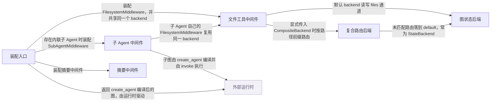

# deepagents：架构、运行逻辑与设计取舍

> main · [64de80191861](https://github.com/langchain-ai/deepagents/commit/64de801918612668a591c486c65407baf0f96f02) · deepseek-flash 辅助分析 · 2026-10-30T05:33:11.336Z
> 下文按固定源码推演，没有执行目标项目。引用可跳到具体代码行；“工程推断”解释收益与代价，不代表作者亲述。

## 1. 先建立直觉

**它把长任务常用的读写工作区、子任务委派和上下文压缩工具预装成一个可直接运行的代理。**

长任务容易把大量文件内容和子步骤塞进同一个上下文，并且文件读写需要明确的存储位置和权限边界。

贯穿全文的例子：

- **输入：** 用户给出一个初始状态：messages 中要求“读取 /materials/a.txt，委派 general-purpose 核对要点，再把摘要写到 /summary.md”，files 中预置 /materials/a.txt 的 utf-8 文本。
- **预期输出：** 推演结果：messages 中出现 read_file、task、write_file 的 ToolMessage；若一切成功，result['files']['/summary.md']['content'] 是写入的摘要文本。这里不预测模型一定选择这些工具或一定按此顺序。

## 2. 一张图看懂架构



| 模块 | 职责与所在层的原因 | 输入 → 输出 | 拥有的状态 |
| --- | --- | --- | --- |
| 装配入口 [1][source-1] [2][source-2] | 解析模型、profile、backend 和中间件，把默认栈与调用方配置合并后交给 LangChain 生成图。 | create_deep_agent 的模型、工具、subagents、backend、中间件等参数。 → CompiledStateGraph 和一个已装配的中间件栈。 | 默认 StateBackend、中间件列表、系统提示、子 Agent 规格。 |
| 文件工具中间件 [3][source-3] [4][source-4] | 生成 ls/read_file/write_file 等工具，在工具边界做路径与权限检查，并在工具结果返回后做二进制卸载或大结果驱逐。 | 模型发起的 ToolCallRequest，以及工具内部拿到的 runtime.state。 → ToolMessage 或 Command，回写到 LangGraph 消息状态。 | 自身权限规则、启用的工具、token 驱逐阈值；不拥有 files 通道本体。 |
| 子 Agent 中间件 [5][source-5] [6][source-6] | 提供 task 工具，选择并编译子图，为子 Agent 准备隔离或 fork 的输入状态，再把子图结果折叠成父级 ToolMessage。 | description、subagent_type 和 ToolRuntime。 → Command，更新父级 messages 及可合并状态。 | subagent_graphs 映射、private_state_keys、排除状态键集合。 |
| 图状态后端 [7][source-7] [8][source-8] | 默认后端，把文件存进 LangGraph 的 files 通道，通过 CONFIG_KEY_READ 和 CONFIG_KEY_SEND 读写。 | 路径、内容、offset/limit 等后端操作参数。 → ReadResult、WriteResult、EditResult 等结构化结果。 | files: path -> FileData，FileData 含 content、encoding 和时间戳。 |
| 复合路由后端 [9][source-9] [10][source-10] | 仅在调用方显式配置 routes 时使用，按最长前缀把路径委派给不同后端，并把结果路径恢复成调用方看到的完整路径。 | 完整虚拟路径和文件操作。 → 路由后端的操作结果，路径前缀被还原。 | default 后端、routes 映射、按长度倒序的 sorted_routes。 |
| 摘要中间件 [11][source-11] [12][source-12] | 在模型调用前按 token 预算截断旧工具参数、摘要旧消息并卸载历史，降低长对话对上下文的压力。 | ModelRequest，包含 messages、system_message、tools 和 state。 → ModelResponse，或带 Command 状态更新的 ExtendedModelResponse。 | 摘要事件、会话 id、历史文件路径。 |
| 外部运行时（外部依赖） [13][source-13] | LangChain 负责模型调用、工具执行和 agent 循环；LangGraph 负责图状态、checkpoint、streaming 和 interrupt。DeepAgents 不重写运行时。 | create_agent 编译后的图、消息、工具和中间件。 → 逐步执行结果和最终状态。 | 消息历史、checkpoint、中断状态、files 通道。 |

## 3. 跟着一个请求跑完整条主线

这是对已读方法体的源码推演，不是执行日志。编号是阅读顺序；装配、写入、查询与条件分支是否发生，取决于每步的触发条件。

### 1. 装配默认后端、中间件和可运行图

**阶段：** 装配

**触发条件：** 每次调用 create_deep_agent 的必经初始化；默认 backend 为 StateBackend，除非显式传入。

入口/调用：`create_deep_agent` [14][source-14] [15][source-15] [2][source-2]

**此时输入：** 模型、工具、subagents、backend、middleware 等参数。

解析模型和 profile，创建默认 StateBackend；构建 FilesystemMiddleware、SubAgentMiddleware、摘要等栈；调用 LangChain create_agent 编译图。

**状态变化：** 生成中间件列表、默认后端和系统提示；不执行文件读写。

**交给下一步：** CompiledStateGraph，后续由 LangGraph 驱动。

### 2. 模型发起 read_file，先进入工具调用包装器

**阶段：** 工具前置

**触发条件：** 模型选择 read_file；每次工具调用都会经过 wrap_tool_call。

入口/调用：`FilesystemMiddleware.wrap_tool_call` [4][source-4]

**此时输入：** ToolCallRequest，args 含 file_path。

先检查并行文件变更冲突；在 _tool_blob_store 上下文中调用 handler，让真正的 read_file 工具执行。

**状态变化：** 无，尚未读取文件；只建立本次工具执行的 blob 存储上下文。

**交给下一步：** handler 返回的 ToolMessage 或 Command。

### 3. read_file 工具校验路径与权限并调用 backend.read

**阶段：** 查询

**触发条件：** read_file 工具被调用；默认 backend 是 StateBackend，显式配置 CompositeBackend 时才先路由。

入口/调用：`FilesystemMiddleware._create_read_file_tool / StateBackend.read` [16][source-16] [17][source-17]

**此时输入：** file_path、offset、limit 和 ToolRuntime。

validate_path 规范化路径；_permission_error 检查读权限；调用 backend.read；StateBackend.read 从 files 通道取文件并按行切片。

**状态变化：** 读取无写入；StateBackend._read_files 使用 fresh=True，可看到同一步内尚未提交的写。

**交给下一步：** ReadResult，包含 file_data、行窗口或错误。

### 4. 工具结果返回后做二进制卸载或大结果驱逐

**阶段：** 结果后处理

**触发条件：** 仅当 _offload_binary_content 且工具为 read_file，或 tool_token_limit_before_evict 非空且工具不在 TOOLS_EXCLUDED_FROM_EVICTION 时触发对应分支。

入口/调用：`FilesystemMiddleware.wrap_tool_call / FilesystemMiddleware._intercept_large_tool_result` [18][source-18] [19][source-19]

**此时输入：** 工具返回的 ToolMessage 或 Command。

read_file 的二进制结果可被 _offload_tool_result 替换为 blob 引用；大结果交给 _intercept_large_tool_result，再委托 _process_large_message 处理并返回替换后的消息。

**状态变化：** 可能把大内容或二进制内容移出消息正文，留下引用或截断后的内容。

**交给下一步：** 处理后的 ToolMessage/Command，进入父消息状态。

### 5. 模型发起 task，选择子图并准备子 Agent 输入

**阶段：** 委派准备

**触发条件：** 模型选择 task，且 SubAgentMiddleware 存在；默认 general-purpose 通常提供，但 profile 可禁用。

入口/调用：`SubAgentMiddleware._build_task_tool` [20][source-20] [6][source-6]

**此时输入：** description、subagent_type 和 ToolRuntime。

校验 subagent_type 存在；_validate_and_prepare_state 选取 runnable；非 fork 子 Agent 只收到 HumanMessage(description)，并过滤 _EXCLUDED_STATE_KEYS 和 private_state_keys。

**状态变化：** 无父状态写入；构造局部的 subagent_state。

**交给下一步：** 子 Agent runnable 和隔离后的子状态。

### 6. 子图执行完成，结果折叠为父级 ToolMessage

**阶段：** 委派返回

**触发条件：** 子图 invoke 成功返回；若子图缺少 messages 则抛错。

入口/调用：`SubAgentMiddleware._build_task_tool` [21][source-21] [22][source-22]

**此时输入：** 子图返回的 result、tool_call_id 和子状态 inputs。

优先使用 structured_response 并 JSON 序列化；否则倒序找最后一条非空 AIMessage 文本；过滤排除键和未变化键，构造 Command(messages=[ToolMessage])。

**状态变化：** 父级 messages 增加一条 ToolMessage；非排除且有变化的子状态字段合并回父状态。

**交给下一步：** Command，驱动父图继续。

### 7. 模型发起 write_file，工具校验后调用 backend.write

**阶段：** 写入

**触发条件：** 模型选择 write_file；权限规则在工具层生效。

入口/调用：`FilesystemMiddleware._create_write_file_tool / StateBackend.write` [23][source-23] [24][source-24]

**此时输入：** file_path、content 和 ToolRuntime。

validate_path 后检查写权限；调用 backend.write；StateBackend.write 读取现有 files，构造或更新 FileData，再排入 files 更新。

**状态变化：** StateBackend.write 内部准备部分 files 更新；此时尚未在节点边界提交。

**交给下一步：** WriteResult，工具再包装为 ToolMessage 'Updated file ...'。

### 8. files 通道收到部分更新

**阶段：** 状态提交

**触发条件：** 默认 StateBackend 路径；若使用 CompositeBackend，则由路由后端决定最终落到哪个底层 backend。

入口/调用：`StateBackend.write / StateBackend._send_files_update` [25][source-25] [24][source-24]

**此时输入：** path -> FileData 的部分更新字典。

_send_files_update 通过 CONFIG_KEY_SEND 发送 [('files', update)]；files 通道用 dict-merge reducer 合并部分键。

**状态变化：** 父状态的 files 通道增加或更新 /summary.md；同一步内 fresh=True 读可看到，节点边界提交。

**交给下一步：** 后续模型轮次可读取到新文件。

## 4. 核心技术到底是什么

### 1. 工具调用包装与结果驱逐

**解决的问题：** 工具结果可能很大或含二进制，直接进入消息状态会挤占上下文。 [4][source-4] [19][source-19] [26][source-26]

wrap_tool_call 先检查并行文件变更，再在 blob 上下文中执行 handler；返回后按开关把二进制 read_file 结果替换为内容寻址 blob 引用，或调用 _intercept_large_tool_result 委托 _process_large_message 生成替换/截断消息。

算法示意（用于解释机制，不是源码原文）：

```text
def wrap_tool_call(request, handler):
    if parallel_file_mutation_conflict(request):
        return error_message
    with tool_blob_store(backend):
        result = handler(request)
    if offload_binary and request.name == 'read_file':
        result = offload_tool_result(result, backend)
    if token_limit is None or request.name in EXCLUDED:
        return result
    return intercept_large_tool_result(result)

```

**关键数据结构：** ToolMessage/Command；blob 路径 {prefix}/{sha256}；内容块上的 deepagents_blob 引用；TOOLS_EXCLUDED_FROM_EVICTION 排除集合。

- **本项目实现：** FilesystemMiddleware.wrap_tool_call、_intercept_large_tool_result、_offload_tool_result 和 _blob_offload 的 _offload_messages/_restore_payloads。
- **外部依赖提供：** LangChain 的 ToolNode 调用 handler；LangGraph 负责把返回的 ToolMessage/Command 写入状态并提交 checkpoint。
- **收益与代价：** 统一在工具边界处理，能覆盖所有工具结果；但需要精确维护排除列表，二进制卸载失败时仍保留内联内容。

### 2. 图状态通道后端

**解决的问题：** 默认文件存储既要无外部依赖，又要和一次会话的 checkpoint 生命周期一致。 [8][source-8] [24][source-24]

StateBackend 不保存内存副本，而是每次通过 get_config 拿 CONFIG_KEY_READ，fresh=True 读取 files 通道；写时通过 CONFIG_KEY_SEND 发送部分更新，由 files 通道的 dict-merge reducer 合并。

算法示意（用于解释机制，不是源码原文）：

```text
def read(path, offset, limit):
    files = config.read('files', fresh=True) or {}
    fd = files.get(path)
    if fd is None: return ReadResult(error='not found')
    return slice_read_response(fd, offset, limit)

def write(path, content):
    files = config.read('files', fresh=True) or {}
    fd = update_or_create(files.get(path), content)
    config.send([('files', {path: fd})])
    return WriteResult(path=path)

```

**关键数据结构：** files: dict[path, FileData]；FileData.content 是 utf-8 文本或 base64；encoding 区分文本与二进制；写更新是部分字典。

- **本项目实现：** StateBackend 的 _read_files、_send_files_update、read、write、edit、delete。
- **外部依赖提供：** LangGraph 提供 CONFIG_KEY_READ/CONFIG_KEY_SEND、files 通道 reducer 和 checkpoint；脱离图上下文时 _get_config 直接报错。
- **收益与代价：** 无需外部 store 且与线程 checkpoint 一致；但文件只在该会话线程内持久，直接调用 backend 会失败，跨线程需要显式换成 Store/Filesystem 或 Composite 路由。

### 3. 子 Agent 隔离与结果折叠

**解决的问题：** 子任务的多步工具调用和中间结果不应全部塞回父 Agent 的上下文。 [27][source-27] [28][source-28] [6][source-6]

task 工具按 subagent_type 选 runnable；非 fork 子状态只放 HumanMessage(description)，并过滤排除键；子图 invoke 后取 structured_response 或最后一条非空 AIMessage，构造一条 ToolMessage，同时只合并非排除且有变化的子状态。

算法示意（用于解释机制，不是源码原文）：

```text
def task(description, subagent_type, runtime):
    runnable = graph_for(subagent_type)
    state = strip_excluded(parent_state)
    state['messages'] = [HumanMessage(description)]
    result = runnable.invoke(state)
    content = structured(result) or last_nonempty_ai_text(result)
    update = changed_non_excluded(result, state)
    return Command(update={**update, 'messages': [ToolMessage(content)]})

```

**关键数据结构：** subagent_graphs: name -> Runnable；_EXCLUDED_STATE_KEYS；private_state_keys；Command.update 中的 messages 列表。

- **本项目实现：** _build_task_tool、_validate_and_prepare_state、_return_command_with_state_update。
- **外部依赖提供：** LangChain create_agent 编译声明式子图；LangGraph 执行子图 invoke 并把 Command 应用到父图。
- **收益与代价：** 父上下文干净、返回结果短；代价是子 Agent 默认看不到父对话，任务描述必须完整，fork 模式则要承担缓存和实验性语义。

### 4. 路径前缀路由后端

**解决的问题：** 同一虚拟文件树需要把不同前缀映射到不同存储，同时保持调用方看到的路径一致。 [10][source-10] [29][source-29] [30][source-30]

CompositeBackend 构造时把 routes 按前缀长度倒序；_route_for_path 逐个比较，命中则剥离前缀得到后端内部路径；写/编辑结果再把 path 恢复成原始完整路径。

算法示意（用于解释机制，不是源码原文）：

```text
def route(path):
    for prefix, backend in sorted_routes_longest_first:
        if path == prefix_without_slash:
            return backend, '/', prefix
        if path.startswith(prefix_with_slash):
            return backend, '/' + path[len(prefix_with_slash):], prefix
    return default, path, None

def write(path, content):
    backend, inner = route(path)
    res = backend.write(inner, content)
    if res.path: res.path = path
    return res

```

**关键数据结构：** routes: prefix -> BackendProtocol；sorted_routes 按 len(prefix) 降序；路由结果 (backend, backend_path, route_prefix)。

- **本项目实现：** _route_for_path、CompositeBackend.write/edit/read/ls/grep/glob。
- **外部依赖提供：** 底层 backend 各自实现存储；Composite 只负责路由和结果路径重映射。
- **收益与代价：** 能按路径拆分持久化策略；但根路径搜索需要合并多个后端结果并重映射，路由前缀边界和错误传播要特别处理。

## 5. 为什么选择这种实现

### 1. 默认 backend 使用 StateBackend，而不是默认 CompositeBackend 或 StoreBackend。

**作者原文：** “The default state backend is thread-scoped; store-backed or filesystem-backed routes can make files durable across threads or map them to disk or sandbox storage.” [14][source-14] [31][source-31]

**面临的约束：** 调用方通常希望开箱即用，且文件应与当前会话的图状态同生命周期。

**如果改用另一种做法：** 默认装配 CompositeBackend，并把某些路径路由到持久 Store。

**为什么当前方案有用：** 在本文场景中，/materials/a.txt 和 /summary.md 默认直接落在 files 通道；跨线程持久必须显式传 backend，避免隐式外部依赖。

**付出的代价，以及不适用的情况：** 默认文件不跨线程持久；直接调用 StateBackend 时若没有 LangGraph 上下文会抛 RuntimeError。

### 2. 声明式子 Agent 默认使用隔离上下文，而不是默认继承父对话。

**作者原文：** “Each invocation is stateless by default: the agent sees only the prompt you give it and returns a single final report.” [32][source-32] [33][source-33]

**面临的约束：** 子任务通常只需任务描述和必要状态，父对话全文会放大上下文并引入无关中间步骤。

**如果改用另一种做法：** 所有子 Agent 默认 fork 父对话并共享完整历史。

**为什么当前方案有用：** 示例中父 Agent 先读材料，再把核对子任务交给 general-purpose；默认 task 只给子 Agent 一条 HumanMessage(description)，因此子 Agent 不会自动带上父上下文中的全部 read_file 结果和中间推理，返回值也只折叠为一条 ToolMessage。

**付出的代价，以及不适用的情况：** 任务描述必须写全；需要父对话时要用 fork 模式，而 fork 是实验性功能且要考虑缓存复用。

### 3. 大工具结果的驱逐放在 wrap_tool_call，而不是放在每个 backend 的 read/write 实现里。

**依据：已确认实现；以下原因是工程分析，不代表作者亲述。** [34][source-34] [19][source-19]

**面临的约束：** backend 只应负责存取数据，不应知道模型 token 预算、消息结构和排除工具列表。

**如果改用另一种做法：** 在 StateBackend.read 或每个文件工具内部直接截断结果。

**为什么当前方案有用：** 这样 read_file、task 等其他工具返回后都能在同一个中间件边界被统一处理；示例中的大 read_file 结果可以在进入父消息状态前被替换或截断，而 StateBackend 仍只返回原始 ReadResult。

**付出的代价，以及不适用的情况：** 需要依赖中间件包装顺序和 TOOLS_EXCLUDED_FROM_EVICTION 排除列表；具体替换逻辑分散在 _process_large_message 中。

### 4. 文件权限在 FilesystemMiddleware 的工具层执行，而不是在 BackendProtocol 的读写方法里执行。

**作者原文：** “`FilesystemMiddleware` applies these permissions at the tool level for its built-in filesystem tools, not at the backend level. Direct backend usage does not currently incorporate `permissions`.” [35][source-35]

**面临的约束：** 权限规则需要看到工具名和参数，并且内置文件工具是主要访问面；直接 backend 调用可能来自测试或自定义代码。

**如果改用另一种做法：** 把权限检查下沉到 StateBackend.read/write 等每个 backend 方法。

**为什么当前方案有用：** 示例中的 read_file/write_file 会先经过工具层权限检查，未命中 deny 才调用 backend；因此同一套权限规则能覆盖内置文件工具。

**付出的代价，以及不适用的情况：** 直接使用 backend 的代码不会自动获得 permissions 保护，文档也明确说 direct backend usage 不包含权限。

### 5. CompositeBackend 按最长前缀匹配路由，并在写回结果时恢复原始完整路径。

**依据：已确认实现；以下原因是工程分析，不代表作者亲述。** [29][source-29] [10][source-10] [30][source-30]

**面临的约束：** 同一虚拟树允许多个路由，较短前缀不能吞掉更具体的前缀；调用方仍应看到 /memories/a.md 而不是后端内部路径。

**如果改用另一种做法：** 按配置顺序匹配第一个前缀，或让后端返回内部路径由上层拼接。

**为什么当前方案有用：** 例如同时配置 /memories/ 和 /memories/archive/ 时，最长前缀优先能稳定选中更具体的后端；write/edit 后把 res.path 改回原路径，调用方和消息中的路径保持一致。

**付出的代价，以及不适用的情况：** 根路径 ls/grep/glob 需要跨多个后端合并并重映射结果，错误传播和截断标志也要特殊处理。

## 6. 关键代码精读

### 1. create_deep_agent 如何装配默认 backend、文件中间件和子 Agent 中间件


`libs/deepagents/deepagents/graph.py:671-671` [14][source-14]

```python
    backend = backend if backend is not None else StateBackend()
```


`libs/deepagents/deepagents/graph.py:907-927` [15][source-15]

```python
    deepagent_middleware: list[AgentMiddleware[Any, Any, Any]] = [
        FilesystemMiddleware(
            backend=backend,
            custom_tool_descriptions=_profile.tool_description_overrides,
            permissions=permissions,
        ),
    ]
    sub_agent_middleware: SubAgentMiddleware | None = None
    if inline_subagents:
        sub_agent_middleware = SubAgentMiddleware(
            backend=backend,
            subagents=inline_subagents,
            # Overrides the task tool description. Value should include
            # {available_agents} — a format placeholder replaced with the
            # subagent name/description list. Without it the model can't
            # see which subagents exist. None (default) uses the built-in
            # template. Stale keys silently no-op if the tool is renamed.
            task_description=_profile.tool_description_overrides.get("task"),
            state_schema=state_schema,
        )
        deepagent_middleware.append(sub_agent_middleware)
```


`libs/deepagents/deepagents/graph.py:1008-1020` [2][source-2]

```python
    return create_agent(
        model,
        system_prompt=final_system_prompt,
        tools=_tools,
        middleware=deepagent_middleware,
        response_format=response_format,
        context_schema=context_schema,
        checkpointer=checkpointer,
        store=store,
        debug=debug,
        name=name,
        cache=cache,
        state_schema=state_schema if state_schema is not None else DeepAgentState,
```


这几段决定了场景中的默认路径：backend 未传时创建 StateBackend，所以文件进入图状态；主栈先放 FilesystemMiddleware；只有 inline_subagents 非空时才创建 SubAgentMiddleware 并加入 task 工具；最后调用 LangChain create_agent 并把默认状态模式设为 DeepAgentState。默认 general-purpose 子 Agent 通常会插入 inline_subagents，但 profile 可以禁用。

### 2. task 工具如何把父任务隔离子 Agent，再把结果折叠回来


`libs/deepagents/deepagents/middleware/subagents.py:813-835` [36][source-36]

```python
        if _is_forked_subagent(subagent) or _is_forked_compiled_subagent(subagent):
            # The event is folded into the message list above to support compiled subagents
            if _is_forked_subagent(subagent):
                # A declarative fork runs the same graph shape as its parent, so
                # private channels carry over and its own middleware can rebuild
                # what the parent built from them.
                inherited = {key: value for key, value in runtime.state.items() if key not in _FORK_EXCLUDED_STATE_KEYS}
                inherited[_FORKED_CONTEXT_KEY] = True
            else:
                # A compiled runnable is opaque -- it may not declare these
                # channels, and internal state isn't ours to hand it.
                inherited = {key: value for key, value in runtime.state.items() if key not in _EXCLUDED_STATE_KEYS | private_state_keys}
            subagent_state = {
                **inherited,
                "messages": _fork_messages(
                    runtime.state.get("messages", []),
                    runtime.state.get(SUMMARIZATION_EVENT_KEY),
                    description,
                ),
            }
        else:
            subagent_state = {key: value for key, value in runtime.state.items() if key not in _EXCLUDED_STATE_KEYS | private_state_keys}
            subagent_state["messages"] = [HumanMessage(content=description)]
```


`libs/deepagents/deepagents/middleware/subagents.py:757-759` [37][source-37]

```python
        state_update = {
            k: v for k, v in result.items() if k not in _EXCLUDED_STATE_KEYS and k not in private_state_keys and not _is_unchanged(k, v, inputs)
        }
```


`libs/deepagents/deepagents/middleware/subagents.py:761-786` [38][source-38]

```python
        structured = result.get("structured_response")
        if structured is not None:
            if hasattr(structured, "model_dump_json"):
                content: str = structured.model_dump_json()
            elif dataclasses.is_dataclass(structured) and not isinstance(structured, type):
                content = json.dumps(dataclasses.asdict(structured))
            else:
                content = json.dumps(structured)
        else:
            # Walk back to the last AIMessage with non-empty text. Anthropic
            # occasionally emits a trailing empty `end_turn` AIMessage after a
            # successful final tool call, which would otherwise be forwarded
            # as an empty ToolMessage.
            content = ""
            for msg in reversed(result["messages"]):
                if isinstance(msg, AIMessage):
                    text = msg.text.rstrip() if msg.text else ""
                    if text:
                        content = text
                        break

        return Command(
            update={
                **state_update,
                "messages": [ToolMessage(content, tool_call_id=tool_call_id)],
            }
```


非 fork 分支只把父状态中未被排除的键复制到 subagent_state，然后强制 messages 为一条 HumanMessage(description)。子图返回后，_return_command_with_state_update 先检查 messages 键，再过滤排除键、private 键和未变化键；结果内容优先取 structured_response，否则取最后一条非空 AIMessage 文本，最后作为一条 ToolMessage 放进 Command。这样父 Agent 只看到子 Agent 的最终报告，而不是子 Agent 的全部工具轨迹。

### 3. write_file 如何从工具参数落到 files 通道


`libs/deepagents/deepagents/middleware/filesystem.py:2338-2362` [23][source-23]

```python
        def sync_write_file(
            file_path: str,
            content: str,
            runtime: ToolRuntime[None, FilesystemState],
        ) -> ToolMessage:
            """Synchronous wrapper for write_file tool."""
            resolved_backend = self.backend
            try:
                validated_path = validate_path(file_path)
            except ValueError as e:
                return ToolMessage(
                    content=f"Error: {e}",
                    name="write_file",
                    tool_call_id=runtime.tool_call_id,
                    status="error",
                )

            if (error := _permission_error(self._permissions, "write", self.backend, validated_path)) is not None:
                return ToolMessage(
                    content=error,
                    name="write_file",
                    tool_call_id=runtime.tool_call_id,
                    status="error",
                )
            res: WriteResult = resolved_backend.write(validated_path, content)
```


`libs/deepagents/deepagents/backends/state.py:206-221` [24][source-24]

```python
    def write(
        self,
        file_path: str,
        content: str,
    ) -> WriteResult:
        """Write content to a file, creating it or overwriting it if it already exists.

        The update is queued directly via `CONFIG_KEY_SEND`.
        """
        files = self._read_files()

        existing = files.get(file_path)
        new_file_data = update_file_data(existing, content) if existing is not None else create_file_data(content)
        new_file_data["encoding"] = "utf-8"
        self._send_files_update({file_path: self._prepare_for_storage(new_file_data)})
        return WriteResult(path=file_path)
```


write_file 工具先规范化路径并检查写权限，然后调用 backend.write，成功时返回 Updated file 的 ToolMessage。StateBackend.write 从 files 通道读取现有内容，存在则 update_file_data，不存在则 create_file_data，强制 encoding 为 utf-8，然后通过 _send_files_update 发送部分 files 更新。因此场景最后一步不是直接改某个内存字典，而是向 LangGraph 的 files 通道提交一个带 reducer 的部分更新。

## 7. 动手验证你的理解

以下是建议实验，没有执行过。

### 1. 默认 StateBackend 与显式 CompositeBackend 在写 /summary.md 或 /memories/a.md 时的路径和状态位置有何不同？

**改变什么：** 保持其他配置不变，分别使用默认 backend 和 CompositeBackend(default=StateBackend(), routes={'/memories/': StoreBackend(...)})，写一个 /memories/ 下的文件。 [14][source-14] [10][source-10] [30][source-30]

**应该观察到什么：** 默认 StateBackend 应把文件放进当前图的 files 通道；Composite 应通过 _route_for_path 剥离 /memories/ 后委托路由后端，并在 WriteResult.path 中恢复原始 /memories/... 路径。

### 2. 当 read_file 返回超过 token 限制的大文本时，wrap_tool_call 是否会把结果交给驱逐路径？

**改变什么：** 把 tool_token_limit_before_evict 设得很小，让 read_file 读一个大文本文件；另一次让工具名落在 TOOLS_EXCLUDED_FROM_EVICTION 中作为对照。 [34][source-34] [19][source-19]

**应该观察到什么：** 非排除工具应进入 _intercept_large_tool_result 并返回 processed_message；排除工具应直接返回原始 tool_result，不进入驱逐分支。这里不推断 _process_large_message 内部具体截断文本。

### 3. task 子 Agent 是否只收到任务描述，且父级 private 状态不会泄漏？

**改变什么：** 在父状态中放一个普通可合并字段和一个被标记为 PrivateStateAttr 的字段，调用 task 后检查子 Agent 的输入状态和父级最终状态。 [33][source-33] [37][source-37] [39][source-39]

**应该观察到什么：** 非 fork 子 Agent 的 messages 应只有一条 HumanMessage(description)；private_state_keys 中的字段不应出现在子状态；父级只收到 ToolMessage 以及非排除且有变化的子状态字段。

## 8. 读完应当能复述什么

- 中间件是工具调用边界：权限、二进制卸载和大结果驱逐都在工具结果进入消息状态前发生。
- backend 是存储边界：默认 StateBackend 把文件写进 LangGraph 的 files 通道，CompositeBackend 只有在显式配置路由时才介入。
- 子 Agent 是上下文边界：默认隔离输入、只返回最终报告，父级通过 Command 合并结果而不是共享全部子图轨迹。
- 同一个场景里三条路径要分开看：读文件走 read_file 工具和 backend.read；委派走 task 工具和子图 invoke；写回走 write_file 工具和 files 通道更新。
- 默认配置和可选配置不能混画：默认不是 Composite 路由，默认子 Agent 不是 fork，大结果驱逐也受 token 阈值和排除列表控制。

## 来源与覆盖边界

本次读取 24 个文件，共 349,930 字符；18 个文件完整读取，其他文件按关键方法取带行号的片段。没有把未读依赖的内部实现当作已确认事实。

- FilesystemMiddleware._process_large_message 和 _apply_eviction_and_truncate 的方法体未出现在已读片段中，无法确认驱逐阈值、替换消息和截断文本的精确算法。
- FilesystemMiddleware.__init__ 的方法体未出现在已读片段中，无法确认 _tool_token_limit_before_evict 和 _offload_binary_content 的默认值。
- 用户 focus 中写的 _create_filesystem_tools 在已读源码里对应的是 FilesystemMiddleware._create_tools，未发现同名 _create_filesystem_tools 符号。
- summarization.py 的 _create_summary 方法体未包含在已读片段中，无法确认摘要 prompt、摘要调用和 token 计数器的完整细节。
- LangChain create_agent 内部如何安排模型节点与工具节点不在本仓库已读代码中，只能确认 DeepAgents 把中间件和状态模式传给 create_agent。

| 文件 | 实际读取行段 |
| --- | --- |
| [README.md](https://github.com/langchain-ai/deepagents/blob/64de801918612668a591c486c65407baf0f96f02/README.md) | 1–113 / 共 113 行 |
| [libs/deepagents/deepagents/graph.py](https://github.com/langchain-ai/deepagents/blob/64de801918612668a591c486c65407baf0f96f02/libs/deepagents/deepagents/graph.py) | 1–1031 / 共 1031 行 |
| [libs/deepagents/deepagents/middleware/filesystem.py](https://github.com/langchain-ai/deepagents/blob/64de801918612668a591c486c65407baf0f96f02/libs/deepagents/deepagents/middleware/filesystem.py) | 1–50、2026–2045、2153–2424、3756–3808、3847–3910 / 共 3910 行 |
| [libs/deepagents/deepagents/middleware/subagents.py](https://github.com/langchain-ai/deepagents/blob/64de801918612668a591c486c65407baf0f96f02/libs/deepagents/deepagents/middleware/subagents.py) | 1–1061 / 共 1061 行 |
| [libs/deepagents/deepagents/backends/state.py](https://github.com/langchain-ai/deepagents/blob/64de801918612668a591c486c65407baf0f96f02/libs/deepagents/deepagents/backends/state.py) | 1–380 / 共 380 行 |
| [libs/deepagents/deepagents/backends/composite.py](https://github.com/langchain-ai/deepagents/blob/64de801918612668a591c486c65407baf0f96f02/libs/deepagents/deepagents/backends/composite.py) | 1–1020 / 共 1020 行 |
| [libs/deepagents/deepagents/middleware/summarization.py](https://github.com/langchain-ai/deepagents/blob/64de801918612668a591c486c65407baf0f96f02/libs/deepagents/deepagents/middleware/summarization.py) | 1–50、285–335、595–610、766–777、1587–1728 / 共 2425 行 |
| [libs/deepagents/deepagents/middleware/_blob_offload.py](https://github.com/langchain-ai/deepagents/blob/64de801918612668a591c486c65407baf0f96f02/libs/deepagents/deepagents/middleware/_blob_offload.py) | 1–277 / 共 277 行 |
| [libs/deepagents/deepagents/backends/protocol.py](https://github.com/langchain-ai/deepagents/blob/64de801918612668a591c486c65407baf0f96f02/libs/deepagents/deepagents/backends/protocol.py) | 1–1007 / 共 1007 行 |
| [libs/deepagents/deepagents/middleware/_state.py](https://github.com/langchain-ai/deepagents/blob/64de801918612668a591c486c65407baf0f96f02/libs/deepagents/deepagents/middleware/_state.py) | 1–50 / 共 50 行 |
| [libs/deepagents/tests/unit_tests/test_file_system_tools.py](https://github.com/langchain-ai/deepagents/blob/64de801918612668a591c486c65407baf0f96f02/libs/deepagents/tests/unit_tests/test_file_system_tools.py) | 1–586 / 共 586 行 |
| [libs/deepagents/tests/unit_tests/test_subagents.py](https://github.com/langchain-ai/deepagents/blob/64de801918612668a591c486c65407baf0f96f02/libs/deepagents/tests/unit_tests/test_subagents.py) | 1–50、81–334 / 共 3510 行 |
| [libs/deepagents/tests/unit_tests/test_graph.py](https://github.com/langchain-ai/deepagents/blob/64de801918612668a591c486c65407baf0f96f02/libs/deepagents/tests/unit_tests/test_graph.py) | 1–50、73–92、100–106 / 共 3288 行 |
| [libs/deepagents/tests/unit_tests/backends/test_state_backend.py](https://github.com/langchain-ai/deepagents/blob/64de801918612668a591c486c65407baf0f96f02/libs/deepagents/tests/unit_tests/backends/test_state_backend.py) | 1–193 / 共 193 行 |
| [libs/deepagents/tests/unit_tests/backends/test_composite_backend.py](https://github.com/langchain-ai/deepagents/blob/64de801918612668a591c486c65407baf0f96f02/libs/deepagents/tests/unit_tests/backends/test_composite_backend.py) | 1–252 / 共 1832 行 |
| [libs/ARCHITECTURE.md](https://github.com/langchain-ai/deepagents/blob/64de801918612668a591c486c65407baf0f96f02/libs/ARCHITECTURE.md) | 1–116 / 共 116 行 |
| [libs/deepagents/deepagents/_api/deprecation.py](https://github.com/langchain-ai/deepagents/blob/64de801918612668a591c486c65407baf0f96f02/libs/deepagents/deepagents/_api/deprecation.py) | 1–132 / 共 132 行 |
| [libs/deepagents/deepagents/_excluded_middleware.py](https://github.com/langchain-ai/deepagents/blob/64de801918612668a591c486c65407baf0f96f02/libs/deepagents/deepagents/_excluded_middleware.py) | 1–237 / 共 237 行 |
| [libs/deepagents/deepagents/_messages_reducer.py](https://github.com/langchain-ai/deepagents/blob/64de801918612668a591c486c65407baf0f96f02/libs/deepagents/deepagents/_messages_reducer.py) | 1–91 / 共 91 行 |
| [libs/deepagents/deepagents/_models.py](https://github.com/langchain-ai/deepagents/blob/64de801918612668a591c486c65407baf0f96f02/libs/deepagents/deepagents/_models.py) | 1–213 / 共 213 行 |
| [libs/deepagents/deepagents/_tools.py](https://github.com/langchain-ai/deepagents/blob/64de801918612668a591c486c65407baf0f96f02/libs/deepagents/deepagents/_tools.py) | 1–66 / 共 66 行 |
| [libs/deepagents/deepagents/_version.py](https://github.com/langchain-ai/deepagents/blob/64de801918612668a591c486c65407baf0f96f02/libs/deepagents/deepagents/_version.py) | 1–218 / 共 218 行 |
| [libs/deepagents/deepagents/backends/__init__.py](https://github.com/langchain-ai/deepagents/blob/64de801918612668a591c486c65407baf0f96f02/libs/deepagents/deepagents/backends/__init__.py) | 1–24 / 共 24 行 |
| [libs/deepagents/deepagents/middleware/_fs_interrupt.py](https://github.com/langchain-ai/deepagents/blob/64de801918612668a591c486c65407baf0f96f02/libs/deepagents/deepagents/middleware/_fs_interrupt.py) | 94–110、121–150 / 共 204 行 |

[source-1]: https://github.com/langchain-ai/deepagents/blob/64de801918612668a591c486c65407baf0f96f02/libs/deepagents/deepagents/graph.py#L289-L309 "libs/deepagents/deepagents/graph.py:289-309"
[source-2]: https://github.com/langchain-ai/deepagents/blob/64de801918612668a591c486c65407baf0f96f02/libs/deepagents/deepagents/graph.py#L1008-L1020 "libs/deepagents/deepagents/graph.py:1008-1020"
[source-3]: https://github.com/langchain-ai/deepagents/blob/64de801918612668a591c486c65407baf0f96f02/libs/deepagents/deepagents/middleware/filesystem.py#L2029-L2044 "libs/deepagents/deepagents/middleware/filesystem.py:2029-2044"
[source-4]: https://github.com/langchain-ai/deepagents/blob/64de801918612668a591c486c65407baf0f96f02/libs/deepagents/deepagents/middleware/filesystem.py#L3850-L3879 "libs/deepagents/deepagents/middleware/filesystem.py:3850-3879"
[source-5]: https://github.com/langchain-ai/deepagents/blob/64de801918612668a591c486c65407baf0f96f02/libs/deepagents/deepagents/middleware/subagents.py#L974-L1022 "libs/deepagents/deepagents/middleware/subagents.py:974-1022"
[source-6]: https://github.com/langchain-ai/deepagents/blob/64de801918612668a591c486c65407baf0f96f02/libs/deepagents/deepagents/middleware/subagents.py#L838-L866 "libs/deepagents/deepagents/middleware/subagents.py:838-866"
[source-7]: https://github.com/langchain-ai/deepagents/blob/64de801918612668a591c486c65407baf0f96f02/libs/deepagents/deepagents/backends/state.py#L38-L48 "libs/deepagents/deepagents/backends/state.py:38-48"
[source-8]: https://github.com/langchain-ai/deepagents/blob/64de801918612668a591c486c65407baf0f96f02/libs/deepagents/deepagents/backends/state.py#L57-L119 "libs/deepagents/deepagents/backends/state.py:57-119"
[source-9]: https://github.com/langchain-ai/deepagents/blob/64de801918612668a591c486c65407baf0f96f02/libs/deepagents/deepagents/backends/composite.py#L228-L283 "libs/deepagents/deepagents/backends/composite.py:228-283"
[source-10]: https://github.com/langchain-ai/deepagents/blob/64de801918612668a591c486c65407baf0f96f02/libs/deepagents/deepagents/backends/composite.py#L195-L225 "libs/deepagents/deepagents/backends/composite.py:195-225"
[source-11]: https://github.com/langchain-ai/deepagents/blob/64de801918612668a591c486c65407baf0f96f02/libs/deepagents/deepagents/middleware/summarization.py#L288-L325 "libs/deepagents/deepagents/middleware/summarization.py:288-325"
[source-12]: https://github.com/langchain-ai/deepagents/blob/64de801918612668a591c486c65407baf0f96f02/libs/deepagents/deepagents/middleware/summarization.py#L1590-L1727 "libs/deepagents/deepagents/middleware/summarization.py:1590-1727"
[source-13]: https://github.com/langchain-ai/deepagents/blob/64de801918612668a591c486c65407baf0f96f02/libs/ARCHITECTURE.md#L16-L26 "libs/ARCHITECTURE.md:16-26"
[source-14]: https://github.com/langchain-ai/deepagents/blob/64de801918612668a591c486c65407baf0f96f02/libs/deepagents/deepagents/graph.py#L671-L671 "libs/deepagents/deepagents/graph.py:671-671"
[source-15]: https://github.com/langchain-ai/deepagents/blob/64de801918612668a591c486c65407baf0f96f02/libs/deepagents/deepagents/graph.py#L907-L927 "libs/deepagents/deepagents/graph.py:907-927"
[source-16]: https://github.com/langchain-ai/deepagents/blob/64de801918612668a591c486c65407baf0f96f02/libs/deepagents/deepagents/middleware/filesystem.py#L2271-L2296 "libs/deepagents/deepagents/middleware/filesystem.py:2271-2296"
[source-17]: https://github.com/langchain-ai/deepagents/blob/64de801918612668a591c486c65407baf0f96f02/libs/deepagents/deepagents/backends/state.py#L175-L204 "libs/deepagents/deepagents/backends/state.py:175-204"
[source-18]: https://github.com/langchain-ai/deepagents/blob/64de801918612668a591c486c65407baf0f96f02/libs/deepagents/deepagents/middleware/filesystem.py#L3873-L3879 "libs/deepagents/deepagents/middleware/filesystem.py:3873-3879"
[source-19]: https://github.com/langchain-ai/deepagents/blob/64de801918612668a591c486c65407baf0f96f02/libs/deepagents/deepagents/middleware/filesystem.py#L3759-L3781 "libs/deepagents/deepagents/middleware/filesystem.py:3759-3781"
[source-20]: https://github.com/langchain-ai/deepagents/blob/64de801918612668a591c486c65407baf0f96f02/libs/deepagents/deepagents/middleware/subagents.py#L804-L836 "libs/deepagents/deepagents/middleware/subagents.py:804-836"
[source-21]: https://github.com/langchain-ai/deepagents/blob/64de801918612668a591c486c65407baf0f96f02/libs/deepagents/deepagents/middleware/subagents.py#L747-L787 "libs/deepagents/deepagents/middleware/subagents.py:747-787"
[source-22]: https://github.com/langchain-ai/deepagents/blob/64de801918612668a591c486c65407baf0f96f02/libs/deepagents/deepagents/middleware/subagents.py#L861-L866 "libs/deepagents/deepagents/middleware/subagents.py:861-866"
[source-23]: https://github.com/langchain-ai/deepagents/blob/64de801918612668a591c486c65407baf0f96f02/libs/deepagents/deepagents/middleware/filesystem.py#L2338-L2362 "libs/deepagents/deepagents/middleware/filesystem.py:2338-2362"
[source-24]: https://github.com/langchain-ai/deepagents/blob/64de801918612668a591c486c65407baf0f96f02/libs/deepagents/deepagents/backends/state.py#L206-L221 "libs/deepagents/deepagents/backends/state.py:206-221"
[source-25]: https://github.com/langchain-ai/deepagents/blob/64de801918612668a591c486c65407baf0f96f02/libs/deepagents/deepagents/backends/state.py#L99-L119 "libs/deepagents/deepagents/backends/state.py:99-119"
[source-26]: https://github.com/langchain-ai/deepagents/blob/64de801918612668a591c486c65407baf0f96f02/libs/deepagents/deepagents/middleware/_blob_offload.py#L105-L118 "libs/deepagents/deepagents/middleware/_blob_offload.py:105-118"
[source-27]: https://github.com/langchain-ai/deepagents/blob/64de801918612668a591c486c65407baf0f96f02/libs/deepagents/deepagents/middleware/subagents.py#L813-L836 "libs/deepagents/deepagents/middleware/subagents.py:813-836"
[source-28]: https://github.com/langchain-ai/deepagents/blob/64de801918612668a591c486c65407baf0f96f02/libs/deepagents/deepagents/middleware/subagents.py#L757-L786 "libs/deepagents/deepagents/middleware/subagents.py:757-786"
[source-29]: https://github.com/langchain-ai/deepagents/blob/64de801918612668a591c486c65407baf0f96f02/libs/deepagents/deepagents/backends/composite.py#L280-L283 "libs/deepagents/deepagents/backends/composite.py:280-283"
[source-30]: https://github.com/langchain-ai/deepagents/blob/64de801918612668a591c486c65407baf0f96f02/libs/deepagents/deepagents/backends/composite.py#L708-L726 "libs/deepagents/deepagents/backends/composite.py:708-726"
[source-31]: https://github.com/langchain-ai/deepagents/blob/64de801918612668a591c486c65407baf0f96f02/libs/ARCHITECTURE.md#L95-L98 "libs/ARCHITECTURE.md:95-98"
[source-32]: https://github.com/langchain-ai/deepagents/blob/64de801918612668a591c486c65407baf0f96f02/libs/deepagents/deepagents/middleware/subagents.py#L493-L504 "libs/deepagents/deepagents/middleware/subagents.py:493-504"
[source-33]: https://github.com/langchain-ai/deepagents/blob/64de801918612668a591c486c65407baf0f96f02/libs/deepagents/deepagents/middleware/subagents.py#L833-L835 "libs/deepagents/deepagents/middleware/subagents.py:833-835"
[source-34]: https://github.com/langchain-ai/deepagents/blob/64de801918612668a591c486c65407baf0f96f02/libs/deepagents/deepagents/middleware/filesystem.py#L3876-L3879 "libs/deepagents/deepagents/middleware/filesystem.py:3876-3879"
[source-35]: https://github.com/langchain-ai/deepagents/blob/64de801918612668a591c486c65407baf0f96f02/libs/deepagents/deepagents/graph.py#L515-L518 "libs/deepagents/deepagents/graph.py:515-518"
[source-36]: https://github.com/langchain-ai/deepagents/blob/64de801918612668a591c486c65407baf0f96f02/libs/deepagents/deepagents/middleware/subagents.py#L813-L835 "libs/deepagents/deepagents/middleware/subagents.py:813-835"
[source-37]: https://github.com/langchain-ai/deepagents/blob/64de801918612668a591c486c65407baf0f96f02/libs/deepagents/deepagents/middleware/subagents.py#L757-L759 "libs/deepagents/deepagents/middleware/subagents.py:757-759"
[source-38]: https://github.com/langchain-ai/deepagents/blob/64de801918612668a591c486c65407baf0f96f02/libs/deepagents/deepagents/middleware/subagents.py#L761-L786 "libs/deepagents/deepagents/middleware/subagents.py:761-786"
[source-39]: https://github.com/langchain-ai/deepagents/blob/64de801918612668a591c486c65407baf0f96f02/libs/deepagents/deepagents/middleware/subagents.py#L785-L786 "libs/deepagents/deepagents/middleware/subagents.py:785-786"
