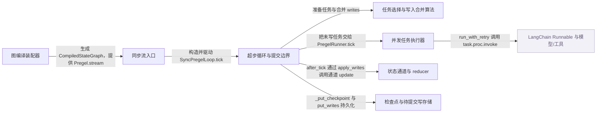

# langgraph：架构、运行逻辑与设计取舍

> main · [6f2df053f448](https://github.com/langchain-ai/langgraph/commit/6f2df053f4487ce6ea8decc0d7482c8e46e0f132) · deepseek-flash 辅助分析 · 2026-10-30T05:33:11.336Z
> 下文按固定源码推演，没有执行目标项目。引用可跳到具体代码行；“工程推断”解释收益与代价，不代表作者亲述。

## 1. 先建立直觉

**它把一次可能很长、可暂停的流程拆成有版本的超步：每步先按当前状态选出要跑的节点，执行节点并把写暂存，再在步边界统一合并、保存，从而失败或人工暂停后还能接着跑。**

模型节点与工具节点往往多轮交替、可能并发写同一个状态键，还要支持中断、恢复和从检查点重放；如果节点直接改共享状态，失败时很难知道哪些写已提交、哪些要重跑。

贯穿全文的例子：

- **输入：** 推演示例：State 含 messages: Annotated[list, add_messages]；输入 {"messages":[HumanMessage("北京天气?")]}，config 带 thread_id="t1"；模型节点被配置为若需要工具则返回带 tool_calls 的 AIMessage，工具节点返回 ToolMessage。
- **预期输出：** 推演输出：若模型产生 tool_calls，则一次运行可能依次写入 AIMessage(tool_calls)、ToolMessage、最终 AIMessage；若在工具节点前设置 interrupt_after，首次调用停在检查点，第二次用 Command(resume=...) 从该边界继续。

## 2. 一张图看懂架构



| 模块 | 职责与所在层的原因 | 输入 → 输出 | 拥有的状态 |
| --- | --- | --- | --- |
| 图编译装配器 [1][source-1] | 把构建期的节点、边、条件分支固化成运行期的 PregelNode、通道和写入器，因此运行循环不需要重新解释图结构。 | StateGraph 的 nodes、edges、branches、channels 与 checkpointer 配置 → CompiledStateGraph（Pregel 子类），内含 nodes、channels、START 通道和每个节点的 writers | 编译对象的 channels、nodes、schema mapper、checkpointer、interrupt 节点列表 |
| 同步流入口 [2][source-2] [3][source-3] [4][source-4] | 解析默认 checkpointer/durability/stream_mode，建立 SyncPregelLoop 与 PregelRunner，并驱动 while loop.tick()。 | 用户 input、config、stream_mode、durability、interrupt 参数 → 逐步流出的 values/updates 等 chunk；最终 loop.output | 本次运行的 Runtime、callback manager、loop 的 checkpoint 与 tasks |
| 超步循环与提交边界 [5][source-5] [6][source-6] | 每轮准备任务、检查 before 中断；任务完成后合并 writes、发 values、保存 checkpoint，并检查 after 中断。 | 当前 checkpoint、channels、pending writes、step/stop、interrupt 列表 → tasks 交给 runner；updated_channels 和新的 checkpoint 写回存储 | checkpoint、channel_versions、versions_seen、tasks、checkpoint_pending_writes、step |
| 任务选择与写入合并算法 [7][source-7] [8][source-8] [9][source-9] | 根据通道版本和触发关系生成 PULL/PUSH 任务，并在超步边界把各任务 writes 应用到通道，调用各通道的 reducer。 | checkpoint、channels、pending_writes、trigger_to_nodes、updated_channels → PregelExecutableTask 字典；apply_writes 返回更新过的通道集合 | checkpoint.versions_seen、channel_versions；各 BaseChannel 的值 |
| 并发任务执行器 [10][source-10] [11][source-11] | 把选中任务提交到线程池或单任务快路径，调用 run_with_retry；任务完成后 commit 把 writes 或错误/中断写回 loop。 | PregelExecutableTask 列表、retry_policy、timeout、get_waiter → 执行结果通过 task.writes 和 put_writes 进入 loop；yield 让入口输出流 | FuturesDict、task.writes、SKIP_RERAISE_SET、handled_exception_ids |
| 状态通道与 reducer [12][source-12] [13][source-13] [14][source-14] | 定义某个状态键如何接收本步多个写入并合并成新值；LastValue 只允许单写，BinaryOperatorAggregate/add_messages 负责累积或按 ID 合并。 | 本步写入值序列 Sequence[Update] → 更新后的通道值；update() 返回是否真正改变 | 通道内部 value；LastValueAfterFinish 还含 finished 标记 |
| 检查点与待提交写存储 [15][source-15] [16][source-16] | 保存 checkpoint 的通道版本/值、父指针和每个 task 的 pending writes，使下一次运行能定位边界并重放。 | config、Checkpoint、metadata、new_versions、writes、task_id → 可按 thread_id/checkpoint_ns/checkpoint_id 读取的 CheckpointTuple | storage、blobs、writes 三个 defaultdict；InMemorySaver 仅存内存 |
| LangChain Runnable 与模型/工具（外部依赖） [17][source-17] [18][source-18] | 用户节点本身是 Runnable；LangChain 负责回调、模型调用和工具调用，LangGraph 只负责调度、合并与持久化。 | 节点输入状态、RunnableConfig → 节点返回值或异常，被 write/commit 转为 writes | 回调管理器与用户节点内部状态不由 LangGraph 直接管理 |

## 3. 跟着一个请求跑完整条主线

这是对已读方法体的源码推演，不是执行日志。编号是阅读顺序；装配、写入、查询与条件分支是否发生，取决于每步的触发条件。

### 1. 编译图，把边和条件分支变成写入器

**阶段：** 装配

**触发条件：** 必经

入口/调用：`StateGraph.compile / CompiledStateGraph.attach_node / CompiledStateGraph.attach_edge` [1][source-1] [19][source-19] [20][source-20] [21][source-21]

**此时输入：** 构建期 nodes、edges、branches

创建 CompiledStateGraph，向 channels 加入 START；attach_node 为每个节点建立 PregelNode，其 triggers 指向 branch 通道，writers 使用 ChannelWrite；attach_edge 给源节点追加写入 branch:to:end 的 writer；attach_branch 追加条件分支 writer 与可选 reader。

**状态变化：** compiled.nodes、compiled.channels 与各节点 writers 被填充

**交给下一步：** 可供 stream 调用的编译图

### 2. 解析运行默认值并建立同步循环

**阶段：** 初始化

**触发条件：** 必经

入口/调用：`Pregel.stream / Pregel._defaults` [2][source-2] [3][source-3]

**此时输入：** input、config、stream_mode、durability

_defaults 解析 checkpointer、store、cache、interrupt 列表和 durability；stream 建 SyncQueue、Runtime、callback manager，并以 checkpointer/channels/nodes 构造 SyncPregelLoop，再构造 PregelRunner。

**状态变化：** loop 获得初始输入、checkpoint 配置和 stream 协议；runner 获得 submit/put_writes 弱引用

**交给下一步：** 进入 while loop.tick()

### 3. tick 选出本超步要执行的任务

**阶段：** 查询/调度

**触发条件：** 必经

入口/调用：`PregelLoop.tick / prepare_next_tasks` [22][source-22] [7][source-7] [8][source-8]

**此时输入：** 当前 checkpoint、channels、updated_channels、trigger_to_nodes

tick 调 _prepare_tasks_and_emit_checkpoint；prepare_next_tasks 先处理 TASKS 通道里的 PUSH/Send，再用 updated_channels 与 trigger_to_nodes 得到候选节点，逐个 prepare_single_task 检查触发版本、构造输入和 PregelExecutableTask；没有任务则 status=done。

**状态变化：** self.tasks 被填充；任务含 writes deque、retry_policy、cache_key、task_id

**交给下一步：** tasks 字典

### 4. 执行前检查中断点

**阶段：** 可选分支

**触发条件：** 配置了 interrupt_before 且 should_interrupt 命中

入口/调用：`PregelLoop.tick / should_interrupt` [23][source-23] [24][source-24]

**此时输入：** checkpoint、interrupt_before、tasks

若通道自上次中断后有更新且任务名命中列表，status=interrupt_before 并抛 GraphInterrupt；否则继续本步执行。

**状态变化：** 运行状态变为中断，异常交给 loop 退出路径保存

**交给下一步：** 不执行本步任务，进入中断处理

### 5. runner 执行节点并提交 writes

**阶段：** 执行/写入

**触发条件：** 存在未写任务

入口/调用：`PregelRunner.tick / run_with_retry / PregelRunner.commit` [25][source-25] [26][source-26] [11][source-11] [27][source-27]

**此时输入：** loop.tasks 中未写任务

入口调用 runner.tick；单任务快路径直接 run_with_retry(t, ...)，多任务提交线程池。run_with_retry 每次尝试先清空 task.writes，再 task.proc.invoke；节点通过 config 里的 CONFIG_KEY_SEND 把返回值写入 task.writes。commit 成功时调用 put_writes 保存；异常时写 ERROR，GraphInterrupt 时写 INTERRUPT。

**状态变化：** task.writes 被填充并持久化为 pending writes；失败/中断也被记录

**交给下一步：** 写入后的 tasks，等待 after_tick 合并

### 6. 把本步结果转成流式输出

**阶段：** 输出

**触发条件：** stream_mode 包含对应模式，或 debug/print_mode 要求

入口/调用：`Pregel.stream / map_output_values / map_output_updates` [28][source-28] [29][source-29] [30][source-30]

**此时输入：** runner.tick 产生的输出塞入 stream 队列；after_tick 也可能发 values

入口在每个 runner yield 后从 sync queue 取 chunk 并经 _output 产出；values 模式读通道当前完整值，updates 模式按任务名汇总该任务写入的键值。

**状态变化：** 无状态合并；仅产生输出 chunk

**交给下一步：** 调用者看到 values 或 updates chunk

### 7. 超步边界统一合并状态

**阶段：** 写入/合并

**触发条件：** 本步任务已结束

入口/调用：`PregelLoop.after_tick / apply_writes` [31][source-31] [9][source-9]

**此时输入：** tasks 的 writes、checkpoint、channels

after_tick 收集所有 writes，调 apply_writes：按 task path 排序保证确定性；更新 versions_seen；对 task.triggers 调 consume；按通道分组 writes，逐个 channels[chan].update(vals)，由通道 reducer 完成合并；再通知未更新通道新步，并在疑似最后一步 finish。

**状态变化：** channels 值被 reducer 合并；checkpoint.channel_versions 与 versions_seen 更新；updated_channels 返回

**交给下一步：** 合并后的通道状态与更新通道集合

### 8. 保存检查点与待提交写

**阶段：** 持久化

**触发条件：** 存在 checkpointer；durability 决定时机

入口/调用：`PregelLoop._put_checkpoint / InMemorySaver.put / InMemorySaver.put_writes` [32][source-32] [33][source-33] [34][source-34] [16][source-16]

**此时输入：** 合并后的 checkpoint、checkpoint_metadata、new_versions、writes

_put_checkpoint 创建新 Checkpoint 并提交 _checkpointer_put_after_previous；InMemorySaver.put 把 channel_values 按版本拆进 blobs，把 checkpoint、metadata、父 id 放入 storage；put_writes 以 (task_id, write_idx) 存 writes，正索引重复写会跳过。

**状态变化：** storage/blobs/writes 增加本步记录；checkpoint_config 指向新 checkpoint id

**交给下一步：** 下一次 get_tuple 可读的检查点边界

### 9. 中断后从检查点和 resume 写恢复

**阶段：** 可选分支/恢复

**触发条件：** 发生 GraphInterrupt 或用户用同一 thread_id 再次调用

入口/调用：`PregelRunner.commit / PregelLoop._suppress_interrupt / Pregel.invoke / _scratchpad` [35][source-35] [36][source-36] [37][source-37] [38][source-38]

**此时输入：** 中断异常、pending INTERRUPT/RESUME writes、原 thread_id

commit 把 INTERRUPT 写保存；_suppress_interrupt 在退出时持久化当前 checkpoint 和 pending writes，并保存 output；再次 invoke 走 stream，loop 加载 checkpoint 后，_scratchpad 从 pending writes 找到 RESUME 或全局 resume，再在下一 tick 重新准备任务。

**状态变化：** 中断点被保留；resume 值进入任务 scratchpad；任务从该边界继续

**交给下一步：** 继续执行或再次停在下一个中断点

## 4. 核心技术到底是什么

### 1. Pregel/BSP 超步调度

**解决的问题：** 要让并发节点在同一状态快照上执行，又能在边界确定性地合并写入。 [5][source-5] [9][source-9] [7][source-7]

每轮先用 checkpoint 的 channel_versions/versions_seen 和 trigger_to_nodes 选出任务；任务只把写放入自己的 task.writes；全部结束后 apply_writes 一次性更新通道并推进版本。

算法示意（用于解释机制，不是源码原文）：

```text
每轮 tasks=prepare_next_tasks(checkpoint,channels,versions_seen)；无任务则结束；每个任务 run(t) 并在 task.writes 收集写；updated=apply_writes(checkpoint,channels,tasks)；再用 create_checkpoint 保存并 step 加一
```

**关键数据结构：** checkpoint.channel_versions、checkpoint.versions_seen、tasks[id]->PregelExecutableTask、task.writes(deque)、updated_channels(set)

- **本项目实现：** PregelLoop.tick/after_tick、_algo.prepare_next_tasks/prepare_single_task/apply_writes 自己实现选择与合并；_runner 负责并发执行。
- **外部依赖提供：** 用户节点内部的 LangChain Runnable、模型和工具由外部框架执行；LangGraph 只接收其返回值/异常并转成 writes。
- **收益与代价：** 边界合并使状态可重放、并发写可归并，但同一超步内节点看不到彼此本步写入，且会多一次调度边界。

### 2. 通道 reducer 合并

**解决的问题：** 同一状态键可能被多个任务写入，需要定义多个值如何变成一个值。 [12][source-12] [13][source-13] [14][source-14]

BaseChannel.update(values) 接收本步该通道的全部写入；LastValue 要求恰好一个值，BinaryOperatorAggregate 用二元函数折叠，add_messages 按消息 ID 替换或追加，RemoveMessage 删除。

算法示意（用于解释机制，不是源码原文）：

```text
update(values)：空则返回 False；若当前为空取第一个；遍历剩余值，遇到 Overwrite 则替换当前值且只允许一次，否则 current=operator(current,value)；返回 True
```

**关键数据结构：** LastValue.value；BinaryOperatorAggregate.value+operator；add_messages 的 merged_by_id 与 ids_to_remove

- **本项目实现：** channels/base.py 定义 update/consume/finish 接口；binop.py、last_value.py、graph/message.py 提供具体 reducer。
- **外部依赖提供：** LangChain 的 BaseMessage/RemoveMessage 类型与消息转换由外部包提供。
- **收益与代价：** reducer 让并发写有确定语义，但 LastValue 对同一超步多写直接报 InvalidUpdateError；自定义 reducer 的合并语义需开发者保证符合业务。

### 3. 检查点与 pending writes 分层

**解决的问题：** 暂停、失败恢复和重放需要知道执行到哪个边界以及边界上哪些任务已写了什么。 [32][source-32] [15][source-15] [39][source-39]

checkpoint 保存通道版本、通道值、versions_seen 和父 id；put_writes 另按 (thread_id, checkpoint_ns, checkpoint_id, task_id, idx) 保存任务写入。恢复时先加载 checkpoint，再把 pending writes 重新应用到成功任务或用于 resume。

算法示意（用于解释机制，不是源码原文）：

```text
put：按 new_versions 把 channel_values 拆入 blobs，并保存 checkpoint/metadata/父 id；put_writes：对每个 write 用 (task_id, 索引) 建键，已有正索引写则跳过，否则序列化保存
```

**关键数据结构：** storage[thread][ns][checkpoint_id]；blobs[(thread, ns, channel, version)]；writes[(thread, ns, checkpoint_id)] -> {(task_id, idx): write}

- **本项目实现：** InMemorySaver 用 defaultdict 实现 put/get_tuple/put_writes；_put_checkpoint 负责生成 checkpoint 并提交保存。
- **外部依赖提供：** 生产持久化可换成 BaseCheckpointSaver 的其他实现；本仓库的 InMemorySaver 作者明确只建议调试/测试。
- **收益与代价：** 分层让恢复边界清晰，但保存频率与 durability 有关；内存实现不能跨进程持久，生产需外部 saver。

### 4. 节点级重试

**解决的问题：** 单个模型/工具节点可能瞬时失败，不应让整个图立即失败。 [40][source-40] [41][source-41]

run_with_retry 在任务层循环：每次尝试先清空 task.writes；异常匹配 retry_policy 时按 initial_interval、backoff_factor、max_interval 和 jitter 计算 sleep；超过 max_attempts 才抛出，并置 RESUMING 让子图恢复。

算法示意（用于解释机制，不是源码原文）：

```text
attempts=0；循环：清空 task.writes；尝试 task.proc.invoke；遇到 GraphBubbleUp 直接抛；遇到其它异常则找匹配 retry_policy，找不到就抛；attempts 加一，达到 max_attempts 就抛；否则按退避 sleep 后重试
```

**关键数据结构：** task.retry_policy、attempts、RetryPolicy.max_attempts/initial_interval/backoff_factor/jitter

- **本项目实现：** _retry.run_with_retry 实现重试循环与退避；_runner 负责把任务提交到该函数并在失败后 commit ERROR。
- **外部依赖提供：** 异常类型和节点调用由 LangChain Runnable/用户代码产生；LangGraph 不自动回滚节点已造成的外部副作用。
- **收益与代价：** 重试隐藏瞬时故障，但会重复执行节点，外部副作用可能重复；只清空 task.writes 不等于撤销外部世界。

## 5. 为什么选择这种实现

### 1. 编译期把边和条件分支固化成节点的 writers 与 branch 通道，而不是在运行循环里重新遍历图。

**依据：已确认实现；以下原因是工程分析，不代表作者亲述。** [19][source-19] [20][source-20] [21][source-21]

**面临的约束：** 运行期需要按通道版本快速判断哪些节点被触发，并保持确定性。

**如果改用另一种做法：** 每次 tick 时扫描 edges/branches 决定下一批节点。

**为什么当前方案有用：** 在示例中，模型节点完成后只需向 branch:to:tools 写入，工具节点的 trigger 通道变为可用后下一 tick 自然被选中；编译期装配让触发判断只依赖通道版本和 trigger_to_nodes。

**付出的代价，以及不适用的情况：** 编译对象较复杂，动态修改图后必须重新 compile；条件边需要 reader/写入口约定。

### 2. 节点执行结果先写入 task.writes，超步结束才由 apply_writes 合并进全局通道。

**依据：已确认实现；以下原因是工程分析，不代表作者亲述。** [42][source-42] [31][source-31] [9][source-9]

**面临的约束：** 同一超步内多个模型/工具任务可能并发，读状态必须是本步开始的一致快照。

**如果改用另一种做法：** 节点执行时直接修改全局 state。

**为什么当前方案有用：** 示例中若模型节点和工具节点并发写 messages，直接改全局状态会出现半更新；先暂存再按通道 reducer 合并，可把并发写变成一次确定的 update 序列，且失败时未提交写可丢弃。

**付出的代价，以及不适用的情况：** 节点内看不到同超步其他节点的写入；需要通过条件边 local_read 等机制显式读取本节点写入。

### 3. 将 reducer、checkpoint、interrupt 分成三层：reducer 定义状态合并，checkpoint 定义可恢复边界，interrupt 只是控制流暂停。

**依据：已确认实现；以下原因是工程分析，不代表作者亲述。** [23][source-23] [36][source-36] [35][source-35]

**面临的约束：** 状态合并、持久化、人工暂停是三个不同问题，混在一个状态对象里会让恢复时无法区分已提交值和未执行任务。

**如果改用另一种做法：** 用一个全局 state 加一个 paused 标志，暂停时直接保存整个对象。

**为什么当前方案有用：** 示例中 messages 的合并需要 add_messages；恢复需要知道执行到哪个超步和哪些 task writes 已保存；人工中断需要抛 GraphInterrupt 但仍保存边界。三者分开后，resume 可以只补 RESUME 写并重跑未完成任务。

**付出的代价，以及不适用的情况：** 状态分散在 channels、checkpoint、pending writes 和 scratchpad 中，调试时需要同时看多处；自定义 saver 要实现较完整接口。

### 4. 仓库内的 InMemorySaver 定位为调试/测试存储，而不是生产持久化方案。

**作者原文：** “Only use `InMemorySaver` for debugging or testing purposes.” [39][source-39]

**面临的约束：** 内存字典无法跨进程、跨机器持久化，进程退出即丢失。

**如果改用另一种做法：** 生产直接使用 PostgresSaver 等外部检查点实现。

**为什么当前方案有用：** 示例用 InMemorySaver 可以验证 thread_id 恢复、interrupt 和 pending writes 行为；但真实长运行 agent 需要可持久化、可并发访问的 saver。

**付出的代价，以及不适用的情况：** 测试方便但生产不适用；需要额外依赖和部署数据库。

## 6. 关键代码精读

### 1. compile 如何把节点和边变成执行对象


`libs/langgraph/langgraph/graph/state.py:1346-1401` [1][source-1]

```python
        compiled = CompiledStateGraph[StateT, ContextT, InputT, OutputT](
            builder=self,
            schema_to_mapper={},
            context_schema=self.context_schema,
            nodes={},
            channels={
                **self.channels,
                **self.managed,
                START: EphemeralValue(self.input_schema),
            },
            input_channels=START,
            stream_mode="updates",
            output_channels=output_channels,
            stream_channels=stream_channels,
            checkpointer=checkpointer,
            interrupt_before_nodes=interrupt_before,
            interrupt_after_nodes=interrupt_after,
            auto_validate=False,
            debug=debug,
            store=store,
            cache=cache,
            node_error_handler_map=node_error_handler_map,
            name=name or "LangGraph",
            stream_transformers=transformers,
        )
        compiled._serde_allowlist = serde_allowlist

        compiled.attach_node(START, None)
        for key, node in self.nodes.items():
            compiled.attach_node(key, node)

        # Record output/state mappers for v2 stream coercion (pydantic/dataclass only)
        compiled._output_mapper = _pick_mapper(
            list(output_channels)
            if isinstance(output_channels, list)
            else [output_channels],
            self.output_schema,
        )
        compiled._state_mapper = _pick_mapper(
            list(stream_channels)
            if isinstance(stream_channels, list)
            else [stream_channels],
            self.state_schema,
        )

        for start, end in self.edges:
            compiled.attach_edge(start, end)

        for starts, end in self.waiting_edges:
            compiled.attach_edge(starts, end)

        for start, branches in self.branches.items():
            for name, branch in branches.items():
                compiled.attach_branch(start, name, branch)

        return compiled.validate()
```


`libs/langgraph/langgraph/graph/state.py:1531-1547` [19][source-19]

```python
            self.nodes[key] = PregelNode(
                triggers=[branch_channel],
                # read state keys and managed values
                channels=("__root__" if is_single_input else input_channels),
                # coerce state dict to schema class (eg. pydantic model)
                mapper=mapper,
                # publish to state keys
                writers=[ChannelWrite(write_entries)],
                metadata=node.metadata,
                retry_policy=node.retry_policy,
                cache_policy=node.cache_policy,
                is_error_handler=node.is_error_handler,
                error_handler_node=node.error_handler_node,
                bound=node.runnable,  # type: ignore[arg-type]
                timeout=node.timeout,
                trace_policy=node.trace_policy,
            )
```


`libs/langgraph/langgraph/graph/state.py:1551-1575` [20][source-20]

```python
    def attach_edge(self, starts: str | Sequence[str], end: str) -> None:
        if isinstance(starts, str):
            # subscribe to start channel
            if end != END:
                self.nodes[starts].writers.append(
                    ChannelWrite(
                        (ChannelWriteEntry(_CHANNEL_BRANCH_TO.format(end), None),)
                    )
                )
        elif end != END:
            channel_name = f"join:{'+'.join(starts)}:{end}"
            # register channel
            if self.builder.nodes[end].defer:
                self.channels[channel_name] = NamedBarrierValueAfterFinish(
                    str, set(starts)
                )
            else:
                self.channels[channel_name] = NamedBarrierValue(str, set(starts))
            # subscribe to channel
            self.nodes[end].triggers.append(channel_name)
            # publish to channel
            for start in starts:
                self.nodes[start].writers.append(
                    ChannelWrite((ChannelWriteEntry(channel_name, start),))
                )
```


compile 先创建 CompiledStateGraph，channels 由状态通道、managed 通道和 START 组成；然后 attach_node(START) 和每个业务节点。attach_node 为业务节点建立 PregelNode：triggers 指向 branch 通道，channels 是输入通道，writers 是 ChannelWrite，真正执行体放在 bound。attach_edge 不保存边对象，而是给源节点的 writers 追加一个写 branch:to:end 的 ChannelWrite；条件分支则由 attach_branch 追加 branch.run 生成的 writer。这样运行期只需看通道触发。

### 2. 一次同步超步的主循环


`libs/langgraph/langgraph/pregel/main.py:3050-3079` [4][source-4]

```python
                # Similarly to Bulk Synchronous Parallel / Pregel model
                # computation proceeds in steps, while there are channel updates.
                # Channel updates from step N are only visible in step N+1
                # channels are guaranteed to be immutable for the duration of the step,
                # with channel updates applied only at the transition between steps.
                while loop.tick():
                    for task in loop.match_cached_writes():
                        loop.put_writes(task.id, task.writes, cached=True)
                    for _ in runner.tick(
                        [t for t in loop.tasks.values() if not t.writes],
                        timeout=self.step_timeout,
                        get_waiter=get_waiter,
                        schedule_task=loop.accept_push,
                    ):
                        # emit output
                        yield from _output(
                            stream_mode,
                            print_mode,
                            subgraphs,
                            stream.get,
                            queue.Empty,
                            version,
                            _output_mapper,
                            _state_mapper,
                        )
                    loop.after_tick()
                    emit_graph_lifecycle_events(loop)
                    # wait for checkpoint
                    if durability_ == "sync":
                        loop._put_checkpoint_fut.result()
```


`libs/langgraph/langgraph/pregel/_loop.py:650-669` [43][source-43]

```python
    def tick(self) -> bool:
        """Execute a single iteration of the Pregel loop.

        Returns:
            True if more iterations are needed.
        """

        # check if iteration limit is reached
        if self.step > self.stop:
            self.status = "out_of_steps"
            # stream the checkpoint the last step saved, as a tick that runs would
            self._prepare_tasks_and_emit_checkpoint()
            return False

        self._prepare_tasks_and_emit_checkpoint()

        # if no more tasks, we're done
        if not self.tasks:
            self.status = "done"
            return False
```


`libs/langgraph/langgraph/pregel/_runner.py:200-218` [26][source-26]

```python
        elif len(tasks) == 1 and timeout is None and get_waiter is None:
            t = tasks[0]
            scheduled_error_handler = False
            try:
                run_with_retry(
                    t,
                    retry_policy,
                    configurable={
                        CONFIG_KEY_CALL: partial(
                            _call,
                            weakref.ref(t),
                            retry_policy=retry_policy,
                            futures=weakref.ref(futures),
                            schedule_task=schedule_task,
                            submit=self.submit,
                        ),
                    },
                )
                self.commit(t, None)
```


Pregel.stream 在构造 SyncPregelLoop 和 PregelRunner 后进入 while loop.tick()。tick 先准备任务；若没有任务则 done 返回 False。入口把未写任务交给 runner.tick，runner 的单任务快路径调用 run_with_retry，内部执行 task.proc.invoke，节点的 ChannelWrite 通过 CONFIG_KEY_SEND 把写 append 到 task.writes。随后入口调用 loop.after_tick，after_tick 收集 task.writes 并调 apply_writes 合并通道。

### 3. apply_writes 与 InMemorySaver.put 的边界


`libs/langgraph/langgraph/pregel/_algo.py:293-344` [44][source-44]

```python
    # Group writes by channel
    pending_writes_by_channel: dict[str, list[Any]] = defaultdict(list)
    for task in tasks:
        for chan, val in task.writes:
            if chan in (
                NO_WRITES,
                PUSH,
                RESUME,
                INTERRUPT,
                RETURN,
                ERROR,
                ERROR_SOURCE_NODE,
            ):
                pass
            elif chan in channels:
                pending_writes_by_channel[chan].append(val)
            else:
                logger.warning(
                    f"Task {task.name} with path {task.path} wrote to unknown channel {chan}, ignoring it."
                )

    # Apply writes to channels
    updated_channels: set[str] = set()
    for chan, vals in pending_writes_by_channel.items():
        if chan in channels:
            if channels[chan].update(vals) and next_version is not None:
                checkpoint["channel_versions"][chan] = next_version
                # unavailable channels can't trigger tasks, so don't add them
                if channels[chan].is_available():
                    updated_channels.add(chan)

    # Channels that weren't updated in this step are notified of a new step
    if bump_step:
        for chan in channels:
            if channels[chan].is_available() and chan not in updated_channels:
                if channels[chan].update(EMPTY_SEQ) and next_version is not None:
                    checkpoint["channel_versions"][chan] = next_version
                    # unavailable channels can't trigger tasks, so don't add them
                    if channels[chan].is_available():
                        updated_channels.add(chan)

    # If this is (tentatively) the last superstep, notify all channels of finish
    if bump_step and updated_channels.isdisjoint(trigger_to_nodes):
        for chan in channels:
            if channels[chan].finish() and next_version is not None:
                checkpoint["channel_versions"][chan] = next_version
                # unavailable channels can't trigger tasks, so don't add them
                if channels[chan].is_available():
                    updated_channels.add(chan)

    # Return managed values writes to be applied externally
    return updated_channels
```


`libs/langgraph/langgraph/pregel/_loop.py:1301-1313` [45][source-45]

```python
        self.checkpoint = create_checkpoint(
            self.checkpoint,
            self.channels if do_checkpoint else None,
            self.step,
            id=self.checkpoint["id"] if exiting else None,
            updated_channels=self.updated_channels,
            get_next_version=self.checkpointer_get_next_version
            if do_checkpoint
            else None,
            channels_to_snapshot=channels_to_snapshot,
            stored_versions=self.checkpoint_previous_versions,
            trigger_to_nodes=self.trigger_to_nodes,
        )
```


`libs/checkpoint/langgraph/checkpoint/memory/__init__.py:451-504` [46][source-46]

```python
        c = checkpoint.copy()
        thread_id = config["configurable"]["thread_id"]
        checkpoint_ns = config["configurable"]["checkpoint_ns"]
        values: dict[str, Any] = c.pop("channel_values")  # type: ignore[misc]
        for k, v in new_versions.items():
            self.blobs[(thread_id, checkpoint_ns, k, v)] = (
                self.serde.dumps_typed(values[k]) if k in values else ("empty", b"")
            )
        self.storage[thread_id][checkpoint_ns].update(
            {
                checkpoint["id"]: (
                    self.serde.dumps_typed(c),
                    self.serde.dumps_typed(get_checkpoint_metadata(config, metadata)),
                    config["configurable"].get("checkpoint_id"),  # parent
                )
            }
        )
        return {
            "configurable": {
                "thread_id": thread_id,
                "checkpoint_ns": checkpoint_ns,
                "checkpoint_id": checkpoint["id"],
            }
        }

    def put_writes(
        self,
        config: RunnableConfig,
        writes: Sequence[tuple[str, Any]],
        task_id: str,
        task_path: str = "",
    ) -> None:
        """Save a list of writes to the in-memory storage.

        This method saves a list of writes to the in-memory storage. The writes are associated
        with the provided config.

        Args:
            config: The config to associate with the writes.
            writes: The writes to save.
            task_id: Identifier for the task creating the writes.
            task_path: Path of the task creating the writes.

        Returns:
            RunnableConfig: The updated config containing the saved writes' timestamp.
        """
        thread_id = config["configurable"]["thread_id"]
        checkpoint_ns = config["configurable"].get("checkpoint_ns", "")
        checkpoint_id = config["configurable"]["checkpoint_id"]
        outer_key = (thread_id, checkpoint_ns, checkpoint_id)
        outer_writes_ = self.writes.get(outer_key)
        for idx, (c, v) in enumerate(writes):
            inner_key = (task_id, WRITES_IDX_MAP.get(c, idx))
            if inner_key[1] >= 0 and outer_writes_ and inner_key in outer_writes_:
```


apply_writes 先按 task path 排序，保证写合并顺序确定；对每个 task 的 triggers 更新 versions_seen，并 consume 对应通道。然后把 writes 按通道分组，忽略 NO_WRITES/PUSH/RESUME/INTERRUPT/RETURN/ERROR 等控制通道，对普通通道调用 channels[chan].update(vals)。update 返回 True 才推进 channel_versions 并加入 updated_channels。_put_checkpoint 随后 create_checkpoint，并把保存任务提交给 saver。InMemorySaver.put 把 checkpoint 的 channel_values 按 (thread, ns, channel, version) 拆进 blobs，把 checkpoint 本体、metadata、父 id 放入 storage；put_writes 以 (task_id, 写索引) 为键，并在遇到已有正索引写时跳过。

## 7. 动手验证你的理解

以下是建议实验，没有执行过。

### 1. stream_mode="updates" 与 "values" 在同一个超步后输出什么差异？

**改变什么：** 把 graph.stream 的 stream_mode 从 "values" 改为 "updates"，输入与图不变。 [29][source-29] [30][source-30] [28][source-28]

**应该观察到什么：** updates 只显示节点名及其本步写入的键值；values 会读通道当前完整状态，因此在 messages 场景会看到累计消息列表。原因是 map_output_updates 按 task.writes 分组，而 map_output_values 调 read_channels 读完整通道。

### 2. durability="sync" 是否让每个超步等待检查点写完再进入下一 tick？

**改变什么：** compile 时传入 InMemorySaver，并把 invoke/stream 的 durability 设为 "sync"，与默认 "async" 对比。 [47][source-47] [33][source-33]

**应该观察到什么：** sync 下 Pregel.stream 在 loop.after_tick 后调用 loop._put_checkpoint_fut.result()，会阻塞到本步保存完成；async 下不等待。这样 sync 更适合要求下一步开始前上一步已持久化的场景。

### 3. interrupt_after="*" 时首次 invoke 是否停在下一个节点之前？

**改变什么：** 构造 step_1 -> step_2 -> step_3 的 StateGraph，compile(checkpointer=..., interrupt_after="*")，首次 invoke 后读取 get_state，再次 invoke(None)。 [48][source-48] [49][source-49]

**应该观察到什么：** 首次调用在 step_1 后中断，get_state(thread).next 为 ("step_2",)；再次 invoke(None) 从该检查点继续到 step_2 后中断。测试直接断言了 next 和 checkpoint 数量随 durability 变化。

## 8. 读完应当能复述什么

- compile 是静态装配阶段：节点、边、条件分支被转成 PregelNode 的 triggers/writers 和 branch 通道，运行期只按通道版本触发。
- 一次超步分成选任务、执行并暂存 writes、边界 apply_writes、保存 checkpoint 四段；节点执行中不直接提交全局状态。
- reducer 决定同一状态键多个写入如何合并；LastValue 对同一步多写报错，因此并发写同一键必须使用合适的 Annotated reducer。
- interrupt 不是直接杀进程：GraphInterrupt 会经 commit 写入 INTERRUPT，退出路径保存 checkpoint 和 pending writes，恢复时再读 RESUME。
- retry 发生在 runner 的单任务层，重试会清空 task.writes 但不回滚外部副作用；失败与重试不能与状态合并混为一层。
- InMemorySaver 适合调试/测试；生产可恢复性依赖可持久化的 BaseCheckpointSaver 实现。

## 来源与覆盖边界

本次读取 24 个文件，共 337,675 字符；18 个文件完整读取，其他文件按关键方法取带行号的片段。没有把未读依赖的内部实现当作已确认事实。

- 未读模型节点和工具节点的具体实现，因此不能确认示例中模型一定产生 tool_calls、工具一定返回什么内容，也不能预测路由。
- 未完整阅读 BaseCheckpointSaver 的所有序列化/迁移实现，跨进程、跨版本检查点恢复边界只能从 InMemorySaver 与 _put_checkpoint 已读代码推断。
- 未完整追踪 v2/v3 stream transformer 与 messages token 细节；本回答只把 stream chunk 当作入口按模式产出的输出，不把它等同于原始 token delta。
- compile 中 serde allowlist、schema mapper 和所有错误处理分支未逐行展开，相关边界需继续读 state.py 其余部分。

| 文件 | 实际读取行段 |
| --- | --- |
| [README.md](https://github.com/langchain-ai/langgraph/blob/6f2df053f4487ce6ea8decc0d7482c8e46e0f132/README.md) | 1–83 / 共 83 行 |
| [libs/langgraph/langgraph/graph/state.py](https://github.com/langchain-ai/langgraph/blob/6f2df053f4487ce6ea8decc0d7482c8e46e0f132/libs/langgraph/langgraph/graph/state.py) | 1–50、1174–1403、1441–1625、1812–1875 / 共 1979 行 |
| [libs/langgraph/langgraph/pregel/main.py](https://github.com/langchain-ai/langgraph/blob/6f2df053f4487ce6ea8decc0d7482c8e46e0f132/libs/langgraph/langgraph/pregel/main.py) | 1–50、2642–3114、3357–3421、3870–4049 / 共 4557 行 |
| [libs/langgraph/langgraph/pregel/_loop.py](https://github.com/langchain-ai/langgraph/blob/6f2df053f4487ce6ea8decc0d7482c8e46e0f132/libs/langgraph/langgraph/pregel/_loop.py) | 1–50、647–777、1234–1385、1497–1562 / 共 2173 行 |
| [libs/langgraph/langgraph/pregel/_runner.py](https://github.com/langchain-ai/langgraph/blob/6f2df053f4487ce6ea8decc0d7482c8e46e0f132/libs/langgraph/langgraph/pregel/_runner.py) | 1–949 / 共 949 行 |
| [libs/langgraph/langgraph/pregel/_algo.py](https://github.com/langchain-ai/langgraph/blob/6f2df053f4487ce6ea8decc0d7482c8e46e0f132/libs/langgraph/langgraph/pregel/_algo.py) | 1–1460 / 共 1460 行 |
| [libs/langgraph/langgraph/graph/message.py](https://github.com/langchain-ai/langgraph/blob/6f2df053f4487ce6ea8decc0d7482c8e46e0f132/libs/langgraph/langgraph/graph/message.py) | 1–376 / 共 376 行 |
| [libs/checkpoint/langgraph/checkpoint/memory/__init__.py](https://github.com/langchain-ai/langgraph/blob/6f2df053f4487ce6ea8decc0d7482c8e46e0f132/libs/checkpoint/langgraph/checkpoint/memory/__init__.py) | 1–708 / 共 708 行 |
| [libs/langgraph/langgraph/pregel/_retry.py](https://github.com/langchain-ai/langgraph/blob/6f2df053f4487ce6ea8decc0d7482c8e46e0f132/libs/langgraph/langgraph/pregel/_retry.py) | 1–854 / 共 854 行 |
| [libs/langgraph/langgraph/pregel/_checkpoint.py](https://github.com/langchain-ai/langgraph/blob/6f2df053f4487ce6ea8decc0d7482c8e46e0f132/libs/langgraph/langgraph/pregel/_checkpoint.py) | 1–547 / 共 547 行 |
| [libs/langgraph/langgraph/pregel/_io.py](https://github.com/langchain-ai/langgraph/blob/6f2df053f4487ce6ea8decc0d7482c8e46e0f132/libs/langgraph/langgraph/pregel/_io.py) | 1–175 / 共 175 行 |
| [libs/langgraph/langgraph/channels/base.py](https://github.com/langchain-ai/langgraph/blob/6f2df053f4487ce6ea8decc0d7482c8e46e0f132/libs/langgraph/langgraph/channels/base.py) | 1–122 / 共 122 行 |
| [libs/langgraph/langgraph/channels/binop.py](https://github.com/langchain-ai/langgraph/blob/6f2df053f4487ce6ea8decc0d7482c8e46e0f132/libs/langgraph/langgraph/channels/binop.py) | 1–160 / 共 160 行 |
| [libs/langgraph/langgraph/channels/last_value.py](https://github.com/langchain-ai/langgraph/blob/6f2df053f4487ce6ea8decc0d7482c8e46e0f132/libs/langgraph/langgraph/channels/last_value.py) | 1–152 / 共 152 行 |
| [libs/langgraph/langgraph/pregel/_write.py](https://github.com/langchain-ai/langgraph/blob/6f2df053f4487ce6ea8decc0d7482c8e46e0f132/libs/langgraph/langgraph/pregel/_write.py) | 1–193 / 共 193 行 |
| [libs/langgraph/langgraph/pregel/_messages.py](https://github.com/langchain-ai/langgraph/blob/6f2df053f4487ce6ea8decc0d7482c8e46e0f132/libs/langgraph/langgraph/pregel/_messages.py) | 1–603 / 共 603 行 |
| [libs/langgraph/tests/test_interruption.py](https://github.com/langchain-ai/langgraph/blob/6f2df053f4487ce6ea8decc0d7482c8e46e0f132/libs/langgraph/tests/test_interruption.py) | 1–315 / 共 315 行 |
| [libs/langgraph/tests/test_pregel.py](https://github.com/langchain-ai/langgraph/blob/6f2df053f4487ce6ea8decc0d7482c8e46e0f132/libs/langgraph/tests/test_pregel.py) | 1–50、101–161 / 共 9976 行 |
| [libs/checkpoint/langgraph/checkpoint/serde/types.py](https://github.com/langchain-ai/langgraph/blob/6f2df053f4487ce6ea8decc0d7482c8e46e0f132/libs/checkpoint/langgraph/checkpoint/serde/types.py) | 1–69 / 共 69 行 |
| [libs/langgraph/langgraph/pregel/types.py](https://github.com/langchain-ai/langgraph/blob/6f2df053f4487ce6ea8decc0d7482c8e46e0f132/libs/langgraph/langgraph/pregel/types.py) | 1–39 / 共 39 行 |
| [libs/langgraph/langgraph/types.py](https://github.com/langchain-ai/langgraph/blob/6f2df053f4487ce6ea8decc0d7482c8e46e0f132/libs/langgraph/langgraph/types.py) | 1–50、115–152、490–529、567–583、632–658 / 共 1097 行 |
| [libs/sdk-py/langgraph_sdk/_shared/types.py](https://github.com/langchain-ai/langgraph/blob/6f2df053f4487ce6ea8decc0d7482c8e46e0f132/libs/sdk-py/langgraph_sdk/_shared/types.py) | 1–11 / 共 11 行 |
| [libs/sdk-py/langgraph_sdk/auth/types.py](https://github.com/langchain-ai/langgraph/blob/6f2df053f4487ce6ea8decc0d7482c8e46e0f132/libs/sdk-py/langgraph_sdk/auth/types.py) | 1–50、152–163、183–204 / 共 1163 行 |
| [libs/sdk-py/langgraph_sdk/encryption/types.py](https://github.com/langchain-ai/langgraph/blob/6f2df053f4487ce6ea8decc0d7482c8e46e0f132/libs/sdk-py/langgraph_sdk/encryption/types.py) | 1–174 / 共 174 行 |

[source-1]: https://github.com/langchain-ai/langgraph/blob/6f2df053f4487ce6ea8decc0d7482c8e46e0f132/libs/langgraph/langgraph/graph/state.py#L1346-L1401 "libs/langgraph/langgraph/graph/state.py:1346-1401"
[source-2]: https://github.com/langchain-ai/langgraph/blob/6f2df053f4487ce6ea8decc0d7482c8e46e0f132/libs/langgraph/langgraph/pregel/main.py#L2843-L2864 "libs/langgraph/langgraph/pregel/main.py:2843-2864"
[source-3]: https://github.com/langchain-ai/langgraph/blob/6f2df053f4487ce6ea8decc0d7482c8e46e0f132/libs/langgraph/langgraph/pregel/main.py#L2990-L3022 "libs/langgraph/langgraph/pregel/main.py:2990-3022"
[source-4]: https://github.com/langchain-ai/langgraph/blob/6f2df053f4487ce6ea8decc0d7482c8e46e0f132/libs/langgraph/langgraph/pregel/main.py#L3050-L3079 "libs/langgraph/langgraph/pregel/main.py:3050-3079"
[source-5]: https://github.com/langchain-ai/langgraph/blob/6f2df053f4487ce6ea8decc0d7482c8e46e0f132/libs/langgraph/langgraph/pregel/_loop.py#L650-L698 "libs/langgraph/langgraph/pregel/_loop.py:650-698"
[source-6]: https://github.com/langchain-ai/langgraph/blob/6f2df053f4487ce6ea8decc0d7482c8e46e0f132/libs/langgraph/langgraph/pregel/_loop.py#L700-L777 "libs/langgraph/langgraph/pregel/_loop.py:700-777"
[source-7]: https://github.com/langchain-ai/langgraph/blob/6f2df053f4487ce6ea8decc0d7482c8e46e0f132/libs/langgraph/langgraph/pregel/_algo.py#L474-L511 "libs/langgraph/langgraph/pregel/_algo.py:474-511"
[source-8]: https://github.com/langchain-ai/langgraph/blob/6f2df053f4487ce6ea8decc0d7482c8e46e0f132/libs/langgraph/langgraph/pregel/_algo.py#L596-L758 "libs/langgraph/langgraph/pregel/_algo.py:596-758"
[source-9]: https://github.com/langchain-ai/langgraph/blob/6f2df053f4487ce6ea8decc0d7482c8e46e0f132/libs/langgraph/langgraph/pregel/_algo.py#L254-L344 "libs/langgraph/langgraph/pregel/_algo.py:254-344"
[source-10]: https://github.com/langchain-ai/langgraph/blob/6f2df053f4487ce6ea8decc0d7482c8e46e0f132/libs/langgraph/langgraph/pregel/_runner.py#L173-L218 "libs/langgraph/langgraph/pregel/_runner.py:173-218"
[source-11]: https://github.com/langchain-ai/langgraph/blob/6f2df053f4487ce6ea8decc0d7482c8e46e0f132/libs/langgraph/langgraph/pregel/_runner.py#L575-L615 "libs/langgraph/langgraph/pregel/_runner.py:575-615"
[source-12]: https://github.com/langchain-ai/langgraph/blob/6f2df053f4487ce6ea8decc0d7482c8e46e0f132/libs/langgraph/langgraph/channels/binop.py#L127-L148 "libs/langgraph/langgraph/channels/binop.py:127-148"
[source-13]: https://github.com/langchain-ai/langgraph/blob/6f2df053f4487ce6ea8decc0d7482c8e46e0f132/libs/langgraph/langgraph/channels/last_value.py#L56-L67 "libs/langgraph/langgraph/channels/last_value.py:56-67"
[source-14]: https://github.com/langchain-ai/langgraph/blob/6f2df053f4487ce6ea8decc0d7482c8e46e0f132/libs/langgraph/langgraph/graph/message.py#L219-L237 "libs/langgraph/langgraph/graph/message.py:219-237"
[source-15]: https://github.com/langchain-ai/langgraph/blob/6f2df053f4487ce6ea8decc0d7482c8e46e0f132/libs/checkpoint/langgraph/checkpoint/memory/__init__.py#L430-L474 "libs/checkpoint/langgraph/checkpoint/memory/__init__.py:430-474"
[source-16]: https://github.com/langchain-ai/langgraph/blob/6f2df053f4487ce6ea8decc0d7482c8e46e0f132/libs/checkpoint/langgraph/checkpoint/memory/__init__.py#L500-L512 "libs/checkpoint/langgraph/checkpoint/memory/__init__.py:500-512"
[source-17]: https://github.com/langchain-ai/langgraph/blob/6f2df053f4487ce6ea8decc0d7482c8e46e0f132/libs/langgraph/langgraph/pregel/_retry.py#L614-L618 "libs/langgraph/langgraph/pregel/_retry.py:614-618"
[source-18]: https://github.com/langchain-ai/langgraph/blob/6f2df053f4487ce6ea8decc0d7482c8e46e0f132/libs/langgraph/langgraph/pregel/main.py#L2885-L2894 "libs/langgraph/langgraph/pregel/main.py:2885-2894"
[source-19]: https://github.com/langchain-ai/langgraph/blob/6f2df053f4487ce6ea8decc0d7482c8e46e0f132/libs/langgraph/langgraph/graph/state.py#L1531-L1547 "libs/langgraph/langgraph/graph/state.py:1531-1547"
[source-20]: https://github.com/langchain-ai/langgraph/blob/6f2df053f4487ce6ea8decc0d7482c8e46e0f132/libs/langgraph/langgraph/graph/state.py#L1551-L1575 "libs/langgraph/langgraph/graph/state.py:1551-1575"
[source-21]: https://github.com/langchain-ai/langgraph/blob/6f2df053f4487ce6ea8decc0d7482c8e46e0f132/libs/langgraph/langgraph/graph/state.py#L1580-L1624 "libs/langgraph/langgraph/graph/state.py:1580-1624"
[source-22]: https://github.com/langchain-ai/langgraph/blob/6f2df053f4487ce6ea8decc0d7482c8e46e0f132/libs/langgraph/langgraph/pregel/_loop.py#L664-L669 "libs/langgraph/langgraph/pregel/_loop.py:664-669"
[source-23]: https://github.com/langchain-ai/langgraph/blob/6f2df053f4487ce6ea8decc0d7482c8e46e0f132/libs/langgraph/langgraph/pregel/_loop.py#L676-L681 "libs/langgraph/langgraph/pregel/_loop.py:676-681"
[source-24]: https://github.com/langchain-ai/langgraph/blob/6f2df053f4487ce6ea8decc0d7482c8e46e0f132/libs/langgraph/langgraph/pregel/_algo.py#L156-L186 "libs/langgraph/langgraph/pregel/_algo.py:156-186"
[source-25]: https://github.com/langchain-ai/langgraph/blob/6f2df053f4487ce6ea8decc0d7482c8e46e0f132/libs/langgraph/langgraph/pregel/main.py#L3055-L3063 "libs/langgraph/langgraph/pregel/main.py:3055-3063"
[source-26]: https://github.com/langchain-ai/langgraph/blob/6f2df053f4487ce6ea8decc0d7482c8e46e0f132/libs/langgraph/langgraph/pregel/_runner.py#L200-L218 "libs/langgraph/langgraph/pregel/_runner.py:200-218"
[source-27]: https://github.com/langchain-ai/langgraph/blob/6f2df053f4487ce6ea8decc0d7482c8e46e0f132/libs/langgraph/langgraph/pregel/_retry.py#L601-L618 "libs/langgraph/langgraph/pregel/_retry.py:601-618"
[source-28]: https://github.com/langchain-ai/langgraph/blob/6f2df053f4487ce6ea8decc0d7482c8e46e0f132/libs/langgraph/langgraph/pregel/main.py#L3063-L3074 "libs/langgraph/langgraph/pregel/main.py:3063-3074"
[source-29]: https://github.com/langchain-ai/langgraph/blob/6f2df053f4487ce6ea8decc0d7482c8e46e0f132/libs/langgraph/langgraph/pregel/_io.py#L100-L117 "libs/langgraph/langgraph/pregel/_io.py:100-117"
[source-30]: https://github.com/langchain-ai/langgraph/blob/6f2df053f4487ce6ea8decc0d7482c8e46e0f132/libs/langgraph/langgraph/pregel/_io.py#L118-L174 "libs/langgraph/langgraph/pregel/_io.py:118-174"
[source-31]: https://github.com/langchain-ai/langgraph/blob/6f2df053f4487ce6ea8decc0d7482c8e46e0f132/libs/langgraph/langgraph/pregel/_loop.py#L702-L730 "libs/langgraph/langgraph/pregel/_loop.py:702-730"
[source-32]: https://github.com/langchain-ai/langgraph/blob/6f2df053f4487ce6ea8decc0d7482c8e46e0f132/libs/langgraph/langgraph/pregel/_loop.py#L1237-L1313 "libs/langgraph/langgraph/pregel/_loop.py:1237-1313"
[source-33]: https://github.com/langchain-ai/langgraph/blob/6f2df053f4487ce6ea8decc0d7482c8e46e0f132/libs/langgraph/langgraph/pregel/_loop.py#L1366-L1374 "libs/langgraph/langgraph/pregel/_loop.py:1366-1374"
[source-34]: https://github.com/langchain-ai/langgraph/blob/6f2df053f4487ce6ea8decc0d7482c8e46e0f132/libs/checkpoint/langgraph/checkpoint/memory/__init__.py#L451-L473 "libs/checkpoint/langgraph/checkpoint/memory/__init__.py:451-473"
[source-35]: https://github.com/langchain-ai/langgraph/blob/6f2df053f4487ce6ea8decc0d7482c8e46e0f132/libs/langgraph/langgraph/pregel/_runner.py#L586-L592 "libs/langgraph/langgraph/pregel/_runner.py:586-592"
[source-36]: https://github.com/langchain-ai/langgraph/blob/6f2df053f4487ce6ea8decc0d7482c8e46e0f132/libs/langgraph/langgraph/pregel/_loop.py#L1507-L1558 "libs/langgraph/langgraph/pregel/_loop.py:1507-1558"
[source-37]: https://github.com/langchain-ai/langgraph/blob/6f2df053f4487ce6ea8decc0d7482c8e46e0f132/libs/langgraph/langgraph/pregel/main.py#L3973-L4047 "libs/langgraph/langgraph/pregel/main.py:3973-4047"
[source-38]: https://github.com/langchain-ai/langgraph/blob/6f2df053f4487ce6ea8decc0d7482c8e46e0f132/libs/langgraph/langgraph/pregel/_algo.py#L1288-L1341 "libs/langgraph/langgraph/pregel/_algo.py:1288-1341"
[source-39]: https://github.com/langchain-ai/langgraph/blob/6f2df053f4487ce6ea8decc0d7482c8e46e0f132/libs/checkpoint/langgraph/checkpoint/memory/__init__.py#L41-L45 "libs/checkpoint/langgraph/checkpoint/memory/__init__.py:41-45"
[source-40]: https://github.com/langchain-ai/langgraph/blob/6f2df053f4487ce6ea8decc0d7482c8e46e0f132/libs/langgraph/langgraph/pregel/_retry.py#L601-L684 "libs/langgraph/langgraph/pregel/_retry.py:601-684"
[source-41]: https://github.com/langchain-ai/langgraph/blob/6f2df053f4487ce6ea8decc0d7482c8e46e0f132/libs/langgraph/langgraph/pregel/_runner.py#L204-L220 "libs/langgraph/langgraph/pregel/_runner.py:204-220"
[source-42]: https://github.com/langchain-ai/langgraph/blob/6f2df053f4487ce6ea8decc0d7482c8e46e0f132/libs/langgraph/langgraph/pregel/_algo.py#L705-L749 "libs/langgraph/langgraph/pregel/_algo.py:705-749"
[source-43]: https://github.com/langchain-ai/langgraph/blob/6f2df053f4487ce6ea8decc0d7482c8e46e0f132/libs/langgraph/langgraph/pregel/_loop.py#L650-L669 "libs/langgraph/langgraph/pregel/_loop.py:650-669"
[source-44]: https://github.com/langchain-ai/langgraph/blob/6f2df053f4487ce6ea8decc0d7482c8e46e0f132/libs/langgraph/langgraph/pregel/_algo.py#L293-L344 "libs/langgraph/langgraph/pregel/_algo.py:293-344"
[source-45]: https://github.com/langchain-ai/langgraph/blob/6f2df053f4487ce6ea8decc0d7482c8e46e0f132/libs/langgraph/langgraph/pregel/_loop.py#L1301-L1313 "libs/langgraph/langgraph/pregel/_loop.py:1301-1313"
[source-46]: https://github.com/langchain-ai/langgraph/blob/6f2df053f4487ce6ea8decc0d7482c8e46e0f132/libs/checkpoint/langgraph/checkpoint/memory/__init__.py#L451-L504 "libs/checkpoint/langgraph/checkpoint/memory/__init__.py:451-504"
[source-47]: https://github.com/langchain-ai/langgraph/blob/6f2df053f4487ce6ea8decc0d7482c8e46e0f132/libs/langgraph/langgraph/pregel/main.py#L3077-L3079 "libs/langgraph/langgraph/pregel/main.py:3077-3079"
[source-48]: https://github.com/langchain-ai/langgraph/blob/6f2df053f4487ce6ea8decc0d7482c8e46e0f132/libs/langgraph/tests/test_interruption.py#L41-L58 "libs/langgraph/tests/test_interruption.py:41-58"
[source-49]: https://github.com/langchain-ai/langgraph/blob/6f2df053f4487ce6ea8decc0d7482c8e46e0f132/libs/langgraph/langgraph/pregel/_loop.py#L767-L774 "libs/langgraph/langgraph/pregel/_loop.py:767-774"
