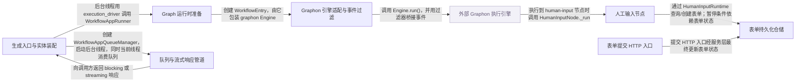

# dify：架构、运行逻辑与设计取舍

> main · [b1d2e2983b7c](https://github.com/langgenius/dify/commit/b1d2e2983b7c1e91dcf87469fe96c9d2e7de4213) · deepseek-flash 辅助分析 · 2026-10-30T05:33:11.336Z
> 下文按固定源码推演，没有执行目标项目。引用可跳到具体代码行；“工程推断”解释收益与代价，不代表作者亲述。

## 1. 先建立直觉

**Dify 让工作流在需要人工填写表单时暂停，把表单和运行状态存下来；用户提交后，系统用保存的状态从人工节点继续执行，并把过程事件推回界面。**

长流程中需要人工审批时，不能一直占着 HTTP 连接或线程等待；页面可能刷新或断开，但运行不能因此丢失，也不能重复提交。

贯穿全文的例子：

- **输入：** 一个工作流含 Start → LLM → HumanInput（表单：审批意见 + 通过/拒绝按钮）→ 结束。用户经 Web App 或 OpenAPI 触发运行，输入 {"topic":"报销"}。
- **预期输出：** 界面先收到 workflow_started、node_started 等事件；到人工节点时收到 human_input_required 和 workflow_paused，展示表单。用户选择“通过”并填写意见后，再次订阅事件流，可能收到 human_input_form_filled，随后节点继续执行并最终收到 workflow_finished。

## 2. 一张图看懂架构



| 模块 | 职责与所在层的原因 | 输入 → 输出 | 拥有的状态 |
| --- | --- | --- | --- |
| 生成入口与实体装配 [1][source-1] [2][source-2] | 接收 API 生成请求，组装 WorkflowAppGenerateEntity、文件、trace、执行仓储，启动后台执行线程。 | App、Workflow、用户、inputs、files、streaming、invoke_from 等。 → WorkflowAppGenerateEntity 和后台线程；当前线程返回 blocking 或 stream 响应。 | 生成 task_id、workflow_run_id、执行实体和仓储实例。 |
| Graph 运行时准备 [3][source-3] [4][source-4] | 构建 VariablePool、系统变量和 graphon RuntimeState，创建 WorkflowEntry 并注入命令通道。 | WorkflowAppGenerateEntity、workflow 图配置、恢复时的 RuntimeState。 → PreparedWorkflowRun（含 WorkflowEntry、workflow_type、workflow_version）。 | 变量池、RuntimeState、command_channel、response_stream_filter。 |
| Graphon 引擎适配与事件过滤 [5][source-5] [6][source-6] | 包装外部 graphon Engine，添加 Dify 的执行上下文、限制层，并用过滤器把引擎事件转成 Dify 可见事件。 | graphon Graph、RuntimeState、CommandChannel。 → EngineEvent 生成器，经 HumanInputFormEventFilter 和 ResponseStreamFilter 过滤。 | ResponseStreamFilter 的 paths_map；暂停时需随状态一起保存。 |
| 人工输入节点 [7][source-7] | 查询或创建表单，根据表单状态发出“需要人工输入”并暂停，或发出“表单已填写”并选择出口边继续。 | node_execution_id、HumanInputNodeData、VariablePool。 → NodeRunHumanInputV2FormRequiredEvent / FormFilledEvent / FormTimeoutEvent，以及 PauseRequestedEvent 或 StreamCompletedEvent。 | 表单状态 WAITING / SUBMITTED / TIMEOUT / EXPIRED；节点输出 inputs、outputs、edge_source_handle。 |
| 表单持久化仓储 [8][source-8] [9][source-9] | 把表单定义、收件人、交付方式和提交结果写入数据库；提交时用行锁防止并发覆盖。 | FormCreateParams、表单 token、提交数据、动作 ID、提交人身份。 → HumanInputFormEntity / HumanInputFormRecord，包含状态、提交数据、动作 ID。 | HumanInputForm 表记录 form_definition、rendered_content、status、submitted_data、selected_action_id、submitted_at 等。 |
| 队列与流式响应管道 [10][source-10] [11][source-11] | 后台工作线程把执行事件放入队列；响应管道监听队列，把事件转成 StreamResponse 并通过 SSE 返回。 | AppQueueEvent（QueueWorkflowStartedEvent、QueueWorkflowPausedEvent 等）。 → WorkflowAppStreamResponse，最终序列化为 SSE 的 dict 或 ping 字符串。 | 队列中的事件流；队列管理器在暂停事件后停止监听。 |
| 表单提交 HTTP 入口 [12][source-12] [13][source-13] | 接收 Web App 或 OpenAPI 的表单提交请求，校验身份和表单归属，调用提交服务。 | form_token、action、inputs、当前 EndUser 或 Account 身份。 → 提交成功响应；OpenAPI 返回后续事件流提示。 | 读取 app 和 end_user 的归属关系；不直接改表单状态，交给服务层与仓储。 |
| 外部 Graphon 执行引擎（外部依赖） [14][source-14] | 执行图节点、处理容器节点、产生节点事件；Dify 通过适配层和过滤器接收事件。 | graphon Graph、RuntimeState、CommandChannel。 → 原始 EngineEvent 流。 | 由 RuntimeState 承载变量池和运行统计；暂停恢复由 Dify 序列化。 |

## 3. 跟着一个请求跑完整条主线

这是对已读方法体的源码推演，不是执行日志。编号是阅读顺序；装配、写入、查询与条件分支是否发生，取决于每步的触发条件。

### 1. 接收生成请求并装配执行实体

**阶段：** 装配

**触发条件：** 必经；用户首次触发工作流

入口/调用：`WorkflowAppGenerator.generate` [1][source-1] [15][source-15] [2][source-2]

**此时输入：** app_model、workflow、user、args（含 inputs、files）、invoke_from、streaming

解析文件、生成 workflow_run_id、准备用户输入、构建 WorkflowAppGenerateEntity，创建 workflow execution 和 node execution 仓储。

**状态变化：** 设置 task_id、workflow_execution_id、extras；文件被解析为 system_files。

**交给下一步：** application_generate_entity 和仓储实例，传给 _generate。

### 2. 启动后台执行线程并创建队列

**阶段：** 初始化

**触发条件：** 必经；streaming 或 blocking 都走 _generate

入口/调用：`WorkflowAppGenerator._generate` [16][source-16]

**此时输入：** application_generate_entity、workflow、仓储、streaming、pause_state_config

创建 WorkflowAppQueueManager；复制 contextvars；关闭当前 DB session 后启动 worker_thread；当前线程调用 _handle_response 消费队列。

**状态变化：** 队列管理器持有 graph_runtime_state，后续由 worker 填充。

**交给下一步：** 后台线程开始执行；当前线程返回响应生成器或 blocking 响应。

### 3. 后台线程构建 Runner 并准备 Graph

**阶段：** 初始化

**触发条件：** 必经；后台线程入口；恢复时额外走 resume_state 分支

入口/调用：`WorkflowAppRunner.prepare` [17][source-17] [3][source-3] [4][source-4]

**此时输入：** WorkflowAppGenerateEntity、workflow、graph_engine_layers、graph_runtime_state（恢复时非空）

新建模式构建系统变量和 VariablePool，把 Start 输入写入变量池，创建 RuntimeState；恢复模式复用已保存的 RuntimeState 和 VariablePool；创建 command_channel，构造 WorkflowEntry。

**状态变化：** RuntimeState.variable_pool 拥有 inputs；command_channel 组合 Redis、StopFlag 和 Celery 信号通道。

**交给下一步：** PreparedWorkflowRun，包含 WorkflowEntry 和 WorkflowType。

### 4. 执行到人工输入节点并准备表单

**阶段：** 执行

**触发条件：** 必经；图执行到达 human-input 节点

入口/调用：`HumanInputNode._run` [18][source-18]

**此时输入：** node_execution_id、HumanInputNodeData、runtime_state.variable_pool

调用 human_input_runtime.prepare_form 查询或创建表单；如果交付失败，节点以 FAILED 完成；否则得到 PreparedForm。

**状态变化：** 可能新建 HumanInputForm 记录，状态为 WAITING；表单定义、收件人、渲染内容被持久化。

**交给下一步：** PreparedForm（含 form 和 form_token），进入状态分支。

### 5. 表单等待，节点请求暂停

**阶段：** 写入/暂停

**触发条件：** prepared.form.status == WAITING

入口/调用：`HumanInputNode._run` [19][source-19]

**此时输入：** PreparedForm，form.status 为 WAITING

先发出 NodeRunHumanInputV2FormRequiredEvent（带表单展示数据），再发出 PauseRequestedEvent，reason 为 HitlRequired，包含 session_id、node_id、node_title。

**状态变化：** graphon 运行时记录暂停原因；Dify 侧不改变表单状态，仍为 WAITING。

**交给下一步：** 暂停事件进入引擎事件流，最终由队列管理器转为 QueueWorkflowPausedEvent。

### 6. 暂停事件经队列转为 SSE 响应并停止监听

**阶段：** 响应桥接

**触发条件：** 队列收到 QueueWorkflowPausedEvent

入口/调用：`WorkflowAppQueueManager._publish / WorkflowAppGenerateTaskPipeline._handle_workflow_paused_event` [10][source-10] [20][source-20]

**此时输入：** AppQueueEvent（暂停事件）

_publish 把事件放入队列，并在 QueueWorkflowPausedEvent 时调用 stop_listen(execution_state=PAUSED)；pipeline 的 _handle_workflow_paused_event 把事件转为 WorkflowPauseStreamResponse。

**状态变化：** 队列停止监听（PAUSED 状态）；pipeline 生成 paused 响应。

**交给下一步：** 前端收到 workflow_paused 事件，连接可以关闭。

### 7. 用户提交表单，状态更新为 SUBMITTED

**阶段：** 写入

**触发条件：** 用户点击提交；表单当前状态为 WAITING

入口/调用：`WebAppHumanInputV2FormApi.post` [12][source-12] [9][source-9]

**此时输入：** form_token、action、inputs、提交人身份

HTTP 入口校验 app 与 end_user 归属后调用提交服务；服务层最终应走仓储的 mark_submitted，在事务内用 with_for_update 锁住表单行，检查状态仍为 WAITING，写入 selected_action_id、submitted_data、submitted_at、status=SUBMITTED 和提交人字段。服务层到仓储的精确调用链未读，见 gaps。

**状态变化：** 表单状态从 WAITING 变为 SUBMITTED；提交数据持久化；并发提交会被 FormAlreadyHandledError 拒绝。

**交给下一步：** 提交成功响应；数据库中的表单可供恢复执行时读取。

### 8. 恢复执行，人工节点读取已提交表单并继续

**阶段：** 执行/恢复

**触发条件：** 暂停状态已持久化，用户再次请求事件流或调用恢复入口

入口/调用：`WorkflowAppGenerator.resume / HumanInputNode._run` [21][source-21] [22][source-22]

**此时输入：** 保存的 WorkflowResumptionContext（generate_entity + serialized_graph_runtime_state）

resume 重建 trace_manager，用恢复的 RuntimeState 调用 _generate；WorkflowAppRunner 走 resume_state 分支复用 variable_pool；WorkflowEntry.run 重新调用 Engine.run()；HumanInputNode._run 再次 prepare_form，读到 status=SUBMITTED。

**状态变化：** 节点输出 completed 状态，edge_source_handle 设为用户选择的 action.id，后续节点继续执行。

**交给下一步：** NodeRunHumanInputV2FormFilledEvent 和 StreamCompletedEvent，工作流继续。

## 4. 核心技术到底是什么

### 1. 外部 Graphon 引擎 + Dify 事件过滤器桥接

**解决的问题：** Dify 需要通用图执行能力，但又要暴露自己的响应顺序和人工输入表单事件。 [5][source-5] [14][source-14]

WorkflowEntry 创建 graphon Engine，调用 engine.run() 得到原始 EngineEvent 流；iter_dify_graph_engine_events 用 filter_engine_events 依次应用 HumanInputFormEventFilter 和 ResponseStreamFilter，把引擎事件转换成 Dify 运行器期望的顺序和格式。

算法示意（用于解释机制，不是源码原文）：

```text
engine = Engine(graph, runtime_state, command_channel)
raw_events = engine.run()
filtered = filter_engine_events(
  raw_events,
  context=EngineEventFilterContext.from_engine(engine),
  filters=[HumanInputFormEventFilter(repo), response_stream_filter or ResponseStreamFilter()]
)
for event in filtered:
  yield event
```

**关键数据结构：** EngineEvent 流；ResponseStreamFilter.paths_map 记录已流出的路径；HumanInputFormEventFilter 通过 HumanInputFormSubmissionRepository 判断表单提交状态。

- **本项目实现：** WorkflowEntry 初始化 Engine 并添加 ExecutionContextLayer、ExecutionLimitsLayer、ObservabilityLayer；iter_dify_graph_engine_events 组合过滤器。
- **外部依赖提供：** graphon.engine.Engine 负责图调度、节点执行、暂停请求的底层处理；Dify 不实现 Engine 内部调度。
- **收益与代价：** 解耦了通用执行与 Dify 语义，但多了一层事件过滤，调试时需要同时看引擎原始事件和过滤后事件。

### 2. 表单状态机与行锁提交

**解决的问题：** 同一表单可能被多人同时打开，提交必须幂等且不能覆盖已处理结果。 [8][source-8] [9][source-9]

表单记录有 WAITING、SUBMITTED、TIMEOUT、EXPIRED 状态。mark_submitted 在事务内用 SELECT ... FOR UPDATE 锁住表单行，只有 status 仍为 WAITING 才写入提交字段；否则抛 FormAlreadyHandledError。创建表单时在事务中写 HumanInputForm、HumanInputDelivery 和 HumanInputFormRecipient。

算法示意（用于解释机制，不是源码原文）：

```text
with session.begin():
  form = session.get(HumanInputForm, form_id, with_for_update=True)
  if form is None: raise FormNotFoundError
  if form.status != WAITING: raise FormAlreadyHandledError
  form.selected_action_id = action_id
  form.submitted_data = json.dumps(form_data)
  form.status = SUBMITTED
  form.submitted_at = now
  session.flush()
  return record(form)
```

**关键数据结构：** HumanInputForm.status 枚举；HumanInputFormRecipient.access_token 用于定位表单；HumanInputForm.submitted_data 为 JSON 字符串。

- **本项目实现：** HumanInputFormRepositoryImpl.create_form 写表单和收件人；HumanInputFormSubmissionRepository.mark_submitted 做状态迁移和并发控制。
- **外部依赖提供：** SQLAlchemy 提供事务和行锁；数据库负责隔离级别和锁实现。
- **收益与代价：** 行锁保证并发安全，但高并发提交同一表单时会有短暂锁等待；状态机简单，但需要所有入口都走同一仓储。

### 3. 暂停状态序列化与恢复上下文

**解决的问题：** HTTP 请求可能断开，不能靠线程驻留等待人工输入；恢复时必须还原变量池和运行位置。 [23][source-23]

PauseStateLayer 把 WorkflowAppGenerateEntity 和 serialized_graph_runtime_state 装入 WorkflowResumptionContext，序列化为 JSON 持久化。恢复时 WorkflowResumptionContext.loads 反序列化，恢复 workflow_execution_timing，WorkflowAppRunner 用恢复的 RuntimeState 重建 graph 和 WorkflowEntry。

算法示意（用于解释机制，不是源码原文）：

```text
context = WorkflowResumptionContext(
  generate_entity=wrapper(entity),
  serialized_graph_runtime_state=state.dumps(),
  elapsed_time=elapsed,
  serialized_response_stream_filter_state=filter.dumps()
)
persist(context.dumps())
# resume
ctx = WorkflowResumptionContext.loads(persisted)
entity = ctx.get_generate_entity()
state = RuntimeState.loads(ctx.serialized_graph_runtime_state)
filter = ctx.get_response_stream_filter()
```

**关键数据结构：** WorkflowResumptionContext.version、generate_entity（带 AppMode 判别）、serialized_graph_runtime_state、serialized_response_stream_filter_state。

- **本项目实现：** PauseStateLayerConfig、WorkflowResumptionContext 的 dumps/loads/get_generate_entity/get_response_stream_filter。
- **外部依赖提供：** graphon.runtime.RuntimeState 提供状态序列化/反序列化；Pydantic 负责 JSON 校验。
- **收益与代价：** 恢复不依赖原线程，支持断开和异步；但序列化格式需要版本兼容，旧快照可能缺少字段，需要降级逻辑。

### 4. 双线程 + 内存队列解耦执行与响应

**解决的问题：** 工作流执行可能很长，不能阻塞 HTTP 请求线程；同时要支持 streaming 和 blocking 两种返回。 [24][source-24] [25][source-25] [10][source-10]

_generate 创建 WorkflowAppQueueManager 和 worker_thread；worker 执行图并把事件放入队列；当前线程通过 _handle_response 调用 pipeline.process() 从队列读取事件，转换成 StreamResponse 并返回。队列管理器在暂停或终止事件后 stop_listen。

算法示意（用于解释机制，不是源码原文）：

```text
queue_manager = WorkflowAppQueueManager(task_id, user_id, invoke_from, app_mode)
thread = threading.Thread(target=_generate_worker, kwargs={...})
thread.start()
response = pipeline.process()  # listens queue_manager.listen()
if streaming: yield from response
else: return blocking_response
```

**关键数据结构：** AppQueueManager 内部 queue.Queue；WorkflowQueueMessage 携带 task_id、app_mode、event。

- **本项目实现：** WorkflowAppQueueManager._publish 把事件封装为 WorkflowQueueMessage；WorkflowAppGenerateTaskPipeline._process_stream_response 监听队列并分发。
- **外部依赖提供：** Python threading 和 queue.Queue；Flask context 通过 contextvars 复制。
- **收益与代价：** 解耦了执行和响应，支持断开后继续执行；但内存队列只在单进程内有效，多 worker 部署时需要 Redis 等跨进程通道。

## 5. 为什么选择这种实现

### 1. 人工输入节点只使用 graphon 的通用节点/事件契约，Dify 表单语义放在 HumanInputRuntime 端口后面。

**作者原文：** “Dify-owned Human Input v2 node; services are supplied through its runtime port. Only the generic graphon node/event contracts are used. Dify form semantics do not pass through HITLCallback. Keep v1 registrations and published runs intact.” [26][source-26]

**面临的约束：** graphon 是通用执行引擎，不应知道 Dify 表单、收件人和审批通道的细节；Dify 又需要保留自己的 v1 注册和已发布运行。

**如果改用另一种做法：** 把 Dify 表单逻辑直接写进 graphon 节点或 HITLCallback，让引擎感知表单字段和收件人。

**为什么当前方案有用：** 这样 graphon 节点只发出 PauseRequestedEvent 和完成事件；Dify 通过 HumanInputNode._run 调用自己的 prepare_form 来创建/读取表单。表单状态、收件人和渲染内容留在 Dify 侧，恢复时 Dify 可以独立演进，不必改引擎。

**付出的代价，以及不适用的情况：** 多一层适配接口；HumanInputRuntime 的实现如果缺失，节点无法真正创建表单。

### 2. 暂停时序列化 RuntimeState 和生成实体，而不是让原线程阻塞等待用户提交。

**依据：已确认实现；以下原因是工程分析，不代表作者亲述。** [23][source-23]

**面临的约束：** 用户可能关闭页面或网络断开；运行器不能无限占用连接和线程。

**如果改用另一种做法：** 在原 HTTP 请求中阻塞等待表单提交，提交后同一线程继续执行。

**为什么当前方案有用：** 如果原线程阻塞，页面刷新或连接超时会导致任务不可恢复；序列化后，提交请求只需更新表单状态，之后 resume 路径用保存的 RuntimeState 重新进入 Engine.run()，从人工节点继续。

**付出的代价，以及不适用的情况：** 需要保证序列化状态和表单状态一致；旧快照缺少字段时要兼容。

### 3. 表单提交使用数据库行锁和 WAITING 状态检查，而不是只依赖前端按钮防重复。

**依据：已确认实现；以下原因是工程分析，不代表作者亲述。** [9][source-9]

**面临的约束：** 同一表单可能被多个收件人同时打开，网络重试也可能重复提交。

**如果改用另一种做法：** 先查表单状态，再直接更新，不加锁。

**为什么当前方案有用：** 两个并发提交可能都读到 WAITING，然后各自写入，后写覆盖先写。mark_submitted 用 with_for_update 锁住行，第二个事务会等第一个提交完成，然后看到状态已不是 WAITING，抛 FormAlreadyHandledError。这样动作和提交数据不会被覆盖。

**付出的代价，以及不适用的情况：** 同一表单高并发提交时会有锁等待；需要数据库支持行锁。

### 4. 生成线程与响应流线程分离，用内存队列传递事件。

**依据：已确认实现；以下原因是工程分析，不代表作者亲述。** [24][source-24] [10][source-10]

**面临的约束：** 工作流执行可能包含长时间 LLM 调用，而 HTTP 响应需要尽快开始流式输出或返回 blocking 结果。

**如果改用另一种做法：** 在请求线程中同步执行图，事件直接 yield。

**为什么当前方案有用：** 同步执行会让请求线程被图执行占用，且 blocking 模式无法提前返回。分离后，worker 线程执行图并把事件放入队列，主线程可以流式读取并立即发给客户端；暂停时队列管理器 stop_listen，主线程结束响应，worker 线程也可以退出，不依赖客户端连接。

**付出的代价，以及不适用的情况：** 内存队列只在单进程内有效；多进程部署需要额外通道，调试时线程切换增加复杂度。

## 6. 关键代码精读

### 1. 后台线程启动与暂停事件的队列桥接


`api/core/app/apps/workflow/app_generator.py:372-403` [24][source-24]

```python
            queue_manager = WorkflowAppQueueManager(
                task_id=application_generate_entity.task_id,
                user_id=application_generate_entity.user_id,
                invoke_from=application_generate_entity.invoke_from,
                app_mode=app_model.mode,
            )

            # new thread with request context and contextvars
            context = contextvars.copy_context()

            # release database connection, because the following new thread operations may take a long time
            db.session.close()

            worker_thread = threading.Thread(
                target=self._generate_worker,
                kwargs={
                    "flask_app": current_app._get_current_object(),  # type: ignore
                    "application_generate_entity": application_generate_entity,
                    "queue_manager": queue_manager,
                    "context": context,
                    "variable_loader": variable_loader,
                    "root_node_id": root_node_id,
                    "workflow_execution_repository": workflow_execution_repository,
                    "workflow_node_execution_repository": workflow_node_execution_repository,
                    "graph_engine_layers": graph_engine_layers,
                    "pause_state_config": pause_state_config,
                    "graph_runtime_state": graph_runtime_state,
                    "response_stream_filter": response_stream_filter,
                },
            )

            worker_thread.start()
```


`api/core/app/apps/workflow/app_queue_manager.py:33-38` [27][source-27]

```python
        message = WorkflowQueueMessage(task_id=self._task_id, app_mode=self._app_mode, event=event)

        self._q.put(message)

        if isinstance(event, QueueWorkflowPausedEvent):
            self.stop_listen(execution_state=AppExecutionState.PAUSED)
```


`api/core/app/apps/workflow/generate_task_pipeline.py:699-721` [28][source-28]

```python
        for queue_message in self._base_task_pipeline.queue_manager.listen():
            event = queue_message.event

            match event:
                case QueueWorkflowStartedEvent():
                    self._resolve_graph_runtime_state()
                    yield from self._handle_workflow_started_event(event)

                case QueueTextChunkEvent():
                    yield from self._handle_text_chunk_event(
                        event, tts_publisher=tts_publisher, queue_message=queue_message
                    )

                case QueueErrorEvent():
                    yield from self._handle_error_event(event)
                    break

                case QueueWorkflowFailedEvent():
                    yield from self._handle_workflow_failed_and_stop_events(event)
                    break
                case QueueWorkflowPausedEvent():
                    yield from self._handle_workflow_paused_event(event)
                    break
```


_generate 在 372-377 创建 WorkflowAppQueueManager，380-403 复制 contextvars、关闭当前 DB session 并启动 worker_thread；worker 线程随后进入 _generate_worker 执行图。队列管理器的 _publish 在 33-35 把事件封装成 WorkflowQueueMessage 放入队列，37-38 在收到 QueueWorkflowPausedEvent 时调用 stop_listen(PAUSED)。当前线程的 pipeline 在 699 监听队列，719-721 遇到 QueueWorkflowPausedEvent 时产出暂停响应并 break，因此前端收到 workflow_paused，而提交表单后由持久状态恢复，不依赖这个连接继续存在。

### 2. HumanInputNode 如何从等待切到完成


`api/core/workflow/nodes/human_input_v2/node.py:62-155` [7][source-7]

```python
    def _run(self) -> Generator[NodeEventPayload | NodeEvent]:
        """Consume persisted form outcomes; only completion events select edges."""
        try:
            prepared = self._human_input_runtime.prepare_form(
                node_execution_id=self.execution_id,
                node_data=self.node_data,
                variable_pool=self.runtime_state.variable_pool,
            )
        except HumanInputDeliveryError as error:
            yield StreamCompletedEvent(
                node_run_result=NodeRunResult(
                    status=WorkflowNodeExecutionStatus.FAILED,
                    error=str(error),
                    error_type=type(error).__name__,
                )
            )
            return

        form = prepared.form
        resolved = form.resolved_form
        match form.status:
            case HumanInputFormStatus.WAITING:
                # Keep the live Dify presentation separate from graphon's persisted
                # pause reason, which carries only the reference needed to resume.
                yield NodeRunHumanInputV2FormRequiredEvent(
                    id=self.execution_id,
                    node_id=self.id,
                    node_type=self.node_type,
                    node_version=self.version(),
                    prepared_form=prepared,
                )
                yield PauseRequestedEvent(
                    reason=HitlRequired(
                        session_id=default_session_binding.issue_session_id_for_form(
                            node_version=self.version(), form_id=form.id
                        ),
                        node_id=self.id,
                        node_title=resolved.title,
                    )
                )
            case HumanInputFormStatus.SUBMITTED:
                submission = form.submission
                assert submission is not None, "Submitted form must contain its accepted submission"
                action = next(action for action in resolved.actions if action.id == submission.selected_action_id)
                inputs = submission.normalized_submission_data
                content = render_filled_content(resolved, inputs)
                yield NodeRunHumanInputV2FormFilledEvent(
                    id=self.execution_id,
                    node_id=self.id,
                    node_type=self.node_type,
                    node_version=self.version(),
                    form_id=form.id,
                    node_title=resolved.title,
                    action_id=action.id,
                    action_text=action.title,
                    submitted_data=inputs,
                    rendered_content=content,
                )
                outputs = dict(inputs)
                outputs.update(_special_outputs(action.id, action.title, content))
                yield StreamCompletedEvent(
                    node_run_result=NodeRunResult(
                        status=WorkflowNodeExecutionStatus.SUCCEEDED,
                        inputs=inputs,
                        outputs=outputs,
                        edge_source_handle=action.id,
                    )
                )
            case HumanInputFormStatus.TIMEOUT:
                yield NodeRunHumanInputV2FormTimeoutEvent(
                    id=self.execution_id,
                    node_id=self.id,
                    node_type=self.node_type,
                    node_version=self.version(),
                    form_id=form.id,
                    node_title=resolved.title,
                    expiration_time=form.expiration_time,
                )
                yield StreamCompletedEvent(
                    node_run_result=NodeRunResult(
                        status=WorkflowNodeExecutionStatus.SUCCEEDED,
                        outputs=_special_outputs("", "", resolved.legacy_form_content),
                        edge_source_handle="__timeout",
                    )
                )
            case HumanInputFormStatus.EXPIRED:
                # A node failure can take an error branch. Global expiration must
                # stop the graph itself, without dispatching a completion event.
                self.runtime_state.graph_execution.abort(f"Human input form globally expired: {form.id}")
            case _:
                assert_never(form.status)

    @classmethod
    @override
```


HumanInputNode._run 先调用 prepare_form 得到 PreparedForm。如果 status 是 WAITING，它发出 NodeRunHumanInputV2FormRequiredEvent 和 PauseRequestedEvent，graphon 记录暂停原因后停止推进。用户提交后，表单状态变为 SUBMITTED。恢复执行时再次进入 _run，prepare_form 读到 SUBMITTED；节点从 resolved.actions 中按 selected_action_id 找到动作，渲染已填内容，发出 FormFilledEvent，并构造 NodeRunResult，status=SUCCEEDED，edge_source_handle=action.id。这个 handle 决定后续走哪条分支。

### 3. Graphon 事件如何被 Dify 过滤


`api/core/workflow/workflow_entry.py:73-98` [5][source-5]

```python
def iter_dify_graph_engine_events(
    engine: Engine,
    response_stream_filter: ResponseStreamFilter | None = None,
) -> Generator[EngineEvent]:
    """
    Apply Dify's response streaming compatibility filter to Engine events.

    Graphon emits raw variable stream chunks and requires callers to opt
    into the legacy response-ordered stream behavior that Dify exposes to its
    workflow runners and tests.

    ``response_stream_filter``, when supplied, must be the same instance a
    caller intends to persist on pause (see ``WorkflowRunAgg``) so
    the filter's ``paths_map`` reflects everything the engine has actually
    streamed for this run.
    """
    yield from filter_engine_events(
        engine.run(),
        context=EngineEventFilterContext.from_engine(engine),
        filters=[
            HumanInputFormEventFilter(form_repository=HumanInputFormSubmissionRepository()),
            response_stream_filter or ResponseStreamFilter(),
        ],
    )


```


`api/core/workflow/workflow_entry.py:208-218` [6][source-6]

```python
    def run(self) -> Generator[EngineEvent]:
        try:
            yield from iter_dify_graph_engine_events(self.graph_engine, self._response_stream_filter)
        except GenerateTaskStoppedError:
            pass
        except Exception as e:
            logger.exception("Unknown Error when workflow entry running")
            yield GraphRunFailedEvent(error=str(e))
            return

    @classmethod
```


WorkflowEntry.run 调用 iter_dify_graph_engine_events，后者把 engine.run() 的原始事件送入 filter_engine_events。过滤器列表包含 HumanInputFormEventFilter（用 HumanInputFormSubmissionRepository 判断表单是否已提交/超时）和 ResponseStreamFilter（保持 Dify 旧有的响应顺序）。这样 HumanInputNode 发出的表单事件不会被引擎直接暴露，而是经过 Dify 的过滤逻辑后再进入队列和 SSE。暂停时 ResponseStreamFilter 的 paths_map 也要随恢复上下文保存，否则恢复后可能重复输出已流过的文本。

## 7. 动手验证你的理解

以下是建议实验，没有执行过。

### 1. 如果移除 HumanInputFormEventFilter，人工表单事件会怎样？

**改变什么：** 把 iter_dify_graph_engine_events 中的 filters 列表改成只保留 ResponseStreamFilter，去掉 HumanInputFormEventFilter。 [29][source-29]

**应该观察到什么：** HumanInputNode 发出的表单事件仍会经过 ResponseStreamFilter，但不会经过 Dify 的表单提交状态过滤；恢复执行时可能无法根据已提交/超时状态正确转换事件，前端可能看不到 human_input_form_filled 或 timeout 的事件形态。

### 2. 如果 mark_submitted 去掉 with_for_update，并发提交会怎样？

**改变什么：** 把 HumanInputFormSubmissionRepository.mark_submitted 中 session.get(HumanInputForm, form_id, with_for_update=True) 改为普通 get。 [30][source-30]

**应该观察到什么：** 两个并发提交可能同时读到 WAITING，然后都通过状态检查并先后写入；后一个会覆盖前一个的 selected_action_id 和 submitted_data，破坏“只处理一次”的语义。

### 3. 如果暂停时不保存 serialized_response_stream_filter_state，恢复后有什么差异？

**改变什么：** 在 WorkflowResumptionContext 构造时把 serialized_response_stream_filter_state 置为 None。 [31][source-31]

**应该观察到什么：** 恢复时 get_response_stream_filter 返回全新的 ResponseStreamFilter，paths_map 为空；已经流出过的文本路径可能被重新输出，导致客户端看到重复的文本块。

## 8. 读完应当能复述什么

- Dify 把图执行交给外部 graphon 引擎，自己负责表单状态、暂停恢复上下文和事件过滤；两者通过 NodeEvent、PauseRequestedEvent 和过滤器边界连接。
- 人工输入的暂停不是线程阻塞，而是发出暂停事件并把 RuntimeState 与表单状态持久化；提交后由新的请求恢复执行，因此页面断开不等于取消远端任务，但暂停时执行线程停止，不是在后台继续跑。
- 表单提交必须走带行锁和状态检查的仓储；WAITING → SUBMITTED 是单向状态迁移，保证并发提交不会覆盖结果。
- SSE/队列负责把执行事件实时送到界面；内存队列只解决单进程内的执行与响应解耦，跨进程或断线重连依赖持久状态和事件重放。
- 恢复执行的关键是人工节点再次进入 _run 时能从仓储读到 SUBMITTED，并用 action.id 作为 edge_source_handle 选择出口分支。

## 来源与覆盖边界

本次读取 24 个文件，共 246,631 字符；24 个文件完整读取，其他文件按关键方法取带行号的片段。没有把未读依赖的内部实现当作已确认事实。

- 已读代码没有展示 graphon Engine 在收到 PauseRequestedEvent 后如何把暂停状态写回 RuntimeState 并结束 Engine.run()；只能确认 Dify 侧发出了暂停事件。
- HumanInputRuntime 是 Protocol，已读文件没有其具体实现；prepare_form 如何创建表单、投递通知、处理交付失败的上层实现不在已读范围内。
- WorkflowAppGenerator.resume 的调用方不在已读文件中；WorkflowEventsApi 使用 MessageGenerator.retrieve_events 或 build_workflow_event_stream 触发恢复的具体路径未读。
- WebAppHumanInputV2FormApi.post 和 OpenApiWorkflowHumanInputFormSubmitApi.post 调用的 HumanInputService / HumanInputSubmissionService 源码未读，服务层到 mark_submitted 的精确调用链无法从已读代码确认。
- PauseStateLayer 的完整实现只有 WorkflowResumptionContext 和 PauseStateLayerConfig，实际层如何拦截暂停并写库的代码未读。

| 文件 | 实际读取行段 |
| --- | --- |
| [README.md](https://github.com/langgenius/dify/blob/b1d2e2983b7c1e91dcf87469fe96c9d2e7de4213/README.md) | 1–173 / 共 173 行 |
| [package.json](https://github.com/langgenius/dify/blob/b1d2e2983b7c1e91dcf87469fe96c9d2e7de4213/package.json) | 1–43 / 共 43 行 |
| [api/core/app/apps/workflow/app_generator.py](https://github.com/langgenius/dify/blob/b1d2e2983b7c1e91dcf87469fe96c9d2e7de4213/api/core/app/apps/workflow/app_generator.py) | 1–753 / 共 753 行 |
| [api/core/app/apps/workflow/app_runner.py](https://github.com/langgenius/dify/blob/b1d2e2983b7c1e91dcf87469fe96c9d2e7de4213/api/core/app/apps/workflow/app_runner.py) | 1–194 / 共 194 行 |
| [api/core/workflow/workflow_entry.py](https://github.com/langgenius/dify/blob/b1d2e2983b7c1e91dcf87469fe96c9d2e7de4213/api/core/workflow/workflow_entry.py) | 1–652 / 共 652 行 |
| [api/core/app/apps/workflow/generate_task_pipeline.py](https://github.com/langgenius/dify/blob/b1d2e2983b7c1e91dcf87469fe96c9d2e7de4213/api/core/app/apps/workflow/generate_task_pipeline.py) | 1–793 / 共 793 行 |
| [api/core/app/apps/workflow/app_queue_manager.py](https://github.com/langgenius/dify/blob/b1d2e2983b7c1e91dcf87469fe96c9d2e7de4213/api/core/app/apps/workflow/app_queue_manager.py) | 1–49 / 共 49 行 |
| [api/core/workflow/nodes/human_input_v2/node.py](https://github.com/langgenius/dify/blob/b1d2e2983b7c1e91dcf87469fe96c9d2e7de4213/api/core/workflow/nodes/human_input_v2/node.py) | 1–190 / 共 190 行 |
| [api/controllers/console/app/workflow_human_input_v2.py](https://github.com/langgenius/dify/blob/b1d2e2983b7c1e91dcf87469fe96c9d2e7de4213/api/controllers/console/app/workflow_human_input_v2.py) | 1–91 / 共 91 行 |
| [api/core/app/apps/workflow/generate_response_converter.py](https://github.com/langgenius/dify/blob/b1d2e2983b7c1e91dcf87469fe96c9d2e7de4213/api/core/app/apps/workflow/generate_response_converter.py) | 1–117 / 共 117 行 |
| [api/core/workflow/nodes/human_input_v2/runtime.py](https://github.com/langgenius/dify/blob/b1d2e2983b7c1e91dcf87469fe96c9d2e7de4213/api/core/workflow/nodes/human_input_v2/runtime.py) | 1–86 / 共 86 行 |
| [api/core/workflow/nodes/human_input_v2/form_compiler.py](https://github.com/langgenius/dify/blob/b1d2e2983b7c1e91dcf87469fe96c9d2e7de4213/api/core/workflow/nodes/human_input_v2/form_compiler.py) | 1–170 / 共 170 行 |
| [api/core/workflow/nodes/human_input_v2/entities.py](https://github.com/langgenius/dify/blob/b1d2e2983b7c1e91dcf87469fe96c9d2e7de4213/api/core/workflow/nodes/human_input_v2/entities.py) | 1–124 / 共 124 行 |
| [api/core/repositories/human_input_repository.py](https://github.com/langgenius/dify/blob/b1d2e2983b7c1e91dcf87469fe96c9d2e7de4213/api/core/repositories/human_input_repository.py) | 1–766 / 共 766 行 |
| [api/core/app/layers/pause_state_persist_layer.py](https://github.com/langgenius/dify/blob/b1d2e2983b7c1e91dcf87469fe96c9d2e7de4213/api/core/app/layers/pause_state_persist_layer.py) | 1–92 / 共 92 行 |
| [api/controllers/web/human_input_v2.py](https://github.com/langgenius/dify/blob/b1d2e2983b7c1e91dcf87469fe96c9d2e7de4213/api/controllers/web/human_input_v2.py) | 1–121 / 共 121 行 |
| [api/controllers/openapi/human_input_form.py](https://github.com/langgenius/dify/blob/b1d2e2983b7c1e91dcf87469fe96c9d2e7de4213/api/controllers/openapi/human_input_form.py) | 1–246 / 共 246 行 |
| [api/controllers/web/workflow_events.py](https://github.com/langgenius/dify/blob/b1d2e2983b7c1e91dcf87469fe96c9d2e7de4213/api/controllers/web/workflow_events.py) | 1–123 / 共 123 行 |
| [api/core/app/entities/task_entities.py](https://github.com/langgenius/dify/blob/b1d2e2983b7c1e91dcf87469fe96c9d2e7de4213/api/core/app/entities/task_entities.py) | 1–972 / 共 972 行 |
| [api/core/workflow/human_input_adapter.py](https://github.com/langgenius/dify/blob/b1d2e2983b7c1e91dcf87469fe96c9d2e7de4213/api/core/workflow/human_input_adapter.py) | 1–474 / 共 474 行 |
| [api/configs/__init__.py](https://github.com/langgenius/dify/blob/b1d2e2983b7c1e91dcf87469fe96c9d2e7de4213/api/configs/__init__.py) | 1–4 / 共 4 行 |
| [api/core/app/app_config/features/file_upload/manager.py](https://github.com/langgenius/dify/blob/b1d2e2983b7c1e91dcf87469fe96c9d2e7de4213/api/core/app/app_config/features/file_upload/manager.py) | 1–44 / 共 44 行 |
| [api/core/app/apps/workflow/active_workflow_tasks.py](https://github.com/langgenius/dify/blob/b1d2e2983b7c1e91dcf87469fe96c9d2e7de4213/api/core/app/apps/workflow/active_workflow_tasks.py) | 1–39 / 共 39 行 |
| [api/core/app/apps/workflow/app_config_manager.py](https://github.com/langgenius/dify/blob/b1d2e2983b7c1e91dcf87469fe96c9d2e7de4213/api/core/app/apps/workflow/app_config_manager.py) | 1–68 / 共 68 行 |

[source-1]: https://github.com/langgenius/dify/blob/b1d2e2983b7c1e91dcf87469fe96c9d2e7de4213/api/core/app/apps/workflow/app_generator.py#L176-L224 "api/core/app/apps/workflow/app_generator.py:176-224"
[source-2]: https://github.com/langgenius/dify/blob/b1d2e2983b7c1e91dcf87469fe96c9d2e7de4213/api/core/app/apps/workflow/app_generator.py#L258-L286 "api/core/app/apps/workflow/app_generator.py:258-286"
[source-3]: https://github.com/langgenius/dify/blob/b1d2e2983b7c1e91dcf87469fe96c9d2e7de4213/api/core/app/apps/workflow/app_runner.py#L111-L157 "api/core/app/apps/workflow/app_runner.py:111-157"
[source-4]: https://github.com/langgenius/dify/blob/b1d2e2983b7c1e91dcf87469fe96c9d2e7de4213/api/core/app/apps/workflow/app_runner.py#L159-L193 "api/core/app/apps/workflow/app_runner.py:159-193"
[source-5]: https://github.com/langgenius/dify/blob/b1d2e2983b7c1e91dcf87469fe96c9d2e7de4213/api/core/workflow/workflow_entry.py#L73-L98 "api/core/workflow/workflow_entry.py:73-98"
[source-6]: https://github.com/langgenius/dify/blob/b1d2e2983b7c1e91dcf87469fe96c9d2e7de4213/api/core/workflow/workflow_entry.py#L208-L218 "api/core/workflow/workflow_entry.py:208-218"
[source-7]: https://github.com/langgenius/dify/blob/b1d2e2983b7c1e91dcf87469fe96c9d2e7de4213/api/core/workflow/nodes/human_input_v2/node.py#L62-L155 "api/core/workflow/nodes/human_input_v2/node.py:62-155"
[source-8]: https://github.com/langgenius/dify/blob/b1d2e2983b7c1e91dcf87469fe96c9d2e7de4213/api/core/repositories/human_input_repository.py#L502-L539 "api/core/repositories/human_input_repository.py:502-539"
[source-9]: https://github.com/langgenius/dify/blob/b1d2e2983b7c1e91dcf87469fe96c9d2e7de4213/api/core/repositories/human_input_repository.py#L697-L731 "api/core/repositories/human_input_repository.py:697-731"
[source-10]: https://github.com/langgenius/dify/blob/b1d2e2983b7c1e91dcf87469fe96c9d2e7de4213/api/core/app/apps/workflow/app_queue_manager.py#L26-L49 "api/core/app/apps/workflow/app_queue_manager.py:26-49"
[source-11]: https://github.com/langgenius/dify/blob/b1d2e2983b7c1e91dcf87469fe96c9d2e7de4213/api/core/app/apps/workflow/generate_task_pipeline.py#L690-L738 "api/core/app/apps/workflow/generate_task_pipeline.py:690-738"
[source-12]: https://github.com/langgenius/dify/blob/b1d2e2983b7c1e91dcf87469fe96c9d2e7de4213/api/controllers/web/human_input_v2.py#L111-L121 "api/controllers/web/human_input_v2.py:111-121"
[source-13]: https://github.com/langgenius/dify/blob/b1d2e2983b7c1e91dcf87469fe96c9d2e7de4213/api/controllers/openapi/human_input_form.py#L165-L217 "api/controllers/openapi/human_input_form.py:165-217"
[source-14]: https://github.com/langgenius/dify/blob/b1d2e2983b7c1e91dcf87469fe96c9d2e7de4213/api/core/workflow/workflow_entry.py#L159-L187 "api/core/workflow/workflow_entry.py:159-187"
[source-15]: https://github.com/langgenius/dify/blob/b1d2e2983b7c1e91dcf87469fe96c9d2e7de4213/api/core/app/apps/workflow/app_generator.py#L226-L241 "api/core/app/apps/workflow/app_generator.py:226-241"
[source-16]: https://github.com/langgenius/dify/blob/b1d2e2983b7c1e91dcf87469fe96c9d2e7de4213/api/core/app/apps/workflow/app_generator.py#L335-L433 "api/core/app/apps/workflow/app_generator.py:335-433"
[source-17]: https://github.com/langgenius/dify/blob/b1d2e2983b7c1e91dcf87469fe96c9d2e7de4213/api/core/app/apps/workflow/app_runner.py#L84-L101 "api/core/app/apps/workflow/app_runner.py:84-101"
[source-18]: https://github.com/langgenius/dify/blob/b1d2e2983b7c1e91dcf87469fe96c9d2e7de4213/api/core/workflow/nodes/human_input_v2/node.py#L62-L82 "api/core/workflow/nodes/human_input_v2/node.py:62-82"
[source-19]: https://github.com/langgenius/dify/blob/b1d2e2983b7c1e91dcf87469fe96c9d2e7de4213/api/core/workflow/nodes/human_input_v2/node.py#L82-L101 "api/core/workflow/nodes/human_input_v2/node.py:82-101"
[source-20]: https://github.com/langgenius/dify/blob/b1d2e2983b7c1e91dcf87469fe96c9d2e7de4213/api/core/app/apps/workflow/generate_task_pipeline.py#L508-L522 "api/core/app/apps/workflow/generate_task_pipeline.py:508-522"
[source-21]: https://github.com/langgenius/dify/blob/b1d2e2983b7c1e91dcf87469fe96c9d2e7de4213/api/core/app/apps/workflow/app_generator.py#L288-L333 "api/core/app/apps/workflow/app_generator.py:288-333"
[source-22]: https://github.com/langgenius/dify/blob/b1d2e2983b7c1e91dcf87469fe96c9d2e7de4213/api/core/workflow/nodes/human_input_v2/node.py#L102-L129 "api/core/workflow/nodes/human_input_v2/node.py:102-129"
[source-23]: https://github.com/langgenius/dify/blob/b1d2e2983b7c1e91dcf87469fe96c9d2e7de4213/api/core/app/layers/pause_state_persist_layer.py#L51-L92 "api/core/app/layers/pause_state_persist_layer.py:51-92"
[source-24]: https://github.com/langgenius/dify/blob/b1d2e2983b7c1e91dcf87469fe96c9d2e7de4213/api/core/app/apps/workflow/app_generator.py#L372-L403 "api/core/app/apps/workflow/app_generator.py:372-403"
[source-25]: https://github.com/langgenius/dify/blob/b1d2e2983b7c1e91dcf87469fe96c9d2e7de4213/api/core/app/apps/workflow/app_generator.py#L411-L422 "api/core/app/apps/workflow/app_generator.py:411-422"
[source-26]: https://github.com/langgenius/dify/blob/b1d2e2983b7c1e91dcf87469fe96c9d2e7de4213/api/core/workflow/nodes/human_input_v2/node.py#L1-L5 "api/core/workflow/nodes/human_input_v2/node.py:1-5"
[source-27]: https://github.com/langgenius/dify/blob/b1d2e2983b7c1e91dcf87469fe96c9d2e7de4213/api/core/app/apps/workflow/app_queue_manager.py#L33-L38 "api/core/app/apps/workflow/app_queue_manager.py:33-38"
[source-28]: https://github.com/langgenius/dify/blob/b1d2e2983b7c1e91dcf87469fe96c9d2e7de4213/api/core/app/apps/workflow/generate_task_pipeline.py#L699-L721 "api/core/app/apps/workflow/generate_task_pipeline.py:699-721"
[source-29]: https://github.com/langgenius/dify/blob/b1d2e2983b7c1e91dcf87469fe96c9d2e7de4213/api/core/workflow/workflow_entry.py#L89-L96 "api/core/workflow/workflow_entry.py:89-96"
[source-30]: https://github.com/langgenius/dify/blob/b1d2e2983b7c1e91dcf87469fe96c9d2e7de4213/api/core/repositories/human_input_repository.py#L707-L712 "api/core/repositories/human_input_repository.py:707-712"
[source-31]: https://github.com/langgenius/dify/blob/b1d2e2983b7c1e91dcf87469fe96c9d2e7de4213/api/core/app/layers/pause_state_persist_layer.py#L79-L86 "api/core/app/layers/pause_state_persist_layer.py:79-86"
