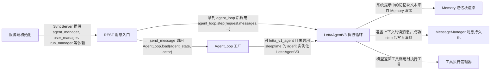

# letta：架构、运行逻辑与设计取舍

> archive · [56ba9c255526](https://github.com/letta-ai/letta/commit/56ba9c25552605eec89de8ed3dc6394b625c1993) · deepseek-flash 辅助分析 · 2026-10-30T05:33:11.336Z
> 下文按固定源码推演，没有执行目标项目。引用可跳到具体代码行；“工程推断”解释收益与代价，不代表作者亲述。

## 1. 先建立直觉

**它把 agent 的记忆拆成可编辑的记忆块和消息缓冲，每次请求重新组装成上下文，让模型调用工具，再根据工具结果决定是否继续下一轮。**

如果只保存一大段聊天记录，模型很难稳定地区分长期事实、当前上下文、工具结果和可编辑记忆；同时多步工具调用需要明确的停止条件和持久化边界。

贯穿全文的例子：

- **输入：** 向一个 agent_type=letta_v1_agent、enable_sleeptime=false 的 agent 发送一条普通用户消息，例如“帮我记住：我对花生过敏”，请求未启用流式，也未指定审批工具。
- **预期输出：** 推演结果是一个 LettaResponse：messages 中包含本轮产生的 assistant/tool 消息，stop_reason 可能是 end_turn、max_steps 或 tool_rule（取决于模型是否调用工具以及工具规则），usage 累计本轮 LLM 用量；如果模型选择调用记忆工具并成功，记忆块值会被修改并在成功 step 后持久化。

## 2. 一张图看懂架构



| 模块 | 职责与所在层的原因 | 输入 → 输出 | 拥有的状态 |
| --- | --- | --- | --- |
| REST 消息入口 [1][source-1] | 接收 HTTP 消息请求，取 actor 和 agent 状态，创建/标记 run，然后把真正的执行交给 AgentLoop；它位于协议层，不直接实现记忆算法。 | LettaStreamingRequest、agent_id、headers → agent_state、request.messages、run_id 以及 AgentLoop.step 的结果 | 创建 run、写入 Redis run_id，并在 finally 中更新 run 状态 |
| AgentLoop 工厂 [2][source-2] | 根据 agent_type、enable_sleeptime 和 multi_agent_group 选择不同的执行循环，避免所有 agent 类型共用一套控制流。 | AgentState、actor → LettaAgentV3、LettaAgentV2 或 sleeptime 多智能体组 | 无持久状态，只做选择 |
| LettaAgentV3 执行循环 [3][source-3] [4][source-4] [5][source-5] | 负责准备上下文、循环调用 LLM adapter、收集工具调用、决定是否继续、写入消息和返回 LettaResponse。 | input_messages、max_steps、run_id、conversation_id、client_tools → LettaResponse，以及写入后的 in-context messages | self.in_context_messages、self.response_messages、self.usage、self.stop_reason、self.should_continue |
| Memory 记忆块渲染 [6][source-6] [7][source-7] | 把 blocks 渲染成 system prompt 中可以给模型阅读和编辑的 XML 片段；它不负责消息表，只负责上下文记忆的文本表示。 | Memory.blocks、agent_type、llm_config、sources → 包含 memory_blocks、tool_usage_rules、directories 的字符串 | blocks 的值、描述、limit 和 read_only 等字段 |
| MessageManager 消息持久化 [8][source-8] [9][source-9] [10][source-10] | 按 ID 读取 in-context 消息，创建新消息，向消息表写入并在写入前后做顺序恢复和去重辅助。 | message_ids、Pydantic Message 列表、actor → 按请求顺序返回的 Message 列表，以及持久化后的消息 | messages 表以及消息的 sequence_id/run_id/step_id 等字段 |
| 工具执行管理器 [11][source-11] [12][source-12] | 根据 ToolType 选择具体 executor，执行工具，把异常转成 ToolExecutionResult，并截断过长的返回值。 | function_name、function_args、Tool、agent_state → ToolExecutionResult | 工具自身的副作用由具体 executor 负责；管理器记录状态和指标 |
| 服务端初始化 [13][source-13] | 启动时创建默认组织/用户、同步 provider 和 base tools、准备 sandbox 配置，为后续请求提供数据库和工具依赖。 | 环境配置、数据库、tool_settings → 默认用户、provider/tools 记录、sandbox 配置 | 数据库中的组织、用户、provider、tool、sandbox 记录 |

## 3. 跟着一个请求跑完整条主线

这是对已读方法体的源码推演，不是执行日志。编号是阅读顺序；装配、写入、查询与条件分支是否发生，取决于每步的触发条件。

### 1. REST 入口接收并准备一次运行

**阶段：** 装配

**触发条件：** 必经；请求 messages 非空且通过 streaming 参数校验

入口/调用：`send_message` [1][source-1]

**此时输入：** HTTP 请求中的 agent_id、LettaStreamingRequest、headers

取 actor 和 agent，按需覆盖模型，创建 run 并把 run_id 写入 Redis，然后构造 AgentLoop

**状态变化：** 创建 Run 记录；Redis 写入 {REDIS_RUN_ID_PREFIX}:{agent_id}

**交给下一步：** agent_state、request.messages、run_id、agent_loop

### 2. 工厂选择执行循环

**阶段：** 装配

**触发条件：** agent_type 属于 letta_v1_agent/sleeptime_agent 且 enable_sleeptime=False 时返回 LettaAgentV3；否则可能返回 V2 或多智能体组

入口/调用：`AgentLoop.load` [2][source-2]

**此时输入：** agent_state、actor

检查 agent_type、enable_sleeptime、multi_agent_group，选择具体执行类

**状态变化：** 无

**交给下一步：** LettaAgentV3 或 LettaAgentV2 等 BaseAgentV2 实例

### 3. 准备当前上下文和本次新输入

**阶段：** 查询/初始化

**触发条件：** 必经；conversation_id 为空时从 agent_state.message_ids 读取

入口/调用：`LettaAgentV3.step / _prepare_in_context_messages_no_persist_async` [3][source-3] [14][source-14] [15][source-15]

**此时输入：** input_messages、agent_state、message_manager、actor

如果 message_buffer_autoclear=True 只取 message_ids[0] 的系统消息；否则按 message_ids 取完整上下文。然后把新用户输入转成 new_in_context_messages，但此时不立即持久化这些新消息

**状态变化：** self.in_context_messages=curr_in_context_messages；input_messages_to_persist 暂存新消息

**交给下一步：** curr_in_context_messages + input_messages_to_persist

### 4. 一轮循环中构造 LLM 请求并调用模型

**阶段：** 生成

**触发条件：** 必经；每轮受 max_steps 限制

入口/调用：`LettaAgentV3._step` [16][source-16] [17][source-17]

**此时输入：** self.in_context_messages + input_messages_to_persist、valid_tools、active_llm_config

刷新消息，计算有效工具和是否强制工具调用，生成 request_system_prompt，调用 llm_adapter.invoke_llm 并消费其返回 chunk

**状态变化：** step_id、step_metrics、llm_adapter.usage 等本轮状态被更新

**交给下一步：** LLM 响应、tool_calls、content、usage

### 5. 处理模型响应并生成本轮消息

**阶段：** 写入前处理

**触发条件：** 必经；模型可能返回工具调用、纯内容或不返回工具调用

入口/调用：`LettaAgentV3._step` [18][source-18]

**此时输入：** llm_adapter.tool_calls、llm_adapter.content、valid_tool_names

收集 tool_calls，按 parallel_tool_calls 配置截断并行调用，然后调用 _handle_ai_response 生成 new_messages；把这些消息追加到 self.response_messages 和当前 messages

**状态变化：** self.response_messages 和局部 messages 增加新消息

**交给下一步：** new_messages，以及更新后的 in-context messages 列表

### 6. 执行工具或生成审批请求

**阶段：** 执行

**触发条件：** 模型返回了工具调用且工具不需要审批、也不被工具规则拦截时，才实际调用 executor

入口/调用：`ToolExecutionManager.execute_tool_async / ToolExecutorFactory.get_executor` [19][source-19] [12][source-12]

**此时输入：** function_name、function_args、Tool、agent_state、sandbox_env_vars

按 tool.tool_type 从映射中选择 executor，执行工具，捕获异常并转换成 ToolExecutionResult，超长返回值用 FUNCTION_RETURN_VALUE_TRUNCATED 截断

**状态变化：** 工具自身可能修改记忆块、消息、文件等；管理器记录执行指标

**交给下一步：** ToolExecutionResult，其中包含 func_return、status、stderr 等

### 7. 成功 step 后 checkpoint 消息

**阶段：** 写入

**触发条件：** 本轮 _step 正常完成；发生异常时注释明确不持久化消息

入口/调用：`LettaAgentV3._step` [20][source-20] [21][source-21]

**此时输入：** input_messages_to_persist + new_messages、in_context_messages

更新 step 状态后调用 _checkpoint_messages 保存本轮消息和新的 in-context messages；随后根据 include_return_message_types 产出本轮可见消息

**状态变化：** 消息表新增记录；in-context 列表被 checkpoint 保存

**交给下一步：** 已 checkpoint 的消息和本轮 yield 的消息

### 8. 检查是否继续下一轮或结束

**阶段：** 决策/返回

**触发条件：** self.should_continue=True 且未到 max_steps 时继续；否则跳出并构造响应

入口/调用：`LettaAgentV3.step` [4][source-4] [22][source-22] [5][source-5]

**此时输入：** self.should_continue、self.stop_reason、self.response_messages、self.usage

如果 should_continue 为 false 则 break；如果达到 max_steps 且没有 stop_reason 则设为 max_steps；循环结束后把 response_messages 转成 LettaMessage，并返回 LettaResponse

**状态变化：** self.stop_reason 和 self.usage 最终确定；返回对象包含 messages、stop_reason、usage

**交给下一步：** LettaResponse

## 4. 核心技术到底是什么

### 1. 消息缓冲与自动清空

**解决的问题：** agent 需要既能保留完整对话上下文，也能在某些 agent 类型下只保留系统提示，避免历史消息无限增长。 [14][source-14] [15][source-15]

先按 agent_state.message_ids 取当前上下文；message_buffer_autoclear=True 时只取第一条系统消息，否则取全部 ID；新输入另行转换成待持久消息，不混入已存上下文。

算法示意（用于解释机制，不是源码原文）：

```text
if autoclear:
  current = [get(message_ids[0])]
else:
  current = get_many(message_ids)
new = create_input_messages(input_messages)
return current, new
```

**关键数据结构：** message_ids 是顺序敏感的消息 ID 列表；current_in_context_messages 与 new_in_context_messages 分开保存

- **本项目实现：** _prepare_in_context_messages_no_persist_async 负责读取和分组
- **外部依赖提供：** 消息表由 SQLAlchemy/数据库负责，项目只定义查询和顺序恢复
- **收益与代价：** 收益是上下文可控且支持回滚；代价是每次请求都要按 ID 拉取消息，并维护 current/new 两套列表

### 2. 记忆块渲染成 XML 提示

**解决的问题：** 长期记忆需要以模型可读、可定位的方式进入 system prompt，而不是散落在聊天记录里。 [6][source-6] [7][source-7]

Memory.compile 根据 agent_type 和 llm_config 选择标准、行号或 git 渲染；每个 block 写出 label、description、metadata、value 和字符限制。

算法示意（用于解释机制，不是源码原文）：

```text
if git_enabled: render_git()
elif line_numbered and anthropic: render_line_numbered()
else: render_standard()
for block in blocks:
  write(<label>, description, chars_current, chars_limit, value)
```

**关键数据结构：** Memory.blocks 是 Block 列表；每个 Block 有 label/value/description/limit/read_only

- **本项目实现：** Memory._render_memory_blocks_* 和 Memory.compile
- **外部依赖提供：** 无外部框架负责渲染；模型只消费最终字符串
- **收益与代价：** 收益是记忆可编辑且结构清楚；代价是 block 变更后系统提示需要重建，且渲染策略会因 agent_type/provider 分叉

### 3. 工具类型分发执行

**解决的问题：** 不同工具需要不同执行环境，例如 core memory 工具、文件工具、MCP 工具、sandbox 工具。 [11][source-11] [12][source-12]

ToolExecutorFactory 用 ToolType 到 executor 类的映射选择执行器；ToolExecutionManager 调用 executor.execute，统一捕获异常并截断返回字符串。

算法示意（用于解释机制，不是源码原文）：

```text
executor_cls = map.get(tool.tool_type, SandboxToolExecutor)
executor = executor_cls(...)
try:
  result = await executor.execute(args)
  if len(result) > limit: truncate(result)
  return result
except Exception:
  return ToolExecutionResult(status='error')
```

**关键数据结构：** ClassVar[Dict[ToolType, Type[ToolExecutor]]] 映射；ToolExecutionResult 保存 status/func_return/stderr

- **本项目实现：** ToolExecutorFactory 和 ToolExecutionManager.execute_tool_async
- **外部依赖提供：** 具体 sandbox、MCP、内置工具的实际执行由对应 executor 和外部服务负责
- **收益与代价：** 收益是新增工具类型只需扩展映射；代价是执行语义分散在不同 executor 中，调试时要跨层看

### 4. 多步循环与停止条件

**解决的问题：** 模型可能在一轮里只调用一个工具，需要根据工具结果继续下一轮，同时必须防止无限循环。 [4][source-4] [22][source-22]

LettaAgentV3.step 用 for i in range(max_steps) 驱动 _step；每轮结束后检查 self.should_continue，false 就 break；达到最后一步时补 max_steps stop_reason。

算法示意（用于解释机制，不是源码原文）：

```text
for i in range(max_steps):
  async for chunk in self._step(...):
    collect(chunk)
  if not self.should_continue:
    break
  if i == max_steps-1 and stop_reason is None:
    stop_reason = max_steps
return LettaResponse(...)
```

**关键数据结构：** self.should_continue、self.stop_reason、self.response_messages、self.usage

- **本项目实现：** LettaAgentV3.step 和 _step 的控制流
- **外部依赖提供：** LLM 请求由 llm_adapter 和 provider 客户端执行，项目只决定何时发请求和处理结果
- **收益与代价：** 收益是明确限制轮数并支持工具链；代价是循环状态集中在实例字段上，异常路径需要仔细清理

## 5. 为什么选择这种实现

### 1. 把 in-context memory 建模为可编辑的 Block 列表，并渲染进系统提示，而不是只依赖完整聊天记录

**依据：已确认实现；以下原因是工程分析，不代表作者亲述。** [23][source-23] [6][source-6]

**面临的约束：** 长期事实需要稳定出现，且模型需要能通过工具修改指定记忆块

**如果改用另一种做法：** 只追加完整聊天记录，让模型自己从历史中回忆

**为什么当前方案有用：** 示例中“我对花生过敏”如果只存在聊天记录，后续轮次会被大量消息稀释；Block 带 label、description、limit 和 value，能被 core_memory_append/core_memory_replace 精确定位和修改

**付出的代价，以及不适用的情况：** block 修改后需要重建系统提示；不同 agent_type/provider 的渲染策略不同，增加理解成本

### 2. 新输入先作为待持久消息参与本轮请求，成功 checkpoint 后才写入消息表；异常时回滚到之前状态

**作者原文：** “NOTE: message persistence does not happen in the case of an exception (rollback to previous state)” [20][source-20] [21][source-21]

**面临的约束：** 工具调用和 LLM 请求可能失败，不能把半轮消息提前写成新的上下文

**如果改用另一种做法：** 收到用户消息就立即持久化，然后无论成功失败都保留

**为什么当前方案有用：** 如果本轮在工具执行或 LLM 响应阶段抛异常，立即持久化会留下没有对应 assistant/tool 结果的用户消息，下一轮上下文会不完整；current_in_context_messages 与 input_messages_to_persist 分开正是为了让 checkpoint 决定写入边界

**付出的代价，以及不适用的情况：** 实现上要维护两套消息列表，并且 checkpoint 失败时行为更复杂

### 3. AgentLoop.load 按 agent_type、enable_sleeptime 和 multi_agent_group 分流到 V3、V2 或 sleeptime 组

**依据：已确认实现；以下原因是工程分析，不代表作者亲述。** [2][source-2]

**面临的约束：** 不同 agent 类型的循环语义不同：V3 无 heartbeat、V2 兼容旧逻辑，sleeptime 需要多智能体组

**如果改用另一种做法：** 所有 agent 共用一个执行循环，在循环内部用大量 if 分支处理差异

**为什么当前方案有用：** 分流后 LettaAgentV3.step 可以专注自己的循环和 checkpoint 规则；旧 agent 走 V2，不会被迫适配 V3 的状态模型

**付出的代价，以及不适用的情况：** 新增 agent 类型时要改工厂；调试时必须先确认实际选中的类

### 4. 工具返回值截断和异常包装放在 ToolExecutionManager，而不是每个 agent loop 自己处理

**依据：已确认实现；以下原因是工程分析，不代表作者亲述。** [12][source-12]

**面临的约束：** 不同工具可能返回超长文本或抛异常，agent loop 需要一个统一的 ToolExecutionResult

**如果改用另一种做法：** 在每个调用点分别 try/except 并手动截断

**为什么当前方案有用：** 示例中如果模型调用 search 工具返回超长文本，统一在 execute_tool_async 里按 tool.return_char_limit 截断，可以避免每个 executor 重复实现且保证消息里的工具结果不会撑爆上下文

**付出的代价，以及不适用的情况：** 工具原始错误细节被包装成友好消息，需要看 stderr 才能定位；截断也可能丢失尾部信息

## 6. 关键代码精读

### 1. 工厂如何选择 V3 或 V2


`letta/agents/agent_loop.py:19-43` [24][source-24]

```python
    def load(agent_state: AgentState, actor: "User") -> BaseAgentV2:
        if agent_state.agent_type in [AgentType.letta_v1_agent, AgentType.sleeptime_agent]:
            if agent_state.enable_sleeptime:
                if agent_state.multi_agent_group is None:
                    # Agent has sleeptime enabled but no group - fall back to non-sleeptime agent
                    from letta.log import get_logger

                    logger = get_logger(__name__)
                    logger.warning(
                        f"Agent {agent_state.id} has enable_sleeptime=True but multi_agent_group is None. "
                        f"Falling back to standard LettaAgentV3."
                    )
                    return LettaAgentV3(
                        agent_state=agent_state,
                        actor=actor,
                    )
                return SleeptimeMultiAgentV4(
                    agent_state=agent_state,
                    actor=actor,
                    group=agent_state.multi_agent_group,
                )
            return LettaAgentV3(
                agent_state=agent_state,
                actor=actor,
            )
```


`letta/agents/agent_loop.py:44-63` [25][source-25]

```python
        elif agent_state.enable_sleeptime and agent_state.agent_type != AgentType.voice_convo_agent:
            if agent_state.multi_agent_group is None:
                # Agent has sleeptime enabled but no group - fall back to non-sleeptime agent
                from letta.log import get_logger

                logger = get_logger(__name__)
                logger.warning(
                    f"Agent {agent_state.id} has enable_sleeptime=True but multi_agent_group is None. "
                    f"Falling back to standard LettaAgentV2."
                )
                return LettaAgentV2(
                    agent_state=agent_state,
                    actor=actor,
                )
            return SleeptimeMultiAgentV3(agent_state=agent_state, actor=actor, group=agent_state.multi_agent_group)
        else:
            return LettaAgentV2(
                agent_state=agent_state,
                actor=actor,
            )
```


这段代码先判断 agent_type 是否属于 letta_v1_agent/sleeptime_agent。满足时，如果 enable_sleeptime 为真且存在 multi_agent_group，就返回 SleeptimeMultiAgentV4；如果 enable_sleeptime 为真但没有组，则记录警告并回退 LettaAgentV3；如果 enable_sleeptime 为假，直接返回 LettaAgentV3。其他 agent 类型如果启用 sleeptime，则走 V2 或 SleeptimeMultiAgentV3 分支；否则返回 LettaAgentV2。

### 2. V3 主循环如何准备上下文并控制轮数


`letta/agents/letta_agent_v3.py:256-287` [3][source-3]

```python
        self._initialize_state()
        self.conversation_id = conversation_id
        self.client_tools = client_tools or []
        self.client_skills = client_skills or []
        self.override_system = override_system

        # Apply conversation-specific block overrides if conversation_id is provided
        if conversation_id:
            self.agent_state = await ConversationManager().apply_isolated_blocks_to_agent_state(
                agent_state=self.agent_state,
                conversation_id=conversation_id,
                actor=self.actor,
            )

        request_span = self._request_checkpoint_start(request_start_timestamp_ns=request_start_timestamp_ns)
        response_letta_messages = []

        # Prepare in-context messages (conversation mode if conversation_id provided)
        curr_in_context_messages, input_messages_to_persist = await _prepare_in_context_messages_no_persist_async(
            input_messages,
            self.agent_state,
            self.message_manager,
            self.actor,
            run_id,
            conversation_id=conversation_id,
        )
        follow_up_messages = []
        if len(input_messages_to_persist) > 1 and input_messages_to_persist[0].role == "approval":
            follow_up_messages = input_messages_to_persist[1:]
            input_messages_to_persist = [input_messages_to_persist[0]]

        self.in_context_messages = curr_in_context_messages
```


`letta/agents/letta_agent_v3.py:328-353` [4][source-4]

```python
        for i in range(max_steps):
            if i == 1 and follow_up_messages:
                input_messages_to_persist = follow_up_messages
                follow_up_messages = []

            # Await credit check from previous iteration before running next step
            if credit_task is not None:
                if not await credit_task:
                    self.should_continue = False
                    self.stop_reason = LettaStopReason(stop_reason=StopReasonType.insufficient_credits)
                    break
                credit_task = None

            response = self._step(
                # we append input_messages_to_persist since they aren't checkpointed as in-context until the end of the step (may be rolled back)
                messages=list(self.in_context_messages + input_messages_to_persist),
                input_messages_to_persist=input_messages_to_persist,
                llm_adapter=llm_adapter,
                run_id=run_id,
                # use_assistant_message=use_assistant_message,
                include_return_message_types=include_return_message_types,
                request_start_timestamp_ns=request_start_timestamp_ns,
                include_compaction_messages=include_compaction_messages,
                billing_context=billing_context,
            )
            input_messages_to_persist = []  # clear after first step
```


`letta/agents/letta_agent_v3.py:412-441` [5][source-5]

```python
        if self.stop_reason is None:
            self.stop_reason = LettaStopReason(stop_reason=StopReasonType.end_turn.value)

        # construct the response
        response_letta_messages = Message.to_letta_messages_from_list(
            self.response_messages,
            use_assistant_message=False,  # NOTE: set to false
            reverse=False,
            text_is_assistant_message=True,
        )
        if include_return_message_types:
            response_letta_messages = [m for m in response_letta_messages if m.message_type in include_return_message_types]
        # Set context_tokens to expose actual context window usage (vs accumulated prompt_tokens)
        self.usage.context_tokens = self.context_token_estimate
        result = LettaResponse(
            messages=response_letta_messages,
            stop_reason=self.stop_reason,
            usage=self.usage,
            logprobs=self.logprobs,
            turns=self.turns if self.return_token_ids and self.turns else None,
        )
        if run_id:
            if self.job_update_metadata is None:
                self.job_update_metadata = {}
            self.job_update_metadata["result"] = result.model_dump(mode="json")

        await self._request_checkpoint_finish(
            request_span=request_span, request_start_timestamp_ns=request_start_timestamp_ns, run_id=run_id
        )
        return result
```


step 先调用 _initialize_state，设置 conversation_id/client_tools/override_system，然后通过 _prepare_in_context_messages_no_persist_async 得到当前上下文和待持久输入。循环体里把 self.in_context_messages 与 input_messages_to_persist 拼成 messages 交给 _step；_step 是异步生成器，主循环把它的 chunk 收进 response_letta_messages。每轮后如果 should_continue 为 false 就 break；如果到了 max_steps-1 仍没有 stop_reason，就补 max_steps。最后把 response_messages 转成 LettaMessage，并把 context_tokens、stop_reason、usage 组装成 LettaResponse。

### 3. 一轮 _step 如何把工具结果写回上下文


`letta/agents/letta_agent_v3.py:1326-1370` [18][source-18]

```python
                # Handle the AI response with the extracted data (supports multiple tool calls)
                # Gather tool calls - check for multi-call API first, then fall back to single
                if hasattr(llm_adapter, "tool_calls") and llm_adapter.tool_calls:
                    tool_calls = llm_adapter.tool_calls
                elif llm_adapter.tool_call is not None:
                    tool_calls = [llm_adapter.tool_call]
                else:
                    tool_calls = []

                # Enforce parallel_tool_calls=false by truncating to first tool call
                # Some providers (e.g. Gemini) don't respect this setting via API, so we enforce it client-side
                if len(tool_calls) > 1 and not active_llm_config.parallel_tool_calls:
                    self.logger.warning(
                        f"LLM returned {len(tool_calls)} tool calls but parallel_tool_calls=false. "
                        f"Truncating to first tool call: {tool_calls[0].function.name}"
                    )
                    tool_calls = [tool_calls[0]]

            # get the new generated `Message` objects from handling the LLM response
            new_messages, self.should_continue, self.stop_reason = await self._handle_ai_response(
                tool_calls=tool_calls,
                valid_tool_names=[tool["name"] for tool in valid_tools],
                tool_rules_solver=self.tool_rules_solver,
                usage=UsageStatistics(
                    completion_tokens=self.usage.completion_tokens,
                    prompt_tokens=self.usage.prompt_tokens,
                    total_tokens=self.usage.total_tokens,
                ),
                content=content or llm_adapter.content,
                pre_computed_assistant_message_id=llm_adapter.message_id,
                step_id=step_id,
                initial_messages=[],  # input_messages_to_persist, # TODO: deprecate - super confusing
                agent_step_span=agent_step_span,
                is_final_step=(remaining_turns == 0),
                run_id=run_id,
                step_metrics=step_metrics,
                is_approval_response=approval_response is not None,
                tool_call_denials=tool_call_denials,
                tool_returns=tool_returns,
                finish_reason=llm_adapter.finish_reason,
            )

            # extend trackers with new messages
            self.response_messages.extend(new_messages)
            messages.extend(new_messages)
```


`letta/agents/letta_agent_v3.py:1402-1410` [20][source-20]

```python
            # step(...) has successfully completed! now we can persist messages and update the in-context messages + save metrics
            # persistence needs to happen before streaming to minimize chances of agent getting into an inconsistent state
            step_progression, step_metrics = await self._step_checkpoint_finish(step_metrics, agent_step_span, logged_step)
            await self._checkpoint_messages(
                run_id=run_id,
                step_id=step_id,
                new_messages=input_messages_to_persist + new_messages,
                in_context_messages=messages,  # update the in-context messages
            )
```


`letta/agents/letta_agent_v3.py:1438-1456` [26][source-26]

```python
            # check compaction
            if self.context_token_estimate is not None and self.context_token_estimate > compaction_trigger_threshold:
                self.logger.info(
                    "Compaction threshold exceeded "
                    f"(current: {self.context_token_estimate}, threshold: {compaction_trigger_threshold}, "
                    f"context_window: {self.agent_state.llm_config.context_window}), trying to compact messages"
                )

                # Capture pre-compaction state for metadata
                context_tokens_before = self.context_token_estimate
                messages_count_before = len(messages)

                # Yield event notification before compaction starts
                if include_compaction_messages:
                    yield self._create_compaction_event_message(
                        step_id=step_id,
                        run_id=run_id,
                        trigger="post_step_context_check",
                    )
```


LLM 响应返回后，_step 从 llm_adapter 收集 tool_calls；如果模型给了多个并行调用但配置不允许并行，就只保留第一个。然后调用 _handle_ai_response，由它决定审批、拒绝、执行工具或生成纯内容消息，并把 new_messages 追加到 self.response_messages 和当前 messages。成功完成后，_checkpoint_messages 保存 input_messages_to_persist + new_messages 以及新的 in-context messages；如果 context_token_estimate 超过阈值，再走 compact 分支并 checkpoint summary。异常路径在注释中明确不持久化消息，因此本轮新输入不会污染下一轮上下文。

## 7. 动手验证你的理解

以下是建议实验，没有执行过。

### 1. message_buffer_autoclear=True 时，历史消息是否真的不会进入本轮上下文？

**改变什么：** 把某个 agent 的 message_buffer_autoclear 设为 True，再发送一条新消息，观察 _prepare_in_context_messages_no_persist_async 取到的 current_in_context_messages 长度 [27][source-27] [7][source-7]

**应该观察到什么：** 应只包含 message_ids[0] 对应的系统消息，而不是完整历史；但 Memory.compile 仍会渲染 blocks，因此记忆块中的长期事实仍可能出现在系统提示里

### 2. 把 agent_type 从 letta_v1_agent 改成 memgpt_v2_agent 且 enable_sleeptime=False，工厂是否还选 V3？

**改变什么：** 修改 agent_state.agent_type 为 memgpt_v2_agent，保持 enable_sleeptime=False，然后调用 AgentLoop.load [28][source-28] [29][source-29]

**应该观察到什么：** 根据分支逻辑，不再命中第一个 agent_type 条件，会走到最后的 else 返回 LettaAgentV2，而不是 LettaAgentV3

### 3. 工具配置为 requires_approval 时，模型调用该工具会不会直接执行？

**改变什么：** 给一个工具添加 requires_approval 规则，让模型返回对该工具的调用，观察 _handle_ai_response 的返回值 [30][source-30]

**应该观察到什么：** _handle_ai_response 会构造 approval request 消息，返回 continue_stepping=False 和 requires_approval 的 stop_reason，而不会走到 _execute_tool 实际执行

## 8. 读完应当能复述什么

- 上下文不是一个完整聊天记录，而是系统提示 + 可编辑记忆块 + 按 message_ids 恢复的消息缓冲；自动清空只影响消息缓冲，不等于清空记忆块。
- V3 的主控制流在 LettaAgentV3.step：它按 max_steps 循环，每轮用 _step 调 LLM、处理工具调用，再根据 should_continue 决定是否继续。
- 新用户输入和本轮工具结果先在 current/new 两套列表里推进，成功 checkpoint 后才持久化；异常时注释明确回滚消息持久化。
- 工具执行按 ToolType 分发到不同 executor，返回值在 ToolExecutionManager 统一截断和包装成 ToolExecutionResult。
- 记忆块可以被工具修改，但 block 的 value/description/label/limit 等字段变化会触发系统提示重建，因此长期记忆和消息历史是两条不同的状态线。

## 来源与覆盖边界

本次读取 15 个文件，共 349,846 字符；8 个文件完整读取，其他文件按关键方法取带行号的片段。没有把未读依赖的内部实现当作已确认事实。

- LettaAgentV3._checkpoint_messages 的函数体未在已读范围完整出现，无法确认事务提交、消息 ID 追加到 agent_state.message_ids 的具体实现。
- LettaAgentV3._refresh_messages、LettaAgentV3.compact、_step_checkpoint_start/_step_checkpoint_finish 的完整实现未读，无法确认系统提示重建、压缩和 step 状态机的所有细节。
- letta/agent.py 中 Agent.step 是旧版同步 heartbeat/chaining 循环，但 AgentLoop.load 只返回 LettaAgentV3、LettaAgentV2 或多智能体组；两者在当前工厂中的调用关系无法从已读代码确认。
- LettaAgentV2 的实现未读，无法确认回退路径内部是否与 V3 共用同样的 checkpoint 语义。
- SyncServer.init_async 与 HTTP 请求路径的启动时序只看到初始化片段，无法确认所有 provider/sandbox 在请求前一定已完成。

| 文件 | 实际读取行段 |
| --- | --- |
| [README.md](https://github.com/letta-ai/letta/blob/56ba9c25552605eec89de8ed3dc6394b625c1993/README.md) | 1–94 / 共 94 行 |
| [pyproject.toml](https://github.com/letta-ai/letta/blob/56ba9c25552605eec89de8ed3dc6394b625c1993/pyproject.toml) | 1–231 / 共 231 行 |
| [letta/agents/letta_agent.py](https://github.com/letta-ai/letta/blob/56ba9c25552605eec89de8ed3dc6394b625c1993/letta/agents/letta_agent.py) | 1–50、171–213、559–893、1711–1874、1919–1984 / 共 1984 行 |
| [letta/agents/agent_loop.py](https://github.com/letta-ai/letta/blob/56ba9c25552605eec89de8ed3dc6394b625c1993/letta/agents/agent_loop.py) | 1–64 / 共 64 行 |
| [letta/agent.py](https://github.com/letta-ai/letta/blob/56ba9c25552605eec89de8ed3dc6394b625c1993/letta/agent.py) | 1–50、297–444、750–856 / 共 1759 行 |
| [letta/schemas/memory.py](https://github.com/letta-ai/letta/blob/56ba9c25552605eec89de8ed3dc6394b625c1993/letta/schemas/memory.py) | 1–885 / 共 885 行 |
| [letta/server/server.py](https://github.com/letta-ai/letta/blob/56ba9c25552605eec89de8ed3dc6394b625c1993/letta/server/server.py) | 1–50、371–425、501–790 / 共 1905 行 |
| [letta/server/rest_api/routers/v1/agents.py](https://github.com/letta-ai/letta/blob/56ba9c25552605eec89de8ed3dc6394b625c1993/letta/server/rest_api/routers/v1/agents.py) | 1–50、1659–1882 / 共 2570 行 |
| [letta/agents/letta_agent_v3.py](https://github.com/letta-ai/letta/blob/56ba9c25552605eec89de8ed3dc6394b625c1993/letta/agents/letta_agent_v3.py) | 219–443、892–1955 / 共 2135 行 |
| [letta/agents/helpers.py](https://github.com/letta-ai/letta/blob/56ba9c25552605eec89de8ed3dc6394b625c1993/letta/agents/helpers.py) | 1–544 / 共 544 行 |
| [letta/schemas/agent.py](https://github.com/letta-ai/letta/blob/56ba9c25552605eec89de8ed3dc6394b625c1993/letta/schemas/agent.py) | 1–562 / 共 562 行 |
| [letta/schemas/letta_response.py](https://github.com/letta-ai/letta/blob/56ba9c25552605eec89de8ed3dc6394b625c1993/letta/schemas/letta_response.py) | 1–251 / 共 251 行 |
| [letta/services/message_manager.py](https://github.com/letta-ai/letta/blob/56ba9c25552605eec89de8ed3dc6394b625c1993/letta/services/message_manager.py) | 1–1347 / 共 1347 行 |
| [letta/services/block_manager.py](https://github.com/letta-ai/letta/blob/56ba9c25552605eec89de8ed3dc6394b625c1993/letta/services/block_manager.py) | 1–50、208–274、287–491 / 共 1049 行 |
| [letta/services/tool_executor/tool_execution_manager.py](https://github.com/letta-ai/letta/blob/56ba9c25552605eec89de8ed3dc6394b625c1993/letta/services/tool_executor/tool_execution_manager.py) | 1–67、92–161 / 共 161 行 |

[source-1]: https://github.com/letta-ai/letta/blob/56ba9c25552605eec89de8ed3dc6394b625c1993/letta/server/rest_api/routers/v1/agents.py#L1714-L1798 "letta/server/rest_api/routers/v1/agents.py:1714-1798"
[source-2]: https://github.com/letta-ai/letta/blob/56ba9c25552605eec89de8ed3dc6394b625c1993/letta/agents/agent_loop.py#L19-L63 "letta/agents/agent_loop.py:19-63"
[source-3]: https://github.com/letta-ai/letta/blob/56ba9c25552605eec89de8ed3dc6394b625c1993/letta/agents/letta_agent_v3.py#L256-L287 "letta/agents/letta_agent_v3.py:256-287"
[source-4]: https://github.com/letta-ai/letta/blob/56ba9c25552605eec89de8ed3dc6394b625c1993/letta/agents/letta_agent_v3.py#L328-L353 "letta/agents/letta_agent_v3.py:328-353"
[source-5]: https://github.com/letta-ai/letta/blob/56ba9c25552605eec89de8ed3dc6394b625c1993/letta/agents/letta_agent_v3.py#L412-L441 "letta/agents/letta_agent_v3.py:412-441"
[source-6]: https://github.com/letta-ai/letta/blob/56ba9c25552605eec89de8ed3dc6394b625c1993/letta/schemas/memory.py#L143-L173 "letta/schemas/memory.py:143-173"
[source-7]: https://github.com/letta-ai/letta/blob/56ba9c25552605eec89de8ed3dc6394b625c1993/letta/schemas/memory.py#L688-L712 "letta/schemas/memory.py:688-712"
[source-8]: https://github.com/letta-ai/letta/blob/56ba9c25552605eec89de8ed3dc6394b625c1993/letta/services/message_manager.py#L351-L376 "letta/services/message_manager.py:351-376"
[source-9]: https://github.com/letta-ai/letta/blob/56ba9c25552605eec89de8ed3dc6394b625c1993/letta/services/message_manager.py#L477-L520 "letta/services/message_manager.py:477-520"
[source-10]: https://github.com/letta-ai/letta/blob/56ba9c25552605eec89de8ed3dc6394b625c1993/letta/services/message_manager.py#L571-L603 "letta/services/message_manager.py:571-603"
[source-11]: https://github.com/letta-ai/letta/blob/56ba9c25552605eec89de8ed3dc6394b625c1993/letta/services/tool_executor/tool_execution_manager.py#L35-L65 "letta/services/tool_executor/tool_execution_manager.py:35-65"
[source-12]: https://github.com/letta-ai/letta/blob/56ba9c25552605eec89de8ed3dc6394b625c1993/letta/services/tool_executor/tool_execution_manager.py#L95-L129 "letta/services/tool_executor/tool_execution_manager.py:95-129"
[source-13]: https://github.com/letta-ai/letta/blob/56ba9c25552605eec89de8ed3dc6394b625c1993/letta/server/server.py#L374-L425 "letta/server/server.py:374-425"
[source-14]: https://github.com/letta-ai/letta/blob/56ba9c25552605eec89de8ed3dc6394b625c1993/letta/agents/helpers.py#L206-L220 "letta/agents/helpers.py:206-220"
[source-15]: https://github.com/letta-ai/letta/blob/56ba9c25552605eec89de8ed3dc6394b625c1993/letta/agents/helpers.py#L312-L315 "letta/agents/helpers.py:312-315"
[source-16]: https://github.com/letta-ai/letta/blob/56ba9c25552605eec89de8ed3dc6394b625c1993/letta/agents/letta_agent_v3.py#L955-L1006 "letta/agents/letta_agent_v3.py:955-1006"
[source-17]: https://github.com/letta-ai/letta/blob/56ba9c25552605eec89de8ed3dc6394b625c1993/letta/agents/letta_agent_v3.py#L1092-L1170 "letta/agents/letta_agent_v3.py:1092-1170"
[source-18]: https://github.com/letta-ai/letta/blob/56ba9c25552605eec89de8ed3dc6394b625c1993/letta/agents/letta_agent_v3.py#L1326-L1370 "letta/agents/letta_agent_v3.py:1326-1370"
[source-19]: https://github.com/letta-ai/letta/blob/56ba9c25552605eec89de8ed3dc6394b625c1993/letta/services/tool_executor/tool_execution_manager.py#L46-L65 "letta/services/tool_executor/tool_execution_manager.py:46-65"
[source-20]: https://github.com/letta-ai/letta/blob/56ba9c25552605eec89de8ed3dc6394b625c1993/letta/agents/letta_agent_v3.py#L1402-L1410 "letta/agents/letta_agent_v3.py:1402-1410"
[source-21]: https://github.com/letta-ai/letta/blob/56ba9c25552605eec89de8ed3dc6394b625c1993/letta/agents/letta_agent_v3.py#L1511-L1513 "letta/agents/letta_agent_v3.py:1511-1513"
[source-22]: https://github.com/letta-ai/letta/blob/56ba9c25552605eec89de8ed3dc6394b625c1993/letta/agents/letta_agent_v3.py#L386-L395 "letta/agents/letta_agent_v3.py:386-395"
[source-23]: https://github.com/letta-ai/letta/blob/56ba9c25552605eec89de8ed3dc6394b625c1993/letta/schemas/memory.py#L68-L80 "letta/schemas/memory.py:68-80"
[source-24]: https://github.com/letta-ai/letta/blob/56ba9c25552605eec89de8ed3dc6394b625c1993/letta/agents/agent_loop.py#L19-L43 "letta/agents/agent_loop.py:19-43"
[source-25]: https://github.com/letta-ai/letta/blob/56ba9c25552605eec89de8ed3dc6394b625c1993/letta/agents/agent_loop.py#L44-L63 "letta/agents/agent_loop.py:44-63"
[source-26]: https://github.com/letta-ai/letta/blob/56ba9c25552605eec89de8ed3dc6394b625c1993/letta/agents/letta_agent_v3.py#L1438-L1456 "letta/agents/letta_agent_v3.py:1438-1456"
[source-27]: https://github.com/letta-ai/letta/blob/56ba9c25552605eec89de8ed3dc6394b625c1993/letta/agents/helpers.py#L213-L220 "letta/agents/helpers.py:213-220"
[source-28]: https://github.com/letta-ai/letta/blob/56ba9c25552605eec89de8ed3dc6394b625c1993/letta/agents/agent_loop.py#L20-L43 "letta/agents/agent_loop.py:20-43"
[source-29]: https://github.com/letta-ai/letta/blob/56ba9c25552605eec89de8ed3dc6394b625c1993/letta/agents/agent_loop.py#L59-L63 "letta/agents/agent_loop.py:59-63"
[source-30]: https://github.com/letta-ai/letta/blob/56ba9c25552605eec89de8ed3dc6394b625c1993/letta/agents/letta_agent_v3.py#L1681-L1709 "letta/agents/letta_agent_v3.py:1681-1709"
