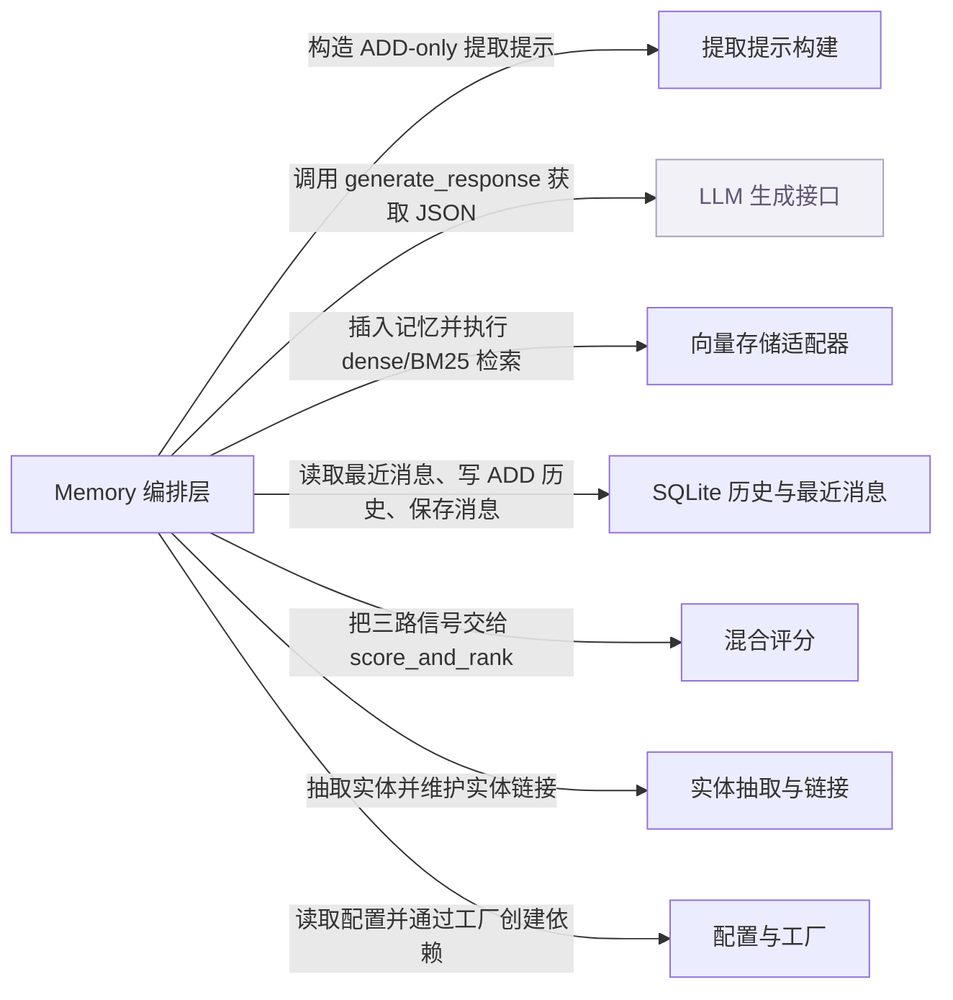

# mem0：架构、运行逻辑与设计取舍

> main · [26cdefb46600](https://github.com/mem0ai/mem0/commit/26cdefb46600c0fa5953c4b5ee5003c125539fc4) · deepseek-flash 辅助分析 · 2026-10-30T05:33:11.336Z
> 下文按固定源码推演，没有执行目标项目。引用可跳到具体代码行；“工程推断”解释收益与代价，不代表作者亲述。

## 1. 先建立直觉

**它把对话中的事实抽成短文本，写入带向量、关键词和实体链接的记忆库，查询时融合多种相似度排序。**

对话很长且事实分散，保留原文会膨胀上下文；纯向量检索又容易漏掉精确关键词或实体关系。

贯穿全文的例子：

- **输入：** memory.add("我不吃辣，喜欢川菜", user_id="u1")，随后 memory.search("给我推荐晚餐", filters={"user_id":"u1"})。
- **预期输出：** 推演输出可能包含一条类似 {"memory":"User does not eat spicy food and likes Sichuan cuisine","score":...} 的结果；具体文本和分数取决于 LLM/embedding，不能预先确定。

## 2. 一张图看懂架构



| 模块 | 职责与所在层的原因 | 输入 → 输出 | 拥有的状态 |
| --- | --- | --- | --- |
| Memory 编排层 [1][source-1] [2][source-2] [3][source-3] | 对外暴露 add/search，装配模型与存储实例，并把写入拆成提取、去重、持久化、实体链接，把查询拆成召回与评分。 | messages/query 与 filters、top_k、threshold 等参数 → 写入结果列表或检索结果列表 | config、embedding_model、vector_store、llm、db、reranker、collection_name |
| 提取提示构建 [4][source-4] [5][source-5] | 把已有记忆、最近消息、新消息、观察日期和自定义指令拼成 ADD-only 提取请求。 | existing_memories、new_messages、last_k_messages、custom_instructions → system prompt 与 user prompt 字符串 | 无持久状态，只生成字符串 |
| LLM 生成接口（外部依赖） [6][source-6] [7][source-7] | 按工厂选择 provider，执行 generate_response 返回 JSON；抽取质量由外部模型决定。 | provider/config 与 messages → JSON 提取响应 | provider 实例 |
| 向量存储适配器 [8][source-8] [9][source-9] [10][source-10] | 实现 dense 检索、BM25 sparse 写入和关键词检索；Qdrant 适配器把 payload 文本编码成稀疏向量。 | vectors、ids、payloads 或 query/vectors/filters → 检索命中的 points 或写入结果 | collection、dense 向量、bm25 稀疏向量槽 |
| 混合评分 [11][source-11] | 把语义分、BM25 分和实体 boost 加法融合，先按语义阈值过滤，再归一化排序。 | semantic_results、bm25_scores、entity_boosts、threshold、top_k → 带 combined score 的排序结果 | 无持久状态 |
| 实体抽取与链接 [12][source-12] [13][source-13] | 从记忆文本抽实体候选，在写入后把共享实体的记忆通过 linked_memory_ids 关联起来。 | 记忆文本列表与 filters → 实体候选、实体 store 中的链接关系 | entity store 中的 data、entity_type、linked_memory_ids、user_id/agent_id/run_id |
| SQLite 历史与最近消息 [14][source-14] [15][source-15] | 记录 ADD 历史，并为下一次提取提供每个 session 最近 10 条消息。 | history 记录或 messages 列表与 session_scope → 历史查询结果或最近消息列表 | history 表与 messages 表 |
| 配置与工厂 [16][source-16] [17][source-17] [18][source-18] | 定义 MemoryConfig，并按 provider 创建 embedder、vector store、llm；默认配置决定实际依赖。 | provider 名称与 provider-specific config → 已配置的 embedder/vector store/llm 实例 | 各 provider 实例配置 |

## 3. 跟着一个请求跑完整条主线

这是对已读方法体的源码推演，不是执行日志。编号是阅读顺序；装配、写入、查询与条件分支是否发生，取决于每步的触发条件。

### 1. 构造 Memory 时装配依赖

**阶段：** 装配

**触发条件：** 构造 Memory 时必经

入口/调用：`Memory.__init__` [1][source-1]

**此时输入：** MemoryConfig（默认配置也可）

创建 embedder、vector store、llm、SQLiteManager；按需创建 reranker；entity store 延迟到首次使用

**状态变化：** 实例持有这些对象

**交给下一步：** 可调用的 Memory 对象

### 2. add 校验并归一化输入

**阶段：** 写入准备

**触发条件：** 调用 add 时必经；timestamp 非空会先报错

入口/调用：`Memory.add` [2][source-2]

**此时输入：** 字符串或消息列表、user_id/agent_id/run_id、metadata

拒绝 timestamp，规范化 expiration_date，构建 processed_metadata 与 effective_filters，字符串包成 user 消息，做 vision 解析，调用 _add_to_vector_store

**状态变化：** processed_metadata、effective_filters、messages

**交给下一步：** 消息列表和过滤信息

### 3. 取最近消息并检索已有记忆

**阶段：** 写入

**触发条件：** 默认 infer=True 时必经

入口/调用：`Memory._add_to_vector_store / SQLiteManager.get_last_messages` [19][source-19] [20][source-20]

**此时输入：** filters、messages

构造 session_scope，从 SQLite 取最近 10 条；parse_messages；对整段新消息 embed('search')；vector_store.search top_k=10；把 UUID 映射成序号，防止 LLM 直接编 UUID

**状态变化：** last_messages、existing_results、existing_memories、uuid_mapping

**交给下一步：** 已有记忆清单和最近上下文

### 4. 单次 LLM ADD-only 提取

**阶段：** 写入

**触发条件：** infer=True 且已有记忆检索完成后必经；LLM 失败抛 LLMError

入口/调用：`Memory._add_to_vector_store / generate_additive_extraction_prompt` [21][source-21] [5][source-5]

**此时输入：** existing_memories、parsed_messages、last_messages、custom_instructions

选 ADDITIVE_EXTRACTION_PROMPT（agent scope 额外加 suffix），构造 user_prompt，调用 llm.generate_response 要求 JSON，remove_code_blocks 后 json.loads 取 memory 数组

**状态变化：** extracted_memories

**交给下一步：** 候选事实列表，可能为空

### 5. 批量嵌入、hash 去重并持久化

**阶段：** 写入

**触发条件：** extracted_memories 非空时；单条嵌入失败会跳过该文本

入口/调用：`Memory._add_to_vector_store` [22][source-22] [23][source-23]

**此时输入：** extracted_memories、existing_results、metadata、filters

embed_batch 失败回退逐条；用 existing_results 的 hash 和本批 seen_hashes 做 md5 精确去重；写 data/text_lemmatized/hash/created_at/updated_at；vector_store.insert 批量，失败逐条；只把 persisted_records 记历史 ADD

**状态变化：** 向量记录、history 表 ADD 行

**交给下一步：** persisted_records 和 returned_memories

### 6. 批量实体提取与链接

**阶段：** 写入

**触发条件：** persisted_records 非空后尽力执行；任何异常只告警不阻断 add

入口/调用：`Memory._add_to_vector_store / extract_entities_batch` [13][source-13] [24][source-24] [25][source-25]

**此时输入：** persisted_records 的文本、search_filters

extract_entities_batch 抽实体；全局按标准化文本合并 memory_ids；批量 embed；先用 exact_matches 再用 entity_store.search_batch 的 >=0.95 语义匹配；命中则更新 linked_memory_ids，否则批量插入新实体

**状态变化：** entity store 的 linked_memory_ids 或新实体记录

**交给下一步：** 实体链接结果，不改变返回的 memory 列表

### 7. search 校验过滤条件

**阶段：** 查询准备

**触发条件：** 调用 search 时必经；reference_date 非空会报错

入口/调用：`Memory.search` [3][source-3]

**此时输入：** query、top_k、filters、threshold、rerank/explain

拒绝 reference_date 和顶层实体参数；校验 threshold/top_k；trim query；校验并 trim filters 里的 user_id/agent_id/run_id，至少一个；高级过滤器先处理；调用 _search_vector_store

**状态变化：** effective_filters、limit、threshold

**交给下一步：** 合法查询参数

### 8. 多信号候选召回

**阶段：** 查询

**触发条件：** 每次 _search_vector_store 必经；keyword_search 可能返回 None

入口/调用：`Memory._search_vector_store / Qdrant.keyword_search` [26][source-26] [10][source-10]

**此时输入：** query、filters、limit、threshold

对 query 做 BM25 lemmatize 和实体抽取；embed 查询；语义检索 over-fetch max(limit*4,60)；若 store 支持则 BM25 keyword_search；用 get_bm25_params+normalize_bm25 把原始 BM25 转 0-1；若 query 有实体则算实体 boost；从语义结果构建候选并过滤过期

**状态变化：** semantic_results、bm25_scores、entity_boosts、candidates

**交给下一步：** 候选与三路信号

### 9. 加法融合、阈值与格式化

**阶段：** 查询

**触发条件：** 候选进入 score_and_rank 后必经

入口/调用：`Memory._search_vector_store / score_and_rank` [27][source-27] [28][source-28]

**此时输入：** candidates、bm25_scores、entity_boosts、threshold、top_k

先按 semantic_score < threshold 丢弃；combined=min((semantic+bm25+entity_boost)/max_possible,1)；max_possible 按激活信号取 1/1.5/2/2.5；排序取 top_k；再包成 MemoryItem 并提升 user_id 等字段到顶层

**状态变化：** 返回结果列表，不写状态

**交给下一步：** {"results":[...]}

## 4. 核心技术到底是什么

### 1. 单次 ADD-only 事实提取

**解决的问题：** 避免多轮更新/删除决策，把原始消息压成可检索事实。 [21][source-21] [5][source-5]

把已有 top10 记忆、最近消息、新消息、观察日期拼进 prompt；LLM 返回 JSON memory 数组；代码只解析 text 等字段并继续写入。

算法示意（用于解释机制，不是源码原文）：

```text
existing = search(messages, top_k=10)
prompt = build(existing, last_messages, new_messages)
resp = llm.generate(prompt, json_object)
items = json.loads(resp).get('memory', [])
for item in items:
  embed(item.text)
  insert(item.text, payload)
```

**关键数据结构：** extracted_memories: [{id,text,attributed_to,linked_memory_ids?}]；不变量：只产生新记录，不返回 UPDATE/DELETE 指令。

- **本项目实现：** main.py 选 ADDITIVE_EXTRACTION_PROMPT、调用 LLM、解析 JSON；prompts.py 构建 prompt。
- **外部依赖提供：** LLM provider 负责自然语言抽取和 JSON 生成；质量取决于模型。
- **收益与代价：** 一次调用成本低、避免覆盖；但旧记忆不会被自动修正，重复/冲突依赖 hash 和后续实体链接处理。

### 2. 语义+BM25+实体 boost 加法融合

**解决的问题：** 纯向量对精确关键词/实体不敏感。 [26][source-26] [28][source-28] [10][source-10]

语义检索 overfetch；BM25 keyword_search 原始分经 sigmoid 归一化；entity_boosts 查表；每个候选先过语义 threshold，再相加除以激活信号最大可能分；排序。

算法示意（用于解释机制，不是源码原文）：

```text
sem = dense_search(query, limit=max(limit*4,60))
kw = keyword_search(lemmatize(query), limit=max(limit*4,60))
for hit in kw: bm25[hit.id] = sigmoid(raw, mid, steep)
for ent in entities(query): entity[mem] = boost(ent, mem)
for c in sem:
  if c.score < threshold: skip
  c.score = (c.score + bm25[id] + entity[id]) / max_possible
sort(candidates)
```

**关键数据结构：** semantic_results、bm25_scores: id->[0,1]、entity_boosts: id->float；max_possible 由 bool(bm25_scores)/bool(entity_boosts) 决定。

- **本项目实现：** main.py 编排三路召回；scoring.py 实现公式。
- **外部依赖提供：** vector store 执行 dense search 和 BM25 sparse search；Qdrant 用 fastembed Qdrant/bm25 编码。
- **收益与代价：** 多信号提升召回；但 BM25 未安装/不支持时退化为语义；threshold 只看语义，可能丢弃可被关键词救回的候选。

### 3. 实体抽取与实体链接

**解决的问题：** 同一实体的多条记忆需要互相关联，查询时可按实体加权。 [12][source-12] [13][source-13]

spaCy NER+proper name+quoted+topic 候选，按 priority/confidence/span 去重；add 时批量抽实体、批量 embed，按标准化文本精确匹配或 >=0.95 语义匹配，更新 linked_memory_ids 或插入新实体。

算法示意（用于解释机制，不是源码原文）：

```text
ents = extract_entities_batch(texts)
global = normalize_and_merge(ents)
vecs = embed_batch(entity_texts)
for key, vec in zip(global, vecs):
  exact = existing_by_text.get(key)
  sem = entity_store.search_batch(vec, top_k=1)
  if exact or sem.score >= .95:
    update(linked_memory_ids)
  else:
    insert(entity, linked_memory_ids)
```

**关键数据结构：** 实体 payload: data, entity_type, linked_memory_ids, user_id/agent_id/run_id；global_entities: normalized_key -> [type,text,set(memory_ids)]。

- **本项目实现：** entity_extraction.py 规则和候选解析；main.py 批量链接。
- **外部依赖提供：** spaCy 提供分词/NER/依存；向量 store 存实体向量并 search_batch。
- **收益与代价：** 建立可复用链接；但 spaCy 可选、模型语言能力受限，中文场景质量未确认。

### 4. SQLite 历史与最近消息窗口

**解决的问题：** 需要审计 ADD 事件，并为提取提供最近上下文。 [14][source-14] [15][source-15]

history 表逐条/批量插入，字段含 event/new_memory/old_memory；messages 表按 session_scope 插入后删除超过最近 10 条；get_last_messages 用子查询取最新 10 条再按时间升序。

算法示意（用于解释机制，不是源码原文）：

```text
insert history(memory_id, old_memory, new_memory, event)
insert messages(session_scope, role, content, now)
delete messages where session_scope=? and id not in (
  select id from messages where session_scope=? order by created_at desc limit 10)
select * from (
  select * from messages where session_scope=? order by created_at desc limit 10)
order by created_at asc
```

**关键数据结构：** history: memory_id, old_memory, new_memory, event, created_at, ...；messages: session_scope, role, content, created_at。

- **本项目实现：** storage.py 事务、锁、迁移、批量插入。
- **外部依赖提供：** sqlite3 标准库提供本地文件存储。
- **收益与代价：** 简单可审计；单文件、进程内锁，跨进程并发和大规模不是强项。

## 5. 为什么选择这种实现

### 1. 当前 add 只执行 ADD-only 提取，不在写入路径做 UPDATE/DELETE 决策

**作者原文：** “- **Single-pass ADD-only extraction** -- one LLM call, no UPDATE/DELETE. Memories accumulate; nothing is overwritten.” [29][source-29] [21][source-21]

**面临的约束：** 旧式四操作需要额外 LLM 比较和多轮维护；当前代码选择单次提取

**如果改用另一种做法：** 让 LLM 对每条新事实输出 ADD/UPDATE/DELETE/NONE 并在同一次写入中修改或删除旧记录

**为什么当前方案有用：** 本场景第二次 add 不会覆盖旧偏好；只追加新记录，避免旧记忆被误删/误改；代码中 _add_to_vector_store 只解析 memory 并持久化新记录

**付出的代价，以及不适用的情况：** 旧偏好变更不会自动替换，冲突和重复要靠 hash/链接/上层处理

### 2. 用 top10 现有记忆作为 LLM 去重/链接参考

**依据：已确认实现；以下原因是工程分析，不代表作者亲述。** [30][source-30] [31][source-31]

**面临的约束：** LLM 需要知道已有记忆才能避免重复和建立 linked_memory_ids

**如果改用另一种做法：** 不检索旧记忆，直接抽取后只靠 hash 去重

**为什么当前方案有用：** 本场景若已存过“喜欢川菜”，把 existing_memories 放进 prompt 可让模型跳过语义等价事实；代码随后还用 hash 兜底

**付出的代价，以及不适用的情况：** 只取 top10，更多旧记忆看不到；模型可能仍重复，hash 只处理精确文本

### 3. 检索用语义候选池做 gate，再融合 BM25/entity

**作者原文：** “candidates below the threshold are excluded even if BM25/entity would boost them.” [32][source-32] [33][source-33]

**面临的约束：** 多信号候选集合不同，需要统一排序；语义分范围可比较

**如果改用另一种做法：** 把三路结果直接拼接后按各自原始分排序，不先经过语义阈值

**为什么当前方案有用：** score_and_rank 先要求 semantic_score >= threshold，再按 max_possible 归一化相加；这样 BM25/entity 只能提升已在语义池中的候选，避免关键词结果绕过语义门槛

**付出的代价，以及不适用的情况：** 语义检索漏掉的记忆无法被 BM25/entity 救回；threshold 过高会漏

### 4. Qdrant 写入时同时生成 dense 和 BM25 sparse 向量

**依据：已确认实现；以下原因是工程分析，不代表作者亲述。** [9][source-9] [10][source-10]

**面临的约束：** 关键词检索需要稀疏向量槽 bm25

**如果改用另一种做法：** 只存 dense，查询时再对全文做外部 BM25 或每次查询重建稀疏索引

**为什么当前方案有用：** insert 从 payload 的 text_lemmatized/data 批量编码 BM25 并写入 named vector；keyword_search 用 using='bm25' 查询；避免查询时重建索引

**付出的代价，以及不适用的情况：** 依赖 fastembed 和 collection 有 bm25 slot；旧 collection 或未安装时退化为语义

### 5. messages 表只保留每个 session 最近 10 条

**依据：已确认实现；以下原因是工程分析，不代表作者亲述。** [34][source-34] [20][source-20]

**面临的约束：** last_k_messages 只需最近上下文，避免无限膨胀

**如果改用另一种做法：** 不删除 messages，而是保留全量并在 get_last_messages 时用 ORDER BY created_at DESC LIMIT 10 只取最近十条；或者把全量消息写入单独归档表，messages 表仅作为短期窗口。

**为什么当前方案有用：** save_messages 插入后删除超过最近 10 条；get_last_messages 取最新 10 条升序返回，控制 prompt 上下文

**付出的代价，以及不适用的情况：** 更早对话无法作为 last_k_messages；长期审计依赖 history 而不是 messages

## 6. 关键代码精读

### 1. ADD-only 提取：只解析 memory 数组


`mem0/memory/main.py:942-986` [21][source-21]

```python
        # Phase 2: LLM extraction (single call)
        is_agent_scoped = bool(filters.get("agent_id")) and not filters.get("user_id")
        system_prompt = ADDITIVE_EXTRACTION_PROMPT
        if is_agent_scoped:
            system_prompt += AGENT_CONTEXT_SUFFIX

        custom_instr = prompt or self.custom_instructions

        user_prompt = generate_additive_extraction_prompt(
            existing_memories=existing_memories,
            new_messages=parsed_messages,
            last_k_messages=last_messages,
            custom_instructions=custom_instr,
        )

        try:
            response = self.llm.generate_response(
                messages=[
                    {"role": "system", "content": system_prompt},
                    {"role": "user", "content": user_prompt},
                ],
                response_format={"type": "json_object"},
            )
        except Exception as e:
            # Re-raise so callers can implement provider fallback / retry.
            # The original silent ``return []`` made upstream callers unable to
            # distinguish "LLM unavailable" (429/5xx/timeout) from "LLM
            # extracted no facts" -- both surfaced as an empty list.
            logger.error(f"LLM extraction failed: {e}")
            raise LLMError(f"LLM extraction failed: {e}") from e

        # Parse response
        try:
            response = remove_code_blocks(response)
            if not response or not response.strip():
                extracted_memories = []
            else:
                try:
                    extracted_memories = json.loads(response, strict=False).get("memory", [])
                except json.JSONDecodeError:
                    extracted_json = extract_json(response)
                    extracted_memories = json.loads(extracted_json, strict=False).get("memory", [])
        except Exception as e:
            logger.error(f"Error parsing extraction response: {e}")
            extracted_memories = []
```


`mem0/configs/prompts.py:1016-1062` [5][source-5]

```python
def generate_additive_extraction_prompt(
    summary=None,
    recently_extracted_memories=None,
    existing_memories=None,
    new_messages=None,
    *,
    last_k_messages=None,
    current_date=None,
    timestamp=None,
    custom_instructions=None,
    use_input_language=False,
):
    """Build the user prompt for additive (ADD-only) extraction with linking.

    Pairs with ADDITIVE_EXTRACTION_PROMPT system prompt.
    The LLM will produce only ADD operations, with optional linked_memory_ids.
    """
    current_date, observation_date = _resolve_dates(current_date, timestamp)

    sections = []
    sections.append(f"## Summary\n{_format_summary(summary)}")
    sections.append(f"## Last k Messages\n{_format_conversation_history(last_k_messages)}")
    sections.append(f"## Recently Extracted Memories\n{_serialize_memories(recently_extracted_memories)}")
    sections.append(f"## Existing Memories\n{_serialize_memories(existing_memories)}")
    sections.append(f"## New Messages\n{_format_new_messages(new_messages)}")
    sections.append(f"## Observation Date\n{observation_date}")
    sections.append(f"## Current Date\n{current_date}")

    if custom_instructions:
        sections.append(f"## Custom Instructions\n{custom_instructions}")

    if use_input_language:
        sections.append(
            "## Language Requirement\n"
            "CRITICAL: Respond in the SAME LANGUAGE and SCRIPT as the input messages.\n"
            "1. Match the language of the user's messages exactly — if they write in Korean, extract in Korean; Japanese in Japanese; etc.\n"
            "2. Preserve the exact script/alphabet of the input.\n"
            "3. Do NOT translate or transliterate into English unless the input is already in English.\n"
            "4. Maintain all quality standards (contextual richness, temporal grounding, etc.) regardless of language.\n"
            "5. Technical terms, proper nouns, and brand names should be preserved in their original form as used in the input.\n"
            "6. If the input mixes languages (e.g., Hinglish), preserve both the mixed language style AND the script.\n"
            "7. For Japanese: explicitly resolve omitted subjects using conversation context.\n"
            "8. For CJK languages: maintain appropriate formality level from the source text."
        )

    sections.append("# Output:")
    return "\n\n".join(sections)
```


先用整段新消息做一次 search embedding，并取 top10 现有记忆，转成带序号的 existing_memories。然后选 ADDITIVE_EXTRACTION_PROMPT，把 existing_memories、parsed_messages、last_messages、custom_instructions 交给 generate_additive_extraction_prompt 拼成 user prompt。LLM 以 json_object 返回后，remove_code_blocks 清掉代码围栏，json.loads 只取 memory 键；解析失败或没有 memory 时返回空列表。这里没有 UPDATE/DELETE 分支，提取结果只作为新记录候选。

### 2. hash 去重和持久化顺序


`mem0/memory/main.py:1007-1041` [35][source-35]

```python
        # Phase 4: Per-memory CPU processing + Phase 5: Hash dedup
        # Build set of existing hashes for dedup
        existing_hashes = set()
        for mem in existing_results:
            h = mem.payload.get("hash") if hasattr(mem, "payload") and mem.payload else None
            if h:
                existing_hashes.add(h)

        records = []  # (memory_id, text, embedding, payload)
        seen_hashes = set()  # dedup within the current batch
        for mem in extracted_memories:
            text = mem.get("text")
            if not text or text not in embed_map:
                continue

            mem_hash = hashlib.md5(text.encode()).hexdigest()
            if mem_hash in existing_hashes or mem_hash in seen_hashes:
                logger.debug(f"Skipping duplicate memory (hash match): {text[:50]}")
                continue
            seen_hashes.add(mem_hash)

            text_lemmatized = lemmatize_for_bm25(text)

            memory_id = str(uuid.uuid4())
            mem_metadata = deepcopy(metadata)
            mem_metadata["data"] = text
            mem_metadata["text_lemmatized"] = text_lemmatized
            mem_metadata["hash"] = mem_hash
            if "created_at" not in mem_metadata:
                mem_metadata["created_at"] = datetime.now(timezone.utc).isoformat()
            mem_metadata["updated_at"] = mem_metadata["created_at"]
            if mem.get("attributed_to"):
                mem_metadata["attributed_to"] = mem["attributed_to"]

            records.append((memory_id, text, embed_map[text], mem_metadata))
```


`mem0/memory/main.py:1047-1098` [23][source-23]

```python
        # Phase 6: Batch persist
        all_vectors = [r[2] for r in records]
        all_ids = [r[0] for r in records]
        all_payloads = [r[3] for r in records]

        # Only records confirmed to be stored make it into history, entity
        # links, and the returned results — a record the store rejected must
        # never be reported back as a successful ADD.
        persisted_records = []
        try:
            self.vector_store.insert(
                vectors=all_vectors,
                ids=all_ids,
                payloads=all_payloads,
            )
            persisted_records = records
        except Exception:
            # Fallback: insert one by one
            for rec in records:
                try:
                    self.vector_store.insert(vectors=[rec[2]], ids=[rec[0]], payloads=[rec[3]])
                    persisted_records.append(rec)
                except Exception as e:
                    logger.error(f"Failed to insert memory {rec[0]}: {e}")

        if not persisted_records:
            self.db.save_messages(messages, session_scope)
            raise VectorStoreError(
                f"Failed to insert any of the {len(records)} extracted memories into the vector store"
            )

        # Batch history
        history_records = [
            {
                "memory_id": r[0],
                "old_memory": None,
                "new_memory": r[1],
                "event": "ADD",
                "created_at": r[3].get("created_at"),
                "is_deleted": 0,
            }
            for r in persisted_records
        ]
        try:
            self.db.batch_add_history(history_records)
        except Exception:
            # Fallback: add one by one
            for hr in history_records:
                try:
                    self.db.add_history(hr["memory_id"], None, hr["new_memory"], "ADD", created_at=hr.get("created_at"))
                except Exception as e:
                    logger.error(f"Failed to add history for {hr['memory_id']}: {e}")
```


先从 existing_results 的 payload 收集 hash，再用 seen_hashes 记录本批已见文本。每条提取文本算 md5；命中 existing_hashes 或 seen_hashes 就跳过，所以去重范围是 top10 现有结果加本批，不是全库幂等。通过后写 data、text_lemmatized、hash、created_at、updated_at 等 payload，形成 records。随后批量 vector_store.insert；批量失败逐条插入，只有 persisted_records 才写 history 的 ADD 事件并返回。

### 3. 混合评分：threshold 在融合前


`mem0/memory/main.py:1647-1701` [26][source-26]

```python
        # Step 1: Preprocess query
        query_lemmatized = lemmatize_for_bm25(query)
        query_entities = extract_entities(query)

        # Step 2: Embed query
        embeddings = self.embedding_model.embed(query, "search")

        # Step 3: Semantic search (over-fetch for scoring pool)
        internal_limit = max(limit * 4, 60)
        semantic_results = self.vector_store.search(
            query=query, vectors=embeddings, top_k=internal_limit, filters=filters
        )

        # Step 4: Keyword search (if store supports it)
        keyword_results = self.vector_store.keyword_search(
            query=query_lemmatized, top_k=internal_limit, filters=filters
        )

        # Step 5: Compute BM25 scores from keyword results
        bm25_scores = {}
        if keyword_results is not None:
            midpoint, steepness = get_bm25_params(query, lemmatized=query_lemmatized)
            for mem in keyword_results:
                mem_id = str(mem.id) if hasattr(mem, 'id') else str(mem.get('id', ''))
                raw_score = mem.score if hasattr(mem, 'score') else mem.get('score', 0)
                if raw_score and raw_score > 0:
                    bm25_scores[mem_id] = normalize_bm25(raw_score, midpoint, steepness)

        # Step 6: Compute entity boosts
        entity_boosts = {}
        if query_entities:
            entity_boosts = self._compute_entity_boosts(query_entities, filters)

        # Step 7: Build candidate set from semantic results
        candidates = []
        for mem in semantic_results:
            payload = mem.payload if hasattr(mem, 'payload') else {}
            if not show_expired and _payload_is_expired(payload):
                continue
            mem_id = str(mem.id)
            candidates.append({
                "id": mem_id,
                "score": mem.score,
                "payload": payload,
            })

        # Step 8: Score and rank
        scored_results = score_and_rank(
            semantic_results=candidates,
            bm25_scores=bm25_scores,
            entity_boosts=entity_boosts,
            threshold=threshold,
            top_k=limit,
            explain=explain,
        )
```


`mem0/utils/scoring.py:94-139` [28][source-28]

```python
    has_bm25 = bool(bm25_scores)
    has_entity = bool(entity_boosts)

    max_possible = 1.0
    if has_bm25:
        max_possible += 1.0
    if has_entity:
        max_possible += ENTITY_BOOST_WEIGHT

    scored: List[Dict[str, Any]] = []

    for result in semantic_results:
        mem_id = result.get("id")
        if mem_id is None:
            continue

        semantic_score = result.get("score") or 0.0
        if semantic_score < threshold:
            continue

        mem_id_str = str(mem_id)
        bm25_score = bm25_scores.get(mem_id_str, 0.0)
        entity_boost = entity_boosts.get(mem_id_str, 0.0)

        raw_combined = semantic_score + bm25_score + entity_boost
        combined = min(raw_combined / max_possible, 1.0)

        scored_result = {
            "id": mem_id_str,
            "score": combined,
            "payload": result.get("payload"),
        }
        if explain:
            scored_result["score_details"] = {
                "semantic_score": semantic_score,
                "bm25_score": bm25_score,
                "entity_boost": entity_boost,
                "raw_score": raw_combined,
                "max_possible_score": max_possible,
                "final_score": combined,
                "threshold": threshold,
            }
        scored.append(scored_result)

    scored.sort(key=lambda x: x["score"], reverse=True)
    return scored[:top_k]
```


_search_vector_store 先对 query 做 BM25 lemmatize 和实体抽取，embed 后语义检索 over-fetch。keyword_search 返回命中时，用 query 长度选 sigmoid 参数，把原始 BM25 归一化到 0-1；query 有实体时再算 entity_boosts。score_and_rank 对每个语义候选先检查 semantic_score < threshold，低于阈值直接丢弃；然后 combined = min((semantic + bm25 + entity_boost) / max_possible, 1)，max_possible 按激活信号取 1、1.5、2 或 2.5，最后排序取 top_k。

## 7. 动手验证你的理解

以下是建议实验，没有执行过。

### 1. 重复 add 完全相同的提取文本会被去重吗？

**改变什么：** 对同一 user_id 连续两次 add 同一句；假设 LLM 两次抽出的 text 完全相同。 [36][source-36] [37][source-37]

**应该观察到什么：** 第二次在 Phase5 计算 md5，命中 existing_results 的 hash 或本批 seen_hashes 时跳过；若所有候选都被跳过则返回 []，不会新增向量和历史 ADD。注意去重范围是 top10 现有结果加本批，不是全库。

### 2. search 的分数由哪些部分构成？

**改变什么：** 调用 search(..., explain=True)。 [38][source-38] [39][source-39]

**应该观察到什么：** 结果里出现 score_details，含 semantic_score、bm25_score、entity_boost、raw_score、max_possible_score、final_score、threshold；若 keyword_search 返回 None 则 bm25_score=0，且 max_possible 不含 1.0 这一项。

### 3. 查询词加入“川菜”会改变哪些信号？

**改变什么：** 把查询从“给我推荐晚餐”改为“川菜 晚餐”，并确保 Qdrant 与 fastembed 可用。 [10][source-10] [40][source-40]

**应该观察到什么：** BM25 keyword_search 更可能有命中，bm25_scores 非空，max_possible 从 1.0 变 2.0；若实体抽取也命中实体，max_possible 变 2.5。仍不能保证排名，因为要看实际归一化分数和语义分。

## 8. 读完应当能复述什么

- add 默认不是旧版 UPDATE/DELETE 决策，而是单次 ADD-only 提取；去重是 top10 现有 hash 加本批 hash 的精确文本去重。
- search 是语义候选池 + BM25 + entity 的加法融合，threshold 在融合前卡语义；最终分除以激活信号最大可能分。
- LLM 负责抽事实，embedding 负责向量化，vector store 负责 dense/sparse 检索，spaCy 负责实体候选，SQLite 负责历史和最近消息。
- 没有实际模型/向量结果不能预测提取文本或排名；默认 BM25/entity 可能因依赖缺失退化为语义。
- 场景推演：查询“晚餐”更可能通过语义相似召回“不吃辣/喜欢川菜”，但不保证；查询含“川菜”才更可能触发 BM25/实体信号。

## 来源与覆盖边界

本次读取 24 个文件，共 314,473 字符；23 个文件完整读取，其他文件按关键方法取带行号的片段。没有把未读依赖的内部实现当作已确认事实。

- _compute_entity_boosts 和 _search_entity 方法体未在已读片段中，无法确认查询时实体 boost 的具体匹配与权重计算；只能确认它被调用并进入 score_and_rank。
- lemmatize_for_bm25 和 get_nlp_full 方法体未读，无法确认中文分词/词形还原和 spaCy 模型对中文的实际效果。
- 默认 Qdrant 的 BM25 依赖 fastembed 和 collection 的 bm25 slot；未安装/旧 collection 时 keyword_search 返回 None，实际默认是否启用取决于环境，不能断言一定走三路。
- add 路径没有调用 update/delete；但 Memory.update/delete 方法体未在已读片段中，不能描述单独调用它们时的完整语义。
- 没有实际 embedding/LLM 输出，不能声称模型一定提取“不吃辣/喜欢川菜”或预测 search 排名。

| 文件 | 实际读取行段 |
| --- | --- |
| [README.md](https://github.com/mem0ai/mem0/blob/26cdefb46600c0fa5953c4b5ee5003c125539fc4/README.md) | 1–281 / 共 281 行 |
| [pyproject.toml](https://github.com/mem0ai/mem0/blob/26cdefb46600c0fa5953c4b5ee5003c125539fc4/pyproject.toml) | 1–175 / 共 175 行 |
| [mem0/memory/main.py](https://github.com/mem0ai/mem0/blob/26cdefb46600c0fa5953c4b5ee5003c125539fc4/mem0/memory/main.py) | 1–50、485–554、757–1221、1390–1537、1639–1746、1972–2006 / 共 3913 行 |
| [mem0/configs/base.py](https://github.com/mem0ai/mem0/blob/26cdefb46600c0fa5953c4b5ee5003c125539fc4/mem0/configs/base.py) | 1–82 / 共 82 行 |
| [mem0/configs/prompts.py](https://github.com/mem0ai/mem0/blob/26cdefb46600c0fa5953c4b5ee5003c125539fc4/mem0/configs/prompts.py) | 1–1063 / 共 1063 行 |
| [mem0/utils/factory.py](https://github.com/mem0ai/mem0/blob/26cdefb46600c0fa5953c4b5ee5003c125539fc4/mem0/utils/factory.py) | 1–281 / 共 281 行 |
| [mem0/memory/storage.py](https://github.com/mem0ai/mem0/blob/26cdefb46600c0fa5953c4b5ee5003c125539fc4/mem0/memory/storage.py) | 1–348 / 共 348 行 |
| [mem0/vector_stores/base.py](https://github.com/mem0ai/mem0/blob/26cdefb46600c0fa5953c4b5ee5003c125539fc4/mem0/vector_stores/base.py) | 1–101 / 共 101 行 |
| [mem0/vector_stores/qdrant.py](https://github.com/mem0ai/mem0/blob/26cdefb46600c0fa5953c4b5ee5003c125539fc4/mem0/vector_stores/qdrant.py) | 1–607 / 共 607 行 |
| [mem0/utils/scoring.py](https://github.com/mem0ai/mem0/blob/26cdefb46600c0fa5953c4b5ee5003c125539fc4/mem0/utils/scoring.py) | 1–140 / 共 140 行 |
| [mem0/utils/entity_extraction.py](https://github.com/mem0ai/mem0/blob/26cdefb46600c0fa5953c4b5ee5003c125539fc4/mem0/utils/entity_extraction.py) | 1–773 / 共 773 行 |
| [examples/mem0-demo/app/api/chat/route.ts](https://github.com/mem0ai/mem0/blob/26cdefb46600c0fa5953c4b5ee5003c125539fc4/examples/mem0-demo/app/api/chat/route.ts) | 1–113 / 共 113 行 |
| [mem0/configs/enums.py](https://github.com/mem0ai/mem0/blob/26cdefb46600c0fa5953c4b5ee5003c125539fc4/mem0/configs/enums.py) | 1–8 / 共 8 行 |
| [mem0/exceptions.py](https://github.com/mem0ai/mem0/blob/26cdefb46600c0fa5953c4b5ee5003c125539fc4/mem0/exceptions.py) | 1–485 / 共 485 行 |
| [mem0/memory/base.py](https://github.com/mem0ai/mem0/blob/26cdefb46600c0fa5953c4b5ee5003c125539fc4/mem0/memory/base.py) | 1–64 / 共 64 行 |
| [mem0/memory/notices.py](https://github.com/mem0ai/mem0/blob/26cdefb46600c0fa5953c4b5ee5003c125539fc4/mem0/memory/notices.py) | 1–1668 / 共 1668 行 |
| [mem0/memory/setup.py](https://github.com/mem0ai/mem0/blob/26cdefb46600c0fa5953c4b5ee5003c125539fc4/mem0/memory/setup.py) | 1–167 / 共 167 行 |
| [mem0/memory/telemetry.py](https://github.com/mem0ai/mem0/blob/26cdefb46600c0fa5953c4b5ee5003c125539fc4/mem0/memory/telemetry.py) | 1–242 / 共 242 行 |
| [mem0/memory/utils.py](https://github.com/mem0ai/mem0/blob/26cdefb46600c0fa5953c4b5ee5003c125539fc4/mem0/memory/utils.py) | 1–331 / 共 331 行 |
| [mem0/configs/rerankers/config.py](https://github.com/mem0ai/mem0/blob/26cdefb46600c0fa5953c4b5ee5003c125539fc4/mem0/configs/rerankers/config.py) | 1–13 / 共 13 行 |
| [mem0/embeddings/configs.py](https://github.com/mem0ai/mem0/blob/26cdefb46600c0fa5953c4b5ee5003c125539fc4/mem0/embeddings/configs.py) | 1–32 / 共 32 行 |
| [mem0/llms/configs.py](https://github.com/mem0ai/mem0/blob/26cdefb46600c0fa5953c4b5ee5003c125539fc4/mem0/llms/configs.py) | 1–36 / 共 36 行 |
| [mem0/vector_stores/configs.py](https://github.com/mem0ai/mem0/blob/26cdefb46600c0fa5953c4b5ee5003c125539fc4/mem0/vector_stores/configs.py) | 1–69 / 共 69 行 |
| [mem0/configs/embeddings/base.py](https://github.com/mem0ai/mem0/blob/26cdefb46600c0fa5953c4b5ee5003c125539fc4/mem0/configs/embeddings/base.py) | 1–112 / 共 112 行 |

[source-1]: https://github.com/mem0ai/mem0/blob/26cdefb46600c0fa5953c4b5ee5003c125539fc4/mem0/memory/main.py#L488-L514 "mem0/memory/main.py:488-514"
[source-2]: https://github.com/mem0ai/mem0/blob/26cdefb46600c0fa5953c4b5ee5003c125539fc4/mem0/memory/main.py#L817-L871 "mem0/memory/main.py:817-871"
[source-3]: https://github.com/mem0ai/mem0/blob/26cdefb46600c0fa5953c4b5ee5003c125539fc4/mem0/memory/main.py#L1446-L1509 "mem0/memory/main.py:1446-1509"
[source-4]: https://github.com/mem0ai/mem0/blob/26cdefb46600c0fa5953c4b5ee5003c125539fc4/mem0/configs/prompts.py#L468-L513 "mem0/configs/prompts.py:468-513"
[source-5]: https://github.com/mem0ai/mem0/blob/26cdefb46600c0fa5953c4b5ee5003c125539fc4/mem0/configs/prompts.py#L1016-L1062 "mem0/configs/prompts.py:1016-1062"
[source-6]: https://github.com/mem0ai/mem0/blob/26cdefb46600c0fa5953c4b5ee5003c125539fc4/mem0/utils/factory.py#L64-L125 "mem0/utils/factory.py:64-125"
[source-7]: https://github.com/mem0ai/mem0/blob/26cdefb46600c0fa5953c4b5ee5003c125539fc4/mem0/memory/main.py#L957-L964 "mem0/memory/main.py:957-964"
[source-8]: https://github.com/mem0ai/mem0/blob/26cdefb46600c0fa5953c4b5ee5003c125539fc4/mem0/vector_stores/base.py#L16-L26 "mem0/vector_stores/base.py:16-26"
[source-9]: https://github.com/mem0ai/mem0/blob/26cdefb46600c0fa5953c4b5ee5003c125539fc4/mem0/vector_stores/qdrant.py#L186-L246 "mem0/vector_stores/qdrant.py:186-246"
[source-10]: https://github.com/mem0ai/mem0/blob/26cdefb46600c0fa5953c4b5ee5003c125539fc4/mem0/vector_stores/qdrant.py#L454-L481 "mem0/vector_stores/qdrant.py:454-481"
[source-11]: https://github.com/mem0ai/mem0/blob/26cdefb46600c0fa5953c4b5ee5003c125539fc4/mem0/utils/scoring.py#L60-L139 "mem0/utils/scoring.py:60-139"
[source-12]: https://github.com/mem0ai/mem0/blob/26cdefb46600c0fa5953c4b5ee5003c125539fc4/mem0/utils/entity_extraction.py#L731-L772 "mem0/utils/entity_extraction.py:731-772"
[source-13]: https://github.com/mem0ai/mem0/blob/26cdefb46600c0fa5953c4b5ee5003c125539fc4/mem0/memory/main.py#L1100-L1180 "mem0/memory/main.py:1100-1180"
[source-14]: https://github.com/mem0ai/mem0/blob/26cdefb46600c0fa5953c4b5ee5003c125539fc4/mem0/memory/storage.py#L150-L192 "mem0/memory/storage.py:150-192"
[source-15]: https://github.com/mem0ai/mem0/blob/26cdefb46600c0fa5953c4b5ee5003c125539fc4/mem0/memory/storage.py#L257-L324 "mem0/memory/storage.py:257-324"
[source-16]: https://github.com/mem0ai/mem0/blob/26cdefb46600c0fa5953c4b5ee5003c125539fc4/mem0/configs/base.py#L29-L57 "mem0/configs/base.py:29-57"
[source-17]: https://github.com/mem0ai/mem0/blob/26cdefb46600c0fa5953c4b5ee5003c125539fc4/mem0/utils/factory.py#L152-L179 "mem0/utils/factory.py:152-179"
[source-18]: https://github.com/mem0ai/mem0/blob/26cdefb46600c0fa5953c4b5ee5003c125539fc4/mem0/utils/factory.py#L210-L218 "mem0/utils/factory.py:210-218"
[source-19]: https://github.com/mem0ai/mem0/blob/26cdefb46600c0fa5953c4b5ee5003c125539fc4/mem0/memory/main.py#L918-L940 "mem0/memory/main.py:918-940"
[source-20]: https://github.com/mem0ai/mem0/blob/26cdefb46600c0fa5953c4b5ee5003c125539fc4/mem0/memory/storage.py#L298-L324 "mem0/memory/storage.py:298-324"
[source-21]: https://github.com/mem0ai/mem0/blob/26cdefb46600c0fa5953c4b5ee5003c125539fc4/mem0/memory/main.py#L942-L986 "mem0/memory/main.py:942-986"
[source-22]: https://github.com/mem0ai/mem0/blob/26cdefb46600c0fa5953c4b5ee5003c125539fc4/mem0/memory/main.py#L993-L1045 "mem0/memory/main.py:993-1045"
[source-23]: https://github.com/mem0ai/mem0/blob/26cdefb46600c0fa5953c4b5ee5003c125539fc4/mem0/memory/main.py#L1047-L1098 "mem0/memory/main.py:1047-1098"
[source-24]: https://github.com/mem0ai/mem0/blob/26cdefb46600c0fa5953c4b5ee5003c125539fc4/mem0/memory/main.py#L1182-L1204 "mem0/memory/main.py:1182-1204"
[source-25]: https://github.com/mem0ai/mem0/blob/26cdefb46600c0fa5953c4b5ee5003c125539fc4/mem0/utils/entity_extraction.py#L761-L772 "mem0/utils/entity_extraction.py:761-772"
[source-26]: https://github.com/mem0ai/mem0/blob/26cdefb46600c0fa5953c4b5ee5003c125539fc4/mem0/memory/main.py#L1647-L1701 "mem0/memory/main.py:1647-1701"
[source-27]: https://github.com/mem0ai/mem0/blob/26cdefb46600c0fa5953c4b5ee5003c125539fc4/mem0/memory/main.py#L1703-L1745 "mem0/memory/main.py:1703-1745"
[source-28]: https://github.com/mem0ai/mem0/blob/26cdefb46600c0fa5953c4b5ee5003c125539fc4/mem0/utils/scoring.py#L94-L139 "mem0/utils/scoring.py:94-139"
[source-29]: https://github.com/mem0ai/mem0/blob/26cdefb46600c0fa5953c4b5ee5003c125539fc4/README.md#L67-L72 "README.md:67-72"
[source-30]: https://github.com/mem0ai/mem0/blob/26cdefb46600c0fa5953c4b5ee5003c125539fc4/mem0/memory/main.py#L925-L955 "mem0/memory/main.py:925-955"
[source-31]: https://github.com/mem0ai/mem0/blob/26cdefb46600c0fa5953c4b5ee5003c125539fc4/mem0/configs/prompts.py#L506-L513 "mem0/configs/prompts.py:506-513"
[source-32]: https://github.com/mem0ai/mem0/blob/26cdefb46600c0fa5953c4b5ee5003c125539fc4/mem0/utils/scoring.py#L74-L119 "mem0/utils/scoring.py:74-119"
[source-33]: https://github.com/mem0ai/mem0/blob/26cdefb46600c0fa5953c4b5ee5003c125539fc4/mem0/memory/main.py#L1680-L1701 "mem0/memory/main.py:1680-1701"
[source-34]: https://github.com/mem0ai/mem0/blob/26cdefb46600c0fa5953c4b5ee5003c125539fc4/mem0/memory/storage.py#L279-L291 "mem0/memory/storage.py:279-291"
[source-35]: https://github.com/mem0ai/mem0/blob/26cdefb46600c0fa5953c4b5ee5003c125539fc4/mem0/memory/main.py#L1007-L1041 "mem0/memory/main.py:1007-1041"
[source-36]: https://github.com/mem0ai/mem0/blob/26cdefb46600c0fa5953c4b5ee5003c125539fc4/mem0/memory/main.py#L1009-L1026 "mem0/memory/main.py:1009-1026"
[source-37]: https://github.com/mem0ai/mem0/blob/26cdefb46600c0fa5953c4b5ee5003c125539fc4/mem0/memory/main.py#L1043-L1045 "mem0/memory/main.py:1043-1045"
[source-38]: https://github.com/mem0ai/mem0/blob/26cdefb46600c0fa5953c4b5ee5003c125539fc4/mem0/utils/scoring.py#L121-L135 "mem0/utils/scoring.py:121-135"
[source-39]: https://github.com/mem0ai/mem0/blob/26cdefb46600c0fa5953c4b5ee5003c125539fc4/mem0/memory/main.py#L1660-L1673 "mem0/memory/main.py:1660-1673"
[source-40]: https://github.com/mem0ai/mem0/blob/26cdefb46600c0fa5953c4b5ee5003c125539fc4/mem0/utils/scoring.py#L97-L101 "mem0/utils/scoring.py:97-101"
