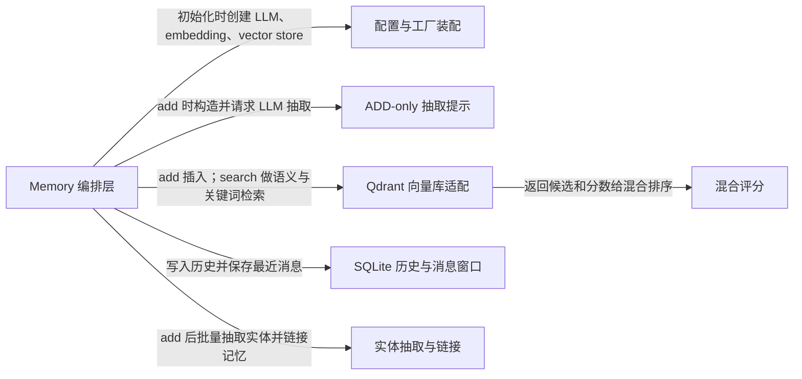

# mem0：架构、运行逻辑与设计取舍

> ts-v3.3.1 · [94c3fe9f238f](https://github.com/mem0ai/mem0/commit/94c3fe9f238f3dbf29c9ce98643bd71eb13077cd) · deepseek-flash 辅助分析 · 2026-10-30T05:33:11.336Z
> 下文按固定源码推演，没有执行目标项目。引用可跳到具体代码行；“工程推断”解释收益与代价，不代表作者亲述。

## 1. 先建立直觉

**把对话中值得长期记住的偏好先抽取成短句，再用语义和关键词信号在需要时找回来。**

聊天里说过的饮食偏好很容易丢失；直接存原始对话又会让后续检索充满噪声。项目用一次 LLM 抽取生成自包含记忆，再写入向量库，查询时混合语义、BM25 关键词和实体信号返回候选。

贯穿全文的例子：

- **输入：** add("我不吃辣，喜欢川菜", user_id="u1")；随后 search(query="给我推荐晚餐", filters={"user_id":"u1"}, top_k=20)。
- **预期输出：** 推演：add 可能返回若干条 event=ADD 的记忆，例如“用户不吃辣”“用户喜欢川菜”；search 可能返回包含川菜偏好的条目。具体抽取文本、分数和排名取决于实际 LLM、embedding、Qdrant 数据与实体抽取，不能由源码预测。

## 2. 一张图看懂架构



| 模块 | 职责与所在层的原因 | 输入 → 输出 | 拥有的状态 |
| --- | --- | --- | --- |
| Memory 编排层 [1][source-1] [2][source-2] | 对外暴露 add/search，并决定何时调用抽取、向量库、历史库和实体链接。 | 用户消息、user_id 等 scope、搜索 query 与 filters。 → add 返回 results 列表；search 返回带 score 的 MemoryItem 字典。 | 持有 embedding_model、vector_store、llm、SQLiteManager、collection_name 等实例。 |
| 配置与工厂装配 [3][source-3] | 按配置创建 LLM、embedding 和向量库实现，把 provider 名称映射到具体类。 | MemoryConfig 中的 provider 与 config。 → 可调用的 llm、embedding_model、vector_store 实例。 | 工厂类映射表与具体客户端连接。 |
| ADD-only 抽取提示 [4][source-4] [5][source-5] | 把已有记忆、新消息和最近消息拼成一次 LLM 请求，要求只输出 ADD 型 memory 数组。 | parsed_messages、existing_memories、last_k_messages、custom_instructions。 → JSON 中的 memory 数组，每项含 text 等字段。 | 无持久状态，仅构造提示和解析响应。 |
| Qdrant 向量库适配 [6][source-6] [7][source-7] | 执行 dense 向量插入/搜索、BM25 稀疏向量插入/搜索和 payload 过滤。 | vectors、ids、payloads、filters、query。 → Point 列表或 None（keyword 不支持时）。 | Qdrant collection 中的 dense 与 bm25 命名向量及 payload。 |
| 混合评分 [8][source-8] | 把语义分、归一化 BM25 分和实体 boost 相加并按可用信号归一化，再用语义阈值门控。 | semantic_results、bm25_scores、entity_boosts、threshold、top_k。 → 按 combined score 降序的候选。 | 无持久状态。 |
| SQLite 历史与消息窗口 [9][source-9] [10][source-10] | 记录 ADD 历史，保存最近对话消息，供下次 add 取 last_messages。 | memory_id、old/new text、event、messages、session_scope。 → history 行与最近 10 条 messages。 | SQLite 的 history 和 messages 表。 |
| 实体抽取与链接 [11][source-11] [12][source-12] | 从记忆文本抽取 PROPER/QUOTED/TOPIC/IDENTIFIER 实体，用于写入实体存储和检索 boost。 | 记忆文本或查询文本。 → (entity_type, entity_text) 元组列表。 | 实体存储中 linked_memory_ids 与实体向量。 |

## 3. 跟着一个请求跑完整条主线

这是对已读方法体的源码推演，不是执行日志。编号是阅读顺序；装配、写入、查询与条件分支是否发生，取决于每步的触发条件。

### 1. 构造 Memory 并装配依赖

**阶段：** 初始化

**触发条件：** 构造 Memory 时必经

入口/调用：`Memory.__init__ / EmbedderFactory.create / VectorStoreFactory.create / LlmFactory.create` [13][source-13] [14][source-14] [15][source-15]

**此时输入：** MemoryConfig，默认 provider 配置。

分别创建 embedding、vector_store、llm，并创建 SQLiteManager；若配置了 reranker 再创建。

**状态变化：** Memory 实例持有各依赖；SQLiteManager 建表并执行历史表迁移。

**交给下一步：** 可执行 add/search 的 Memory 对象。

### 2. add 规范化输入与 scope

**阶段：** 写入准备

**触发条件：** 调用 add 且不是 procedural memory 分支时

入口/调用：`Memory.add` [16][source-16]

**此时输入：** 字符串“我不吃辣，喜欢川菜”和 user_id。

拒绝 OSS 不支持的 timestamp；把字符串包装成 [{"role":"user","content":...}]；构建 metadata 与 effective_filters。

**状态变化：** messages 被统一为列表；processed_metadata 含 scope 与可选 expiration_date。

**交给下一步：** messages、processed_metadata、effective_filters 进入 _add_to_vector_store。

### 3. 抽取前先检索已有记忆

**阶段：** 写入

**触发条件：** infer=True 默认路径

入口/调用：`Memory._add_to_vector_store` [17][source-17]

**此时输入：** parsed_messages 与 user_id 过滤条件。

取 last_messages；对 parsed_messages 生成 search embedding；用 vector_store.search 取 top_k=10 已有记忆；把 UUID 映射为顺序 id，形成 existing_memories。

**状态变化：** 无持久写入；只是构造 LLM 去重/链接参考。

**交给下一步：** existing_memories 和 last_messages。

### 4. 一次 LLM 生成 ADD 型抽取结果

**阶段：** 写入

**触发条件：** infer=True 且 LLM 调用成功

入口/调用：`Memory._add_to_vector_store / generate_additive_extraction_prompt` [5][source-5] [4][source-4]

**此时输入：** ADDITIVE_EXTRACTION_PROMPT、existing_memories、new_messages、last_k_messages。

拼出用户侧 prompt，调用 llm.generate_response(response_format=json_object)，去掉代码块并解析 JSON 的 memory 数组。

**状态变化：** 无持久状态；得到 extracted_memories。

**交给下一步：** 可能包含多条待写入记忆文本的列表。

### 5. 批量 embedding 与 hash 去重

**阶段：** 写入

**触发条件：** extracted_memories 非空时

入口/调用：`Memory._add_to_vector_store` [18][source-18]

**此时输入：** extracted_memories 的 text 列表。

对文本批量 embed；对每条文本算 md5；跳过与已检索 existing hash 相同或本批 seen_hashes 相同的条目；保留者构造 memory_id、data、text_lemmatized、hash、created_at。

**状态变化：** 形成 records，但尚未写向量库。

**交给下一步：** 待批量插入的 records。

### 6. 批量持久化、历史与实体链接

**阶段：** 写入

**触发条件：** records 非空；insert 成功或逐条 fallback 成功

入口/调用：`Memory._add_to_vector_store / extract_entities_batch` [19][source-19] [20][source-20]

**此时输入：** records 的 vectors、ids、payloads。

批量 insert 向量；批量写 history 的 ADD 记录；对文本抽取实体，合并同实体 linked_memory_ids，更新或插入实体存储；最后 save_messages。

**状态变化：** Qdrant collection 新增点；SQLite history 新增 ADD；实体存储新增/更新链接。

**交给下一步：** returned_memories，每项 event=ADD。

### 7. search 预处理与语义过取

**阶段：** 查询

**触发条件：** 调用 search 且 filters 至少含 user_id/agent_id/run_id

入口/调用：`Memory.search / Memory._search_vector_store` [21][source-21] [22][source-22]

**此时输入：** query“给我推荐晚餐”，filters={user_id:u1}，top_k=20。

校验参数；对 query 做 BM25 词形处理并抽取实体；embed query；以 internal_limit=max(limit*4,60) 做向量搜索。

**状态变化：** 无持久状态；得到 semantic_results 候选池。

**交给下一步：** semantic_results、query_lemmatized、query_entities。

### 8. 关键词与实体信号补充

**阶段：** 查询可选分支

**触发条件：** vector store 支持 keyword_search；query_entities 非空时计算 entity boost

入口/调用：`Memory._search_vector_store / Qdrant.keyword_search / score_and_rank` [23][source-23] [24][source-24] [25][source-25]

**此时输入：** query_lemmatized、filters、semantic_results。

Qdrant 用 bm25 稀疏向量检索；对 raw BM25 用 sigmoid 归一化；有查询实体则查实体存储得 boost；score_and_rank 先按 semantic threshold 过滤，再 combined=(semantic+bm25+entity)/max_possible。

**状态变化：** 无持久状态；候选被重新排序。

**交给下一步：** top_k 个 scored 结果。

### 9. 格式化返回

**阶段：** 查询

**触发条件：** scored_results 中 payload.data 非空

入口/调用：`Memory._search_vector_store` [26][source-26]

**此时输入：** scored 结果及其 payload。

过滤过期 payload；构造 MemoryItem，把 data 映射为 memory，score 写入 score；提升 user_id、agent_id、run_id 等键，其余 payload 放入 metadata；explain 时附 score_details。

**状态变化：** 无持久状态。

**交给下一步：** {"results":[...]}。

## 4. 核心技术到底是什么

### 1. 单次 ADD-only LLM 抽取

**解决的问题：** 需要把一句自然语言偏好变成自包含、可检索的记忆，同时避免旧式 UPDATE/DELETE 决策覆盖已有信息。 [27][source-27] [4][source-4]

把新消息、最近消息和 top10 已有记忆放入提示；LLM 只输出 memory 数组；项目解析 text，后续统一加 hash、embedding、payload。

算法示意（用于解释机制，不是源码原文）：

```text
existing = vector_search(embed(parsed_messages), top_k=10)
prompt = build(existing_memories=existing, new_messages=parsed_messages, last_k=last_messages)
resp = llm.generate(prompt, response_format=json_object)
items = json.loads(resp).get('memory', [])
for item in items:
  text = item['text']
  vec = embed_batch([text])
  records.append((uuid4(), text, vec, payload(text)))

```

**关键数据结构：** existing_memories=[{id:str(idx),text:payload.data}]；extracted_memories=[{text,...}]；records=(id,text,embedding,payload)。

- **本项目实现：** Memory._add_to_vector_store 负责检索已有记忆、构造提示、解析 JSON、去重、写库；prompts.generate_additive_extraction_prompt 负责拼接章节。
- **外部依赖提供：** LLM 负责真正抽取哪些事实；embedding 模型负责把文本变向量；源码不保证一定抽出“不吃辣”或“喜欢川菜”。
- **收益与代价：** 写入只追加，冲突不会自动消解；但避免一次错误 UPDATE/DELETE 抹掉旧偏好，检索需要靠时间和分数融合处理新旧共存。

### 2. 混合检索与加性评分

**解决的问题：** 只靠语义向量会漏掉专名/关键词，只靠关键词又不懂同义表达。 [28][source-28] [29][source-29] [25][source-25]

语义搜索先过取候选；BM25 稀疏搜索得到关键词候选；BM25 原始分用查询长度自适应 sigmoid 归一到 [0,1]；实体 boost 加入；最终按 semantic threshold 门控后相加并除以 max_possible。

算法示意（用于解释机制，不是源码原文）：

```text
semantic = vector_store.search(query_vec, top_k=max(4*k,60))
keyword = vector_store.keyword_search(lemmatized_query, top_k=internal)
for hit in keyword:
  bm25[hit.id] = sigmoid(steepness*(raw-midpoint))
if query_entities:
  entity_boosts = compute_entity_boosts(query_entities)
for c in semantic:
  if c.score < threshold: skip
  combined = (c.score + bm25[c.id] + entity_boosts[c.id]) / max_possible
return top_k(sorted by combined)

```

**关键数据结构：** bm25_scores: {memory_id: normalized_score}；entity_boosts: {memory_id: boost}；candidate: {id,score,payload}。

- **本项目实现：** scoring.py 实现 BM25 参数、sigmoid 归一化和 score_and_rank；main.py 组织三路信号并格式化 MemoryItem。
- **外部依赖提供：** Qdrant 执行 dense query_points 和 bm25 稀疏 query_points；fastembed 生成 BM25 稀疏向量。
- **收益与代价：** 多信号提升召回，但排名依赖外部 embedding/BM25/实体抽取结果；分数不是概率，不能从代码推导具体名次。

### 3. MD5 hash 精确去重

**解决的问题：** 同一批抽取或最近已有记忆可能产生完全相同的文本，重复插入浪费空间并污染检索。 [30][source-30]

对每条抽取文本计算 md5；与 Phase1 返回的 existing payload.hash 集合比较，并与本批 seen_hashes 比较；命中则跳过。

算法示意（用于解释机制，不是源码原文）：

```text
existing_hashes = {m.payload['hash'] for m in existing_results if m.payload.hash}
seen = set()
for item in extracted:
  h = md5(item.text)
  if h in existing_hashes or h in seen: continue
  seen.add(h)
  records.append(make_record(item.text, h))

```

**关键数据结构：** existing_hashes:set[str]；seen_hashes:set[str]；payload.hash 保存 md5。

- **本项目实现：** Memory._add_to_vector_store 自己计算和比较 hash；SQLiteManager 记录 ADD 历史。
- **外部依赖提供：** 向量库只负责按 id 插入，不负责语义去重。
- **收益与代价：** 只挡住完全同文和本次 top10 内同 hash 的重复；不是全库幂等，换一种说法或 Phase1 未召回时仍可能新增。

### 4. 实体抽取与链接增强

**解决的问题：** 查询“晚餐”时，用户偏好里的“川菜”实体可以帮助把相关记忆排前。 [11][source-11] [12][source-12]

spaCy 文档经 NER、专名跨度、引号、主题短语多路候选，按优先级和重叠规则去重，输出 (type,text)；写入时把实体与 memory_id 关联，查询时对查询实体查实体存储产生 boost。

算法示意（用于解释机制，不是源码原文）：

```text
doc = nlp(text)
candidates = NER(doc) + identifiers(tokens) + proper_spans(tokens) + quoted(doc.text) + topic_phrases(doc)
accepted = resolve_by_priority_and_overlap(candidates)
return [(type, text)]
# add 侧：extract_entities_batch(texts) -> linked_memory_ids
# search 侧：extract_entities(query) -> entity_boosts

```

**关键数据结构：** _EntityCandidate(type,text,start,end,confidence,priority)；global_entities: normalized_key -> [type,text,{memory_ids}]。

- **本项目实现：** entity_extraction.py 负责候选生成与去重；main.py 在 add Phase7 批量合并、查询实体存储并更新 linked_memory_ids。
- **外部依赖提供：** spaCy 提供分词、词性、依存和 NER；fastembed/embedding 模型为实体文本生成向量。
- **收益与代价：** 实体链接能增强专名召回，但实体抽取有误差；boost 方法体未读完，不能确认其内部加权细节。

## 5. 为什么选择这种实现

### 1. 当前写入算法采用单次 ADD-only 抽取，不再让 LLM 对已有记忆做 UPDATE/DELETE 决策。

**依据：已确认实现；以下原因是工程分析，不代表作者亲述。** [31][source-31] [5][source-5]

**面临的约束：** 要保留用户历史偏好的完整轨迹，避免一次抽取错误覆盖旧信息。

**如果改用另一种做法：** 旧式做法是把已有记忆和新事实交给 LLM，让它输出 ADD/UPDATE/DELETE/NONE。

**为什么当前方案有用：** 在“我不吃辣，喜欢川菜”场景中，ADD-only 会把偏好作为新记忆追加；如果后来用户说“现在能吃辣了”，旧记忆仍在，检索层可通过时间和分数处理共存，而不是让一次 LLM 决策直接删掉旧偏好。

**付出的代价，以及不适用的情况：** 冲突不会自动消解，重复和过时偏好可能同时存在；需要下游检索、时间或应用层策略融合。

### 2. 语义阈值在混合评分之前门控候选。

**依据：已确认实现；以下原因是工程分析，不代表作者亲述。** [32][source-32]

**面临的约束：** BM25 或实体 boost 可能给语义不相关条目加分，需要先保证候选与查询有基本语义相关性。

**如果改用另一种做法：** 先把 semantic、bm25、entity 相加，再对最终分设阈值。

**为什么当前方案有用：** 查询“给我推荐晚餐”时，如果某条记忆只有“川菜”关键词重合但语义完全不相关，先卡 semantic_score 可避免它仅靠关键词被拉回；通过门控的川菜偏好仍可获得 BM25/实体增强。

**付出的代价，以及不适用的情况：** 语义分数偏低但关键词极准的条目可能被漏掉；阈值 0.1 是默认值，实际效果依赖 embedding。

### 3. 写入去重只比较 Phase1 召回的已有 hash 和本批 seen_hashes，而不是全库扫描。

**依据：已确认实现；以下原因是工程分析，不代表作者亲述。** [33][source-33]

**面临的约束：** add 路径要控制延迟，不能为了去重对全库逐条比较。

**如果改用另一种做法：** 每次 add 前对全库做 hash 查询或向量相似度去重。

**为什么当前方案有用：** 同一批抽取中的重复文本会被 seen_hashes 挡住；最近 top10 中完全相同的文本也会被挡住。但“喜欢川菜”和“爱吃川菜”这种不同文本不会被 hash 去重，说明去重范围有限。

**付出的代价，以及不适用的情况：** 不是全库幂等；相似但不同文或未被 top10 召回的同文仍可能重复写入。

### 4. 已有记忆只作为抽取参考和链接目标，不作为 UPDATE/DELETE 的修改对象。

**依据：已确认实现；以下原因是工程分析，不代表作者亲述。** [34][source-34] [35][source-35]

**面临的约束：** 保持 ADD-only 语义，同时让新记忆能关联到旧记忆。

**如果改用另一种做法：** 把 existing_memories 直接交给更新提示，由 LLM 选择覆盖旧 id。

**为什么当前方案有用：** 场景中已有“喜欢川菜”，新句“我不吃辣，喜欢川菜”应新增偏好并可能 linked_memory_ids 指向川菜旧记忆，而不是改写或删除旧条目；这样保留上下文。

**付出的代价，以及不适用的情况：** 旧偏好不会被自动修正，实体链接也只建立关系，不解决事实冲突。

### 5. SQLite 消息表只保留每个 session_scope 最近 10 条消息，并单独记录 history。

**依据：已确认实现；以下原因是工程分析，不代表作者亲述。** [36][source-36] [37][source-37]

**面临的约束：** last_k_messages 只需近期上下文，不能无限增长。

**如果改用另一种做法：** 永久保存完整对话并每次全量传入抽取提示。

**为什么当前方案有用：** add 时 get_last_messages(limit=10) 只取最近消息辅助代词消解；save_messages 后删除超出 10 条的旧消息，控制提示长度和本地库大小。

**付出的代价，以及不适用的情况：** 更早的对话上下文不会出现在 last_k_messages；依赖长期记忆条目和已有记忆检索补回。

## 6. 关键代码精读

### 1. add：先召回已有记忆，再让 LLM 只产出 ADD 文本


`mem0/memory/main.py:925-940` [38][source-38]

```python
        # Phase 1: Existing memory retrieval
        search_filters = {k: v for k, v in filters.items() if k in ("user_id", "agent_id", "run_id") and v}
        query_embedding = self.embedding_model.embed(parsed_messages, "search")
        existing_results = self.vector_store.search(
            query=parsed_messages,
            vectors=query_embedding,
            top_k=10,
            filters=search_filters,
        )

        # Map UUIDs to integers (anti-hallucination)
        existing_memories = []
        uuid_mapping = {}
        for idx, mem in enumerate(existing_results):
            uuid_mapping[str(idx)] = mem.id
            existing_memories.append({"id": str(idx), "text": mem.payload.get("data", "")})
```


`mem0/memory/main.py:942-986` [5][source-5]

```python
        # Phase 2: LLM extraction (single call)
        is_agent_scoped = bool(filters.get("agent_id")) and not filters.get("user_id")
        system_prompt = ADDITIVE_EXTRACTION_PROMPT
        if is_agent_scoped:
            system_prompt += AGENT_CONTEXT_SUFFIX

        custom_instr = prompt or self.custom_instructions

        user_prompt = generate_additive_extraction_prompt(
            existing_memories=existing_memories,
            new_messages=parsed_messages,
            last_k_messages=last_messages,
            custom_instructions=custom_instr,
        )

        try:
            response = self.llm.generate_response(
                messages=[
                    {"role": "system", "content": system_prompt},
                    {"role": "user", "content": user_prompt},
                ],
                response_format={"type": "json_object"},
            )
        except Exception as e:
            # Re-raise so callers can implement provider fallback / retry.
            # The original silent ``return []`` made upstream callers unable to
            # distinguish "LLM unavailable" (429/5xx/timeout) from "LLM
            # extracted no facts" -- both surfaced as an empty list.
            logger.error(f"LLM extraction failed: {e}")
            raise LLMError(f"LLM extraction failed: {e}") from e

        # Parse response
        try:
            response = remove_code_blocks(response)
            if not response or not response.strip():
                extracted_memories = []
            else:
                try:
                    extracted_memories = json.loads(response, strict=False).get("memory", [])
                except json.JSONDecodeError:
                    extracted_json = extract_json(response)
                    extracted_memories = json.loads(extracted_json, strict=False).get("memory", [])
        except Exception as e:
            logger.error(f"Error parsing extraction response: {e}")
            extracted_memories = []
```


`mem0/memory/main.py:993-1034` [39][source-39]

```python
        # Phase 3: Batch embed all extracted memory texts
        mem_texts = [m.get("text", "") for m in extracted_memories if m.get("text")]
        try:
            mem_embeddings_list = self.embedding_model.embed_batch(mem_texts, "add")
            embed_map = dict(zip(mem_texts, mem_embeddings_list))
        except Exception:
            # Fallback: embed individually
            embed_map = {}
            for text in mem_texts:
                try:
                    embed_map[text] = self.embedding_model.embed(text, "add")
                except Exception as e:
                    logger.warning(f"Failed to embed memory text: {e}")

        # Phase 4: Per-memory CPU processing + Phase 5: Hash dedup
        # Build set of existing hashes for dedup
        existing_hashes = set()
        for mem in existing_results:
            h = mem.payload.get("hash") if hasattr(mem, "payload") and mem.payload else None
            if h:
                existing_hashes.add(h)

        records = []  # (memory_id, text, embedding, payload)
        seen_hashes = set()  # dedup within the current batch
        for mem in extracted_memories:
            text = mem.get("text")
            if not text or text not in embed_map:
                continue

            mem_hash = hashlib.md5(text.encode()).hexdigest()
            if mem_hash in existing_hashes or mem_hash in seen_hashes:
                logger.debug(f"Skipping duplicate memory (hash match): {text[:50]}")
                continue
            seen_hashes.add(mem_hash)

            text_lemmatized = lemmatize_for_bm25(text)

            memory_id = str(uuid.uuid4())
            mem_metadata = deepcopy(metadata)
            mem_metadata["data"] = text
            mem_metadata["text_lemmatized"] = text_lemmatized
            mem_metadata["hash"] = mem_hash
```


Phase1 对解析后的新消息做 embedding，并只取 user_id/agent_id/run_id 这些 scope 过滤，向量检索 top10；结果不直接修改，只映射成 existing_memories 给 LLM 做去重和 linking。Phase2 把 ADDITIVE_EXTRACTION_PROMPT 和生成的用户提示发给 LLM，解析 memory 数组。Phase3/5 对每条 text 批量 embed，并用 md5 与本批和已有 hash 比较；通过后才构造 payload，其中 data 是实际记忆文本，text_lemmatized 供 BM25，hash 供精确去重。

### 2. search：三路信号如何汇合


`mem0/memory/main.py:1647-1701` [28][source-28]

```python
        # Step 1: Preprocess query
        query_lemmatized = lemmatize_for_bm25(query)
        query_entities = extract_entities(query)

        # Step 2: Embed query
        embeddings = self.embedding_model.embed(query, "search")

        # Step 3: Semantic search (over-fetch for scoring pool)
        internal_limit = max(limit * 4, 60)
        semantic_results = self.vector_store.search(
            query=query, vectors=embeddings, top_k=internal_limit, filters=filters
        )

        # Step 4: Keyword search (if store supports it)
        keyword_results = self.vector_store.keyword_search(
            query=query_lemmatized, top_k=internal_limit, filters=filters
        )

        # Step 5: Compute BM25 scores from keyword results
        bm25_scores = {}
        if keyword_results is not None:
            midpoint, steepness = get_bm25_params(query, lemmatized=query_lemmatized)
            for mem in keyword_results:
                mem_id = str(mem.id) if hasattr(mem, 'id') else str(mem.get('id', ''))
                raw_score = mem.score if hasattr(mem, 'score') else mem.get('score', 0)
                if raw_score and raw_score > 0:
                    bm25_scores[mem_id] = normalize_bm25(raw_score, midpoint, steepness)

        # Step 6: Compute entity boosts
        entity_boosts = {}
        if query_entities:
            entity_boosts = self._compute_entity_boosts(query_entities, filters)

        # Step 7: Build candidate set from semantic results
        candidates = []
        for mem in semantic_results:
            payload = mem.payload if hasattr(mem, 'payload') else {}
            if not show_expired and _payload_is_expired(payload):
                continue
            mem_id = str(mem.id)
            candidates.append({
                "id": mem_id,
                "score": mem.score,
                "payload": payload,
            })

        # Step 8: Score and rank
        scored_results = score_and_rank(
            semantic_results=candidates,
            bm25_scores=bm25_scores,
            entity_boosts=entity_boosts,
            threshold=threshold,
            top_k=limit,
            explain=explain,
        )
```


查询先做 lemmatize 和实体抽取，再 embed。语义搜索用 internal_limit=max(limit*4,60) 过取候选池。keyword_search 用 bm25 稀疏向量；只有返回非 None 时才把 raw score 经 get_bm25_params 选择的 midpoint/steepness 做 sigmoid 归一化。query_entities 非空时计算 entity_boosts。最后 score_and_rank 只从 semantic_results 建候选，所以 BM25 和实体 boost 是给语义候选加分，不是独立产生新候选。

### 3. scoring：阈值门控与自适应分母


`mem0/utils/scoring.py:16-54` [29][source-29]

```python
def get_bm25_params(query: str, *, lemmatized: Optional[str] = None) -> tuple:
    """Get BM25 sigmoid parameters based on query length.

    Longer queries tend to have higher raw BM25 scores, so we adjust
    the sigmoid midpoint and steepness accordingly.

    Returns:
        (midpoint, steepness) for sigmoid normalization.
    """
    if lemmatized is None:
        from mem0.utils.lemmatization import lemmatize_for_bm25

        lemmatized = lemmatize_for_bm25(query)
    num_terms = len(lemmatized.split()) if lemmatized else 1

    if num_terms <= 3:
        return 5.0, 0.7
    elif num_terms <= 6:
        return 7.0, 0.6
    elif num_terms <= 9:
        return 9.0, 0.5
    elif num_terms <= 15:
        return 10.0, 0.5
    else:
        return 12.0, 0.5


def normalize_bm25(raw_score: float, midpoint: float, steepness: float) -> float:
    """Normalize BM25 score to [0, 1] using logistic sigmoid.

    Args:
        raw_score: Raw BM25 score (unbounded, typically 0-20+).
        midpoint: Score at which sigmoid outputs 0.5.
        steepness: Controls how quickly sigmoid transitions.

    Returns:
        Normalized score in range [0, 1].
    """
    return 1.0 / (1.0 + math.exp(-steepness * (raw_score - midpoint)))
```


`mem0/utils/scoring.py:94-139` [25][source-25]

```python
    has_bm25 = bool(bm25_scores)
    has_entity = bool(entity_boosts)

    max_possible = 1.0
    if has_bm25:
        max_possible += 1.0
    if has_entity:
        max_possible += ENTITY_BOOST_WEIGHT

    scored: List[Dict[str, Any]] = []

    for result in semantic_results:
        mem_id = result.get("id")
        if mem_id is None:
            continue

        semantic_score = result.get("score") or 0.0
        if semantic_score < threshold:
            continue

        mem_id_str = str(mem_id)
        bm25_score = bm25_scores.get(mem_id_str, 0.0)
        entity_boost = entity_boosts.get(mem_id_str, 0.0)

        raw_combined = semantic_score + bm25_score + entity_boost
        combined = min(raw_combined / max_possible, 1.0)

        scored_result = {
            "id": mem_id_str,
            "score": combined,
            "payload": result.get("payload"),
        }
        if explain:
            scored_result["score_details"] = {
                "semantic_score": semantic_score,
                "bm25_score": bm25_score,
                "entity_boost": entity_boost,
                "raw_score": raw_combined,
                "max_possible_score": max_possible,
                "final_score": combined,
                "threshold": threshold,
            }
        scored.append(scored_result)

    scored.sort(key=lambda x: x["score"], reverse=True)
    return scored[:top_k]
```


max_possible 根据实际信号存在性变化：只有语义为 1.0；有 BM25 加 1.0；有实体再加 0.5。每个候选先检查 semantic_score < threshold，低于阈值直接跳过；因此关键词和实体不能把语义不相关条目救回来。combined=(semantic+bm25+entity)/max_possible 并截断到 1.0，最后降序取 top_k。BM25 归一化使用 logistic sigmoid，使不同查询长度下的 raw BM25 可比。

## 7. 动手验证你的理解

以下是建议实验，没有执行过。

### 1. infer=False 时是否还经过 LLM 抽取和 hash 去重？

**改变什么：** 对同一句“我不吃辣，喜欢川菜”调用 memory.add(..., infer=False)。 [40][source-40] [41][source-41]

**应该观察到什么：** 应跳过 Phase2 的 LLM 抽取和 Phase5 的 extracted hash 去重，直接对每条非 system 消息 embed，并调用 _create_memory 写向量库和 history ADD；返回 event=ADD。

### 2. 向量库不支持 keyword_search 时混合评分如何退化？

**改变什么：** 换一个未 override keyword_search 的 vector store，或用没有 bm25 slot 的 Qdrant collection，然后执行同一 search。 [42][source-42] [43][source-43]

**应该观察到什么：** keyword_search 返回 None，bm25_scores 为空；score_and_rank 的 has_bm25=False，max_possible 从 1.0 起算；排名只由 semantic 与可能存在的 entity boost 决定。

### 3. 重复 add 完全相同文本是否一定不新增？

**改变什么：** 先 add 一次，再对同一 user_id 重复 add 完全相同的文本，保持 infer=True。 [44][source-44] [33][source-33]

**应该观察到什么：** 若 Phase1 top10 检索返回了同 hash 的已有记忆，则被跳过；若该已有记忆未被 top10 召回，则代码没有全库 hash 检查，仍可能插入。因此实验应观察“去重范围”而不是假设全局幂等。

## 8. 读完应当能复述什么

- add 当前是单次 ADD-only 抽取：已有记忆用于去重参考和 linking，不是 UPDATE/DELETE 的目标。
- search 不是单一向量检索：语义候选池先过阈值，再由 BM25 和实体 boost 加性重排。
- hash 去重只覆盖 Phase1 top10 已有 hash 与本批 seen_hashes，不能把整个系统理解为全局幂等。
- LLM、embedding、Qdrant 和 spaCy 各自负责抽取、向量化、检索和实体候选；具体排名不能由源码静态预测。
- 历史库记录 ADD 审计，消息窗口只保留最近 10 条，长期上下文主要靠记忆条目本身。

## 来源与覆盖边界

本次读取 24 个文件，共 314,086 字符；23 个文件完整读取，其他文件按关键方法取带行号的片段。没有把未读依赖的内部实现当作已确认事实。

- Memory._compute_entity_boosts 和 _search_entity 的方法体未在已读范围，无法确认实体 boost 的具体数值计算和实体存储查询细节。
- _build_filters_and_metadata 的方法体未读，无法逐步验证 metadata 与 user_id/agent_id/run_id 的合并细节。
- Memory.entity_store 的初始化与底层实体存储实现未读，无法确认实体存储使用哪个向量集合及失败回退细节。
- Qdrant BM25 的实际 IDF、稀疏向量编码和命中分数由 fastembed 与 Qdrant 决定，未运行无法预测“给我推荐晚餐”最终排名。

| 文件 | 实际读取行段 |
| --- | --- |
| [README.md](https://github.com/mem0ai/mem0/blob/94c3fe9f238f3dbf29c9ce98643bd71eb13077cd/README.md) | 1–270 / 共 270 行 |
| [pyproject.toml](https://github.com/mem0ai/mem0/blob/94c3fe9f238f3dbf29c9ce98643bd71eb13077cd/pyproject.toml) | 1–175 / 共 175 行 |
| [mem0/memory/main.py](https://github.com/mem0ai/mem0/blob/94c3fe9f238f3dbf29c9ce98643bd71eb13077cd/mem0/memory/main.py) | 1–50、485–554、757–1221、1390–1537、1639–1746、1972–2006 / 共 3913 行 |
| [mem0/configs/base.py](https://github.com/mem0ai/mem0/blob/94c3fe9f238f3dbf29c9ce98643bd71eb13077cd/mem0/configs/base.py) | 1–82 / 共 82 行 |
| [mem0/configs/prompts.py](https://github.com/mem0ai/mem0/blob/94c3fe9f238f3dbf29c9ce98643bd71eb13077cd/mem0/configs/prompts.py) | 1–1063 / 共 1063 行 |
| [mem0/utils/factory.py](https://github.com/mem0ai/mem0/blob/94c3fe9f238f3dbf29c9ce98643bd71eb13077cd/mem0/utils/factory.py) | 1–281 / 共 281 行 |
| [mem0/memory/storage.py](https://github.com/mem0ai/mem0/blob/94c3fe9f238f3dbf29c9ce98643bd71eb13077cd/mem0/memory/storage.py) | 1–348 / 共 348 行 |
| [mem0/vector_stores/base.py](https://github.com/mem0ai/mem0/blob/94c3fe9f238f3dbf29c9ce98643bd71eb13077cd/mem0/vector_stores/base.py) | 1–101 / 共 101 行 |
| [mem0/vector_stores/qdrant.py](https://github.com/mem0ai/mem0/blob/94c3fe9f238f3dbf29c9ce98643bd71eb13077cd/mem0/vector_stores/qdrant.py) | 1–607 / 共 607 行 |
| [mem0/utils/scoring.py](https://github.com/mem0ai/mem0/blob/94c3fe9f238f3dbf29c9ce98643bd71eb13077cd/mem0/utils/scoring.py) | 1–140 / 共 140 行 |
| [mem0/utils/entity_extraction.py](https://github.com/mem0ai/mem0/blob/94c3fe9f238f3dbf29c9ce98643bd71eb13077cd/mem0/utils/entity_extraction.py) | 1–773 / 共 773 行 |
| [examples/mem0-demo/app/api/chat/route.ts](https://github.com/mem0ai/mem0/blob/94c3fe9f238f3dbf29c9ce98643bd71eb13077cd/examples/mem0-demo/app/api/chat/route.ts) | 1–113 / 共 113 行 |
| [mem0/configs/enums.py](https://github.com/mem0ai/mem0/blob/94c3fe9f238f3dbf29c9ce98643bd71eb13077cd/mem0/configs/enums.py) | 1–8 / 共 8 行 |
| [mem0/exceptions.py](https://github.com/mem0ai/mem0/blob/94c3fe9f238f3dbf29c9ce98643bd71eb13077cd/mem0/exceptions.py) | 1–485 / 共 485 行 |
| [mem0/memory/base.py](https://github.com/mem0ai/mem0/blob/94c3fe9f238f3dbf29c9ce98643bd71eb13077cd/mem0/memory/base.py) | 1–64 / 共 64 行 |
| [mem0/memory/notices.py](https://github.com/mem0ai/mem0/blob/94c3fe9f238f3dbf29c9ce98643bd71eb13077cd/mem0/memory/notices.py) | 1–1668 / 共 1668 行 |
| [mem0/memory/setup.py](https://github.com/mem0ai/mem0/blob/94c3fe9f238f3dbf29c9ce98643bd71eb13077cd/mem0/memory/setup.py) | 1–167 / 共 167 行 |
| [mem0/memory/telemetry.py](https://github.com/mem0ai/mem0/blob/94c3fe9f238f3dbf29c9ce98643bd71eb13077cd/mem0/memory/telemetry.py) | 1–242 / 共 242 行 |
| [mem0/memory/utils.py](https://github.com/mem0ai/mem0/blob/94c3fe9f238f3dbf29c9ce98643bd71eb13077cd/mem0/memory/utils.py) | 1–331 / 共 331 行 |
| [mem0/configs/rerankers/config.py](https://github.com/mem0ai/mem0/blob/94c3fe9f238f3dbf29c9ce98643bd71eb13077cd/mem0/configs/rerankers/config.py) | 1–13 / 共 13 行 |
| [mem0/embeddings/configs.py](https://github.com/mem0ai/mem0/blob/94c3fe9f238f3dbf29c9ce98643bd71eb13077cd/mem0/embeddings/configs.py) | 1–32 / 共 32 行 |
| [mem0/llms/configs.py](https://github.com/mem0ai/mem0/blob/94c3fe9f238f3dbf29c9ce98643bd71eb13077cd/mem0/llms/configs.py) | 1–36 / 共 36 行 |
| [mem0/vector_stores/configs.py](https://github.com/mem0ai/mem0/blob/94c3fe9f238f3dbf29c9ce98643bd71eb13077cd/mem0/vector_stores/configs.py) | 1–69 / 共 69 行 |
| [mem0/configs/embeddings/base.py](https://github.com/mem0ai/mem0/blob/94c3fe9f238f3dbf29c9ce98643bd71eb13077cd/mem0/configs/embeddings/base.py) | 1–112 / 共 112 行 |

[source-1]: https://github.com/mem0ai/mem0/blob/94c3fe9f238f3dbf29c9ce98643bd71eb13077cd/mem0/memory/main.py#L487-L554 "mem0/memory/main.py:487-554"
[source-2]: https://github.com/mem0ai/mem0/blob/94c3fe9f238f3dbf29c9ce98643bd71eb13077cd/mem0/memory/main.py#L760-L880 "mem0/memory/main.py:760-880"
[source-3]: https://github.com/mem0ai/mem0/blob/94c3fe9f238f3dbf29c9ce98643bd71eb13077cd/mem0/utils/factory.py#L152-L225 "mem0/utils/factory.py:152-225"
[source-4]: https://github.com/mem0ai/mem0/blob/94c3fe9f238f3dbf29c9ce98643bd71eb13077cd/mem0/configs/prompts.py#L1016-L1063 "mem0/configs/prompts.py:1016-1063"
[source-5]: https://github.com/mem0ai/mem0/blob/94c3fe9f238f3dbf29c9ce98643bd71eb13077cd/mem0/memory/main.py#L942-L986 "mem0/memory/main.py:942-986"
[source-6]: https://github.com/mem0ai/mem0/blob/94c3fe9f238f3dbf29c9ce98643bd71eb13077cd/mem0/vector_stores/qdrant.py#L186-L246 "mem0/vector_stores/qdrant.py:186-246"
[source-7]: https://github.com/mem0ai/mem0/blob/94c3fe9f238f3dbf29c9ce98643bd71eb13077cd/mem0/vector_stores/qdrant.py#L415-L485 "mem0/vector_stores/qdrant.py:415-485"
[source-8]: https://github.com/mem0ai/mem0/blob/94c3fe9f238f3dbf29c9ce98643bd71eb13077cd/mem0/utils/scoring.py#L60-L139 "mem0/utils/scoring.py:60-139"
[source-9]: https://github.com/mem0ai/mem0/blob/94c3fe9f238f3dbf29c9ce98643bd71eb13077cd/mem0/memory/storage.py#L150-L256 "mem0/memory/storage.py:150-256"
[source-10]: https://github.com/mem0ai/mem0/blob/94c3fe9f238f3dbf29c9ce98643bd71eb13077cd/mem0/memory/storage.py#L257-L324 "mem0/memory/storage.py:257-324"
[source-11]: https://github.com/mem0ai/mem0/blob/94c3fe9f238f3dbf29c9ce98643bd71eb13077cd/mem0/utils/entity_extraction.py#L731-L773 "mem0/utils/entity_extraction.py:731-773"
[source-12]: https://github.com/mem0ai/mem0/blob/94c3fe9f238f3dbf29c9ce98643bd71eb13077cd/mem0/memory/main.py#L1100-L1204 "mem0/memory/main.py:1100-1204"
[source-13]: https://github.com/mem0ai/mem0/blob/94c3fe9f238f3dbf29c9ce98643bd71eb13077cd/mem0/memory/main.py#L488-L514 "mem0/memory/main.py:488-514"
[source-14]: https://github.com/mem0ai/mem0/blob/94c3fe9f238f3dbf29c9ce98643bd71eb13077cd/mem0/utils/factory.py#L168-L179 "mem0/utils/factory.py:168-179"
[source-15]: https://github.com/mem0ai/mem0/blob/94c3fe9f238f3dbf29c9ce98643bd71eb13077cd/mem0/utils/factory.py#L210-L218 "mem0/utils/factory.py:210-218"
[source-16]: https://github.com/mem0ai/mem0/blob/94c3fe9f238f3dbf29c9ce98643bd71eb13077cd/mem0/memory/main.py#L817-L871 "mem0/memory/main.py:817-871"
[source-17]: https://github.com/mem0ai/mem0/blob/94c3fe9f238f3dbf29c9ce98643bd71eb13077cd/mem0/memory/main.py#L920-L940 "mem0/memory/main.py:920-940"
[source-18]: https://github.com/mem0ai/mem0/blob/94c3fe9f238f3dbf29c9ce98643bd71eb13077cd/mem0/memory/main.py#L993-L1041 "mem0/memory/main.py:993-1041"
[source-19]: https://github.com/mem0ai/mem0/blob/94c3fe9f238f3dbf29c9ce98643bd71eb13077cd/mem0/memory/main.py#L1047-L1220 "mem0/memory/main.py:1047-1220"
[source-20]: https://github.com/mem0ai/mem0/blob/94c3fe9f238f3dbf29c9ce98643bd71eb13077cd/mem0/utils/entity_extraction.py#L761-L773 "mem0/utils/entity_extraction.py:761-773"
[source-21]: https://github.com/mem0ai/mem0/blob/94c3fe9f238f3dbf29c9ce98643bd71eb13077cd/mem0/memory/main.py#L1446-L1510 "mem0/memory/main.py:1446-1510"
[source-22]: https://github.com/mem0ai/mem0/blob/94c3fe9f238f3dbf29c9ce98643bd71eb13077cd/mem0/memory/main.py#L1642-L1658 "mem0/memory/main.py:1642-1658"
[source-23]: https://github.com/mem0ai/mem0/blob/94c3fe9f238f3dbf29c9ce98643bd71eb13077cd/mem0/memory/main.py#L1660-L1701 "mem0/memory/main.py:1660-1701"
[source-24]: https://github.com/mem0ai/mem0/blob/94c3fe9f238f3dbf29c9ce98643bd71eb13077cd/mem0/vector_stores/qdrant.py#L454-L485 "mem0/vector_stores/qdrant.py:454-485"
[source-25]: https://github.com/mem0ai/mem0/blob/94c3fe9f238f3dbf29c9ce98643bd71eb13077cd/mem0/utils/scoring.py#L94-L139 "mem0/utils/scoring.py:94-139"
[source-26]: https://github.com/mem0ai/mem0/blob/94c3fe9f238f3dbf29c9ce98643bd71eb13077cd/mem0/memory/main.py#L1703-L1745 "mem0/memory/main.py:1703-1745"
[source-27]: https://github.com/mem0ai/mem0/blob/94c3fe9f238f3dbf29c9ce98643bd71eb13077cd/mem0/memory/main.py#L925-L986 "mem0/memory/main.py:925-986"
[source-28]: https://github.com/mem0ai/mem0/blob/94c3fe9f238f3dbf29c9ce98643bd71eb13077cd/mem0/memory/main.py#L1647-L1701 "mem0/memory/main.py:1647-1701"
[source-29]: https://github.com/mem0ai/mem0/blob/94c3fe9f238f3dbf29c9ce98643bd71eb13077cd/mem0/utils/scoring.py#L16-L54 "mem0/utils/scoring.py:16-54"
[source-30]: https://github.com/mem0ai/mem0/blob/94c3fe9f238f3dbf29c9ce98643bd71eb13077cd/mem0/memory/main.py#L1007-L1041 "mem0/memory/main.py:1007-1041"
[source-31]: https://github.com/mem0ai/mem0/blob/94c3fe9f238f3dbf29c9ce98643bd71eb13077cd/README.md#L56-L61 "README.md:56-61"
[source-32]: https://github.com/mem0ai/mem0/blob/94c3fe9f238f3dbf29c9ce98643bd71eb13077cd/mem0/utils/scoring.py#L105-L119 "mem0/utils/scoring.py:105-119"
[source-33]: https://github.com/mem0ai/mem0/blob/94c3fe9f238f3dbf29c9ce98643bd71eb13077cd/mem0/memory/main.py#L1009-L1026 "mem0/memory/main.py:1009-1026"
[source-34]: https://github.com/mem0ai/mem0/blob/94c3fe9f238f3dbf29c9ce98643bd71eb13077cd/mem0/configs/prompts.py#L506-L513 "mem0/configs/prompts.py:506-513"
[source-35]: https://github.com/mem0ai/mem0/blob/94c3fe9f238f3dbf29c9ce98643bd71eb13077cd/mem0/memory/main.py#L925-L955 "mem0/memory/main.py:925-955"
[source-36]: https://github.com/mem0ai/mem0/blob/94c3fe9f238f3dbf29c9ce98643bd71eb13077cd/mem0/memory/main.py#L920-L923 "mem0/memory/main.py:920-923"
[source-37]: https://github.com/mem0ai/mem0/blob/94c3fe9f238f3dbf29c9ce98643bd71eb13077cd/mem0/memory/storage.py#L279-L291 "mem0/memory/storage.py:279-291"
[source-38]: https://github.com/mem0ai/mem0/blob/94c3fe9f238f3dbf29c9ce98643bd71eb13077cd/mem0/memory/main.py#L925-L940 "mem0/memory/main.py:925-940"
[source-39]: https://github.com/mem0ai/mem0/blob/94c3fe9f238f3dbf29c9ce98643bd71eb13077cd/mem0/memory/main.py#L993-L1034 "mem0/memory/main.py:993-1034"
[source-40]: https://github.com/mem0ai/mem0/blob/94c3fe9f238f3dbf29c9ce98643bd71eb13077cd/mem0/memory/main.py#L882-L916 "mem0/memory/main.py:882-916"
[source-41]: https://github.com/mem0ai/mem0/blob/94c3fe9f238f3dbf29c9ce98643bd71eb13077cd/mem0/memory/main.py#L1975-L2005 "mem0/memory/main.py:1975-2005"
[source-42]: https://github.com/mem0ai/mem0/blob/94c3fe9f238f3dbf29c9ce98643bd71eb13077cd/mem0/vector_stores/base.py#L68-L83 "mem0/vector_stores/base.py:68-83"
[source-43]: https://github.com/mem0ai/mem0/blob/94c3fe9f238f3dbf29c9ce98643bd71eb13077cd/mem0/utils/scoring.py#L94-L101 "mem0/utils/scoring.py:94-101"
[source-44]: https://github.com/mem0ai/mem0/blob/94c3fe9f238f3dbf29c9ce98643bd71eb13077cd/mem0/memory/main.py#L925-L933 "mem0/memory/main.py:925-933"
