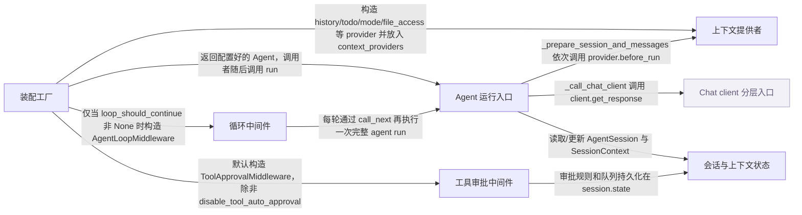

# agent-framework：架构、运行逻辑与设计取舍

> main · [1a6300e28765](https://github.com/microsoft/agent-framework/commit/1a6300e287658d184201e2389decf6c183c0ff87) · deepseek-flash 辅助分析 · 2026-10-30T05:33:11.336Z
> 下文按固定源码推演，没有执行目标项目。引用可跳到具体代码行；“工程推断”解释收益与代价，不代表作者亲述。

## 1. 先建立直觉

**把一次任务拆成可重复的模型调用：模型提出工具动作，宿主批准后执行，结果写回会话，直到待办完成或不再满足继续条件。**

直接调用模型时，文件读写、待办跟踪、模式切换、工具审批、会话历史和循环终止都要手工编排；如果都塞进一个 run 函数，安全边界和状态持久化会相互纠缠。

贯穿全文的例子：

- **输入：** 假定用户说：读取 notes/todo.md，把未完成事项补进待办，并写 summary.md。构造 create_harness_agent(client, file_access_store=FileSystemAgentFileStore(...), loop_should_continue=todos_remaining(), loop_next_message=todos_remaining_message)。
- **预期输出：** 推演：模型可能先调用 todos_add（无需审批），再提出 file_access_read 或 file_access_write；文件工具默认 always_require，ToolApprovalMiddleware 会把调用变成 function_approval_request 返回给调用者。调用者批准后再次 run，审批响应被收集并驱动工具执行；文件写入 store，最终返回 summary。若仍有未完成 todo，AgentLoopMiddleware 用 next_message 再跑一轮；todos_remaining 返回 False 后停止。

## 2. 一张图看懂架构



| 模块 | 职责与所在层的原因 | 输入 → 输出 | 拥有的状态 |
| --- | --- | --- | --- |
| 装配工厂 [1][source-1] [2][source-2] | create_harness_agent 只负责把 client、历史、压缩、上下文提供者、工具、中间件和默认选项组装成 Agent；它不实现 run 循环。 | chat client 与可选参数，如 file_access_store、loop_should_continue、disable_tool_auto_approval。 → 配置好的 Agent 实例。 | 创建 provider/middleware 实例，并把 compaction_strategy、context_providers、middleware 等写入 Agent 构造参数。 |
| Agent 运行入口 [3][source-3] [4][source-4] [5][source-5] | RawAgent.run 准备一次运行的上下文，调用 chat client，并把返回的 ChatResponse 解析成 AgentResponse；AgentMiddlewareLayer 在 run 外再包一层 agent middleware。 | 用户消息、AgentSession、run options、tools。 → AgentResponse 或流式 ResponseStream。 | 创建 SessionContext，更新 session/response，安装 per-service-call history middleware。 |
| 上下文提供者 [6][source-6] [7][source-7] [8][source-8] [9][source-9] | 在每次 run 前把工具、指令、消息注入 SessionContext；TodoProvider、AgentModeProvider、FileAccessProvider 分别管理待办、模式和文件工具。 | AgentSession、SessionContext、provider 自己的 state。 → 增加到 context 的 messages、instructions、tools。 | provider 状态写入 session.state[source_id]；文件 provider 还维护 store 和工作目录。 |
| 循环中间件 [10][source-10] [11][source-11] | AgentLoopMiddleware 包裹整次 run，按 should_continue 和 max_iterations 决定是否再跑一轮；遇到待审批请求时中断并返回给调用者。 | AgentContext、call_next、should_continue、next_message。 → 聚合后的 AgentResponse，或下一轮输入。 | progress 日志、aggregated messages、usage；可选地恢复 session 快照。 |
| 工具审批中间件 [12][source-12] [13][source-13] | ToolApprovalMiddleware 把 standing rules、自动审批回调和排队中的审批请求组织成一次 run 内的审批状态机。 | AgentContext、消息中的 function_approval_request/function_approval_response、AgentSession。 → 批准的 function_approval_response，或把待审批请求返回给调用者。 | session.state[source_id] 中的 ToolApprovalState：rules、queued_approval_requests、collected_approval_responses。 |
| 会话与上下文状态 [14][source-14] [15][source-15] | AgentSession 保存 session_id、service_session_id 和共享 state；SessionContext 保存一次 run 的 provider 注入结果。 | provider 写入的消息、工具、指令和状态。 → 按 provider 顺序合并后的消息列表与 session 状态。 | AgentSession.state 是可变 dict；SessionContext.context_messages 按 source_id 分区。 |
| Chat client 分层入口（外部依赖） [16][source-16] [17][source-17] | RawAgent 通过 client.get_response 进入模型调用；具体客户端内部再组合 telemetry、function invocation、chat middleware 等层。 | messages、options、compaction_strategy、function_invocation_kwargs、client_kwargs。 → ChatResponse 或 ResponseStream。 | 由具体客户端和模型服务管理；本仓库基类只做参数解析和压缩入口。 |

## 3. 跟着一个请求跑完整条主线

这是对已读方法体的源码推演，不是执行日志。编号是阅读顺序；装配、写入、查询与条件分支是否发生，取决于每步的触发条件。

### 1. 工厂装配出 Agent

**阶段：** 装配

**触发条件：** 必经：调用 create_harness_agent

入口/调用：`create_harness_agent` [18][source-18] [19][source-19]

**此时输入：** client 与可选参数

解析压缩策略、构造 history/shell/context providers，合并 instructions、tools、default_options，组装 middleware，最后构造 Agent 并返回

**状态变化：** 创建 provider 和 middleware 实例；Agent 持有 context_providers、middleware、compaction_strategy；此时没有运行循环

**交给下一步：** 配置好的 Agent

### 2. 启用 loop 时开始一轮循环

**阶段：** 调用/可选分支

**触发条件：** 条件：loop_should_continue 非 None，AgentLoopMiddleware 位于中间件管线外层

入口/调用：`AgentLoopMiddleware.process` [10][source-10]

**此时输入：** AgentContext、call_next

把本次输入保存为 original_messages；若需要 fresh_context 则快照 session；然后调用 _process_non_streaming 或 _process_streaming

**状态变化：** context.messages 可能被追加 additional_instructions；snapshot 可能被保存

**交给下一步：** 进入内层 middleware 或最终 agent run

### 3. 工具审批中间件准备入站消息并进入下一层

**阶段：** 初始化/查询

**触发条件：** 默认：disable_tool_auto_approval 为 False 时启用

入口/调用：`ToolApprovalMiddleware.process` [13][source-13] [20][source-20]

**此时输入：** AgentContext、AgentSession 中的批准状态

要求 session 存在，读取 ToolApprovalState，处理调用者传入的 function_approval_response，注入已收集的审批响应，然后调用 call_next 进入内层 agent run

**状态变化：** rules 可能新增；collected_approval_responses 被注入消息；状态保存回 session.state

**交给下一步：** 带审批响应消息的上下文，交给 RawAgent.run

### 4. RawAgent.run 准备一次运行

**阶段：** 初始化/查询

**触发条件：** 必经：最终 handler 调用 run

入口/调用：`RawAgent.run / RawAgent._prepare_run_context / RawAgent._prepare_session_and_messages` [21][source-21] [22][source-22] [23][source-23]

**此时输入：** 用户 messages、session、run tools/options

合并 options 和 tools，确定 active session，创建 SessionContext，按顺序调用 context providers 的 before_run，合并 provider 注入的 tools/instructions，生成 session_messages

**状态变化：** SessionContext 被填充；provider 可能写入 session.state[source_id]；返回 _RunContext

**交给下一步：** 包含 session_messages、chat_options、client_kwargs、function_invocation_kwargs 的运行上下文

### 5. 调用 chat client 进入模型与工具层

**阶段：** 调用

**触发条件：** 必经：非流式或流式 run

入口/调用：`RawAgent._call_chat_client` [24][source-24] [17][source-17]

**此时输入：** _RunContext 中的 messages/options/compaction_strategy

调用 self.client.get_response(...)；具体客户端分层负责模型调用和 function invocation；本仓库已读代码确认入口和层名，未展开 FunctionInvocationLayer 方法体

**状态变化：** 无直接 session 写入；客户端返回 ChatResponse 或 ResponseStream

**交给下一步：** 原始 ChatResponse/ResponseStream

### 6. 完成响应并写回会话

**阶段：** 写入/收尾

**触发条件：** 必经：模型返回最终响应

入口/调用：`RawAgent._parse_non_streaming_response` [25][source-25]

**此时输入：** _RunContext 与 ChatResponse

给消息补 author_name，更新 session，构建 AgentResponse，设置 session_context._response，再运行 after providers

**状态变化：** session 和 session_context._response 更新

**交给下一步：** AgentResponse

### 7. 审批中间件处理出站工具调用

**阶段：** 查询/可选写入

**触发条件：** 条件：结果中出现 function_approval_request，且 ToolApprovalMiddleware 启用

入口/调用：`ToolApprovalMiddleware._process_outbound_messages` [26][source-26]

**此时输入：** context.result.messages 中的 function_approval_request

先匹配 standing rules 或 auto_approval_rules；匹配则生成 approved response 放入 collected；未匹配时保留一个给调用者，多余请求按策略排队

**状态变化：** ToolApprovalState 的 collected_approval_responses/queued_approval_requests 变化并保存到 session.state

**交给下一步：** 带待审批请求的 AgentResponse，或继续内部循环

### 8. 循环判断是否再跑一轮

**阶段：** 查询/可选分支

**触发条件：** 条件：loop_should_continue 非 None，且本轮没有待审批请求

入口/调用：`AgentLoopMiddleware._process_non_streaming / AgentLoopMiddleware._evaluate_stop / todos_remaining` [27][source-27] [28][source-28] [29][source-29]

**此时输入：** 本轮 AgentResponse、progress、session、agent

先检查 pending approval 并中断；否则先看 max_iterations，再调用 should_continue；todos_remaining 从 agent.context_providers 找 TodoProvider，加载当前 session 的 todo items，判断是否有未完成项；若继续，用 next_message 生成下一轮输入

**状态变化：** progress 追加本轮反馈；aggregated messages 增加；context.messages 被替换为下一轮输入

**交给下一步：** 继续下一轮 run，或返回聚合/最终响应

## 4. 核心技术到底是什么

### 1. 上下文提供者注入管线

**解决的问题：** 每次 run 前要把待办、模式、文件工具和指令追加到请求中，但不能让 Agent 类知道每个具体功能。 [9][source-9] [15][source-15] [23][source-23] [6][source-6] [8][source-8] [7][source-7]

SessionContext 按 source_id 收集 messages/instructions/tools；Agent._prepare_session_and_messages 按 provider 顺序调用 before_run；每个 provider 写入自己的片段；最后 get_messages(include_input=True) 按 provider 插入顺序拼接 context messages，再把 tools/instructions 合并进 chat_options。

算法示意（用于解释机制，不是源码原文）：

```text
ctx = SessionContext(input_messages)
for provider in agent.context_providers:
    await provider.before_run(session, ctx, state=session.state[provider.source_id])
chat_options.tools += ctx.tools
chat_options.instructions += ctx.instructions
messages = ctx.get_messages(include_input=True)
```

**关键数据结构：** SessionContext.context_messages: dict[source_id, list[Message]]；SessionContext.instructions: list[str]；SessionContext.tools: list[Any]；AgentSession.state: dict。

- **本项目实现：** SessionContext、_prepare_session_and_messages、TodoProvider.before_run、AgentModeProvider.before_run、FileAccessProvider.before_run。
- **外部依赖提供：** 模型调用与工具函数执行由 chat client 的分层 get_response 负责；本仓库已读范围只确认调用入口和层名，未展开 FunctionInvocationLayer 方法体。
- **收益与代价：** 组合灵活，新增能力只需加 provider；代价是 source_id 冲突、provider 顺序和 session state 分区需要调用者理解。

### 2. 工具审批规则与队列状态机

**解决的问题：** 模型提出的敏感工具调用不能直接执行；宿主可能跨多次 run 才批准，而且“总是批准”规则要记住。 [12][source-12] [30][source-30] [26][source-26]

ToolApprovalState 保存 rules、queued_approval_requests、collected_approval_responses。出站时收集 function_approval_request，逐条匹配 ToolApprovalRule（工具名、可选 canonical 参数、server_label）或 auto_approval_rules；匹配则生成 approved response，未匹配的请求排队或返回给调用者。入站时绑定 function_approval_response，若带 always_approve scope 则新增规则，再把响应收集起来注入下一轮消息。

算法示意（用于解释机制，不是源码原文）：

```text
state = load(session.state[source_id])
for req in approval_requests(messages):
    if matches_rule(req, state.rules) or await auto_rule(req):
        state.collected.append(approve(req))
    else:
        unresolved.append(req)
if unresolved and not preserve_batch:
    state.queued.extend(unresolved[1:])
    return unresolved[0]
for resp in inbound_approval_responses:
    record_rule_if_always_approve(resp)
    state.collected.append(resp)
```

**关键数据结构：** ToolApprovalRule(tool_name, arguments: dict[str,str]|None, server_label)；ToolApprovalState(rules, queued_approval_requests, collected_approval_responses)。

- **本项目实现：** ToolApprovalMiddleware、ToolApprovalRule、ToolApprovalState、_matches_rule、_process_outbound_messages、_handle_inbound_approval_response。
- **外部依赖提供：** function_approval_request/response 的生成和获批工具的最终执行由工具调用层负责；本仓库已读代码只处理审批状态和消息。
- **收益与代价：** 安全边界清晰且规则可跨 run 复用；代价是必须提供 AgentSession，规则按名称可能与其他同名工具碰撞，需要调用者审查。

### 3. 循环中间件的停止与下一消息

**解决的问题：** 一个任务可能需要多轮模型调用，但普通问答不应默认循环；遇到待审批还要暂停。 [10][source-10] [11][source-11] [28][source-28] [29][source-29]

AgentLoopMiddleware.process 保存 original_messages；非流式 _process_non_streaming 循环 call_next，每轮收集 result.messages 和 usage；先检查 function_approval_request，有则 break；否则 _evaluate_stop 先检查 max_iterations，再调用 should_continue；should_continue 可返回 bool 或 (bool, feedback)；不停止时 _resolve_next_message 生成下一轮消息。

算法示意（用于解释机制，不是源码原文）：

```text
loop:
  await call_next()
  result = context.result
  aggregate(result)
  if has_pending_approval(result): break
  stop, feedback = evaluate_stop(iteration)
  if stop: break
  next_messages = resolve_next_message(feedback)
  context.messages = next_messages
```

**关键数据结构：** progress: list[str]；aggregated: list[Message]；aggregated_usage；iteration/work_iterations。

- **本项目实现：** AgentLoopMiddleware、todos_remaining、todos_remaining_message、background_tasks_running。
- **外部依赖提供：** 每轮模型调用仍由 RawAgent.run 和 chat client 完成；loop 只调度。
- **收益与代价：** 显式启用，避免默认多轮成本；代价是调用者要提供可终止的 should_continue，并处理审批暂停。

### 4. 文件访问工具的作用域与写锁

**解决的问题：** 给模型文件读写能力时，需要控制工作目录、并发写和审批边界。 [31][source-31] [32][source-32] [33][source-33] [34][source-34]

FileAccessProvider.before_run 动态注册工具；session_scoped 或显式 scope 时，_resolve_session_key 用 scope 或 session_id 经 _storage_key_segment 映射到固定工作目录；每个工具把相对路径拼到 session_key 下；写、删除、替换等操作在 _store_write_lock 内执行，避免同一目录的读改写交错。

算法示意（用于解释机制，不是源码原文）：

```text
key = scope or session_id
workspace = workspace_namespace + storage_segment(key)
await store.create_directory(workspace)
register(file_access_read, approval=readonly_mode)
register(file_access_write, approval=write_mode)
async with lock(parent_folder(path)):
    await store.write(path, content, overwrite=overwrite)
```

**关键数据结构：** AgentFileStore；session_key 字符串；工具注册的 approval_mode；写锁按父目录。

- **本项目实现：** FileAccessProvider、AgentFileStore、FileSystemAgentFileStore、_store_write_lock。
- **外部依赖提供：** 实际磁盘/内存存储由 AgentFileStore 实现；模型工具调用由 function invocation 层执行。
- **收益与代价：** 默认共享 store 并默认审批，安全但会打断无人值守流程；session_scoped 可隔离但要求 session_id 或 scope 非空。

## 5. 为什么选择这种实现

### 1. create_harness_agent 返回配置好的 Agent，而不是在工厂里实现运行循环

**依据：已确认实现；以下原因是工程分析，不代表作者亲述。** [35][source-35] [2][source-2]

**面临的约束：** Agent/RawAgent.run 已经定义了每次 run 的准备、client 调用和响应解析；harness 特性需要能独立禁用或替换。

**如果改用另一种做法：** 定义一个 HarnessAgent 子类，在 run 内硬编码文件工具、审批和循环。

**为什么当前方案有用：** 本场景中不传 file_access_store 就不应有文件工具，不传 loop_should_continue 就不应循环；返回普通 Agent 让这些差异只体现在装配列表里。若工厂自己实现循环，会重复 RawAgent.run 的 session/history/tool 处理，并与 middleware 层冲突。

**付出的代价，以及不适用的情况：** 调用者需要理解 middleware 顺序、session 要求和 provider 注入时机。

### 2. 循环默认不加入，只有提供 loop_should_continue 时才构造 AgentLoopMiddleware

**依据：已确认实现；以下原因是工程分析，不代表作者亲述。** [36][source-36] [10][source-10]

**面临的约束：** 普通单次问答不应被 todos_remaining 检查拖入多轮；循环可能产生额外模型调用和成本。

**如果改用另一种做法：** 总是加入一个默认 should_continue，例如只要还有 todo 就继续。

**为什么当前方案有用：** 在示例中，只有调用者显式传 todos_remaining() 才希望“做到待办完成”；否则一次 run 返回即结束。显式传入 predicate 也把终止责任交给调用者，避免默认无限循环。

**付出的代价，以及不适用的情况：** 需要自己组合 should_continue 和 next_message；如果 predicate 永不返回 False，只能依赖 max_iterations 兜底。

### 3. ToolApprovalMiddleware 要求 AgentSession，审批规则和队列放在 session state

**作者原文：** “This middleware is opt-in and requires callers to run the agent with an     :class:`AgentSession`, because approval rules and queued requests are stored     in session state.” [37][source-37] [38][source-38]

**面临的约束：** 一次 run 可能返回多个审批请求，用户批准发生在下一次 run；standing rules 要跨 run 记住。

**如果改用另一种做法：** 审批状态放在 middleware 实例或每次 run 的临时对象里。

**为什么当前方案有用：** 如果规则和队列不持久，下一次 run 无法知道之前批准了哪个请求，也无法复用“总是批准”规则；放在 session.state[source_id] 还能按 session 隔离。

**付出的代价，以及不适用的情况：** 不带 session 的 run 会直接报错；复用 session 给不同工具集时需要审查旧规则是否仍适用。

### 4. FileAccessProvider 的文件工具默认 always_require，文件访问本身是 opt-in

**作者原文：** “By default all tools require approval: each is registered with     ``approval_mode="always_require"`` so the host must approve every file     operation the model proposes.” [39][source-39] [40][source-40]

**面临的约束：** 模型可能修改共享 store；文件写操作需要宿主可见的审批边界。

**如果改用另一种做法：** 文件工具默认 never_require，直接执行。

**为什么当前方案有用：** 默认审批会把 file_access_write 变成 function_approval_request，先返回给调用者，而不是让模型直接落盘；要无人值守时再显式 disable 某类审批或加 auto_approval_rules。

**付出的代价，以及不适用的情况：** 默认场景需要人工批准；自动审批规则按工具名匹配，可能误批同名工具。

### 5. 模式、审批、文件访问、待办分别建模为 provider/middleware/session state 分区，而不是一个全局 harness 状态

**依据：已确认实现；以下原因是工程分析，不代表作者亲述。** [41][source-41] [12][source-12] [42][source-42] [43][source-43] [14][source-14]

**面临的约束：** 这些关注点的生命周期和安全边界不同：模式要随 session 持久，审批规则要跨 run 持久，文件工具每次 run 注入，待办需要按 session 读写。

**如果改用另一种做法：** 用一个全局状态对象保存 current_mode、approval_rules、file_paths、todos。

**为什么当前方案有用：** 在示例里，todos_remaining 需要从 agent.context_providers 找到 TodoProvider 并读 session state；ToolApprovalMiddleware 需要独立读取 rules/queue；FileAccessProvider 需要在 before_run 动态注册工具。混成一个状态会让 provider 注入、审批匹配和循环判断互相耦合。

**付出的代价，以及不适用的情况：** 需要协调 source_id、provider 顺序和 session 复用；不同 provider 的 state 结构需要各自序列化。

## 6. 关键代码精读

### 1. 工厂把可选特性变成 provider 和 middleware 列表


`python/packages/core/agent_framework/_harness/_agent.py:193-202` [44][source-44]

```python
    if file_access_store is not None:
        providers.append(
            FileAccessProvider(
                file_access_store,
                disable_write_tools=file_access_disable_write_tools,
                disable_readonly_tool_approval=file_access_disable_readonly_tool_approval,
                disable_write_tool_approval=file_access_disable_write_tool_approval,
                session_scoped=file_access_session_scoped,
            )
        )
```


`python/packages/core/agent_framework/_harness/_agent.py:667-697` [19][source-19]

```python
    if not disable_tool_auto_approval:
        assembled_middleware.append(ToolApprovalMiddleware(auto_approval_rules=auto_approval_rules))
    if loop_should_continue is not None:
        assembled_middleware.insert(
            0,
            AgentLoopMiddleware(
                loop_should_continue,
                max_iterations=loop_max_iterations,
                next_message=loop_next_message,
            ),
        )
    # Message injection is always on. It is a no-op when no messages are queued for the session,
    # so there is no opt-out.
    assembled_middleware.append(MessageInjectionMiddleware())
    if middleware is not None:
        assembled_middleware.extend(_copy_middleware_sequence(middleware))

    agent = Agent(
        client,
        instructions,
        id=id,
        name=name,
        description=description,
        tools=final_tools,
        default_options=default_opts,  # type: ignore[arg-type]
        context_providers=assembled_providers,
        middleware=assembled_middleware or None,
        compaction_strategy=before_compaction,
        tokenizer=tokenizer,
        require_per_service_call_history_persistence=True,
    )
```


create_harness_agent 在 _assemble_context_providers 中只有 file_access_store 非 None 才追加 FileAccessProvider，所以默认没有文件工具；随后组装 middleware：默认先放 ToolApprovalMiddleware，如果 loop_should_continue 非 None 再把 AgentLoopMiddleware 插到最前面，使 loop 成为最外层。最后构造 Agent 时把 assembled_providers、assembled_middleware、before_compaction 和 require_per_service_call_history_persistence 传入，然后直接返回。这里没有 while 循环，运行循环要么在 RawAgent.run 的单次调用里，要么由可选的 AgentLoopMiddleware 包裹。

### 2. RawAgent.run 的单次非流式调用链


`python/packages/core/agent_framework/_agents.py:1291-1299` [21][source-21]

```python
        if not stream:

            async def _run_non_streaming() -> AgentResponse[Any]:
                with _run_identity_scope(run_identity):
                    ctx = await _prepare_run_context()
                    response = await self._call_chat_client(ctx, stream=False)
                    return await self._parse_non_streaming_response(ctx, response)

            return _run_non_streaming()
```


`python/packages/core/agent_framework/_agents.py:1328-1354` [24][source-24]

```python
    def _call_chat_client(
        self,
        context: _RunContext,
        *,
        stream: bool,
    ) -> Awaitable[ChatResponse[Any]] | ResponseStream[ChatResponseUpdate, ChatResponse[Any]]:
        """Invoke the downstream chat client for a prepared run context."""
        if stream:
            return self.client.get_response(  # type: ignore[call-overload, no-any-return]
                messages=context["session_messages"],
                stream=True,
                options=context["chat_options"],  # type: ignore[reportArgumentType]
                compaction_strategy=context["compaction_strategy"],
                tokenizer=context["tokenizer"],
                function_invocation_kwargs=context["function_invocation_kwargs"],
                client_kwargs=context["client_kwargs"],
            )

        return self.client.get_response(  # type: ignore[call-overload, no-any-return]
            messages=context["session_messages"],
            stream=False,
            options=context["chat_options"],  # type: ignore[reportArgumentType]
            compaction_strategy=context["compaction_strategy"],
            tokenizer=context["tokenizer"],
            function_invocation_kwargs=context["function_invocation_kwargs"],
            client_kwargs=context["client_kwargs"],
        )
```


`python/packages/core/agent_framework/_agents.py:1388-1412` [25][source-25]

```python
    async def _parse_non_streaming_response(
        self,
        context: _RunContext,
        response: ChatResponse[Any],
    ) -> AgentResponse[Any]:
        """Finalize a non-streaming chat response into an AgentResponse."""
        if not response:
            raise AgentInvalidResponseException("Chat client did not return a response.")

        for message in response.messages:
            if message.author_name is None:
                message.author_name = context["agent_name"]

        session = context["session"]
        self._update_session_from_chat_response(session, response)

        agent_response = _build_agent_response_from_chat_response(
            response,
            response_format=context["chat_options"].get("response_format"),
            suppress_response_id=context["suppress_response_id"],
        )
        session_context = context["session_context"]
        session_context._response = agent_response  # type: ignore[assignment]
        await self._run_after_providers(session=session, context=session_context)
        return agent_response
```


非流式分支先 await _prepare_run_context()，得到包含 session_messages、chat_options、client_kwargs 的上下文；然后 _call_chat_client 调 self.client.get_response(...)，把 messages/options/compaction_strategy/function_invocation_kwargs 交给 chat client 分层。工具调用不在 RawAgent.run 的这些行里直接循环，而是交给客户端内部的 function invocation 层；已读证据能确认调用入口，但不能确认该层具体如何解析 function_call。返回后 _parse_non_streaming_response 补 author_name、更新 session、构建 AgentResponse，并设置 session_context._response，再跑 after providers。

### 3. AgentLoopMiddleware 每轮重跑并在审批处暂停


`python/packages/core/agent_framework/_harness/_loop.py:471-489` [45][source-45]

```python
    def _has_pending_approval_request(result: AgentResponse | None) -> bool:
        """Return ``True`` if ``result`` carries a pending tool-approval request.

        When the loop sits outermost (e.g. around a tool-approval middleware), an iteration may
        return a response that asks the caller to approve a tool call rather than a completed turn.
        In that case the loop must stop and hand the response back so a human can approve, instead
        of continuing or injecting the next message. This mirrors the C# ``LoopAgent`` escape hatch
        (``HasPendingApprovalRequests``). A pending request is any content whose ``type`` is
        ``"function_approval_request"``.
        """
        if result is None:
            return False
        return any(
            getattr(content, "type", None) == "function_approval_request"
            for message in result.messages
            for content in message.contents
        )

    @staticmethod
```


`python/packages/core/agent_framework/_harness/_loop.py:552-571` [27][source-27]

```python
            while True:
                await call_next()
                iteration += 1

                result = context.result
                if not isinstance(result, AgentResponse):
                    raise TypeError(
                        "AgentLoopMiddleware expected an AgentResponse from a non-streaming run, "
                        f"got {type(result).__name__}."
                    )

                final_result = result
                aggregated.extend(result.messages)
                if result.usage_details is not None:
                    aggregated_usage = add_usage_details(aggregated_usage, result.usage_details)

                # Escape hatch: if this iteration is asking for tool approval, stop and return the
                # response so the caller can approve, instead of continuing or injecting next_message.
                if self._has_pending_approval_request(result):
                    break
```


`python/packages/core/agent_framework/_harness/_loop.py:775-791` [28][source-28]

```python
    async def _evaluate_stop(self, loop_kwargs: dict[str, Any], work_iterations: int) -> tuple[bool, str | None]:
        """Decide whether the loop should stop, returning ``(stop, feedback)``.

        ``max_iterations`` is a safety cap that short-circuits before ``should_continue`` is
        evaluated (so an expensive predicate/judge is not called once the cap has fired). Any
        feedback returned by ``should_continue`` is propagated so the progress and next-message
        callables can reference it.
        """
        if self.max_iterations is not None and work_iterations >= self.max_iterations:
            return True, None
        keep_going, feedback = await self._should_continue(loop_kwargs)
        return (not keep_going), feedback

    async def _should_continue(self, loop_kwargs: dict[str, Any]) -> tuple[bool, str | None]:
        """Evaluate the predicate, normalizing its result to ``(continue, feedback)``."""
        result = await _maybe_await(self.should_continue(**loop_kwargs))
        return (bool(result[0]), result[1]) if isinstance(result, tuple) else (bool(result), None)  # type: ignore
```


_has_pending_approval_request 只要在本轮结果的消息内容里看到 type 为 function_approval_request，就返回 True。_process_non_streaming 的 while True 中调用 call_next() 后，先检查这个条件；为 True 就 break，把响应交回调用者，而不是注入 next_message。没有待审批时，_evaluate_stop 先看 max_iterations，再调用 should_continue；_should_continue 把 bool 或 (bool, feedback) 归一化。若 stop 为 False，后续会生成下一轮输入并再次 call_next；todos_remaining 正是可作为 should_continue 的谓词，从 agent.context_providers 找 TodoProvider 并读取当前 session 的 items。

## 7. 动手验证你的理解

以下是建议实验，没有执行过。

### 1. 不传 file_access_store 时，Agent 是否还会有文件工具？

**改变什么：** 调用 create_harness_agent(client)，不传 file_access_store，但保留默认 todo。 [46][source-46]

**应该观察到什么：** assembled_providers 中不会出现 FileAccessProvider，模型看不到 file_access_* 工具；TodoProvider 仍默认加入。原因是 _assemble_context_providers 只在 file_access_store is not None 时追加 FileAccessProvider。

### 2. 默认审批启用时，不带 session 调用 run 会怎样？

**改变什么：** create_harness_agent(client, file_access_store=store)，保持 disable_tool_auto_approval=False，然后 agent.run(...) 不传 session。 [47][source-47] [38][source-38]

**应该观察到什么：** ToolApprovalMiddleware.process 检测到 context.session is None，抛出 RuntimeError('ToolApprovalMiddleware requires an AgentSession.')；因为文件工具默认 always_require，审批中间件又是默认加入的。

### 3. 循环谓词如何受模式影响？

**改变什么：** 使用 loop_should_continue=todos_remaining(looping_modes=['execute'])，并把当前模式设为 plan。 [48][source-48] [49][source-49]

**应该观察到什么：** todos_remaining 先解析 AgentModeProvider 的当前模式；若不在 allowed_modes，直接返回 False，即使还有未完成 todo 也不继续。这验证模式状态与循环停止条件是分开建模、在谓词里组合的。

## 8. 读完应当能复述什么

- create_harness_agent 是装配工厂：它构造 Agent、providers 和 middleware，不实现运行循环；真正的单次执行在 RawAgent.run，循环由可选的 AgentLoopMiddleware 包裹。
- 工具审批是显式的安全状态机：文件工具默认 always_require，ToolApprovalMiddleware 用 session.state 保存规则、队列和已收集响应；遇到待审批请求时 loop 会暂停并把请求交回调用者。
- 上下文提供者按 run 注入工具和指令，session.state 按 source_id 分区；待办、模式、文件访问各有自己的状态结构和生命周期，不能用一个全局状态替代。
- 循环是否继续由 should_continue 和 max_iterations 决定，todos_remaining 只是其中一个谓词；默认不循环，避免普通问答被拖入多轮和额外成本。

## 来源与覆盖边界

本次读取 11 个文件，共 349,978 字符；7 个文件完整读取，其他文件按关键方法取带行号的片段。没有把未读依赖的内部实现当作已确认事实。

- FunctionInvocationLayer 的完整方法体未包含在已读片段，无法确认 function_call 如何被解析、执行并回填 function_result 的具体循环。
- 具体 chat client provider 如何把模型工具调用转换成 function_approval_request 未读，无法确认该转换发生在哪一层。
- FileSystemAgentFileStore 的完整实现被裁剪，未读所有读写/搜索方法，无法确认磁盘路径安全和搜索算法的全部细节。
- 无法从已读代码确认模型在示例中一定按 todos_add、file_access_read、file_access_write 的顺序调用；这些只是可能的推演。
- RawAgent._update_session_from_chat_response 方法体未包含在已读片段，无法确认会话字段更新的全部细节。

| 文件 | 实际读取行段 |
| --- | --- |
| [README.md](https://github.com/microsoft/agent-framework/blob/1a6300e287658d184201e2389decf6c183c0ff87/README.md) | 1–240 / 共 240 行 |
| [python/packages/core/agent_framework/_harness/_agent.py](https://github.com/microsoft/agent-framework/blob/1a6300e287658d184201e2389decf6c183c0ff87/python/packages/core/agent_framework/_harness/_agent.py) | 1–704 / 共 704 行 |
| [python/packages/core/agent_framework/_agents.py](https://github.com/microsoft/agent-framework/blob/1a6300e287658d184201e2389decf6c183c0ff87/python/packages/core/agent_framework/_agents.py) | 1–50、1174–1355、1385–1486、1520–1857 / 共 2162 行 |
| [python/packages/core/agent_framework/_harness/_loop.py](https://github.com/microsoft/agent-framework/blob/1a6300e287658d184201e2389decf6c183c0ff87/python/packages/core/agent_framework/_harness/_loop.py) | 1–1050 / 共 1050 行 |
| [python/packages/core/agent_framework/_harness/_tool_approval.py](https://github.com/microsoft/agent-framework/blob/1a6300e287658d184201e2389decf6c183c0ff87/python/packages/core/agent_framework/_harness/_tool_approval.py) | 1–768 / 共 768 行 |
| [python/packages/core/agent_framework/_harness/_file_access.py](https://github.com/microsoft/agent-framework/blob/1a6300e287658d184201e2389decf6c183c0ff87/python/packages/core/agent_framework/_harness/_file_access.py) | 1–50、1924–2490 / 共 2490 行 |
| [python/packages/core/agent_framework/_harness/_todo.py](https://github.com/microsoft/agent-framework/blob/1a6300e287658d184201e2389decf6c183c0ff87/python/packages/core/agent_framework/_harness/_todo.py) | 1–584 / 共 584 行 |
| [python/packages/core/agent_framework/_sessions.py](https://github.com/microsoft/agent-framework/blob/1a6300e287658d184201e2389decf6c183c0ff87/python/packages/core/agent_framework/_sessions.py) | 1–50、513–751、985–1157、1161–1172、1182–1202、1584–1817、1841–1926、2216–2303 / 共 2607 行 |
| [python/packages/core/agent_framework/_harness/_mode.py](https://github.com/microsoft/agent-framework/blob/1a6300e287658d184201e2389decf6c183c0ff87/python/packages/core/agent_framework/_harness/_mode.py) | 1–390 / 共 390 行 |
| [python/packages/core/agent_framework/_clients.py](https://github.com/microsoft/agent-framework/blob/1a6300e287658d184201e2389decf6c183c0ff87/python/packages/core/agent_framework/_clients.py) | 1–1084 / 共 1084 行 |
| [python/packages/core/agent_framework/_middleware.py](https://github.com/microsoft/agent-framework/blob/1a6300e287658d184201e2389decf6c183c0ff87/python/packages/core/agent_framework/_middleware.py) | 425–619、1910–2129 / 共 2326 行 |

[source-1]: https://github.com/microsoft/agent-framework/blob/1a6300e287658d184201e2389decf6c183c0ff87/python/packages/core/agent_framework/_harness/_agent.py#L312-L356 "python/packages/core/agent_framework/_harness/_agent.py:312-356"
[source-2]: https://github.com/microsoft/agent-framework/blob/1a6300e287658d184201e2389decf6c183c0ff87/python/packages/core/agent_framework/_harness/_agent.py#L684-L697 "python/packages/core/agent_framework/_harness/_agent.py:684-697"
[source-3]: https://github.com/microsoft/agent-framework/blob/1a6300e287658d184201e2389decf6c183c0ff87/python/packages/core/agent_framework/_agents.py#L1221-L1310 "python/packages/core/agent_framework/_agents.py:1221-1310"
[source-4]: https://github.com/microsoft/agent-framework/blob/1a6300e287658d184201e2389decf6c183c0ff87/python/packages/core/agent_framework/_agents.py#L1523-L1775 "python/packages/core/agent_framework/_agents.py:1523-1775"
[source-5]: https://github.com/microsoft/agent-framework/blob/1a6300e287658d184201e2389decf6c183c0ff87/python/packages/core/agent_framework/_middleware.py#L1992-L2107 "python/packages/core/agent_framework/_middleware.py:1992-2107"
[source-6]: https://github.com/microsoft/agent-framework/blob/1a6300e287658d184201e2389decf6c183c0ff87/python/packages/core/agent_framework/_harness/_todo.py#L461-L584 "python/packages/core/agent_framework/_harness/_todo.py:461-584"
[source-7]: https://github.com/microsoft/agent-framework/blob/1a6300e287658d184201e2389decf6c183c0ff87/python/packages/core/agent_framework/_harness/_mode.py#L317-L389 "python/packages/core/agent_framework/_harness/_mode.py:317-389"
[source-8]: https://github.com/microsoft/agent-framework/blob/1a6300e287658d184201e2389decf6c183c0ff87/python/packages/core/agent_framework/_harness/_file_access.py#L2234-L2476 "python/packages/core/agent_framework/_harness/_file_access.py:2234-2476"
[source-9]: https://github.com/microsoft/agent-framework/blob/1a6300e287658d184201e2389decf6c183c0ff87/python/packages/core/agent_framework/_sessions.py#L516-L576 "python/packages/core/agent_framework/_sessions.py:516-576"
[source-10]: https://github.com/microsoft/agent-framework/blob/1a6300e287658d184201e2389decf6c183c0ff87/python/packages/core/agent_framework/_harness/_loop.py#L445-L468 "python/packages/core/agent_framework/_harness/_loop.py:445-468"
[source-11]: https://github.com/microsoft/agent-framework/blob/1a6300e287658d184201e2389decf6c183c0ff87/python/packages/core/agent_framework/_harness/_loop.py#L533-L626 "python/packages/core/agent_framework/_harness/_loop.py:533-626"
[source-12]: https://github.com/microsoft/agent-framework/blob/1a6300e287658d184201e2389decf6c183c0ff87/python/packages/core/agent_framework/_harness/_tool_approval.py#L178-L235 "python/packages/core/agent_framework/_harness/_tool_approval.py:178-235"
[source-13]: https://github.com/microsoft/agent-framework/blob/1a6300e287658d184201e2389decf6c183c0ff87/python/packages/core/agent_framework/_harness/_tool_approval.py#L429-L473 "python/packages/core/agent_framework/_harness/_tool_approval.py:429-473"
[source-14]: https://github.com/microsoft/agent-framework/blob/1a6300e287658d184201e2389decf6c183c0ff87/python/packages/core/agent_framework/_sessions.py#L1844-L1879 "python/packages/core/agent_framework/_sessions.py:1844-1879"
[source-15]: https://github.com/microsoft/agent-framework/blob/1a6300e287658d184201e2389decf6c183c0ff87/python/packages/core/agent_framework/_sessions.py#L716-L749 "python/packages/core/agent_framework/_sessions.py:716-749"
[source-16]: https://github.com/microsoft/agent-framework/blob/1a6300e287658d184201e2389decf6c183c0ff87/python/packages/core/agent_framework/_clients.py#L551-L630 "python/packages/core/agent_framework/_clients.py:551-630"
[source-17]: https://github.com/microsoft/agent-framework/blob/1a6300e287658d184201e2389decf6c183c0ff87/python/packages/core/agent_framework/_clients.py#L1056-L1080 "python/packages/core/agent_framework/_clients.py:1056-1080"
[source-18]: https://github.com/microsoft/agent-framework/blob/1a6300e287658d184201e2389decf6c183c0ff87/python/packages/core/agent_framework/_harness/_agent.py#L584-L629 "python/packages/core/agent_framework/_harness/_agent.py:584-629"
[source-19]: https://github.com/microsoft/agent-framework/blob/1a6300e287658d184201e2389decf6c183c0ff87/python/packages/core/agent_framework/_harness/_agent.py#L667-L697 "python/packages/core/agent_framework/_harness/_agent.py:667-697"
[source-20]: https://github.com/microsoft/agent-framework/blob/1a6300e287658d184201e2389decf6c183c0ff87/python/packages/core/agent_framework/_harness/_tool_approval.py#L591-L665 "python/packages/core/agent_framework/_harness/_tool_approval.py:591-665"
[source-21]: https://github.com/microsoft/agent-framework/blob/1a6300e287658d184201e2389decf6c183c0ff87/python/packages/core/agent_framework/_agents.py#L1291-L1299 "python/packages/core/agent_framework/_agents.py:1291-1299"
[source-22]: https://github.com/microsoft/agent-framework/blob/1a6300e287658d184201e2389decf6c183c0ff87/python/packages/core/agent_framework/_agents.py#L1614-L1618 "python/packages/core/agent_framework/_agents.py:1614-1618"
[source-23]: https://github.com/microsoft/agent-framework/blob/1a6300e287658d184201e2389decf6c183c0ff87/python/packages/core/agent_framework/_agents.py#L1828-L1856 "python/packages/core/agent_framework/_agents.py:1828-1856"
[source-24]: https://github.com/microsoft/agent-framework/blob/1a6300e287658d184201e2389decf6c183c0ff87/python/packages/core/agent_framework/_agents.py#L1328-L1354 "python/packages/core/agent_framework/_agents.py:1328-1354"
[source-25]: https://github.com/microsoft/agent-framework/blob/1a6300e287658d184201e2389decf6c183c0ff87/python/packages/core/agent_framework/_agents.py#L1388-L1412 "python/packages/core/agent_framework/_agents.py:1388-1412"
[source-26]: https://github.com/microsoft/agent-framework/blob/1a6300e287658d184201e2389decf6c183c0ff87/python/packages/core/agent_framework/_harness/_tool_approval.py#L688-L724 "python/packages/core/agent_framework/_harness/_tool_approval.py:688-724"
[source-27]: https://github.com/microsoft/agent-framework/blob/1a6300e287658d184201e2389decf6c183c0ff87/python/packages/core/agent_framework/_harness/_loop.py#L552-L571 "python/packages/core/agent_framework/_harness/_loop.py:552-571"
[source-28]: https://github.com/microsoft/agent-framework/blob/1a6300e287658d184201e2389decf6c183c0ff87/python/packages/core/agent_framework/_harness/_loop.py#L775-L791 "python/packages/core/agent_framework/_harness/_loop.py:775-791"
[source-29]: https://github.com/microsoft/agent-framework/blob/1a6300e287658d184201e2389decf6c183c0ff87/python/packages/core/agent_framework/_harness/_loop.py#L953-L1014 "python/packages/core/agent_framework/_harness/_loop.py:953-1014"
[source-30]: https://github.com/microsoft/agent-framework/blob/1a6300e287658d184201e2389decf6c183c0ff87/python/packages/core/agent_framework/_harness/_tool_approval.py#L343-L356 "python/packages/core/agent_framework/_harness/_tool_approval.py:343-356"
[source-31]: https://github.com/microsoft/agent-framework/blob/1a6300e287658d184201e2389decf6c183c0ff87/python/packages/core/agent_framework/_harness/_file_access.py#L2094-L2122 "python/packages/core/agent_framework/_harness/_file_access.py:2094-2122"
[source-32]: https://github.com/microsoft/agent-framework/blob/1a6300e287658d184201e2389decf6c183c0ff87/python/packages/core/agent_framework/_harness/_file_access.py#L2234-L2276 "python/packages/core/agent_framework/_harness/_file_access.py:2234-2276"
[source-33]: https://github.com/microsoft/agent-framework/blob/1a6300e287658d184201e2389decf6c183c0ff87/python/packages/core/agent_framework/_harness/_file_access.py#L2259-L2286 "python/packages/core/agent_framework/_harness/_file_access.py:2259-2286"
[source-34]: https://github.com/microsoft/agent-framework/blob/1a6300e287658d184201e2389decf6c183c0ff87/python/packages/core/agent_framework/_harness/_file_access.py#L2373-L2415 "python/packages/core/agent_framework/_harness/_file_access.py:2373-2415"
[source-35]: https://github.com/microsoft/agent-framework/blob/1a6300e287658d184201e2389decf6c183c0ff87/python/packages/core/agent_framework/_harness/_agent.py#L357-L375 "python/packages/core/agent_framework/_harness/_agent.py:357-375"
[source-36]: https://github.com/microsoft/agent-framework/blob/1a6300e287658d184201e2389decf6c183c0ff87/python/packages/core/agent_framework/_harness/_agent.py#L669-L677 "python/packages/core/agent_framework/_harness/_agent.py:669-677"
[source-37]: https://github.com/microsoft/agent-framework/blob/1a6300e287658d184201e2389decf6c183c0ff87/python/packages/core/agent_framework/_harness/_tool_approval.py#L378-L397 "python/packages/core/agent_framework/_harness/_tool_approval.py:378-397"
[source-38]: https://github.com/microsoft/agent-framework/blob/1a6300e287658d184201e2389decf6c183c0ff87/python/packages/core/agent_framework/_harness/_tool_approval.py#L429-L433 "python/packages/core/agent_framework/_harness/_tool_approval.py:429-433"
[source-39]: https://github.com/microsoft/agent-framework/blob/1a6300e287658d184201e2389decf6c183c0ff87/python/packages/core/agent_framework/_harness/_file_access.py#L1957-L1966 "python/packages/core/agent_framework/_harness/_file_access.py:1957-1966"
[source-40]: https://github.com/microsoft/agent-framework/blob/1a6300e287658d184201e2389decf6c183c0ff87/python/packages/core/agent_framework/_harness/_file_access.py#L2234-L2245 "python/packages/core/agent_framework/_harness/_file_access.py:2234-2245"
[source-41]: https://github.com/microsoft/agent-framework/blob/1a6300e287658d184201e2389decf6c183c0ff87/python/packages/core/agent_framework/_harness/_mode.py#L223-L240 "python/packages/core/agent_framework/_harness/_mode.py:223-240"
[source-42]: https://github.com/microsoft/agent-framework/blob/1a6300e287658d184201e2389decf6c183c0ff87/python/packages/core/agent_framework/_harness/_file_access.py#L1927-L1966 "python/packages/core/agent_framework/_harness/_file_access.py:1927-1966"
[source-43]: https://github.com/microsoft/agent-framework/blob/1a6300e287658d184201e2389decf6c183c0ff87/python/packages/core/agent_framework/_harness/_todo.py#L414-L428 "python/packages/core/agent_framework/_harness/_todo.py:414-428"
[source-44]: https://github.com/microsoft/agent-framework/blob/1a6300e287658d184201e2389decf6c183c0ff87/python/packages/core/agent_framework/_harness/_agent.py#L193-L202 "python/packages/core/agent_framework/_harness/_agent.py:193-202"
[source-45]: https://github.com/microsoft/agent-framework/blob/1a6300e287658d184201e2389decf6c183c0ff87/python/packages/core/agent_framework/_harness/_loop.py#L471-L489 "python/packages/core/agent_framework/_harness/_loop.py:471-489"
[source-46]: https://github.com/microsoft/agent-framework/blob/1a6300e287658d184201e2389decf6c183c0ff87/python/packages/core/agent_framework/_harness/_agent.py#L179-L202 "python/packages/core/agent_framework/_harness/_agent.py:179-202"
[source-47]: https://github.com/microsoft/agent-framework/blob/1a6300e287658d184201e2389decf6c183c0ff87/python/packages/core/agent_framework/_harness/_agent.py#L667-L668 "python/packages/core/agent_framework/_harness/_agent.py:667-668"
[source-48]: https://github.com/microsoft/agent-framework/blob/1a6300e287658d184201e2389decf6c183c0ff87/python/packages/core/agent_framework/_harness/_loop.py#L987-L1012 "python/packages/core/agent_framework/_harness/_loop.py:987-1012"
[source-49]: https://github.com/microsoft/agent-framework/blob/1a6300e287658d184201e2389decf6c183c0ff87/python/packages/core/agent_framework/_harness/_mode.py#L134-L170 "python/packages/core/agent_framework/_harness/_mode.py:134-170"
