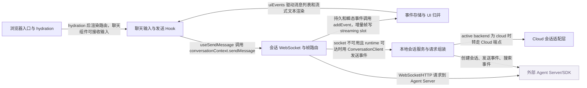

# OpenHands：架构、运行逻辑与设计取舍

> main · [5e8052347cc0](https://github.com/OpenHands/OpenHands/commit/5e8052347cc021b7657abc7f30828dead944a683) · deepseek-flash 辅助分析 · 2026-10-30T05:33:11.336Z
> 下文按固定源码推演，没有执行目标项目。引用可跳到具体代码行；“工程推断”解释收益与代价，不代表作者亲述。

## 1. 先建立直觉

**浏览器端把用户输入整理成消息，交给会话连接；连接把后端返回的流式片段和持久事件写进本地事件表，再渲染成聊天记录，真正的 Agent 执行在外部服务。**

同一个前端要同时面对本地 Agent Server、Docker 运行时和 Cloud 后端；既要在网络未就绪时让用户看到自己已发送，又要把 WebSocket 增量、REST 历史、后端状态更新合并成一致的消息列表。

贯穿全文的例子：

- **输入：** 用户在已有会话的聊天框输入“登录接口的单元测试挂了，帮我定位并修复”，可附带图片或文件。
- **预期输出：** 聊天框先出现“发送中”的乐观气泡；若 socket 已开，消息以 run:true 发出；Agent Server 回显 UserMessageEvent 后气泡被消费，随后 item_started/delta 让回复逐字出现，durable 事件按同一 id 替换流式占位并带上 seq，执行状态从 idle 变为 running 再变为 finished。

## 2. 一张图看懂架构



| 模块 | 职责与所在层的原因 | 输入 → 输出 | 拥有的状态 |
| --- | --- | --- | --- |
| 浏览器入口与 hydration [1][source-1] | 浏览器加载后先等待 i18n、MARS bridge 和可选 mock worker 就绪，再挂载 React 路由；这是所有前端状态的起点。 | 浏览器页面和静态资源 → 带有 AgentServerUIProviders 的 HydratedRouter 树 | i18n 就绪状态、window.marsBridge、开发态 preview 安装状态 |
| 聊天输入与发送 Hook [2][source-2] [3][source-3] | 把聊天框内容变成统一消息，维护本地乐观发送气泡，并调用 WebSocket 上下文发送。 | 用户输入文本、图片 File[]、文件 File[] → SendMessageRequest 和 queued 结果 | optimistic-user-message-store 的 pendingMessages、draftMessage、滚动位置 |
| 会话 WebSocket 与帧路由 [4][source-4] [5][source-5] | 维护主/规划两条 socket、续传游标和流式批处理器；把发送动作分流到 WebSocket 或 REST，把收到的帧分成增量、持久、瞬态和错误。 | SendMessageRequest、WebSocket JSON 帧、conversationUrl/sessionApiKey → 持久/瞬态事件交给事件 store，错误交给错误 store | mainConnectionState、planningConnectionState、heldMessagesRef、SeqCursor、StreamingDeltaBatcher |
| 事件存储与 UI 归并 [6][source-6] [7][source-7] | 用事件 id 去重，把持久事件和流式占位合并成 uiEvents；这是聊天渲染读取的本地事实源。 | OpenHandsEvent/UIEvent、DeltaFrame、ItemStartedFrame → events、eventIds、uiEvents 的新快照 | events 数组、eventIds Set、uiEvents 数组、loadedConversationId、streaming slots |
| 本地会话服务与请求组装 [8][source-8] [9][source-9] [10][source-10] | 为本地 Agent Server 组装创建会话请求、发送事件请求和客户端连接参数；真正执行 Agent loop 的不是这里。 | CreateConversationOptions、SendMessageRequest、Settings、AgentProfile 信息 → 发给 @openhands/typescript-client 的 ConversationClient 请求 | payload.workspace、payload.tags、initial_message、client_tools；本地 metadata 缓存 |
| Cloud 会话适配层 [11][source-11] [12][source-12] | 当 active backend 是 cloud 时，把会话创建、事件历史、sandbox 暂停/恢复等请求转到 Cloud App API；与本地路径是不同端点。 | AppConversationStartRequest、conversationId、sandboxId、分页参数 → AppConversationStartTask、AppConversationPage、EventSearchPage 或空页 | Cloud 会话列表、start task、sandbox 状态 |
| 外部 Agent Server/SDK（外部依赖） [13][source-13] [14][source-14] | 实现 REST API、会话、事件、工具、workspace 和 Agent 执行；本仓库只消费它的 API。 | 本仓库通过 TypeScript client 发出的 HTTP/WebSocket 请求 → UserMessageEvent、ActionEvent、ObservationEvent、流式帧、状态更新 | 会话日志、Agent 状态、工具执行结果、sandbox 运行时 |

## 3. 跟着一个请求跑完整条主线

这是对已读方法体的源码推演，不是执行日志。编号是阅读顺序；装配、写入、查询与条件分支是否发生，取决于每步的触发条件。

### 1. 浏览器 hydrate 并装配会话 UI 上下文

**阶段：** 初始化

**触发条件：** 必经：页面首次加载时

入口/调用：`prepareApp` [1][source-1]

**此时输入：** 浏览器 document、静态资源

等待 waitForI18n 和 installMarsWebBridge，必要时启动 mock worker，然后在 startTransition 中 hydrateRoot 到 AgentServerUIProviders/HydratedRouter

**状态变化：** 设置 i18n 就绪、window.marsBridge、开发态 preview；React 树开始接管页面

**交给下一步：** 可交互的聊天路由

### 2. 新建会话时收集 mutation 变量并调用 launchConversation

**阶段：** 装配/写入

**触发条件：** 可选分支：用户从首页或侧边栏新建会话时

入口/调用：`useCreateConversation` [15][source-15] [16][source-16]

**此时输入：** query、repository、workingDir、workspaceMode、agentProfileId、llmProfile 等

从变量中拆出首条消息和仓库元数据，调用 launchConversation，并把结果转成 conversation_id/url/task_id；launchConversation 的方法体未读，因此不在此断言它内部何时进入 createConversation

**状态变化：** 成功后 invalidate 会话列表和 start-tasks 查询；插件快照写入本地 metadata

**交给下一步：** CreateConversationResponse，包含 conversation_id、url、task_id

### 3. 会话服务为本地新建会话组装请求并调用 ConversationClient

**阶段：** 装配/写入

**触发条件：** 条件分支：新建路径实际进入 AgentServerConversationService.createConversation；launchConversation 中间方法体未读

入口/调用：`AgentServerConversationService.createConversation` [9][source-9] [17][source-17]

**此时输入：** CreateConversationOptions、Settings、工作目录、AgentProfile 信息

本地分支用 buildStartConversationRequestWithEncryptedSettings 组装 payload，合并 workspace/repository 标签，再用 ConversationClient.createConversation 发送；Docker 运行时改为 DockerExecutionWorkspace

**状态变化：** 写入 payload.tags；必要时 setStoredConversationMetadata 保存 repo/branch/workspace；返回 READY start task

**交给下一步：** AppConversationStartTask，local 路径直接 READY

### 4. 聊天框提交消息并先写乐观气泡

**阶段：** 写入/分支

**触发条件：** 必经：用户提交非 /new 的普通消息时

入口/调用：`ChatInterface.handleSendMessage` [18][source-18]

**此时输入：** content、images File[]、files File[]

校验文件大小，图片转 base64，文件上传后拼出 prompt，enqueuePendingMessage 写“sending”气泡，再调用 send(createChatMessage(...))；失败则把 pending 标为 error

**状态变化：** pendingMessages 增加一条；draftMessage 清空；滚动到底部

**交给下一步：** 交给 useSendMessage 的聊天消息

### 5. 发送 Hook 把聊天输入转成 Agent Server 消息内容

**阶段：** 装配

**触发条件：** 必经：conversationContext 存在且 action 为 message

入口/调用：`useSendMessage` [3][source-3]

**此时输入：** { action: 'message', args: { content, image_urls, file_urls } }

构造 MessageContent 数组：先放 text，再按需追加 image；调用 conversationContext.sendMessage({ role:'user', content })

**状态变化：** 无本地事件写入，只透传

**交给下一步：** SendMessageResult（queued 布尔值）

### 6. Provider 内发送回调按 socket 状态选择直接 WS、挂起或 REST 投递

**阶段：** 分支/写入

**触发条件：** 当前模式可为 main 或 plan；socket 可能 OPEN 或未 OPEN；cloud 可能没有 runtimeUrl

入口/调用：`ConversationWebSocketProvider` [19][source-19] [20][source-20] [21][source-21]

**此时输入：** SendMessageRequest、当前 conversationMode、mainSocket/planningAgentSocket、conversationUrl/sessionApiKey

socket OPEN 时 currentSocket.send(JSON.stringify({...message, run:true}))；未 OPEN 且 plan 无目标则抛错；cloud 无 runtimeUrl 时把消息放进 heldMessagesRef；runtime 可达时用 ConversationClient.sendEvent 直接投递

**状态变化：** heldMessagesRef 可能新增消息；打开 socket 后 flushHeldMessages 发送；错误写 error store

**交给下一步：** { queued: false } 表示 WS 已发，{ queued: true } 表示挂起或 REST 已投递

### 7. WebSocket 消息先按帧类型分流

**阶段：** 查询/转换

**触发条件：** 每收到一条 socket 消息时

入口/调用：`routeSessionFrame` [4][source-4] [22][source-22]

**此时输入：** JSON.parse(messageEvent.data) 的原始对象

asSessionFrame 识别帧；delta 只入 batcher；其他帧先 flush batcher；item_started 打开 streaming slot，item_aborted 删除 slot，durable 推进 cursor 并返回带 seq 的事件，transient 原样返回，error 写错误 store

**状态变化：** StreamingDeltaBatcher、SeqCursor、event store 的 streaming slot、error store

**交给下一步：** durable/transient 事件，或 null（增量/进度/错误已就地处理）

### 8. Provider 内主 socket 处理器把事件写入 store 并消费回显

**阶段：** 写入

**触发条件：** routeSessionFrame 返回非空事件，且 isAgentServerEvent 通过

入口/调用：`ConversationWebSocketProvider` [23][source-23] [24][source-24]

**此时输入：** routeSessionFrame 返回的事件对象

先查 eventIds 判断是否重放；addEvent 写入；重复事件直接跳过副作用；UserMessageEvent 按文本匹配并消费 pending 气泡；ConversationStateUpdateEvent 更新 execution_status、metrics、goal；ActionEvent 触发查询缓存失效

**状态变化：** event store、optimistic pending、conversation-state-store、metrics-store、goal-store、React Query 缓存

**交给下一步：** 更新后的事件列表和会话状态

### 9. 事件存储去重、追加并生成 UI 投影

**阶段：** 写入/计算

**触发条件：** addEvent 被调用时

入口/调用：`applyAddEvent/appendEvent` [6][source-6] [25][source-25]

**此时输入：** 一个 UIEvent

appendEvent 先看 eventIds 是否已有该 id，有则原状态返回；否则复制 Set、追加 events，并调用 handleEventForUI 生成 uiEvents；applyAddEvent 只在新事件时间戳早于末尾时排序

**状态变化：** events、eventIds、uiEvents；重复事件不改变状态

**交给下一步：** 新的 store 快照，供聊天列表渲染

## 4. 核心技术到底是什么

### 1. 会话帧分流与续传游标

**解决的问题：** 同一条 socket 上混有可持久事件、不可重放的流式增量和错误帧，直接都塞进事件列表会重复或留下永远不闭合的临时气泡。 [4][source-4] [22][source-22]

原始 JSON 先被 asSessionFrame 窄化为 SessionFrame；delta 只进入批处理器，其他帧先 flush；durable 帧用 seq 推进游标并返回事件，transient 原样返回，item_started/aborted 只操作 uiEvents 里的 streaming slot。

算法示意（用于解释机制，不是源码原文）：

```text
frame = asSessionFrame(raw)
if frame is null: return null
if frame.type == 'delta': batcher.enqueue(frame); return null
batcher.flush()
if frame.type == 'item_started': openStreamingSlot(frame); return null
if frame.type == 'item_aborted': abortStreamingSlot(frame.item_id); return null
if frame.type == 'durable': cursor.observe(frame.seq); return {...frame.event, seq: frame.seq}
if frame.type == 'transient': return frame.event
if frame.type == 'error': errorStore.set(frame.detail)
```

**关键数据结构：** SessionFrame 联合类型、StreamingDeltaBatcher、SeqCursor、uiEvents 中的 StreamingDeltaEvent 占位

- **本项目实现：** routeSessionFrame、handleMainMessage/handlePlanningMessage、openStreamingSlot/appendStreamingDeltas/abortStreamingSlot
- **外部依赖提供：** Agent Server 产生 /sockets/session/{id} 帧并决定何时发 item_started、delta、durable；本仓库只解析和归并
- **收益与代价：** 流式文本能立即显示且重连不重复，但需要维护 attempt、anchor_seq 和游标；遇到未知帧只能忽略。

### 2. 事件去重与 UI 归并

**解决的问题：** REST 历史预载和 WebSocket 重放会重叠，同一事件可能到达两次；Action 与 Observation 也需要在同一位置合并，而不是显示两张卡。 [6][source-6] [7][source-7]

appendEvent 用 eventIds Set O(1) 判断 id 是否已见；新事件追加到 events 后调用 handleEventForUI；后者若发现 durable 事件 id 等于某个 streaming slot 的 id，就原地替换 slot；Observation 则按 action_id 替换对应 Action，Think/Finish 的 Observation 直接丢弃。

算法示意（用于解释机制，不是源码原文）：

```text
id = event.id
if id exists in eventIds: return state
nextEvents = [...events, event]
nextIds = new Set(eventIds).add(id)
ui = handleEventForUI(event, uiEvents)
if event.timestamp < last.timestamp: sort(nextEvents); sort(ui)
return {events: nextEvents, eventIds: nextIds, uiEvents: ui}
```

**关键数据结构：** events 数组、eventIds Set、uiEvents 数组、streaming slot 的 content/reasoning_content/attempt

- **本项目实现：** appendEvent/applyAddEvent、handleEventForUI、openStreamingSlot/appendStreamingDeltas
- **外部依赖提供：** Zustand 只提供 store 容器；React 根据 store 快照重渲染
- **收益与代价：** 去重是 O(1) 且多数追加不排序，但只对带 id 的事件生效；没有 id 的瞬态事件无法用该集合去重。

### 3. 跨后端会话请求组装

**解决的问题：** 本地、Docker 和 Cloud 对 workspace、首条消息、标签、客户端工具和密钥的字段要求不同，调用点不能各自拼 JSON。 [10][source-10] [26][source-26]

buildStartConversationRequest 先合并运行环境说明和 router suffix，再调用 buildConfiguredConversationSettings 处理 workspace/initial_message/plugins；最后按 profile kind 决定 client_tools，并追加 tags、max_iterations、confirmation_policy、secrets。

算法示意（用于解释机制，不是源码原文）：

```text
suffix = runtimeServicesSuffix + routerSuffix
settings = buildConfiguredConversationSettings({settings, query, workspace, executionRuntime})
payload = {agent_profile_id, workspace, client_tools, confirmation_policy, max_iterations, ...}
payload.tags = {automationSetup?, acpserver?, clientsource:'agentcanvas'}
if securityAnalyzer: payload.security_analyzer = analyzer
if initial_message: payload.initial_message = initial_message
if customSecrets: payload.secrets = LookupSecret map
return payload
```

**关键数据结构：** ProfileStartConversationPayload/RawAgentStartConversationPayload、WorkspacePayload、InitialMessagePayload、tags Record

- **本项目实现：** agent-server-adapter.ts 的 buildStartConversationRequest 和 buildStartConversationRequestWithEncryptedSettings
- **外部依赖提供：** Agent Server/SDK 校验这些字段、解析 LookupSecret、创建会话并执行 Agent
- **收益与代价：** 调用点简单且字段一致，但适配层要跟随 SDK 字段演进；旧服务忽略的字段和新增字段需要兼容。

### 4. 本地/云端双路径服务适配

**解决的问题：** 本地会话由 Agent Server 同步创建，Cloud 会话则要先建 start task，等 sandbox READY 后才有 runtime URL 和 session key。 [8][source-8] [27][source-27] [11][source-11]

AgentServerConversationService 先看 getActiveBackend().backend.kind；cloud 分支构造 AppConversationStartRequest 并 POST /api/v1/app-conversations，local 分支用 ConversationClient 同步创建；发送事件时 cloud 若没有 conversationUrl/sessionApiKey 先 batchGetCloudConversations 补齐，否则直接调用运行时。

算法示意（用于解释机制，不是源码原文）：

```text
active = getActiveBackend().backend
if active.kind == 'cloud':
  request = buildCloudStartRequest(options)
  task = createCloudAppConversation(request)
  return task
else:
  require agentProfileId
  payload = buildStartConversationRequestWithEncryptedSettings(options)
  data = new ConversationClient(options).createConversation(payload)
  return {status:'READY', app_conversation_id:data.id,...}
```

**关键数据结构：** Backend.kind、AppConversationStartTask、AppConversation.conversation_url/session_api_key

- **本项目实现：** AgentServerConversationService、cloud/conversation-service.api.ts、callCloudProxy 调用点
- **外部依赖提供：** Cloud App API 管理 sandbox 生命周期；本地 Agent Server 同步创建会话；TypeScript client 负责 HTTP 细节
- **收益与代价：** 同一 UI 能切换后端，但分支多、错误语义不同；Cloud 消息在 sandbox 未起时只能先挂起。

## 5. 为什么选择这种实现

### 1. 把 Agent 执行引擎和 canonical API 放在外部 SDK/Agent Server，本仓库只做前端控制中心和本地栈编排。

**作者原文：** “The Agent Server API is implemented by the SDK and consumed through the TypeScript client by Agent Canvas.” [13][source-13]

**面临的约束：** 多仓库分工明确：Agent Server API 由 SDK 实现，浏览器客户端只消费它。

**如果改用另一种做法：** 在本仓库实现 Agent loop、工具调用和 sandbox。

**为什么当前方案有用：** 本次场景里消息最终只是 ConversationClient.sendEvent 或 WebSocket 帧；如果执行引擎也放在前端仓库，浏览器 bundle 要承担 Python 工具、sandbox 和会话日志，且会与 canonical API 重复。

**付出的代价，以及不适用的情况：** 必须依赖兼容的 Agent Server；本仓库无法单独解释工具执行和 sandbox 细节，服务不可达时只能表现为连接或兼容性错误。

### 2. 本地调用优先使用 @openhands/typescript-client 的类型化 client，Cloud 调用走 cloud service 模块和 proxy。

**作者原文：** “Local agent-server API access should use `@openhands/typescript-client` classes directly” [14][source-14] [8][source-8]

**面临的约束：** 两边的 host、认证方式和端点不同；本地还需要统一的 host/apiKey/workingDir 解析。

**如果改用另一种做法：** 所有请求都用通用 fetch 字符串拼 URL。

**为什么当前方案有用：** 示例中 sendMessage 在 socket 关闭时直接 new ConversationClient(getAgentServerClientOptions(...)).sendEvent；cloud 则通过 callCloudProxy 调 /api/v1/...，类型化 client 和 cloud 适配层分别封装了不同的连接语义。

**付出的代价，以及不适用的情况：** 同一动作要维护本地/云端两条分支；新增端点先要改 TypeScript client 或 cloud proxy。

### 3. 发送消息时优先走已打开的 WebSocket；socket 未开且 Cloud sandbox 还没有 runtime URL 时先挂起，等 socket 打开再 flush。

**依据：已确认实现；以下原因是工程分析，不代表作者亲述。** [28][source-28] [29][source-29] [21][source-21]

**面临的约束：** Cloud sandbox PAUSED/STARTING 时 V1 agent server 尚不存在，消息没有可投递的 host。

**如果改用另一种做法：** socket 未开就直接报错，或丢掉消息让用户重发。

**为什么当前方案有用：** 当前实现把消息放进 heldMessagesRef，保留“发送中”气泡，并在 main/planning socket OPEN 后调用 flushHeldMessages；这样用户不会因为 sandbox 启动窗口看到失败。

**付出的代价，以及不适用的情况：** 挂起消息只在内存中，页面刷新会丢；如果用户撤回气泡，flush 时会跳过该消息。

### 4. 流式文本先放在 uiEvents 的临时 slot，持久事件到达后按同一 id 原地替换。

**依据：已确认实现；以下原因是工程分析，不代表作者亲述。** [30][source-30] [31][source-31]

**面临的约束：** progress 帧不会重放，durable 事件才会进入可恢复日志；两者必须能合并。

**如果改用另一种做法：** 每收到一个 delta 就追加一个事件，收到 durable 再删除旧增量。

**为什么当前方案有用：** routeSessionFrame 对 delta 只调用 batcher.enqueue，对 item_started 才开 slot；handleEventForUI 看到 event.id 等于 slot 的 item_id 时直接替换。这样流式回复不会在列表里变成多条碎片，重连时也能由 durable cursor 恢复。

**付出的代价，以及不适用的情况：** 需要维护 attempt、anchor_seq 和流式批处理；如果 durable 先于 delta 到达，isFinished 会阻止迟到的 delta 重开 slot。

### 5. 事件 store 用 eventIds Set 去重，只在发现新事件时间戳早于末尾时排序。

**依据：已确认实现；以下原因是工程分析，不代表作者亲述。** [6][source-6] [32][source-32]

**面临的约束：** WebSocket 重放和 REST 历史预载会重叠，但多数实时事件按顺序到达。

**如果改用另一种做法：** 每次 addEvent 都全量排序，或不去重。

**为什么当前方案有用：** appendEvent 先查 Set，命中就直接返回原 state；applyAddEvent 只在 needsSorting 为真时排序。示例中 WS 重放同一 id 时不会重复渲染，也不会重复执行 UserMessageEvent 的消费逻辑。

**付出的代价，以及不适用的情况：** 无 id 的事件无法去重；真正乱序时才付出排序成本。

## 6. 关键代码精读

### 1. 发送消息的两种投递路径


`src/contexts/conversation-websocket-context.tsx:1427-1470` [19][source-19]

```typescript
      if (currentSocket?.readyState !== WebSocket.OPEN) {
        // WebSocket not connected.
        if (!targetConversationId) {
          // Never fall back to the parent in plan mode: without a planner
          // target the message would run in the code agent, which is exactly
          // the boundary plan mode exists to enforce.
          const error = new Error(
            currentMode === "plan"
              ? "Planning conversation is not ready yet"
              : "No conversation ID available",
          );
          setErrorMessage(error.message);
          throw error;
        }

        // Runtime coordinates for the target. A cloud runtime only has a URL
        // (and session key) while its sandbox is RUNNING.
        const planningAgentConversation = subConversations?.[0];
        const runtimeUrl =
          currentMode === "plan"
            ? planningAgentConversation?.conversation_url
            : conversationUrl;
        const runtimeApiKey =
          currentMode === "plan"
            ? planningAgentConversation?.session_api_key
            : sessionApiKey;

        if (getActiveBackend().backend.kind === "cloud" && !runtimeUrl) {
          // Nothing to deliver to yet (sandbox PAUSED/STARTING). Hold the
          // message for `flushHeldMessages`; the caller's bubble stays in
          // "sending". Not an error, so no banner.
          const held = heldMessagesRef.current.get(targetConversationId) ?? [];
          const serialized = JSON.stringify(message);
          if (
            !held.some((entry) => JSON.stringify(entry.message) === serialized)
          ) {
            held.push({
              message,
              hadBubble: hasSendingBubble(targetConversationId, message),
            });
            heldMessagesRef.current.set(targetConversationId, held);
          }
          return { queued: true };
        }
```


`src/contexts/conversation-websocket-context.tsx:1500-1504` [20][source-20]

```typescript
      try {
        // Send message through WebSocket as JSON with run: true so the
        // agent loop starts automatically in async mode.
        currentSocket.send(JSON.stringify({ ...message, run: true }));
        return { queued: false };
```


`src/contexts/conversation-websocket-context.tsx:1318-1334` [21][source-21]

```typescript
  const flushHeldMessages = useCallback(
    (targetConversationId: string, socket: WebSocket) => {
      if (socket.readyState !== WebSocket.OPEN) return;
      const held = heldMessagesRef.current.get(targetConversationId);
      if (!held?.length) return;
      heldMessagesRef.current.delete(targetConversationId);
      held.forEach(({ message, hadBubble }) => {
        // A bubble the user stopped (or that timed out into Retry) withdraws
        // its message; everything else goes out exactly as a live send would.
        if (hadBubble && !hasSendingBubble(targetConversationId, message)) {
          return;
        }
        socket.send(JSON.stringify({ ...message, run: true }));
      });
    },
    [hasSendingBubble],
  );
```


socket OPEN 时，sendMessage 不走 REST，而是把消息序列化成 {...message, run:true} 直接写 WebSocket；未 OPEN 时，如果当前是 Cloud 且 runtimeUrl 还不存在，就把消息放进 heldMessagesRef 并返回 queued:true，等 socket 打开后 flushHeldMessages 再发；如果 runtime 已经可达，则用 ConversationClient.sendEvent 直接投递。这样“已连接”“sandbox 还没起”“socket 断了但 runtime 可达”三种状态各有落点。

### 2. 帧路由如何区分增量和持久事件


`src/contexts/conversation-websocket-context.tsx:166-211` [4][source-4]

```typescript
const routeSessionFrame = (
  raw: unknown,
  batcher: StreamingDeltaBatcher | null,
  /** Report a durable frame's `seq` to this socket's resume cursor. */
  advanceCursor: (seq: number) => void,
  slotMeta: { isFromPlanningAgent?: boolean } = {},
): unknown | null => {
  const frame: SessionFrame | null = asSessionFrame(raw);
  if (!frame) {
    return null;
  }

  if (frame.type === "delta") {
    batcher?.enqueue(frame);
    return null;
  }

  // Nothing else may overtake text that was streamed ahead of it.
  batcher?.flush();

  switch (frame.type) {
    case "item_started":
      useEventStore.getState().openStreamingSlot(frame, slotMeta);
      return null;
    case "item_aborted":
      // Nothing durable is coming to supersede the provisional text.
      useEventStore.getState().abortStreamingSlot(frame.item_id, frame.attempt);
      return null;
    case "durable":
      advanceCursor(frame.seq);
      return { ...frame.event, seq: frame.seq };
    case "transient":
      return frame.event;
    case "error":
      // The server answers a rejected inbound message with an ErrorFrame and
      // keeps the socket open ("not worth dropping over"), so there is no
      // reconnect and nothing else will ever surface this to the user.
      useErrorMessageStore
        .getState()
        .setErrorMessage(frame.detail, "conversation", frame.code);
      return null;
    default:
      // `sync` needs nothing: the cursor advances on durable frames.
      return null;
  }
};
```


`src/types/agent-server/session-frames.ts:95-107` [22][source-22]

```typescript
export const asSessionFrame = (value: unknown): SessionFrame | null => {
  if (typeof value !== "object" || value === null) {
    return null;
  }
  const { type } = value as { type?: unknown };
  if (
    typeof type !== "string" ||
    !FRAME_TYPES.has(type as SessionFrame["type"])
  ) {
    return null;
  }
  return value as SessionFrame;
};
```


routeSessionFrame 先把原始对象窄化为 SessionFrame；delta 只进 batcher 并返回 null，所以不会直接写 events。其他帧到达前先 flush batcher，保证文本不会越过后续事件。item_started 只打开 streaming slot，durable 帧推进 seq 游标并把事件返回给上层，transient 原样返回，error 写错误 store。上层 handleMainMessage 再把返回的事件送进 addEvent。

### 3. 事件存储去重和 durable 替换流式占位


`src/stores/use-event-store.ts:113-132` [33][source-33]

```typescript
const appendEvent = (state: EventState, event: OHEvent): EventState => {
  const eventId = getEventId(event);

  // Deduplicate: skip if event with same id already exists (O(1) lookup)
  if (eventId !== undefined && state.eventIds.has(eventId)) {
    return state;
  }

  const newEventIds =
    eventId !== undefined
      ? new Set(state.eventIds).add(eventId)
      : state.eventIds;

  return {
    ...state,
    events: [...state.events, event],
    eventIds: newEventIds,
    uiEvents: handleEventForUI(event, state.uiEvents),
  };
};
```


`src/utils/handle-event-for-ui.ts:281-291` [31][source-31]

```typescript
  // The durable event *is* the item: the SDK mints its id when the stream
  // opens, so one equality test retires the slot — and replacing in place
  // keeps the finished message where the streamed text already was.
  const eventId = "id" in event ? event.id : undefined;
  if (eventId !== undefined) {
    const slotIndex = findSlotIndex(newUiEvents, eventId);
    if (slotIndex !== -1) {
      newUiEvents[slotIndex] = event;
      return newUiEvents;
    }
  }
```


appendEvent 先用 eventIds Set 判断 id；命中则返回原 state，不追加也不重跑 UI 归并。新事件才复制 Set、追加 events 并调用 handleEventForUI。handleEventForUI 先找 id 相同的 streaming slot：找到就原地替换成 durable 事件，因此正在逐字显示的回复会变成最终消息；随后才处理普通 Action/Observation 的替换逻辑。

## 7. 动手验证你的理解

以下是建议实验，没有执行过。

### 1. Cloud sandbox 还没有 runtimeUrl 时发送消息，前端会失败还是挂起？

**改变什么：** 把 active backend 设为 cloud，令 conversationUrl/sessionApiKey 为空，然后调用 ConversationWebSocketProvider 内的发送回调。 [29][source-29] [21][source-21]

**应该观察到什么：** 应返回 {queued:true}，消息进入 heldMessagesRef，不写错误 banner；等该会话 socket OPEN 后 flushHeldMessages 用 socket.send(JSON.stringify({...message, run:true})) 发出。

### 2. 同一事件 id 从 REST 历史与 WebSocket 重放各到达一次，会不会重复渲染？

**改变什么：** 先 addEvents 预载一个 id 为 e1 的 UserMessageEvent，再通过主 socket 处理器收到同一个 e1。 [34][source-34] [32][source-32]

**应该观察到什么：** appendEvent 命中 eventIds 后返回原 state，uiEvents 不增加；主 socket 处理器的 isDuplicateEvent 为真，也会跳过消费 pending、状态更新等副作用。

### 3. plan 模式没有 planningConversationId 且 socket 未开时，消息会不会落到父会话？

**改变什么：** 把 conversationMode 设为 plan，planningConversationId 设为 null，保持 planningAgentSocket 未 OPEN，然后发送消息。 [35][source-35]

**应该观察到什么：** 应抛出 'Planning conversation is not ready yet' 并写错误 store，而不是退回主 conversationId 发送；这保护了 plan 模式与 code agent 的边界。

## 8. 读完应当能复述什么

- 本仓库是 Agent Canvas 前端控制中心：它负责输入、连接、事件归并和 UI，不负责 Agent loop、工具执行或 sandbox。
- 一次消息发送有明确的三态：WS 已发、Cloud 无 runtime 时挂起、runtime 可达时 REST 直投；不能用单一“HTTP 调用”概括。
- 流式文本是临时 slot，durable 事件才是可恢复日志；两者靠 item_id 对齐，靠 seq 游标续传。
- 事件 store 的去重是 id 级、O(1) 的 Set 检查，排序只在检测到乱序时发生；这直接避免 REST 历史和 WS 重放产生重复消息。
- 乐观 UI 通过 pending 气泡和 UserMessageEvent 回显匹配来闭合，发送失败时 pending 会转 error 而不是静默消失。

## 来源与覆盖边界

本次读取 24 个文件，共 333,777 字符；24 个文件完整读取，其他文件按关键方法取带行号的片段。没有把未读依赖的内部实现当作已确认事实。

- useCreateConversation 调用的 launchConversation 方法体未读，无法确认它具体何时、以何参数进入 AgentServerConversationService.createConversation。
- useWebSocket 的底层实现未读，因此重连节奏、after_seq 参数如何拼到 URL、断线重试细节无法从本仓库已读代码确认。
- useConversationHistory 的 REST 预载与分页实现未读，只能根据 conversation-websocket-context 的注释知道会预载最近事件并用于 afterSeq。
- Agent Server/SDK 的 Agent loop、工具执行、事件持久化和 sandbox 生命周期不在本仓库；本仓库只能看到消费端。
- callCloudProxy 的内部实现未读，Cloud 的认证头、错误映射和代理路径无法进一步确认。

| 文件 | 实际读取行段 |
| --- | --- |
| [README.md](https://github.com/OpenHands/OpenHands/blob/5e8052347cc021b7657abc7f30828dead944a683/README.md) | 1–185 / 共 185 行 |
| [README.windows.md](https://github.com/OpenHands/OpenHands/blob/5e8052347cc021b7657abc7f30828dead944a683/README.windows.md) | 1–39 / 共 39 行 |
| [src/entry.client.tsx](https://github.com/OpenHands/OpenHands/blob/5e8052347cc021b7657abc7f30828dead944a683/src/entry.client.tsx) | 1–54 / 共 54 行 |
| [src/api/agent-server-adapter.ts](https://github.com/OpenHands/OpenHands/blob/5e8052347cc021b7657abc7f30828dead944a683/src/api/agent-server-adapter.ts) | 1–1640 / 共 1640 行 |
| [src/api/agent-server-config.ts](https://github.com/OpenHands/OpenHands/blob/5e8052347cc021b7657abc7f30828dead944a683/src/api/agent-server-config.ts) | 1–291 / 共 291 行 |
| [src/api/cloud/conversation-service.api.ts](https://github.com/OpenHands/OpenHands/blob/5e8052347cc021b7657abc7f30828dead944a683/src/api/cloud/conversation-service.api.ts) | 1–382 / 共 382 行 |
| [src/api/README.md](https://github.com/OpenHands/OpenHands/blob/5e8052347cc021b7657abc7f30828dead944a683/src/api/README.md) | 1–99 / 共 99 行 |
| [src/api/agent-server-client-options.ts](https://github.com/OpenHands/OpenHands/blob/5e8052347cc021b7657abc7f30828dead944a683/src/api/agent-server-client-options.ts) | 1–83 / 共 83 行 |
| [src/api/conversation-service/agent-server-conversation-service.api.ts](https://github.com/OpenHands/OpenHands/blob/5e8052347cc021b7657abc7f30828dead944a683/src/api/conversation-service/agent-server-conversation-service.api.ts) | 1–1379 / 共 1379 行 |
| [src/api/conversation-service/conversation-service.api.ts](https://github.com/OpenHands/OpenHands/blob/5e8052347cc021b7657abc7f30828dead944a683/src/api/conversation-service/conversation-service.api.ts) | 1–53 / 共 53 行 |
| [src/api/event-service/event-service.api.ts](https://github.com/OpenHands/OpenHands/blob/5e8052347cc021b7657abc7f30828dead944a683/src/api/event-service/event-service.api.ts) | 1–158 / 共 158 行 |
| [src/contexts/conversation-websocket-context.tsx](https://github.com/OpenHands/OpenHands/blob/5e8052347cc021b7657abc7f30828dead944a683/src/contexts/conversation-websocket-context.tsx) | 1–1617 / 共 1617 行 |
| [src/stores/use-event-store.ts](https://github.com/OpenHands/OpenHands/blob/5e8052347cc021b7657abc7f30828dead944a683/src/stores/use-event-store.ts) | 1–257 / 共 257 行 |
| [src/utils/handle-event-for-ui.ts](https://github.com/OpenHands/OpenHands/blob/5e8052347cc021b7657abc7f30828dead944a683/src/utils/handle-event-for-ui.ts) | 1–358 / 共 358 行 |
| [src/hooks/use-send-message.ts](https://github.com/OpenHands/OpenHands/blob/5e8052347cc021b7657abc7f30828dead944a683/src/hooks/use-send-message.ts) | 1–69 / 共 69 行 |
| [src/hooks/mutation/use-create-conversation.ts](https://github.com/OpenHands/OpenHands/blob/5e8052347cc021b7657abc7f30828dead944a683/src/hooks/mutation/use-create-conversation.ts) | 1–250 / 共 250 行 |
| [src/components/features/chat/chat-interface.tsx](https://github.com/OpenHands/OpenHands/blob/5e8052347cc021b7657abc7f30828dead944a683/src/components/features/chat/chat-interface.tsx) | 1–757 / 共 757 行 |
| [src/types/agent-server/core/openhands-event.ts](https://github.com/OpenHands/OpenHands/blob/5e8052347cc021b7657abc7f30828dead944a683/src/types/agent-server/core/openhands-event.ts) | 1–47 / 共 47 行 |
| [src/types/agent-server/session-frames.ts](https://github.com/OpenHands/OpenHands/blob/5e8052347cc021b7657abc7f30828dead944a683/src/types/agent-server/session-frames.ts) | 1–108 / 共 108 行 |
| [src/api/agent-server-adapter.test.ts](https://github.com/OpenHands/OpenHands/blob/5e8052347cc021b7657abc7f30828dead944a683/src/api/agent-server-adapter.test.ts) | 1–633 / 共 633 行 |
| [src/api/event-service/event-service.api.test.ts](https://github.com/OpenHands/OpenHands/blob/5e8052347cc021b7657abc7f30828dead944a683/src/api/event-service/event-service.api.test.ts) | 1–416 / 共 416 行 |
| [src/components/features/settings/app-settings/getting-started-checklist-switch.tsx](https://github.com/OpenHands/OpenHands/blob/5e8052347cc021b7657abc7f30828dead944a683/src/components/features/settings/app-settings/getting-started-checklist-switch.tsx) | 1–25 / 共 25 行 |
| [src/api/acp-service/acp-service.api.ts](https://github.com/OpenHands/OpenHands/blob/5e8052347cc021b7657abc7f30828dead944a683/src/api/acp-service/acp-service.api.ts) | 1–137 / 共 137 行 |
| [src/components/providers/index.ts](https://github.com/OpenHands/OpenHands/blob/5e8052347cc021b7657abc7f30828dead944a683/src/components/providers/index.ts) | 1–13 / 共 13 行 |

[source-1]: https://github.com/OpenHands/OpenHands/blob/5e8052347cc021b7657abc7f30828dead944a683/src/entry.client.tsx#L18-L53 "src/entry.client.tsx:18-53"
[source-2]: https://github.com/OpenHands/OpenHands/blob/5e8052347cc021b7657abc7f30828dead944a683/src/components/features/chat/chat-interface.tsx#L358-L457 "src/components/features/chat/chat-interface.tsx:358-457"
[source-3]: https://github.com/OpenHands/OpenHands/blob/5e8052347cc021b7657abc7f30828dead944a683/src/hooks/use-send-message.ts#L22-L57 "src/hooks/use-send-message.ts:22-57"
[source-4]: https://github.com/OpenHands/OpenHands/blob/5e8052347cc021b7657abc7f30828dead944a683/src/contexts/conversation-websocket-context.tsx#L166-L211 "src/contexts/conversation-websocket-context.tsx:166-211"
[source-5]: https://github.com/OpenHands/OpenHands/blob/5e8052347cc021b7657abc7f30828dead944a683/src/contexts/conversation-websocket-context.tsx#L1419-L1523 "src/contexts/conversation-websocket-context.tsx:1419-1523"
[source-6]: https://github.com/OpenHands/OpenHands/blob/5e8052347cc021b7657abc7f30828dead944a683/src/stores/use-event-store.ts#L113-L154 "src/stores/use-event-store.ts:113-154"
[source-7]: https://github.com/OpenHands/OpenHands/blob/5e8052347cc021b7657abc7f30828dead944a683/src/utils/handle-event-for-ui.ts#L275-L357 "src/utils/handle-event-for-ui.ts:275-357"
[source-8]: https://github.com/OpenHands/OpenHands/blob/5e8052347cc021b7657abc7f30828dead944a683/src/api/conversation-service/agent-server-conversation-service.api.ts#L491-L526 "src/api/conversation-service/agent-server-conversation-service.api.ts:491-526"
[source-9]: https://github.com/OpenHands/OpenHands/blob/5e8052347cc021b7657abc7f30828dead944a683/src/api/conversation-service/agent-server-conversation-service.api.ts#L641-L701 "src/api/conversation-service/agent-server-conversation-service.api.ts:641-701"
[source-10]: https://github.com/OpenHands/OpenHands/blob/5e8052347cc021b7657abc7f30828dead944a683/src/api/agent-server-adapter.ts#L1121-L1200 "src/api/agent-server-adapter.ts:1121-1200"
[source-11]: https://github.com/OpenHands/OpenHands/blob/5e8052347cc021b7657abc7f30828dead944a683/src/api/cloud/conversation-service.api.ts#L148-L163 "src/api/cloud/conversation-service.api.ts:148-163"
[source-12]: https://github.com/OpenHands/OpenHands/blob/5e8052347cc021b7657abc7f30828dead944a683/src/api/event-service/event-service.api.ts#L84-L136 "src/api/event-service/event-service.api.ts:84-136"
[source-13]: https://github.com/OpenHands/OpenHands/blob/5e8052347cc021b7657abc7f30828dead944a683/README.md#L166-L177 "README.md:166-177"
[source-14]: https://github.com/OpenHands/OpenHands/blob/5e8052347cc021b7657abc7f30828dead944a683/src/api/README.md#L5-L7 "src/api/README.md:5-7"
[source-15]: https://github.com/OpenHands/OpenHands/blob/5e8052347cc021b7657abc7f30828dead944a683/src/hooks/mutation/use-create-conversation.ts#L116-L155 "src/hooks/mutation/use-create-conversation.ts:116-155"
[source-16]: https://github.com/OpenHands/OpenHands/blob/5e8052347cc021b7657abc7f30828dead944a683/src/hooks/mutation/use-create-conversation.ts#L208-L217 "src/hooks/mutation/use-create-conversation.ts:208-217"
[source-17]: https://github.com/OpenHands/OpenHands/blob/5e8052347cc021b7657abc7f30828dead944a683/src/api/conversation-service/agent-server-conversation-service.api.ts#L723-L738 "src/api/conversation-service/agent-server-conversation-service.api.ts:723-738"
[source-18]: https://github.com/OpenHands/OpenHands/blob/5e8052347cc021b7657abc7f30828dead944a683/src/components/features/chat/chat-interface.tsx#L398-L456 "src/components/features/chat/chat-interface.tsx:398-456"
[source-19]: https://github.com/OpenHands/OpenHands/blob/5e8052347cc021b7657abc7f30828dead944a683/src/contexts/conversation-websocket-context.tsx#L1427-L1470 "src/contexts/conversation-websocket-context.tsx:1427-1470"
[source-20]: https://github.com/OpenHands/OpenHands/blob/5e8052347cc021b7657abc7f30828dead944a683/src/contexts/conversation-websocket-context.tsx#L1500-L1504 "src/contexts/conversation-websocket-context.tsx:1500-1504"
[source-21]: https://github.com/OpenHands/OpenHands/blob/5e8052347cc021b7657abc7f30828dead944a683/src/contexts/conversation-websocket-context.tsx#L1318-L1334 "src/contexts/conversation-websocket-context.tsx:1318-1334"
[source-22]: https://github.com/OpenHands/OpenHands/blob/5e8052347cc021b7657abc7f30828dead944a683/src/types/agent-server/session-frames.ts#L95-L107 "src/types/agent-server/session-frames.ts:95-107"
[source-23]: https://github.com/OpenHands/OpenHands/blob/5e8052347cc021b7657abc7f30828dead944a683/src/contexts/conversation-websocket-context.tsx#L647-L675 "src/contexts/conversation-websocket-context.tsx:647-675"
[source-24]: https://github.com/OpenHands/OpenHands/blob/5e8052347cc021b7657abc7f30828dead944a683/src/contexts/conversation-websocket-context.tsx#L717-L765 "src/contexts/conversation-websocket-context.tsx:717-765"
[source-25]: https://github.com/OpenHands/OpenHands/blob/5e8052347cc021b7657abc7f30828dead944a683/src/stores/use-event-store.ts#L161-L161 "src/stores/use-event-store.ts:161-161"
[source-26]: https://github.com/OpenHands/OpenHands/blob/5e8052347cc021b7657abc7f30828dead944a683/src/api/agent-server-adapter.ts#L1575-L1600 "src/api/agent-server-adapter.ts:1575-1600"
[source-27]: https://github.com/OpenHands/OpenHands/blob/5e8052347cc021b7657abc7f30828dead944a683/src/api/conversation-service/agent-server-conversation-service.api.ts#L552-L606 "src/api/conversation-service/agent-server-conversation-service.api.ts:552-606"
[source-28]: https://github.com/OpenHands/OpenHands/blob/5e8052347cc021b7657abc7f30828dead944a683/src/contexts/conversation-websocket-context.tsx#L1293-L1298 "src/contexts/conversation-websocket-context.tsx:1293-1298"
[source-29]: https://github.com/OpenHands/OpenHands/blob/5e8052347cc021b7657abc7f30828dead944a683/src/contexts/conversation-websocket-context.tsx#L1454-L1469 "src/contexts/conversation-websocket-context.tsx:1454-1469"
[source-30]: https://github.com/OpenHands/OpenHands/blob/5e8052347cc021b7657abc7f30828dead944a683/src/contexts/conversation-websocket-context.tsx#L178-L196 "src/contexts/conversation-websocket-context.tsx:178-196"
[source-31]: https://github.com/OpenHands/OpenHands/blob/5e8052347cc021b7657abc7f30828dead944a683/src/utils/handle-event-for-ui.ts#L281-L291 "src/utils/handle-event-for-ui.ts:281-291"
[source-32]: https://github.com/OpenHands/OpenHands/blob/5e8052347cc021b7657abc7f30828dead944a683/src/contexts/conversation-websocket-context.tsx#L660-L675 "src/contexts/conversation-websocket-context.tsx:660-675"
[source-33]: https://github.com/OpenHands/OpenHands/blob/5e8052347cc021b7657abc7f30828dead944a683/src/stores/use-event-store.ts#L113-L132 "src/stores/use-event-store.ts:113-132"
[source-34]: https://github.com/OpenHands/OpenHands/blob/5e8052347cc021b7657abc7f30828dead944a683/src/stores/use-event-store.ts#L113-L119 "src/stores/use-event-store.ts:113-119"
[source-35]: https://github.com/OpenHands/OpenHands/blob/5e8052347cc021b7657abc7f30828dead944a683/src/contexts/conversation-websocket-context.tsx#L1429-L1439 "src/contexts/conversation-websocket-context.tsx:1429-1439"
