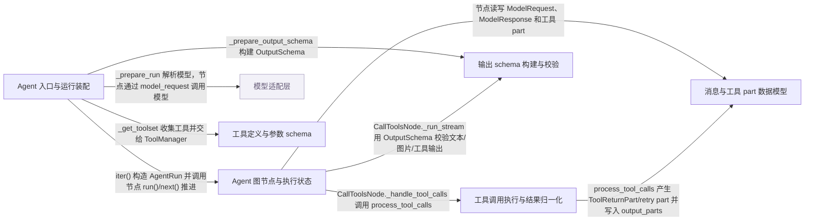

# pydantic-ai：架构、运行逻辑与设计取舍

> main · [fb04437121e9](https://github.com/pydantic/pydantic-ai/commit/fb04437121e9e84cda129a3db394ce8e27ae95f0) · deepseek-flash 辅助分析 · 2026-10-30T05:33:11.336Z
> 下文按固定源码推演，没有执行目标项目。引用可跳到具体代码行；“工程推断”解释收益与代价，不代表作者亲述。

## 1. 先建立直觉

**把一次带工具的结构化对话拆成可逐个推进的图节点，模型请求、工具执行和最终校验各自决定下一节点，失败就带着错误消息回到模型请求节点。**

Agent 运行同时要处理模型调用、工具调用、工具参数校验失败、结构化输出校验失败、重试预算和消息历史；如果把这些问题都塞进一个递归函数，调用方看不到中间节点，重试路径也难以测试和取消。

贯穿全文的例子：

- **输入：** 推演示例：Agent 配置 output_type=Sentiment（label 为 Literal['positive','negative','neutral']，score 为 ge=-1、le=1 的 float），并注册 recent_reviews(product: str) 工具。用户请求“Extract app 的用户感受如何？”。假设模型返回 ToolCallPart(recent_reviews, product='Extract app')；如果工具参数字段缺失或类型不对，或最终 score 越界，就进入重试分支。
- **预期输出：** 推演结果：先出现 ModelRequestNode，模型响应含 ToolCallPart；随后 CallToolsNode 执行工具，把 ToolReturnPart 或携带校验错误的 retry part 写入 output_parts；若没有最终输出，就构造新的 ModelRequestNode 把工具结果/错误送回模型。最终 OutputSchema 校验通过后得到 Sentiment 实例，AgentRun.result 是 AgentRunResult，消息历史保留完整请求与工具往返。

## 2. 一张图看懂架构



| 模块 | 职责与所在层的原因 | 输入 → 输出 | 拥有的状态 |
| --- | --- | --- | --- |
| Agent 入口与运行装配 [1][source-1] [2][source-2] [3][source-3] | 接收 run/iter 参数，解析 conversation、retry 预算、模型、输出 schema 和工具集，构造 GraphAgentState、GraphAgentDeps、UserPromptNode 与 AgentRun；run 只负责驱动迭代。 | 用户 prompt、output_type、message_history、deps、model、retries 等。 → 可迭代的 AgentRun 及其图状态；run 结束时返回 AgentRunResult。 | GraphAgentState.message_history、usage、run_step、output_retries_used；GraphAgentDeps 中的 model、tool_manager、output_schema。 |
| Agent 图节点与执行状态 [4][source-4] [5][source-5] [6][source-6] | 定义 UserPromptNode、ModelRequestNode、CallToolsNode 的 run() 语义，以及它们返回的下一节点；由 run()/stream() 驱动模型请求、工具处理和最终结果。 | GraphAgentState、GraphAgentDeps、上一步的 ModelRequest 或 ModelResponse。 → 下一个图节点（ModelRequestNode、CallToolsNode 或 End）和新增的历史消息。 | message_history 追加 ModelRequest/ModelResponse；output_retries_used；tool_manager 的每步状态。 |
| 模型适配层（外部依赖） [7][source-7] [8][source-8] | 把 ModelRequest 消息、settings 和 ModelRequestParameters 交给具体模型实现，返回 ModelResponse；项目只定义抽象 request/request_stream 边界，具体 provider 编码由子类负责。 | messages、model_settings、model_request_parameters。 → ModelResponse，parts 中可能含 TextPart、ToolCallPart、FilePart 等。 | 由具体模型实现持有；TestModel 记录 last_model_request_parameters。 |
| 工具定义与参数 schema [9][source-9] [10][source-10] [11][source-11] | 把 Python 工具函数签名转换为 FunctionSchema：参数 JSON Schema 和 Pydantic SchemaValidator，并生成 ToolDefinition；ToolDefinition 决定该工具是 function、output、external 还是 unapproved。 | 工具函数、docstring、参数注解、takes_ctx、schema_generator。 → ToolDefinition.parameters_json_schema 与可调用的校验器；工具集供 ToolManager 使用。 | FunctionSchema 持有 validator、json_schema、single_arg_name；ToolDefinition 持有 kind、timeout、sequential 等。 |
| 工具调用执行与结果归一化 [12][source-12] [13][source-13] | 按 end_strategy 选择处理器，把 ToolCallPart 交给工具执行，并把返回值归一化为 ToolReturnPart、retry part 或 final result；同时维护 output_parts 作为下一轮 ModelRequest 的 parts。 | tool_manager、tool_calls、已有的 tool_call_results、ctx、output_parts。 → 事件流；output_parts 中积累 ToolReturnPart/RetryFeedbackPart；output_final_result 中最多一个 FinalResult。 | processor 的调用索引、已执行/跳过/延迟调用集合；output_parts 列表；output_final_result deque(maxlen=1)。 |
| 输出 schema 构建与校验 [14][source-14] [15][source-15] [16][source-16] | 把 output_type 展开成 OutputSchema：决定文本、工具、图片、NativeOutput/PromptedOutput 等模式，构建 ObjectOutputProcessor/UnionOutputProcessor 和 OutputToolset；执行阶段调用 validate 做 Pydantic 校验。 | OutputSpec、name、description、strict。 → OutputSchema，含 text_processor、toolset、object_def、allows_none 等；validate 返回语义结果或抛 ValidationError。 | OutputSchema 在 run 准备时构建一次；processor 持有 SchemaValidator；ToolOutputSchema 持有 OutputToolset。 |
| 消息与工具 part 数据模型 [17][source-17] [18][source-18] [19][source-19] | 定义 ModelRequest、ModelResponse、ToolCallPart、ToolReturnPart、RetryPromptPart/RetryFeedbackPart 等可序列化 part；它们既是模型输入输出的载体，也是重试信息的载体。 | 模型响应、工具返回值、校验错误。 → 可放入 message_history 的 part；下一轮模型请求读取这些 part。 | part 内的 tool_name、tool_call_id、content、outcome、retry 等字段。 |

## 3. 跟着一个请求跑完整条主线

这是对已读方法体的源码推演，不是执行日志。编号是阅读顺序；装配、写入、查询与条件分支是否发生，取决于每步的触发条件。

### 1. run 进入 iter 并取得 AgentRun

**阶段：** 初始化

**触发条件：** 必经：调用 AbstractAgent.run

入口/调用：`AbstractAgent.run` [20][source-20] [21][source-21]

**此时输入：** 用户 prompt、output_type、message_history、deps、model、retries 等参数

run 先处理 infer_name 和 event_stream_handler，然后 async with self.iter(...) 取得 agent_run；如果有 event_stream_handler，就用 _stream_and_advance 包一层，否则直接调用 agent_run.next(node)。

**状态变化：** 创建 AgentRun；循环变量 node 从 agent_run.next_node 开始；agent_run.result 在循环结束后必须非空。

**交给下一步：** 驱动到 End 后返回 agent_run.result（AgentRunResult）。

### 2. iter 装配图、状态、工具集和输出 schema

**阶段：** 装配

**触发条件：** 必经：Agent.iter 被调用

入口/调用：`Agent.iter / Agent._prepare_run` [2][source-2] [3][source-3] [22][source-22] [23][source-23] [24][source-24]

**此时输入：** iter 参数，以及 conversation/message_history

iter 解析 conversation 后调用 _prepare_run；_prepare_run 解析模型、retry 预算、工具集和 OutputSchema，构造 GraphAgentState（含 message_history/run_id/conversation_id）、GraphAgentDeps（含 output_schema、tool_manager、model），构建 _agent_graph.build_agent_graph(...)，再构造 UserPromptNode。

**状态变化：** state.message_history 初始化为输入历史；state.output_retries_used=0、run_step=0；graph_deps 持有本次运行的模型、输出 schema 和工具集。

**交给下一步：** _PreparedAgentRun，其 open() 产出可迭代的 AgentRun。

### 3. UserPromptNode 组装首个 ModelRequest

**阶段：** 装配/写入

**触发条件：** 必经：新 run 且没有 deferred_tool_results

入口/调用：`UserPromptNode.run` [25][source-25] [26][source-26]

**此时输入：** state.message_history、user_prompt、system prompts/instructions

run 先清理历史并把捕获的 run messages 设为历史，然后在没有 pending tool calls 的情况下重新评估动态 system prompt；如果历史为空，追加 _sys_parts；如果 user_prompt 非空，追加 UserPromptPart；最后构造 ModelRequest 并返回 ModelRequestNode。

**状态变化：** state.message_history 被替换/清理；deps.new_message_index 设为当前历史长度；新的 ModelRequest 成为下一个节点的 request。

**交给下一步：** ModelRequestNode(request=next_message)。

### 4. ModelRequestNode 调用模型并处理 attempt

**阶段：** 查询

**触发条件：** 必经：进入 ModelRequestNode.run

入口/调用：`ModelRequestNode.run / ModelRequestNode._make_request / ModelRequestNode._request_attempts / ModelRequestNode._request_attempt` [5][source-5] [27][source-27] [28][source-28]

**此时输入：** 当前 ModelRequest、run_context、ModelRequestContext、step model settings

run 调用 _make_request；_make_request 先 _prepare_request，再把请求交给 model_handler；model_handler 调用 _apply_before_model_request 后进入 _request_attempts；_request_attempts 捕获 baseline，并在 while True 中 restore、_prepare_attempt、_request_attempt；_request_attempt 调用 model_request，成功后进入 after_model_request，若模型/钩子要求重试则抛 RetryModelRequest。

**状态变化：** state.response 记录本次响应；usage 在 provider 响应边界提交；失败 attempt 的 usage 仍计数，被拒绝的响应不进入历史。

**交给下一步：** ModelResponse，或通过 RetryModelRequest 进入下一次 attempt；正常情况下返回 CallToolsNode。

### 5. 模型响应中的 ToolCallPart 进入工具处理

**阶段：** 可选分支

**触发条件：** 模型响应的 parts 中存在 ToolCallPart

入口/调用：`CallToolsNode._run_stream / CallToolsNode._handle_tool_calls` [29][source-29] [30][source-30]

**此时输入：** ModelResponse.parts

_run_stream 遍历 parts，把 TextPart 累加到 text，把 ToolCallPart 收集到 tool_calls；只要 tool_calls 非空，就创建 _handle_tool_calls 生成器并逐个 yield 其事件，然后 return，不再走文本/图片输出路径。

**状态变化：** tool_calls 列表被填充；控制流进入 _handle_tool_calls。

**交给下一步：** _handle_tool_calls 的事件流。

### 6. 执行工具并把结果写入 output_parts

**阶段：** 写入（按策略可能并行）

**触发条件：** tool_calls 非空，进入 _handle_tool_calls

入口/调用：`CallToolsNode._handle_tool_calls / process_tool_calls` [31][source-31] [32][source-32] [12][source-12] [13][source-13]

**此时输入：** tool_calls、tool_call_results、tool_call_metadata、final_result（可能为 None）、ctx、output_parts

_handle_tool_calls 先刷新 discovered tool names、构建 run_context，调用 tool_manager.for_run_step；然后 process_tool_calls 按 end_strategy 选择 _ExhaustiveProcessor/_EarlyProcessor/_GracefulProcessor，processor.run() 产出事件，并把成功 ToolReturnPart 或 retry part 写入 output_parts；若某个 output tool 产生 FinalResult，则追加到 output_final_result。

**状态变化：** output_parts 增加工具返回/重试 part；tool_manager 的 retries 可能累计；output_final_result 最多保存一个 FinalResult。

**交给下一步：** output_parts 和 output_final_result，供下一步决定下一节点。

### 7. 没有最终结果就回到模型；有最终结果就结束

**阶段：** 可选分支

**触发条件：** output_final_result 为空（工具刚执行完或产生 retry）→ 回模型；output_final_result 非空 → 结束

入口/调用：`CallToolsNode._handle_tool_calls / CallToolsNode.run` [33][source-33] [34][source-34]

**此时输入：** output_parts、output_final_result、self.user_prompt

_handle_tool_calls 先处理 process_tool_calls 写入的 output_final_result：若有，则 _handle_final_result 构造下一节点；否则把 user_prompt（若有）追加到 output_parts 末尾，并构造 ModelRequestNode(ModelRequest(parts=output_parts))。CallToolsNode.run 在 stream 结束后返回 _next_node。

**状态变化：** self._next_node 被设为 ModelRequestNode 或最终结果节点；工具结果/重试消息成为下一轮 ModelRequest 的 parts。

**交给下一步：** 下一轮 ModelRequestNode（重试分支），或 End/FinalResult。

### 8. 最终输出用 OutputSchema 校验，失败以 retry 消息回灌

**阶段：** 查询/校验（可选重试分支）

**触发条件：** 没有待执行 function tool_calls，或 output tool 调用成功，或 text/image 输出路径

入口/调用：`CallToolsNode._run_stream / OutputSchema.build` [35][source-35] [36][source-36] [14][source-14]

**此时输入：** text、files、output_schema.text_processor、output_schema.toolset

OutputSchema 在 run 准备时由 OutputSchema.build 根据 output_type 构建（决定 text_processor 或 OutputToolset）。执行阶段 _run_stream 先看 output_schema.allows_image，再看 text_processor 并调用 _handle_text_response；若没有可接受输出，则构造 RetryFeedbackPart 并抛 ToolRetryError。except ToolRetryError 时调用 state.consume_output_retry，并设 self._next_node=ModelRequestNode(ModelRequest(parts=[e.tool_retry]))，把校验错误作为 retry 消息送回模型。

**状态变化：** state.output_retries_used 增加；model_history 中新增带 RetryFeedbackPart 的 ModelRequest；下一轮再次进入 ModelRequestNode。

**交给下一步：** FinalResult（校验通过），或携带 retry part 的 ModelRequestNode。

## 4. 核心技术到底是什么

### 1. 图节点驱动的请求-工具循环

**解决的问题：** 一次 agent 运行不是单次函数调用：模型可能要求工具、工具结果要回给模型、输出校验失败还要再请求；需要可暂停、可观察、可取消的执行单元。 [21][source-21] [5][source-5] [6][source-6]

每个节点实现 run(ctx)，返回下一个节点；AbstractAgent.run 只做 `while not isinstance(node, End): node = await agent_run.next(node)`，节点内部决定是继续请求模型、执行工具，还是产生最终结果。

算法示意（用于解释机制，不是源码原文）：

```text
node = agent_run.next_node
while not isinstance(node, End):
    if agent_run.result is not None: break
    next = await node.run(ctx)
    node = next
return agent_run.result
```

**关键数据结构：** GraphAgentState 保存 message_history/usage/run_step；GraphAgentDeps 保存 model/tool_manager/output_schema；节点自身保存 request 或 model_response。

- **本项目实现：** UserPromptNode/ModelRequestNode/CallToolsNode 的 run() 语义、下一节点选择、重试节点构造。
- **外部依赖提供：** pydantic_graph 提供 GraphRunContext、GraphRun 和 End 容器；项目决定节点类型和状态字段。
- **收益与代价：** 换成纯 while 循环更难让调用方逐节点迭代和插入 hook；代价是状态被拆到 state/deps/node 三处，阅读时要跨文件。

### 2. 从函数签名生成 JSON Schema 与 Pydantic 校验器

**解决的问题：** 工具参数既要告诉模型字段结构，又要在执行前把模型给的 JSON 校验成 Python 参数；手写两份容易漂移。 [37][source-37] [38][source-38] [39][source-39]

function_schema 用 inspect.signature 遍历参数，跳过 RunContext，把其余参数组装成 TypedDict core schema；单个 model-like 参数用 wrap validator 接受解开或包裹两种形状；create_schema_validator 生成 SchemaValidator，GenerateJsonSchema 生成 JSON Schema，最后封装成 FunctionSchema。

算法示意（用于解释机制，不是源码原文）：

```text
sig = signature(function)
for each param except RunContext:
    field_info = FieldInfo.from_annotation(annotation or Any) or from_annotated_attribute
    td_fields[name] = generate_td_field_schema(name, field_info, required)
core_schema = typed_dict_schema(td_fields)
validator = create_schema_validator(core_schema)
json_schema = GenerateToolJsonSchema().generate(core_schema)
```

**关键数据结构：** FunctionSchema.validator（SchemaValidator）、FunctionSchema.json_schema（ObjectJsonSchema）、single_arg_name/positional_fields 决定调用时如何拆参数；ToolDefinition.parameters_json_schema 是发给模型的 schema。

- **本项目实现：** 遍历签名、处理 RunContext、组装 TypedDict、单参数包裹/解开、返回 schema 生成。
- **外部依赖提供：** Pydantic 提供 GenerateSchema、FieldInfo、SchemaValidator、GenerateJsonSchema 和 ValidationError；项目只负责把函数形状翻译成这些结构。
- **收益与代价：** 签名变化自动同步 schema；但文件开头明确依赖 Pydantic 内部 API，升级 Pydantic 时容易破。

### 3. 按 end_strategy 分派工具执行与 retry-wins

**解决的问题：** 模型可能一次返回多个工具调用，其中既有普通函数工具也有 output 工具；需要决定谁先跑、谁被跳过、某个工具要求重试时是否还能结束。 [12][source-12] [13][source-13]

process_tool_calls 读取 end_strategy，选 _ExhaustiveProcessor/_EarlyProcessor/_GracefulProcessor；processor.run() 按策略调用工具，把结果写进 output_parts；如果 function/unknown 工具要求 retry，在 graceful/exhaustive 下抑制 final_result，让模型下一轮处理 retry。

算法示意（用于解释机制，不是源码原文）：

```text
processor = processor_class(tool_manager, tool_calls, ctx, output_parts, final_result)
for event in processor.run(): yield event
if processor.final_result: output_final_result.append(processor.final_result)
```

**关键数据结构：** ToolCallPart 列表、ToolReturnPart/retry part、output_parts、output_final_result=deque(maxlen=1)；processor 内部记录 call_kinds 和 calls_to_run_results。

- **本项目实现：** 策略类选择、retry-wins 规则、ToolReturnPart 归一化、final result 写回。
- **外部依赖提供：** 工具函数本身由用户代码执行；Pydantic 校验器由 FunctionSchema.validator 提供。
- **收益与代价：** 默认 graceful 让函数工具段内并行，缩短总耗时；代价是“第一个合法 output 赢”和“retry 抑制 final”的交互复杂，必须靠 output_parts/deque 维持顺序。

### 4. OutputSchema 统一结构化输出模式

**解决的问题：** output_type 可能是 str、BaseModel、ToolOutput、NativeOutput、PromptedOutput、BinaryImage、None 或它们的组合；每种模式需要不同的校验和交给模型的方式。 [14][source-14] [15][source-15] [16][source-16]

OutputSchema.build 先 _flatten_output_spec 展开，再拆出 allows_none、allows_deferred_tools、allows_image；如果出现 NativeOutput/PromptedOutput，强制它们唯一并返回对应 schema；否则把 str/TextOutput 归为 text_outputs，把 ToolOutput/其他类型归为 tool_outputs/other_outputs，构建 OutputToolset 和 processor；单个输出用 ObjectOutputProcessor，多个用 UnionOutputProcessor。

算法示意（用于解释机制，不是源码原文）：

```text
outputs = flatten(output_spec)
if NativeOutput in outputs: return NativeOutputSchema(processor=_build_processor(...))
if PromptedOutput in outputs: return PromptedOutputSchema(processor=_build_processor(...))
toolset = OutputToolset.build(tool_outputs + other_outputs)
if text_outputs: return ToolOutputSchema(toolset, text_processor) or TextOutputSchema(text_processor)
if tool_outputs: return ToolOutputSchema(toolset)
if other_outputs: return AutoOutputSchema(processor, toolset)
```

**关键数据结构：** OutputSchema 持有 text_processor/toolset/object_def/allows_none 等；ObjectOutputProcessor.validator 是 SchemaValidator；UnionOutputProcessor._processors 按 kind 分派内层。

- **本项目实现：** 输出类型归类、processor 构建、工具输出和文本输出的组合规则。
- **外部依赖提供：** Pydantic 的 SchemaValidator/ValidationError/TypeAdapter 执行实际 JSON/Python 校验；项目决定何时调用 validate 以及如何把 ValidationError 转成 retry 消息。
- **收益与代价：** 一次构建、每步复用，避免每轮重新解析类型；代价是 run 级 output_type 与 output_validators 互斥，且多输出要走 union envelope 多一层包装。

## 5. 为什么选择这种实现

### 1. 用有类型图节点表达 agent 循环，而不是在 run 里写一个递归/while 调用栈

**依据：已确认实现；以下原因是工程分析，不代表作者亲述。** [21][source-21] [5][source-5] [6][source-6]

**面临的约束：** 调用方需要逐节点迭代、看到中间 ModelRequest/ModelResponse、在工具执行或重试处暂停/取消；同时 run、run_stream、run_stream_events 要复用同一执行语义。

**如果改用另一种做法：** 在 AbstractAgent.run 内部直接 while True：请求模型→执行工具→再请求，直到得到输出。

**为什么当前方案有用：** 本次场景里工具结果和校验失败都要变成下一轮 ModelRequest；如果全在一个函数里，重试只是局部 continue，调用方拿不到 CallToolsNode，也无法在节点边界插入 event_stream_handler。图节点让每次“请求模型/执行工具”都是可观察状态。

**付出的代价，以及不适用的情况：** 状态分散到 GraphAgentState、GraphAgentDeps 和节点自身；读代码要跨 _agent_graph.py 和 run.py 才能还原一次调用。

### 2. 工具参数 schema 和输出 schema 在构造/run 准备阶段一次性生成，执行阶段只做 validate

**依据：已确认实现；以下原因是工程分析，不代表作者亲述。** [36][source-36] [14][source-14]

**面临的约束：** 工具签名和 output_type 在 run 生命周期内通常不变；但 run 级 output_type 可以覆盖 agent 默认值，且 output_validators 与 run 级 output_type 不能同时使用。

**如果改用另一种做法：** 每次模型请求前重新 inspect 函数签名、重新生成 JSON Schema 和 Pydantic validator。

**为什么当前方案有用：** 本次场景中 ModelRequestNode 可能被重试多次；如果每轮重新生成 schema，既浪费又可能因动态配置产生不一致的 ToolDefinition。_prepare_output_schema 在 run 开始时选出正确的 OutputSchema，后续 _run_stream 直接使用 output_schema.text_processor/toolset。

**付出的代价，以及不适用的情况：** run 级 output_type 与 output_validators 互斥，用户不能在单次 run 中既限制类型又保留可能改变类型的 validator；动态变更 schema 需要走 capability 或新 run。

### 3. 工具参数/输出校验失败以消息 part 回灌模型，而不是抛异常终止 run

**依据：已确认实现；以下原因是工程分析，不代表作者亲述。** [40][source-40] [33][source-33]

**面临的约束：** 模型需要看到具体错误（哪个字段、什么约束）才能修正；调用方也需要在最终失败前保留完整重试历史。

**如果改用另一种做法：** 校验失败直接抛出 ValidationError/UserError，让调用方处理。

**为什么当前方案有用：** 本次场景中错误参数或越界 score 是可修正的；CallToolsNode._run_stream 捕获 ToolRetryError 后构造 ModelRequestNode(ModelRequest(parts=[e.tool_retry]))，把 retry part 放进历史，下一轮 ModelRequestNode 再请求模型。这样重试预算 state.output_retries_used 可以控制次数，历史里也能看到每次错误。

**付出的代价，以及不适用的情况：** 历史会变长，重试次数需要预算限制；如果模型反复不修正，最终仍会因 retry 预算耗尽失败。

### 4. 工具调用按 end_strategy 分派处理器，默认 graceful 并在函数工具 retry 时抑制 final result

**依据：已确认实现；以下原因是工程分析，不代表作者亲述。** [41][source-41] [42][source-42]

**面临的约束：** 模型可能同时返回普通函数工具和 output 工具；不同策略对“何时结束、哪些工具跳过”有不同要求，且并行执行要避免副作用。

**如果改用另一种做法：** 所有工具严格按返回顺序串行执行，遇到第一个 output tool 成功就结束。

**为什么当前方案有用：** 默认 graceful 允许段内函数工具并行，缩短耗时；但一旦某个函数工具要求 retry，final_result 被抑制，否则模型会看到“已结束”却还有未处理的 retry。本次场景里如果 recent_reviews 参数校验失败，retry part 会阻止同一轮的 output 直接结束，从而进入下一轮修正。

**付出的代价，以及不适用的情况：** 策略交互复杂：output tool 成功会跳过后续 output tool，函数工具在 early 策略下可能完全不执行；用户需要理解三种策略的副作用差异。

## 6. 关键代码精读

### 1. run 只是 iter 的驱动壳


`pydantic_ai_slim/pydantic_ai/agent/abstract.py:628-650` [20][source-20]

```python
        async with self.iter(
            user_prompt=user_prompt,
            output_type=output_type,
            conversation=conversation,
            message_history=message_history,
            deferred_tool_results=deferred_tool_results,
            conversation_id=conversation_id,
            run_id=run_id,
            model=model,
            instructions=instructions,
            deps=deps,
            model_settings=model_settings,
            usage_limits=usage_limits,
            cancellation_token=cancellation_token,
            timeout=timeout,
            usage=usage,
            metadata=metadata,
            retries=retries,
            toolsets=toolsets,
            capabilities=capabilities,
            workspace=workspace,
            spec=spec,
        ) as agent_run:
```


`pydantic_ai_slim/pydantic_ai/agent/abstract.py:683-694` [21][source-21]

```python
            node = agent_run.next_node
            while not isinstance(node, End):
                # Handle wrap_run short-circuit: result is already available, skip the graph.
                if agent_run.result is not None:
                    break
                if _stream_step is not None:
                    node = await agent_run._run_node_with_hooks(node, _stream_step)  # pyright: ignore[reportPrivateUsage]
                else:
                    node = await agent_run.next(node)  # pyright: ignore[reportArgumentType]

        assert agent_run.result is not None, 'The graph run did not finish properly'
        return agent_run.result
```


AbstractAgent.run 先确定 event_stream_handler，然后 async with self.iter(...) 拿到 agent_run；这里 iter 负责真正的图、状态和工具集装配。若没有 handler，循环体就是 `node = await agent_run.next(node)`，直到 End；若有 handler，_stream_and_advance 会在 ModelRequestNode/CallToolsNode 上打开 stream，把事件交给 handler，并在 handler 正常返回后 drain 剩余事件，再调用 _advance_graph。最终 run 断言 agent_run.result 非空并返回它，所以 run 不直接解析模型输出，只负责推进。

### 2. ModelRequestNode 的 attempt 循环如何隔离失败响应


`pydantic_ai_slim/pydantic_ai/_agent_graph.py:2620-2628` [43][source-43]

```python
        async def model_handler(req_ctx: ModelRequestContext) -> _messages.ModelResponse:
            nonlocal _handler_called
            if _handler_called:
                raise exceptions.UserError('`wrap_model_request` may call its handler only once')
            _handler_called = True
            req_ctx = await self._apply_before_model_request(
                ctx, run_context, req_ctx, original_request_context=request_context
            )
            return await self._request_attempts(ctx, run_context, req_ctx, state)
```


`pydantic_ai_slim/pydantic_ai/_agent_graph.py:2693-2717` [28][source-28]

```python
        while True:
            baseline.restore(request_context)
            await baseline.resolve_native_tools(run_context, request_context)
            state.response = None
            state.usage_recorded = False
            try:
                request_context, attempt_model = await self._prepare_attempt(ctx, run_context, request_context)
            except exceptions.RetryModelRequest as retry:
                # A `prepare_model_request` hook asked for another model before this attempt was sent.
                await self._start_next_attempt(ctx, request_context, retry)
                continue
            except exceptions.FallbackExceptionGroup as unrecovered:
                # A hook found no model left to attempt before this attempt was sent.
                failed.list_on(unrecovered)
                self._raise_usage_limit_exceeded(ctx, unrecovered)
                raise
            capture_model_request_span_context(request_context)
            try:
                return await self._request_attempt(ctx, run_context, request_context, state, failed)
            except exceptions.RetryModelRequest as retry:
                # The next attempt is wrapped afresh, for whichever model serves it.
                request_context.model = attempt_model
                request_context._serving_wrapper = None  # pyright: ignore[reportPrivateUsage]
                baseline.rewind_suspended()
                await self._start_next_attempt(ctx, request_context, retry)
```


_make_request 把 request_context 交给 model_handler；model_handler 用 _handler_called 保证 wrap_model_request 最多调用一次 handler，然后先执行 _apply_before_model_request，再进入 _request_attempts。_request_attempts 先 capture baseline，再 while True：每轮 restore request_context，重新 resolve native tools，清空 state.response 和 usage_recorded，然后 _prepare_attempt；若 _prepare_attempt 抛 RetryModelRequest，就 _start_next_attempt 后 continue；否则调用 _request_attempt。_request_attempt 里通过 model_request 发请求，成功后交给 after_model_request；如果 after_model_request 抛 RetryModelRequest，记录 failed 并 raise，外层循环再开一轮。这样被拒绝的响应不会留在 state.response 里进入历史，但它的 usage 已经按 provider 边界计数。

### 3. 工具结果和重试 part 怎样回到下一轮模型请求


`pydantic_ai_slim/pydantic_ai/_agent_graph.py:4003-4020` [44][source-44]

```python
        output_parts: list[_messages.ModelRequestPart] = []
        output_final_result: deque[result.FinalResult[NodeRunEndT]] = deque(maxlen=1)

        try:
            # When `final_result` is set (schema-validated text or image output already won under
            # `end_strategy='early'`), `process_tool_calls` records the tool calls as skipped rather than
            # executing them.
            async with aclosing(
                process_tool_calls(
                    tool_manager=ctx.deps.tool_manager,
                    tool_calls=tool_calls,
                    tool_call_results=self.tool_call_results,
                    tool_call_metadata=self.tool_call_metadata,
                    final_result=final_result,
                    ctx=ctx,
                    output_parts=output_parts,
                    output_final_result=output_final_result,
                )
```


`pydantic_ai_slim/pydantic_ai/_agent_graph.py:4045-4053` [33][source-33]

```python
        if output_final_result:
            final_result = output_final_result[0]
            self._next_node = self._handle_final_result(ctx, final_result, output_parts)
        else:
            # Add user prompt if provided, after all tool return parts
            if self.user_prompt is not None:
                output_parts.append(_messages.UserPromptPart(self.user_prompt))

            self._next_node = ModelRequestNode[DepsT, NodeRunEndT](_messages.ModelRequest(parts=output_parts))
```


`pydantic_ai_slim/pydantic_ai/_tool_execution.py:197-205` [45][source-45]

```python
def tool_bound_retry_part(error: ToolRetryError) -> _messages.ToolReturnPart:
    """The part carried by a `ToolRetryError` raised against a tool call.

    Every retry raised while handling a call is built from that call, so it is never the tool-less
    `RetryFeedbackPart` that `ToolRetryError` also carries for output that had no call to answer.
    """
    part = error.tool_retry
    assert isinstance(part, _messages.ToolReturnPart)
    return part
```


_handle_tool_calls 先建立 output_parts 和 output_final_result(deque(maxlen=1))，然后把 process_tool_calls 作为异步生成器打开并逐个 yield 事件；process_tool_calls 按 end_strategy 选 processor，processor 执行工具后把 ToolReturnPart 或 retry part 写入 output_parts，若某个 output tool 产生 FinalResult，则写入 output_final_result。生成器结束后，若 output_final_result 非空，就 _handle_final_result 构造最终节点；否则把 user_prompt（若有）追加到 output_parts，并构造 ModelRequestNode(ModelRequest(parts=output_parts))。tool_bound_retry_part 说明：当 ToolRetryError 是针对某个工具调用时，error.tool_retry 就是该调用的 ToolReturnPart，而不是无工具的 RetryFeedbackPart；所以“错误参数导致的 retry”能沿着同一条 tool_call_id 回到模型。

## 7. 动手验证你的理解

以下是建议实验，没有执行过。

### 1. output schema 校验失败是否真的以 retry 消息回到下一轮 ModelRequestNode，并消耗 output retry 预算？

**改变什么：** 用 TestModel(custom_output_args={'score': 2.0, 'label': 'positive'})，Agent 的 output_type 设为 Sentiment（score 有 ge=-1、le=1 约束），运行一次。 [40][source-40] [16][source-16] [46][source-46]

**应该观察到什么：** 应看到第一次 output tool 调用后 ObjectOutputProcessor.validate 调用 Pydantic validator 并抛 ValidationError；_run_stream 的 except ToolRetryError 调用 state.consume_output_retry，然后构造 ModelRequestNode(ModelRequest(parts=[e.tool_retry]))。历史中应出现带 RetryFeedbackPart 的 ModelRequest，而不是直接抛 ValidationError 终止。TestModel 在下一轮会按 _request 重新发出 output tool 调用，但生成 args 是否再次越界取决于 seed/生成器，不能保证一次修正。

### 2. 把 end_strategy 从默认 graceful 改成 early 后，工具调用与 output 工具的先后/跳过规则是否改变？

**改变什么：** 同一 agent 分别用 end_strategy='graceful' 和 'early' 运行一个同时有函数工具和 output tool 的 TestModel 场景，记录 CallToolsNode 的事件顺序和最终 output。 [41][source-41] [42][source-42]

**应该观察到什么：** process_tool_calls 会根据 deps.end_strategy 选择不同 processor；文档说明 early 下 output tools 按 emission order 顺序执行并在第一个成功时停止，function tools 只有在所有 output tools 都失败时才执行；graceful 下函数工具在段内并行，output tools 顺序执行并在第一个成功时停止，后续 output tools 被跳过。所以 early 应更早结束且更少执行函数工具；具体哪些工具被调用仍取决于模型返回的 parts，不能预先断言某工具一定运行。

### 3. 工具函数的 RunContext 位置写错时，schema 构建阶段是否会给出明确 UserError？

**改变什么：** 定义一个函数 `def bad_tool(x: int, ctx: RunContext) -> str`（RunContext 不在第一位），传给 Tool(...) 并构造 Agent。 [47][source-47] [48][source-48]

**应该观察到什么：** function_schema 遍历参数时，index!=0 且 is_call_ctx(annotation) 会追加错误 'RunContext annotations can only be used as the first argument'；收集完 errors 后抛 UserError。也就是说错误在 agent/工具构造阶段暴露，而不是等到模型调用时才失败。

## 8. 读完应当能复述什么

- AbstractAgent.run 只是 iter 的驱动壳；真正的模型请求、工具执行和重试都由 _agent_graph 节点的 run() 返回下一节点来表达。
- 工具参数/输出校验失败不是终点：失败被翻译成 ToolReturnPart(outcome='retried') 或 RetryFeedbackPart，装进新的 ModelRequestNode，让模型在下一轮看到错误并修正。
- 类型 schema 在构造/run 准备阶段生成一次（FunctionSchema、OutputSchema），执行阶段只做 validate；Pydantic 负责 core schema、SchemaValidator 和 JSON Schema，项目负责 agent 语义和重试路由。
- 默认 graceful 工具策略在段内并行、输出工具顺序停止于第一个成功，并用 retry-wins 抑制 final result；这保证函数工具要求重试时不会提前结束。
- 读这个项目要沿着“谁产生下一节点、谁写 output_parts、谁消费 message_history”三条线看，而不是按文件目录逐项看类。

## 来源与覆盖边界

本次读取 14 个文件，共 349,815 字符；5 个文件完整读取，其他文件按关键方法取带行号的片段。没有把未读依赖的内部实现当作已确认事实。

- _ToolCallProcessor._call_tool/_validate_function_calls 的方法体未包含在已读片段中，无法确认参数校验失败被转换成具体哪种 retry part 的逐行代码；只能从 tool_bound_retry_part 和 _handle_tool_calls 的 output_parts 行为推断。
- ModelRequestNode._prepare_request/_prepare_attempt/_apply_before_model_request 的方法体未包含，无法确认 before_model_request hook 具体如何改写 request_context 和 model settings。
- CallToolsNode._process_response_output 与 _handle_final_result 的方法体未包含，无法确认 text/image/tool 输出校验和 End 节点构造的精确调用顺序。
- OutputToolset.build 的方法体未包含，无法确认 output tool 的 ToolDefinition 具体如何从 processor 生成。
- 具体模型 provider 的 request 编码在子类中，本仓库已读只覆盖抽象 Model.request 和 TestModel；真实 provider 如何把 ToolCallPart 映射成 HTTP JSON 未验证。

| 文件 | 实际读取行段 |
| --- | --- |
| [README.md](https://github.com/pydantic/pydantic-ai/blob/fb04437121e9e84cda129a3db394ce8e27ae95f0/README.md) | 1–370 / 共 370 行 |
| [pyproject.toml](https://github.com/pydantic/pydantic-ai/blob/fb04437121e9e84cda129a3db394ce8e27ae95f0/pyproject.toml) | 1–717 / 共 717 行 |
| [pydantic_ai_slim/pydantic_ai/agent/abstract.py](https://github.com/pydantic/pydantic-ai/blob/fb04437121e9e84cda129a3db394ce8e27ae95f0/pydantic_ai_slim/pydantic_ai/agent/abstract.py) | 1–50、479–696、1621–1817 / 共 2541 行 |
| [pydantic_ai_slim/pydantic_ai/agent/__init__.py](https://github.com/pydantic/pydantic-ai/blob/fb04437121e9e84cda129a3db394ce8e27ae95f0/pydantic_ai_slim/pydantic_ai/agent/__init__.py) | 1–50、1420–2327、3849–3922、3989–4009 / 共 5652 行 |
| [pydantic_ai_slim/pydantic_ai/_agent_graph.py](https://github.com/pydantic/pydantic-ai/blob/fb04437121e9e84cda129a3db394ce8e27ae95f0/pydantic_ai_slim/pydantic_ai/_agent_graph.py) | 1–50、1038–1158、2207–2227、2606–2785、3666–3683、3724–4054 / 共 4831 行 |
| [pydantic_ai_slim/pydantic_ai/_tool_execution.py](https://github.com/pydantic/pydantic-ai/blob/fb04437121e9e84cda129a3db394ce8e27ae95f0/pydantic_ai_slim/pydantic_ai/_tool_execution.py) | 1–50、92–174、194–208、318–392、503–508 / 共 1434 行 |
| [pydantic_ai_slim/pydantic_ai/tools.py](https://github.com/pydantic/pydantic-ai/blob/fb04437121e9e84cda129a3db394ce8e27ae95f0/pydantic_ai_slim/pydantic_ai/tools.py) | 1–943 / 共 943 行 |
| [pydantic_ai_slim/pydantic_ai/_output.py](https://github.com/pydantic/pydantic-ai/blob/fb04437121e9e84cda129a3db394ce8e27ae95f0/pydantic_ai_slim/pydantic_ai/_output.py) | 1–50、309–349、508–756、853–862、867–903、1089–1110、1333–1410 / 共 1823 行 |
| [pydantic_ai_slim/pydantic_ai/_function_schema.py](https://github.com/pydantic/pydantic-ai/blob/fb04437121e9e84cda129a3db394ce8e27ae95f0/pydantic_ai_slim/pydantic_ai/_function_schema.py) | 1–475 / 共 475 行 |
| [pydantic_ai_slim/pydantic_ai/messages.py](https://github.com/pydantic/pydantic-ai/blob/fb04437121e9e84cda129a3db394ce8e27ae95f0/pydantic_ai_slim/pydantic_ai/messages.py) | 1–50、2392–2437、2535–2645、3409–3472、3594–3641、4068–4097、4541–4828 / 共 7606 行 |
| [pydantic_ai_slim/pydantic_ai/models/__init__.py](https://github.com/pydantic/pydantic-ai/blob/fb04437121e9e84cda129a3db394ce8e27ae95f0/pydantic_ai_slim/pydantic_ai/models/__init__.py) | 1–50、1283–1297、1320–1336 / 共 4778 行 |
| [pydantic_ai_slim/pydantic_ai/models/test.py](https://github.com/pydantic/pydantic-ai/blob/fb04437121e9e84cda129a3db394ce8e27ae95f0/pydantic_ai_slim/pydantic_ai/models/test.py) | 1–692 / 共 692 行 |
| [pydantic_ai_slim/pydantic_ai/result.py](https://github.com/pydantic/pydantic-ai/blob/fb04437121e9e84cda129a3db394ce8e27ae95f0/pydantic_ai_slim/pydantic_ai/result.py) | 1–50、1209–1226 / 共 1271 行 |
| [pydantic_ai_slim/pydantic_ai/run.py](https://github.com/pydantic/pydantic-ai/blob/fb04437121e9e84cda129a3db394ce8e27ae95f0/pydantic_ai_slim/pydantic_ai/run.py) | 167–306、577–596 / 共 1100 行 |

[source-1]: https://github.com/pydantic/pydantic-ai/blob/fb04437121e9e84cda129a3db394ce8e27ae95f0/pydantic_ai_slim/pydantic_ai/agent/abstract.py#L539-L696 "pydantic_ai_slim/pydantic_ai/agent/abstract.py:539-696"
[source-2]: https://github.com/pydantic/pydantic-ai/blob/fb04437121e9e84cda129a3db394ce8e27ae95f0/pydantic_ai_slim/pydantic_ai/agent/__init__.py#L1611-L1641 "pydantic_ai_slim/pydantic_ai/agent/__init__.py:1611-1641"
[source-3]: https://github.com/pydantic/pydantic-ai/blob/fb04437121e9e84cda129a3db394ce8e27ae95f0/pydantic_ai_slim/pydantic_ai/agent/__init__.py#L1796-L1811 "pydantic_ai_slim/pydantic_ai/agent/__init__.py:1796-1811"
[source-4]: https://github.com/pydantic/pydantic-ai/blob/fb04437121e9e84cda129a3db394ce8e27ae95f0/pydantic_ai_slim/pydantic_ai/_agent_graph.py#L1041-L1157 "pydantic_ai_slim/pydantic_ai/_agent_graph.py:1041-1157"
[source-5]: https://github.com/pydantic/pydantic-ai/blob/fb04437121e9e84cda129a3db394ce8e27ae95f0/pydantic_ai_slim/pydantic_ai/_agent_graph.py#L2210-L2225 "pydantic_ai_slim/pydantic_ai/_agent_graph.py:2210-2225"
[source-6]: https://github.com/pydantic/pydantic-ai/blob/fb04437121e9e84cda129a3db394ce8e27ae95f0/pydantic_ai_slim/pydantic_ai/_agent_graph.py#L3669-L3681 "pydantic_ai_slim/pydantic_ai/_agent_graph.py:3669-3681"
[source-7]: https://github.com/pydantic/pydantic-ai/blob/fb04437121e9e84cda129a3db394ce8e27ae95f0/pydantic_ai_slim/pydantic_ai/models/__init__.py#L1285-L1296 "pydantic_ai_slim/pydantic_ai/models/__init__.py:1285-1296"
[source-8]: https://github.com/pydantic/pydantic-ai/blob/fb04437121e9e84cda129a3db394ce8e27ae95f0/pydantic_ai_slim/pydantic_ai/models/test.py#L125-L142 "pydantic_ai_slim/pydantic_ai/models/test.py:125-142"
[source-9]: https://github.com/pydantic/pydantic-ai/blob/fb04437121e9e84cda129a3db394ce8e27ae95f0/pydantic_ai_slim/pydantic_ai/_function_schema.py#L110-L295 "pydantic_ai_slim/pydantic_ai/_function_schema.py:110-295"
[source-10]: https://github.com/pydantic/pydantic-ai/blob/fb04437121e9e84cda129a3db394ce8e27ae95f0/pydantic_ai_slim/pydantic_ai/tools.py#L380-L503 "pydantic_ai_slim/pydantic_ai/tools.py:380-503"
[source-11]: https://github.com/pydantic/pydantic-ai/blob/fb04437121e9e84cda129a3db394ce8e27ae95f0/pydantic_ai_slim/pydantic_ai/tools.py#L563-L578 "pydantic_ai_slim/pydantic_ai/tools.py:563-578"
[source-12]: https://github.com/pydantic/pydantic-ai/blob/fb04437121e9e84cda129a3db394ce8e27ae95f0/pydantic_ai_slim/pydantic_ai/_tool_execution.py#L321-L389 "pydantic_ai_slim/pydantic_ai/_tool_execution.py:321-389"
[source-13]: https://github.com/pydantic/pydantic-ai/blob/fb04437121e9e84cda129a3db394ce8e27ae95f0/pydantic_ai_slim/pydantic_ai/_tool_execution.py#L120-L172 "pydantic_ai_slim/pydantic_ai/_tool_execution.py:120-172"
[source-14]: https://github.com/pydantic/pydantic-ai/blob/fb04437121e9e84cda129a3db394ce8e27ae95f0/pydantic_ai_slim/pydantic_ai/_output.py#L553-L572 "pydantic_ai_slim/pydantic_ai/_output.py:553-572"
[source-15]: https://github.com/pydantic/pydantic-ai/blob/fb04437121e9e84cda129a3db394ce8e27ae95f0/pydantic_ai_slim/pydantic_ai/_output.py#L574-L660 "pydantic_ai_slim/pydantic_ai/_output.py:574-660"
[source-16]: https://github.com/pydantic/pydantic-ai/blob/fb04437121e9e84cda129a3db394ce8e27ae95f0/pydantic_ai_slim/pydantic_ai/_output.py#L1092-L1109 "pydantic_ai_slim/pydantic_ai/_output.py:1092-1109"
[source-17]: https://github.com/pydantic/pydantic-ai/blob/fb04437121e9e84cda129a3db394ce8e27ae95f0/pydantic_ai_slim/pydantic_ai/messages.py#L4071-L4094 "pydantic_ai_slim/pydantic_ai/messages.py:4071-4094"
[source-18]: https://github.com/pydantic/pydantic-ai/blob/fb04437121e9e84cda129a3db394ce8e27ae95f0/pydantic_ai_slim/pydantic_ai/messages.py#L2394-L2434 "pydantic_ai_slim/pydantic_ai/messages.py:2394-2434"
[source-19]: https://github.com/pydantic/pydantic-ai/blob/fb04437121e9e84cda129a3db394ce8e27ae95f0/pydantic_ai_slim/pydantic_ai/messages.py#L2538-L2625 "pydantic_ai_slim/pydantic_ai/messages.py:2538-2625"
[source-20]: https://github.com/pydantic/pydantic-ai/blob/fb04437121e9e84cda129a3db394ce8e27ae95f0/pydantic_ai_slim/pydantic_ai/agent/abstract.py#L628-L650 "pydantic_ai_slim/pydantic_ai/agent/abstract.py:628-650"
[source-21]: https://github.com/pydantic/pydantic-ai/blob/fb04437121e9e84cda129a3db394ce8e27ae95f0/pydantic_ai_slim/pydantic_ai/agent/abstract.py#L683-L694 "pydantic_ai_slim/pydantic_ai/agent/abstract.py:683-694"
[source-22]: https://github.com/pydantic/pydantic-ai/blob/fb04437121e9e84cda129a3db394ce8e27ae95f0/pydantic_ai_slim/pydantic_ai/agent/__init__.py#L1854-L1854 "pydantic_ai_slim/pydantic_ai/agent/__init__.py:1854-1854"
[source-23]: https://github.com/pydantic/pydantic-ai/blob/fb04437121e9e84cda129a3db394ce8e27ae95f0/pydantic_ai_slim/pydantic_ai/agent/__init__.py#L1882-L1882 "pydantic_ai_slim/pydantic_ai/agent/__init__.py:1882-1882"
[source-24]: https://github.com/pydantic/pydantic-ai/blob/fb04437121e9e84cda129a3db394ce8e27ae95f0/pydantic_ai_slim/pydantic_ai/agent/__init__.py#L2298-L2306 "pydantic_ai_slim/pydantic_ai/agent/__init__.py:2298-2306"
[source-25]: https://github.com/pydantic/pydantic-ai/blob/fb04437121e9e84cda129a3db394ce8e27ae95f0/pydantic_ai_slim/pydantic_ai/_agent_graph.py#L1055-L1064 "pydantic_ai_slim/pydantic_ai/_agent_graph.py:1055-1064"
[source-26]: https://github.com/pydantic/pydantic-ai/blob/fb04437121e9e84cda129a3db394ce8e27ae95f0/pydantic_ai_slim/pydantic_ai/_agent_graph.py#L1145-L1157 "pydantic_ai_slim/pydantic_ai/_agent_graph.py:1145-1157"
[source-27]: https://github.com/pydantic/pydantic-ai/blob/fb04437121e9e84cda129a3db394ce8e27ae95f0/pydantic_ai_slim/pydantic_ai/_agent_graph.py#L2609-L2628 "pydantic_ai_slim/pydantic_ai/_agent_graph.py:2609-2628"
[source-28]: https://github.com/pydantic/pydantic-ai/blob/fb04437121e9e84cda129a3db394ce8e27ae95f0/pydantic_ai_slim/pydantic_ai/_agent_graph.py#L2693-L2717 "pydantic_ai_slim/pydantic_ai/_agent_graph.py:2693-2717"
[source-29]: https://github.com/pydantic/pydantic-ai/blob/fb04437121e9e84cda129a3db394ce8e27ae95f0/pydantic_ai_slim/pydantic_ai/_agent_graph.py#L3826-L3830 "pydantic_ai_slim/pydantic_ai/_agent_graph.py:3826-3830"
[source-30]: https://github.com/pydantic/pydantic-ai/blob/fb04437121e9e84cda129a3db394ce8e27ae95f0/pydantic_ai_slim/pydantic_ai/_agent_graph.py#L3877-L3885 "pydantic_ai_slim/pydantic_ai/_agent_graph.py:3877-3885"
[source-31]: https://github.com/pydantic/pydantic-ai/blob/fb04437121e9e84cda129a3db394ce8e27ae95f0/pydantic_ai_slim/pydantic_ai/_agent_graph.py#L3968-L3979 "pydantic_ai_slim/pydantic_ai/_agent_graph.py:3968-3979"
[source-32]: https://github.com/pydantic/pydantic-ai/blob/fb04437121e9e84cda129a3db394ce8e27ae95f0/pydantic_ai_slim/pydantic_ai/_agent_graph.py#L4010-L4020 "pydantic_ai_slim/pydantic_ai/_agent_graph.py:4010-4020"
[source-33]: https://github.com/pydantic/pydantic-ai/blob/fb04437121e9e84cda129a3db394ce8e27ae95f0/pydantic_ai_slim/pydantic_ai/_agent_graph.py#L4045-L4053 "pydantic_ai_slim/pydantic_ai/_agent_graph.py:4045-4053"
[source-34]: https://github.com/pydantic/pydantic-ai/blob/fb04437121e9e84cda129a3db394ce8e27ae95f0/pydantic_ai_slim/pydantic_ai/_agent_graph.py#L3674-L3681 "pydantic_ai_slim/pydantic_ai/_agent_graph.py:3674-3681"
[source-35]: https://github.com/pydantic/pydantic-ai/blob/fb04437121e9e84cda129a3db394ce8e27ae95f0/pydantic_ai_slim/pydantic_ai/_agent_graph.py#L3886-L3916 "pydantic_ai_slim/pydantic_ai/_agent_graph.py:3886-3916"
[source-36]: https://github.com/pydantic/pydantic-ai/blob/fb04437121e9e84cda129a3db394ce8e27ae95f0/pydantic_ai_slim/pydantic_ai/agent/__init__.py#L3999-L4007 "pydantic_ai_slim/pydantic_ai/agent/__init__.py:3999-4007"
[source-37]: https://github.com/pydantic/pydantic-ai/blob/fb04437121e9e84cda129a3db394ce8e27ae95f0/pydantic_ai_slim/pydantic_ai/_function_schema.py#L110-L160 "pydantic_ai_slim/pydantic_ai/_function_schema.py:110-160"
[source-38]: https://github.com/pydantic/pydantic-ai/blob/fb04437121e9e84cda129a3db394ce8e27ae95f0/pydantic_ai_slim/pydantic_ai/_function_schema.py#L161-L230 "pydantic_ai_slim/pydantic_ai/_function_schema.py:161-230"
[source-39]: https://github.com/pydantic/pydantic-ai/blob/fb04437121e9e84cda129a3db394ce8e27ae95f0/pydantic_ai_slim/pydantic_ai/_function_schema.py#L232-L295 "pydantic_ai_slim/pydantic_ai/_function_schema.py:232-295"
[source-40]: https://github.com/pydantic/pydantic-ai/blob/fb04437121e9e84cda129a3db394ce8e27ae95f0/pydantic_ai_slim/pydantic_ai/_agent_graph.py#L3900-L3916 "pydantic_ai_slim/pydantic_ai/_agent_graph.py:3900-3916"
[source-41]: https://github.com/pydantic/pydantic-ai/blob/fb04437121e9e84cda129a3db394ce8e27ae95f0/pydantic_ai_slim/pydantic_ai/_tool_execution.py#L336-L357 "pydantic_ai_slim/pydantic_ai/_tool_execution.py:336-357"
[source-42]: https://github.com/pydantic/pydantic-ai/blob/fb04437121e9e84cda129a3db394ce8e27ae95f0/pydantic_ai_slim/pydantic_ai/_tool_execution.py#L368-L389 "pydantic_ai_slim/pydantic_ai/_tool_execution.py:368-389"
[source-43]: https://github.com/pydantic/pydantic-ai/blob/fb04437121e9e84cda129a3db394ce8e27ae95f0/pydantic_ai_slim/pydantic_ai/_agent_graph.py#L2620-L2628 "pydantic_ai_slim/pydantic_ai/_agent_graph.py:2620-2628"
[source-44]: https://github.com/pydantic/pydantic-ai/blob/fb04437121e9e84cda129a3db394ce8e27ae95f0/pydantic_ai_slim/pydantic_ai/_agent_graph.py#L4003-L4020 "pydantic_ai_slim/pydantic_ai/_agent_graph.py:4003-4020"
[source-45]: https://github.com/pydantic/pydantic-ai/blob/fb04437121e9e84cda129a3db394ce8e27ae95f0/pydantic_ai_slim/pydantic_ai/_tool_execution.py#L197-L205 "pydantic_ai_slim/pydantic_ai/_tool_execution.py:197-205"
[source-46]: https://github.com/pydantic/pydantic-ai/blob/fb04437121e9e84cda129a3db394ce8e27ae95f0/pydantic_ai_slim/pydantic_ai/models/test.py#L333-L359 "pydantic_ai_slim/pydantic_ai/models/test.py:333-359"
[source-47]: https://github.com/pydantic/pydantic-ai/blob/fb04437121e9e84cda129a3db394ce8e27ae95f0/pydantic_ai_slim/pydantic_ai/_function_schema.py#L161-L183 "pydantic_ai_slim/pydantic_ai/_function_schema.py:161-183"
[source-48]: https://github.com/pydantic/pydantic-ai/blob/fb04437121e9e84cda129a3db394ce8e27ae95f0/pydantic_ai_slim/pydantic_ai/_function_schema.py#L223-L230 "pydantic_ai_slim/pydantic_ai/_function_schema.py:223-230"
