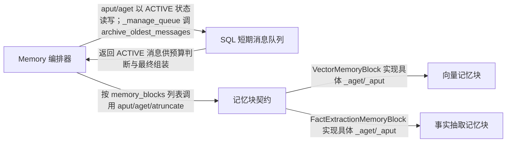

# llama_index：架构、运行逻辑与设计取舍

> main · [619d74664e84](https://github.com/run-llama/llama_index/commit/619d74664e8404612038bc15a1a40c686037277c) · deepseek-flash 辅助分析 · 2026-10-30T05:33:11.336Z
> 下文按固定源码推演，没有执行目标项目。引用可跳到具体代码行；“工程推断”解释收益与代价，不代表作者亲述。

## 1. 先建立直觉

**把多轮对话先放进有 token 预算的短期队列，超限时把旧消息转入可插拔的长期块，读取时再把块内容拼回消息列表。**

上下文窗口有限，全量历史不能每次送给模型；直接按 token 截断又会丢掉较早的对话或事实。

贯穿全文的例子：

- **输入：** 假设 Memory(token_limit=1000, chat_history_token_ratio=0.7, token_flush_size=100)，并配置 VectorMemoryBlock 与 FactExtractionMemoryBlock。ACTIVE 队列已有若干 user/assistant 消息，估算共 760 tokens；此时又写入一条消息。
- **预期输出：** 预期：ACTIVE 队列因超过 700 tokens 触发转存，最旧的完整对话轮次被标为 ARCHIVED 并分发给各块；下次 aget 读取剩余 ACTIVE 消息，按 priority 取回块内容，若总 token 超限则从低优先级块截断，最后返回 active 历史。若块有内容，默认把 <memory> 文本前置到 system message；否则只返回 active 历史。具体向量召回和事实抽取结果取决于外部向量库与 LLM，不能预先断言。

## 2. 一张图看懂架构



| 模块 | 职责与所在层的原因 | 输入 → 输出 | 拥有的状态 |
| --- | --- | --- | --- |
| Memory 编排器 [1][source-1] [2][source-2] | 维护短期队列与块列表，负责写入后的转存检测、读取时的块取回、截断和最终消息组装。 | ChatMessage、可选查询 input、session_id 和 memory_blocks 配置。 → 按插入策略组装后的 List[ChatMessage]。 | session_id、token 预算参数、memory_blocks、sql_store；不直接拥有块内部事实或向量。 |
| SQL 短期消息队列 [3][source-3] [4][source-4] [5][source-5] | 用 ACTIVE/ARCHIVED 状态保存消息，提供按时间排序读取、归档最旧消息和批量写入。 | session key、ChatMessage、目标状态。 → ACTIVE 消息列表或已归档消息列表。 | 数据库表中的 key、timestamp、role、status、data。 |
| 记忆块契约 [6][source-6] | 规定块如何接收短期消息、如何返回内容、如何按 priority 被截断；Memory 只依赖这个契约。 | 消息列表、session_id、截断 token 提示。 → str、List[ContentBlock] 或 List[ChatMessage]，或截断后的内容。 | name、priority、accept_short_term_memory 等块级状态。 |
| 向量记忆块 [7][source-7] [8][source-8] [9][source-9] | 可选的长期消息块：把被转存的消息批次写成带 session_id 的向量节点，查询时按最近上下文检索相关旧消息。 | 转存消息或当前查询上下文。 → 格式化后的检索文本；没有结果时返回空字符串。 | 外部 vector_store 中的 TextNode 及 metadata.session_id。 |
| 事实抽取记忆块 [10][source-10] [11][source-11] | 可选的长期事实块：用 LLM 从转存消息中抽取离散事实，超过上限时再让 LLM 合并压缩。 | 被转存的消息列表。 → 由 <fact> 标签拼接的事实文本。 | facts 列表和 max_facts。 |

## 3. 跟着一个请求跑完整条主线

这是对已读方法体的源码推演，不是执行日志。编号是阅读顺序；装配、写入、查询与条件分支是否发生，取决于每步的触发条件。

### 1. 装配 Memory 与默认短期库

**阶段：** 初始化

**触发条件：** 创建 Memory 时；若未传 chat_store，则创建默认 SQLAlchemyChatStore

入口/调用：`Memory.from_defaults / Memory.validate_memory` [12][source-12] [13][source-13]

**此时输入：** token_limit、ratio、flush size、memory_blocks、可选 chat_history。

生成 session_id，创建或接收 chat store；若传入 chat_history 则 set_messages；校验 token_limit、flush size 和块名唯一。

**状态变化：** Memory 持有 sql_store、session_id 和 memory_blocks。

**交给下一步：** 可写入、可读取的 Memory 实例。

### 2. 写入一条消息到 ACTIVE 队列

**阶段：** 写入

**触发条件：** 每次 aput 必经

入口/调用：`Memory.aput` [14][source-14]

**此时输入：** 一条 ChatMessage。

先调用 sql_store.add_message 写入 ACTIVE，再调用 _manage_queue。

**状态变化：** 数据库新增一行 ACTIVE 消息。

**交给下一步：** 活跃队列多一条消息。

### 3. 估算 ACTIVE token 并判断是否越线

**阶段：** 写入后检测

**触发条件：** aput 后必经；只有 tokens_in_current_queue > token_limit*chat_history_token_ratio 才进入转存

入口/调用：`Memory._manage_queue` [15][source-15]

**此时输入：** 当前 session 的 ACTIVE 消息。

读取 ACTIVE 消息，用 _estimate_token_count 汇总 token，和比例阈值比较；空队列直接返回。

**状态变化：** 未越线时无状态变化。

**交给下一步：** 越线则进入最旧消息选择；否则 aput 结束。

### 4. 按 flush 大小取最旧消息并保留完整轮次

**阶段：** 写入后检测/转存

**触发条件：** 第 3 步已超过阈值

入口/调用：`Memory._manage_queue` [16][source-16]

**此时输入：** ACTIVE 队列和 tokens_to_remove。

把队列反转为 newest-first，从尾部弹出最旧消息，直到达到 token_flush_size；至少保留一条，并调整边界使剩余队列尽量从 user 消息开始；必要时把最近完整对话轮次放回队列。

**状态变化：** 只在内存中移动消息列表。

**交给下一步：** messages_to_flush 和调整后的 reversed_queue。

### 5. 归档旧消息并并发分发给各块

**阶段：** 转存

**触发条件：** 第 4 步得到非空 messages_to_flush

入口/调用：`Memory._manage_queue / SQLAlchemyChatStore.archive_oldest_messages / BaseMemoryBlock.aput` [17][source-17] [5][source-5] [18][source-18]

**此时输入：** 待转存消息列表。

先按最旧顺序把对应 ACTIVE 行更新为 ARCHIVED；再用 asyncio.gather 并发调用各 block.aput，传入 from_short_term_memory=True 和 session_id。

**状态变化：** 数据库状态由 ACTIVE 变为 ARCHIVED；各块内部状态更新，例如向量库新增节点或事实列表新增事实。

**交给下一步：** 块侧长期内容；循环重新计算剩余队列 token。

### 6. aget 读取 ACTIVE 历史并计 token

**阶段：** 查询

**触发条件：** 每次 aget 必经

入口/调用：`Memory.aget` [19][source-19]

**此时输入：** 可选 input 和 block_kwargs。

从 sql_store 读取 ACTIVE 消息，并逐条估算 chat_history_tokens。

**状态变化：** 无。

**交给下一步：** chat_history 与 chat_history_tokens。

### 7. 按 priority 降序逐个取块内容

**阶段：** 查询/可选块

**触发条件：** aget 必经；未配置 memory_blocks 时直接得到空字典

入口/调用：`Memory._get_memory_blocks_content / BaseMemoryBlock.aget` [20][source-20] [21][source-21]

**此时输入：** chat_history，可选 input。

若 input 是字符串，先把它追加成临时 user 消息；按 priority 从高到低排序块，逐个 await block.aget，收集非空的 str/list 内容。注意这里是顺序 await，不是 gather。

**状态变化：** 块通常在读取时只读；向量块会构造查询但不在块外暴露排序结果。

**交给下一步：** content_per_memory_block：块名到内容的字典。

### 8. 合并 token 超限时按低优先级截断

**阶段：** 查询/可选分支

**触发条件：** 仅当 chat_history_tokens + memory_blocks_tokens > token_limit

入口/调用：`Memory._truncate_memory_blocks / BaseMemoryBlock.atruncate` [22][source-22] [23][source-23]

**此时输入：** 块内容字典和两侧 token 数。

计算超出量；按 priority 从低到高尝试 atruncate，priority 0 永不截断；用截断前后估算 token 差扣减待截量；若仍超出，再从低优先级开始移除整块。

**状态变化：** 只修改本地 truncated_content 字典，不回写块状态。

**交给下一步：** 截断后的块内容字典。

### 9. 格式化 memory 模板并插入消息列表

**阶段：** 查询/组装

**触发条件：** aget 必经

入口/调用：`Memory._format_memory_blocks / Memory._insert_memory_content` [24][source-24] [25][source-25]

**此时输入：** 截断后的块内容和 ACTIVE 历史。

把返回 ChatMessage 的块内容单独收集；其余块内容交给 memory_blocks_template.format_messages 生成 <memory> 文本。随后按 insert_method 把模板内容前置到已有 system message 或最新 user message；ChatMessage 型块内容直接前置到结果开头。

**状态变化：** 无持久状态变化；返回新列表。

**交给下一步：** 最终交给 LLM 的 List[ChatMessage]。

## 4. 核心技术到底是什么

### 1. 带 token 预算的 FIFO 队列瀑布

**解决的问题：** 短期对话不能无限增长，但直接删除会丢失仍需长期保存的旧消息。 [26][source-26] [5][source-5]

读取 ACTIVE 队列并估算 token；超过 token_limit*ratio 后从最旧消息开始按 flush size 选取，保持完整轮次，把选中行标为 ARCHIVED，再并发交给各块。

算法示意（用于解释机制，不是源码原文）：

```text
active = store.get_messages(session, ACTIVE)
tokens = sum(estimate(m) for m in active)
limit = token_limit * ratio
while tokens > limit and len(active) > 1:
  batch = pop_oldest_until(flush_size)
  keep_complete_turn(batch, active)
  store.archive_oldest_messages(session, len(batch))
  parallel for block in blocks: block.aput(batch)
  active = store.get_messages(session, ACTIVE)
  tokens = sum(estimate(m) for m in active)
```

**关键数据结构：** 按 timestamp,id 排序的消息行；status=ACTIVE/ARCHIVED；队列不变量是尽量保留至少一条且保留完整对话轮次。

- **本项目实现：** Memory._manage_queue 选择消息并调用块；SQLAlchemyChatStore.archive_oldest_messages 更新状态并返回被归档消息。
- **外部依赖提供：** SQLAlchemy 异步引擎和具体数据库负责事务与行更新；tokenizer 由外部配置的 tokenizer_fn 决定。
- **收益与代价：** 保留完整轮次可能让剩余队列略高于比例阈值；token 只是估算；归档表会持续增长。

### 2. 按 priority 截断的块契约

**解决的问题：** Memory 不知道向量块、事实块或静态块内部如何表示数据，却需要统一控制上下文预算。 [6][source-6] [22][source-22]

块实现 aget/aput/atruncate；Memory 取回内容后按块 priority 决定截断顺序，priority 0 受保护，低优先级先被截断或移除。

算法示意（用于解释机制，不是源码原文）：

```text
contents = {}
for block in blocks sorted by -priority:
  c = await block.aget(messages)
  if c: contents[block.name] = c
if tokens(contents) + tokens(chat) > token_limit:
  excess = tokens(contents) + tokens(chat) - token_limit
  for block in blocks sorted by priority:
    if block.priority == 0: continue
    c2 = await block.atruncate(contents[block.name], excess)
    excess -= tokens(c1) - tokens(c2)
return contents
```

**关键数据结构：** 字典 block.name -> str/List[ContentBlock]/List[ChatMessage]；priority 0 表示不截断；块名必须唯一。

- **本项目实现：** BaseMemoryBlock 定义 aget/aput/atruncate；Memory._truncate_memory_blocks 执行预算分配。
- **外部依赖提供：** 无外部框架参与截断决策；块内部可选择默认整块删除或自定义截断。
- **收益与代价：** 契约简单但截断粒度由块决定；默认 atruncate 返回 None 会整块移除，可能损失较多内容。

### 3. 向量记忆块的查询、过滤与批量写入

**解决的问题：** 被转存的旧消息需要按当前对话语义取回，同时不能跨会话混用。 [8][source-8] [9][source-9] [27][source-27]

查询时取最近 retrieval_context_window 条消息的 TextBlock 拼成 query_text，加入 session_id 过滤，生成 query embedding，调用 vector_store.aquery(top_k)，再经 postprocessor 和 format_template；写入时把一个消息批次写成一个 TextNode，metadata 带 session_id。

算法示意（用于解释机制，不是源码原文）：

```text
ctx = messages[-retrieval_context_window:]
text = join_text_blocks(ctx)
qvec = embed(text)
filters = session_id_filter(session_id)
res = vector_store.aquery(qvec, top_k, filters)
nodes = postprocess(res.nodes)
return format_template.format(text=join(node.content))
# 写入
node = TextNode(text=join(role_tagged_messages), metadata={session_id})
node.embedding = embed(node.text)
vector_store.async_add([node])
```

**关键数据结构：** TextNode；metadata.session_id；VectorStoreQuery 的 similarity_top_k 和 filters。

- **本项目实现：** VectorMemoryBlock 负责拼查询文本、构造过滤、调用 embedding 和 vector_store、格式化结果；项目不实现具体向量数据库。
- **外部依赖提供：** embed_model 和 vector_store 的具体实现由外部集成提供；VectorMemoryBlock 还要求 vector_store.stores_text 为真才能作为记忆块使用。
- **收益与代价：** 召回质量取决于外部向量库和 embedding；每个消息批次只写一个节点，检索粒度较粗；它是可选块，不是所有 Memory 的默认长期记忆。

### 4. LLM 事实抽取与压缩

**解决的问题：** 长期记忆不只要保存原消息，还要维护离散事实，并限制事实数量。 [28][source-28] [29][source-29]

把已有事实和转存消息交给 LLM，解析返回的 <fact> 标签；只追加非完全重复事实；事实数超过 max_facts 时再让 LLM 压缩，且只有解析出非空结果才替换原列表。

算法示意（用于解释机制，不是源码原文）：

```text
existing = render_facts(facts)
prompt = extract_template.format(existing_facts=existing)
resp = llm.achat(messages + prompt)
new = parse_facts_xml(resp.content)
for f in new:
  if f not in facts: facts.append(f)
if len(facts) > max_facts:
  resp = llm.achat(condense_prompt(facts, max_facts))
  condensed = parse_facts_xml(resp.content)
  if condensed: facts = condensed
```

**关键数据结构：** facts: List[str]；XML <fact> 标签；max_facts 上限；去重只做 exact-match。

- **本项目实现：** FactExtractionMemoryBlock 负责 prompt、XML 解析、去重和压缩替换保护。
- **外部依赖提供：** LLM 负责生成事实和压缩结果；本项目不能保证模型一定抽出某条事实或一定返回可解析 XML。
- **收益与代价：** 额外 LLM 调用有成本且结果不确定；exact-match 去重不能消除语义重复，需要压缩提示词兜底。

## 5. 为什么选择这种实现

### 1. 短期队列不直接删除移出的消息，而是把状态改为 ARCHIVED

**依据：已确认实现；以下原因是工程分析，不代表作者亲述。** [30][source-30] [31][source-31]

**面临的约束：** 需要同时支持 active 读取、归档返回和完整历史保留。

**如果改用另一种做法：** 调用 delete_oldest_messages 直接删除最旧消息。

**为什么当前方案有用：** 示例中转存旧消息后，下次 aget 只读 ACTIVE，不会重复注入；但归档仍可通过 aget_all 查询，且 archive_oldest_messages 能返回同批消息交给块。直接删除会让历史不可恢复。

**付出的代价，以及不适用的情况：** 归档行长期保留，表会增长；需要按 status 过滤查询。

### 2. 触发转存的阈值是 token_limit*chat_history_token_ratio，而不是整个 token_limit

**依据：已确认实现；以下原因是工程分析，不代表作者亲述。** [32][source-32] [33][source-33]

**面临的约束：** 要为 memory blocks 和模型输出预留 token 空间。

**如果改用另一种做法：** 等 ACTIVE 历史达到总 token_limit 再转存。

**为什么当前方案有用：** 如果 active 历史独占全部预算，aget 时块内容再加入就会立刻超限，只能大量截断块；默认 ratio=0.7 让短期历史最多占七成左右，剩余预算留给长期块。

**付出的代价，以及不适用的情况：** 活跃历史更短，最近对话可能更早被转存；比例是估算值。

### 3. 转存时保持完整对话轮次，而不是严格按 token 精确切掉最旧消息

**作者原文：** “We need to maintain conversation integrity” [34][source-34]

**面临的约束：** 活跃队列如果以 assistant/tool 消息开头，会破坏模型对对话结构的预期。

**如果改用另一种做法：** 只按 flush size 从最旧消息开始切，直到 token 低于阈值。

**为什么当前方案有用：** 代码会继续弹出剩余队列开头的非 user 消息，并把最近完整 turn 放回；这样下次 aget 的活跃历史更可能从 user 开始，避免孤立的 assistant 或 tool 消息。

**付出的代价，以及不适用的情况：** 剩余队列可能暂时高于比例阈值；逻辑更复杂。

### 4. VectorMemoryBlock 作为可选块时强制 stores_text，并用 metadata.session_id 过滤查询

**依据：已确认实现；以下原因是工程分析，不代表作者亲述。** [27][source-27] [35][source-35]

**面临的约束：** 块需要返回可读文本，且多会话共用向量库时不能把别的会话消息召回进来。

**如果改用另一种做法：** 允许不存文本的向量库，或全局检索后再在应用层过滤。

**为什么当前方案有用：** 校验阶段拒绝 stores_text=False 的库；查询阶段若传入 session_id，就构造 MetadataFilter(key='session_id', value=session_id) 并放入 VectorStoreQuery。这样同一向量库可承载多个 session，而 aget 只取当前会话相关节点。

**付出的代价，以及不适用的情况：** 需要支持文本存储和 metadata 过滤的向量库；具体过滤执行由外部向量库负责。

### 5. 事实压缩只有在解析出非空事实时才整体替换原 facts

**作者原文：** “The condensed response replaces the fact list wholesale” [36][source-36]

**面临的约束：** 压缩提示要求模型返回完整快照，但模型可能返回空或不可解析 XML。

**如果改用另一种做法：** 无条件把解析结果赋给 self.facts。

**为什么当前方案有用：** 如果模型返回空列表，无条件替换会把已有事实全部清空；代码先检查 condensed_facts 非空，再执行 self.facts = condensed_facts。

**付出的代价，以及不适用的情况：** 模型返回空时旧事实可能超过 max_facts，但至少不会丢失。

## 6. 关键代码精读

### 1. 转存触发与块分发


`llama-index-core/llama_index/core/memory/memory.py:691-721` [37][source-37]

```python
        tokens_in_current_queue = sum(
            self._estimate_token_count(message) for message in current_queue
        )

        # If we're over the token limit, initiate waterfall
        token_limit = self.token_limit * self.chat_history_token_ratio
        if tokens_in_current_queue > token_limit:
            # Process from oldest to newest, but efficiently with pop() operations
            reversed_queue = current_queue[::-1]  # newest first, oldest last

            # Calculate approximate number of messages to remove
            tokens_to_remove = tokens_in_current_queue - token_limit

            while tokens_to_remove > 0:
                # If only one message left, keep it regardless of token count
                if len(reversed_queue) <= 1:
                    break

                # Collect messages to flush (up to flush size)
                messages_to_flush = []
                flushed_tokens = 0

                # Remove oldest messages (from end of reversed list) until reaching flush size
                while (
                    flushed_tokens < self.token_flush_size
                    and reversed_queue
                    and len(reversed_queue) > 1
                ):
                    message = reversed_queue.pop()
                    messages_to_flush.append(message)
                    flushed_tokens += self._estimate_token_count(message)
```


`llama-index-core/llama_index/core/memory/memory.py:781-797` [38][source-38]

```python
                # Archive the flushed messages
                if messages_to_flush:
                    await self.sql_store.archive_oldest_messages(
                        self.session_id, n=len(messages_to_flush)
                    )

                    # Waterfall the flushed messages to memory blocks
                    await asyncio.gather(
                        *[
                            block.aput(
                                messages_to_flush,
                                from_short_term_memory=True,
                                session_id=self.session_id,
                            )
                            for block in self.memory_blocks
                        ]
                    )
```


先读取 ACTIVE 队列并逐条估算 token；只有超过 token_limit*chat_history_token_ratio 才进入转存。随后把队列反转，从尾部弹出最旧消息，按 token_flush_size 组成批次，并至少保留一条消息。真正落库时调用 archive_oldest_messages 把最旧 ACTIVE 行改成 ARCHIVED，再用 asyncio.gather 并发调用每个块的 aput。也就是说：归档和块写入只发生在超预算分支，块写入是并发的。

### 2. aget 如何把块内容拼回消息列表


`llama-index-core/llama_index/core/memory/memory.py:624-670` [2][source-2]

```python
    async def aget(
        self, input: Optional[Union[str, ChatMessage]] = None, **block_kwargs: Any
    ) -> List[ChatMessage]:  # type: ignore[override]
        """Get messages with memory blocks included (async)."""
        # Get chat history efficiently
        chat_history = await self.sql_store.get_messages(
            self.session_id, status=MessageStatus.ACTIVE
        )
        chat_history_tokens = sum(
            self._estimate_token_count(message) for message in chat_history
        )

        # Get memory blocks content
        content_per_memory_block = await self._get_memory_blocks_content(
            chat_history, input=input, **block_kwargs
        )

        # Calculate memory blocks tokens
        memory_blocks_tokens = sum(
            self._estimate_token_count(content)
            for content in content_per_memory_block.values()
        )

        # Handle truncation if needed
        truncated_content = await self._truncate_memory_blocks(
            content_per_memory_block, memory_blocks_tokens, chat_history_tokens
        )

        # Format template-based memory blocks
        memory_blocks_data, chat_message_data = await self._format_memory_blocks(
            truncated_content
        )

        # Create messages from template content
        memory_content = []
        if memory_blocks_data:
            memory_block_messages = self.memory_blocks_template.format_messages(
                memory_blocks=memory_blocks_data
            )
            memory_content = (
                memory_block_messages[0].blocks if memory_block_messages else []
            )

        # Insert memory content into chat history
        return self._insert_memory_content(
            chat_history, memory_content, chat_message_data
        )
```


`llama-index-core/llama_index/core/memory/memory.py:589-620` [39][source-39]

```python
            if self.insert_method == InsertMethod.SYSTEM:
                # Find system message or create a new one
                system_idx = next(
                    (i for i, msg in enumerate(result) if msg.role == "system"), None
                )

                if system_idx is not None:
                    # Update existing system message
                    result[system_idx].blocks = [
                        *memory_content,
                        *result[system_idx].blocks,
                    ]
                else:
                    # Create new system message at the beginning
                    result.insert(0, ChatMessage(role="system", blocks=memory_content))
            elif self.insert_method == InsertMethod.USER:
                # Find the latest user message
                session_idx = next(
                    (i for i, msg in enumerate(reversed(result)) if msg.role == "user"),
                    None,
                )

                if session_idx is not None:
                    # Get actual index (since we enumerated in reverse)
                    actual_idx = len(result) - 1 - session_idx
                    # Update existing user message
                    result[actual_idx].blocks = [
                        *memory_content,
                        *result[actual_idx].blocks,
                    ]
                else:
                    result.append(ChatMessage(role="user", blocks=memory_content))
```


aget 先读 ACTIVE 历史并计算 chat_history_tokens；_get_memory_blocks_content 按 priority 降序逐个 await 块，把非空 str/list 收集到字典。之后把 chat 和块 token 相加，只有超过 token_limit 才调用 _truncate_memory_blocks。_format_memory_blocks 把返回 ChatMessage 的内容与模板内容分开；模板生成一个 <memory> 内容块，_insert_memory_content 按 InsertMethod.SYSTEM 把它放到已有 system message 前，若没有 system 就新建；USER 模式则放到最新 user message 前。ChatMessage 型块内容会直接前置到整个结果开头。

### 3. 向量块如何检索和写入


`llama-index-core/llama_index/core/memory/memory_blocks/vector.py:100-125` [40][source-40]

```python
    async def _aget(
        self,
        messages: Optional[List[ChatMessage]] = None,
        session_id: Optional[str] = None,
        **block_kwargs: Any,
    ) -> str:
        """Retrieve relevant information based on recent messages."""
        if not messages or len(messages) == 0:
            return ""

        # Use the last message or a context window of messages for the query
        if (
            self.retrieval_context_window > 1
            and len(messages) >= self.retrieval_context_window
        ):
            context = messages[-self.retrieval_context_window :]
        else:
            context = messages

        query_text = self._get_text_from_messages(context)
        if not query_text:
            return ""

        # Handle filtering by session_id
        if session_id is not None:
            filter = MetadataFilter(key="session_id", value=session_id)
```


`llama-index-core/llama_index/core/memory/memory_blocks/vector.py:143-168` [41][source-41]

```python
        # Create and execute the query
        query_embedding = await self.embed_model.aget_query_embedding(query_text)
        query = VectorStoreQuery(
            query_str=query_text,
            query_embedding=query_embedding,
            similarity_top_k=self.similarity_top_k,
            **self.query_kwargs,
        )

        results = await self.vector_store.aquery(query)
        nodes_with_scores = [
            NodeWithScore(node=node, score=score)
            for node, score in zip(results.nodes or [], results.similarities or [])
        ]
        if not nodes_with_scores:
            return ""

        # Apply postprocessors
        for postprocessor in self.node_postprocessors:
            nodes_with_scores = await postprocessor.apostprocess_nodes(
                nodes_with_scores, query_str=query_text
            )

        # Format the results
        retrieved_text = "\n\n".join([node.get_content() for node in nodes_with_scores])
        return self.format_template.format(text=retrieved_text)
```


`llama-index-core/llama_index/core/memory/memory_blocks/vector.py:170-202` [9][source-9]

```python
    async def _aput(self, messages: List[ChatMessage]) -> None:
        """Store messages in the vector store for future retrieval."""
        if not messages:
            return

        # Format messages with role, text content, and additional info
        texts = []
        session_id = None
        for message in messages:
            text = self._get_text_from_messages([message])
            if not text:
                continue

            # special case for session_id
            if "session_id" in message.additional_kwargs:
                session_id = message.additional_kwargs.pop("session_id")

            if message.additional_kwargs:
                text += f"\nAdditional Info: ({message.additional_kwargs!s})"

            text = f"<message role='{message.role.value}'>{text}</message>"
            texts.append(text)

        if not texts:
            return

        # Get embeddings
        text_node = TextNode(text="\n".join(texts), metadata={"session_id": session_id})
        text_node.embedding = await self.embed_model.aget_text_embedding(text_node.text)

        # Add to vector store, one node per entire message batch
        await self.vector_store.async_add([text_node])

```


VectorMemoryBlock 取最近 retrieval_context_window 条消息，只拼接 TextBlock 文本作为 query_text；如果传入 session_id，就把它加进 MetadataFilters。然后生成 query embedding，调用 vector_store.aquery，按 similarity_top_k 取节点，运行 postprocessor，最后把节点内容拼成文本交给 format_template。写入侧把一个消息批次拼成一个 TextNode，metadata 写 session_id，计算 embedding 后 async_add；因此检索粒度是批次节点，不是每条消息一个节点。

## 7. 动手验证你的理解

以下是建议实验，没有执行过。

### 1. 短期队列超过比例阈值后，旧消息是否真的从 ACTIVE 转为 ARCHIVED 并只分发给配置的块？

**改变什么：** 把 token_limit 调小、chat_history_token_ratio 调低，并设置较小的 token_flush_size；连续 aput 多轮 user/assistant 消息，然后检查 AGET_ALL 和块状态。 [42][source-42] [5][source-5]

**应该观察到什么：** 应观察到至少一次 archive_oldest_messages 效果：部分旧行 status 变为 ARCHIVED，ACTIVE 只保留较新的完整轮次；配置的块收到 from_short_term_memory=True 的 aput。由于完整轮次保护，ACTIVE token 未必精确等于阈值。

### 2. 不配置 memory_blocks 时，aget 是否只返回 ACTIVE 历史而不生成 memory 模板？

**改变什么：** 创建 Memory 时不传 memory_blocks，写入若干消息后调用 aget。 [20][source-20] [2][source-2]

**应该观察到什么：** _get_memory_blocks_content 得到空字典，_format_memory_blocks 不产生模板数据，_insert_memory_content 没有 memory_content 可插入；返回值应只有 ACTIVE 历史，不出现 <memory> 系统块，也不会调用向量或事实块。

### 3. 事实压缩返回空或不可解析时，已有 facts 会不会被清空？

**改变什么：** 配置 FactExtractionMemoryBlock，使 facts 超过 max_facts，并让压缩提示对应的 LLM 返回空 <facts></facts> 或非 XML 文本。 [36][source-36]

**应该观察到什么：** 由于代码只在 condensed_facts 非空时替换 self.facts，已有事实应保留，不会被空结果覆盖。

## 8. 读完应当能复述什么

- 短期队列与长期块是两层：ACTIVE/ARCHIVED 队列负责近期对话，memory_blocks 负责可选长期内容；向量检索不是默认长期记忆，只有显式配置 VectorMemoryBlock 才参与。
- token 预算有两道闸门：写入时按 chat_history_token_ratio 触发瀑布转存，读取时按 token_limit 对块内容做 priority 截断；priority 0 受保护。
- 转存用 archive_oldest_messages 保留行并改状态，块写入用 asyncio.gather 并发；读取块内容时则是按 priority 降序逐个 await，不能把 aget 的块取回描述成并发。
- RAG 的 RetrieverQueryEngine/VectorIndexRetriever 是文档检索回答链；Memory 的 VectorMemoryBlock 直接查询 vector_store 并维护 session 过滤，二者共享向量检索语义但不在同一条默认调用链上。
- 事实记忆依赖 LLM 抽取和 XML 解析，去重只做完全匹配；压缩替换有防清空保护，但仍不能保证模型一定产出某条事实。

## 来源与覆盖边界

本次读取 24 个文件，共 254,080 字符；24 个文件完整读取，其他文件按关键方法取带行号的片段。没有把未读依赖的内部实现当作已确认事实。

- 已读代码中 SimpleVectorStore 的 stores_text=False，而 VectorMemoryBlock 要求 vector_store.stores_text 为真；具体生产向量库如何满足该要求、aquery 如何返回 nodes，未在已读文件中确认。
- 无法从代码确认某次 LLM 事实抽取会得到哪些事实，也无法预测向量检索的排名；这些取决于外部模型、embedding 和向量库数据。
- _truncate_memory_blocks 的第二个循环会对非零 priority 的块名执行 pop；若某个非零 priority 块在之前返回空且未进入 content_per_memory_block，是否安全未读到测试验证。
- 未读到 Memory 与 RetrieverQueryEngine/VectorIndexRetriever 的直接调用关系；因此不能把 RAG query engine 画进 Memory.aget 的必经调用链。
- 已读代码没有展示并发写入同一 session 时的数据库竞态测试；timestamp 和 id 排序在同一进程批量写入下可用，但跨并发请求的精确排序边界未验证。

| 文件 | 实际读取行段 |
| --- | --- |
| [README.md](https://github.com/run-llama/llama_index/blob/619d74664e8404612038bc15a1a40c686037277c/README.md) | 1–224 / 共 224 行 |
| [pyproject.toml](https://github.com/run-llama/llama_index/blob/619d74664e8404612038bc15a1a40c686037277c/pyproject.toml) | 1–222 / 共 222 行 |
| [llama-index-core/llama_index/core/memory/memory.py](https://github.com/run-llama/llama_index/blob/619d74664e8404612038bc15a1a40c686037277c/llama-index-core/llama_index/core/memory/memory.py) | 1–874 / 共 874 行 |
| [llama-index-core/llama_index/core/memory/memory_blocks/vector.py](https://github.com/run-llama/llama_index/blob/619d74664e8404612038bc15a1a40c686037277c/llama-index-core/llama_index/core/memory/memory_blocks/vector.py) | 1–202 / 共 202 行 |
| [llama-index-core/llama_index/core/memory/memory_blocks/fact.py](https://github.com/run-llama/llama_index/blob/619d74664e8404612038bc15a1a40c686037277c/llama-index-core/llama_index/core/memory/memory_blocks/fact.py) | 1–183 / 共 183 行 |
| [llama-index-core/llama_index/core/memory/vector_memory.py](https://github.com/run-llama/llama_index/blob/619d74664e8404612038bc15a1a40c686037277c/llama-index-core/llama_index/core/memory/vector_memory.py) | 1–207 / 共 207 行 |
| [llama-index-core/llama_index/core/indices/vector_store/retrievers/retriever.py](https://github.com/run-llama/llama_index/blob/619d74664e8404612038bc15a1a40c686037277c/llama-index-core/llama_index/core/indices/vector_store/retrievers/retriever.py) | 1–268 / 共 268 行 |
| [llama-index-core/llama_index/core/query_engine/retriever_query_engine.py](https://github.com/run-llama/llama_index/blob/619d74664e8404612038bc15a1a40c686037277c/llama-index-core/llama_index/core/query_engine/retriever_query_engine.py) | 1–238 / 共 238 行 |
| [llama-index-core/llama_index/core/memory/types.py](https://github.com/run-llama/llama_index/blob/619d74664e8404612038bc15a1a40c686037277c/llama-index-core/llama_index/core/memory/types.py) | 1–153 / 共 153 行 |
| [llama-index-core/llama_index/core/storage/chat_store/sql.py](https://github.com/run-llama/llama_index/blob/619d74664e8404612038bc15a1a40c686037277c/llama-index-core/llama_index/core/storage/chat_store/sql.py) | 1–459 / 共 459 行 |
| [llama-index-core/llama_index/core/storage/chat_store/base_db.py](https://github.com/run-llama/llama_index/blob/619d74664e8404612038bc15a1a40c686037277c/llama-index-core/llama_index/core/storage/chat_store/base_db.py) | 1–102 / 共 102 行 |
| [llama-index-core/llama_index/core/memory/memory_blocks/static.py](https://github.com/run-llama/llama_index/blob/619d74664e8404612038bc15a1a40c686037277c/llama-index-core/llama_index/core/memory/memory_blocks/static.py) | 1–40 / 共 40 行 |
| [llama-index-core/llama_index/core/memory/simple_composable_memory.py](https://github.com/run-llama/llama_index/blob/619d74664e8404612038bc15a1a40c686037277c/llama-index-core/llama_index/core/memory/simple_composable_memory.py) | 1–164 / 共 164 行 |
| [llama-index-core/llama_index/core/memory/chat_memory_buffer.py](https://github.com/run-llama/llama_index/blob/619d74664e8404612038bc15a1a40c686037277c/llama-index-core/llama_index/core/memory/chat_memory_buffer.py) | 1–169 / 共 169 行 |
| [llama-index-core/llama_index/core/vector_stores/simple.py](https://github.com/run-llama/llama_index/blob/619d74664e8404612038bc15a1a40c686037277c/llama-index-core/llama_index/core/vector_stores/simple.py) | 1–355 / 共 355 行 |
| [llama-index-core/llama_index/core/memory/__init__.py](https://github.com/run-llama/llama_index/blob/619d74664e8404612038bc15a1a40c686037277c/llama-index-core/llama_index/core/memory/__init__.py) | 1–27 / 共 27 行 |
| [docs/src/content/docs/framework/getting_started/concepts.mdx](https://github.com/run-llama/llama_index/blob/619d74664e8404612038bc15a1a40c686037277c/docs/src/content/docs/framework/getting_started/concepts.mdx) | 1–71 / 共 71 行 |
| [llama-index-core/llama_index/core/async_utils.py](https://github.com/run-llama/llama_index/blob/619d74664e8404612038bc15a1a40c686037277c/llama-index-core/llama_index/core/async_utils.py) | 1–176 / 共 176 行 |
| [llama-index-core/llama_index/core/base/llms/types.py](https://github.com/run-llama/llama_index/blob/619d74664e8404612038bc15a1a40c686037277c/llama-index-core/llama_index/core/base/llms/types.py) | 1–1372 / 共 1372 行 |
| [llama-index-core/llama_index/core/bridge/pydantic.py](https://github.com/run-llama/llama_index/blob/619d74664e8404612038bc15a1a40c686037277c/llama-index-core/llama_index/core/bridge/pydantic.py) | 1–68 / 共 68 行 |
| [llama-index-core/llama_index/core/prompts/__init__.py](https://github.com/run-llama/llama_index/blob/619d74664e8404612038bc15a1a40c686037277c/llama-index-core/llama_index/core/prompts/__init__.py) | 1–29 / 共 29 行 |
| [llama-index-core/llama_index/core/utils.py](https://github.com/run-llama/llama_index/blob/619d74664e8404612038bc15a1a40c686037277c/llama-index-core/llama_index/core/utils.py) | 1–711 / 共 711 行 |
| [llama-index-core/llama_index/core/base/embeddings/base.py](https://github.com/run-llama/llama_index/blob/619d74664e8404612038bc15a1a40c686037277c/llama-index-core/llama_index/core/base/embeddings/base.py) | 1–661 / 共 661 行 |
| [llama-index-core/llama_index/core/postprocessor/types.py](https://github.com/run-llama/llama_index/blob/619d74664e8404612038bc15a1a40c686037277c/llama-index-core/llama_index/core/postprocessor/types.py) | 1–80 / 共 80 行 |

[source-1]: https://github.com/run-llama/llama_index/blob/619d74664e8404612038bc15a1a40c686037277c/llama-index-core/llama_index/core/memory/memory.py#L188-L258 "llama-index-core/llama_index/core/memory/memory.py:188-258"
[source-2]: https://github.com/run-llama/llama_index/blob/619d74664e8404612038bc15a1a40c686037277c/llama-index-core/llama_index/core/memory/memory.py#L624-L670 "llama-index-core/llama_index/core/memory/memory.py:624-670"
[source-3]: https://github.com/run-llama/llama_index/blob/619d74664e8404612038bc15a1a40c686037277c/llama-index-core/llama_index/core/storage/chat_store/sql.py#L35-L45 "llama-index-core/llama_index/core/storage/chat_store/sql.py:35-45"
[source-4]: https://github.com/run-llama/llama_index/blob/619d74664e8404612038bc15a1a40c686037277c/llama-index-core/llama_index/core/storage/chat_store/sql.py#L173-L204 "llama-index-core/llama_index/core/storage/chat_store/sql.py:173-204"
[source-5]: https://github.com/run-llama/llama_index/blob/619d74664e8404612038bc15a1a40c686037277c/llama-index-core/llama_index/core/storage/chat_store/sql.py#L372-L406 "llama-index-core/llama_index/core/storage/chat_store/sql.py:372-406"
[source-6]: https://github.com/run-llama/llama_index/blob/619d74664e8404612038bc15a1a40c686037277c/llama-index-core/llama_index/core/memory/memory.py#L103-L187 "llama-index-core/llama_index/core/memory/memory.py:103-187"
[source-7]: https://github.com/run-llama/llama_index/blob/619d74664e8404612038bc15a1a40c686037277c/llama-index-core/llama_index/core/memory/memory_blocks/vector.py#L29-L65 "llama-index-core/llama_index/core/memory/memory_blocks/vector.py:29-65"
[source-8]: https://github.com/run-llama/llama_index/blob/619d74664e8404612038bc15a1a40c686037277c/llama-index-core/llama_index/core/memory/memory_blocks/vector.py#L100-L168 "llama-index-core/llama_index/core/memory/memory_blocks/vector.py:100-168"
[source-9]: https://github.com/run-llama/llama_index/blob/619d74664e8404612038bc15a1a40c686037277c/llama-index-core/llama_index/core/memory/memory_blocks/vector.py#L170-L202 "llama-index-core/llama_index/core/memory/memory_blocks/vector.py:170-202"
[source-10]: https://github.com/run-llama/llama_index/blob/619d74664e8404612038bc15a1a40c686037277c/llama-index-core/llama_index/core/memory/memory_blocks/fact.py#L67-L97 "llama-index-core/llama_index/core/memory/memory_blocks/fact.py:67-97"
[source-11]: https://github.com/run-llama/llama_index/blob/619d74664e8404612038bc15a1a40c686037277c/llama-index-core/llama_index/core/memory/memory_blocks/fact.py#L110-L183 "llama-index-core/llama_index/core/memory/memory_blocks/fact.py:110-183"
[source-12]: https://github.com/run-llama/llama_index/blob/619d74664e8404612038bc15a1a40c686037277c/llama-index-core/llama_index/core/memory/memory.py#L288-L342 "llama-index-core/llama_index/core/memory/memory.py:288-342"
[source-13]: https://github.com/run-llama/llama_index/blob/619d74664e8404612038bc15a1a40c686037277c/llama-index-core/llama_index/core/memory/memory.py#L266-L286 "llama-index-core/llama_index/core/memory/memory.py:266-286"
[source-14]: https://github.com/run-llama/llama_index/blob/619d74664e8404612038bc15a1a40c686037277c/llama-index-core/llama_index/core/memory/memory.py#L811-L819 "llama-index-core/llama_index/core/memory/memory.py:811-819"
[source-15]: https://github.com/run-llama/llama_index/blob/619d74664e8404612038bc15a1a40c686037277c/llama-index-core/llama_index/core/memory/memory.py#L672-L697 "llama-index-core/llama_index/core/memory/memory.py:672-697"
[source-16]: https://github.com/run-llama/llama_index/blob/619d74664e8404612038bc15a1a40c686037277c/llama-index-core/llama_index/core/memory/memory.py#L699-L779 "llama-index-core/llama_index/core/memory/memory.py:699-779"
[source-17]: https://github.com/run-llama/llama_index/blob/619d74664e8404612038bc15a1a40c686037277c/llama-index-core/llama_index/core/memory/memory.py#L781-L809 "llama-index-core/llama_index/core/memory/memory.py:781-809"
[source-18]: https://github.com/run-llama/llama_index/blob/619d74664e8404612038bc15a1a40c686037277c/llama-index-core/llama_index/core/memory/memory.py#L151-L166 "llama-index-core/llama_index/core/memory/memory.py:151-166"
[source-19]: https://github.com/run-llama/llama_index/blob/619d74664e8404612038bc15a1a40c686037277c/llama-index-core/llama_index/core/memory/memory.py#L624-L635 "llama-index-core/llama_index/core/memory/memory.py:624-635"
[source-20]: https://github.com/run-llama/llama_index/blob/619d74664e8404612038bc15a1a40c686037277c/llama-index-core/llama_index/core/memory/memory.py#L446-L479 "llama-index-core/llama_index/core/memory/memory.py:446-479"
[source-21]: https://github.com/run-llama/llama_index/blob/619d74664e8404612038bc15a1a40c686037277c/llama-index-core/llama_index/core/memory/memory.py#L132-L145 "llama-index-core/llama_index/core/memory/memory.py:132-145"
[source-22]: https://github.com/run-llama/llama_index/blob/619d74664e8404612038bc15a1a40c686037277c/llama-index-core/llama_index/core/memory/memory.py#L481-L544 "llama-index-core/llama_index/core/memory/memory.py:481-544"
[source-23]: https://github.com/run-llama/llama_index/blob/619d74664e8404612038bc15a1a40c686037277c/llama-index-core/llama_index/core/memory/memory.py#L167-L185 "llama-index-core/llama_index/core/memory/memory.py:167-185"
[source-24]: https://github.com/run-llama/llama_index/blob/619d74664e8404612038bc15a1a40c686037277c/llama-index-core/llama_index/core/memory/memory.py#L546-L622 "llama-index-core/llama_index/core/memory/memory.py:546-622"
[source-25]: https://github.com/run-llama/llama_index/blob/619d74664e8404612038bc15a1a40c686037277c/llama-index-core/llama_index/core/memory/memory.py#L652-L670 "llama-index-core/llama_index/core/memory/memory.py:652-670"
[source-26]: https://github.com/run-llama/llama_index/blob/619d74664e8404612038bc15a1a40c686037277c/llama-index-core/llama_index/core/memory/memory.py#L672-L724 "llama-index-core/llama_index/core/memory/memory.py:672-724"
[source-27]: https://github.com/run-llama/llama_index/blob/619d74664e8404612038bc15a1a40c686037277c/llama-index-core/llama_index/core/memory/memory_blocks/vector.py#L67-L76 "llama-index-core/llama_index/core/memory/memory_blocks/vector.py:67-76"
[source-28]: https://github.com/run-llama/llama_index/blob/619d74664e8404612038bc15a1a40c686037277c/llama-index-core/llama_index/core/memory/memory_blocks/fact.py#L119-L167 "llama-index-core/llama_index/core/memory/memory_blocks/fact.py:119-167"
[source-29]: https://github.com/run-llama/llama_index/blob/619d74664e8404612038bc15a1a40c686037277c/llama-index-core/llama_index/core/memory/memory_blocks/fact.py#L168-L183 "llama-index-core/llama_index/core/memory/memory_blocks/fact.py:168-183"
[source-30]: https://github.com/run-llama/llama_index/blob/619d74664e8404612038bc15a1a40c686037277c/llama-index-core/llama_index/core/storage/chat_store/sql.py#L323-L337 "llama-index-core/llama_index/core/storage/chat_store/sql.py:323-337"
[source-31]: https://github.com/run-llama/llama_index/blob/619d74664e8404612038bc15a1a40c686037277c/llama-index-core/llama_index/core/storage/chat_store/sql.py#L338-L406 "llama-index-core/llama_index/core/storage/chat_store/sql.py:338-406"
[source-32]: https://github.com/run-llama/llama_index/blob/619d74664e8404612038bc15a1a40c686037277c/llama-index-core/llama_index/core/memory/memory.py#L213-L216 "llama-index-core/llama_index/core/memory/memory.py:213-216"
[source-33]: https://github.com/run-llama/llama_index/blob/619d74664e8404612038bc15a1a40c686037277c/llama-index-core/llama_index/core/memory/memory.py#L695-L697 "llama-index-core/llama_index/core/memory/memory.py:695-697"
[source-34]: https://github.com/run-llama/llama_index/blob/619d74664e8404612038bc15a1a40c686037277c/llama-index-core/llama_index/core/memory/memory.py#L727-L779 "llama-index-core/llama_index/core/memory/memory.py:727-779"
[source-35]: https://github.com/run-llama/llama_index/blob/619d74664e8404612038bc15a1a40c686037277c/llama-index-core/llama_index/core/memory/memory_blocks/vector.py#L123-L152 "llama-index-core/llama_index/core/memory/memory_blocks/vector.py:123-152"
[source-36]: https://github.com/run-llama/llama_index/blob/619d74664e8404612038bc15a1a40c686037277c/llama-index-core/llama_index/core/memory/memory_blocks/fact.py#L149-L166 "llama-index-core/llama_index/core/memory/memory_blocks/fact.py:149-166"
[source-37]: https://github.com/run-llama/llama_index/blob/619d74664e8404612038bc15a1a40c686037277c/llama-index-core/llama_index/core/memory/memory.py#L691-L721 "llama-index-core/llama_index/core/memory/memory.py:691-721"
[source-38]: https://github.com/run-llama/llama_index/blob/619d74664e8404612038bc15a1a40c686037277c/llama-index-core/llama_index/core/memory/memory.py#L781-L797 "llama-index-core/llama_index/core/memory/memory.py:781-797"
[source-39]: https://github.com/run-llama/llama_index/blob/619d74664e8404612038bc15a1a40c686037277c/llama-index-core/llama_index/core/memory/memory.py#L589-L620 "llama-index-core/llama_index/core/memory/memory.py:589-620"
[source-40]: https://github.com/run-llama/llama_index/blob/619d74664e8404612038bc15a1a40c686037277c/llama-index-core/llama_index/core/memory/memory_blocks/vector.py#L100-L125 "llama-index-core/llama_index/core/memory/memory_blocks/vector.py:100-125"
[source-41]: https://github.com/run-llama/llama_index/blob/619d74664e8404612038bc15a1a40c686037277c/llama-index-core/llama_index/core/memory/memory_blocks/vector.py#L143-L168 "llama-index-core/llama_index/core/memory/memory_blocks/vector.py:143-168"
[source-42]: https://github.com/run-llama/llama_index/blob/619d74664e8404612038bc15a1a40c686037277c/llama-index-core/llama_index/core/memory/memory.py#L691-L797 "llama-index-core/llama_index/core/memory/memory.py:691-797"
