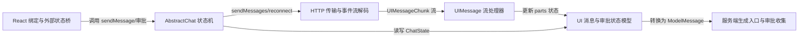

# ai：架构、运行逻辑与设计取舍

> main · [dfed8e8234b6](https://github.com/vercel/ai/commit/dfed8e8234b684c3e2a0571ad1a1078c8364b44c) · deepseek-flash 辅助分析 · 2026-10-30T05:33:11.336Z
> 下文按固定源码推演，没有执行目标项目。引用可跳到具体代码行；“工程推断”解释收益与代价，不代表作者亲述。

## 1. 先建立直觉

**它把一次聊天拆成三层：界面保存可渲染消息，请求层拿完整消息换来一条分块事件流，再把每个事件折叠进当前界面消息。**

模型输出是增量事件，界面却要稳定渲染文本、工具调用和审批状态；断线还要续传，而模型协议需要的 tool-call/result 与 UI 的 approval-requested 等状态并不相同。

贯穿全文的例子：

- **输入：** 用户调用 sendMessage({ text: '把报告保存到 report.md' })。这里假设服务端本轮返回文本流，并发出 writeFile 工具的审批请求；这不是模型必然行为，只是贯穿示例。
- **预期输出：** 推演输出：界面先出现用户消息，assistant 文本随 text-delta 增长，随后出现 writeFile 的 approval-requested；用户批准后工具部变为 approval-responded。若配置 sendAutomaticallyWhen 且返回真，下一次 POST 会带上完整消息历史，服务端可把该批准转成 tool-approval-response 后继续生成。

## 2. 一张图看懂架构



| 模块 | 职责与所在层的原因 | 输入 → 输出 | 拥有的状态 |
| --- | --- | --- | --- |
| React 绑定与外部状态桥 [1][source-1] [2][source-2] [3][source-3] [4][source-4] | 把 Chat 实例做成稳定引用，订阅消息、状态和错误回调，只把快照交给 React 渲染；它不解析流协议，也不直接拼请求体。 | useChat 的 options、throttle、resume 配置或外部 Chat 实例。 → sendMessage、addToolApprovalResponse、messages、status 等 helper。 | Chat 持有实时状态；React 只保存 readChatSnapshot 返回的渲染快照。 |
| AbstractChat 状态机 [5][source-5] [6][source-6] [7][source-7] [8][source-8] | 维护消息数组、status、activeResponse 和 pendingApprovalMessageId；决定何时创建请求、何时消费审批、何时自动续跑。 | UIMessage 输入、ChatRequestOptions、transport 返回的 chunk 流。 → 读写 ChatState，并调用 transport.sendMessages/reconnectToStream。 | messages、status、error、activeResponse、resumableStreamState、pendingApprovalMessageId、interruptedMessageIds。 |
| HTTP 传输与事件流解码 [9][source-9] [10][source-10] | 把 chatId、messages、trigger 等组装成 HTTP 请求，检查响应，再把响应体解析成 UIMessageChunk 流；不决定 UI 消息语义。 | AbstractChat 传入的 sendMessages/reconnectToStream 参数。 → ReadableStream<UIMessageChunk> 或 null。 | 保存 api、headers、body、fetch、prepareSendMessagesRequest；解析过程本身不改 ChatState。 |
| UIMessage 流处理器 [11][source-11] [12][source-12] [13][source-13] [14][source-14] | 按 chunk.type 分支修改当前 streaming message：文本累加、工具输入拼接、审批请求/结果改变工具状态，并通过 write 把状态提交给 Chat。 | UIMessageChunk 流、上一轮 assistant 消息、runUpdateMessageJob。 → 更新后的 message.parts，以及 onToolCall/onData 回调。 | activeTextParts、activeReasoningParts、partialToolCalls、finishReason。 |
| UI 消息与审批状态模型 [15][source-15] [16][source-16] [17][source-17] [18][source-18] | 定义 UIMessage 的 parts、工具状态机和审批字段；它是渲染与传输之间的共同形状，但不是模型消息本身。 | chunk 处理器写入的 part 数据、用户审批动作。 → 可渲染的 UIMessage；经 convertToModelMessages 后才成为 ModelMessage。 | TextUIPart、ToolUIPart、DynamicToolUIPart 及其 approval 状态。 |
| 服务端生成入口与审批收集 [19][source-19] [20][source-20] [21][source-21] | streamText 是对外生成入口；已读片段只确认它转调 startStreamText。collectToolApprovals 从 ModelMessage 中收集审批响应并与 tool-call 配对。 | streamText 的 options；collectToolApprovals 接收 ModelMessage[]。 → streamText 返回 StreamTextResult；collectToolApprovals 返回 approved/denied 两组审批。 | collectToolApprovals 内部用对象映射保存 toolCall、approval request、tool result 和已收集 toolCallId。 |

## 3. 跟着一个请求跑完整条主线

这是对已读方法体的源码推演，不是执行日志。编号是阅读顺序；装配、写入、查询与条件分支是否发生，取决于每步的触发条件。

### 1. useChat 准备稳定的 Chat 与 transport

**阶段：** 初始化

**触发条件：** 首次渲染或 chatKey 变化；必经初始化步骤

入口/调用：`useChat / getTransport` [22][source-22] [2][source-2]

**此时输入：** useChat 的 options、可选外部 chat、transport。

用 latestRef 保存最新回调与 transport；没有 transport 时惰性创建 DefaultChatTransport；用 useMemo 创建或复用 Chat，并订阅消息/状态/错误回调。

**状态变化：** Chat 拥有实时状态；React snapshot 只是渲染副本。

**交给下一步：** 返回绑定到 chat 的 sendMessage、messages、status 等 helper。

### 2. sendMessage 写入 user UIMessage 并发起 submit

**阶段：** 写入

**触发条件：** 用户提供 text/files/message 或 parts；必经用户输入步骤

入口/调用：`AbstractChat.sendMessage` [23][source-23]

**此时输入：** { text: '把报告保存到 report.md' } 与可选 options。

把 text 转成 text part；没有 messageId 时 pushMessage，有 messageId 时截断旧消息并 replaceMessage；随后调用 makeRequest，trigger 为 submit-message。

**状态变化：** messages 新增 user 消息；后续请求阶段把 status 改为 submitted。

**交给下一步：** makeRequest 参数：trigger、messageId、headers/body/metadata。

### 3. makeRequestImpl 建立响应状态并调用 transport

**阶段：** 装配与请求

**触发条件：** trigger 为 submit-message 的主路径；必经请求步骤

入口/调用：`AbstractChat.makeRequest / AbstractChat.makeRequestImpl` [24][source-24] [7][source-7] [8][source-8]

**此时输入：** trigger、messageId、请求 options。

setStatus 为 submitted；基于 responseMessage 创建 StreamingUIMessageState 和 activeResponse；调用 transport.sendMessages 取得 stream，并把 runUpdateMessageJob 交给流处理器。

**状态变化：** status=submitted，activeResponse 指向当前 response，abortController 建立。

**交给下一步：** ReadableStream<UIMessageChunk> 与串行更新入口。

### 4. HTTP POST 与事件流解码

**阶段：** 请求与转换

**触发条件：** transport 为 DefaultChatTransport 且不是 resume-stream 分支

入口/调用：`HttpChatTransport.sendMessages / DefaultChatTransport.processResponseStream` [9][source-9] [10][source-10]

**此时输入：** chatId、完整 messages、trigger、messageId、headers/body/metadata。

解析 body/headers/credentials，允许 prepareSendMessagesRequest 改写；fetch POST 后检查 response.ok 和 body；DefaultChatTransport 用 parseJsonEventStream + uiMessageChunkSchema 把字节流变成 UIMessageChunk。

**状态变化：** 不改 ChatState；返回新的 chunk 流。

**交给下一步：** UIMessageChunk 流，含 text-delta、tool-approval-request 等。

### 5. 流处理器把 text delta 折叠进 UIMessage，并把审批请求变成审批状态

**阶段：** 写入

**触发条件：** 收到 text-start/text-delta/text-end 或 tool-approval-request 等 chunk

入口/调用：`processUIMessageStream / AbstractChat.makeRequestImpl` [25][source-25] [12][source-12] [14][source-14] [8][source-8]

**此时输入：** 单个 UIMessageChunk 和当前 StreamingUIMessageState。

text-start 创建空 text part；text-delta 对 activeTextParts[chunk.id] 做 textPart.text += chunk.delta；tool-approval-request 用 toolCallId 找到工具部并改成 approval-requested；write 通过 runUpdateMessageJob 串行提交。

**状态变化：** response.state.message.parts 改变；write 把 status 改为 streaming，并替换已存在消息或追加新消息。

**交给下一步：** React 可读到的 messages snapshot 随 chunk 更新。

### 6. 流结束与可选自动续跑

**阶段：** 收尾与可选查询

**触发条件：** 流正常结束且没有 abort/error；自动续跑还要求 sendAutomaticallyWhen 返回真

入口/调用：`AbstractChat.makeRequestImpl / AbstractChat.runAutomaticRequest / AbstractChat.shouldSendAutomatically` [26][source-26] [27][source-27] [28][source-28]

**此时输入：** activeResponse 的结束状态、messages、sendAutomaticallyWhen。

未 abort 时 setStatus 为 ready；调用 onFinish；finally 清理 activeResponse；若 finishReason 不是 interrupted，则 runAutomaticRequest 尝试 makeRequest submit lastMessage；runAutomaticRequest 先询问 shouldSendAutomatically。

**状态变化：** status 回到 ready；interruptedMessageIds 根据 finishReason 增删；可能触发下一次请求。

**交给下一步：** 默认不自动续跑；只有配置且判定为真时才生成下一轮请求。

### 7. 用户审批写回 approval-responded

**阶段：** 写入与可选自动请求

**触发条件：** 用户调用 addToolApprovalResponse({ id, approved, reason })

入口/调用：`AbstractChat.addToolApprovalResponse` [6][source-6]

**此时输入：** 审批 id、approved 布尔值、reason、可选请求 options。

在 jobExecutor 串行作业中查找 state 为 approval-requested 且 approval.id 匹配的工具部，改成 approval-responded，写入 approved 和 reason；replaceMessage 立即更新 UI；设置 pendingApprovalMessageId；同步 activeResponse；若状态不是 streaming/submitted 且 sendAutomaticallyWhen 为真，则 runAutomaticRequest 调用 makeRequestForToolApproval。

**状态变化：** 工具部变为 approval-responded；pendingApprovalMessageId 指向被审批的 assistant 消息。

**交给下一步：** 要么等待后续手动发送，要么触发下一轮请求。

### 8. 下一轮请求消费 pending approval 并带上历史

**阶段：** 请求

**触发条件：** 自动续跑触发，或用户再次调用无参 sendMessage 且存在 pendingApprovalMessageId

入口/调用：`AbstractChat.sendMessage / AbstractChat.makeRequestForToolApproval` [29][source-29] [30][source-30]

**此时输入：** messageId、messageIndex、请求 options。

如果 messageId 等于 pendingApprovalMessageId，则先清空 pending；调用 makeRequest 发 submit-message；若请求进入 error 且没有新的 pending，则恢复 pendingApprovalMessageId 以便重试；makeRequestImpl 把完整 messages 交给 transport。

**状态变化：** pendingApprovalMessageId 清空或失败后恢复；status 进入 submitted/streaming。

**交给下一步：** HTTP body 带上包含 approval-responded 工具部的完整 UI 历史。

### 9. 服务端把 UI 历史转成模型消息并收集审批

**阶段：** 转换与查询

**触发条件：** 后端选择调用 convertToModelMessages 和 collectToolApprovals；本仓库已读范围没有证明 streamText 内部自动调用它们

入口/调用：`convertToModelMessages / collectToolApprovals` [17][source-17] [18][source-18] [20][source-20] [21][source-21]

**此时输入：** 请求体中的 UIMessage[]，以及可选的 tools 配置。

assistant 的 tool-call 与 approval request 转成 ModelMessage assistant 内容；approval-responded 转成 tool 消息中的 tool-approval-response；被拒绝的批准还会生成 execution-denied 的 tool-result。collectToolApprovals 只检查最后一条 tool 消息，按 approvalId 找请求、按 toolCallId 找调用，同一 toolCallId 只收集首个响应，并把批准项按模型调用顺序排序。

**状态变化：** 无客户端 ChatState；生成 ModelMessage[] 与 approved/denied 审批列表。

**交给下一步：** 交给服务端生成流程的模型消息和待执行审批集合。

## 4. 核心技术到底是什么

### 1. 按 chunk 类型折叠 UIMessage parts

**解决的问题：** 文本和工具参数都是增量到达，不能把每个事件当成完整消息直接替换。 [12][source-12] [13][source-13] [14][source-14]

text-start 先建立空 text part；text-delta 用 chunk.id 找到活动 part 后累加 delta；tool-input-start 建立 partialToolCalls，tool-input-delta 继续累加原始文本并用 parsePartialJson 得到当前可显示 input；approval-request 则把已有工具部切到 approval-requested。

算法示意（用于解释机制，不是源码原文）：

```text
on text-start: create activeTextParts[id]={text:''}; push part
on text-delta: activeTextParts[id].text += chunk.delta; write()
on tool-input-start: partialToolCalls[id]={text:'', toolName,...}
on tool-input-delta: partialToolCalls[id].text += chunk.inputTextDelta; input=parsePartialJson(...)
on tool-approval-request: toolPart.state='approval-requested'; toolPart.approval={id:approvalId}
write(): replace existing message by id, else push
```

**关键数据结构：** state.message.parts 是渲染顺序；activeTextParts 按 chunk.id 索引活动文本；partialToolCalls 按 toolCallId 保存未完成工具输入；不变量是 text-delta 前必须有 text-start。

- **本项目实现：** processUIMessageStream 自己实现 chunk 分支、活动 part 映射、工具状态改写和 write 提交。
- **外部依赖提供：** DefaultChatTransport 只负责把字节流解析为 UIMessageChunk；模型是否生成某个 chunk 由服务端和模型决定，本仓库客户端不预测。
- **收益与代价：** 收益是能边流边渲染并支持多个并行文本段；代价是协议顺序严格，缺失 text-start 或 tool-input-start 会抛 UIMessageStreamError。

### 2. 串行更新作业与快照订阅

**解决的问题：** 流 chunk、工具回调和审批动作可能同时尝试修改同一条 assistant 消息，直接并发写会交错覆盖。 [31][source-31] [8][source-8] [32][source-32]

每个 chunk 的 transform 调用 runUpdateMessageJob，把作业送进 SerialJobExecutor 的队列；只有队首完成才取下一个。write 先检查 abort，再设 status=streaming，并通过消息 id 查找已有消息进行 replaceMessage，找不到才 pushMessage。React 侧通过回调读取完整快照。

算法示意（用于解释机制，不是源码原文）：

```text
run(job): queue.push(job); if not processing: processQueue()
processQueue: while queue: await queue[0](); queue.shift()
write(): if aborted return; status='streaming'
         if messages contains state.message.id: replaceMessage(index,state.message)
         else pushMessage(state.message)
```

**关键数据结构：** SerialJobExecutor.queue 保存待执行作业；ActiveResponse 保存当前 state/abortController；ReactChatState 用 Set 保存 messages/status/error 回调。

- **本项目实现：** AbstractChat 提供 runUpdateMessageJob 和 activeResponse；SerialJobExecutor 提供队列；ReactChatState 提供快照和订阅。
- **外部依赖提供：** React 只负责调度渲染快照，不负责流协议和工具状态机。
- **收益与代价：** 收益是消息更新有序且 stop 可以 waitForIdle；代价是慢回调会阻塞后续工具更新，代码注释也明确 onToolCall 仍是阻塞调用。

### 3. 审批响应配对、去重与模型顺序恢复

**解决的问题：** 审批响应可能重复、冲突、乱序，或引用不存在的 approvalId/toolCallId；直接执行会导致工具执行两次或既执行又拒绝。 [20][source-20] [21][source-21] [33][source-33]

collectToolApprovals 只处理最后一条 tool 消息，先建立 toolCall 和 approval request 映射；对每个 approval-response 查请求、查已有 tool-result、查 tool-call；同一 toolCallId 只收集第一个响应；最后把 approved 列表按模型调用顺序排序。

算法示意（用于解释机制，不是源码原文）：

```text
last = messages.at(-1)
if last.role != 'tool': return empty
map toolCallId -> call; map approvalId -> request
for response in last.content where type='tool-approval-response':
  request = requests[response.approvalId] or throw
  existing = toolResults[request.toolCallId]
  if existing and (approved or existing not denied): continue
  call = calls[request.toolCallId] or throw
  if collected.has(call.toolCallId): continue
  push to approved or denied
sort approved by model call order
```

**关键数据结构：** Object.create(null) 映射避免继承属性碰撞；collectedToolCallIds Set 保证一个 toolCallId 只收一次；toolCallOrder 恢复模型调用顺序。

- **本项目实现：** collectToolApprovals 完成配对、去重、排序；convertToModelMessages 负责把 UI 审批状态生成 tool-approval-response 和 execution-denied result。
- **外部依赖提供：** 真正执行已批准工具、把结果送回模型的下一次生成，属于服务端生成流程；本已读范围没有 streamText 内部调用点。
- **收益与代价：** 收益是冲突审批不会重复执行；代价是只检查最后一条 tool 消息，且同一 toolCallId 的后续审批会被忽略，要求调用方正确组织消息边界。

### 4. 可恢复流与取消边界

**解决的问题：** 网络中断后不能丢已经渲染的文本，但重连端点可能从头回放，也可能只继续后半段；取消时又可能还有工具回调在排队。 [34][source-34] [35][source-35] [36][source-36] [37][source-37] [38][source-38]

resume-stream 分支调用 transport.reconnectToStream；204 返回 null 表示无活动流，状态回 ready。网络 TypeError 被识别为 disconnect 时保存 resumableStreamState。DefaultChatTransport 默认 resumeStreamIsReplay=true，于是 processUIMessageStream 在首个 start chunk 重建流式状态。stop 会 abort 准备中消息、活动 resume 和活动响应，等待 completionPromise，并 waitForIdle 清空串行作业。

算法示意（用于解释机制，不是源码原文）：

```text
on resume:
  stream = transport.reconnectToStream({chatId})
  if stream == null: status='ready'; return
  process(stream, resetOnFirstStart=transport.resumeStreamIsReplay)
on network TypeError:
  resumableStreamState = activeResponse.state
stop:
  abort all controllers; await completions; await jobExecutor.waitForIdle()
```

**关键数据结构：** activeResumeRequest、resumableStreamState、activeResponse.abortController、pendingMessagePreparations、stopGeneration。

- **本项目实现：** AbstractChat 决定何时保存 resumableStreamState、何时重连、何时重置状态；DefaultChatTransport 提供默认重放标记；processUIMessageStream 执行重置。
- **外部依赖提供：** 服务端的 /:chatId/stream 端点是否真的可重放或只续传，本仓库客户端只能通过 resumeStreamIsReplay 和 204 响应约定边界。
- **收益与代价：** 收益是断线可恢复且取消后队列不会继续写；代价是默认假设从头 replay，若后端只续传却保持默认 true，会在首个 start 时错误重建状态。

## 5. 为什么选择这种实现

### 1. UI 消息与模型消息分成两套形状，中间通过 convertToModelMessages 转换。

**依据：已确认实现；以下原因是工程分析，不代表作者亲述。** [39][source-39] [17][source-17] [18][source-18]

**面临的约束：** UI 要保存 streaming text、approval-requested/responded 等渲染状态；模型协议需要 tool-call、tool-approval-request/response、tool-result 的明确配对。

**如果改用另一种做法：** 让 React 组件直接持有并发送 ModelMessage。

**为什么当前方案有用：** 在示例中，writeFile 的 approval-requested 是界面状态，不是模型输入；如果直接当模型消息，用户后来发新消息会留下未匹配的工具调用。转换器会过滤被后续 user 消息超越的未决审批，并为拒绝生成 execution-denied result，避免工具调用悬空。

**付出的代价，以及不适用的情况：** 需要维护两套状态和转换逻辑，data part、文件、provider metadata 都要映射，转换也可能丢弃未决审批。

### 2. 流处理器用 chunk 类型维护活动 part，而不是每个事件都整体重建一条新消息。

**依据：已确认实现；以下原因是工程分析，不代表作者亲述。** [40][source-40] [41][source-41]

**面临的约束：** text-delta 是增量，tool-input-delta 还是未完成 JSON，UI 需要显示部分参数但还不能执行工具。

**如果改用另一种做法：** 服务端每个事件发送完整累积文本，客户端直接替换。

**为什么当前方案有用：** text-delta 只携带 delta，处理器用 activeTextParts[chunk.id] 累加；tool-input-delta 先拼 rawInput，再用 parsePartialJson 得到当前 input。这样示例中的文本和 writeFile 参数可以边到边显示，而不必等完整消息。

**付出的代价，以及不适用的情况：** 协议顺序强约束：text-delta 找不到 text-start、tool-input-delta 找不到 tool-input-start 都会抛错；活动 part 映射也需要按 id 正确清理。

### 3. 审批更新先写回本地 part，再由 sendAutomaticallyWhen 决定是否发下一轮请求，且自动请求不 await 在审批写回作业里。

**依据：已确认实现；以下原因是工程分析，不代表作者亲述。** [42][source-42] [43][source-43] [44][source-44] [45][source-45]

**面临的约束：** 审批可能在 UI 任意时刻发生，也可能在流尚未结束时发生；如果直接 await 下一次请求，会和串行作业互相等待。

**如果改用另一种做法：** addToolApprovalResponse 内立即 await makeRequest 并等待服务端结果。

**为什么当前方案有用：** 示例中用户批准 writeFile 后，代码先把工具部改为 approval-responded 并设置 pendingApprovalMessageId；只有未在 streaming/submitted 且 shouldSendAutomatically 为真时才 runAutomaticRequest。注释明确 no await to avoid deadlocking，runAutomaticRequest 还用 stopGeneration 挡住已取消的自动请求。

**付出的代价，以及不适用的情况：** 默认不会自动续跑；调用方必须配置 sendAutomaticallyWhen（例如 lastAssistantMessageIsCompleteWithApprovalResponses）或手动无参 sendMessage。

### 4. DefaultChatTransport 把 resume 流默认视为从头 replay，并在首个 start chunk 重建状态。

**作者原文：** “Defaults to true.” [46][source-46] [47][source-47] [38][source-38]

**面临的约束：** 不同后端可能重放完整响应，也可能只继续中断后的片段。

**如果改用另一种做法：** 重连时一律保留现有流式状态，不重建。

**为什么当前方案有用：** 如果后端从头 replay 而客户端保留旧状态，示例中的文本和工具部会被重复追加或重复更新；默认 reset 可以让 replay 从空状态重建。

**付出的代价，以及不适用的情况：** 如果后端只续传却保持默认 true，首个 start 会清空已有状态，因此需要显式设置 resumeStreamIsReplay=false。

### 5. stop 不只 abort 网络请求，还等待 completionPromise 并清空串行作业队列。

**作者原文：** “Stream cancellation can complete while a processing job is still       // blocked in onToolCall. Drain that job and any message update it queued.” [36][source-36]

**面临的约束：** 流取消可能先完成，而 onToolCall 仍阻塞在作业中，还可能在取消后排队一次消息更新。

**如果改用另一种做法：** 只 abort fetch，然后立即把状态改为 ready。

**为什么当前方案有用：** 示例中 writeFile 工具回调和审批写回都经过 jobExecutor；如果只 abort 流，排队中的工具更新可能在 stop 返回后继续改消息。stop 等待作业空闲，能保证取消边界覆盖已排队的消息更新。

**付出的代价，以及不适用的情况：** 如果 onToolCall 长时间不返回，stop 也会被拖住；这使取消不是瞬时操作。

## 6. 关键代码精读

### 1. makeRequestImpl 如何把一条流变成当前 assistant 消息


`packages/ai/src/ui/chat.ts:989-1000` [48][source-48]

```typescript
    this.setStatus({ status: 'submitted', error: undefined });

    const lastMessage = this.lastMessage;
    const responseMessageIndex =
      trigger === 'submit-message' && messageId != null
        ? this.state.messages.findIndex(message => message.id === messageId)
        : this.state.messages.length - 1;
    const responseMessage =
      responseMessageIndex === -1
        ? lastMessage
        : this.state.messages[responseMessageIndex];
    const originalResponseMessageId = responseMessage?.id;
```


`packages/ai/src/ui/chat.ts:1025-1066` [49][source-49]

```typescript
    try {
      const response = {
        state:
          trigger === 'resume-stream' && this.resumableStreamState != null
            ? this.resumableStreamState
            : createStreamingUIMessageState({
                lastMessage:
                  trigger === 'resume-stream'
                    ? resumableResponseMessage
                    : trigger === 'regenerate-message'
                      ? undefined
                      : this.state.snapshot(responseMessage),
                messageId: this.generateId(),
              }),
        abortController,
        completionPromise,
      } as ActiveResponse<UI_MESSAGE>;

      activeResponse = response;

      response.abortController.signal.addEventListener('abort', () => {
        isAbort = true;
      });

      this.activeResponse = response;

      let stream: ReadableStream<UIMessageChunk>;

      if (trigger === 'resume-stream') {
        stream = resumeStream!;
      } else {
        stream = await this.transport.sendMessages({
          chatId: this.id,
          messages: this.state.messages,
          abortSignal: response.abortController.signal,
          metadata,
          headers,
          body,
          trigger,
          messageId,
        });
      }
```


`packages/ai/src/ui/chat.ts:1068-1118` [8][source-8]

```typescript
      const runUpdateMessageJob = (
        job: (options: {
          state: StreamingUIMessageState<UI_MESSAGE>;
          write: (options?: UIMessageStreamWriteOptions) => void;
        }) => Promise<void>,
      ) =>
        // serialize the job execution to avoid race conditions:
        this.jobExecutor.run(() => {
          if (response.abortController.signal.aborted) {
            return Promise.resolve();
          }

          return job({
            state: response.state,
            write: ({ updateStatus = true } = {}) => {
              if (response.abortController.signal.aborted) {
                return;
              }

              if (updateStatus) {
                this.setStatus({ status: 'streaming' });
              }

              const existingMessageIndex = this.state.messages.findLastIndex(
                message => message.id === response.state.message.id,
              );

              if (existingMessageIndex !== -1) {
                this.state.replaceMessage(
                  existingMessageIndex,
                  response.state.message,
                );
              } else if (usesEarlierAssistantMessage) {
                const originalMessageIndex = this.state.messages.findLastIndex(
                  message => message.id === originalResponseMessageId,
                );

                if (originalMessageIndex !== -1) {
                  this.state.replaceMessage(
                    originalMessageIndex,
                    response.state.message,
                  );
                } else {
                  this.state.pushMessage(response.state.message);
                }
              } else {
                this.state.pushMessage(response.state.message);
              }
            },
          });
        });
```


这段先 setStatus 为 submitted，按 messageId 找响应消息，并用 createStreamingUIMessageState 决定是复用已有 assistant 消息还是新建。submit 分支把当前消息的 snapshot 作为 lastMessage，然后把完整 messages 交给 transport.sendMessages。随后 runUpdateMessageJob 把每个 chunk 的写回包进 SerialJobExecutor：write 检查 abort、切到 streaming、按 response.state.message.id 查找并替换已有消息，找不到才 push。因此同一条 assistant 消息在流式期间是被替换更新，而不是每次 delta 新加一条消息。

### 2. 审批结果如何成为下一次请求的触发点


`packages/ai/src/ui/chat.ts:595-635` [50][source-50]

```typescript
    this.jobExecutor.run(async () => {
      const messages = this.state.messages;

      const updatePart = (
        part: UIMessagePart<UIDataTypes, UITools>,
      ): UIMessagePart<UIDataTypes, UITools> =>
        isToolUIPart(part) &&
        part.state === 'approval-requested' &&
        part.approval.id === id
          ? {
              ...part,
              state: 'approval-responded',
              approval: { ...part.approval, id, approved, reason },
            }
          : part;

      const messageIndex = messages.findIndex(message =>
        message.parts.some(
          part =>
            isToolUIPart(part) &&
            part.state === 'approval-requested' &&
            part.approval.id === id,
        ),
      );

      if (messageIndex !== -1) {
        const message = messages[messageIndex];

        // update the message to trigger an immediate UI update
        this.state.replaceMessage(messageIndex, {
          ...message,
          parts: message.parts.map(updatePart),
        });
        this.pendingApprovalMessageId = message.id;
      }

      // update the active response if it exists
      if (this.activeResponse) {
        this.activeResponse.state.message.parts =
          this.activeResponse.state.message.parts.map(updatePart);
      }
```


`packages/ai/src/ui/chat.ts:637-664` [42][source-42]

```typescript
      // automatically send the message if the sendAutomaticallyWhen function returns true
      if (
        messageIndex !== -1 &&
        this.status !== 'streaming' &&
        this.status !== 'submitted' &&
        this.sendAutomaticallyWhen
      ) {
        const shouldSend = await this.shouldSendAutomatically(
          messages[messageIndex].id,
        );

        if (shouldSend) {
          // no await to avoid deadlocking
          void this.runAutomaticRequest(() => {
            const messageId =
              messageIndex === -1
                ? this.lastMessage?.id
                : messages[messageIndex].id;

            return this.makeRequestForToolApproval({
              messageId,
              messageIndex,
              ...options,
            });
          }, shouldSend);
        }
      }
    });
```


updatePart 只在工具部处于 approval-requested 且 approval.id 等于传入 id 时，把它改成 approval-responded，并写入 approved 和 reason。找到消息后立即 replaceMessage，同时记录 pendingApprovalMessageId；activeResponse 存在时也同步其内部 parts。随后只有在消息存在、status 不是 streaming/submitted、且 sendAutomaticallyWhen 存在时，才调用 shouldSendAutomatically；为真则 runAutomaticRequest 调 makeRequestForToolApproval。注释说明不 await 是为了避免死锁。

### 3. text-delta 与 approval-request 在流处理器中的落点


`packages/ai/src/ui/process-ui-message-stream.ts:504-520` [40][source-40]

```typescript
            case 'text-delta': {
              const textPart = state.activeTextParts[chunk.id];
              if (textPart == null) {
                throw new UIMessageStreamError({
                  chunkType: 'text-delta',
                  chunkId: chunk.id,
                  message:
                    `Received text-delta for missing text part with ID "${chunk.id}". ` +
                    `Ensure a "text-start" chunk is sent before any "text-delta" chunks.`,
                });
              }
              textPart.text += chunk.delta;
              textPart.providerMetadata =
                chunk.providerMetadata ?? textPart.providerMetadata;
              write();
              break;
            }
```


`packages/ai/src/ui/process-ui-message-stream.ts:820-844` [14][source-14]

```typescript
            case 'tool-approval-request': {
              const toolInvocation = getToolInvocation(chunk.toolCallId);
              toolInvocation.state = 'approval-requested';
              toolInvocation.approval = {
                id: chunk.approvalId,
                ...(chunk.approvalDescriptor != null
                  ? { descriptor: chunk.approvalDescriptor }
                  : {}),
                ...(Object.prototype.hasOwnProperty.call(
                  chunk,
                  'inputSchemaInput',
                )
                  ? { inputSchemaInput: chunk.inputSchemaInput }
                  : {}),
                ...(chunk.reason != null
                  ? { requestReason: chunk.reason }
                  : {}),
                ...(chunk.isAutomatic === true ? { isAutomatic: true } : {}),
                ...(chunk.signature != null
                  ? { signature: chunk.signature }
                  : {}),
              };
              write();
              break;
            }
```


text-delta 分支要求 activeTextParts[chunk.id] 已存在，然后执行 textPart.text += chunk.delta，再 write。text-start 已在前面建立该 part；缺失时处理器会抛出带 chunkId 的 UIMessageStreamError。tool-approval-request 分支则按 toolCallId 找到已有工具部，把 state 改为 approval-requested，并写入 approval.id、请求原因、签名等字段，再 write。这两条路径共同说明：流协议事件先改变 StreamingUIMessageState，再通过 write 提交成 UI 消息。

## 7. 动手验证你的理解

以下是建议实验，没有执行过。

### 1. 不配置 sendAutomaticallyWhen 时，用户批准工具后会不会自动发下一轮请求？

**改变什么：** 在 useChat 中不传 sendAutomaticallyWhen，或让它始终返回 false；调用 addToolApprovalResponse({ id, approved: true })。 [51][source-51] [52][source-52] [29][source-29]

**应该观察到什么：** 工具部会变为 approval-responded，pendingApprovalMessageId 会被设置，但自动请求条件不满足，不会自动 makeRequest。若要让示例继续，需要再次调用无参 sendMessage 或配置一个返回真的 sendAutomaticallyWhen。

### 2. resumeStreamIsReplay=false 时，重连收到首个 start 是否还会重建流式状态？

**改变什么：** 使用 new DefaultChatTransport({ resumeStreamIsReplay: false })。 [37][source-37] [53][source-53] [38][source-38]

**应该观察到什么：** makeRequestImpl 传给 processUIMessageStream 的 resetStateOnFirstMessageStart 为 false；start chunk 不会走首个 start 的重建路径，已有文本和工具部应保留。默认 true 时则会在首个 start 重建。

### 3. 同一 toolCallId 出现冲突审批时，服务端收集器会保留哪一个？

**改变什么：** 构造一条 assistant 消息包含同一个 toolCallId 的两个 approval request，最后一条 tool 消息先放 approved=true 再放 approved=false 的响应。 [54][source-54] [55][source-55]

**应该观察到什么：** collectToolApprovals 对同一 toolCallId 只收集首个响应，因此先到的 approved=true 被保留，后面的拒绝被跳过；测试也明确 conflicting decisions keep first。

## 8. 读完应当能复述什么

- transport 只负责把请求变成 UIMessageChunk 流；消息语义、工具状态和审批状态由 processUIMessageStream 折叠到 UIMessage。
- 流式更新必须串行提交：每个 chunk 的 write 走 SerialJobExecutor，避免文本、工具回调和审批动作交错覆盖同一条 assistant 消息。
- 审批不是普通的工具输出：addToolApprovalResponse 先把 part 改为 approval-responded 并设置 pendingApprovalMessageId，下轮请求靠这个标记消费同一 assistant 消息。
- 自动续跑默认关闭；sendAutomaticallyWhen 为真且未在 streaming/submitted、未被 stop 打断时，才会触发下一次 makeRequest。
- 取消范围覆盖 aborted 请求、completionPromise 和串行作业队列；重连是否安全取决于后端是否 replay 与 resumeStreamIsReplay 是否匹配。
- UI 消息和模型消息分开，是为了让界面能表达 approval-requested/responded，同时让服务端转换器生成模型需要的 tool-call、tool-approval-response 和 execution-denied result。

## 来源与覆盖边界

本次读取 24 个文件，共 206,715 字符；22 个文件完整读取，其他文件按关键方法取带行号的片段。没有把未读依赖的内部实现当作已确认事实。

- streamText 的已读片段只有 387-395 行，确认它转调 startStreamText，但未读 startStreamText/streamTextInternal/streamStep 的方法体；因此无法确认服务端每步如何调用模型、何时执行工具、审批如何触发下一步。
- collectToolApprovals 在 streamText 内部的具体调用点不在已读范围；只能确认这个 helper 自身如何配对和排序，不能断言所有生成 API 都必经它。
- reconnectToStream 的服务端端点实现未在读到的文件中；无法证明服务端一定从头 replay，还是只续传，只能确认客户端通过 resumeStreamIsReplay 和 204 响应处理两种情况。
- HTTP 路由是否自动调用 convertToModelMessages 也未在读到的文件里；示例中服务端审批回传依赖后端显式转换，不能当成客户端 transport 自动完成。
- 示例中的 writeFile 工具调用和审批请求是假设的输入形状；本仓库客户端代码不保证模型一定调用某个工具或产生某条文本。

| 文件 | 实际读取行段 |
| --- | --- |
| [package.json](https://github.com/vercel/ai/blob/dfed8e8234b684c3e2a0571ad1a1078c8364b44c/package.json) | 1–80 / 共 80 行 |
| [packages/react/src/use-chat.ts](https://github.com/vercel/ai/blob/dfed8e8234b684c3e2a0571ad1a1078c8364b44c/packages/react/src/use-chat.ts) | 1–370 / 共 370 行 |
| [packages/ai/src/ui/chat.ts](https://github.com/vercel/ai/blob/dfed8e8234b684c3e2a0571ad1a1078c8364b44c/packages/ai/src/ui/chat.ts) | 1–1245 / 共 1245 行 |
| [packages/ai/src/ui/http-chat-transport.ts](https://github.com/vercel/ai/blob/dfed8e8234b684c3e2a0571ad1a1078c8364b44c/packages/ai/src/ui/http-chat-transport.ts) | 1–313 / 共 313 行 |
| [packages/ai/src/ui/default-chat-transport.ts](https://github.com/vercel/ai/blob/dfed8e8234b684c3e2a0571ad1a1078c8364b44c/packages/ai/src/ui/default-chat-transport.ts) | 1–50 / 共 50 行 |
| [packages/ai/src/ui/process-ui-message-stream.ts](https://github.com/vercel/ai/blob/dfed8e8234b684c3e2a0571ad1a1078c8364b44c/packages/ai/src/ui/process-ui-message-stream.ts) | 1–1122 / 共 1122 行 |
| [packages/ai/src/generate-text/stream-text.ts](https://github.com/vercel/ai/blob/dfed8e8234b684c3e2a0571ad1a1078c8364b44c/packages/ai/src/generate-text/stream-text.ts) | 1–50、384–395 / 共 3932 行 |
| [packages/ai/src/generate-text/collect-tool-approvals.ts](https://github.com/vercel/ai/blob/dfed8e8234b684c3e2a0571ad1a1078c8364b44c/packages/ai/src/generate-text/collect-tool-approvals.ts) | 1–156 / 共 156 行 |
| [packages/react/src/chat.react.ts](https://github.com/vercel/ai/blob/dfed8e8234b684c3e2a0571ad1a1078c8364b44c/packages/react/src/chat.react.ts) | 1–174 / 共 174 行 |
| [packages/ai/src/ui/chat-transport.ts](https://github.com/vercel/ai/blob/dfed8e8234b684c3e2a0571ad1a1078c8364b44c/packages/ai/src/ui/chat-transport.ts) | 1–103 / 共 103 行 |
| [packages/ai/src/ui-message-stream/ui-message-chunks.ts](https://github.com/vercel/ai/blob/dfed8e8234b684c3e2a0571ad1a1078c8364b44c/packages/ai/src/ui-message-stream/ui-message-chunks.ts) | 1–432 / 共 432 行 |
| [packages/ai/src/ui/ui-messages.ts](https://github.com/vercel/ai/blob/dfed8e8234b684c3e2a0571ad1a1078c8364b44c/packages/ai/src/ui/ui-messages.ts) | 1–727 / 共 727 行 |
| [packages/ai/src/ui/convert-to-model-messages.ts](https://github.com/vercel/ai/blob/dfed8e8234b684c3e2a0571ad1a1078c8364b44c/packages/ai/src/ui/convert-to-model-messages.ts) | 1–507 / 共 507 行 |
| [packages/ai/src/generate-text/resolve-tool-approval.ts](https://github.com/vercel/ai/blob/dfed8e8234b684c3e2a0571ad1a1078c8364b44c/packages/ai/src/generate-text/resolve-tool-approval.ts) | 1–138 / 共 138 行 |
| [packages/ai/src/ui/last-assistant-message-is-complete-with-approval-responses.ts](https://github.com/vercel/ai/blob/dfed8e8234b684c3e2a0571ad1a1078c8364b44c/packages/ai/src/ui/last-assistant-message-is-complete-with-approval-responses.ts) | 1–44 / 共 44 行 |
| [packages/ai/src/ui/chat.test.ts](https://github.com/vercel/ai/blob/dfed8e8234b684c3e2a0571ad1a1078c8364b44c/packages/ai/src/ui/chat.test.ts) | 1–62 / 共 5832 行 |
| [packages/ai/src/generate-text/collect-tool-approvals.test.ts](https://github.com/vercel/ai/blob/dfed8e8234b684c3e2a0571ad1a1078c8364b44c/packages/ai/src/generate-text/collect-tool-approvals.test.ts) | 1–836 / 共 836 行 |
| [packages/ai/src/error/invalid-argument-error.ts](https://github.com/vercel/ai/blob/dfed8e8234b684c3e2a0571ad1a1078c8364b44c/packages/ai/src/error/invalid-argument-error.ts) | 1–35 / 共 35 行 |
| [packages/ai/src/types/language-model.ts](https://github.com/vercel/ai/blob/dfed8e8234b684c3e2a0571ad1a1078c8364b44c/packages/ai/src/types/language-model.ts) | 1–117 / 共 117 行 |
| [packages/ai/src/util/consume-stream.ts](https://github.com/vercel/ai/blob/dfed8e8234b684c3e2a0571ad1a1078c8364b44c/packages/ai/src/util/consume-stream.ts) | 1–45 / 共 45 行 |
| [packages/ai/src/util/create-resolvable-promise.ts](https://github.com/vercel/ai/blob/dfed8e8234b684c3e2a0571ad1a1078c8364b44c/packages/ai/src/util/create-resolvable-promise.ts) | 1–31 / 共 31 行 |
| [packages/ai/src/util/serial-job-executor.ts](https://github.com/vercel/ai/blob/dfed8e8234b684c3e2a0571ad1a1078c8364b44c/packages/ai/src/util/serial-job-executor.ts) | 1–54 / 共 54 行 |
| [packages/ai/src/ui/convert-file-list-to-file-ui-parts.ts](https://github.com/vercel/ai/blob/dfed8e8234b684c3e2a0571ad1a1078c8364b44c/packages/ai/src/ui/convert-file-list-to-file-ui-parts.ts) | 1–41 / 共 41 行 |
| [packages/ai/src/ui/create-ui-api-call-error.ts](https://github.com/vercel/ai/blob/dfed8e8234b684c3e2a0571ad1a1078c8364b44c/packages/ai/src/ui/create-ui-api-call-error.ts) | 1–24 / 共 24 行 |

[source-1]: https://github.com/vercel/ai/blob/dfed8e8234b684c3e2a0571ad1a1078c8364b44c/packages/react/src/use-chat.ts#L189-L259 "packages/react/src/use-chat.ts:189-259"
[source-2]: https://github.com/vercel/ai/blob/dfed8e8234b684c3e2a0571ad1a1078c8364b44c/packages/react/src/use-chat.ts#L279-L324 "packages/react/src/use-chat.ts:279-324"
[source-3]: https://github.com/vercel/ai/blob/dfed8e8234b684c3e2a0571ad1a1078c8364b44c/packages/react/src/chat.react.ts#L111-L122 "packages/react/src/chat.react.ts:111-122"
[source-4]: https://github.com/vercel/ai/blob/dfed8e8234b684c3e2a0571ad1a1078c8364b44c/packages/react/src/chat.react.ts#L162-L172 "packages/react/src/chat.react.ts:162-172"
[source-5]: https://github.com/vercel/ai/blob/dfed8e8234b684c3e2a0571ad1a1078c8364b44c/packages/ai/src/ui/chat.ts#L251-L315 "packages/ai/src/ui/chat.ts:251-315"
[source-6]: https://github.com/vercel/ai/blob/dfed8e8234b684c3e2a0571ad1a1078c8364b44c/packages/ai/src/ui/chat.ts#L589-L664 "packages/ai/src/ui/chat.ts:589-664"
[source-7]: https://github.com/vercel/ai/blob/dfed8e8234b684c3e2a0571ad1a1078c8364b44c/packages/ai/src/ui/chat.ts#L989-L1066 "packages/ai/src/ui/chat.ts:989-1066"
[source-8]: https://github.com/vercel/ai/blob/dfed8e8234b684c3e2a0571ad1a1078c8364b44c/packages/ai/src/ui/chat.ts#L1068-L1118 "packages/ai/src/ui/chat.ts:1068-1118"
[source-9]: https://github.com/vercel/ai/blob/dfed8e8234b684c3e2a0571ad1a1078c8364b44c/packages/ai/src/ui/http-chat-transport.ts#L158-L230 "packages/ai/src/ui/http-chat-transport.ts:158-230"
[source-10]: https://github.com/vercel/ai/blob/dfed8e8234b684c3e2a0571ad1a1078c8364b44c/packages/ai/src/ui/default-chat-transport.ts#L32-L48 "packages/ai/src/ui/default-chat-transport.ts:32-48"
[source-11]: https://github.com/vercel/ai/blob/dfed8e8234b684c3e2a0571ad1a1078c8364b44c/packages/ai/src/ui/process-ui-message-stream.ts#L117-L152 "packages/ai/src/ui/process-ui-message-stream.ts:117-152"
[source-12]: https://github.com/vercel/ai/blob/dfed8e8234b684c3e2a0571ad1a1078c8364b44c/packages/ai/src/ui/process-ui-message-stream.ts#L490-L520 "packages/ai/src/ui/process-ui-message-stream.ts:490-520"
[source-13]: https://github.com/vercel/ai/blob/dfed8e8234b684c3e2a0571ad1a1078c8364b44c/packages/ai/src/ui/process-ui-message-stream.ts#L649-L738 "packages/ai/src/ui/process-ui-message-stream.ts:649-738"
[source-14]: https://github.com/vercel/ai/blob/dfed8e8234b684c3e2a0571ad1a1078c8364b44c/packages/ai/src/ui/process-ui-message-stream.ts#L820-L844 "packages/ai/src/ui/process-ui-message-stream.ts:820-844"
[source-15]: https://github.com/vercel/ai/blob/dfed8e8234b684c3e2a0571ad1a1078c8364b44c/packages/ai/src/ui/ui-messages.ts#L45-L76 "packages/ai/src/ui/ui-messages.ts:45-76"
[source-16]: https://github.com/vercel/ai/blob/dfed8e8234b684c3e2a0571ad1a1078c8364b44c/packages/ai/src/ui/ui-messages.ts#L326-L359 "packages/ai/src/ui/ui-messages.ts:326-359"
[source-17]: https://github.com/vercel/ai/blob/dfed8e8234b684c3e2a0571ad1a1078c8364b44c/packages/ai/src/ui/convert-to-model-messages.ts#L260-L335 "packages/ai/src/ui/convert-to-model-messages.ts:260-335"
[source-18]: https://github.com/vercel/ai/blob/dfed8e8234b684c3e2a0571ad1a1078c8364b44c/packages/ai/src/ui/convert-to-model-messages.ts#L336-L405 "packages/ai/src/ui/convert-to-model-messages.ts:336-405"
[source-19]: https://github.com/vercel/ai/blob/dfed8e8234b684c3e2a0571ad1a1078c8364b44c/packages/ai/src/generate-text/stream-text.ts#L387-L395 "packages/ai/src/generate-text/stream-text.ts:387-395"
[source-20]: https://github.com/vercel/ai/blob/dfed8e8234b684c3e2a0571ad1a1078c8364b44c/packages/ai/src/generate-text/collect-tool-approvals.ts#L23-L90 "packages/ai/src/generate-text/collect-tool-approvals.ts:23-90"
[source-21]: https://github.com/vercel/ai/blob/dfed8e8234b684c3e2a0571ad1a1078c8364b44c/packages/ai/src/generate-text/collect-tool-approvals.ts#L91-L155 "packages/ai/src/generate-text/collect-tool-approvals.ts:91-155"
[source-22]: https://github.com/vercel/ai/blob/dfed8e8234b684c3e2a0571ad1a1078c8364b44c/packages/react/src/use-chat.ts#L216-L259 "packages/react/src/use-chat.ts:216-259"
[source-23]: https://github.com/vercel/ai/blob/dfed8e8234b684c3e2a0571ad1a1078c8364b44c/packages/ai/src/ui/chat.ts#L428-L503 "packages/ai/src/ui/chat.ts:428-503"
[source-24]: https://github.com/vercel/ai/blob/dfed8e8234b684c3e2a0571ad1a1078c8364b44c/packages/ai/src/ui/chat.ts#L883-L894 "packages/ai/src/ui/chat.ts:883-894"
[source-25]: https://github.com/vercel/ai/blob/dfed8e8234b684c3e2a0571ad1a1078c8364b44c/packages/ai/src/ui/process-ui-message-stream.ts#L172-L200 "packages/ai/src/ui/process-ui-message-stream.ts:172-200"
[source-26]: https://github.com/vercel/ai/blob/dfed8e8234b684c3e2a0571ad1a1078c8364b44c/packages/ai/src/ui/chat.ts#L1141-L1156 "packages/ai/src/ui/chat.ts:1141-1156"
[source-27]: https://github.com/vercel/ai/blob/dfed8e8234b684c3e2a0571ad1a1078c8364b44c/packages/ai/src/ui/chat.ts#L1199-L1242 "packages/ai/src/ui/chat.ts:1199-1242"
[source-28]: https://github.com/vercel/ai/blob/dfed8e8234b684c3e2a0571ad1a1078c8364b44c/packages/ai/src/ui/chat.ts#L804-L851 "packages/ai/src/ui/chat.ts:804-851"
[source-29]: https://github.com/vercel/ai/blob/dfed8e8234b684c3e2a0571ad1a1078c8364b44c/packages/ai/src/ui/chat.ts#L391-L425 "packages/ai/src/ui/chat.ts:391-425"
[source-30]: https://github.com/vercel/ai/blob/dfed8e8234b684c3e2a0571ad1a1078c8364b44c/packages/ai/src/ui/chat.ts#L853-L881 "packages/ai/src/ui/chat.ts:853-881"
[source-31]: https://github.com/vercel/ai/blob/dfed8e8234b684c3e2a0571ad1a1078c8364b44c/packages/ai/src/util/serial-job-executor.ts#L3-L53 "packages/ai/src/util/serial-job-executor.ts:3-53"
[source-32]: https://github.com/vercel/ai/blob/dfed8e8234b684c3e2a0571ad1a1078c8364b44c/packages/react/src/chat.react.ts#L111-L148 "packages/react/src/chat.react.ts:111-148"
[source-33]: https://github.com/vercel/ai/blob/dfed8e8234b684c3e2a0571ad1a1078c8364b44c/packages/ai/src/ui/convert-to-model-messages.ts#L308-L405 "packages/ai/src/ui/convert-to-model-messages.ts:308-405"
[source-34]: https://github.com/vercel/ai/blob/dfed8e8234b684c3e2a0571ad1a1078c8364b44c/packages/ai/src/ui/chat.ts#L935-L987 "packages/ai/src/ui/chat.ts:935-987"
[source-35]: https://github.com/vercel/ai/blob/dfed8e8234b684c3e2a0571ad1a1078c8364b44c/packages/ai/src/ui/chat.ts#L1157-L1192 "packages/ai/src/ui/chat.ts:1157-1192"
[source-36]: https://github.com/vercel/ai/blob/dfed8e8234b684c3e2a0571ad1a1078c8364b44c/packages/ai/src/ui/chat.ts#L769-L794 "packages/ai/src/ui/chat.ts:769-794"
[source-37]: https://github.com/vercel/ai/blob/dfed8e8234b684c3e2a0571ad1a1078c8364b44c/packages/ai/src/ui/default-chat-transport.ts#L17-L30 "packages/ai/src/ui/default-chat-transport.ts:17-30"
[source-38]: https://github.com/vercel/ai/blob/dfed8e8234b684c3e2a0571ad1a1078c8364b44c/packages/ai/src/ui/process-ui-message-stream.ts#L993-L1014 "packages/ai/src/ui/process-ui-message-stream.ts:993-1014"
[source-39]: https://github.com/vercel/ai/blob/dfed8e8234b684c3e2a0571ad1a1078c8364b44c/packages/ai/src/ui/convert-to-model-messages.ts#L63-L87 "packages/ai/src/ui/convert-to-model-messages.ts:63-87"
[source-40]: https://github.com/vercel/ai/blob/dfed8e8234b684c3e2a0571ad1a1078c8364b44c/packages/ai/src/ui/process-ui-message-stream.ts#L504-L520 "packages/ai/src/ui/process-ui-message-stream.ts:504-520"
[source-41]: https://github.com/vercel/ai/blob/dfed8e8234b684c3e2a0571ad1a1078c8364b44c/packages/ai/src/ui/process-ui-message-stream.ts#L694-L738 "packages/ai/src/ui/process-ui-message-stream.ts:694-738"
[source-42]: https://github.com/vercel/ai/blob/dfed8e8234b684c3e2a0571ad1a1078c8364b44c/packages/ai/src/ui/chat.ts#L637-L664 "packages/ai/src/ui/chat.ts:637-664"
[source-43]: https://github.com/vercel/ai/blob/dfed8e8234b684c3e2a0571ad1a1078c8364b44c/packages/ai/src/ui/chat.ts#L829-L851 "packages/ai/src/ui/chat.ts:829-851"
[source-44]: https://github.com/vercel/ai/blob/dfed8e8234b684c3e2a0571ad1a1078c8364b44c/packages/react/src/use-chat.ts#L248-L249 "packages/react/src/use-chat.ts:248-249"
[source-45]: https://github.com/vercel/ai/blob/dfed8e8234b684c3e2a0571ad1a1078c8364b44c/packages/ai/src/ui/last-assistant-message-is-complete-with-approval-responses.ts#L7-L43 "packages/ai/src/ui/last-assistant-message-is-complete-with-approval-responses.ts:7-43"
[source-46]: https://github.com/vercel/ai/blob/dfed8e8234b684c3e2a0571ad1a1078c8364b44c/packages/ai/src/ui/default-chat-transport.ts#L20-L29 "packages/ai/src/ui/default-chat-transport.ts:20-29"
[source-47]: https://github.com/vercel/ai/blob/dfed8e8234b684c3e2a0571ad1a1078c8364b44c/packages/ai/src/ui/chat.ts#L1123-L1125 "packages/ai/src/ui/chat.ts:1123-1125"
[source-48]: https://github.com/vercel/ai/blob/dfed8e8234b684c3e2a0571ad1a1078c8364b44c/packages/ai/src/ui/chat.ts#L989-L1000 "packages/ai/src/ui/chat.ts:989-1000"
[source-49]: https://github.com/vercel/ai/blob/dfed8e8234b684c3e2a0571ad1a1078c8364b44c/packages/ai/src/ui/chat.ts#L1025-L1066 "packages/ai/src/ui/chat.ts:1025-1066"
[source-50]: https://github.com/vercel/ai/blob/dfed8e8234b684c3e2a0571ad1a1078c8364b44c/packages/ai/src/ui/chat.ts#L595-L635 "packages/ai/src/ui/chat.ts:595-635"
[source-51]: https://github.com/vercel/ai/blob/dfed8e8234b684c3e2a0571ad1a1078c8364b44c/packages/ai/src/ui/chat.ts#L637-L643 "packages/ai/src/ui/chat.ts:637-643"
[source-52]: https://github.com/vercel/ai/blob/dfed8e8234b684c3e2a0571ad1a1078c8364b44c/packages/ai/src/ui/chat.ts#L804-L827 "packages/ai/src/ui/chat.ts:804-827"
[source-53]: https://github.com/vercel/ai/blob/dfed8e8234b684c3e2a0571ad1a1078c8364b44c/packages/ai/src/ui/chat.ts#L1120-L1126 "packages/ai/src/ui/chat.ts:1120-1126"
[source-54]: https://github.com/vercel/ai/blob/dfed8e8234b684c3e2a0571ad1a1078c8364b44c/packages/ai/src/generate-text/collect-tool-approvals.ts#L123-L130 "packages/ai/src/generate-text/collect-tool-approvals.ts:123-130"
[source-55]: https://github.com/vercel/ai/blob/dfed8e8234b684c3e2a0571ad1a1078c8364b44c/packages/ai/src/generate-text/collect-tool-approvals.test.ts#L807-L811 "packages/ai/src/generate-text/collect-tool-approvals.test.ts:807-811"
